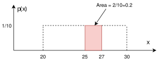



> "*It is remarkable that a science which began with the consideration of games of chance should have become the most important object of human knowledge...*"---Pierre-Simon Laplace, 1812


# Probability and Uncertainty {#sec-prob}

Probability deals with randomness and provides a language to communicate uncertainty, which is usually associated with our lack of knowledge or information. In the classical coin toss, for instance, if we knew the exact force applied, we could predict the outcome with certainty. However, practically it is never the case, and we treat coin toss outcome as random. 

Assigning probabilities to events is a challenging problem. Often, the probability will be applied to analyze the results of experiments (observed data). Consider the coin-tossing example. Say event $A$ represents a Head. Then, to empirically estimate the probability of event $A$, $P(A)$, we can repeat the tossing experiment $N$ times and count $n$, the number of times $A$ occurred.

```{r}
#| fig-cap: "Graph of the proportion of heads after $N$ trials."
#| echo: true

set.seed(89)
N <- 30
y <- rbinom(N, 1, 0.5)
plot(cumsum(y) / seq_along(y), type = "l",
     xlab = "Number of Trials", ylab = "Proportion of Heads", ylim = c(0, 1))
abline(h = 0.5, col = "red")
```
We can see that as $N$ grows, the curve converges to $0.5$. This is the law of large numbers. When $N$ is large, $n/N$ will be close to $P(A)$.  The probability as a limit definition is natural and was proposed by von Mises. 
$$
P(\text{Heads}) = \lim_{N \to \infty} \frac{n}{N}.
$$

However, this definition is not operational. It requires the notion of a collective, an infinite sequence of repeatable trials with random outcomes. This is an untestable assumption and was criticized by @ville1939etude. On the other hand, Kolmogorov tried to operationalize probability by proposing tests for randomness in his work on algorithmic complexity theory.

We can use a relaxed definition due to Bernoulli and define probability as simply the ratio of the number of heads to the total number of trials in a given experiment. This definition is operational and requires the experiment to be repeated under identical conditions, otherwise $P(A)$ will change as well.

An alternative operational definition of probability was proposed by Frank Ramsey [-@ramsey1926truth] and later refined by Bruno de Finetti [-@definetti1937foresight]. Rather than relying on long-run frequencies, this approach defines probability through the lens of rational betting behavior. The key insight is that your probability assignment for an event should correspond to the odds at which you would be willing to bet on that event.

de Finetti and Ramsey school of thought takes probability as subjective, namely personal to the observer. De Finetti famously concluded that *"Probability does not exist."* Measuring uncertainty is personal to the observer. It's not like mass which is a property of an object. If two different observers have differing "news," then there is an opportunity for them to bet (exchange contracts), thus leading to an assessment of probability.

For many events, most people will agree on their probabilities, for example, $P(\text{Heads}) = 0.5$. In the subjective view of probability, we can measure or elicit a personal probability as a "willingness to play". Namely, will you be willing to bet \$1 so you can get \$2 if the coin lands Tail and \$0 if Head occurs?  The subjective view of probability also leads to subjective expected utility theory. You cannot separate the two. For more details, see @sec-Decisions.

This book primarily adopts the Bayesian (subjective) interpretation of probability, formalized through coherence (the Dutch book principle here, and de Finetti's representation in @sec-bl). We still use frequentist language and long-run intuition as operational tools, but the organizing viewpoint is probabilistic modeling and belief updating.

Suppose you believe the probability of an event $A$ is $p$. According to Ramsey's definition, this means you should be indifferent between paying $p \cdot S$ dollars to receive $S$ dollars if event $A$ occurs (and nothing otherwise) and accepting $p \cdot S$ dollars to pay someone $S$ dollars if event $A$ occurs. However, not all probability assignments lead to rational behavior. Suppose someone assigns probabilities to events in an incoherent way. In that case, a clever adversary could construct a series of bets, called a *Dutch book*, where the individual is guaranteed to lose money regardless of which events occur. The requirement that probabilities must be assigned in such a way that no Dutch book can be constructed against you is known as *coherence*. For a detailed derivation of probability rules using Dutch Book arguments, see the [Appendix](#sec-dutch-book).

The principle of coherence for subjective probability is the fundamental rationality constraint, in finance, that would be called the no-arbitrage condition [@poincare1952science; @bachelier1900theorie].

Let us consider a simple example. Suppose you assign probability $P(A) = 0.7$ to event $A$ occurring and probability $P(\bar A) = 0.2$ to event $A$ not occurring, where $\bar A$ denotes the complement of $A$. A Dutch book can be constructed as follows:

- Bet 1: Accept $\$0.70$ to pay $\$1$ if $A$ occurs
- Bet 2: Accept $\$0.20$ to pay $\$1$ if $\bar A$ occurs

You collect $\$0.90$ in total, but you will pay out exactly $\$1$ regardless of whether $A$ or $\bar A$ occurs, for a guaranteed loss of $\$0.10$. The incoherence arises because $P(A) + P(\bar A) = 0.9 \neq 1$.

More generally, coherence implies that probabilities must satisfy the following basic properties:

1. *Non-negativity*: For any event $A$, we must have $P(A) \geq 0$
2. *Normalization*: For the certain event $\Omega$ (the sample space), we must have $P(\Omega) = 1$
3. *Additivity*: For mutually exclusive events $A$ and $B$ (i.e., $A \cap B = \emptyset$), we must have $P(A \cup B) = P(A) + P(B)$

To see why non-negativity must hold, suppose $P(A) = -0.1$ for some event $A$. According to the betting interpretation, you would accept $-\$0.10$ to pay $\$1$ if $A$ occurs, that is, you would pay $\$0.10$ up front and then pay $\$1$ if $A$ occurs. If $A$ does not occur, you are still out the $\$0.10$ and receive nothing, so you lose either way. This means you are offering to pay someone to take a bet on $A$, clearly irrational behavior. While standard probability theory requires non-negativity, extensions involving negative probabilities have been explored in fields like physics and quantum computing, as well as in Bayesian modeling as mixing distributions for unobserved latent variables [@polson2025negative].

The normalization requirement $P(\Omega) = 1$ ensures that you assign probability one to something that is certain to happen. If $P(\Omega) < 1$, you would be willing to accept less than $\$1$ to pay $\$1$ with certainty, allowing an arbitrageur to make a riskless profit. Conversely, if $P(\Omega) > 1$, you would pay more than $\$1$ for a certain payoff of $\$1$, guaranteeing a loss. 

The additivity axiom ensures consistency across mutually exclusive events. If $A$ and $B$ cannot both occur, then betting on "$A$ or $B$" should cost the same as placing separate bets on $A$ and on $B$. Violating this principle again opens the door to Dutch books.

Another axiom $P(A) + P(\bar A) = 1$ just follows from the normalization requirement and the additivity axiom.

These are, in their finitely additive form, the axioms proposed by Andrey Kolmogorov [-@kolmogorov1933grundbegriffe] in his foundational work on probability theory. Although Kolmogorov's axioms are agnostic to any definition of probability and are purely mathematical in nature, the fact that they can be derived from the Dutch book argument shows their applicability to rational decision-making under uncertainty. Any violation of these axioms opens you to guaranteed losses through carefully constructed bets. However, Kolmogorov's axiomatic approach helps us to derive results in more complex settings. For example, Kolmogorov's framework is applicable in infinite sample spaces and continuous random variables. This rests on his further requirement of countable additivity, $P(\bigcup_{i=1}^{\infty} A_i) = \sum_{i=1}^{\infty} P(A_i)$ for mutually exclusive events $A_1, A_2, \ldots$, which a Dutch book built from finitely many bets does not deliver.

The axioms provide a number of rules that probabilities must follow. Here are some important corollaries that follow from the Kolmogorov axioms:

<!-- https://www.york.ac.uk/depts/maths/histstat/kolmogorov_foundations.pdf -->

1.  *Complement rule*: Let "not $A$" denote the complement of event $A$.
$$
  P(\text{not } A) = 1- P(A).
$$
2.  *Monotonicity*: If $A\subset B$, then $P(A)\le P(B)$.
3.  *Subadditivity*: This is a generalization of the addition rule, where the equality holds when events $A$ and $B$ are mutually exclusive.
$$
    P(A \text{ or } B)\le P(A)+P(B). 
$$
4.  *Inclusion–exclusion principle*: This principle extends subadditivity to the case where $A$ and $B$ are not necessarily mutually exclusive.
$$
    P(A\text{ or } B)=P(A)+P(B)-P(A\text{ and }B). 
$$
5.  *Conditional probability*: The conditional probability of $A$ given $B$ is
$$ 
    P(A\mid B) = \dfrac{P(A \text{ and } B)}{P(B)}.
$$
6.  *Bayes' rule* simply reverses the conditioning to compute $P(A\mid B)$ from $P(B\mid A)$, a disciplined probability accounting.
$$ 
    P(A\mid B) = \dfrac{P(B\mid A)P(A)}{P(B)}.   
$$
7.  *Law of total probability* is a direct consequence of the definition of conditional probability and the normalization axiom. It states that if $B_1, B_2, \ldots, B_n$ are mutually exclusive and exhaustive events, then
$$
P(A) = \sum_{i=1}^n P(A \text{ and } B_i) = \sum_{i=1}^n P(A \mid B_i)P(B_i).
$$

All of these axioms follow simply from the principle of coherence and the avoidance of Dutch book arbitrage. This includes Bayes' rule itself [@definetti1937foresight; @shimony1955coherence]. If there is arbitrage present in the market, it should be "traded". It often happens when subjective probabilities do not match.

Bayes' rule is a fundamental rule of probability that allows us to calculate conditional probabilities. It is a direct consequence of the definition of conditional probability and the normalization axiom. This rule will become central to learning and inference in artificial intelligence.

Bayes' rule simply provides a disciplined probability accounting of how probabilities get updated in light of evidence. A rational agent requires that their subjective probabilities must obey the principle of coherence. Namely in announcing the set of probabilities, they cannot undergo a sure loss. This is enough to provide a similar framework to the axiomatic approach of Kolmogorov.

Arguably the most important rule is Bayes' rule for conditional probability.

The rise of artificial intelligence has renewed the prominence of Bayesian inference in modern learning algorithms. One of the key properties of probabilities is that they are updated as you learn new information. Conditional means given its personal characteristics or the personal situation. Personalization algorithms used by many online services rely on this concept. One can argue that all probabilities are conditional in some way. The process of Bayesian updating is central to how machines learn from observed data. Rational human behavior ought to adhere to Bayes' rule, although there is much literature documenting the contrary.

<!-- ## Bernoulli's Problem
Bernoulli considered the following problem. Suppose that we observe $m$ successes and $n$ failures of an event $A$, out of total $N=m+n$ trials. How do we assign a probability to the event $A$? A classic definition of the probability (due to Jacob Bernoulli) is the ratio of number of favorable outcomes $m$ to the total number of outcomes $N$, which is the sum of $m$ and the number of unfavorable outcomes $n$ 
$$
P_N = \dfrac{m}{m+n} = \dfrac{m}{N}.
$$

Moreover, can we construct a law of succession? What is the probability that the next trial will be a success, given that there are uncertainties in the underlying probabilities? @keynes1921treatise considered the rule of succession a.k.a. induction. For example, Bernoulli proposed that 
$$
P_{N+1} = \dfrac{m+1}{N+2}.
$$ 
@keynes1921treatise (p. 371) provided a fully Bayesian model based on what we know today as the Beta-Binomial model. @sec-bl provides a full analysis. The determination of the predictive rule is equivalent to the problem of finding a sufficient statistic (a.k.a. summary statistic) and performing feature engineering in modern day artificial intelligence applications.

de Finetti puts this in the framework of exchangeable random variables, see @kreps1988notes for further discussion. Jeffreys provides an alternative approach based on the principle of indifference. 
$$
P_{N+1} = \dfrac{m+1/2}{N+1}.
$$
Ramsey (1926) and de Finetti (1937) and Savage (1956) use a purely axiomatic approach in an effort to operationalize probability. In a famous quote de Finetti says "the probability does not exist." In this framework, probability is subjective and operationalized as a willingness to bet. If a gamble $A$ pays \$1 if it happens and \$0 otherwise, then the willingness to bet 50 cents to enter the gamble implies the subjective probability of $A$ is 0.5. Contrary to the frequentist approach, the probability is not a property of the event, but a property of the person. This is the basis for the Bayesian approach to probability. 

Leonard Jimmie Savage, an American statistician, developed a decision theory framework known as the "Savage axioms" or the "Sure-Thing Principle." This framework is a set of axioms that describe how a rational decision-maker should behave in the face of uncertainty. These axioms provide a foundation for subjective expected utility theory.

The Savage axioms consist of three main principles:

1.  *Completeness axiom.*
This axiom assumes that a decision-maker can compare and rank all possible outcomes or acts in terms of preferences. In other words, for any two acts (or lotteries), the decision-maker can express a preference for one over the other, or consider them equally preferable.

2.  *Transitivity axiom.*
This axiom states that if a decision-maker prefers act A to act B and prefers act B to act C, then they must also prefer act A to act C. It ensures that the preferences are consistent and do not lead to cycles or contradictions.

3.  *Continuity axiom (Archimedean axiom).*
The continuity axiom introduces the concept of continuity in preferences. It implies that if a decision-maker prefers act A to act B, and B to C, then there exists some probability at which the decision-maker is indifferent between A and a lottery that combines B and C. This axiom helps to ensure that preferences are not too "discontinuous" or erratic.

Savage's axioms provide a basis for the development of subjective expected utility theory. In this theory, decision-makers are assumed to assign subjective probabilities to different outcomes and evaluate acts based on the expected utility, which is a combination of the utility of outcomes and the subjective probabilities assigned to those outcomes.

Savage's framework has been influential in shaping the understanding of decision-making under uncertainty. It allows for a more flexible approach to decision theory that accommodates subjective beliefs and preferences. However, it's worth noting that different decision theorists may have alternative frameworks, and there are ongoing debates about the appropriateness of various assumptions in modeling decision-making.

Frequency probability is based on the idea that the probability of an event can be found by repeating the experiment many times and probability arises from some random process on the sample space (such as random selection). For example, if we toss a coin many times, the probability of getting a head is the number of heads divided by the total number of tosses. This is the basis for the frequentist approach to probability. -->


## Odds as Probabilities

Another way, sometimes more convenient, to talk about uncertainty and to express probabilities via odds, such as 9 to 2 or 3 to 1. Odds in favor express the ratio of favorable to unfavorable outcomes (Success:Failure), while probability is the chance of an event happening out of all possibilities (Success / Total).

We assign odds "on $A$" (or "in favor of $A$") versus odds "against $A$". For example, if the probability of a Chicago Bears' Super Bowl win is $P(A) = 2/11$, the odds against them are $(1 - 2/11) / (2/11) = 9/2$, or "9 to 2". This means for every 2 times they win, they lose 9 times. Conventionally, "odds on" often refers to the reverse, but to avoid ambiguity, we will speak of probability or odds against.
$$
O(A) = \dfrac{P(\bar A) }{P(A)} = \dfrac{1-P(A)}{P(A)}
$$
Equivalently, probabilities can be determined from odds
$$
P(A) = \dfrac{1}{1+O(A)}
$$
For example, if the odds are one $O(A) = 1$, then for every \$1 bet, you will pay out \$1. This event has a probability $0.5$.

If $O(A) = 2$, then you are willing to offer $2:1$. For a \$1 bet, you'll payback \$3. In terms of probability, $P(A) = 1/3$.

Odds are primarily used in betting markets. For example, let's re-analyze the 2016 election in the US. 

::: {#exm-odds}
## Odds
One of the main sources of prediction markets is bookmakers who take bets on outcomes of events (mostly sporting) at agreed-upon odds. @fig-odds shows the odds used by several bookmakers to take bets on the winner of the US presidential election in 2016. At that time, the market was predicting that Hillary Clinton would win over Donald Trump, the second favorite, with odds of 7/3. The table is generated by the Oddschecker website. 

{#fig-odds}

Ahead of time, we can assign probabilities of winning to each candidate. According to the bookmakers' odds, the candidate with the highest chance to win is Hillary Clinton. The best odds on Clinton are $1/3$; this means that you have to risk \$3 to win \$1 offered by Matchbook. Odds dynamically change as new information arrives. There is also competition between the Bookmakers and the Market is adapting to provide the best possible odds. Ladbrokes is the largest UK bookie, and Betfair is an online exchange. A bookmaker sets their odds trying to get equal public action on both sides, otherwise they are risking to stay out of business.
:::

::: {#exm-derby}
## Kentucky Derby

The Kentucky Derby happens once a year---the first Saturday in May. In horse racing, the odds are set by the betting public. The racetrack collects all the bets, takes a fee (18\%), and then redistributes the pool to the winning tickets. The race is $1 \frac{1}{4}$ miles (2 kilometers) and is the first time the three-year old horses have raced the distance.

There was a long period where favorites rarely won. Only six favorites have won in the 35 year period from 1979 to 2013. Recently, favorites have won many times in a row. The market is getting better at predicting who's going to win. Here's the data

| Horse Name         | Year | Odds  |
|--------------------|------|-------|
| Spectacular Bid    | 1979 | 3/5   |
| Fusaichi Pegasus   | 2000 | 2.3/1 |
| Street Sense       | 2007 | 9/2   |
| Big Brown          | 2008 | 5/2   |

Recently, favorites have had a lot more success		

| Horse Name         | Year | Odds  |
|--------------------|------|-------|
| California Chrome  | 2014 | 5/2   |
| American Pharoah   | 2015 | 2/1   |
| Nyquist            | 2016 | 3.3/1 |
| Always Dreaming    | 2017 | 5.2/1 |

The most famous favorite to win is Secretariat (1973), who won with odds of 3/2 in a record time of 1 minute 59 and 2/5 seconds. Monarchos was the only other horse that in 2001 had broken two minutes at odds of 11.5/1.
:::
::: {#exm-harville}
## Exacta Betting and the Harville Formula

How can probability help you with betting on the race? There are many different types of bets, and probability can help you find *fair* odds. The Derby is a Grade 1 stakes race for three-year-old thoroughbred horses. Colts and geldings carry 126 pounds, and fillies 121. The odds are set by pari-mutuel betting by the public. After all the wagers have been placed, the racetrack takes a fee (18%). After the winning horse passes the finishing line, the pool of money is redistributed to the winning tickets. Random betting therefore loses you 18%, so it's important to learn some empirical facts to try and tilt the odds in your favor.

For example, you can place bets as follows:

- *Win*: "$2 win horse 1"
- *Straight Exacta*: "$2 exacta 1 *with* 2"  
- *Exacta Box*: "$2 exacta box 1 *and* 2" You win with *either* order: 2 bets = $4.

Consider a hypothetical race where *Sovereignty* wins at 9/1 odds, and *Journalism* comes second at 7/2 odds. For a $2 bet on *Sovereignty* to Win at 9/1, the payout would be $\$2 \cdot 9 + 2 = \$20$ (the 9/1 win plus your initial $2 bet returned).

Let's figure out the *fair* value for an exacta bet given that you know the win odds. This is known as the *Harville formula*. The exacta is a widely used bet among horseplayers, corresponding to predicting the first two horses in the correct order.

We use the rule of conditional probability. The probability for the straight exacta of horse $A$ beating horse $B$ is:
$$
P(A \text{ beats } B) = P(A \text{ Wins}) \cdot P(B \text{ Second} \mid A \text{ Wins})
$$

A reasonable assessment of $P(B \text{ Second} \mid A \text{ Wins})$ can be derived as follows. Renormalizing the probabilities by removing the winner $A$ and distributing the probability mass to the remaining horses gives:
$$
P(B \text{ Second} \mid A \text{ Wins}) = \frac{P(B \text{ Wins})}{1 - P(A \text{ Wins})}
$$

In total, the fair price for the exacta is:
$$
P(A \text{ beats } B) = P(A \text{ Wins}) \cdot \frac{P(B \text{ Wins})}{1 - P(A \text{ Wins})}
$$

Therefore, we have:
$$
p_{12} = p_1 \cdot \frac{p_2}{1-p_1} \text{ where } p_1 = \frac{1}{1+O_1}, p_2 = \frac{1}{1+O_2}
$$

Solving for odds, we get the *Harville formula*:
$$
O_{12} = O_1(1 + O_2) - 1
$$

Using our example with 9/1 and 7/2 odds: $O_{12} = 9 \cdot (1 + 3.5) - 1 = 39.5/1$. 

The actual payout is determined solely by the volume of money wagered on that combination. There's no requirement that it matches our probabilistic analysis. However, the Harville formula gives us an idea of fair value. Some bettors searching for value try to find significantly undervalued exacta bets relative to the Harville formula.

There are many other factors to consider: jockey performance, bloodlines, and post positions can all matter significantly in determining the actual race outcome.
:::

::: {#exm-odds2}
## Boy-Girl Paradox
If a woman has two children and one is a girl, the chance that the other child is also female has to be $50-50$, right? But it's not. Let's list the possibilities of girl-girl, girl-boy and boy-girl. So the chance that both children are girls is 33 percent. Once we are told that one child is female, this extra information constrains the odds. (Even weirder, the author demonstrates that the odds change again if we're told that one of the girls is named Florida.) In terms of conditional probability, the four possible combinations are
$$
BB \; \; BG \; \; GB \; \; GG
$$
Conditional on the information that one is a girl means that you know we can't have the $BB$ scenario. Hence, we are left with three possibilities
$$
BG \; \; GB \; \; GG
$$
In one of these is the other, a girl. Hence $1/3$.

It's a different question if we say that the first child is a girl. Then the probability that the other is a girl is $1/2$, as there are two possibilities
$$
GB \; \; GG
$$
This leads to the probability of $1/2$.
:::

::: {#exm-galton}
## Galton Paradox

You flip three fair coins. What is the $P(\text{all} \; \text{alike})$? 

Assuming a fair coin (i.e., $P(H) = P(T) = 1/2$), a formal approach might consist of computing the probability for all heads or all tails, which is

\begin{align*}
P(HHH) &\equiv P(H \text{ and } H \text{ and } H) \\
&= P(H)\times P(H)\times P(H) = \left(\frac{1}{2}\right)^3
\end{align*}
and, since we're ultimately interested in the probability of either (mutually exclusive) case,
\begin{align*}
P(\text{all alike}) &= P(HHH \text{ or } TTT) \\
&= P(HHH) + P(TTT) = 2 \times \frac{1}{8}
\end{align*}

One could arrive at the same conclusion by enumerating the entire sample space and counting the events. Now, what about a simpler argument like the following. In a run of three coin flips, two coins will always share the same result, so the probability that the "remaining/last" coin matches the other two is 1/2; thus,
$$
P(\text{all alike}) = 1/2 
$$
There are 8 equally likely outcomes. Two are 'all alike' (HHH, TTT). So 2/8 = 1/4. The error in reasoning is assuming that 'two must correspond' fixes the first two coins, but 'two alike' could be coins 1&2, 2&3, or 1&3.

For a real treatment of the subject, we highly recommend reading Galton's essay at [galton.org](http://galton.org/essays/1890-1899/galton-1894-chances.pdf).

:::

::: {#exm-odds3}
## Three Cards
Suppose that you have three cards: one red/red, one red/blue, and one blue/blue. You randomly draw a card and place it face down on a table, and then you reveal the top side. You see that it's red. What's the probability the other side is red? $1/2$? No, it's $2/3$! By a similar logic, there are six initial possibilities
$$
B_1 B_2 \; \; B_2 B_1 \; \; B R \; \; R B \; \; R_1 R_2 \; \; R_2 R_1 
$$
where $1$ and $2$ index the sides of the same colored cards.

If we now condition on the top side being red, we see that there are still three possibilities left
$$
R B \; \; R_1 R_2 \; \; R_2 R_1 
$$
Hence, the probability is $2/3$ and not the intuitive $1/2$.
:::


::: {#exm-Patriots}
## NFL: New England Patriots Coin Toss
Let's consider another example and calculate the probability of winning 19 coin tosses out of 25. The NFL team New England Patriots won 19 out of 25 coin tosses in the 2014-15 season. What is the probability of this happening?

Let $X$ be a random variable equal to $1$ if the Patriots win and $0$ otherwise. It's reasonable to assume $P(X = 1) = \frac{1}{2}$. The probability of observing the sequence in which there is 1 on the first 19 positions, and 0 afterwards is $(1/2)^{25}$. We can code a typical sequence as, 
$$
1,1,1,\ldots,1,0,0,\ldots,0.
$$ 
There are $177{,}100$ different sequences of 25 games where the Patriots win 19. There are $25! = 1\cdot 2\cdot \ldots \cdot 25$ ways to re-arrange this sequence of zeroes and ones. Further, all zeroes and ones are interchangeable, and there are $19!$ ways to re-arrange the ones and $6!$ ways to rearrange the sequence of zeroes. Thus, the total number of different winning sequences is 

```{r}
#| echo: true
factorial(25) / (factorial(19) * factorial(25 - 19))
```

Each potential sequence has a probability $0.5^{25}$, thus
$$
P\left(\text{Patriots win 19 out of 25 tosses}\right) =  177{,}100 \times 0.5^{25} = 0.0053
$$

Often, it is easier to communicate uncertainties in the form of odds. In terms of betting odds of $1:1$ gives $P = \frac{1}{2}$, odds of $2:1$ (I give $2$ for each $1$ you bet) is $P = \frac{1}{3}$.

Remember, the odds against $A$, $O(A)$, is the ratio of the probability of not happening over happening, 
$$
O(A) = (1 - P(A))/P(A),
$$
equivalently, 
$$
P(A) = \frac{1}{1 + O(A)}.
$$

The odds against the Patriots winning the sequence are then about 188 to 1
```{r}
#| echo: true
p <- 177100 * 0.5^25
(1 - p) / p
```
:::

::: {#exm-Pete}
## Hitting Streak
Pete Rose of the Cincinnati Reds set a National League record by hitting safely in $44$ consecutive games. How likely is such a long sequence of safe hits to be observed? If you were a bookmaker, what odds would you offer on such an event? This means that he safely reached first base after hitting the ball into fair territory, without the benefit of an error or a fielder's choice at least once in every one of those 44 games. Here are a couple of facts we know about him:

1.  Rose was a $300$ hitter, he hit safely 3 times out of 10 attempts
2.  Each at bat is assumed to be independent, i.e., the current at bat doesn't affect the outcome of the next.

Assuming he comes to bat $4$ times each game, *what probability might reasonably be associated with that hitting streak?* First, we define notation. We use $A_i$ to denote an event of hitting safely at game $i$, then 
$$
\begin{aligned}
& P( \mathrm{Rose \; Hits \; Safely \; in \;44 \; consecutive \; games} ) = \\
& P ( A_1 \; \text{and} \;  A_2  \ldots \text{and} \;  A_{44} ) = P ( A_1 ) P ( A_2 ) \ldots P ( A_{44} )
\end{aligned}
$$ 
We now need to find $P(A_i)$s where $P(A_i) = 1 - P(\text{not} \; A_i)$ 
\begin{align*}
P ( A_1 ) & = 1 - P ( \mathrm{ not} \; A_1 ) \\
 & = 1 - P ( \mathrm{ Rose \; makes \; 4 \; outs } ) \\
 & = 1 - ( 0.7)^4 = 0.76
\end{align*} 
For the winning streak, then we have $(0.76)^{44} = 0.0000057$, a very low probability. In terms of odds, there are three basic inferences

1.  This means that the odds against a particular player as good as Pete Rose, starting a hitting streak today are 175,470 to 1.
2.  This doesn't mean that the run of $44$ won't be beaten by some player at some time: the Law of Very Large Numbers
3.  Joe DiMaggio's record is 56. He is a 325 hitter, thus we have $(0.792)^{56} = 2.13 \times 10^{-6}$ or 469,234 to 1. It's going to be hard to beat.

The independence assumption underlying this calculation does not account for the popular belief in the "hot hand", the idea that a player who has been successful recently is more likely to succeed again. 
:::

::: {#exm-Jeter}
## Derek Jeter

Sample averages can have paradoxical behavior. This is related to the field of causation and the property of confounding. Let's compare Derek Jeter's and David Justice's batting averages. In both 1995 and 1996, Justice had a higher batting average than Jeter did. However, when you combine the two seasons, Jeter shows a higher batting average than Justice! This is just a property of averages, and finer subset selection can change your average effects.

|               | 1995    |       | 1996    |       | Combined |       |
|---------------|---------|-------|---------|-------|----------|-------|
| Derek Jeter   | 12/48   | 0.250 | 183/582 | 0.314 | 195/630  | 0.310 |
| David Justice | 104/411 | 0.253 | 45/140  | 0.321 | 149/551  | 0.270 |

This situation is known as *confounding*. It occurs when two separate and different populations are aggregated to give misleading conclusions. The example shows that if $A,B,C$ are events, it is possible to have the three inequalities
\begin{align*}
&P( A \mid B \text{ and } C ) > P( A \mid B \text{ and } \bar C )\\
&P( A \mid \bar  B \text{ and } C ) > P( A \mid \bar  B \text{ and } \bar  C )\\
&P( A \mid C ) < P( A \mid \bar C )
\end{align*}
The three inequalities can't hold simultaneously when $P(B\mid C) = P(B\mid \bar  C)$.
:::

::: {#exm-birthday}
## Birthday Problem

The birthday problem [@diaconis1989methods] is a classic problem in probability theory that explores the counterintuitive likelihood of shared birthdays within a group. Surprisingly, in a room of 23 people, the probability of shared birthdays is 50%. With 70 people, the probability is 99.9%.

In general, given $N$ items (people) randomly distributed into $c$ categories (birthdays), where the number of items is small compared to the number of categories $N \ll c$, the probability of no match is given by 
$$
P(\text{no match}) \approx \exp\left(-N^2/2c\right).
$$ 
Given $A_i$ is the event that person $i$ has a matching birthday with someone, we have 
$$
P(\text{no match})  = \prod_{i=1}^{N-1}(1-P(A_i)) = \exp\left(\sum_{i=1}^{N-1}\log (1-P(A_i))\right).
$$ 
Here $P(A_i) =\dfrac{i}{c}$ Then use the approximation $\log(1-x) \approx -x$ for small $x$ to get $P(\text{no match})$. 
$$
\sum_{i=1}^{N-1}\log (1-P(A_i)) \approx -\sum_{i=1}^{N-1}\dfrac{i}{c} = -\dfrac{N(N-1)}{2c}.
$$

The probability of at least two people sharing a birthday is then the complement of the probability above: 
$$
P(\text{At least one shared birthday}) = 1 - P(\text{no match}).
$$ 
Solving for $P(\text{match})=1/2$ leads to a square root law $N=1.2\sqrt{c}$, if $c=365$ then $N=23$, and if $c=121$ (near birthday match), then $N=13$.

The unintuitive nature of this result is a consequence of the fact that there are many potential pairs of people in the group, and the probability of at least one pair sharing a birthday increases quickly as more people are added.
:::

## Random Variables: Quantifying Uncertainty
A random variable is a function that maps the outcomes of a random experiment (events) to real numbers. A random variable provides a bridge between the abstract concept of events in a sample space and the concrete calculations involving numerical values and probabilities. Similar to assigning probabilities to events, we can assign respective probabilities to random variables.

For example, consider a random experiment of rolling a die. Here, an event could be "the outcome is an even number", and the random variable could be the actual number that shows up on the die. The probability of the event "the outcome is an even number" is 0.5, and the probability distribution of the random variable is a list of all numbers from 1 to 6, each with a probability of 1/6.

Random variables are quantities that we are not certain about. A random variable that can take a finite or a countable number of values is called a *discrete random variable* (number of rainy days next week). Otherwise, it will be a *continuous random variable* (amount of rain tomorrow). 

Discrete random variables are often constructed by assigning specific values to events such as $\{X=x\}$, which corresponds to the outcomes where $X$ equals a specific number $x$. For example 

1.  Will a user click-through on a Google ad? (0 or 1)
2.  Who will win the next presidential election? (Republican=1, Democrat=2, Independent=3)

To fix notation, we will use $P(X=x)$ to denote the probability that random variable $X$ is equal to $x$. A map from all possible values $x$ of a discrete random variable $X$ to probabilities is called a *probability mass function* $p(x)$. We will interchangeably use $P(X=x)$ and $p(x)$. An important property of the probability mass function is that (normalization Kolmogorov axiom) 
$$
\sum_{x\in S} p(x) = 1.
$$ 
Here $S$ denotes the set of all possible values of random variable $X$.

Clearly, all probabilities have to be greater than or equal to zero, so that $p(x)\ge 0$. 

Often, we are interested in 
$$
F(x) = P(X\le x) = \sum_{y\le x} p(y),
$$ 
this is the cumulative distribution function (CDF).

The CDF is a monotonically increasing function (never decreases as $x$ increases). In other words, if $a \leq b$, then $F_X(a) \leq F_X(b)$. The value of the CDF always lies between 0 and 1, inclusive.


::: {#exm-dcdf}
## Discrete CDF

Suppose $X$ is a discrete random variable that represents the outcome of rolling a six-sided die. The probability mass function (PMF) of $X$ is:

$$
P(X = x) = \frac{1}{6}
$$ 
for $x = 1, 2, 3, 4, 5, 6$

The CDF of $X$, $F(x)$, is calculated as follows:

- For $x < 1$, $F(x) = 0$ (since it's impossible to roll less than 1).
- For $1 \leq x < 2$, $F(x) = \frac{1}{6}$ (the probability of rolling a 1).
- For $2 \leq x < 3$, $F(x) = \frac{1}{6} + \frac{1}{6} = \frac{2}{6}$ (the probability of rolling a 1 or 2).
- This pattern continues, adding $\frac{1}{6}$ for each integer interval up to 6.
- For $x \geq 6$, $F(x) = 1$ (since it's certain to roll a number 6 or less).

Graphically, the CDF of a discrete random variable is a step function that increases at the value of each possible outcome. It's flat between these outcomes because a discrete random variable can only take specific, distinct values.
```{r}
#| echo: true
#| fig-cap: CDF of a discrete random variable.
plot(ecdf(1:6), main = "", ylab = expression(F(x)))
```
:::

### Continuous Random Variables
If we want to build a probabilistic model of a stock price or return, we need to use a continuous random variable that can take an interval of values. Instead of a frequency function we will use a *density function*, $p(x)$ to describe a continuous variable. Unlike the discrete case, $p(x)$ is not the probability that the random variable takes value $x$. Rather, we need to talk about the value being inside an interval. For example, the probability of $X$ with density $p(x)$ being inside any interval $[a,b]$, with $a<b$ is given by
$$
P(a < X < b) = \int_{a}^{b}p(x)dx.
$$
The total probability is one as $\int_{-\infty}^\infty p(x) dx=1$. The simplest continuous random variable is the uniform. A uniform distribution describes a variable which takes on any value as likely as any other. For example, if you are asked about what would be the temperature in Chicago on July 4 of next year, you might say anywhere between 20 and 30 C. The density function of the corresponding uniform distribution is then
$$ 
  p(x) = \begin{cases} 1/10, ~~~20 \le x \le 30\\0, ~~~\mbox{otherwise}\end{cases}
$$

Under this model, the probability of temperature being between 25 and 27 degrees is
$$
P(25 \le x \le 27) = \int_{25}^{27} p(x)dx = (27-25)/10 = 0.2
$$

{width=60%}


The Cumulative Distribution Function for a continuous random variable, it is defined similarly to discrete RV CDF as
$$
F(x) = P(X \leq x) = \int_{-\infty}^x p(t)dt
$$
It is a non-decreasing function and takes values in [0,1].

::: {#exm-ccdf}
## Continuous CDF for Uniform Distribution

$$
p(x) = \begin{cases}
1 & \text{if } 0 \leq x \leq 1 \\
0 & \text{otherwise}
\end{cases}
$$

The CDF, $F(x)$, is obtained by integrating the PDF:

- For $x < 0$, $F(x) = 0$.
- For $0 \leq x \leq 1$, $F(x) = \int_0^x 1 \, dt = x$.
- For $x > 1$, $F(x) = 1$.

So, the CDF of this uniform distribution is a linear function that increases from 0 to 1 as $x$ goes from 0 to 1.


Graphically, the CDF of a continuous random variable is a smooth curve. It starts at 0, increases as $x$ increases, and eventually reaches 1. Figure below shows the CDF of a uniform and normal random variable, respectively.
```{r}
#| echo: true
#| layout-ncol: 2
#| fig-width: 2.6
#| fig-height: 1.8
#| fig-cap:
#|   - "CDF of a uniform random variable"
#|   - "CDF of a normal random variable"

set.seed(33) # Patrick Roy
plot(ecdf(runif(500)), main = "", ylab = expression(F[n](x)), col = "lightblue", pch = 21, bg = "grey")
plot(ecdf(rnorm(500)), main = "", ylab = expression(F[n](x)), col = "lightblue", pch = 21, bg = "grey")
```
:::

### The Inverse CDF Method
The inverse distribution method uses samples of uniform random variables to generate draws from random variables with a continuous distribution function, $F$. Since $F\left(  x\right)$ is uniformly distributed on $\left[ 0,1\right]$, draw a uniform random variable and invert the CDF to get a draw from $F$. Thus, to sample from $F$,
\begin{align*}
&  \text{Step 1}\text{: Draw }U\sim U\left[  0,1\right]  \ \\
&  \text{Step 2}\text{: }\text{Set }X=F^{-1}\left(  U\right)  ,
\end{align*}
where $F^{-1}\left(  U\right)  =\inf\left\{  x:F\left(  x\right)  =U\right\}$.

This inversion method provides i.i.d. draws from $F$ provided that $F^{-1}\left(  U\right)$ can be exactly calculated. For example, the CDF of an exponential random variable with parameter $\mu$ is $F\left(  x\right) =1-\exp\left(  -\mu x\right)$, which can easily be inverted. When $F^{-1}$ cannot be analytically calculated, approximate inversions can be used. For example, suppose that the density is a known analytical function. Then, $F\left(  x\right)$ can be computed to an arbitrary degree of accuracy on a grid, and inversions can be approximately calculated, generating an approximate draw from $F$. With all approximations, there is a natural trade-off between computational speed and accuracy. One example where efficient approximations are possible are inversions involving normal distributions, which is useful for generating truncated normal random variables. Outside of these limited cases, the inverse transform method does not provide a computationally attractive approach for drawing random variables from a given distribution function. In particular, it does not work well in multiple dimensions.

### Functional Transformations
The second main method uses functional transformations to express the distribution of a random variable that is a known function of another random variable. Suppose that $X\sim F$, admitting a density $f$, and that $y=h\left(  x\right)$ is an increasing continuous function. Thus, we can define $x=h^{-1}\left(  y\right)$ as the inverse of the function $h$. The distribution of $y$ is given by
$$
F_Y\left(y\right)  =P\left(  Y\leq y\right)  =\int_{-\infty}^{h^{-1}\left(  y\right)  }f\left(  x\right)  dx=F_X\left(  X\leq h^{-1}\left(y\right)  \right).
$$
Differentiating with respect to $y$ gives the density via Leibnitz's rule:
$$
f_{Y}\left(  y\right)  =f\left(  h^{-1}\left(  y\right)  \right)  \left\vert\frac{d}{dy}\left(  h^{-1}\left(  y\right)  \right)  \right\vert,
$$
where we make explicit that the density is over the random variable $Y$. This result is used widely. For example, if $X\sim\mathcal{N}\left(  0,1\right)$, then $Y=\mu+\sigma X$. Since $x=h^{-1}\left(  y\right)  =\frac{y-\mu}{\sigma}$, the distribution function is $F\left(  \frac{y-\mu}{\sigma}\right)$ and density
$$
f_{Y}\left(  y\right)  =\frac{1}{\sqrt{2\pi}\sigma}\exp\left(  -\frac{1}{2}\left(  \frac{y-\mu}{\sigma}\right)  ^{2}\right).
$$
Transformations are widely used to simulate both univariate and multivariate random variables. As examples, if $Y\sim\chi^{2}\left(  \nu\right)$ and $\nu$ is an integer, then $Y=\sum_{i=1}^{\nu}X_{i}^{2}$ where each $X_{i}$ is an independent standard normal. Exponential random variables can be used to simulate $\chi^{2}$, Gamma, Beta, and Poisson random variables. The famous Box-Muller algorithm simulates normals from uniform and exponential random variables. In the multivariate setting, Wishart (and inverse Wishart) random variables can be simulated via sums of squared vectors of standard normal random variables.


## Expectation and Variance (Reward and Risk)
An expected value of a random variable, denoted by $\E{X}$ is a weighted average. Each possible value of a random variable is weighted by its probability. For example, Google Maps uses expected value when calculating travel times. We might compute two different routes by their expected travel time. Typically, a forecast or expected value is all that is required; these expected values can be updated in real time as we travel. Say I am interested in the travel time from Washington National Airport to Fairfax, Virginia. The histogram below shows the travel times observed for a work day evening and were obtained from [Uber](https://movement.uber.com/). 

::: {#exm-Uber}
## Uber
Let's look at the histogram of travel times from Fairfax, VA to Washington, DC
```{r} 
#| fig-cap: "Travel times in the evening."
d <- read.csv("data/dc_travel_time.csv")
# use evening travel times (column 18) and convert from seconds to minutes
evening_tt <- d[, 18] / 60
day_tt <- d[, 15] / 60
evening_tt <- evening_tt[!is.na(evening_tt)] # remove missing observations
hist(evening_tt, freq = F, main = "", xlab = "Travel Time [min]", nclass = 20, col = "lightblue")
```

From this dataset, we can empirically estimate the probabilities of observing different values of travel times
```{r ex-travel}
bins <- hist(evening_tt, breaks = 3, plot = F)
knitr::kable(data.frame("tt" = bins$mids, "Probability" = bins$counts / length(evening_tt)), col.names = c("Travel Time", "Probability"), digits = c(1, 2), format.args = list(digits = 3))
```

There is a small chance (5%) I can get to Washington, DC in 17.5 minutes, which probably happens on a holiday, and a non-trivial chance (18%) to travel for 27.5 minutes, possibly due to a sports game or bad weather. Most of the time (77%), our travel time is 22.5 minutes. However, when Uber shows you the travel time, it uses the expected value as a forecast rather than the full distribution. Specifically, you will be given an expected travel time of 23 minutes. 
```{r}
#| echo: true
0.05 * 17.5 + 0.77 * 22.5 + 0.18 * 27.5
```

It is a simple summary that takes into account travel accidents and other events that can affect travel time as best as it can.
:::

The expected value $\E{X}$ of a discrete random variable $X$ which takes possible values $\{x_1,\ldots x_n\}$ is calculated using

$$
\E{X} =\sum_{i=1}^{n}x_i P(X = x_i)
$$

For example, in a binary scenario, if $X\in \{0,1\}$ and $P(X=1)=p$, then $\E{X} = 0\times(1-p)+1\times p = p$. The expected value of a Bernoulli random variable is simply the probability of success. In many binary scenarios, a probabilistic forecast is sufficient. 

If $X$ is continuous with probability distribution $p(x)$, then we have to calculate the expectation as an integral
$$
\E{X} = \int xp(x)d x  \text{ and } \int p(x)dx = 1.
$$ 

### Standard Deviation and Covariance
Variance measures the spread of a random variable around its expected value $\mu = \E{X}$. For a discrete random variable $X$ with possible values $\{x_1,\ldots x_N\}$, we have
$$
\Var{X} = \E{(X-\mu)^2} =  \sum_{i=1}^N (x_i-\mu)^2 P(X=x_i).
$$
In the continuous case, we have
$$
\Var{X} = \int_{-\infty}^\infty (x-\mu) ^2 p(x)dx,\text{ where } \mu = \E{X}=\int_{-\infty}^{\infty}x\, p_X(x)dx.
$$

The standard deviation is more convenient and is the square root of variance $\sd{X} = \sqrt{\Var{X}}$.
Standard deviation has the desirable property that it is measured in the same units as the random variable $X$ itself.

Suppose that we have two random variables $X$ and $Y$. We need to measure whether they move together or in opposite directions. The *covariance* is defined by
$$
\Cov{X,Y} = \E{\left[ (X- \E{X})(Y- \E{Y})\right]}.
$$

When $X$ and $Y$ are discrete, and we are given the joint probability distribution, we need to calculate
$$
\Cov{X,Y} = \sum_{x,y}  ( x - \E{X} )(y - \E{Y})p(x,y).
$$
Covariance is measured in units of $X\times$units of $Y$. This can be inconvenient and makes it hard to compare covariances of different pairs of variables. A more convenient metric is the *correlation*, which is defined by
$$
\Cor{X,Y}= \frac{ \Cov{X,Y} }{ \sd{X} \sd{Y} }.
$$
Correlation, $\Cor{X,Y}$, is unitless and takes values between -1 and 1.

In the case of joint continuous distribution, it is convenient to use the covariance matrix $\Sigma$ which is defined as
$$
\Sigma = \begin{bmatrix}
\Var{X} & \Cov{X,Y} \\
\Cov{X,Y} & \Var{Y}
\end{bmatrix}.
$$
If $X$ and $Y$ are independent, then $\Cov{X,Y} = 0$ and $\Sigma$ is diagonal. The correlation matrix is defined as
$$
\rho = \begin{bmatrix}
1 & \Cor{X,Y} \\
\Cor{X,Y} & 1
\end{bmatrix}.
$$
If $X$ and $Y$ have an exact linear relationship, then $\Cor{X,Y} = 1$ and $\Cov{X,Y}$ is the product of standard deviations. In matrix notation, the relation between the covariance matrix and correlation matrix is given by
$$
\rho = \mathrm{diag}\left(\Sigma\right)^{-1/2} \Sigma\mathrm{diag}\left(\Sigma\right)^{-1/2},
$$
where $\mathrm{diag}\left(\Sigma\right)$ is the diagonal matrix formed from the diagonal (variance) entries of $\Sigma$, so that $\mathrm{diag}\left(\Sigma\right)^{-1/2}$ carries the reciprocal standard deviations on its diagonal.


### Portfolios: Linear Combinations
Calculating means and standard deviations of combinations of random variables is a central tool in probability. It is known as the portfolio problem. Let $P$ be your portfolio, which comprises a mix of two assets $X$ and $Y$, typically stocks and bonds,
$$
P = aX + bY,
$$
where $a$ and $b$ are the portfolio weights, typically $a+b=1$, as we are allocating our total capital. Imagine that you have placed $a$ dollars on the random outcome $X$, and $b$ dollars on $Y$. The portfolio $P$ measures your total weighted outcome.

Key portfolio rules: The expected value and variance follow the relations
\begin{align*} 
\E{aX + bY} = &      a\E{X}+b\E{Y}\\
\Var{ aX + bY }  = & a^2 \Var{X} + b^2 \Var{Y} + 2 ab \Cov{X,Y },
\end{align*} 
with *covariance* defined by
$$
\Cov{X,Y} = \E{ ( X- \E{X} )(Y- \E{Y})}.
$$
Expectation and variance help us to understand the long-run behavior. When we make long-term decisions, we need to use the expectations to avoid biases.

The covariance is related to the correlation by $\Cov{X,Y} = \Cor{X,Y} \sqrt{\Var{X}\,\Var{Y}}$.

::: {#exm-Tortoise}
## Tortoise and Hare

Tortoise and Hare are selling cars. Say $X$ is the number of cars sold, and probability distributions, means, and variances are given by the following table


            $X$                      Mean     Variance           sd
---------- ----- ----- ----- ----- --------- ----------- ------------------
             0     1     2     3    $\E{X}$   $\Var{X}$   $\sqrt{\Var{X}}$
 Tortoise    0    0.5   0.5    0      1.5       0.25            0.5
   Hare     0.5    0     0    0.5     1.5       2.25            1.5

Let's calculate Tortoise's expectations and variances
\begin{align*} 
\E{T} & = (1/2) (1) + (1/2)(2) = 1.5 \\
\Var{T} & = \E{T^2} - \E{T}^2 \\ 
& =  (1/2)(1)^2 + (1/2)(2)^2 - (1.5)^2 = 0.25 
\end{align*} 

Now the Hare's 
\begin{align*} 
\E{H} & = (1/2)(0) + (1/2)(3) = 1.5 \\ 
\Var{H} & =  (1/2)(0)^2 + (1/2)(3)^2- (1.5)^2 = 2.25 
\end{align*} 

What do these tell us about the long-run behavior?

1.  Tortoise and Hare have the same expected number of cars sold.

2.  Tortoise is more predictable than Hare. He has a smaller variance.

The standard deviations $\sqrt{\Var{X}}$ are $0.5$ and $1.5$, respectively. Given two equal means, you always want to pick the lower variance. If we are to invest in one of those, we prefer Tortoise.

What about a portfolio of Tortoise and Hare? Suppose I want to evenly split my investment between Tortoise and Hare. What is the expected number of cars sold and the variance of the number of cars sold?
$$
\E{\frac{1}{2}T + \frac{1}{2}H} = \frac{1}{2} \E{T} + \frac{1}{2} \E{H} = 1.5
$$
For variance, we need to know $\Cov{T,H}$. The standard deviations $0.5$ and $1.5$ cap the covariance at $|\Cov{T,H}| \le 0.5 \times 1.5 = 0.75$, so let's take the most negative value possible, $\Cov{T,H} = -0.75$ (perfect negative correlation), and see what happens.
$$
\begin{aligned}
\Var{\frac{1}{2}T + \frac{1}{2}H} &= \frac{1}{4} \Var{T} + \frac{1}{4} \Var{H} + \frac{1}{2} \Cov{T,H} \\
&= 0.0625 + 0.5625 - 0.375 = 0.25
\end{aligned}
$$

Notice that the portfolio variance (0.25) equals Tortoise's own variance and is far below Hare's (2.25), even though the two assets share the same expected return. This demonstrates the power of diversification: by combining investments with negative covariance, we can reduce overall risk while maintaining the same expected return. The negative covariance indicates that when Tortoise performs well, Hare tends to perform poorly, and vice versa, creating a natural hedge. Tilting the weights toward the steadier asset would lower the variance further still.

:::

## Limiting Behavior of Averages

The Tortoise and Hare example illustrates how expectations and variances behave for a single period or a fixed portfolio. However, in many real-world applications, from insurance to machine learning, we are interested in what happens when we repeat an experiment many times. Does the average outcome settle down to a predictable value?

When we observe a stochastic process repeatedly, we naturally ask: what happens to averages as we collect more data? The answer is provided by the *law of large numbers*, a central result in probability theory.

### The Weak Law of Large Numbers

The weak law of large numbers, in its simplest form, states that sample averages converge in probability to the expected value. We assume that observation $x_1, x_2, \ldots, x_n$ are draws (realizations) of independent identically distributed (i.i.d.) random variables $X_1, X_2, \ldots, X_n$ with finite mean $\mu = \E{X_i}$. Then the sample average $\bar{X}_n = \frac{1}{n}\sum_{i=1}^n X_i$ satisfies:
$$
\lim_{n \to \infty} P\left(\left|\bar{X}_n - \mu\right| > \epsilon\right) = 0,
$$
for any $\epsilon > 0$. This form of convergence, known as *convergence in probability*, means that for large enough $n$, the probability that the sample average deviates from the true mean by more than any fixed amount becomes arbitrarily small.

The proof of this result, when the variance $\sigma^2 = \Var{X_i}$ exists and is finite, follows elegantly from Chebyshev's inequality. Since $\E{\bar{X}_n} = \mu$ and $\Var{\bar{X}_n} = \sigma^2/n$, we have:

$$
P\left(\left|\bar{X}_n - \mu\right| > \epsilon\right) \leq \frac{\Var{\bar{X}_n}}{\epsilon^2} = \frac{\sigma^2}{n\epsilon^2} \to 0
$$

as $n \to \infty$. This simple argument reveals why averages become more reliable as sample sizes grow: the variance of the sample mean shrinks at a rate $1/n$.

This $1/n$ scaling reappears throughout the book, from confidence intervals and A/B testing (@sec-abtesting) to the role of sample size in estimation risk and generalization.

### Kolmogorov's Strong Law of Large Numbers

While the weak law establishes convergence in probability, a stronger form of convergence is possible. The *strong law of large numbers* states that sample averages converge *almost surely* (with probability one) to the expected value. This means that for almost every realization of the sequence, the sample average actually approaches the true mean, not merely that the probability of large deviations vanishes.

Andrey Kolmogorov formalized this result in his 1933 monograph *Foundations of the Theory of Probability* [@kolmogorov1933grundbegriffe], establishing the conditions under which strong convergence holds. His result placed probability on a rigorous measure-theoretic foundation.

*Kolmogorov's Strong Law* states that if $X_1, X_2, \ldots$ are independent random variables (not necessarily identically distributed) with finite variances satisfying Kolmogorov's condition $\sum_{i=1}^{\infty} \Var{X_i}/i^2 < \infty$, then:

$$
\bar{X}_n = \frac{1}{n}\sum_{i=1}^n X_i \to \mu \quad \text{almost surely}
$$

where $\mu = \lim_{n \to \infty} \frac{1}{n}\sum_{i=1}^n \E{X_i}$, provided this limit exists. For i.i.d. random variables the variance condition is not needed: a finite mean $\E{|X_1|} < \infty$ alone gives $\bar{X}_n \to \mu$ almost surely, with $\mu = \E{X_1}$.

The distinction between convergence in probability and almost sure convergence is subtle but crucial. Convergence in probability allows for infinitely many large deviations, as long as they become increasingly rare. Almost sure convergence is stronger: it requires that eventually, after some finite (but random) time, all deviations remain small forever.

Formally, almost sure convergence means:

$$
P\left(\lim_{n \to \infty} \bar{X}_n = \mu\right) = 1
$$

This is equivalent to saying that the set of sequences for which the limit fails to equal $\mu$ has probability zero. For practical purposes, this means we can be confident that the specific sequence we observe will exhibit convergence, not merely that convergence is likely.

The independence assumption is central to Kolmogorov's results, but it can be relaxed in various ways for different applications. For stochastic processes with dependent observations, the key question becomes: how much dependence can we tolerate while still obtaining convergence of averages?

For *stationary processes*, where the joint distribution of $(X_t, X_{t+1}, \ldots, X_{t+k})$ does not depend on $t$, a law of large numbers holds under considerably weaker conditions than independence. If the process is *ergodic* (roughly, if it eventually "forgets" its initial conditions), then time averages converge to ensemble averages:

$$
\frac{1}{n}\sum_{i=1}^n X_i \to \mu \quad \text{almost surely}
$$

This *ergodic theorem* extends Kolmogorov's law of large numbers to dependent sequences and is central to statistical inference from time series data. It justifies the common practice of estimating population means from a single long realization of a stochastic process.

Every time we estimate a population mean from a sample, test a hypothesis, or train a machine learning model, we implicitly rely on the law of large numbers. The confidence we place in larger samples, the use of cross-validation to assess model performance, and the convergence of stochastic gradient descent in deep learning all trace back to this fundamental result.

In the context of stochastic processes, the law of large numbers justifies estimating process parameters from a single long trajectory. When modeling financial returns, climate data, or network traffic, we typically observe one realization over time rather than multiple independent realizations. The ergodic theorem ensures that time averages from this single path converge to the true population moments, enabling inference from the data we actually have.

The Kolmogorov's formalization is the culmination of several decades of work on the foundations of probability theory. The weak law of large numbers was first proved by Jakob Bernoulli in 1713 for the special case of binomial random variables, an achievement that took him over twenty years. The result was later generalized by Poisson (1837) and Chebyshev (1867) to broader classes of random variables.

The strong law required deeper mathematical machinery. Émile Borel proved a version for Bernoulli trials in 1909, but the general result awaited the development of measure-theoretic probability. Francesco Cantelli made progress in the 1910s, but it was Kolmogorov who provided the definitive treatment in 1933, unifying diverse results under a single rigorous framework.

Kolmogorov's work transformed probability theory from a collection of special cases and heuristics into a branch of mathematics with the same rigor as analysis or algebra. His measure-theoretic foundations enabled precise statements about almost sure convergence, clarified the distinction between different modes of convergence, and opened the door to modern probability theory and stochastic processes.

The law of large numbers underpins Bayesian inference and computational statistics. For applications to posterior consistency, Monte Carlo simulation, and Markov chain Monte Carlo (MCMC) methods, see @sec-computational-bridge in Chapter 3.


## Binomial, Poisson, and Normal Distributions
### Bernoulli Distribution
The formal model of a coin toss was described by Bernoulli. He modeled the notion of *probability* for a coin toss, now known as the Bernoulli distribution, where $X \in \{0,1\}$ and $P(X=1)=p, P(X=0) = 1-p$. Laplace gave us the *principle of insufficient reason*: where you would list out the possibilities and then place equal probability on each of the outcomes. Essentially, the discrete uniform distribution on the set of possible outcomes.

A Bernoulli trial relates to an experiment with the following conditions

1.  The result of each trial is either a success or a failure.
2.  The probability $p$ of a success is the same for all trials.
3.  The trials are assumed to be *independent*.

The Bernoulli random variable can take on one of two possible outcomes, typically labeled as "success" and "failure." It is named after the Swiss mathematician Jacob Bernoulli, who introduced it in the 18th century. The distribution is often denoted by $\text{Bernoulli}(p)$, where $p$ is the probability of success.

The probability mass function (PMF) of a Bernoulli distribution is defined as follows: 
$$ 
P(X = x) = \begin{cases} 
p & \text{if } x = 1 \\
1 - p & \text{if } x = 0 
\end{cases} 
$$ 
The expected value (mean) of a Bernoulli distributed random variable $X$ is given by:
$$\E{X} = p
$$
Simply speaking, if you are to toss a coin many times, you expect $p$ heads.

The variance of $X$ is given by:
$$ 
\Var{X} = p(1-p)
$$

::: {#exm-cointoss}
## Coin Toss
The quintessential random variable is an outcome of a coin toss. The set of all possible outcomes, known as the sample space, is $S = \{H,T\}$, and $P(X = H) = P(X = T) = 1/2$. On the other hand, a single outcome can be an element of many different events. For example, there are four possible outcomes of two coin tosses, HH, TT, HT, and TH, which are equally likely with probabilities of 1/4. The probability mass function over the number of heads $X$ out of two coin tosses is

| $x$ | 0 | 1 | 2 |
| :-: | :-: | :-: | :-: |
| $p(x)$ | 1/4 | 1/2 | 1/4 |

Given the probability mass function, we can, for example, calculate the probability of at least one head as $P(X \geq 1) = P(X =1) + P(X =2) = p(1)+p(2) = 3/4$.
:::

The Bernoulli distribution serves as the foundation for more complex distributions, such as the binomial distribution (which models the number of successes in a fixed number of independent Bernoulli trials) and the geometric distribution (which models the number of trials needed to achieve the first success). A Binomial distribution arises from a sequence of Bernoulli trials, and assigns probability to $X$, which is the number of successes. Its probability distribution is calculated via: 
$$
P(X=x) = {n \choose x} p^x(1-p)^{n-x}.
$$ 
Here ${n \choose x}$ is the combinatorial function, 
$$
{n \choose x} = \frac{n!}{x!(n-x)!},
$$ 
Here the combinatorial function ${n \choose x}$ counts the number of ways of getting $x$ successes in $n$ trials and $n!=n(n-1)(n-2)\ldots 2 \cdot 1$ counts the number of permutations of $n$ observations without replacement.

Plot below shows the probability mass function of a Binomial distribution with $n = 20$ and $p = 0.3$.

```{r}
#| fig-cap: "Probability Mass Function of a Binomial Distribution (n = 20, p = 0.3)."
#| echo: true
barplot(dbinom(0:20, size = 20, prob = 0.3),
  names.arg = 0:20, col = "lightblue", ylim = c(0, 0.2),
  xlab = "Number of Heads", ylab = "Probability"
)
```


The table below shows the expected value and variance of a Binomial random variable. Those quantities can be calculated by plugging in the possible outcomes and corresponding probabilities into the definitions of expected value and variance.

| Binomial Distribution |              Parameters              |
| :-------------------: | :----------------------------------: |
|    Expected value     |         $\mu = \E{X} = n p$          |
|       Variance        | $\sigma^2 = \Var{X} = n p ( 1 - p )$ |

: Mean and Variance of Binomial.

For large sample sizes $n$, this distribution is approximately normal with mean $np$ and variance of $np(1-p)$.


Let $X$ be the number of heads in three flips. Each possible outcome ("realization") of $X$ is an *event*. Now, consider the event of getting only two heads 
$$
\{ X= 2\} = \{ HHT, HTH, THH \} ,
$$ 
The probability distribution of $X$ is Binomial with parameters $n = 3, p= 1/2$, where $n$ denotes the sample size (a.k.a. number of trials) and $p$ is the probability of heads; we have a fair coin. The notation is $X \sim \mathrm{Bin} \left ( n = 3 , p = \frac{1}{2} \right )$ where the sign $\sim$ is read as *distributed as*.

| Result | $X$ |   $P(X=x)$ |
| :----: | :-: | -------------: |
|  HHH   |  3  |          $p^3$ |
|  HHT   |  2  |  $p^2 ( 1- p)$ |
|  HTH   |  2  | $p^2 ( 1 - p)$ |
|  THH   |  2  |     $(1-p)p^2$ |
|  HTT   |  1  |    $p( 1-p)^2$ |
|  THT   |  1  |   $p ( 1-p)^2$ |
|  TTH   |  1  |    $(1-p)^2 p$ |
|  TTT   |  0  |      $(1-p)^3$ |

: Outcomes of three coin flips.

### Poisson Distribution
The Poisson distribution is a discrete probability distribution that expresses the probability of a given number of events occurring in a fixed interval of time or space if these events occur with a known constant mean rate and independently of the time since the last event. You can think of Poisson distribution as a limiting case of the Binomial distribution when the number of trials $n$ is large and the probability of success $p$ is small, such that $np = \lambda$ remains constant. Think of a soccer game where the goal is the "successful" event of interest. The soccer team does not have a predefined number of attempts to score a goal. Rather, they continuously try to score a goal until they do. The number of goals scored in a game is the number of events occurring in a fixed interval of time. The mean number of goals scored in a game is the mean rate of events occurring in a fixed interval of time. 

There are many examples of Poisson distributed random variables. For example, the number of phone calls received by a call center per hour, the number of emails received per day, the number of customers arriving at a store per hour, the number of defects in a manufactured product, the number of accidents on a highway per month.

A random variable $X$ follows a Poisson distribution with parameter $\lambda > 0$ if its probability mass function is given by:
$$
P(X = k) = \frac{\lambda^k e^{-\lambda}}{k!}
$$
for $k = 0, 1, 2, 3, \ldots$, where $\lambda$ is both the mean and variance of the distribution.

Plot below shows the probability mass function of a Poisson distribution with $\lambda = 1, 5, 10$.

```{r}
#| fig-cap: "Probability Mass Function of a Poisson Distribution."
# Create x values
x <- 0:20

# Plot the first distribution
plot(x, dpois(x, lambda = 1),
  type = "b", col = "blue", lwd = 2, lty = 1, pch = 16,
  xlab = "Number of Events", ylab = "Probability",
  main = "Poisson Distribution for Different Lambda Values",
  ylim = c(0, 0.4)
)

# Add the other distributions
lines(x, dpois(x, lambda = 5), col = "red", lwd = 2, lty = 2, pch = 17, type = "b")
lines(x, dpois(x, lambda = 10), col = "darkgreen", lwd = 2, lty = 3, pch = 15, type = "b")

# Add legend
legend("topright",
  legend = expression(lambda == 1, lambda == 5, lambda == 10),
  col = c("blue", "red", "darkgreen"), lwd = 2, lty = 1:3, pch = c(16, 17, 15), bty = "n", cex = 0.8
)
```


We write $X \sim \text{Poisson}(\lambda)$ to denote that $X$ follows a Poisson distribution with parameter $\lambda$.

| Poisson Distribution |        Parameters        |
| :------------------: | :----------------------: |
|   Expected value     |   $\mu = \E{X} = \lambda$   |
|      Variance        | $\sigma^2 = \Var{X} = \lambda$ |

: Mean and Variance of Poisson.

::: {#exm-poisson}
## Customer Arrivals

Suppose customers arrive at a coffee shop at an average rate of 3 customers per hour. What is the probability that exactly 5 customers will arrive in the next hour?

Using the Poisson distribution with $\lambda = 3$:
$$
P(X = 5) = \frac{3^5 e^{-3}}{5!} = \frac{243 \times e^{-3}}{120} \approx 0.101
$$

So there is approximately a 10.1% chance that exactly 5 customers will arrive in the next hour.
:::

The Poisson distribution can be derived as a limiting case of the binomial distribution when $n$ is large and $p$ is small, such that $np = \lambda$ remains constant. This connection makes the Poisson distribution particularly useful for modeling rare events in large populations.

### Normal Distribution
The Normal distribution is a continuous probability distribution that is widely used in statistics and probability theory. It is also known as the Gaussian distribution or the bell curve. The Normal distribution is characterized by its symmetric bell-shaped curve and is defined by two parameters: the mean ($\mu$) and the variance ($\sigma^2$).

The probability density function (PDF) of the Normal distribution is given by:
$$
f(x) = \frac{1}{\sigma \sqrt{2\pi}} e^{-\frac{(x-\mu)^2}{2\sigma^2}}
$$
for $-\infty < x < \infty$, where $\mu$ is the mean and $\sigma$ is the standard deviation.

The Normal distribution is often used to model real-world phenomena such as measurement errors, heights, weights, and scores on standardized tests. It is also used in hypothesis testing and confidence interval construction. 

::: {#exm-normal}
## Heights of Adults

The heights of adult males in a certain population are normally distributed with a mean of 70 inches and a standard deviation of 3 inches. 

a) What is the probability that a randomly selected male is between 67 and 73 inches tall?

Using the Normal distribution with $\mu = 70$ and $\sigma = 3$:

```{r}
#| fig-cap: "Normal Distribution (mu = 70, sigma = 3) with Highlighted Area."
#| label: fig-normal-height

# Define parameters
mu <- 70
sigma <- 3

# Create x values for the curve
x <- seq(mu - 4 * sigma, mu + 4 * sigma, length.out = 1000)
y <- dnorm(x, mean = mu, sd = sigma)

# Plot the normal curve
plot(x, y,
  type = "l", lwd = 2, col = "blue", ylim = c(0, 0.16),
  xlab = "Height (inches)", ylab = "Density", main = ""
)

# Add vertical lines at 67 and 73, ending at the curve
segments(c(67, 73), 0, c(67, 73), dnorm(c(67, 73), mean = mu, sd = sigma), col = "red", lty = 2, lwd = 2)

# Highlight the area between 67 and 73
x_area <- seq(67, 73, length.out = 100)
y_area <- dnorm(x_area, mean = mu, sd = sigma)
polygon(c(67, x_area, 73), c(0, y_area, 0),
  col = rgb(0, 0, 1, alpha = 0.3), border = NA
)

# Add labels
text(66, 0.01, "67", col = "red", cex = 1.2)
text(74, 0.01, "73", col = "red", cex = 1.2)
text(70, 0.15, "P(67 < X < 73)", cex = 1.2, col = "darkblue")
```

The bell curve in @fig-normal-height shows the probability density function of a random variable $X \sim N(70,3^2)$, a Normal distribution with mean 70 and standard deviation 3. The Normal distribution is symmetric around the mean, and the mean, median, and mode are all equal. The probability of a randomly selected male being between 67 and 73 inches tall is the area under the curve between 67 and 73 inches and is approximately 0.6827.

Now let's calculate this probability using `R`:

```{r}
#| echo: true
prob_between <- pnorm(73, mean = 70, sd = 3) - pnorm(67, mean = 70, sd = 3)
cat("P(67 < X < 73) =", sprintf("%.4f", prob_between), "\n")
```
The calculation shows that $P(67 < X < 73) = P(X \leq 73) - P(X \leq 67) \approx 0.6827$.

This result makes sense because 67 and 73 inches are exactly one standard deviation below and above the mean (70 $\pm$ 3), respectively. According to the empirical rule (68-95-99.7 rule), approximately 68% of values in a normal distribution fall within one standard deviation of the mean.

b) What height corresponds to the 95th percentile?

We need to find $x$ such that $P(X \leq x) = 0.95$. From standard normal tables, $\Phi^{-1}(0.95) \approx 1.645$.

```{r}
#| echo: true
x <- qnorm(0.95, mean = 70, sd = 3)
cat("Height corresponding to the 95th percentile:", sprintf("%.3f", x), "inches\n")
```

Therefore: $x = \mu + \sigma \cdot 1.645 = 70 + 3 \cdot 1.645 = 74.935$ inches.
:::

::: {#exm-crash}
## The 1987 Stock Market Crash

How extreme was the October 1987 crash of $-21.76\%$? We can use standardization to quantify just how unusual this event was under a Normal model.

Prior to the October 1987 crash, S&P 500 monthly returns averaged $1.2\%$ with a volatility (standard deviation) of $4.3\%$. If we model returns as $X \sim N(0.012, 0.043^2)$, we can standardize to obtain a Z-score:
$$
Z = \frac{X - \mu}{\sigma} = \frac{X - 0.012}{0.043} \sim N(0,1)
$$

For the observed crash return of $-21.76\%$:
$$
Z = \frac{-0.2176 - 0.012}{0.043} = -5.34
$$

This is a 5-sigma event. Under the Normal distribution, the probability of observing a return this extreme or more extreme is vanishingly small:

```{r}
#| echo: true
z_score <- (-0.2176 - 0.012) / 0.043
pnorm(z_score)
```

The probability is approximately $4.7 \times 10^{-8}$, or about 1 in 21 million. If returns were truly Normal and independent, we would expect such an event to occur roughly once every 21 million months, or once every 1.8 million years.

This analysis raises an important point about model validation. The Normal distribution, while convenient, may not accurately capture the behavior of financial returns, particularly in the tails. Empirically, stock returns exhibit *fat tails*, meaning extreme events occur more frequently than the Normal distribution predicts. The 1987 crash, the 2008 financial crisis, and other market disruptions suggest that using an inaccurate model can lead to severely underestimating the probability of extreme events.
:::

## Conditional, Marginal and Joint Distributions
Suppose that we have two random variables $X$ and $Y$, which can be related to each other. Knowing $X$ would change your belief about $Y$. For example, as a first pass, psychologists who study the phenomenon of happiness can be interested in understanding its relation to income level. Now we need a single probability mass function (a.k.a. probabilistic model) that describes all possible values of those two variables. Joint distributions do exactly that.

Formally, the *joint distribution* of two variables $X$ and $Y$ is a function given by 
$$
P(x,y) = P(X=x,Y=y).
$$ 
This maps all combinations of possible values of these two variables to a probability on the interval [0,1].

The *conditional probability* is a measure of the probability of a random variable $X$, given that the value of another random variable was observed as $Y = y$. 
$$
P(x\mid y) = P(X = x \mid Y = y).
$$

The *marginal probability* of a subset of a collection of random variables is the probability distribution of the variables contained in the subset without reference to the values of the other variables. Say we have two random variables $X$ and $Y$, the marginal probability $P(X)$ is the probability distribution of $X$ when the values of $Y$ are not taken into consideration. This can be calculated by summing the joint probability distribution over all values of $Y$. The converse is also true: the marginal distribution can be obtained for $Y$ by summing over the separate values of $X$.

Marginal probability is different from conditional probability. Marginal probability is the probability of a single event occurring, independent of other events. A conditional probability, on the other hand, is the probability that an event occurs given that another specific event has already occurred.

::: {#exm-salary}
## Salary-Happiness

Let's look at an example. Suppose that we want to model the relationship between two quantities, salary $Y$ and happiness $X$. Imagine that a survey gives the joint distribution described by the following "happiness index" table as a function of salary. The numbers are made up for illustration.

```{r, include=F}
survey <- matrix(c(0.03, 0.12, 0.07, 0.02, 0.13, 0.11, 0.01, 0.13, 0.14, 0.01, 0.09, 0.14), ncol = 3)
rownames(survey) <- c("Y = low (0)", "Y = medium (1)", "Y = high (2)", "Y = very high (3)")
colnames(survey) <- c("X = 0 (low)", "X = 1 (medium)", "X = 2 (high)")
```

```{r, echo=F}
knitr::kable(survey, caption = "Joint distribution of salary ($Y$, rows) and happiness ($X$, columns) in a hypothetical survey.", align = "c")
```

Each cell of the table is the joint probability, e.g., 14% of people have a very high income level and are very happy. In a real survey, such joint probabilities would be calculated by counting and taking proportions.

Now, if we want to answer the question, what is the percent of high earners in the population. For that, we need to calculate what is called a *marginal probability* $P(y = 2)$. We can calculate the proportion of high earners $P(y = 2)$ by summing up the entries in the third row of the table, which is `r 0.07 +  0.01 + 0.09` in our case.

```{r}
#| results: hide
0.07 + 0.01 + 0.09
```

Formally, marginal probability over $y$ is calculated by summing the joint probability over the other variable, $x$, 
$$ 
p(y) = \sum_{x \in S}p(x,y)
$$ 
Where $S$ is the set of all possible values of the random variable $X$.

<!--     Salary ($S$)   0 (low)   1 (medium)   2 (high) -->

<!--   -------------- --------- ------------ ---------- -->

<!--            low 0      0.03         0.12       0.07 -->

<!--         medium 1      0.02         0.13       0.11 -->

<!--           high 2      0.01         0.13       0.14 -->

<!--      very high 3      0.01         0.09       0.14 -->

Another question of interest is whether happiness depends on income level. To answer those types of questions, we need to introduce an important concept, which is the *conditional probability* of $X$ given that the value of variable $Y$ is known. This is denoted by $P(X=x\mid Y=y)$ or simply $p(x\mid y)$, where $\mid$ reads as "given" or "conditional upon".

The conditional probability $p(x\mid y)$ also has an interpretation as updating your probability over $X$ after you have learned the new information about $Y$. In this sense, probability is also the language of how you change opinions in light of new evidence. The proportion of happy people among high earners is given by the conditional probability $P(X=2\mid Y=2)$ and can be calculated by dividing the proportion of those who are high earners and highly happy by the proportion of high earners
$$
P(X=2\mid Y=2) = \dfrac{P(X=2,Y=2)}{P(Y=2)} = \dfrac{0.09}{0.17} = `r 0.09/0.17`.
$$

Now, if we compare it with the proportion of highly happy people, $P(X = 2) = `r sum(survey[,3])`$, we see that, on average you are more likely to be happy given your income is high.
:::

## Independence
Historically, the concept of independence in experiments and random variables has been a defining mathematical characteristic that has uniquely shaped the theory of probability.

Using the notion of conditional probability, we can define the independence of two variables. Two random variables $X$ and $Y$ are said to be *independent* if
$$
P(Y = y \mid X = x) = P(Y = y),
$$ 
for all possible $x$ and $y$ values. That is, learning information $X=x$ doesn't affect our probabilistic assessment of $Y$ for any value $y$. In the case of independence, $p(x \mid y) = p(x)$ and $p(y \mid x) = p(y)$.

Conditional probabilities are counter-intuitive. For example, one of the most important properties is typically $p( x \mid y ) \neq p( y\mid x )$. Confusing these two, specifically equating $P(A \mid B)$ with $P(B \mid A)$, is a common error known as the *Prosecutor's Fallacy*.

We just derived an important relation that allows us to calculate the conditional probability $p(x \mid y)$ when we know joint probability $p(x,y)$ and marginal probability $p(y)$. The total probability or evidence can be calculated as usual, via $p(y) = \sum_{x}p(x,y)$.

We will see that independence will lead to a different conclusion than the Bayes conditional probability decomposition: specifically, independence yields $p( x,y ) = p(x) p(y)$, whereas Bayes implies $p(x ,y) = p(x)p(y \mid x)$.

## Further Notes: Dutch Book Arguments {#sec-dutch-book}

If probabilities are degrees of belief and subjective, where do they come from and what rules must they satisfy? These questions were answered to varying degrees by Ramsey, de Finetti, and Savage. Ramsey and de Finetti, working independently and at roughly the same time, developed the first primitive theories of subjective probability and expected utility, and Savage placed the theories on a more rigorous footing, combining the insights of Ramsey with the expected utility theory of von Neumann and Morgenstern.

The starting point for Ramsey's and de Finetti's theories is the measurement of one's subjective probabilities using betting odds, which have been used for centuries to gauge the uncertainty over an event. As noted by de Finetti, "*It is a question of simply making mathematically precise the trivial and obvious idea that the degree of probability attributed by an individual to a given event is revealed by the conditions under which he would be disposed to bet on that event*" (p. 101). Notice the difference between the frequentist and Bayesian approach. Instead of defining the probabilities via an infinite repeated experiment, the Bayesian approach elicits probabilities from an individual's observed behavior.

Formally, for any event $A$, the identity
$$
P(A)  =\frac{1}{1+\text{odds}(A)}\text{ or }\text{odds}(A)=\frac{1-P(A)}{P(A)},
$$
where $\bar A$ is the complement of $A$, links odds and probabilities. Throughout, we use $P$ as a generic term to denote probabilities when there is no specific reference to an underlying distribution or density. If a horse in a race has odds of 2, commonly expressed as 2:1 (read two to one), then the probability the horse wins is $1/3$. The basic idea of using betting odds to elicit probabilities is simple and intuitive: ask an individual to place odds on various mutually exclusive events, and use these odds to calculate the probabilities. Odds are *fair* if lower odds would induce a person to take the bet, and higher odds would induce the person to take the other side of the bet.

In constructing a collection of betting odds over various events, de Finetti and Ramsey argued that not all odds are rational (i.e., consistent or coherent). For example, the sum of the probability of each horse winning a race cannot be greater than one. If a person has inconsistent beliefs, then he "*could have a book made against him by a cunning bettor and would then stand to lose in any event*" (Ramsey (1931), p. 22). This situation is called a Dutch book arbitrage, and a rational theory of probability should rule out such inconsistencies. By avoiding Dutch books, Ramsey and de Finetti showed that the degrees of beliefs elicited from coherent odds satisfy the standard axioms of probability theory, such as the restriction that probabilities are between zero and one, finite additivity, and the laws of conditional probability. The converse also holds: probabilities satisfying the standard axioms generate odds excluding Dutch-book arbitrages. Absence of arbitrage is natural in finance and economics and is a primary assumption for many foundational results in asset pricing. In fact, the derivations given below have a similar flavor to those used to prove the existence of a state price density assuming discrete states.

Dutch-book arguments are simple to explain. To start, they require an individual to post odds on events. A bettor or bookie can then post stakes or make bets at those odds with a given payoff, $S$. The choice of the stakes is up to the bettor. A Dutch book occurs when a cunning bettor makes money for sure by placing carefully chosen stakes at the given odds. Alternatively, one can view the odds as prices of lottery tickets that pay off \$1 when the event occurs, and the stakes as the number of tickets bought. Thus, probabilities are essentially lottery ticket prices. In fact, de Finetti used the notation 'Pr' to refer to both prices and probabilities.

To derive the rules, consider the first axiom of probability: for any event $A$, $0\leq P(A) \leq 1$. Suppose that the odds imply probabilities $P(A)$ for $A$ occurring and $P(\bar A)$ for other outcomes, with associated payoffs of $S_{A}$ and $S_{\bar A}$. Then, having bet $S_{A}$ and $S_{\bar A}$, the gains if $A$ or $\bar A$ occur, $G_{A}$ and $G_{\bar A}$, respectively, are 
\begin{align*}
G(A)   &  =S_{A}-P(A) S_{A}-P(\bar A)  S_{\bar A}\\
G(\bar A)   &  =S_{\bar A}-P(A) S_{A}-P(\bar A)  S_{\bar A}.
\end{align*} 
To see this, note that the bettor receives $S_{A}$ and pays $P(A) S_{A}$ for a bet on event $A$. The bookie can always choose to place a zero stake on $\bar A$ occurring, which implies that $G(A) =S_{A}-P(A) S_{A}$ and $G\left(\bar A\right) =-P(A) S_{A}$. Coherence or the absence of arbitrage implies that you cannot gain or lose in both states, thus $G(A) G(\bar A) \leq 0$. Substituting, $\left( 1-P(A) \right) P(A) \geq0$ or $0\leq P(A) \leq 1$, which is the first axiom of probability. The second axiom, that the set of all possible outcomes has probability $1$, is similarly straightforward to show.

The third axiom is that probabilities add, that is, for two disjoint events $A_{1}$ and $A_{2}$, $P(A) =P\left( A_{1} \text{ or } A_{2}\right) =P\left( A_{1}\right) +P\left( A_{2}\right)$. Assuming stakes sizes of $S_{A}$, $S_{A_{1}},$ and $S_{A_{2}}$ (and zero stakes on their complements) there are three possible outcomes. If neither $A_{1}$ nor $A_{2}$ occurs, the gain is
$$
G(\bar A)  =-P(A)  S_{A} -P\left(  A_{1}\right)  S_{A_{1}}-P\left( A_{2}\right)  S_{A_{2}}.
$$

If $A_{1}$ occurs, $A$ also occurs, and the gain is
$$
G\left(  A_{1}\right)  =\left(  1-P(A) \right)  S_{A}+\left(  1-P\left(  A_{1}\right)  \right) S_{A_{1}}-P\left(  A_{2}\right)  S_{A_{2}},
$$
and finally, if $A_{2}$ occurs, $A$ also occurs, and
$$
G\left(  A_{2}\right)  =\left(  1-P(A) \right)  S_{A}-P\left(  A_{1}\right)  S_{A_{1}}+\left( 1-P\left(  A_{2}\right)  \right)  S_{A_{2}}.
$$
Arranging these into a matrix equation, $G=PS$:
$$
\left( \begin{array}
[c]{c}%
G(\bar A) \\
G\left(  A_{1}\right) \\
G\left(  A_{2}\right)
\end{array}
\right)  =\left( \begin{array}
[c]{ccc}%
-P(A)  & -P\left(  A_{1}\right)  &
-P\left(  A_{2}\right) \\
1-P(A)  & 1-P\left(  A_{1}\right)  &
-P\left(  A_{2}\right) \\
1-P(A)  & -P\left(  A_{1}\right)  &
1-P\left(  A_{2}\right)
\end{array}
\right)  \left( \begin{array}
[c]{c}%
S_{A}\\
S_{A_{1}}\\
S_{A_{2}}%
\end{array}
\right).
$$

The absence of a Dutch book arbitrage implies that there is no set of stakes, $S_{A}$, $S_{A_{1}}$, and $S_{A_{2}}$, such that the winnings in all three events are positive. If the matrix $P$ is invertible, it is possible to find stakes with positive gains. To rule this out, the determinant of $P$ must be zero, which implies that $0=-P(A) +P\left(A_{1}\right) +P\left( A_{2}\right)$, or $P\left(A\right) =P\left( A_{1}\right) +P\left( A_{2}\right)$.

The fourth axiom is conditional probability. Consider an event $B$, with $P\left( B\right) >0$, an event $A$ that occurs conditional on $B$, and the event that both $A$ and $B$ occur. The probabilities or prices of these bets are $P\left( B\right)$, $P\left( A \mid B\right)$, and $P\left( A \text{ and } B\right)$. Consider bets with stakes $S_{B}$, $S_{A \mid B}$ and $S_{A \text{ and } B}$, with the understanding that if $B$ does not occur, the conditional bet on $A$ is canceled. The payoffs to the events that $B$ does not occur, $B$ occurs but not $A$, and $A$ and $B$ occur, are
$$
\left( \begin{array}
[c]{c}%
G\left(  \bar B\right) \\
G\left(  \bar A \text{ and } B\right) \\
G\left(  A \text{ and } B\right)
\end{array}
\right)  =\left( \begin{array}
[c]{ccc}%
-P\left(  B\right)  & -P\left(  A \text{ and } B\right)  & 0\\
1-P\left(  B\right)  & -P\left(  A \text{ and } B\right)  &
-P\left(  A \mid B\right) \\
1-P\left(  B\right)  & 1-P\left(  A \text{ and } B\right)  &
1-P\left(  A \mid B\right)
\end{array}
\right)  \left( \begin{array}
[c]{c}%
S_{B}\\
S_{A \text{ and } B}\\
S_{A \mid B}%
\end{array}
\right).
$$
Similar arguments imply that the determinant must be zero, which implies that
$$
P\left(  A \mid B\right)  =\frac{P\left(  A \text{ and } B\right) }{P\left(  B\right)  },
$$
which is the law of conditional probability, given $P(B)>0$, of course, otherwise the conditional probability is not defined, and the $P$ matrix has determinant 0.

## Exercises {.unnumbered}

