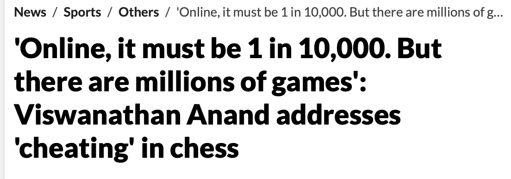
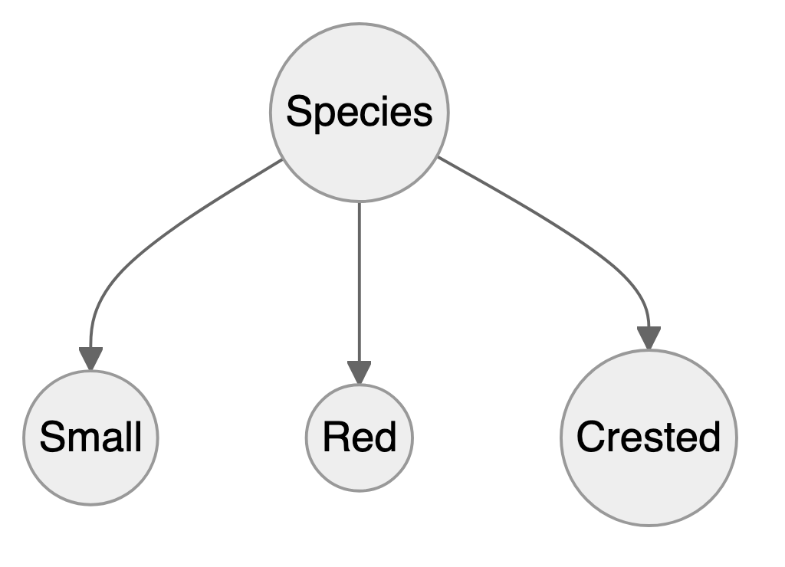
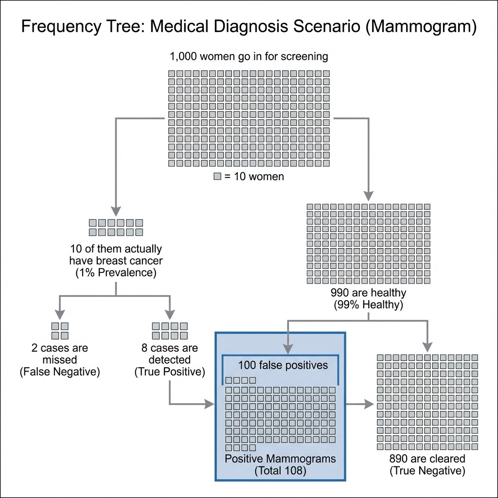
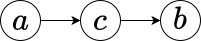
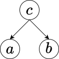
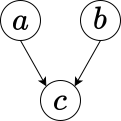
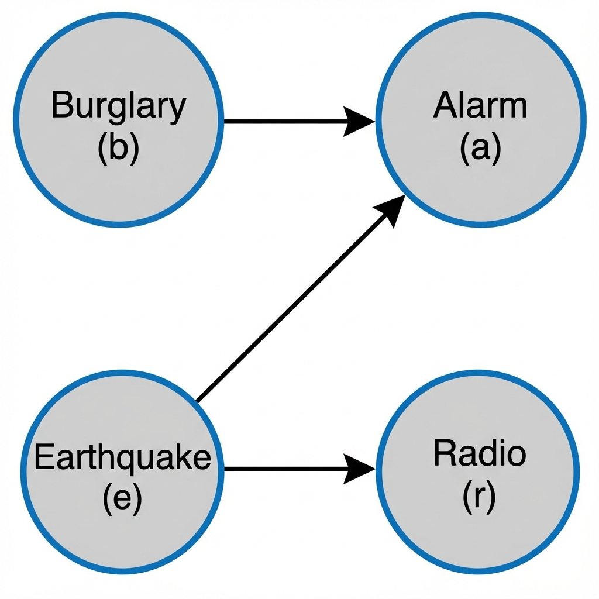



# Bayes' Rule
> "*When the facts change, I change my mind. What do you do, sir?*"---John Maynard Keynes

One of the key questions in the theory of learning is: *How do you update your beliefs in the presence of new information?* Bayes' rule provides the answer. Conditional probability can be interpreted as updating your probability of event $A$ after you have learned the new information that $B$ has occurred. In this sense, probability is also the language of how you'll change opinions in the light of new evidence. 

Probability rules allow us to change our mind if the facts change. For example, suppose that we have evidence $E = \{ E_1 , E_2 \}$ consisting of two pieces of information and that we are interested in identifying a *cause* $C$. Bayes' rule simply lets you calculate this conditional probability $P(C\mid E_1,E_2)$ in a sequential fashion. First, conditioning on the information contained in $E_1$ lets us calculate
$$
P( C\mid E_1 ) = \frac{ P(  E_1 \mid C ) P( C) }{ P( E_1 ) }
$$
Then, using the posterior probability $P( C\mid E_1 )$ as the "new" prior for the next piece of information $E_2$ lets us find
$$
P( C\mid E_1 , E_2 ) = \frac{ P(  E_2 \mid E_1 , C ) P( C \mid E_1 ) }{ P( E_2 \mid E_1 ) }
$$
Hence, we see that we need assessments of the two conditional probabilities $P( E_1 \mid C )$ and $P( E_2 \mid E_1 , C )$. In many situations, the latter will be simply $P( E_2 \mid C )$ and not involve $E_1$. The events $( E_1, E_2 )$ will be said to be conditionally independent given $C$.

This concept generalizes to a sequence of events where $E = \{ E_1,\ldots E_n \}$. When learning from data, we will use this property all the time. An illustrative example will be the Black Swan problem, which we discuss later.

Bayes' rule is a fundamental concept in probability theory and statistics. It describes how to update our *beliefs* about an event based on *new evidence*. We start with an initial belief about the probability of an event (called the *prior probability*). We then observe some conditional information (e.g., evidence). We use Bayes' rule to update our initial belief based on the evidence, resulting in a new belief called the *posterior probability*. Remember, the formula is

::: {.callout-note icon=false}
## Bayes' Rule
$$
P(A\mid B) = \dfrac{P(B\mid A) P(A)}{P(B)}
$$ 
:::

where:

- $P(A\mid B)$ is the *posterior probability* of event $A$ occurring given that $B$ is known to happen for sure. This is the probability we're trying to find.
- $P(B\mid A)$ is the *likelihood* of observing event $B$ if event $A$ has occurred.
- $P(A)$ is the *prior probability* of event $A$ occurring. This is our initial belief about the probability of $A$ before we see any evidence.
- $P(B)$ is the *marginal probability* of observing event $B$. This is the probability of observing B regardless of whether $A$ occurs.

The ability to use Bayes' rule sequentially is key in many applications, when we need to update our beliefs in the presence of new information. For example, Bayesian learning was used by mathematician Alan Turing in England at Bletchley Park to break the German Enigma code - a development that helped the Allies win the Second World War [@simpson2010edward]. Turing called his algorithm Banburismus, it is a process he invented which used sequential conditional probability to infer information about the likely settings of the Enigma machine.

Dennis Lindley argued that we should all be trained in Bayes' rule and that conditional probability can be simply viewed as disciplined probability accounting. Akin to how market odds change as evidence changes. However, human intuition is rarely naturally calibrated for Bayesian reasoning; it is a skill that must be learned, much like literacy.

## Law of Total Probability
The Law of Total Probability is a fundamental rule relating marginal probabilities to conditional probabilities.

Suppose you have a set of events $B_1, B_2, ..., B_n$ that are mutually exclusive (i.e., no two events can occur at the same time) and collectively exhaustive (i.e., at least one of the events must occur). The Law of Total Probability states that for any other event $A$, the probability of $A$ occurring can be calculated as the sum of the probabilities of $A$ occurring given each $B_i$, multiplied by the probability of each $B_i$ occurring.

Mathematically, it is expressed as:
$$ 
P(A) = \sum_{i=1}^{n} P(A\mid  B_i) P(B_i)
$$

::: {#exm-total}
## Total Probability

Suppose you have two bags of balls. Bag 1 contains 3 red and 7 blue balls, while Bag 2 contains 6 red and 4 blue balls. You randomly choose one of the bags and then randomly draw a ball from that bag. What is the probability of drawing a red ball?

Here, the events $B_1$ and $B_2$ can be choosing Bag 1 and Bag 2, respectively. You want to find  drawing a red ball (event $A$). 

Applying the law:

- $P(A\mid B_1)$ is the probability of drawing a red ball from Bag 1, which is $\frac{3}{10}$.
- $P(A\mid B_2)$ is the probability of drawing a red ball from Bag 2, which is $\frac{6}{10}$.
- Assume the probability of choosing either bag is equal, so $P(B_1) = P(B_2) = \frac{1}{2}$.

Using the Law of Total Probability:
$$
P(A) = P(A\mid B_1) \times P(B_1) + P(A\mid B_2) \times P(B_2)= \frac{3}{10} \times \frac{1}{2} + \frac{6}{10} \times \frac{1}{2} = \frac{9}{20}
$$ 

So, the probability of drawing a red ball in this scenario is $\frac{9}{20}$.
:::

This law is particularly useful in complex probability problems where direct calculation of probability is difficult. By breaking down the problem into conditional probabilities based on relevant events, it simplifies the calculation and helps to derive a solution.

## Intuition and Simple Examples

::: {#exm-intuition}
## Intuition
Our intuition is not well trained to make use of Bayes' rule. Suppose I tell you that Steve was selected at random from a representative sample, and that he is 6 feet 2 inches tall and an excellent basketball player. He goes to the gym every day and practices hard playing basketball. Do you think Steve is a custodian at a factory or an NBA player? Most people assume Steve is an NBA player, which is wrong. The ratio of NBA players to custodians is very small, probabilistically Steve is more likely to be a custodian. The key is to provide the right conditioning and to consider the prior probability! Even though the ratio of people who practice basketball hard is much higher among NBA players (it is 1) when compared to custodians, the larger number of the population means we still have more custodians in the US than NBA players. 

\begin{align*} 
P(\text{Practice hard}  \mid  \text{Play in NBA}) \approx  1\\
P( \text{Play in NBA}  \mid  \text{Practice hard}) \approx  0.
\end{align*}

Even though you practice hard, the odds of playing in the NBA are low (about $450$ players out of $8$ billion). But given you're in the NBA, you no doubt practice very hard. To understand this further, let's look at the conditional probability implication and apply Bayes' rule
$$
P \left ( \text{Play in NBA}  \mid  \text{Practice hard}  \right ) = \dfrac{P  \left ( \text{Practice hard}  \mid  \text{Play in NBA} \right )}{P(\text{Practice hard})}P( \text{Play in NBA}).
$$
This is written in the form
$$
\text{Posterior} = \frac{\text{Likelihood}}{\text{Marginal}}\times \text{Prior} = \text{Updating factor} \times \text{Prior}.
$$
We call the Likelihood/Marginal ratio the updating factor. It differs from the Bayes factor of the odds form of Bayes' rule below, which compares the likelihoods under a hypothesis and under its negation. As we will see in the text, one of the key advantages over classical is the ability to sequentially update our beliefs as new evidence appears. It allows for disciplined probability accounting in "real-time". With the advent of prediction markets and data science, it has become increasingly important to be able to update our beliefs as new evidence appears.

The initial (a.k.a. prior) probability $P(\text{Play in NBA} ) = 450/(8 \cdot 10^9) = 5.625 \times 10^{-8}$. This uses a global population of around 8 billion as the reference population. (The 7-foot example below uses US playing-age males as the reference, giving a different prior; the choice of reference population is part of the model specification.)
$$
P   \left ( \text{Play in NBA}  \mid  \text{Practice hard}  \right ) \approx  0,
$$ 
$P(\text{practice hard})$ is not that small and $P(\text{practice hard} \mid \text{play in NBA})=1$. Hence, when one 'reverses the conditioning' one gets a very small probability. This makes sense!

The Steve example illustrates how our intuition fails us, but let's consider an even more striking case that demonstrates the power of Bayes' rule with extreme probabilities. Consider the question: what is the probability that a randomly selected 7-foot-tall American male plays in the NBA?

Most people's intuition suggests this probability should be quite high - after all, being exceptionally tall seems like the primary qualification for professional basketball. However, Bayes' rule reveals a more nuanced picture that depends critically on the base rates involved.

To calculate $P(\text{NBA player} \mid \text{7 feet tall})$ using Bayes' rule, we need to carefully estimate each component:

$$P(\text{NBA} \mid \text{7ft}) = \frac{P(\text{7ft} \mid \text{NBA}) \times P(\text{NBA})}{P(\text{7ft})}$$

The prior probability $P(\text{NBA})$ represents the baseline chance of being an NBA player. With approximately 450 active players drawn from roughly 40 million American males of playing age, this gives us $P(\text{NBA}) \approx 1.1 \times 10^{-5}$.

The likelihood $P(\text{7ft} \mid \text{NBA})$ asks what fraction of NBA players are 7 feet or taller. Historically, this has been around 17% of the league, so $P(\text{7ft} \mid \text{NBA}) \approx 0.17$.

The marginal probability $P(\text{7ft})$ requires us to estimate how rare 7-foot-tall men are in the general population. If male height followed a normal distribution with mean 69 inches and standard deviation 3 inches, a $z$-score of 5.0 would give roughly 1 in 3.5 million, but the normal distribution dramatically underestimates the frequency of extreme heights because real height distributions have heavier tails. Empirical estimates suggest roughly 1 in 35,000 playing-age American males are 7 feet or taller, giving us $P(\text{7ft}) \approx 2.87 \times 10^{-5}$.

Applying Bayes' rule:
$$P(\text{NBA} \mid \text{7ft}) = \frac{0.17 \times 1.1 \times 10^{-5}}{2.87 \times 10^{-5}} \approx 0.065$$

This yields approximately 6.5% - a dramatic increase from the baseline probability of 0.001%, yet still surprisingly low given our intuitions. 

Let's also consider a direct count-based calculation. As of September 2025, there are 39 players in the NBA who are 7 feet tall or taller, out of a total of 450 NBA players. This means the probability that a randomly selected NBA player is at least 7 feet tall is:

$$
P(\text{7ft} \mid \text{NBA}) = \frac{39}{450} = 0.0867
$$

This empirical estimate is slightly different from the earlier historical average, but it still highlights the rarity of extreme height even among elite basketball players. Substituting this count-based likelihood ($0.0867$) for the historical $0.17$ in the Bayes calculation would roughly halve the posterior, to about $3.3\%$ rather than $6.5\%$.

Regardless of the exact calculation, this example powerfully demonstrates how Bayes' rule forces us to account for base rates. Even when height provides enormous predictive value for NBA success (the likelihood ratio is massive), the extreme rarity of both 7-foot-tall individuals and NBA players means that most 7-footers will not be professional basketball players.
:::

::: {#exm-Craps}
## Craps

Craps is a fast-moving dice game with a complex betting layout. It's highly volatile, but eventually your bankroll will drift towards zero. Let's look at the pass line bet. The expectation $E(X)$ governs the long run. When 7 or 11 comes up, you win. When 2, 3, or 12 comes up, this is known as "craps", you lose. When 4, 5, 6, 8, 9, or 10 comes up, this number is called the "point", the bettor continues to roll until a 7 (you lose) or the point comes up (you win).

We need to know the probability of winning. The pay-out, probability, and expectation for a \$1 bet

| Win | Prob   |
|-----|--------|
| 1   | 0.4929 |
| -1  | 0.5071 |


This leads to an edge in favor of the house as 
$$
E(X) = 1 \cdot 0.4929 + (- 1) \cdot  0.5071 = -0.014
$$
The house has a 1.4\% edge. 

To calculate the probability of winning: $P( \text{Win} )$, let's use the law of total probability
$$
P( \text{Win} ) = \sum_{ \mathrm{Point} } P ( \text{Win} \mid \mathrm{Point} ) P ( \mathrm{Point} )
$$
The set of $P(\text{Point})$ values is given by 

::: {layout-ncol=2}

| Value | Probability | Percentage |
|-------|-------------|------------|
| 2     | 1/36        | 2.78\%     |
| 3     | 2/36        | 5.56\%     |
| 4     | 3/36        | 8.33\%     |
| 5     | 4/36        | 11.1\%     |
| 6     | 5/36        | 13.9\%     |
| 7     | 6/36        | 16.7\%     |

| Value | Probability | Percentage |
|-------|-------------|------------|
| 8     | 5/36        | 13.9\%     |
| 9     | 4/36        | 11.1\%     |
| 10    | 3/36        | 8.33\%     |
| 11    | 2/36        | 5.56\%     |
| 12    | 1/36        | 2.78\%     |

:::

The conditional probabilities $P( \text{Win} \mid \mathrm{Point} )$ are harder to calculate
$$
P( \text{Win} \mid 7 \; \mathrm{or} \; 11 ) = 1 \; \; \mathrm{and} \; \; P( \text{Win} \mid 2 ,
3 \; \mathrm{or} \; 12 ) = 0
$$
We still have to work out all the probabilities of winning given the point. Suppose the point is $4$
$$ 
P( \text{Win} \mid 4 ) = P ( 4 \; \mathrm{before} \; 7 ) = \dfrac{P(4)}{P(7)+P(4)} = \frac{3}{9} =
\frac{1}{3} 
$$
There are 6 ways of getting a 7, 3 ways of getting a 4, for a total of 9 possibilities. Now do all of them and sum them up. You get 
$$ 
P( \text{Win}) = 0.4929 
$$

:::

::: {#exm-jar}
## Coin Jar

Large jar containing 1024 fair coins and one two-headed coin. You pick one at random and flip it $10$ times and get all heads. What's the probability that the coin is the two-headed coin? The probability of initially picking the two headed coin is 1/1025. There is a 1/1024 chance of getting $10$ heads in a row from a fair coin. Therefore, it's a $50/50$ bet. 


Let's do the formal Bayes' rule math. Let $E$ be the event that you get $10$ Heads in a row; then

$$
P \left ( \text{two-headed}  \mid  E \right ) = \frac{ P \left ( E  \mid  \text{two-headed}  \right )P \left (  \text{two-headed} \right )}
{P \left ( E  \mid  \text{fair}  \right )P \left ( \text{fair} \right ) + P \left ( E  \mid  \text{two-headed}  \right )P \left ( \text{two-headed} \right )}
$$
Therefore, the posterior probability
$$
P \left (  \text{two-headed}  \mid  E \right ) = \frac{ 1 \times \frac{1}{1025} }{ \frac{1}{1024} \times \frac{1024}{1025} + 1 \times \frac{1}{1025} } = 0.50
$$
What's the probability that the next toss is a head? Using the law of total probability gives 
  
\begin{align*}
  P( H ) &= P( H  \mid  \text{two-headed} )P( \text{two-headed}  \mid E ) +  P( H  \mid  \text{fair} )P( \text{fair}  \mid E) \\
  & = 1 \times \frac{1}{2} + \frac{1}{2} \times \frac{1}{2} = \frac{3}{4}
\end{align*}
:::

::: {#exm-monty}
## Monty Hall Problem
Another example of a situation when calculating probabilities is counterintuitive. The Monty Hall problem was named after the host of the long-running TV show Let's Make a Deal. The original solution was proposed by Marilyn vos Savant, who had a column with the correct answer that many Mathematicians thought was wrong!

The game set-up is as follows. A contestant is given the choice of 3 doors. There is a prize (a car, say) behind one of the doors and something worthless behind the other two doors: two goats. The game is as follows:

1. You pick a door.
2. Monty then opens one of the other two doors, revealing a goat. He can't open your door or show you a car
3. You have the choice of switching doors.

The question is, is it advantageous to switch? The answer is yes. The probability of winning if you switch is 2/3 and if you don't switch is 1/3.

Conditional probabilities allow us to answer this question. Assume you pick door 1. Let event $A$ denote that the car is behind Door 2, and let event $B$ denote that the host opened Door 3, revealing a goat. We want to calculate $P(A\mid B)$, the probability the car is behind the door you should switch to. The prior probability that the car is behind Door 2 is $P(A) = 1/3$. If the car is behind Door 2; the host must open Door 3 (he cannot open Door 1 or show the car behind Door 2), so $P(B\mid A) = 1$. Bayes' rule gives us
$$
P(A\mid B) = \frac{P(B\mid A)P(A)}{P(B)} = \frac{1/3}{1/2} = \frac{2}{3}.
$$
The overall probability of the host opening Door 3 
$$
P(B) = (1/3 \times 1/2) + (1/3 \times 1) = 1/6 + 1/3 = 1/2.
$$

The posterior probability that the car is behind Door 2 after the host opens Door 3 is 2/3. It is to your advantage to switch doors.
:::


## Real World Bayes

The following cases (search-and-rescue operations, wartime survival, and legal proceedings) share a common insight: updating beliefs systematically while accounting for base rates and the direction of conditioning.

::: {#exm-Scorpion}
## USS Scorpion Sank 22 May 1968 in the Middle of the Atlantic

Experts placed bets on each casualty and how each would affect the sinking. Undersea soundings gave a prior on location. Bayes' rule: $L$ is location, and $S$ is scenario
$$
P (L \mid S) = \frac{ P(S \mid L) P(L)}{P(S)}
$$
The Navy spent $5$ months looking and found nothing. Built a probability map: within $5$ days, the submarine was found within $220$ yards of the most likely probability!

A similar story happened during the search for an Air France plane that flew from Rio to Paris.
:::

::: {#exm-Wald}
## Wald and Airplane Safety

Many lives were saved by analysis of conditional probabilities performed by Abraham Wald during the Second World War. He was analyzing damage on the US planes that came back from bombing missions in Germany. Somebody suggested to analyze the distribution of the hits over different parts of the plane. The idea was to find a pattern in the damage and design a reinforcement strategy.

After examining hundreds of damaged airplanes, researchers came up with the following table

|              Location | Number of Planes |
|----------------------:|-----------------:|
|                Engine |               53 |
|               Cockpit |               65 |
|           Fuel system |               96 |
| Wings, fuselage, etc. |              434 |

We can convert those counts to probabilities

|              Location | Number of Planes |
|----------------------:|-----------------:|
|                Engine |             0.08 |
|               Cockpit |              0.1 |
|           Fuel system |             0.15 |
| Wings, fuselage, etc. |             0.67 |

We can conclude that the most likely area to be damaged on the returned planes was the wings and fuselage.
$$
P(\mbox{hit on wings or fuselage } \mid \mbox{returns safely}) = 0.67
$$
Wald realized that analyzing damages only on survived planes is not the right approach. Instead, he suggested that it is essential to calculate the inverse probability
$$
P(\mbox{returns safely} \mid \mbox{hit on wings or fuselage }) = ?
$$
To calculate that, he interviewed many engineers and pilots; he performed a lot of field experiments. He analyzed likely attack angles. He studied the properties of a shrapnel cloud from a flak gun. He suggested to the army that they fire thousands of dummy bullets at a plane sitting on the tarmac. Wald constructed a 'probability model' carefully to reconstruct an estimate for the joint probabilities. The table below shows the results.

|                   Hit | Returned | Shot Down |
|----------------------:|---------:|----------:|
|                Engine |       53 |        57 |
|               Cockpit |       65 |        46 |
|           Fuel system |       96 |        16 |
| Wings, fuselage, etc. |      434 |        33 |

Which allows us to estimate joint probabilities, for example
$$
P(\mbox{outcome = returns safely} , \mbox{hit  =  engine }) = 53/800 = 0.066
$$
We also can calculate the conditional probabilities now
$$
P(\mbox{outcome = returns safely} \mid  \mbox{hit  =  wings or fuselage  }) = \dfrac{434}{434+33} = `r 434/(434+33)`.
$$ 
Should we reinforce wings or fuselage?
$$
P(\mbox{outcome = returns safely} \mid  \mbox{hit  =  engine  }) = \dfrac{53}{53+57} = 0.48
$$
:::

A convenient way to perform Bayes' rule calculations is using the "odds" form.

::: {.callout-note}
## Bayes' Rule in Odds Form
$$
\underbrace{O(H \mid E)}_{\text{Posterior Odds}} = \underbrace{\frac{P(E \mid H)}{P(E \mid \neg H)}}_{\text{Bayes factor}} \times \underbrace{O(H)}_{\text{Prior Odds}}
$$
:::

Here, the odds of an event $H$ are defined as $O(H) = \frac{P(H)}{P(\neg H)}$. This separates the contribution of the evidence (Bayes factor) from the prior belief.

::: {#exm-prosecutors-fallacy}
## The Prosecutor's Fallacy

The Prosecutor's Fallacy is a logical error that occurs when a prosecutor presents evidence or statistical data in a way that suggests a defendant's guilt, even though the evidence is not as conclusive as it may seem. This fallacy arises from confounding conditional probabilities, specifically equating the probability of evidence given guilt $P(E\mid G)$ with the probability of guilt given evidence $P(G\mid E)$.
$$
P(E\mid G) \ne P(G\mid E)
$$
A classic example involves DNA evidence. Suppose you're serving on a jury in a city with a population of 10 million. A defendant is accused of a crime based on a DNA match found at the scene. A forensic scientist testifies that the probability of an innocent person’s DNA matching the sample is one in a million ($P(E\mid \bar G) = 10^{-6}$).

The prosecutor argues that this means there is only a one in a million chance the defendant is innocent. This is the fallacy. You are charged with assessing $P(G \mid E)$ - the probability of guilt given the match.

Let's apply Bayes' rule.

- $P(G) \approx 1/10^7$ (Prior probability, assuming a random citizen).
- $P(E\mid \bar G) = 10^{-6}$ (False positive rate).
- $P(E\mid G) \approx 1$ (Sensitivity).

$$
P(G\mid E) = \frac{P(E\mid G)P(G)}{P(E\mid G)P(G) + P(E\mid \bar G)P(\bar G)}
$$
$$
P(G\mid E) \approx \frac{1 \cdot 10^{-7}}{1 \cdot 10^{-7} + 10^{-6} \cdot 1} = \frac{10^{-7}}{1.1 \times 10^{-6}} \approx \frac{1}{11} \approx 0.09
$$

Despite the "one in a million" match rarity, the probability of guilt is only about 9%! There are 10 million people, so we expect about 10 innocent matches ($10^7 \times 10^{-6}$) and 1 guilty match. Thus, out of 11 matches, only 1 is guilty. The prosecutor's argument ignores the base rate.
:::

::: {#exm-island}
## Island Problem
There are $N+1$ people on the island, and one is a criminal. We have the probability of a trait of a criminal equal to $p$, which is $p = P(E\mid I)$, the probability of evidence, given innocence. Then we have a suspect who is matching the trait, and we need to find the probability of being guilty, given the evidence, $P(G \mid E)$. It is easier to do Bayes' rule in the odds form. There are three components to the calculations: the prior odds of guilt,
$$
O ( G ) = P (G) / P ( I ),
$$ 
the Bayes factor, 
$$
\frac{P(E\mid G)}{P(E\mid I)}.
$$
and the posterior odds of guilt.
$$
	O(G\mid E) = \dfrac{P(G\mid E)}{P(I\mid E)} = \dfrac{1}{Np}.
$$

Cromwell's rule states that the use of prior probability of 1 or 0 should be avoided except when it is known for certain that the probability is 1 or 0. It is named after Oliver Cromwell who wrote to the General Assembly of the Church of Scotland in 1650 "*I beseech you, in the bowels of Christ, think it possible that you may be mistaken.*" In other words, using Bayes' rule
$$
P(G\mid E) = \dfrac{P(E\mid G)}{P(E)}P(G),
$$
if $P(G)$ is zero, it does not matter what the evidence is. Symmetrically, the probability of innocence is zero if the evidence is certain. In other words, if $P(E\mid I) = 0$, then $P(I\mid E) = 0$. It is not always true, but it is a good rule of thumb; it is a good way to avoid the prosecutor's fallacy. 
:::


::: {#exm-nakamura}
## Nakamura's Alleged Cheating
In our paper @maharaj2023kramnik, we provide a statistical analysis of the recent controversy between Vladimir Kramnik (ex-world champion) and Hikaru Nakamura. Kramnik called into question Nakamura's 45.5 out of 46 win streak in a 3+0 online blitz contest at chess.com. In this example, we reproduce this paper and assess the weight of evidence using an a priori probabilistic assessment of Viswanathan Anand and the streak evidence of Kramnik. Our analysis shows that Nakamura has a 99.65 percent chance of not cheating given Anand's prior assumptions. 

We start by addressing the argument of Kramnik which is based on the fact that the probability of such a streak is very small. This falls into precisely the *Prosecutor's Fallacy*, as discussed in @exm-prosecutors-fallacy. We denote by $G$ the event of being guilty and $I$ the event of innocence. We use $E$ to denote evidence (streak of wins). Kramnik's argument is that because the probability of observing the streak is very low ($P(E\mid I)$ is small), it implies a high probability of cheating ($P(G\mid E)$ is high). As we have seen, this reasoning is flawed because it neglects the prior probability of cheating.
The prosecutor's fallacy can lead to an overestimation of the strength of the evidence and may result in an unjust conviction. In the cheating problem, at the top level of chess, the prior probability of $P(G)$ is small! According to a recent statement by Viswanathan Anand, the probability of cheating is $1/10000$.

{width=50%}


Given the prior ratio of cheaters to non-cheaters is $1/N$, meaning out of $N+1$ players, there is one cheater, the Bayes calculations require two main terms. The first one is the prior odds of innocence:
$$
O ( I ) = P (I) / P ( G ).
$$
Here $P(I)$ and $P(G)$ are the prior probabilities of innocence and guilt, respectively.

The second term is the Bayes factor in favor of innocence, which is the ratio of the probability of the evidence under the innocence hypothesis to the probability of the evidence under the guilt hypothesis:
$$
	L(E\mid I) = \frac{P(E\mid I)}{P(E\mid G)}.
$$

The product of the Bayes factor and the prior odds is the posterior odds of innocence, given the evidence:
$$
	O(I\mid E) = O(I) \times L(E\mid I).
$$


The odds of innocence is
$$
	O ( I )  = \dfrac{N/(N+1)}{1/(N+1)} = N.
$$

The Bayes factor is given by
$$
\frac{P(E\mid I)}{P(E\mid G)} = \dfrac{p}{1} = p.
$$ 
Thus, the posterior odds of innocence are
$$
	O(I\mid E) = Np.
$$
There are two numbers we need to estimate to calculate the odds of innocence given the evidence, namely the prior probability of cheating given via $N$ and the probability of a streak $p = P(E\mid I)$. 

There are multiple ways to calculate the probability of a streak. We can use the binomial distribution, the negative binomial distribution, or the Poisson distribution. The binomial distribution is the most natural choice. The probability of a streak of $k$ wins in a row is given by 
$$
	P(E\mid I) = \binom{N}{k} q^k (1-q)^{N-k}.
$$
Here $q$ is the probability of winning a single game. Thus, for a streak of 45 wins in a row, we have $k = 45$ and $N = 46$. We encode the outcome of a game as $1$ for a win and $0$ for a loss or a draw. The probability of a win is $q = 0.8916$ (Nakamura's Estimate, which he reported on his YouTube channel). The probability of a streak is then 0.029. The individual game win probability can also be calculated from the ELO rating difference between the players. 

The ELO rating of Hikaru is 3300, and the average ELO rating of his opponents is 2950, according to Kramnik. The difference of 350 corresponds to the odds of winning of $wo = 10^{350/400} = 10^{0.875} = 7.5$. The probability of winning a single game is $q = wo/(1+wo) = 0.88$, close to Nakamura's own estimate of $0.8916$ that we use here.

Then we use Anand's prior of $N = 10000$ to get the posterior odds of cheating given the evidence of a streak of 45 wins in a row. The posterior odds of being innocent are 285. The probability of cheating is then 
$$
P(G\mid E) = 1/(1+O(I\mid E)) = 0.003492.
$$ 
Therefore, the probability of innocence is
$$
	P(I\mid E) = \frac{Np}{Np+1} = 0.9965.
$$

For completeness, we perform a sensitivity analysis and also get the odds of not cheating for $N = 500$, which should be a high prior probability given the status of the player and the importance of the event. We get
$$
	P(I\mid E) = \frac{Np}{Np+1} = 0.9345.
$$

There are several assumptions we made in this analysis. 

- Instead of calculating game-by-game probability of winning, we used the average probability of winning of 0.8916, provided by Nakamura himself. This is a reasonable assumption given the fact that Nakamura is a much stronger player than his opponents. This assumption slightly shifts posterior odds in favor of not cheating. The probability of winning 45 given games with winning probabilities $q_1, \ldots, q_{45}$ is $\prod_{i=1}^{45} q_i$, and by the inequality of arithmetic and geometric means this is at most $\bar q^{45}$, where $\bar q$ is the average of the $q_i$. So the probability of a streak that we computed with the average is slightly too large. We consider the difference to be small. Further, we treated the games as independent, but there is some correlation between them, and a long streak is more likely when results are positively correlated, which would shift the posterior odds in favor of not cheating. For example, some players are on tilt. Given they lost the first game, they are more likely to lose the second game.
- There are many ways to win 3+0, unlike in classical chess. For example, one can win on time. We argue that the probability of winning calculated from the ELO rating difference is underestimated. 

Next, we can use the Bayes analysis to solve an inverse problem and to find what prior you need to assume and how long of a sequence you need to observe to get 0.99 posterior? Small sample size, we have $p$ close to 1. @fig-n-p shows the combination of prior ($N$) and the probability of a streak ($p$) that gives posterior probability of 0.99. The curve is $p = 99/N$, because the posterior probability of innocence $P(I\mid E) = Np/(Np+1)$ equals 0.99 exactly when $Np = 99$.

Indeed, the results of the Bayesian analysis contradict the results of a traditional $p$-value based approach. A $p$-value is a measure used in frequentist statistical hypothesis testing. It represents the probability of obtaining the observed results, or results more extreme, assuming that the null hypothesis is true. The null hypothesis is a default position that Nakamura is not cheating, and we compare the expected win probability of $q=0.8916$ (Nakamura's own estimate) to the observed one of $s=45/46=0.978$. Under the null hypothesis, Nakamura should perform at the level predicted by $q$. 

```{r nakamura}
#| echo: true
#| R.options: !expr list(digits = 4)
q <- 0.8916
p <- dbinom(45, 46, q)
N <- 10000
odds <- p * N
print(1 - 1 / (1 + odds))
print(1 / (1 + odds))
print(N * p / (N * p + 1))
```

```{r}
#| label: fig-n-p
#| fig-cap: "The combination of prior ($N$) and the probability of a streak ($p$) that gives posterior probability of 0.99."
N <- seq(500, 10000, by = 250)
plot(99 / N, N, xlab = "p", ylab = "N", type = "l", lwd = 3, col = "blue", xlim = c(0, 0.2), ylim = c(0, 10000), yaxt = "n")
axis(2, at = seq(0, 10000, 2500))
```

:::

David Hume discussed the problem similar to the Island problem in his "On Miracles" essay. Hume is making the following argument on miracles:

> "*...no testimony is sufficient to establish a miracle, unless the testimony be of such a kind, that its falsehood would be more miraculous, than the fact, which it endeavors to establish; and even in that case there is a mutual destruction of arguments, and the superior only gives us an assurance suitable to that degree of force, which remains, after deducting the inferior.*"

One can view this as an application of the Island problem. Assuming the probability of a miracle $A$ is $P( A) = p$ and $P( \text{not } A ) = 1 -p$. Then Bayes' rule gives
$$
P( A\mid a ) = \frac{ P( a\mid A) p }{  P( a\mid A) p  +  P( a \mid  \text{not } A) (1-p) }
$$
Prosecutor's fallacy, $P( a\mid \text{not } A)  \neq 1 -  P( a\mid A)$, in general.  

In Hume's assessment of miracles (has to be something not in the laws of nature), we have $P(A) = 10^{-6}$. This assessment takes into account background information, $I$. Rare to have a contradiction to the laws of nature. More informative to write $P( A \mid I )$. Furthermore, we take $P( a\mid A) =0.99$. The hardest bit is to assess $P(a \mid \text{not } A )$. The "frequency" of faked miracles and mankind's propensity to be marvelous. We assess $P(a \mid \text{not } A )  = 10^{-3}$. 
 This yields the chance of a miracle to be unlikely as 
$$
P( A\mid a ) = \frac{ 0.99 \times 10^{-6}  }{  0.99 \times 10^{-6}    +  10^{-3} (1- 10^{-6}) }   \approx 10^{-3}.
$$
Feynman considers the inverse problem: can we learn the laws of nature purely from empirical observation? Uses chess as an example. 
Is it a miracle that we have two bishops of the same color? No! according to Hume. We just didn't know the laws of nature (a.k.a. model). 


::: {#exm-Sally}
## Sally Clark Case: Independence or Bayes' Rule?
To show that independence can lead to dramatically different results from Bayes conditional probabilities, consider the Sally Clark case. Sally Clark was accused and convicted of killing her two children who could have both died of SIDS. One explanation is that this was a random occurrence; the other one is that they both died of sudden infant death syndrome (SIDS). How can we use conditional probability to figure out a reasonable assessment of the probability that she murdered her children. First, some known probability assessments

1.  The chance of a family of non-smokers having an SIDS death is $1$ in $8{,}500$.
2.  The chance of a second SIDS death is $1$ in $100$.
3.  The chance of a mother killing her two children is around $1$ in $1{,}000{,}000$.

Under Bayes 
\begin{align*} 
P(\mathrm{both} \; \; \mathrm{SIDS})   &  = P(\mathrm{first} \; \mathrm{SIDS}) P(\mathrm{Second} \; \;\mathrm{SIDS} \mid \mathrm{first} \; \mathrm{SIDS})\\
&  = \frac{1}{8500} \cdot \frac{1}{100} = \frac{1}{850{,}000}.
\end{align*}

The $1/100$ comes from taking into account the genetic properties of SIDS. Independence, as implemented by the court, gets you to a probabilistic assessment of
$$
P \left(  \mathrm{both} \; \; \mathrm{SIDS} \right)  = (1/8500) (1/8500) \approx (1/72{,}000{,}000).
$$
This is a low probability. It is still not the answer to our question of context. We need a conditional probability; this will come to Bayes' rule.

First, some general comment on the likelihood ratio calculation used to assess the weight of evidence in favor of guilty v.s. innocent evidence. Under Bayes we'll find that there's reasonable evidence that she'd be acquitted. We need the relative odds ratio. Let $I$ denote the event that Sally Clark is innocent and $G$ denotes guilty. Let $E$ denote the evidence. In most cases, $E$ contains a sequence $E_1, E_2, \ldots$ of 'facts' and we have to use the likelihood ratios in turn. Bayes' rule then tells you to combine via multiplicative fashion. If likelihood ratio $>1$, odds of guilty. If likelihood ratio $<1$, more likelihood to be $I$. By Bayes' rule
$$
\frac{P(I\mid E)}{P(G\mid E)} = \frac{P( E\text{ and } I)}{P( E\text{ and } G)}.
$$
If we further decompose $P(E \text{ and } I) = P(E\mid I )P(I)$ then we have to discuss the prior probability of innocence, namely $P(I)$. Hence, this is one subtle advantage of the above decomposition.

The underlying intuition that Bayes gives us in this example, is that of the two possible explanations of the data, both of which are unlikely, it is the relative likelihood comparison that should matter. Here is a case where the $p$-value would be non-sensible ($P(E\mid I) \neq P(I\mid E)$). Effectively comparing two rare event probabilities from the two possible models or explanations.

Hence, putting these two together gives the odds of guilt as
$$
\frac{P(I\mid E)}{P(G\mid E)} = \frac{1/850{,}000}{1/1{,}000{,}000} = 1.18.
$$
Solving for the posterior probability yields $46\%$ for the probability of guilty given evidence.
$$
P( G\mid E) = \frac{1}{1 + O(I\mid E)} = 0.46.
$$
Basically a $50/50$ bet. Not enough to definitively convict! But remember that our initial prior probability on guilt $P(G)$ was $10^{-6}$. So now there has been a dramatic increase to a posterior probability of $0.46$. So it's not as if Bayes' rule thinks this is evidence in the suspect's favor, but the magnitude is still not in the $0.999$ range, though, where most jurors would have to be to feel comfortable with a guilt verdict.

If you use the "wrong" model of independence (as the court did), you get
$$
P \left(  \mathrm{both} \; \; \mathrm{SIDS} \right)  = \frac{1}{8500}
  \cdot\frac{1}{8500} \approx \frac{1}{72{,}000{,}000}.
$$
With the independence assumption, you make the assessment
$$
\frac{P(I\mid E)}{P(G\mid E)} = \frac{1}{72} \; \mathrm{ and} \; P( G\mid E) \approx 0.99.
$$
Given these probability assumptions, the suspect looks guilty with probability 99%.

Experts also mis-interpret the evidence by saying: *1 in 73 million chance that it is someone else*. This is clearly false and misleading to the jury and has led to appeals.
:::

::: {#exm-Simpson}
## O. J. Simpson Case: Dershowitz Fallacy
<!-- https://rss.onlinelibrary.wiley.com/doi/pdf/10.1111/j.1740-9713.2015.00839.x -->
This example is based on I. J. Good's, "When batterer turns murderer." Nature, 15 June 1995, p. 541. Alan Dershowitz, on the O. J. Simpson defense team, stated on T.V. and in newspapers that only 1 in 2,500 of men who abuse their wives go on to murder them. He clearly wanted his audience to interpret this to mean that the evidence of abuse by Simpson would only suggest a 0.04% probability of his being guilty of murdering her. He used probability to argue that because so few husbands who batter their wives actually go on to murder their wives. Thus, O.J. is highly likely to be not guilty. This leaves out the most relevant conditioning information that we also know that Nicole Brown Simpson was actually murdered. Both authors believe the jury would be more interested in the probability that the husband is guilty of the murder of his wife given that he abused his wife and his wife was murdered. They both solve this problem by using Bayes' theorem. 

In this example, the notation $B$ represents "woman battered by her husband, boyfriend, or lover", $M$ represents the event "woman murdered", and $G$ denotes "woman murdered by her batterer". Our goal is to show that 
$$
% P(M,B \mid M) \neq P(M,B \mid B).
P(G \mid M,B) \neq P(G\mid B).
$$

It is not hard to come to a wrong conclusion if you don't take into account all the relevant conditional information. He intended this information to exonerate O.J. In 1992, the women population of the US was 125 million, and 4936 women were murdered; thus 
$$
P(M) = 4936/125{,}000{,}000 = 0.00004 = 1/25{,}000.
$$
At the same year, about 3.5 million women were battered 
$$
P(B) = 3.5/125 = 0.028. 
$$
That same year, 1432 women were murdered by their previous batterers, so the marginal probability of that event is $P(G) = 1432/125{,}000{,}000 = 0.00001 = 1/87{,}290$, and the conditional probability, $P(G \mid B)$, is 1432 divided by 3.5 million, or $1/2444$. These are the numbers Dershowitz used to obtain his estimate that about 1 in 2500 battered women go on to be murdered by their batterers.

We need to calculate 
$$
P(G \mid M,B) = P(M \mid G,B) P(G) / P(M,B).
$$
Since $G$ implies both $B$ and $M$, we know $P(M \mid G,B) = 1$ and $P(G,B) = P(G)$. The numbers above do not give $P(M,B)$, but $P(M,B) \le P(M)$, so $P(G \mid M,B) \ge P(G) / P(M) = 1432/4936 = 0.29$, or about 1 in 3.5.

Alan Dershowitz provided the jury with an accurate but irrelevant probability. The fact that the woman was murdered increases the probability that she was murdered by her batterer by a factor of at least 709 (0.29/(1/2444)).
$$
P(G\mid M,B)\ge 709\times P(G\mid B).
$$

The argument used by Dershowitz relating to the Simpson case has been discussed by John Paulos in an op-ed article in the Philadelphia Inquirer (15 Oct. 1995, C7) and his book "Once Upon a Number," by I.J. Good in an article in Nature (June 15,1995, p 541) and by Jon Merz and Jonathan Caulkins in an article in Chance Magazine, (Spring 1995, p 14). 
:::

## First Application: Naive Bayes
Bayes' rule is enough to build a classifier. Suppose that an object belongs to one of $K$ classes $c$ and that we observe $F$ features $x=(x_1,\ldots,x_F)$ of it. The *naive Bayes classifier* assumes that the features are independent given the class, $P(x\mid c)=\prod_{f=1}^F P(x_f\mid c)$. The model is then just the class priors $P(c)$ and one small table of probabilities $P(x_f\mid c)$ for each feature, and Bayes' rule gives the posterior probability of every class
$$
P(c\mid x)=\frac{P(c)\prod_{f=1}^F P(x_f\mid c)}{\sum_{c'}P(c')\prod_{f=1}^F P(x_f\mid c')}.
$$
The denominator is $P(x)$, the sum of the numerators over all classes. It is the same for every class, so the class with the largest numerator is the class with the largest posterior probability, and the classifier predicts that class. The denominator is needed only to turn the numerators into probabilities that add up to one. The word naive refers to the independence assumption, which is rarely exactly true: it replaces a model of the joint distribution of all the features by $F$ one-dimensional models.

::: {#exm-naivebayes-birds}
## Birds at a Feeder

Suppose that we record 1000 sightings at a bird feeder. Each bird is a Sparrow, a Finch or a Cardinal, and we note three yes/no features: whether it is small, whether it is red and whether it has a crest. The counts are made up for illustration. Each feature column counts the sightings of the species in which the bird had the feature.

| Species  | Sightings | Small | Red | Crested |
|:---------|----------:|------:|----:|--------:|
| Sparrow  |       500 |   450 |  30 |       0 |
| Finch    |       300 |   240 | 150 |      15 |
| Cardinal |       200 |    20 | 160 |     180 |

The class priors are the shares of the sightings, $P(\text{Sparrow})=0.5$, $P(\text{Finch})=0.3$ and $P(\text{Cardinal})=0.2$, and a feature probability is a count divided by the number of sightings of the species, for example $P(\text{small}\mid\text{Finch})=240/300=0.8$. The model in @fig-naive-bayes has the species pointing to each feature: given the species, the three features are independent.

{#fig-naive-bayes width=50% fig-align="center" fig-alt="A graph in which the node Species points to the three nodes Small, Red and Crested."}

A new bird is small and red and has no crest. For each species, the score is the prior times one factor per feature, where the absent crest contributes $1-P(\text{crested}\mid\text{species})$:
$$
\begin{aligned}
\text{Sparrow:}\quad & 0.5\times 0.90\times 0.06\times 1.00 = 0.027,\\
\text{Finch:}\quad & 0.3\times 0.80\times 0.50\times 0.95 = 0.114,\\
\text{Cardinal:}\quad & 0.2\times 0.10\times 0.80\times 0.10 = 0.0016.
\end{aligned}
$$
The scores add up to $P(x)=0.1426$ for this bird, and dividing each score by it gives the posterior probabilities $0.19$, $0.80$ and $0.01$. The bird is classified as a Finch, but with probability 0.80, not 1: a Sparrow is also small and has no crest, and only the red feature, $0.50$ against $0.06$, speaks for the Finch. The same computation in R:

```{r naivebayes-birds}
#| echo: true
N <- c(Sparrow = 500, Finch = 300, Cardinal = 200)
yes <- rbind(Sparrow = c(450, 30, 0), Finch = c(240, 150, 15),
             Cardinal = c(20, 160, 180))
x <- c(small = 1, red = 1, crested = 0)
posterior <- function(add) {
  p <- (yes + add) / (N + 2 * add)
  lik <- apply(p, 1, function(r) prod(r^x * (1 - r)^(1 - x)))
  score <- N / sum(N) * lik
  score / sum(score)
}
round(rbind(counts = posterior(0), smoothed = posterior(1)), 3)
```

The first row reproduces the posterior probabilities above. The second row repeats the computation with *add-one smoothing*, which guards against zero counts. No sparrow in the table has a crest, so a crested bird would get a sparrow score of exactly zero whatever its other features, and a single zero count would rule out a species for good. Add-one smoothing adds one to the count of each feature value: if $n$ of the $N$ sightings of a species show a yes/no feature, its probability is estimated by $(n+1)/(N+2)$ instead of $n/N$ (the posterior mean under a uniform prior, Laplace's rule of succession), so $P(\text{crested}\mid\text{Sparrow})=1/502\approx 0.002$ instead of $0$. For the bird above it changes the posterior probabilities by less than $0.01$.
:::

Fitting a naive Bayes classifier takes one pass through the data to count, and it needs little data: with $K$ classes and $F$ yes/no features it has $(K-1)+KF$ free probabilities to estimate, whereas the joint distribution of the class and the features has $K\cdot 2^F-1$ (11 against 23 for the birds). The price is paid in the posterior probabilities. If one feature is a copy of another, naive Bayes counts its evidence twice, and its posterior probabilities can become far too confident even when the predicted class is right. The classification itself can remain optimal under zero-one loss (the error rate) even when the independence assumption fails [@domingos1997optimality].

::: {#exm-naivebayes}
## Spam Filtering

A spam filter gives a message one of two labels, spam or ham (not spam), from the words it contains, which are the features. Two *event models* are in common use, and they differ in what a message is taken to be. This example works out the multinomial model, in which a message is a bag of words, the multiset of its word tokens. Let $n_{wc}$ be the number of times that word $w$ occurs in the training messages of class $c$, and $N_c=\sum_w n_{wc}$ the number of word tokens in those messages. The prior $P(c)$ is the share of the training messages with label $c$, and
$$
P(w\mid c)=\frac{n_{wc}}{N_c}
$$
is the share of the word tokens of class $c$ that equal $w$. A new message with tokens $w_1,\ldots,w_k$ is treated as $k$ independent draws from the word distribution of its class, so $P(c\mid w_1,\ldots,w_k)\propto P(c)\prod_{j=1}^k P(w_j\mid c)$, and the message gets the label with the larger posterior probability.

A word that never occurs in the training messages of a class has $P(w\mid c)=0$, which sets the product to zero for every message that contains the word. As in the bird example we add one to every count, and the total grows by the number $V$ of distinct words in the vocabulary: $P(w\mid c)=(n_{wc}+1)/(N_c+V)$. A product of many small probabilities underflows on a computer, so software compares $\log P(c)+\sum_j\log P(w_j\mid c)$ instead, which ranks the classes in the same way.

In the Bernoulli model a message is a 0/1 vector that records which words of the vocabulary it contains. Now $p_{wc}=P(x_w=1\mid c)$, where $x_w$ indicates that the message contains $w$, is the share of the messages of class $c$ that contain $w$, and every word of the vocabulary contributes a factor to the likelihood: $p_{wc}$ if the word is present and $1-p_{wc}$ if it is absent. The Bernoulli model thus uses the absence of a word as evidence, which the multinomial model does not. One of the computing exercises of this chapter builds the multinomial classifier and the Bernoulli classifier.

Both models treat the words of a message as independent given the label, which is false for text: in spam, words such as "free" and "prize" tend to occur together, yet the product counts them as separate pieces of evidence. The bag of words also discards word order, and a word is a single token whatever its sense, so "bank" has the same probabilities in a message about loans and in a message about a river. Models that read each word in its context, such as transformers (@sec-nlp), address these limits.
:::

## Sensitivity and Specificity {#sec-sensitivity}

Conditional probabilities are used to define two fundamental metrics used for many probabilistic and statistical learning models, namely *sensitivity* and *specificity*.

Sensitivity and specificity are two key metrics used to evaluate the performance of diagnostic tests, classification models, or screening tools. These metrics help assess how well a test can correctly identify individuals with a condition (true positives) and those without the condition (true negatives).

1.  *Sensitivity (true‐positive rate or recall)* is the ability of a test $T$ to correctly identify individuals who have a particular condition or disease ($D$), $P ( T=1 \mid D=1 )$, the probability of a positive test given that the individual has the disease. It is calculated as the ratio of true positives to the sum of true positives and false negatives. 
$$
    P(T=1\mid D=1) = \dfrac{P(T=1,D=1)}{P(D=1)}.
$$ 
A high sensitivity indicates that the test is good at identifying individuals with the condition, minimizing false negatives.
2.  *Specificity (true‐negative rate)* is the ability of a test to correctly identify individuals who do not have a particular condition or disease, $P (T=0 \mid D=0 )$. It is calculated as the ratio of true negatives to the sum of true negatives and false positives. 
$$
    P(T=0\mid D=0) = \dfrac{P(T=0,D=0)}{P(D=0)} 
$$ 
A high specificity indicates that the test is good at correctly excluding individuals without the condition, minimizing false positives.

Sensitivity and specificity are often trade-offs. Increasing sensitivity might decrease specificity, and vice versa. Thus, you might prefer sensitivity over specificity or vice versa, depending on the consequences of false positives and false negatives in a particular application.

Consider a medical test designed to detect a certain disease. The goal is often to strike a balance between sensitivity and specificity based on the specific needs and implications of the test results.

```{=html}
<!-- -   **Sensitivity** measures the true positive rate, or recall, for
  example, the percentage of sick people who are correctly identified
  $P ( T=1 \mid  D=1 )$.
-   **Specificity** measures true negative rate, e.g % of negatives
  corrected identified as such. $P (T=0  \mid  D=0 )$. -->
```
Sensitivity is often called the power of a procedure (a.k.a. test). Type I and Type II errors are fundamental concepts in hypothesis testing, serving as the duals to specificity and sensitivity.

::: {.callout-note icon=false}
## Type I Error (False Positive Rate)
is the percentage of healthy people who tested positive, $P(T=1\mid D=0)$, it is the mistake of thinking something is true when it is not.
:::

::: {.callout-note icon=false}
## Type II Error (or False Negative Rate)
is the percentage of sick people who are tested negative, $P(T=0\mid D=1)$, it is the mistake of thinking something is not true when in fact it is true.
:::

We would like to control both conditional probabilities with our test. Also, if someone tests positive, how likely is it that they actually have the disease. There are two 'errors' one can make. Falsely diagnosing someone, or not correctly finding the disease.

In the stock market, one can think of a type I error as not selling a losing stock quickly enough, and a type II error as failing to buy a growing stock, e.g., Amazon or Google.

|                   |               |                     |                         |
|:-----------------:|:-------------:|:-------------------:|:-----------------------:|
| $P(T=1\mid D=1)$  |  Sensitivity  | True Positive Rate  |        $1-\beta$        |
| $P(T=0\mid D=0 )$ |  Specificity  | True Negative Rate  |       $1-\alpha$        |
| $P(T=1\mid D=0)$  | 1-Specificity | False Positive Rate | $\alpha$ (type I error) |
| $P(T=0\mid D =1)$ | 1-Sensitivity | False Negative Rate | $\beta$ (type II error) |

: Sensitivity and Specificity. {#tbl-sensitivity tbl-colwidths="[30,22,25,23]"}

Often it is convenient to write those four values in the form of a two-by-two matrix, called the confusion matrix:

| Actual/Predicted | Positive | Negative |
|------------------|----------|----------|
| Positive         | TP       | FN       |
| Negative         | FP       | TN       |

where: TP: True Positive. FN: False Negative, FP: False Positive, TN: True Negative

We will extensively use the concepts of errors, specificity, and sensitivity later in the book, when describing AB testing and predictive models. These examples illustrate why people can commonly miscalculate and mis-interpret probabilities. Those quantities can be calculated using Bayes' rule.

### Medical Diagnostics

::: {#exm-Alice}
## Alice Mammogram
Alice is a 40-year-old woman, what is the chance that she really has breast cancer when she gets a positive mammogram result, given the conditions:

1. The prevalence of breast cancer among people like Alice is 1%.
2. The test has an 80% detection rate.
3. The test has a 10% false-positive rate.

We want to calculate the posterior probability $P(\text{cancer} \mid \text{positive mammogram})$.

{#fig-alice-mammogram width=100%}

Using the frequency tree in @fig-alice-mammogram, we can see that out of 1000 cases:

- Number of actual cancer cases = 10.
- Number of healthy cases = 990.

The test detects 8 out of the 10 cancer cases (True Positives). The test falsely flags 100 out of the 990 healthy cases (False Positives). The total number of positive mammograms is thus $8 + 100 = 108$. The number of these that are actually cancer is 8. Therefore, the posterior probability is:
$$
P(\text{cancer} \mid \text{positive}) = \frac{8}{108} \approx 0.074.
$$
There is only about a 7.4% chance Alice has cancer, despite the positive test result.
:::

::: {#exm-Apple}
## Apple Watch Series 4 ECG and Bayes' Theorem

The Apple Watch Series 4 can perform a single-lead ECG and detect atrial fibrillation. In Apple's validation study, the software correctly identified 98.3% of the cases of atrial fibrillation (true positives) and 99.6% of the cases of normal sinus rhythm (true negatives) among the recordings it could classify [@apple2020arrhythmia]. We use 98% and 99% below. For comparison, a study of the KardiaBand accessory of the Apple Watch found 93% sensitivity and 84% specificity, with about a third of the recordings not interpretable [@Bumgarner2018AppleWatch].

| Predicted              | atrial fibrillation | no atrial fibrillation | Total  |
|:-----------------------|:-------------------:|:----------------------:|:------:|
| atrial fibrillation    |        1960         |          980           |  2940  |
| no atrial fibrillation |         40          |         97020          | 97060  |
| Total                  |        2000         |         98000          | 100000 |

However, what is the probability of a person having atrial fibrillation when atrial fibrillation is identified by the Apple Watch Series 4? We use Bayes' theorem to answer this question.
$$
P(\text{atrial fibrillation}\mid \text{atrial fibrillation is identified }) = \frac{0.01960}{ 0.02940} = 0.6667
$$

The conditional probability of having atrial fibrillation when the Apple Watch Series 4 detects atrial fibrillation is about 67% for this population with 2% prevalence.

However, among younger users (under 55), the prevalence of atrial fibrillation is only about 0.1%. Applying Apple's own reported figures for the device, 98% sensitivity and 99.6% specificity (slightly higher than the 99% used in the table above), to this group, a Bayesian analysis by @yazdi2019apple finds the positive predictive value falls to about 19.6%, meaning the app incorrectly flags atrial fibrillation about 80% of the time. This group constitutes the majority of wearable device users. The calculation illustrates how dramatically the base rate (prevalence) affects the PPV, even when sensitivity and specificity are high.

The electrocardiogram app becomes more reliable in older individuals: the same analysis gives a positive predictive value of 76 percent among users between the ages of 60 and 64, 91 percent among those aged 70 to 74, and 96 percent for those older than 85.

In the case of medical diagnostics, the sensitivity is the ratio of people who have the disease and tested positive to the total number of positive cases in the population
$$
P(T=1\mid D=1) = \dfrac{P(T=1,D=1)}{P(D=1)} = 0.0196/0.02 = 0.98
$$
The specificity is given by
$$
P(T=0\mid D=0) = \dfrac{P(T=0,D=0)}{P(D=0)} = 0.9702/0.98 = 0.99.
$$
As we see, the test is highly sensitive and specific. However, only 66% of those who are tested positive will have the disease. This is due to the fact that the number of sick people is much less than the number of healthy and presence of type I error.
:::


## Advanced Applications

::: {#exm-election}
## Obama Elections
This example demonstrates a Bayesian approach to election forecasting with state-level data from the 2012 US presidential election. The goal is to compute the probability of Barack Obama winning the election from the state polls, by combining the uncertainty about the vote share in each state.

The data file has polls from various pollsters for 45 states and DC, and for each of the 50 states and DC a row with the result of the election itself, which took place on 6 November 2012. Each row has percentages for Republican (GOP) and Democratic (Dem) candidates along with the electoral vote counts. We forecast the election from the polls alone: the results are set aside and compared with the forecast at the end, and the polls are aggregated by state, averaging those of the last seven days before the state's most recent poll. For most states that poll is from the last weeks of the campaign, but the five oldest of these polls are much earlier: the only poll of South Carolina is from January 2012, the last polls of Alabama, Vermont and West Virginia are from August, and that of Kentucky is from September. Five states have no poll (Alaska, Delaware, Kansas, Mississippi and Wyoming, 21 electoral votes). We give each of them to the party that won it in 2008, with certainty: the Democrats in Delaware and the Republicans in the other four.

The techniques applied involve Bayesian simulation using a Dirichlet distribution to model uncertainty in the state percentages.
 
::: {.callout-note icon=false}
### Dirichlet Distribution

The Dirichlet distribution is a distribution *over probabilities*. For a $K$-dimensional vector $\mathbf{x} = (x_1, \ldots, x_K)$ such that $\sum_{i=1}^K x_i = 1$ and $x_i \ge 0$, the probability density function is:
$$
f(\mathbf{x}; \boldsymbol{\alpha}) = \frac{1}{B(\boldsymbol{\alpha})} \prod_{i=1}^K x_i^{\alpha_i - 1}
$$
where $\boldsymbol{\alpha} = (\alpha_1, \ldots, \alpha_K)$ are positive parameters and $B(\boldsymbol{\alpha}) = \frac{\prod_{i=1}^K \Gamma(\alpha_i)}{\Gamma(\sum_{i=1}^K \alpha_i)}$ is the multivariate Beta function. It is used here to sample possible election results (Romney, Obama, Others) that always sum to 100%.
:::
 
We simulate the election 10,000 times. In each simulated election Obama wins each state with its estimated probability, independently of the other states, and the electoral votes of the states he wins are added up. The share of the simulated elections in which he reaches the 270 electoral votes needed to win is the estimate of his probability of winning the election.

We start by loading the 2012 state polls and results from <http://www.electoral-vote.com/evp2012/Pres/pres_polls.csv>, setting the results aside and averaging the polls of the last seven days in each state. We then run the simulation and plot probabilities by state.
```{r obama}
# Source: "http://www.electoral-vote.com/evp2012/Pres/pres_polls.csv"
election.2012 <- read.csv("data/pres_polls.csv")
# The polls only (the rows of the pollster "Election 2012-1" are the results),
# averaged over the last seven days of each state
elect2012 <- election.2012 %>%
  filter(!grepl("^Election", Pollster)) %>%
  group_by(state) %>%
  filter(Day > max(Day) - 7) %>%
  dplyr::summarise(R.pct = mean(GOP), O.pct = mean(Dem), EV = mean(EV)) %>%
  as.data.frame()
```


```{r}
#| layout-ncol: 2
#| tbl-cap: "State polls of the 2012 election, averaged over the last seven days (first 5 and last 5 of the 46 rows)."
knitr::kable(elect2012[1:5, ], longtable = TRUE)
knitr::kable(elect2012[42:46, ], longtable = TRUE)
```

For each state in `elect2012` we draw 1000 vote-share vectors (Romney, Obama, others) from the Dirichlet posterior with parameters $500 s_i/100 + 1$, where $s_i$ is the percentage of Romney, of Obama and of the others (the rest of the 100) in the state's row (a uniform prior updated by a hypothetical poll of 500 voters), and take the fraction of draws in which Obama's share exceeds Romney's as his win probability. A Dirichlet vector is a vector of independent gamma draws, with shapes $\alpha_1, \ldots, \alpha_K$ and a common scale, divided by their sum, which is how the function `rdirichlet` below draws it. The probability is stored in the column `Obama` of the data frame `win.probs` next to the electoral votes `EV`.

```{r}
#| echo: true
set.seed(66) # Lemieux
rdirichlet <- function(n, alpha) {
  g <- matrix(rgamma(n * length(alpha), alpha), ncol = length(alpha), byrow = TRUE)
  g / rowSums(g)
}
prob.Obama <- function(mydata) {
  p <- rdirichlet(1000, 500 * c(mydata$R.pct, mydata$O.pct, 100 - mydata$R.pct -
    mydata$O.pct) / 100 + 1)
  mean(p[, 2] > p[, 1])
}
win.probs <- data.frame(state = elect2012$state)
win.probs$Obama <- sapply(1:nrow(elect2012), function(i) prob.Obama(elect2012[i, ]))
```

```{r}
win.probs$EV <- elect2012$EV
# The five states without a poll go to the winner of 2008
unpolled <- data.frame(
  state = c("Alaska", "Delaware", "Kansas", "Mississippi", "Wyoming"),
  Obama = c(0, 1, 0, 0, 0), EV = c(3, 3, 6, 6, 3)
)
win.probs <- rbind(win.probs, unpolled)
win.probs$Romney <- 1 - win.probs$Obama
win.probs <- win.probs[order(win.probs$EV, win.probs$state), ]
rownames(win.probs) <- win.probs$state
```
 
```{r obama-map}
#| fig-cap: "Probabilities of Obama winning by state. The five states without a poll (Alaska, Delaware, Kansas, Mississippi and Wyoming) are set to the winner of 2008."

library(usmap)
plot_usmap(data = win.probs, values = "Obama") +
  scale_fill_gradient(low = "white", high = "navy", name = "Obama Win Probability", label = scales::comma) + theme(legend.position = "right") + coord_sf(expand = FALSE)
```
 
We use those probabilities to simulate the election and calculate the probability of Obama having 270 EV or more.
```{r}
#| echo: true
set.seed(87) # Crosby
sim.election <- function(win.probs) {
  winner <- rbinom(nrow(win.probs), 1, win.probs$Obama)
  sum(win.probs$EV * winner)
}

sim.EV <- replicate(10000, sim.election(win.probs))
oprob <- sum(sim.EV >= 270) / length(sim.EV)
oprob
```
```{r}
#| fig-height: 3
#| label: fig-election-ev
#| fig-cap: "Simulated electoral votes for Barack Obama in the 2012 United States Presidential Election, from the state polls. The vertical lines mark the 270 votes needed to win and the 332 votes that he won."
library(lattice)
# Lattice Graph
densityplot(sim.EV,
  plot.points = "rug", xlab = "Electoral Votes for Obama", ylim = c(0, 0.022),
  panel = function(x, ...) {
    panel.densityplot(x, ...)
    panel.abline(v = 270)
    panel.text(x = 270, y = 0.0205, "270 EV to Win", pos = 2, cex = 0.85)
    panel.abline(v = 332)
    panel.text(x = 332, y = 0.0205, "Actual: 332 EV", pos = 2, cex = 0.85)
  }
)
```
 
The simulation gives Obama a probability of `r round(100 * oprob)`% of reaching the 270 electoral votes needed to win, with `r round(mean(sim.EV))` electoral votes on average and a 90% interval of `r quantile(sim.EV, 0.05)` to `r quantile(sim.EV, 0.95)`. The actual result, 332 electoral votes, is above this average but inside the interval: `r round(100 * mean(sim.EV >= 332), 1)`% of the simulations reach it. Obama won Florida, where the poll average had him a little behind (a win probability of `r round(100 * win.probs["Florida", "Obama"])`%), and lost North Carolina, where the poll average was a tie. The model treats the states as independent, so its interval leaves out the risk of a polling error shared by many states. @fig-election-ev shows the distribution of the simulated outcomes, with the 270 votes needed to win and the actual result marked.

:::


## Graphical Representation of Conditional Independence
<!-- https://cedar.buffalo.edu/~srihari/CSE674/Chap3/3.6-ConditionalIndependence.pdf -->
We can use the telescoping property of conditional probabilities to write the joint probability distribution as a product of conditional probabilities. This is the essence of the chain rule of probability. It is given by 
$$
P(x_1, x_2, \ldots, x_n) = P(x_1)P(x_2 \mid x_1)P(x_3 \mid x_1, x_2) \ldots P(x_n \mid x_1, x_2, \ldots, x_{n-1}).
$$
The expression on the right-hand side can be simplified if some of the variables are conditionally independent. For example, if $x_3$ is conditionally independent of $x_2$, given $x_1$, then we can write
$$
P(x_3 \mid x_1, x_2) =P(x_3 \mid x_1).
$$

In a high-dimensional case, when we have a joint distribution over a large number of random variables, we can often simplify the expression by using independence or conditional independence assumptions. Sometimes it is convenient to represent these assumptions in a graphical form. This is the idea behind the concept of a Bayesian network. Essentially, the graph is a compact representation of a set of independencies that hold in the distribution.

Let's consider an example of a joint distribution with three random variables; we have the following joint distribution:
$$
P(a,b,c) = P(a\mid b,c)P(b\mid c)P(c)
$$

Graphically, we can represent the relations between the variables known as a Directed Acyclic Graph (DAG), which is known as a Bayesian network. Each node represents a random variable and the arrows represent the conditional dependencies between the variables. When two nodes are connected, they are not independent. Consider the following three cases:

::: {layout-ncol=2 layout-align="center"}



$$
\begin{aligned}
P(b\mid c,a) &= P(b\mid c), \\
P(a,b,c) &= P(a)P(c\mid a)P(b\mid c)
\end{aligned}
$$

Line Structure

:::

::: {layout-ncol=2 layout-align="center"}



$$
\begin{aligned}
P(a\mid b,c) &= P(a\mid c), \\
P(a,b,c) &= P(a\mid c)P(b\mid c)P(c)
\end{aligned}
$$

Lambda Structure

:::

::: {layout-ncol=2 layout-align="center"}



$$
\begin{aligned}
P(a\mid b) &= P(a), \\
P(a,b,c) &= P(c\mid a,b)P(a)P(b)
\end{aligned}
$$

V-structure

:::

Although the graph shows us the conditional independence assumptions, we can also derive other independencies from the graph. An interesting question is whether they are connected through a third node. In the first case (a), we have $a$ and $b$ connected through $c$. Thus, $a$ can influence $b$. However, once $c$ is known, $a$ and $b$ are independent. In case (b), the logic here is similar: $a$ can influence $b$ through $c$, but once $c$ is known, $a$ and $b$ are independent. In the third case (c), $a$ and $b$ are independent, but once $c$ is known, $a$ and $b$ are not independent. You can formally derive these independencies from the graph by comparing $P(a,b\mid c)$ and $P(a\mid c)P(b\mid c)$.

::: {#exm-alarm}
## Bayes Home Diagnostics
Suppose that a house alarm system sends me a text notification when some motion inside my house is detected. It detects motion when I have a person inside (burglar) or during an earthquake. Say, from prior data we know that during an earthquake the alarm is triggered in 10\% of the cases. Once I receive a text message, I start driving back home. While driving, I hear on the radio about a small earthquake in our area. Now we want to know $P(b \mid a)$ and $P(b \mid a,r)$. Here $b$ = burglary, $e$ = earthquake, $a$ = alarm, and $r$ = radio message about small earthquake.

The joint distribution is then given by 
$$
  P(b,e,a,r) = P(r \mid a,b,e)P(a \mid b,e)P(b\mid e)P(e).
$$
Since we know the causal relations, we can simplify this expression
$$
P(b,e,a,r) = P(r \mid e)P(a \mid b,e)P(b)P(e).
$$
The $P(a \mid b,e)$ distribution is defined by

| $P(a=1 \mid b,e)$ |  b  |  e  |
|:-----------------:|:---:|:---:|
|         0         |  0  |  0  |
|        0.1        |  0  |  1  |
|         1         |  1  |  0  |
|         1         |  1  |  1  |

: Conditional probability of alarm given burglary and earthquake. {#tbl-alarm}

{#fig-bayes-net width=20%}

Now we can easily calculate $P(a=0 \mid b,e)$ from the property of a probability distribution $P(a=1 \mid b,e) + P(a=0 \mid b,e) = 1$. In addition, we are given $P(r=1 \mid e=1) = 0.5$ and $P(r=1 \mid e=0) = 0$. Further, based on historic data, we have $P(b) = 2\cdot10^{-4}$ and $P(e) = 10^{-2}$. Note that causal relations allowed us to have a more compact representation of the joint probability distribution. The original naive representation requires specifying $2^4 - 1 = 15$ parameters.

To answer our original question, calculate
$$
P(b \mid a) = \dfrac{P(a \mid b)P(b)}{P(a)},~~P(a) = P(a=1 \mid b=1)P(b=1) + P(a=1 \mid b=0)P(b=0).
$$
We have everything but $P(a \mid b)$. This is obtained by marginalizing $P(a=1 \mid b,e)$ to yield
$$
P(a \mid b) = P(a \mid b,e=1)P(e=1) + P(a \mid b,e=0)P(e=0).
$$
We can calculate
$$
P(a=1 \mid b=1) = 1, ~P(a=1 \mid b=0) = 0.1*10^{-2} + 0 = 10^{-3}.
$$
This leads to $P(b \mid a) = 2\cdot10^{-4}/(2\cdot10^{-4} + 10^{-3}(1-2\cdot10^{-4})) = 1/6$.

This result is somewhat counterintuitive. We get such a low probability of burglary because its prior is very low compared to the prior probability of an earthquake. What will happen to the posterior if we live in an area with higher crime rates, say $P(b) = 10^{-3}$. @fig-alarm shows the relationship between the prior and posterior.
$$
P(b \mid a) = \dfrac{P(b)}{P(b) + 10^{-3}(1-P(b))}
$$

```{r}
#| fig-cap: "Relationship between the prior and posterior."
#| label: fig-alarm
prior <- seq(0, .1, length.out = 200)
post <- prior / (prior + 0.001 * (1 - prior))
plot(prior, post, type = "l", lwd = 3, col = "red", xlab = expression("prior" ~ P(b)), ylab = expression("posterior" ~ P(b ~ "|" ~ a)))
```

Now, suppose that you hear on the radio about a small earthquake while driving. Then, using Bayesian conditioning,
$$
P(b=1 \mid a=1,r=1) =  \dfrac{P(a,r  \mid  b)P(b)}{P(a,r)}
$$
and
$$
P(b=1 \mid a=1,r=1) = \dfrac{\sum_e P(b=1,e,a=1,r=1)}{\sum_b\sum_eP(b,e,a=1,r=1)}
$$
$$
=\dfrac{\sum_eP(r=1 \mid e)P(a=1 \mid b=1,e)P(b=1)P(e)}{\sum_b\sum_eP(r=1 \mid e)P(a=1 \mid b,e)P(b)P(e)}
$$
which is $\approx 0.2\%$ in our case. This effect is called *explaining away*, namely when new information explains some previously known fact.
:::

## Exercises {.unnumbered}



