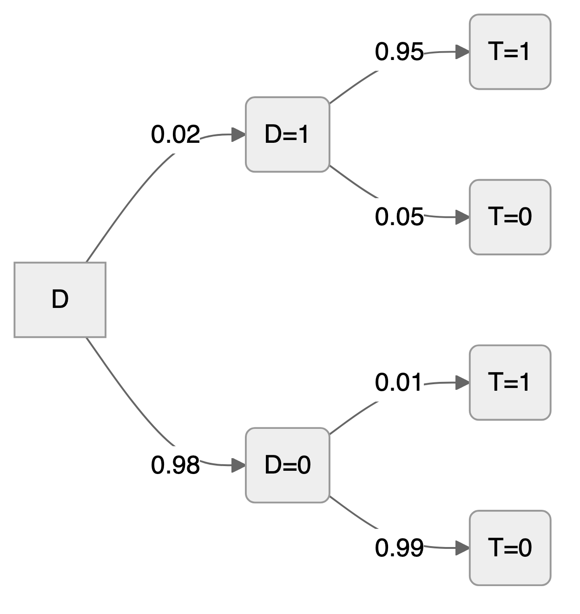
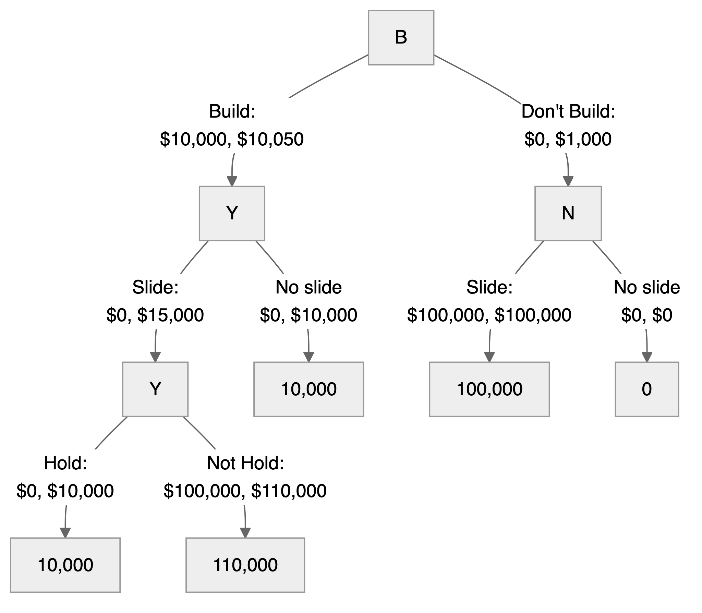



> "*I would never die for my beliefs because I might be wrong.*"---Bertrand Russell

# Utility, Risk and Decisions {#sec-Decisions}
Statistical decision theory asks: given what the data tell us, what should we do? The problem typically splits into two. First, learn something from data: estimate parameters, fit a model. Second, use that learning to choose an action. In finance, this means estimating means and covariances from historical data, then constructing a portfolio. In statistics, it means evaluating which estimator or hypothesis test performs best under a given criterion.

The examples in the previous chapter focused on learning about unknown quantities from data, expressed through posterior distributions. In many applications, however, we must turn a posterior into an action: approve a loan, deploy a model, choose a medical treatment, or ship a product variant. This step requires an additional ingredient beyond probability modeling: a loss function that formalizes what we mean by a good or bad decision.

For a parameter $\theta$ and a decision (or estimate) $a$, a loss $\mathcal{L}(\theta, a)$ assigns a numerical penalty to choosing $a$ when the truth is $\theta$. Given data $y$, Bayesian decision making compares actions using posterior expected loss,
$$
\E{\mathcal{L}(\theta, a)\mid y}.
$$
The optimal Bayesian action is the posterior Bayes rule
$$
a^*(y) = \arg\min_a \E{\mathcal{L}(\theta, a)\mid y}.
$$

Several estimators that are common in statistics can be interpreted as Bayes rules under simple choices of loss. For example, the posterior mean minimizes squared error loss $\mathcal{L}(\theta,a)=(\theta-a)^2$, while the posterior median minimizes absolute error loss $\mathcal{L}(\theta,a)=|\theta-a|$. Under 0--1 loss for point classification, the posterior mode becomes optimal. This perspective makes point estimation a special case of a more general principle: choose the action that is optimal under the posterior distribution and the costs of being wrong.

This chapter develops this decision-theoretic framework systematically, connecting loss functions to utility, risk, and optimal actions under uncertainty.

## Expected Utility
Let $P,Q$ be two possible *risky gambles* or probability bets. An agent's preferences can then be specified as an ordering on probability bets where we write $P \succeq Q$ if $P$ is at least as good as $Q$, $P \succ Q$ for strict preference, and $P \sim Q$ for indifference. A compound or mixture bet is defined by the probability assignment $p P + (1 - p ) Q$ for a prospect weight $0 \leq p \leq 1$.

Ramsey-de Finetti-Savage show that if an agent's preferences satisfy a number of plausible axioms---completeness, transitivity, continuity and independence---then they can be represented by the expectation of a utility function. The theory is a *normative* one and not necessarily *descriptive*. It suggests how a rational agent should formulate beliefs and preferences and not how they actually behave.

This representation of preferences in terms of expected utility $U(P)$ of a risky gamble is then equivalent to 
$$
P \succeq Q \; \; \iff \; \; U (P) \geq U (Q )
$$
Therefore, the higher the value taken by the utility function, the more the gamble is preferred. Specifically, the axioms lead to existence of expected utility and uniqueness of probability.  

Formally, 

1. If $P \succ Q$, $P \succeq R \succeq Q$ and $w P + (1 - w ) Q \sim R$
then $w$ is unique.
1. There exists an expected utility $U(\cdot )$ such that 
$P \succeq Q ~ \iff ~ U (P) \geq U (Q)$.
Furthermore
$$
U \left (w P + (1 - w ) Q \right ) = wU (P) +(1 - w ) U(Q)
$$
for any $P, Q$ and $0 \leq w \leq 1$.

This implies that $U$ is additive and it is also unique up to affine transformation, that is, any $aU + b$ with $a > 0$ represents the same preferences. Like a thermometer scale, two agents can disagree on units (Fahrenheit vs. Celsius) but agree on all decisions.

Proof: If $w$ is not unique, then $\exists w_1$ such that $w_1 P + (1 - w_1 ) Q \sim R$.
Without loss of generality assume that $w_1 < w$ and so $0 < w - w_1 \leq 1 - w_1$.
However, we can write the bet $Q$ as
$$
Q = \left ( \frac{w-w_1}{1-w_1} \right ) Q + \left ( \frac{1-w}{1-w_1} \right ) Q
$$
By independence, as $P \succ Q$ we have
$$
\left ( \frac{w-w_1}{1-w_1} \right ) P + \left ( \frac{1-w}{1-w_1} \right ) Q \succ Q 
$$
However,
$$
w P + ( 1 - w) Q = w_1 P + (1 - w_1 ) \left (  \left ( \frac{w-w_1}{1-w_1} \right ) P + \left ( \frac{1-w}{1-w_1} \right ) Q
\right ) 
$$
implying by independence that
$$
w P + (1 - w ) Q \succ w_1 P + (1 - w_1 ) Q
$$
which is a contradiction, since both sides are indifferent to $R$.

This can be used together with the axioms to then prove the existence and uniqueness of a utility function.

::: {#thm-existence}
## Uniqueness of Utility
If $V$ is any other function satisfying these results, then $V$ is an affine function of $U$.
:::
::: {.proof}
If $\forall P , Q$ we have $P \sim Q$, then define $u(P) \equiv 0$. Hence suppose that there exists $S \succ T$. Define $U(S) =1$ and $U(T)=0$. For any $P \in \mathcal{P}$ there are five possibilities: $P \succ S$ or $P \sim S$ or $S \succ P \succ T$ or $P \sim T$ or $T \succ P$.

In the first case, define $1/U(P)$ to be the unique $p$ (see previous theorem) defined by
$p P + ( 1 -p )T \sim S$. In the second case, define $U(P) =1$. In the third, there exists a unique $q$ with
$q S + ( 1 -q )T \sim P$ and then define $U(P)=q$. In the fourth case, define $U(P)=0$ and finally, when 
$T \succ P$ there exists a unique $r$ with $r S + ( 1-r )P \sim T$, and then we define $U(P) = - r / (1 - r)$.

Then check that $U(P)$ satisfies the conditions. For uniqueness, let $V$ be any other function satisfying them and put $a = V(S) - V(T) > 0$ and $b = V(T)$. Because $V(wP + (1-w)Q) = wV(P) + (1-w)V(Q)$ as well, the relation that defines $U(P)$ in each case gives $V(P) = aU(P) + b$: $qS + (1-q)T \sim P$ gives $V(P) = aq + b$, $pP + (1-p)T \sim S$ gives $V(P) = b + a/p$, and $rS + (1-r)P \sim T$ gives $V(P) = b - ar/(1-r)$, while $P \sim S$ and $P \sim T$ give $V(P) = a + b$ and $V(P) = b$. Hence $V = aU + b$ with $a > 0$. See Savage (1954), Ramsey (1926), and de Finetti (1931).
:::

Other interesting extensions: how do people come to a consensus [@degroot1974reaching; @morris1994trade; @morris1996speculative]. Ramsey [-@ramsey1926truth] observation that if someone is willing to offer you a bet, then that's conditioning information for you. All probabilities are conditional probabilities. 

If the bet outcome $x$ is a monetary value, then the utility functions $x, x^2, \sqrt{x}, \ln x$ are all monotonically increasing (the more the better). However, the utility function $x^2$ is convex, and the utility function $\ln x$ is concave. The concavity of the utility function implies that the agent is risk averse, and the convexity implies that the agent is risk seeking. 

::: {#exm-stpetersburg}
## Saint Petersburg Paradox
The Saint Petersburg paradox is a concept in probability and decision theory that was first introduced by Daniel Bernoulli in 1738. It revolves around the idea of how individuals value risky propositions and how those valuations may not align with classical expected utility theory.

The paradox is named after the city of Saint Petersburg, where the problem was formulated.

Imagine a gambling game where a fair coin is flipped repeatedly until it lands on heads. The payoff for the game is $2^N$, where $N$ is the number of tosses needed for the coin to land on heads. The expected value of this game, calculated by multiplying each possible payoff by its probability and summing the results, is infinite:

$$
E(X) = \frac{1}{2} \cdot 2 + \frac{1}{4} \cdot 4 + \frac{1}{8} \cdot 8 + \ldots = \infty
$$

This means that, in theory, a rational person should be willing to pay any finite amount to play this game, as the expected value is infinite. However, in reality, most people would be unwilling to pay a large amount to play such a game.

The paradox arises because traditional expected utility theory assumes that individuals make decisions based on maximizing their expected gain. Bernoulli argued that people do not maximize expected monetary value but rather expected utility, where utility is a subjective measure of satisfaction or happiness. He proposed that individuals exhibit diminishing marginal utility for wealth, meaning that the additional satisfaction gained from an extra unit of wealth decreases as total wealth increases.

In the case of the Saint Petersburg paradox, although the expected monetary value is infinite, the utility gained from each additional dollar diminishes rapidly, leading to a reluctance to pay large amounts to play the game.

In modern decision theory and economics, concepts like diminishing marginal utility and expected utility are fundamental in understanding how individuals make choices under uncertainty and risk.

One common approach is to consider aspects of potential players, such as their possible risk aversion, available funds, etc., through a utility function $U(x)$. Applying a utility function in this situation means changing our focus to the
quantity 
$$
E[U(X)] = \sum^\infty_{k=1} 2^{-k} U(2^k).   
$$

Some examples of utility functions are,

- $U(x) = W_0 (1-x^{-\alpha})$, $\alpha > 0$, which gives an expected utility of $W_0 \left(1-\frac{1}{2^{\alpha+1}-1}\right)$
- Log utility, $U(x) = \log(x)$, with expected value $2 \log(2)$.


Notice that after obtaining an expected utility value, you'll have to find the corresponding reward/dollar amount.

For the log utility case, we need to find the certain dollar amount $x^*$ that provides the same utility as playing the game. Setting $U(x^*) = 2\log(2)$, we solve:
$$
\log(x^*) = 2\log(2) = \log(2^2) = \log(4)
$$
which gives $x^* = 4$. Therefore, under log utility, a rational player would be willing to pay at most \$4 to play the Saint Petersburg game, despite its infinite expected monetary value. This is a dramatic reduction from infinity and demonstrates how risk aversion (captured by the concave log utility function) resolves the paradox.

Similarly, for the power utility $U(x) = W_0 (1-x^{-\alpha})$ with $\alpha > 0$, we have an expected utility of $W_0 \left(1-\frac{1}{2^{\alpha+1}-1}\right)$. To find the certainty equivalent $x^*$, we solve:
$$
W_0 (1-(x^*)^{-\alpha}) = W_0 \left(1-\frac{1}{2^{\alpha+1}-1}\right)
$$
which simplifies to $(x^*)^{-\alpha} = \frac{1}{2^{\alpha+1}-1}$, giving:
$$
x^* = \left(2^{\alpha+1}-1\right)^{1/\alpha}
$$
For example, with $\alpha = 1$, we get $x^* = (2^2-1)^1 = 3$ dollars. As risk aversion increases (larger $\alpha$), the certainty equivalent further decreases.

Bernoulli's resolution of this paradox was a watershed moment: it shifted the focus from objective *expected value* (which is infinite here) to subjective *expected utility*. This idea, that people value money non-linearly, became the cornerstone of the modern economic theory of risk.
:::

::: {#exm-newcomb}
## Newcomb's Problem

Newcomb's problem, introduced by physicist William Newcomb and first analyzed philosophically by Robert Nozick in 1969, is a long-standing puzzle in decision theory. It exposes a fundamental tension between two seemingly reasonable principles for making decisions under uncertainty.

Following @seidenfeld1984comments, the canonical formulation involves a choice between two options: *option 1*, to take the contents of an opaque box (one-box); and *option 2*, to take the contents of the opaque box plus the $1,000 in the transparent box (two-boxes). The opaque box contains either $1,000,000 or nothing, depending upon a demon's earlier prediction that the choice is for one-box or for two-boxes. The decision matrix summarizes the choice problem:

|                        | Demon predicts correctly | Demon predicts incorrectly |
|------------------------|:------------------------:|:--------------------------:|
| Option 1 (one-box)      | $1,000,000               | $0                         |
| Option 2 (two-boxes)    | $1,000                   | $1,001,000                 |

This Savage-styled formulation frames the demon's accuracy as the state of the world. Seidenfeld notes the convenience: the verity of the demon's prediction affords a binary partition of states that can be treated as probabilistically act-independent. What is striking is that neither option dominates the other: option 1 wins when the demon is correct, option 2 wins when incorrect. Yet taking two boxes always yields \$1,000 more *for any fixed content of the opaque box*. We assume the agent takes no interest in the consequences apart from monetary outcomes (no intrinsic desire to frustrate the demon). The twist is to add a constraint that the chooser admits the demon is a very accurate predictor, with conditional probability given the agent's choice:
$$
P(\text{demon predicts option}_i \mid \text{option}_i) = 1 - \varepsilon \approx 1.
$$

Then the conditional expected utility of option 1 exceeds that of option 2, against the recommendation afforded by appeal to dominance. As Seidenfeld notes, this exposes a "deep rooted problem in normative expected utility theory" arising from "the difference between probabilistic dependence and causal dependence across act-state pairs."

Two principles from decision theory give conflicting advice:

*Conditional Expected Utility*: Given the predictor's high accuracy, the expected value of one-boxing is approximately $(1-\varepsilon) \times 1{,}000{,}000 + \varepsilon \times 0 \approx \$1{,}000{,}000$, while two-boxing yields approximately $\varepsilon \times 1{,}001{,}000 + (1-\varepsilon) \times 1{,}000 \approx \$1{,}000$. One-boxing maximizes expected utility.

*Strategic Dominance*: The predictor has already made the prediction and placed the money. Whatever is in the opaque box is "fixed and determined" when the agent chooses. Attention to the causal efficacy of the choice makes the dominating option right.

The limiting case illuminates the paradox. Consider an *infallible* demon where $\varepsilon = 0$. Then by standard decision theory, the problem becomes one of choice under certainty: there is no risk involved. Taking option 1 and getting $1,000,000, or taking option 2 and getting $1,000, are the only possibilities. Do causal decision theorists advocate option 2 when it is certain to yield $1,000 whereas option 1 is certain to yield $1,000,000? As Seidenfeld argues, "To recommend two-boxes in this case is to contravene more than subjective expected utility theory—it is to overturn what is non-controversial by all standard accounts of choice, from expected utility to minimax theory to the very principle of dominance."

Seidenfeld also raises a compelling third-person version: if your friend faces the Newcomb choice, what are your betting odds that conditional on option 1 your friend becomes a millionaire? By the weakest principles of conditionalization, these are fixed by the problem's constraints. What is your fair-market price for your friend's choice? Given your friend chooses one-box, is there any reason to pass up the bargain to buy the proceeds for $10,000?

The problem touches on deep questions about causation and free will. Causal decision theory holds that we should choose actions based on their causal consequences, and since our choice *cannot causally affect* what is already in the opaque box, we should two-box. Evidential decision theory counters that we should choose actions that provide the best *evidence* about outcomes, and one-boxing is strong evidence that the box contains the million.

Newcomb's problem has practical relevance beyond philosophy. In game theory, similar structures arise when facing opponents who can anticipate your strategy. In artificial intelligence, it relates to how agents should reason when their decision procedures are transparent to other agents. The problem also connects to debates about deterrence in international relations, where the credibility of threats depends on whether adversaries believe you would follow through, a prediction about your future choice that influences present outcomes.

A 2020 survey of professional philosophers found a modest plurality (39% vs. 31%) favoring two-boxing, though the debate remains very much alive.
:::

Now, consider a more general situation: when you have two gambles 1: get $P_1$ for sure, 2: get $P_2 = P_1+k$ and $P_3 = P_1-k$ with probability 1/2. Then we will compare the utility of those gambles 
$$
\dfrac{1}{2}U(P_2) + \dfrac{1}{2}U(P_3) \text{ and } U(P_1).
$$
If the utility function is linear then we should be indifferent between the two gambles. However, if the utility function is concave, then we should prefer the sure thing. This is known as the *certainty effect*.
$$
\dfrac{1}{2}U(P_2) + \dfrac{1}{2}U(P_3) < U(P_1).
$$

The usual situation can be described as follows. Let $\Omega$ be a finite set of possible outcomes with $\Omega = \{ \omega_1 , \ldots , \omega_n \}$. Let $P_i$ be the consequence that assigns one to outcome $\omega_i$ and zero otherwise, and let $P = ( p_1 , \ldots , p_n )$ assign probability $p_i$ to outcome $\omega_i$. Then we can write the expected utility, $U(P)$, of the gamble $P$ as 
$$
U(P) = \sum_{i=1}^n p_i U( P_i ).
$$ 
That is, the utility of $P$ is the expected utility of a random variable $W$ (wealth) that takes the value $P_i$ if the outcome is $\omega_i$. Therefore, we can write $U(P) = \E[P]{U(W)}$.

This leads us to the notion of *risk aversion* and a categorization of agents according to their risk tolerance: the agent is said to be 

1. *Risk Averse* if $\E[P]{U(W)} \leq U\left(\E[P]{W}\right)$
1. *Risk Neutral* if $\E[P]{U(W)} = U\left(\E[P]{W}\right)$
1. *Risk Seeking* if $\E[P]{U(W)} \geq U\left(\E[P]{W}\right)$

Here we assume that these hold for all probabilities and random variables. Risk aversion is equivalent to the agent having concave utility and risk seeking convex.

::: {#exm-risk}
### Risk Aversion

Consider the family of Constant Relative Risk Aversion (CRRA) utility functions. This family includes the log-utility (Kelly) 
$$
U(W)=\log(W),
$$ 
and the power utility 
$$
U(W)=\dfrac{W^{1-\gamma} - 1}{1-\gamma}.
$$ 
The log-utility is a limiting case of the power utility when $\gamma \to 1$. The parameter $\gamma$ controls the curvature of the function and is known as the coefficient of relative risk aversion:
$$
R(W) = -W \frac{U''(W)}{U'(W)} = \gamma.
$$
Higher values of $\gamma$ imply greater concavity, meaning the agent is more risk-averse and requires a higher risk premium to accept a gamble.

- $\gamma \to 0$: Risk neutral (linear utility).
- $\gamma = 0.5$: Moderate risk aversion (less than log).
- $\gamma = 1$: Log utility (Kelly criterion).
- $\gamma > 1$: High risk aversion (e.g., fractional Kelly).

@fig-risk-aversion demonstrates the effect of $\gamma$. As $\gamma$ increases, the utility function becomes more curved ("bends" more). This means that losses (moving left from $W=1$) hurt much more in utility terms than equivalent gains (moving right) help.

```{r}
#| fig-height: 3
#| fig-cap: "Utility functions for different risk aversion parameters."
#| label: fig-risk-aversion
w <- seq(0.2, 2, length.out = 500)
gamma <- 2
# Plot this data frame
df <- data.frame(
  w = w,
  logu = log(w),
  kelly = (w^(1 - gamma) - 1) / (1 - gamma)
)
ulab <- expression("log utility", "power utility" ~ (gamma == 2))
# 3. Plot use different y-scales for
ggplot(df, aes(x = w)) +
  geom_line(aes(y = logu, color = "log utility", linetype = "log utility"), size = 1.3) +
  geom_line(aes(y = kelly, color = "power utility (gamma=2)", linetype = "power utility (gamma=2)"), size = 1.3) +
  geom_vline(xintercept = c(0.5, 1, 1.5), linetype = "dashed", color = "black") +
  scale_color_manual(values = c("log utility" = "blue", "power utility (gamma=2)" = "red"), labels = ulab) +
  scale_linetype_manual(values = c("log utility" = "solid", "power utility (gamma=2)" = "dotdash"), labels = ulab) +
  labs(
    title = "Concave Utility Functions",
    x = "Wealth (w)",
    y = "Utility",
    color = "Utility Type",
    linetype = "Utility Type"
  ) +
  theme_minimal() +
  theme(legend.position = "bottom", legend.key.width = unit(1.5, "cm"))
```

To see this concretely, consider a simple gamble with two equally likely outcomes: wealth $w_1 = 0.5$ and $w_2 = 1.5$. The expected wealth is $E[W] = 0.5(0.5) + 0.5(1.5) = 1.0$.

For a risk-neutral agent ($\gamma=0$), the utility is linear, so the value of the gamble is exactly the expected wealth ($1.0$). However, for a risk-averse agent ($\gamma > 0$), the utility of the expected wealth is greater than the expected utility of the gamble. The *Certainty Equivalent (CE)* is the guaranteed amount of wealth that provides the same utility as the risky gamble. The difference between the expected wealth and the certainty equivalent is the *Risk Premium*, the amount the agent is willing to "pay" (forgo in expected value) to avoid the risk.

The table below shows how the Certainty Equivalent decreases, and the Risk Premium increases as the risk aversion parameter $\gamma$ grows.

```{r}
#| echo: false
w1 <- 0.5
w2 <- 1.5
p <- 0.5
E_W <- p * w1 + (1 - p) * w2

# Define utility function (handling log case)
u_crra <- function(w, gamma) {
  if (abs(gamma - 1) < 1e-4) {
    return(log(w))
  }
  (w^(1 - gamma) - 1) / (1 - gamma)
}

# Inverse utility to find CE
u_inv <- function(u, gamma) {
  if (abs(gamma - 1) < 1e-4) {
    return(exp(u))
  }
  (u * (1 - gamma) + 1)^(1 / (1 - gamma))
}

gammas <- c(0, 0.5, 1, 2, 4)
results <- data.frame(Gamma = gammas)
results$CE <- sapply(gammas, function(g) {
  eu <- p * u_crra(w1, g) + (1 - p) * u_crra(w2, g)
  u_inv(eu, g)
})
results$RiskPremium <- E_W - results$CE

knitr::kable(results,
  digits = 3,
  col.names = c("Risk Aversion ($\\gamma$)", "Certainty Equivalent", "Risk Premium"),
  caption = "Impact of risk aversion on the valuation of a gamble with outcomes {0.5, 1.5}."
)
```
:::

::: {#exm-kelly}
## Kelly Criterion

The Kelly criterion has been used effectively by many practitioners. Ed Thorp, in his book *Beat the Dealer*, pioneered its use in blackjack and later applied it to investing in financial markets. Since then, many market participants, such as Jim Simons, have stressed the importance of this money management approach. The criterion's application extends to other domains: Phil Laak described its use for bet sizing in a game-theoretic approach to poker, and Bill Benter applied it to horse racing. Stewart Ethier provided a mathematical framework for multiple outcomes and analyzed a "play the winner" rule in roulette. Claude Shannon also developed a system to detect and exploit unintentionally biased roulette wheels, an endeavor chronicled in the book *The Eudaemonic Pie*.


Suppose you have \$1000 to invest. With probability $0.55$ you will win whatever you wager, and with probability $0.45$ you lose whatever you wager. What's the proportion of capital that leads to the fastest compounded growth rate? 

Quoting @kelly1956new, the exponential rate of growth, $G$, of a gambler's capital is 
$$
G = \lim_{T\to \infty} \frac{1}{T} \log_2 \frac{W_T}{W_0}
$$
for initial capital $W_0$ and capital after $T$ bets $W_T$.

Under the assumption that a gambler bets a fraction of his capital, $\omega$, each time, we use
$$
W_T = (1+\omega)^{k} (1-\omega)^{T-k} W_0
$$
where $k$ is the number of wins in the $T$ bets, so $T-k$ is the number of losses.
We get
$$
G = p \log_2(1+\omega)+ q \log_2(1-\omega)
$$
in which the limits of $k/T$ and $(T-k)/T$ are the probabilities $p$ and $q$, respectively.

This also comes about by considering the sequence of i.i.d. bets with
$$
p ( X_t = 1 ) = p \; \; \text{ and} \; \; p ( X_t = -1 ) = q=1-p 
$$
We want to find an optimal allocation $\omega^*$ that maximizes the expected long-run growth rate:
\begin{align*}
\max_\omega \E{\ln ( 1 + \omega X_t ) }
 & = p \ln ( 1 + \omega ) + (1 -p) \ln (1 - \omega ) \\
 & \leq p \ln p + q \ln q + \ln 2 \; \text{ and} \; \omega^\star = p - q
\end{align*}

The solution is $w^* = 0.55 - 0.45 = 0.1$.

Both approaches give the same optimization problem, which, when solved, give the optimal fraction rate $\omega^* = p-q$, thus, with $p=0.55$, the optimal allocation is 10\% of capital.

We can generalize the rule to the case of  asymmetric payouts $(a,b)$. Then the expected utility function is
$$
p \ln ( 1 + b \omega ) + (1 -p) \ln (1 - a \omega )
$$
The optimal solution is
$$
\omega^\star = \frac{bp - a q}{ab}
$$

If $a=b=1$ this reduces to the pure Kelly criterion.

A common case occurs when $a=1$ and market odds $b=O$. The rule becomes
$$
\omega^* = \frac{p \cdot O  -q }{O}.
$$

Let's consider another scenario. You have two possible market opportunities: one where it offers you $4/1$ when you have personal odds of $3/1$ and a second one when it offers you $12/1$ while you think the odds are $9/1$. 

Both offer the same $4/3$ ratio of market to personal odds. In terms of maximizing long-run growth, however, they are not identical.  

@tbl-kelly shows the Kelly criterion advises allocating about 2.5 times as much capital to the lower odds proposition: $1/16$ weight versus $1/40$. 

| Market | You   | $\Delta$    | $\omega^\star$   |
|--------|-------|--------|------------------|
| $4/1$  | $3/1$ | $1/4$  | $1/16$           |
| $12/1$ | $9/1$ | $3/10$ | $1/40$           |

: Kelly rule {#tbl-kelly}

The optimal allocation $\omega^\star = ( p O - q ) / O$ is
$$
\frac{ (1/4) \times 4 - (3/4) }{4} = \frac{1}{16} \; \text{ and} \; 
\frac{ (1/10) \times 12 - (9/10) }{12} = \frac{1}{40}.
$$

Note, that although the market-to-personal odds ratio is the same, the risk is different. The second gamble has a higher variance than the first gamble.
:::

::: {#exm-berkshire}
## Kelly Criterion for Long-Term Investing

The following example is adapted from @thorp2011kelly. In 1964, a young hedge fund manager acquired a substantial interest in a small New England textile company called Berkshire Hathaway. The stock traded then at 20. In 1998 it traded at 70,000, a multiple of 3500, and an annualized compound growth rate of about 27%, or an instantaneous rate of 24%. The manager was Warren Buffett, whom Thorp describes as the greatest investor of his time and, when he wrote, the world's second richest man. You may read about Buffett in @buffett1997clark, @hagstrom1994warren, @kilpatrick1994warren, and @lowenstein1996buffett. If, like Thorp, you were fortunate enough to meet Buffett and identify the Berkshire opportunity, what strategy does the Kelly criterion suggest?

Assume the drift rate $m = 0.20$, the volatility $s = 0.15$ and the riskless rate $r = 0.06$. Note: plausible arguments for a smaller future drift rate include regression towards the mean, the increasing size of Berkshire, and risk from the aging of management. A counter-argument, when Thorp wrote, was that Berkshire's compounding rate had been as high in its later years as in its earlier years. However, Thorp notes that the S&P 500 Index had performed much better in the years before he wrote, so the spread between the growth rates of the Index and of Berkshire was somewhat less. So, if we expect the Index growth rate to revert towards the historical mean, then we expect Berkshire to do so even more.

Consider a portfolio that holds a multiple $f$ of capital in Berkshire, borrowing at the riskless rate $r$ when $f>1$. The log capital of the repeated bets above is a random walk with drift, and likewise the log of the portfolio value $V(t)$ is approximated by Brownian motion with drift. Its long-run growth rate is $g_\infty(f) = r + f(m-r) - f^2s^2/2$, and the growth rate $G_\infty(f)$ has variance $\text{Var}(G_\infty(f)) = f^2s^2$ per year, so $\text{Sdev}(G_\infty(f)) = fs$ and growth is maximized at the Kelly leverage $f^* = (m-r)/s^2$. We write $c = f/f^*$ for the fraction of the full Kelly bet, and $t_z = z^2\,\text{Var}(G_\infty)/g_\infty^2$ for the number of years after which the expected log growth $t_z g_\infty$ equals $z$ standard deviations of $\log V(t_z)$.

From the Kelly criterion formulas, we obtain:
$$
f^* = 6.22, \quad g_\infty(f^*) = 0.495, \quad \text{Sdev}(G_\infty(f^*)) = 0.93,
$$
$$
t_z g_\infty(f^*) = 1.76z^2, \quad t_z = 3.54z^2 \text{ years}.
$$

Compare this to the unlevered portfolio, where $f = 1$ and $c = 1/6.22 \approx 0.1607$. We find:
$$
f = 1, \quad g_\infty(f) = 0.189, \quad \text{Sdev}(G_\infty(f)) = 0.15,
$$
$$
t_z g_\infty(f) = 0.119z^2, \quad t_z = 0.63z^2 \text{ years}.
$$

Leverage to the level $6.22$ would be inadvisable here in the real world because security prices may change suddenly and discontinuously. In the crash of October 1987, the S&P 500 index dropped 23% in a single day. If this happened at leverage of 2.0, the new leverage would suddenly be $77/27 = 2.85$ before readjustment by selling part of the portfolio. In the case of Berkshire, which is a large, well-diversified portfolio, suppose we chose the conservative $f = 2.0$. Note that this is the maximum initial leverage allowed "customers" under current regulations.

Then $g_\infty(2) = 0.295$. The values in 30 years for median $V(30)/V_0$ are approximately: $f = 1$, $V(30)/V_0 = 288$; $f = 2$, $V(30)/V_0 = 6{,}974$; $f = 6.22$, $V(30)/V_0 = 2.86 \times 10^6$. So the differences in results of leveraging are enormous in a generation.

In the Brownian motion approximation the probability that the portfolio ever falls to a fraction $x<1$ of its initial value is, when $g_\infty > 0$,
$$
\prob{V(t)/V_0 \leq x \text{ for some } t} = x^{2g_\infty/\text{Var}(G_\infty)}.
$$
For $r = 0$ and $f = f^*$ the exponent is $2g_\infty/\text{Var}(G_\infty) = 1$, so that the probability is exactly $x$.
:::

*Power utility* and log-utilities allow us to model constant relative risk aversion (CRRA). The main advantage is that the optimal rule is unaffected by wealth effects. The 
CRRA utility of wealth takes the form
$$
 U_\gamma (W) = \frac{ W^{1-\gamma} -1 }{1-\gamma} 
$$ 

The special case $U(W) = \log (W )$ for $\gamma = 1$. This leads to a myopic Kelly criterion rule.

## Historical Perspectives on Optimal Decision Making

The principles of optimal decision-making under uncertainty have deep historical roots that extend well beyond modern portfolio theory.

### De Finetti's Insurance Problem

In 1940, more than a decade before the canonical papers on portfolio theory, the Italian mathematician Bruno de Finetti addressed the problem of optimal retention in insurance [@definetti1940problema]. An insurance company holding a portfolio of policies faces a key decision: how much of each policy's risk should it retain versus reinsuring? This is essentially an asset allocation problem where the "assets" are insurance policies with uncertain payouts.

De Finetti formulated this as a mean-variance optimization problem with constraints $0 \le f_i \le 1$ on the retention fractions, where $f_i$ represents the fraction of policy $i$ kept for the company's own account. For uncorrelated risks, he proved that the optimal retention for each policy should be
$$
f_i = A \frac{k_i}{\sigma_i^2}
$$
where $k_i$ is the margin of gain from the policy, $\sigma_i^2$ is its variance, and $A$ is a constant determined by the company's risk tolerance. This elegant result states that retention should be proportional to profitability and inversely proportional to variance, precisely the Kelly criterion's risk-return trade-off.

De Finetti extended this analysis to the case of *correlated* risks, recognizing that insurance claims (like stock returns) are often positively correlated due to common factors such as economic conditions or natural disasters. In this case, the problem becomes significantly more complex. De Finetti showed that with correlations, one must solve a system of linear equations to determine optimal retentions, and he outlined, though did not fully solve, the general algorithm for finding the efficient frontier when risks are correlated.

De Finetti also introduced what we now call the "index of stability" for the long-run solvency of an insurance company. If $G$ is the guarantee fund, $m$ the expected annual gain, and $\sigma^2$ the variance of gains, then the probability of ruin $P$ over the long run is approximately
$$
P \approx e^{-\xi} \quad \text{where} \quad \xi = \frac{2mG}{\sigma^2}
$$
This shows that stability increases linearly with the profit margin and capital reserves, but decreases with the square of risk, a fundamental relationship that applies equally to trading and investment.

### Markowitz's Recognition

It was not until 2006 that Harry Markowitz, in a paper titled "De Finetti Scoops Markowitz" [@markowitz2006finetti], brought widespread attention to de Finetti's pioneering work. Markowitz acknowledged that de Finetti had essentially proposed mean-variance analysis with correlated risks in 1940, more than a decade before the famous 1952 papers by Markowitz himself and A.D. Roy.

Despite their mathematical similarity, the two formulations differ in important ways that reflect their distinct applications. Markowitz's portfolio problem includes a budget constraint $\sum X_i = 1$ (fractions invested must sum to one) and seeks either to maximize expected return for a given level of variance, or equivalently to minimize variance for a given expected return. In contrast, de Finetti's reinsurance problem has no budget constraint: the company can choose any retention fractions $0 \le f_i \le 1$ independently for each policy. His objective is to minimize risk (variance) subject to maintaining a fixed level of expected profit from the portfolio. Both formulations trace out an efficient frontier, but they arrive there from different starting points: Markowitz optimizes the trade-off between return and risk along a budget line, while de Finetti optimizes retention to minimize risk for a desired profit margin. Mathematically, both can be solved by minimizing $L = \frac{1}{2}V_P - w E_P$ for various weights $w$, but the constraint sets differ fundamentally.

Markowitz noted that while de Finetti solved the reinsurance problem completely for uncorrelated risks and outlined key properties for the correlated case, he did not provide a complete computational algorithm for the latter. Markowitz showed that the de Finetti problem is a special case of problems solvable by the Critical Line Algorithm (CLA) he developed in 1956. The CLA efficiently traces out the entire efficient frontier by moving along connected line segments in $(X, \eta, \lambda)$ space, where $\eta_i = \partial L/\partial X_i$ measures the marginal change in the objective function.

An interesting feature of the de Finetti problem, which Markowitz corrected, concerns the final segment of the efficient frontier. De Finetti conjectured that the path from maximum expected return to minimum variance always approaches the zero portfolio from the interior of the feasible region. Markowitz proved this is not always true: with correlated risks, some policies may already be at zero retention on the final segment. However, Markowitz established a "correct last segment theorem": once no policy is fully retained (all $X_i < 1$), that segment must lead directly to the minimum variance portfolio.

### Dynamic Kelly and Bellman's Principle

While the static Kelly criterion provides optimal allocation for a single period, real investors face sequential decisions where today's choices affect tomorrow's opportunities. This is where dynamic programming enters the picture. Richard Bellman's Principle of Optimality (1957) states that "whatever the initial state and initial decision, the remaining decisions must constitute an optimal policy with regard to the state resulting from the first decision."

For asset allocation, this leads to a fundamental recursion. If $Q_t(s, a)$ denotes the value of taking action $a$ in state $s$ at time $t$, then
$$
Q_t(s, a) = \E{r(a, s, S_{t+1}) + V(S_{t+1}) \mid s, a}
$$
where $V(s) = \max_a Q_t(s, a)$ is the value function. In the i.i.d. case with logarithmic utility, the myopic Kelly rule remains optimal: future learning opportunities don't change today's allocation. This simplification explains the Kelly criterion's enduring popularity.

::: {#res-option-value-of-learning}

However, when the investor can *learn* about the underlying probabilities, the dynamic problem becomes more sophisticated [@jacquier2013asset]. Consider a Bernoulli-Beta setting where success probability $p$ is unknown and the investor starts with prior $p \sim \text{Beta}(\alpha, \beta)$. The myopic Kelly rule would invest nothing if $\alpha < \beta$ (unfavorable prior odds). Yet the dynamic Bellman solution shows that even a risk-averse investor with $\alpha < \beta$ should invest a small positive amount! 

The reason is the *option value of learning*: by investing even when current odds seem unfavorable, the investor gains information that may reveal the true environment is actually favorable. For instance, with a uniform prior $\text{Beta}(1,1)$ and 10 remaining periods, an investor might optimally allocate 11.7% even after observing one failure (giving posterior $\text{Beta}(1,2)$ with expected odds 1:2 against). The potential to learn trumps the current negative expectation. This insight has direct implications for exploration-exploitation trade-offs in uncertain environments.

:::

### Livermore's Trading Wisdom

The legendary trader Jesse Livermore, whose methods were chronicled in the 1923 classic *Reminiscences of a Stock Operator*, articulated trading principles that align remarkably well with Bellman's optimal control framework [@polson2014bellman]. Two of his famous maxims are particularly revealing:

::: {#res-livermore-maxims}

"Profits always take care of themselves, but losses never do." In the Bellman framework, suppose an investor holds a long position because $Q_t(s, a_L) > Q_t(s, a_N)$ (long is better than neutral). If the position subsequently loses money, the trader faces a choice. Under unchanged beliefs, the same logic would suggest staying long. But Livermore's insight is that the price movement itself contains information. By Bayes' theorem, observing a loss should update beliefs such that $Q_{t+1}^{q \cup \{x_t\}}(s', a_L) < Q_{t+1}^{q \cup \{x_t\}}(s', a_N)$, where $q \cup \{x_t\}$ represents updated beliefs incorporating the price change. The optimal action is to exit. Conversely, a winning position confirms the original thesis: "it takes care of itself."

"Never average down." The practice of doubling up on losing positions seems to violate basic decision theory. If averaging down is optimal, it means $Q_t(s', a_L) > Q_t(s', a_N)$ after a loss. But if we've updated beliefs based on the adverse price movement, this typically cannot hold unless we've received external information beyond what the market revealed. Livermore put it bluntly: "Why send good money after bad?"

:::

These trading heuristics embody Bellman's principle that the only thing that matters for optimal decision-making is the current state and what's optimal going forward, not what you paid, what you hoped for, or what you "should" have made. The past is irrelevant except insofar as it informs beliefs about the future. This perspective removes emotional obstacles to sound decision-making: the sunk cost of past losses, the pride in being "right," or the fear of admitting error.

These four contributions (de Finetti's insurance mathematics, Markowitz's portfolio theory, Bellman's dynamic programming, and Livermore's practical wisdom) represent complementary perspectives on the same fundamental problem of optimal decision-making under uncertainty. The common thread: optimal allocation depends on the *ratio of expected excess return to variance*, must account for correlations, must adapt to new information, and should never let past outcomes cloud judgment about future prospects.


## Statistical Decisions and Risk

While Bernoulli's work laid the foundation for expected utility, it was in the mid-20th century that *L.J. Savage* and *John von Neumann/Oskar Morgenstern* formalized these concepts into a rigorous mathematical decision theory. This framework provides the "rational" standard against which human behavior is often measured.

The statistical decision making problem can be posed as follows. A decision maker (you) has to choose from a set of decisions or acts. The consequences of these decisions depend on an unknown state of the world. Let $d\in\mathcal{D}$
denote the decision and $\theta\in\Theta$ the state of the world. As an example, think of $\theta$ as the unknown parameter and the decision as choosing a parameter estimation or hypothesis testing procedure. To provide information about the parameter, the decision maker obtains a sample $y\in\mathcal{Y}$ that is generated from the likelihood function $p\left(y\mid\theta\right)$. The resulting decision depends on the observed data, is denoted as $d\left(  y\right)$, and is commonly called the decision rule.

To make the decision, the decision maker uses a "loss" function as a quantitative metric to assesses the consequences or performance of different decisions. For each state of the world $\theta$, and decision $d$, $\mathcal{L}\left(  \theta,d\right)$ quantifies the "loss" made by choosing $d$ when the state of the world is $\theta.$ Common loss functions include a quadratic loss,
$\mathcal{L}(\theta,d)=(\theta-d)^{2},$ an absolute loss, $\mathcal{L}(\theta,d)=|\theta-d|$, and a $0-1$ loss, 
$$
\mathcal{L}(\theta,d)=L_{0}1_{\left[  \theta\in\Theta_{0}\right]  }+L_{1}1_{\left[  \theta\in\Theta_{1}\right]  }.
$$ 
For Bayesians, the utility function provides a natural loss function. Historically, decision theory was developed by classical statisticians, thus the development in terms of "objective" loss functions instead of "subjective" utility.

Classical decision theory takes a frequentist approach, treating parameters as "fixed but unknown" and evaluating decisions based on their population properties. Intuitively, this thought experiment entails drawing a dataset $y$
of given length and applying the same decision rule in a large number of repeated trials and averaging the resulting loss across those hypothetical samples. Formally, the classical risk function is defined as
$$
R(\theta,d)=\int_{\mathcal{Y}}\mathcal{L}\left[  \theta,d(y)\right]  p(y \mid \theta )dy=\E{\mathcal{L}\left[  \theta,d(y)\right]  \mid \theta}.
$$
Since the risk function integrates over the data, it does not depend on a given observed sample and is therefore an ex-ante or a-priori metric. In the case of quadratic loss, the risk function is the mean-squared error (MSE) and is
\begin{align*}
R(\theta,d)  &  =\int_{\mathcal{Y}}\left[  \theta-d\left(  y\right)  \right]
^{2}p(y \mid \theta)dy\\
&  =\E{\left(  d\left(  y\right)  -\E{d\left(  y\right)
\mid \theta}  \right)  ^{2} \mid \theta}  +\E{\left(
\E{d\left(  y\right)  \mid \theta}  -\theta\right)  ^{2} \mid \theta}
\\
&  =\text{Var}\left(  d\left(  y\right)  \mid \theta\right)  +\left[  bias\left(
d\left(  y\right)  -\theta\right)  \right]  ^{2}%
\end{align*}
which can be interpreted as the squared bias of the decision/estimator plus the variance of the decision/estimator. Common frequentist estimators choose unbiased estimators so that the bias term is zero, and among them the one with the smallest variance.^[Unbiased estimators are not unique in general: if $y_1, \ldots, y_n$ are i.i.d. $N(\theta, 1)$, both $y_1$ and $\bar{y}$ are unbiased for $\theta$, with variances $1$ and $1/n$. When a complete sufficient statistic exists, the Lehmann-Scheffé theorem [@lehmann1950completeness] shows that an unbiased function of it is the unique minimum variance unbiased estimator.]

The goal of the decision maker is to minimize risk. Unfortunately, rarely is there a decision that minimizes risk uniformly for all parameter values. To see this, consider a simple example of $y\sim N\left(  \theta,1\right)$, a quadratic loss, and two decision rules, $d_{1}\left(  y\right)  =0$ or $d_{2}\left(  y\right)  =y$. Then, $R\left(  \theta,d_{1}\right)  =\theta^{2}$ and $R\left(  \theta,d_{2}\right)  =1$. If $\left\vert \theta\right\vert <1$, then $R\left(  \theta,d_{1}\right)  <R\left(  \theta,d_{2}\right)$, with the ordering reversed for $\left\vert \theta\right\vert >1$. Thus, neither rule uniformly dominates the other.

One way to deal with the lack of uniform domination is to use the minimax principle. For each decision rule, first compute its worst-case risk over the parameter space,
$$
\bar{R}(d)=\underset{\theta\in\Theta}{\sup}\,R(\theta,d)\text{,}%
$$
and then choose the rule that minimizes this worst-case risk:\
$$
d_{m}^{\ast}=\underset{d\in\mathcal{D}}{\arg\min}\,\underset{\theta\in\Theta}{\sup}\,R(\theta,d)=\underset{d\in\mathcal{D}}{\arg\min}\,\bar{R}(d)\text{.}%
$$
The resulting decision is known as a minimax decision rule. The motivation for minimax is game theory, with the idea that the statistician chooses the best decision rule against the other player, mother nature, who chooses the worst parameter.

The Bayesian approach treats parameters as random and specifies both a likelihood and prior distribution, denoted here by $\pi\left(  \theta\right)$. The Bayesian decision maker recognizes that both the data and parameters are random, and accounts for both sources of uncertainty when calculating risk. The Bayes risk is defined as \
\begin{align*}
r(\pi,d)  &  =\int_{\mathcal{\Theta}}\int_{\mathcal{Y}}\mathcal{L}\left[  \theta ,d(y)\right]  p(y \mid \theta)\pi\left(  \theta\right)  dyd\theta\\
&  =\int_{\mathcal{\Theta}}R(\theta,d)\pi\left(  \theta\right)  d\theta =\E[\pi]{R(\theta,d)},
\end{align*}
and thus the Bayes risk is an average of the classical risk, with the expectation taken under the prior distribution. The Bayes decision rule minimizes expected risk:\
$$
d_{\pi}^{\ast}=\underset{d\in\mathcal{D}}{\arg\min}\text{ }r(\pi,d)\text{.}%
$$
The classical risk of a Bayes decision rule is defined as $R\left(
\theta,d_{\pi}^{\ast}\right)$, where $d_{\pi}^{\ast}$ does not depend on $\theta$ or $y$. Minimizing expected risk is consistent with maximizing posterior expected utility or, in this case, minimizing expected loss.
Expected posterior risk is
$$
r(\pi,d)=\int_{\mathcal{Y}}\left[  \int_{\mathcal{\Theta}}\mathcal{L}\left[
\theta,d(y)\right]  p(y \mid \theta)\pi\left(  \theta\right)  d\theta\right]  dy,
$$
where the term in the brackets is posterior expected loss. Minimizing posterior expected loss for every $y\in\mathcal{Y}$ is clearly equivalent to minimizing posterior expected risk, provided it is possible to interchange the order of integration.

The previous definitions did not explicitly state that the prior distribution was proper, that is, that $\int_{\mathcal{\Theta}}\pi\left(  \theta\right)d\theta=1$. In some applications and for some parameters, researchers may use priors that do not integrate, $\int_{\Theta}\pi\left(  \theta\right)d\theta=\infty$, commonly called improper priors. A generalized Bayes rule is one that minimizes $r(\pi,d),$ where $\pi$ is not necessarily a distribution, if such a rule exists. If $r(\pi,d)<\infty$, then the mechanics of this rule is clear, although its meaning is less clear.


## Unintuitive Nature of Decision Making
Despite the elegant mathematical framework of Utility Theory and Statistical Decision Theory established by Savage and von Neumann, actual human decision-making often deviates from these normative axioms. Experiments by *Ellsberg* and *Allais* demonstrated that people frequently violate the axioms of independence and consistency when faced with ambiguity or specific risk profiles.

::: {#exm-ellberg}
## Ellsberg Paradox: Ambiguity Aversion

The Ellsberg paradox is a thought experiment that was first proposed by Daniel Ellsberg in 1961. It is a classic example of a situation where individuals exhibit ambiguity aversion, meaning that they prefer known risks over unknown risks.

There are two urns, each containing 100 balls. It is known that urn A contains 50 red and 50 black, but urn B contains an unknown mix of red and black balls. The following bets are offered to a participant:

| Bet  | Condition | Payoff if True | Payoff if False |
|:----:|:----------|:--------------:|:---------------:|
| 1A   | Red drawn from urn A | $1 | $0 |
| 2A   | Black drawn from urn A | $1 | $0 |
| 1B   | Red drawn from urn B | $1 | $0 |
| 2B   | Black drawn from urn B | $1 | $0 |

Most participants prefer bet 1A over 1B (preferring the known 50% chance over the unknown probability of drawing red from urn B), and they also prefer bet 2A over 2B (again preferring the known 50% chance over the unknown probability of drawing black from urn B).

This pattern of preferences violates the axioms of expected utility theory. If we denote the probability of drawing a red ball from urn B as $p$, then:

- Preferring 1A over 1B implies: $0.5 > p$
- Preferring 2A over 2B implies: $0.5 > (1-p)$, which means $p > 0.5$

These two inequalities are contradictory, yet this preference pattern is commonly observed. The paradox demonstrates that people exhibit *ambiguity aversion*: they prefer known probabilities (risk) over unknown probabilities (ambiguity), even when the expected values might be similar. This behavior cannot be explained by standard expected utility theory, which treats all probabilities symmetrically regardless of whether they are known or unknown.

The Ellsberg paradox demonstrates that human decision-making is sensitive not just to risk (known probabilities) but to *ambiguity* (unknown probabilities). Standard expected utility theory fails to capture this "ambiguity aversion," leading to the development of more generalized decision theories that incorporate confidence in probability estimates.

:::


::: {#exm-allias}
## Allais Paradox: Independence Axiom

The Allais paradox is a choice problem designed by Maurice Allais to show an inconsistency of actual observed choices with the predictions of expected utility theory. The paradox is that the choices made in the second problem seem irrational, although they can be explained by the fact that the independence axiom of expected utility theory is violated.

We run two experiments. In each experiment, a participant has to make a choice between two gambles.

:::: {layout-ncol=2}

::: {}
*Experiment 1*

| Gamble $\mathcal{G}_1$ |        | Gamble $\mathcal{G}_2$ |        |
|:-------------------:|:------:|:-------------------:|:------:|
| Win                 | Chance | Win                 | Chance |
| $25m                | 0      | $25m                | 0.1    |
| $5m                 | 1      | $5m                 | 0.89   |
| $0m                 | 0      | $0m                 | 0.01   |
:::

::: {}
*Experiment 2*

| Gamble $\mathcal{G}_3$ |        | Gamble $\mathcal{G}_4$ |        |
|:-------------------:|:------:|:-------------------:|:------:|
| Win                 | Chance | Win                 | Chance |
| $25m                | 0      | $25m                | 0.1    |
| $5m                 | 0.11   | $5m                 | 0      |
| $0m                 | 0.89   | $0m                 | 0.9    |
:::

::::


The difference in expected gains is identical in two experiments
```{r}
#| echo: true
E1 <- 5 * 1
E2 <- 25 * 0.1 + 5 * 0.89 + 0 * 0.01
E3 <- 5 * 0.11 + 0 * 0.89
E4 <- 25 * 0.1 + 0 * 0.9
print(c(E1 - E2, E3 - E4), digits = 3)
```

However, typically a person prefers $\mathcal{G}_1$ to $\mathcal{G}_2$ and $\mathcal{G}_4$ to $\mathcal{G}_3$, we can conclude that the expected utilities of the preferred are greater than the expected utilities of the second choices. The fact is that  if $\mathcal{G}_1 \geq \mathcal{G}_2$ then $\mathcal{G}_3 \geq \mathcal{G}_4$ and vice versa.
 

Assuming the  subjective probabilities $P = ( p_1 , p_2 , p_3)$. The expected utility $E ( U \mid P )$ is  $u ( 0 ) = 0$ and for the high prize set $u ( \$ 25 \; \text{million} ) = 1$, which leaves one free parameter $u = u(\$ 5 \; \text{million})$.  


Hence to compare gambles with probabilities $P$ and $Q$ we look at the difference
$$
E ( u \mid P ) - E ( u \mid Q ) = ( p_2 - q_2 ) u + ( p_3 - q_3 )
$$

For comparing $\mathcal{G}_1$ and  $\mathcal{G}_2$ we get
\begin{align*}
E ( u \mid \mathcal{G}_1 ) - E ( u \mid \mathcal{G}_2 ) &= 0.11 u - 0.1 \\
E ( u \mid \mathcal{G}_3 ) - E ( u \mid \mathcal{G}_4 ) &= 0.11 u - 0.1
\end{align*}
The order is the same, given your $u$. If your utility satisfies  $u < 0.1/0.11 = 0.909$  you take the "riskier" gamble.

The Allais paradox is particularly damaging to the *Independence Axiom*, which states that if you prefer A to B, you should also prefer A+C to B+C. Here, adding a common consequence flips the preference. This finding suggests that people value "certainty" disproportionately, a phenomenon famously captured by Prospect Theory.
:::
::: {#exm-Curse}
## Winner's Curse

One of the interesting facts about expectation is that when you are in a competitive auctioning game then you shouldn't value things based on pure expected value. You should take into consideration the event that you win $W$. Really you should be calculating $E(X\mid W)$ rather than $E(X)$.

The winner's curse: given that you win, you should feel regret: $E(X\mid W) < E(X)$.

A good example is claiming racehorse whose value is uncertain. 

| Value  | Outcome          |
|--------|------------------|
| 0      | horse never wins |
| 50,000 | horse improves   |

Simple expected value tells you 
$$ 
E(X) = \frac{1}{2} \cdot 0 + \frac{1}{2} \cdot 50{,}000 = \$25{,}000.
$$
In a \$20,000 claiming race (you can buy the horse for this fixed fee ahead of time from the owner) it looks like a simple decision to claim the horse.

It's not so simple! We need to calculate a conditional expectation. What's $E( X\mid W )$, given you win event ($W$)? This is the expected value of the horse given that you win that is relevant to assessing your bid. In most situations $E(X\mid W) < 20{,}000$.

Another related feature of this problem is *asymmetric information*. The owner or trainer of the horse may know something that you don't know. There's a reason why they are entering the horse into a claiming race in the first place.

Winner's curse implies that immediately after you have won, you should feel a little regret, as the object is less valuable to you after you have won! Or put another way, in an auction nobody else in the room is willing to offer more than you at that time.
:::

::: {#exm-hat}
## The Hat Problem
There are $N$ prisoners in a forward-facing line. Each guy is wearing a blue or red hat. Everyone can see all the hats in front of him, but cannot see his own hat. The hats can be in any combination of red and blue, from all red to all blue and every combination in between. The first guy doesn't know his own hat.

A guard is going to walk down the line, starting in the back, and ask each prisoner what color hat they have on. They can only answer "blue" or "red." If they answer incorrectly, or say anything else, they will be shot dead on the spot. If they answer correctly, they will be set free. Each prisoner can hear all of the other prisoners' responses, as well as any gunshots that indicate an incorrect response. They can remember all of this information.

There is a rule that all can agree to follow such that the first guy makes a choice ("My hat is ...") and everyone after that, including the last guy, will get their color right with probability $1$. 

Here is the strategy:

1. The last prisoner (Prisoner 100) counts the number of blue hats among the 99 people in front of him.
2. If he sees an *even* number of blue hats, he yells "Blue". If *odd*, he yells "Red". This yell conveys the *parity* of blue hats to everyone else.
3. Prisoner 99 hears the yell. Now knowing the total parity of blue hats (for 1..99), he counts the blue hats he sees (on 1..98).
   - If the total parity (from 100) matches the parity he sees, his own hat must be Red (contributing 0 to the count).
   - If the parities differ, his own hat must be Blue (changing the parity).
4. He yells his calculated color, saving himself and passing the parity information down to Prisoner 98.
5. This induction continues, allowing every prisoner except the first to determine their hat color with certainty. The first prisoner survives with probability 0.5 (random guess that conveys the bit).

One hundred prisoners are too many to work with. Suppose there are two (1 and 2, where 2 is the back). Prisoner 2 sees prisoner 1. If he sees Blue, he yells "Red" (odd). Prisoner 1 hears "Red", sees 0 blue hats (even). Mismatch -> Blue.
This logic extends to any $N$. By using parity, the group collectively solves the problem with only 1 bit of uncertainty for the entire group. 
:::

::: {#exm-lemons}
## Lemon's Problem
The lemon problem is an interesting conditional probability puzzle  and is a classic example of asymmetric information in economics. It was first proposed by George Akerlof in his 1970 paper "The Market for Lemons: Quality Uncertainty and the Market Mechanism." The problem highlights the importance of information in markets and how it can lead to adverse selection, where the quality of goods or services is lower than expected. 

The basic tenet of the lemons principle is that low-value cars force high-value cars out of the market because of the asymmetrical information available to the buyer and seller of a used car. This is primarily due to the fact that a buyer does not know what the true value of a used car is and, therefore, is not willing to pay a premium on the chance that the car might be a lemon. Premium-car sellers are not willing to sell below the premium price, so this results in only lemons being sold.

Suppose that a dealer pays \$20K for a car and wants to sell for \$25K.   Some cars on the market are Lemons. The dealer knows whether a car is a lemon. A lemon is only worth \$5K. There is asymmetric information as the customer doesn't know if the particular new car is a lemon. S/he estimates the probability of lemons on the road by using the observed frequency of lemons. We will consider two separate cases:

- Let's first suppose only 10\% of cars are lemons. 
- We'll then see what happens if 50\% are lemons.

The question is how does the market clear (i.e., at what price do car's sell). Or put another way, does the customer buy the car and if so what price is agreed on? This is very similar to winner's curse: when computing an expected value, what conditioning information should I be taking into account?

In the case where the customer thinks that $p=0.10$ of the car's are lemons, they are willing to pay 
$$
E (X)= \frac{9}{10} \cdot 25 + \frac{1}{10} \cdot 5 = \$ 23 K
$$
This is greater than the initial \$20K that the dealer paid. The car then sells at \$23K $<$ \$25K. 

Of course, the dealer is disappointed that there are lemons on the road as he is
not achieving the full value---missing \$2000. Therefore, they should try and persuade the
customer its not a lemon by offering a warranty, for example.

The more interesting case is when $p=0.5$. The customer now values the car at
$$
E (X)  = \frac{1}{2} \cdot 25 + \frac{1}{2} \cdot 5 = \$ 15K
$$
This is lower than the \$20K---the reservation price that the dealer would have for a good car.  Now what  type of car and at what price do they sell?

The key point in asymmetric information is that the customer must condition on the fact that  if the dealer still wants to sell the car, the customer must update his probability of the type of the car.  We already know that if the car is not a lemon, the dealer won't sell under his initial cost of \$20K. So at \$15K, he is only willing to sell a lemon. But then if the customer computes a conditional expectation
$E( X \mid \mathrm{Lemon})$---conditioning on new information that the car is a lemon $L$, we get the valuation
$$
E ( X \mid L ) = 1 \cdot  5 = \$ 5K
$$
Therefore only lemons sell, at \$ 5K, even if the dealer has a perfectly good car, the customer is not willing to buy!

Again what should the dealer do? Try to raise the quality and decrease the frequency of lemons in the observable market. This type of modeling has all been used to understand credit markets and rationing in periods of loss of confidence.
:::

::: {#exm-envelope}
## Envelope Paradox
The envelope paradox is a thought experiment or puzzle related to decision-making under uncertainty. It is also known as the "exchange paradox" or the "two-envelope paradox."

A swami puts $m$ dollars in one envelope and $2 m$ in another. He hands on envelope to you and one to your opponent.  The amounts are placed randomly and so there is a probability of $\frac{1}{2}$ that you get either envelope. 

You open your envelope and find $x$ dollars. Let $y$ be the amount in your opponent's envelope. You know that $y = \frac{1}{2} x$ or $y = 2 x$. You are thinking about whether you should switch your opened envelope for the unopened envelope of your friend. It is tempting to do an expected value calculation as follows
$$
E(y) = \frac{1}{2} \cdot  \frac{1}{2} x + \frac{1}{2} \cdot 2 x = \frac{5}{4} x > x 
$$
Therefore, it looks as if you should switch no matter what value of $x$ you see. A consequence of this, following the logic of backwards induction, that even if you didn't open your envelope that you would want to switch! Where's the flaw in this argument? 

This problem permits multiple interpretations, yet it serves as an excellent case study for distinguishing between frequentist and Bayesian reasoning. First, assume we are risk-neutral (note that we can simply substitute "money" with "utility" without loss of generality). We will compare frequentist vs. Bayesian, and open vs. closed envelope scenarios.  

If I DO NOT look in my envelope, in this case, even from a frequentist viewpoint, we can find a fallacy in this naive expectation reasoning $E[trade] = 5x/4$. First, the right answer from a frequentist view is, loosely, as follows.  If we switch the envelope, we can obtain $m$ (when $X = m$) or lose $m$  (when $X = 2m$) with the same probability $1/2$.  Thus, the value of a trade is zero, so that trading matters not for my expected wealth. 

Instead, naive reasoning is confusing the property of variables $X$ and $m$,  $X$ is a random variable, and $m$ is a fixed parameter which is constant (again, from a frequentist viewpoint).  By trading, we can obtain $m$  or lose $m$ with the same probability.  Here, the former $X=m$ is different from the latter $X= 2m$. Thus,  $X \frac{1}{2} - \frac{X}{2} \frac{1}{2} = \frac{X}{4}$ is the wrong expected value of trading.  On the other hand, from a Bayesian view, since we have no information, we are indifferent to either trading or not.  

The second scenario is if I do look in my envelope. As the Christensen \& Utts (1992) article said, the classical view cannot provide a completely reasonable resolution to this case. It is just ignoring the information revealed. Also, the arbitrary decision rule introduced at the end of the paper or the extension of it commented by Ross (1996) are not the results of reasoning from a classical approach. However, the Bayesian approach provides a systematic way of finding an optimal decision rule using the given information.

We can use Bayes' rule to update the probabilities of which envelope your opponent has! Assume $p(m)$ of dollars to be placed in the envelope by the swami. Such an assumption then allows us to calculate an odds ratio
$$
\frac{ p \left ( Y = \frac{1}{2} x \mid X = x \right ) }{ p \left ( Y = 2 x \mid X = x \right ) }
$$
concerning the likelihood of which envelope your opponent has. 

Then, the expected value is given by
$$
E(Y\mid X = x) =  p \left ( Y = \frac{1}{2} x \mid  X = x \right ) \cdot  \frac{1}{2} x +
  p \left ( Y = 2 x \mid X = x \right ) \cdot 2 x 
$$
and the condition $E(Y \mid X = x) > x$ becomes a  decision rule.

Let $g(m)$ be the prior distribution of $m$. Applying Bayes' theorem, we have
$$
p(m = x \mid X = x) = \frac{p(X = x \mid m = x) g(x)}{p(X = x)} = \frac{g(x)}{g(x)+g(x/2)}.
$$
Similarly, we have
$$
p(m = x/2 \mid X = x) = \frac{p(X = x \mid m = x/2) g(x/2)}{p(X = x/2)} = \frac{g(x/2)}{g(x)+g(x/2)}.
$$
The Bayesian can now compute his expected winnings from the two actions. If he keeps the envelope he has, he wins $x$ dollars. If he trades envelopes, he
wins $x/2$ if he currently has the envelope with $2m$ dollars, i.e., if $m = x/2$, and he wins $2x$ if he currently has the envelope with $m$ dollars, i.e., $m = x$. His expected winnings from a trade are
$$
E(W\mid Trade) = E(Y\mid X = x) = \frac{g(x/2)}{g(x)+g(x/2)} \frac{x}{2} + \frac{g(x)}{g(x)+g(x/2)} 2x.
$$
It is easily seen that when $g(x/2) = 2g(x)$, $E(W\mid Trade) = x$. Therefore, if $g(x/2) > 2g(x)$ it is optimal to keep the envelope, and if $g(x/2) < 2g(x)$, it is optimal to trade envelopes. For example, if your prior distribution on $m$ is exponential $\lambda$, so that $g(m) = \lambda e^{-\lambda m}$, then it is easily seen that it is optimal to keep your envelope if $x > 2\log(2)/\lambda$.

The intuitive value of the expected winnings when trading envelopes was shown to be $5x/4$. This value can be obtained by assuming that $g(x)/[g(x) + g(x/2)] =
1/2$ for all $x$. In particular, this implies that $g(x) = g(x/2)$ for all x, i.e., $g(x)$ is a constant function. In other words, the intuitive expected winnings assumes an improper "noninformative" uniform density on $[0, \infty)$. It is of interest to note that the improper noninformative prior for this problem gives a truly noninformative (maximum entropy) posterior distribution.


Most of the arguments in the Christensen \& Utts (1992) paper are right, but there is one serious error in the article which is corrected in Blachman, Christensen \& Utts [-@blachman1996comment] and discussed in Brams \& Kilgour (1995).  The paper calculated the marginal density of $X$ like below.
\begin{align*}
p(X = x) &= p(m = x)g(x) + p(2m = x)g(x/2) \\ 
&= \frac{1}{2} g(x) + \frac{1}{2} g(x/2)
\end{align*}
where $g(x)$ is the prior distribution of $m$.  However, integrating  $p(X = x)$ with respect to $x$ from $0$ to $\infty$ gives $3/2$ instead of $1$. In fact, their calculation of $p(X = x)$ can hold only when the prior distribution $g(x)$ is discrete and $p(X = x)$, $g(m)$, $g(m/2)$ represent the probabilities that $X = x$, $m = m$, $m = m/2$, respectively.  
    
For the correct calculation of the continuous $X$ case, one needs to properly transform the distribution.  That can be done by remembering to include the Jacobian term alongside the transformed PDF, or by working with the CDF of $X$ instead.  The latter forces one to properly consider the transform, and we proceed with that method.

Let $G(x)$ be the CDF of the prior distribution of $m$ corresponding to $g(x)$.
\begin{align*}
p(x < X \leq x+dx) &= p(m = x)dG(x)+ p(2m = x)dG(x/2) \\
&= \frac{1}{2} \left( dG(x)+ dG(x/2) \right)
\end{align*}
where $g(x) = dG(x)/dx$.  Now, the PDF of $X$ is
\begin{align*}
f_X(x) &= \frac{d}{dx} p(x < X \leq x + dx) \\
&= \frac{1}{2} \left(g(x) + \frac{1}{2} g(x/2) \right)
\end{align*}
We have an additional $1/2$ in the last term due to the chain rule, or the Jacobian in the
change-in-variable formula. (Recall that when transforming a probability density $f_X(x)$ to $f_Y(y)$ where $y=g(x)$, we must scale by $|dx/dy|$ to preserve the total probability mass of 1). Therefore, the expected amount of a trade is 
\begin{align*}
E(Y\mid X = x) &= \frac{x}{2} p(2m = x\mid X = x) + 2 x \, p(m = x\mid X = x) \\
&= \frac{x}{2} \frac{g(x/2)/2}{g(x) + g(x/2)/2} + 2 x \frac{g(x)}{g(x) + g(x/2)/2} \\
&=  \frac{2 x g(x) + \frac{x}{4} g(x/2)}{g(x) + g(x/2)/2}
\end{align*}

Thus, for the continuous case, trading is advantageous whenever  $g(x/2) < 4g(x)$, instead of the decision rule for the discrete case $g(x/2) < 2g(x)$.  

Now, think about which prior will give you the same decision rule as the frequentist result. In the discrete case, $g(x)$ such that $g(x/2) = 2g(x)$, and in the continuous case $g(x)$ such that $g(x/2) = 4g(x)$.  However, both do not look like useful, non-informative priors.  Therefore, the frequentist approach does not always equal the Bayes approach with a non-informative prior.  At the moment you start to treat $x$ as a given number, and consider $p(m \mid X = x)$ (or $p(Y \mid X = x)$), you are thinking in a Bayesian way, and need to understand the implications and assumptions in that context. 
:::

## Decision Trees
Decision trees can effectively model and visualize conditional probabilities.

Each node in a decision tree, including the root, represents an event or condition. The branches represent the possible outcomes of that condition. Along each branch, you'll often see a probability. This is the chance of that outcome happening, given the condition at the node. As you move down the tree, you're looking at more specific conditions and their probabilities. The leaves of the tree show the final probabilities of various outcomes, considering all the conditions along the path to that leaf. Thus, the probabilities of the leaves need to sum to 1.

::: {#exm-medical}
## Medical Testing
A patient goes to see a doctor. The doctor performs a test which is 95\% sensitive---that is 95 percent of people who are sick test positive and 99\% specific---that is 99 percent of the healthy people test negative. The doctor also knows that only 2 percent of the people in the country are sick. Now the question is: if the patient tests positive, what are the chances the patient is sick? The intuitive answer is 99 percent, but the correct answer is 66 percent.

Formally, we have two binary variables, $D=1$ that indicates you have a disease and  $T=1$ that indicates that you test positive for it.  The estimates we know already are given by $P(D) = 0.02$, $P(T\mid D) = 0.95$, and $P(\bar T \mid \bar D) = 0.99$. 	Here we used shortcut notations, instead of writing $P(D=1)$ we used $P(D)$ and instead of $P(D=0)$ we wrote $P(\bar D)$.

Sometimes it is more intuitive to describe probabilities using a tree rather than tables.

{width=60% fig-align="center" fig-alt="A probability tree from disease status D to test result T, with branch probabilities 0.02 and 0.98 for D, then 0.95 and 0.05 (if D=1) or 0.01 and 0.99 (if D=0) for T."}

The result is counter-intuitive. Rather than relying on Bayesian math to help us with this, let us consider another illustration. Imagine that the above story takes place in a small town, 
with $1{,}000$ people. From the prior $P(D)=0.02$, we know that 2 percent, or 20 people, are sick, and $980$ are healthy. If we administer the test to everyone, the most probable result is that 19 of the 20 sick people test positive. Since the test has a 1 percent error rate, however, it is also probable that 9.8 of the healthy people test positive, we round it to 10.

Now if the doctor sends everyone who tests positive to the national hospital, there will be 10 healthy and 19 sick patients. If you meet one, even though you are armed with the information that the patient tested positive, there is only a 66 percent chance this person is sick.

Let's extend the example and add the utility  of the test and the utility of the treatment. Then the decision problem is to treat $a_T$ or not to treat $a_N$. The Q-function is the function of the state $S \in \{D_0,D_1\}$ and the action $A \in \{a_T,a_N\}$

| A/S   | $a_T$ | $a_N$ |
|-------|-------|-------|
| $D_0$ | 90    | 100   |
| $D_1$ | 90    | 0     |

: Utility of the test and the treatment. 

Then expected utility of the treatment is 90, and of no treatment is 98. A huge difference. Given our prior knowledge, we should not treat everyone.
```{r}
#| echo: true
0.02 * 90 + 0.98 * 90 # treat
0.02 * 0 + (1 - 0.02) * 100 # do not treat
```

However, the expected utility will change when our probability of disease changes. Let's say that we are in a country where the probability of disease is 0.1 or we performed a test and updated our prior probability of disease to some number $p$. Then the expected utility of the treatment is $E\left[U(a_T)\right] = 90$   and no treatment is
$$
E\left[U(a_N)\right] = 0\cdot p + 100 \cdot (1-p) = 100(1-p)
$$
When we are unsure about the value of $p$, we may want to explore how the optimal decision changes as we vary $p$.
```{r}
#| fig-cap: "Expected utility of the treatment and no treatment as a function of the prior probability of disease."
p <- seq(0, 1, 0.01)
plot(p, 100 * (1 - p), type = "l", xlab = "p", ylab = "E[U(a)]")
abline(h = 90, col = "red")
legend("bottomleft", legend = c(
  TeX("$E[U(a_N)]$"),
  TeX("$E[U(a_T)]$")
), col = c("black", "red"), lty = 1, bty = "n")
```

If our estimate is at the crossover point, then we should be indifferent between treatment and no treatment; if on the left of the crossover point, we should not treat; and if on the right, we should treat. The crossover point is.
$$
100(1-p) = 90, ~p = 0.1
$$

The gap of $90-100(1-p)$ is the expected gain from treatment.

Now, let us calculate the value of test, e.g., the change in expected utility from the test. We will need to calculate the posterior probabilities
```{r}
#| echo: true
# P(D | T = 0) = P(T = 0 | D) P(D) / P(T = 0)
pdt0 <- 0.05 * 0.02 / (0.05 * 0.02 + 0.99 * 0.98)
# Expected utility given the test is negative
# E[U(a_N | T=0)]
UN0 <- pdt0 * 0 + (1 - pdt0) * 100
# E[U(a_T | T=0)]
UT0 <- pdt0 * 90 + (1 - pdt0) * 90

sprintf("P(D | T = 0) : %.4f, E[U(a_N | T=0)] : %.1f, E[U(a_T | T=0)] : %.1f", pdt0, UN0, UT0)
```
Given test is negative, our best action is not to treat. Our utility is 99.9. What if the test is positive?
```{r}
#| echo: true
# P(D | T = 1) = P(T = 1 | D) P(D) / P(T = 1)
pdt <- 0.95 * 0.02 / (0.95 * 0.02 + 0.01 * 0.98)
# E[U(a_N | T=1)]
UN1 <- pdt * 0 + (1 - pdt) * 100
# E[U(a_T | T=1)]
UT1 <- pdt * 90 + (1 - pdt) * 90

sprintf("P(D | T = 1) : %.4f, E[U(a_N | T=1)] : %.1f, E[U(a_T | T=1)] : %.1f", pdt, UN1, UT1)
```

The best option is to treat now! Given the test our strategy is to treat if the test is positive and not treat if the test is negative. Let's calculate the expected utility of this strategy.
```{r}
#| echo: true

# P(T=1) = P(T=1 | D) P(D) + P(T=1 | D=0) P(D=0)
pt <- 0.95 * 0.02 + 0.01 * 0.98
# P(T=0) = P(T=0 | D) P(D) + P(T=0 | D=0) P(D=0)
pt0 <- 0.05 * 0.02 + 0.99 * 0.98
# Expected utility of the strategy
sprintf("P(T=1) : %.4f, P(T=0) : %.4f, E[U(a)] : %.1f", pt, pt0, pt * UT1 + pt0 * UN0)
```

The utility of our testing strategy, 99.6, is above the utility of the best action without testing (98); this difference of 1.6 is called the *value of information*.
:::

::: {#exm-slide}
## Mudslide

I live in a house that is at risk of being damaged by a mudslide. I can build a wall to protect it. The wall costs \$10,000. If there is a mudslide, the wall will protect the house with probability $0.95$. If there is no mudslide, the wall will not cause any damage. The prior probability of a mudslide is $0.01$. If there is a mudslide and the wall does not protect the house, the damage will cost \$100,000. Should I build the wall?

Let's formally solve this as follows:

- Build a decision tree.
- The tree will list the probabilities at each node. It will also list any costs there are you going down a particular branch.
- Finally, it will list the expected cost of going down each branch, so we can see which one has the better risk/reward
characteristics.


{#fig-mudslide width=95% fig-alt="A decision tree for building a wall against a mudslide: build or not, slide or not, and whether the wall holds, with the cost and the expected cost on each branch."}

The first dollar value is the cost of the edge, e.g., the cost of building the wall is \$10,000. The second dollar value is the expected cost of going down that branch. For example, if you build the wall and there is a mudslide, the expected cost is \$15,000. If you build the wall and there is no mudslide, the expected cost is \$10,000. The expected cost of building the wall is \$10,050. The expected cost of not building the wall is \$1,000. The expected cost of building the wall is greater than the expected cost of not building the wall, so you should not build the wall. The dollar value at the leaf nodes is the expected cost of going down that branch. For example, if you build the wall and there is a mudslide and the wall does not hold, the expected cost is \$110,000.

There's also the possibility of a further test to see if the wall will hold. Let's include the geological testing option. The test costs \$3000 and has the following accuracies.
$$
P( T  \mid  \mathrm{Slide} ) = 0.90 \; \; \mathrm{and } \; \; P( \mathrm{not~}T  \mid 
\mathrm{No \; Slide} ) = 0.85
$$
If you choose the test, then should you build the wall?

Let's use Bayes' rule. The initial prior probabilities are
$$
P( Slide ) = 0.01  \; \; \mathrm{and} \; \; P ( \mathrm{No \; Slide} ) = 0.99
$$

\begin{align*}
P( T) & = P( T  \mid  \mathrm{Slide} ) P( \mathrm{Slide} ) +
P( T  \mid  \mathrm{No \;  Slide} ) P( \mathrm{No \; Slide} ) \\
P(T)& = 0.90 \times 0.01 + 0.15 \times 0.99 = 0.1575
\end{align*}
We'll use this to find our optimal course of action.

The posterior probability given a positive test is
\begin{align*}
P ( Slide  \mid  T ) & = \frac{ P ( T  \mid  Slide ) P ( Slide )}{P(T)} \\
& = \frac{ 0.90 \times 0.01}{ 0.1575} = 0.0571
\end{align*}

The posterior probability given a negative test is
\begin{align*}
P \left ( \mathrm{Slide}  \mid  \mathrm{not~}T \right ) & = \frac{ P ( \mathrm{not~}T  \mid  \mathrm{Slide} ) P ( \mathrm{Slide} )}{P(\mathrm{not~}T)} \\
& = \frac{0.1 \times 0.01 }{0.8425} \\
& =0.001187
\end{align*}

Compare this to the initial base rate of a $1$\% chance of having a mud slide.


Given that you build the wall without testing, what is the probability that you'll lose everything? With the given situation, there is one path (or sequence of events
and decisions) that leads to losing everything:

- Build without testing (given) Slide ($0.01$) 
- Doesn't hold ($0.05$)
$$
P ( \mathrm{losing} \; \mathrm{everything}  \mid  \mathrm{build} \; \mathrm{w/o} \;
\mathrm{testing} ) = 0.01 \times 0.05 = 0.0005
$$

Given that you choose the test, what is the probability that
you'll lose everything? There are two paths that lead to losing everything:

- There are three things that have to happen to lose everything. Test +ve ($P=0.1575$), Build, Slide ($P= 0.0571$), Doesn't Hold ($P=0.05$)

- Now you lose everything if Test -ve ($P=0.8425$), Don't Build, Slide given negative ($P=0.001187$). 

The conditional probabilities for the first path
$$
P ( \mathrm{first} \; \mathrm{path} ) = 0.1575 \times 0.0571 \times 0.05
= 0.00045
$$

For the second path
$$
P ( \mathrm{second} \; \mathrm{path} ) = 0.8425 \times 0.001187 = 0.00100
$$

Hence putting it all together
$$
P ( \mathrm{losing} \; \mathrm{everything}  \mid  \mathrm{testing} ) = 0.00045 + 0.00100 = 0.00145
$$


Putting these three cases together we can build a risk/reward table

| Choice            | Expected Cost | Risk    | P           |
|-------------------|---------------|---------|-------------|
| Don't Build       | \$1,000       | 0.01    | 1  in  100  |
| Build w/o testing | \$10,050      | 0.0005  | 1  in  2000 |
| Test              | \$4,720       | 0.00145 | 1  in  700  |


The expected cost with the test is $3000+10000\times 0.1575+100000\times 0.00145 = 4720$

What do you choose?
:::

## Nash Equilibrium
When multiple decision makers interact with each other, meaning the decision of one player changes the state of the "world" and thus affects the decision of another player, then we need to consider the notion of equilibrium. It is a central concept in economics and game theory.  The most widely used type of equilibrium is the Nash equilibrium, named after John Nash, who introduced it in his 1950 paper "Equilibrium Points in N-Person Games." It was popularized by the 2001 film "A Beautiful Mind," which depicted Nash's life and work.

It is defined as a set of strategies where no player can improve their payoff by unilaterally changing their strategy, assuming others keep their strategies constant.

Here are a few examples of Nash equilibria:

- Prisoner's Dilemma: Two prisoners must decide whether to cooperate with each other or defect. The Nash equilibrium is for both to defect, even though they would be better off if they both cooperated.
- Pricing Strategies: Firms in a market choose prices to maximize profits, taking into account their competitors' pricing decisions. The equilibrium is the set of prices where no firm can increase profits by changing its price unilaterally.
- Traffic Flow: Drivers choose routes to minimize travel time, based on their expectations of other drivers' choices. The equilibrium is the pattern of traffic flow where no driver can reduce their travel time by choosing a different route.

::: {#exm-titfortat}
## Marble Game

Here is a subtle marble game where players have to call out (or present) either red or blue with different payoffs according to how things match. Two players $A$ and $B$ have both a red and a blue marble. They present one marble to each other. The payoff table is as follows:

- If both present red, $A$ wins \$3. 
- If both present blue, $A$ wins \$1.
- If the colors do not match, $B$ wins \$2

The question is whether it is better to be $A$ or $B$ or does it matter? Moreover, what kind of strategy should you play? A lot depends on how much credit you give your opponent. A lot of empirical research was done on the *tit-for-tat* strategy, where you cooperate until your opponent defects. Then you match his last response.

Nash equilibrium will also allow us to study the concept of a *randomized strategy* (ie. picking a choice with a certain probability) which turns out to be optimal in many game theory problems.

First, assume that the players have a $\frac{1}{2}$ probability of playing Red or Blue. Thus each player has the same expected payoff $E(A) = \$1$
\begin{align*}
	E(A) &= \frac{1}{4} \cdot 3 + \frac{1}{4} \cdot 1 =1 \\
	E(B) &= \frac{1}{4} \cdot 2 + \frac{1}{4} \cdot 2 =1
\end{align*}
We might go one step further and look at the risk (and measured by a standard deviation) and calculate the  variances of each player's payouts.
\begin{align*}
	Var (A) & = (1-1)^2 \cdot \frac{1}{4} +(3-1)^2 \cdot \frac{1}{4} + (0-1)^2 \cdot \frac{1}{2} = 1.5 \\
	Var(B) & = 1^2 \cdot \frac{1}{2} + (2-1)^2 \cdot \frac{1}{2} = 1
\end{align*}
Therefore, under this scenario, if you are risk averse, player $B$ position is favored.

The matrix of probabilities with equally likely choices is given by

| $A,B$              | Probability    |
|--------------------|----------------|
| $P( red, red )$   | (1/2)(1/2)=1/4 |
| $P( red, blue )$  | (1/2)(1/2)=1/4 |
| $P( blue, red )$  | (1/2)(1/2)=1/4 |
| $P( blue, blue )$ | (1/2)(1/2)=1/4 |


Now there is no reason to assume ahead of time that the players will decide to play $50/50$. We will show that  there's a mixed strategy (randomized) that is a *Nash equilibrium* that is, both players won't deviate from the strategy. We'll prove that the following equilibrium happens:

- $A$ plays Red with probability 1/2 and blue 1/2
- $B$ plays Red with probability 1/4 and blue 3/4

In this case, the expected payoff to playing Red equals that of playing Blue for each player. We can simply calculate: $A$'s expected payoff is 3/4 and $B$'s is \$1
$$
E(A) = \frac{1}{8} \cdot 3 + \frac{3}{8} \cdot 1 = \frac{3}{4}
$$
Moreover, $E(B) =1$, thus $E(B) > E(A)$. We see that $B$ is the favored position. It is clear that if I know that you are going to play this strategy and vice versa, neither of us will deviate from this strategy---hence the Nash equilibrium concept.

Nash equilibrium probabilities are: $p=P( A \; red )= 1/2, p_1 = P( B \; red ) = 1/4$
with payout matrix

| $A,B$              | Probability    |
|--------------------|----------------|
| $P( red, red )$   | (1/2)(1/4)=1/8 |
| $P( red, blue )$  | (1/2)(3/4)=3/8 |
| $P( blue, red )$  | (1/2)(1/4)=1/8 |
| $P( blue, blue )$ | (1/2)(3/4)=3/8 |


We have general payoff probabilities: $p=P( A \; red ), p_1 = P( B \; red )$

\begin{align*}
	f_A ( p , p_1 ) =& 3 p p_1 + ( 1 -p ) ( 1 - p_1 ) \\
	f_B ( p , p_1 ) =& 2 \{ p(1 - p_1) + ( 1 -p ) p_1 \}
\end{align*}

To find the equilibrium point
\begin{align*}
	( \partial / \partial p ) f_A ( p , p_1 ) =& 3 p_1 - ( 1 - p_1 ) = 4 p_1 -1 \; \; \mathrm{so} \; \; p_1= 1/4 \\
	( \partial / \partial p_1 ) f_B ( p , p_1 ) =& 2 ( 1 - 2p ) \; \; \mathrm{so} \; \; p= 1/2
\end{align*}

Much research has been directed to repeated games versus the one-shot game and is too large a topic to discuss further. However, we can analyze one particularly famous strategy: tit-for-tat.

In a repeated version of the marble game [@camerer2003behavioral], player $A$ can employ the tit-for-tat strategy: start by playing Red in the first round, and thereafter simply repeat the opponent's previous move. This strategy was famously shown by Robert Axelrod in his computer tournaments to be remarkably effective in iterated prisoner's dilemma games, despite its simplicity.

Consider player $A$ using tit-for-tat against various strategies employed by $B$.

If $B$ always plays Red, the game locks into a mutually beneficial pattern: both players present Red every round, and $A$ wins \$3 each time. The per-round expected payoff for $A$ is simply \$3.

If $B$ always plays Blue, the dynamics are more interesting. In round 1, $A$ plays Red while $B$ plays Blue, so the colors mismatch and $B$ collects \$2 while $A$ collects nothing. From round 2 onward, $A$ copies $B$'s Blue, resulting in both playing Blue and $A$ winning \$1 per round. Over $n$ rounds, $A$'s total payoff is $0 + (n-1) \cdot 1 = n - 1$, giving an average of $(n-1)/n$ which approaches \$1 as $n \to \infty$.

If both players use tit-for-tat starting with Red, they remain synchronized forever, each playing Red in every round, yielding \$3 per round for $A$. This mutual cooperation is stable because neither player ever defects.

The more challenging case arises when $B$ employs an alternating strategy. Suppose $B$ plays Red, Blue, Red, Blue, and so on. Then the sequence unfolds as follows: in round 1, $(A,B) = (R,R)$ so $A$ wins \$3; in round 2, $A$ copies $B$'s Red while $B$ switches to Blue, giving $(R,B)$ and $B$ wins \$2; in round 3, $A$ copies Blue while $B$ plays Red, giving $(B,R)$ and $B$ wins \$2; this pattern of $B$ winning \$2 continues indefinitely. After the first round, tit-for-tat becomes permanently out of phase with the alternating opponent, and $A$ never collects again: the cumulative payoff freezes at the \$3 won in round 1.

```{r}
#| fig-cap: "Cumulative payoff for player A using tit-for-tat against different opponent strategies over 50 rounds. The curves for Always Red and Tit-for-Tat coincide on the top line."
set.seed(17)
n_rounds <- 50

# A's payoff, matching f_A(p, p_1) above: $3 on red-red, $1 on blue-blue,
# nothing on a mismatch (the \$2 goes to B, so it is not a loss for A).
payoff <- function(a, b) {
  if (a == b) {
    if (a == "R") {
      return(3)
    } else {
      return(1)
    }
  } else {
    return(0) # B collects $2; A collects nothing
  }
}

# Tit-for-tat: start with R, then copy opponent's last move
tit_for_tat <- function(opponent_history) {
  if (length(opponent_history) == 0) {
    return("R")
  }
  return(tail(opponent_history, 1))
}

# Simulate against different strategies
simulate_game <- function(b_strategy, n = n_rounds) {
  a_history <- c()
  b_history <- c()
  payoffs <- c()

  for (i in 1:n) {
    a_move <- tit_for_tat(b_history)
    b_move <- b_strategy(i, a_history)

    a_history <- c(a_history, a_move)
    b_history <- c(b_history, b_move)
    payoffs <- c(payoffs, payoff(a_move, b_move))
  }
  return(cumsum(payoffs))
}

# B strategies
b_always_red <- function(round, a_hist) "R"
b_always_blue <- function(round, a_hist) "B"
b_alternating <- function(round, a_hist) if (round %% 2 == 1) "R" else "B"
b_random <- function(round, a_hist) sample(c("R", "B"), 1)
b_tit_for_tat <- function(round, a_hist) {
  if (length(a_hist) == 0) {
    return("R")
  }
  return(tail(a_hist, 1))
}

# Run simulations
results <- data.frame(
  round = 1:n_rounds,
  vs_always_red = simulate_game(b_always_red),
  vs_always_blue = simulate_game(b_always_blue),
  vs_alternating = simulate_game(b_alternating),
  vs_random = simulate_game(b_random),
  vs_tit_for_tat = simulate_game(b_tit_for_tat)
)

# Plot
library(tidyr)
results_long <- pivot_longer(results, -round,
  names_to = "opponent", values_to = "cumulative_payoff"
)
results_long$opponent <- factor(results_long$opponent,
  levels = c(
    "vs_always_red", "vs_tit_for_tat", "vs_random",
    "vs_always_blue", "vs_alternating"
  ),
  labels = c(
    "B: Always Red", "B: Tit-for-Tat", "B: Random",
    "B: Always Blue", "B: Alternating"
  )
)

# Always Red and Tit-for-Tat coincide exactly: Always Red is wide and light, Tit-for-Tat dark and dashed on top.
ggplot(results_long, aes(
  x = round, y = cumulative_payoff,
  color = opponent, linetype = opponent, linewidth = opponent
)) +
  geom_line() +
  geom_hline(yintercept = 0, linetype = "dashed", alpha = 0.5) +
  scale_color_manual(values = c("#F4A582", "#222222", "#C9A100", "#2166AC", "#9970AB")) +
  scale_linetype_manual(values = c("solid", "dashed", "dotted", "longdash", "dotdash")) +
  scale_linewidth_manual(values = c(2.6, 1, 1, 1, 1)) +
  labs(
    x = "Round", y = "Cumulative Payoff for A",
    color = "Opponent Strategy", linetype = "Opponent Strategy",
    linewidth = "Opponent Strategy"
  ) +
  theme_minimal() +
  theme(legend.position = "right", legend.key.width = unit(1.2, "cm"))
```

The simulation reveals that tit-for-tat performs excellently against cooperative or consistent opponents, collecting the full \$3 every round against Always Red and against another tit-for-tat player. Those two cases are in fact the same series: both settle into mutual Red from the opening round, so the curves coincide exactly; the figure draws Always Red as a wide light line and Tit-for-Tat as a dashed dark line on top of it. Against random play tit-for-tat averages about \$1 per round, which is precisely the one-shot value $E(A)=1$ computed earlier. The reason is that copying a random opponent reproduces its previous draw, which matches the current one half the time, and a match is equally likely to be red-red or blue-blue, giving $\frac{1}{2}(\frac{1}{2}\cdot 3 + \frac{1}{2}\cdot 1)=1$. It does worst against the alternating strategy, which exploits the one-round lag inherent in the copying mechanism and holds $A$ to nothing after the opening round.

```{r}
# Average per-round payoff in the last 20 rounds
# Calculate average payoffs for last 20 rounds
payoff_summary <- data.frame(
  Opponent = c("Always Red", "Tit-for-Tat", "Random", "Always Blue", "Alternating"),
  `Average Payoff` = c(
    mean(diff(c(0, results$vs_always_red))[(n_rounds - 19):n_rounds]),
    mean(diff(c(0, results$vs_tit_for_tat))[(n_rounds - 19):n_rounds]),
    mean(diff(c(0, results$vs_random))[(n_rounds - 19):n_rounds]),
    mean(diff(c(0, results$vs_always_blue))[(n_rounds - 19):n_rounds]),
    mean(diff(c(0, results$vs_alternating))[(n_rounds - 19):n_rounds])
  ),
  check.names = FALSE
)

kable(payoff_summary,
  caption = "Average payoff per round (last 20 rounds)",
  digits = 2
)
```

The key insight from Axelrod's tournaments was that tit-for-tat succeeds not by exploiting opponents, but by fostering cooperation. It is *nice* (never defects first), *retaliatory* (punishes defection immediately), *forgiving* (returns to cooperation if the opponent does), and *clear* (easy for opponents to understand and predict). These properties make it robust in environments where opponents can learn and adapt, even though it can be exploited by adversaries who know the strategy and deliberately play to keep it out of phase.

Thomas Schelling, in his influential essay [*The Manipulation of Risk*](http://slantchev.ucsd.edu/courses/pdf/Schelling%20-%20The%20Manipulation%20of%20Risk.pdf), extends these game-theoretic insights to international relations, arguing that conflicts between major powers often resemble what he calls *competitions in risk-taking* or *tests of nerve* rather than direct tests of force. In this framing, the marble game captures something essential about diplomacy: outcomes are determined not by who can bring the most force to bear, but by who is willing to escalate further or who can make it appear that escalation is forthcoming.

Schelling emphasizes the central role of *face* in such interactions, though he uses the term carefully. Face is not mere pride or status; it is a country's (or player's) *reputation for action*, the expectations others hold about how it will behave in future encounters. As Schelling puts it, face is the interdependence of a country's commitments. When player $A$ in our marble game employs tit-for-tat and retaliates against defection, $A$ is not merely responding to the current round but preserving expectations about future behavior. If $A$ were to let defections pass unpunished, $B$ would rationally update beliefs about what $A$ will tolerate, potentially inviting further exploitation.

This perspective illuminates why tit-for-tat's *retaliatory* property is so important: it maintains credibility. Schelling notes that it would be hard to persuade an adversary, if one yielded repeatedly on minor issues, that one would stand firm on a vital issue. The same logic applies in repeated games: a player who fails to punish defection signals weakness, inviting further defection. Yet Schelling also cautions that face should not attach itself to unworthy enterprises, and that it is sometimes wise to help an adversary save face by providing an exit that does not appear to be capitulation. In game-theoretic terms, this suggests that optimal strategies in repeated interactions must balance retaliation with opportunities for returning to cooperation, precisely the *forgiving* quality that makes tit-for-tat effective.

:::

Equilibrium analysis helps predict the likely outcomes of strategic interactions, even when individuals are acting in their own self-interest. Further, we can use it to understand how markets function and how firms make pricing and production decisions or to design mechanisms (e.g., auctions, voting systems) that incentivize desired behavior and achieve efficient outcomes.

One major drawback is that equilibrium analysis relies on assumptions about rationality and common knowledge of preferences and strategies, which may not always hold in real-world situations. Furthermore, some games may have multiple equilibria, making it difficult to predict which one will be reached. The problem of dynamic strategies, when individuals may learn and adjust their strategies as they gain experience, is hard.

## Exercises {.unnumbered}

