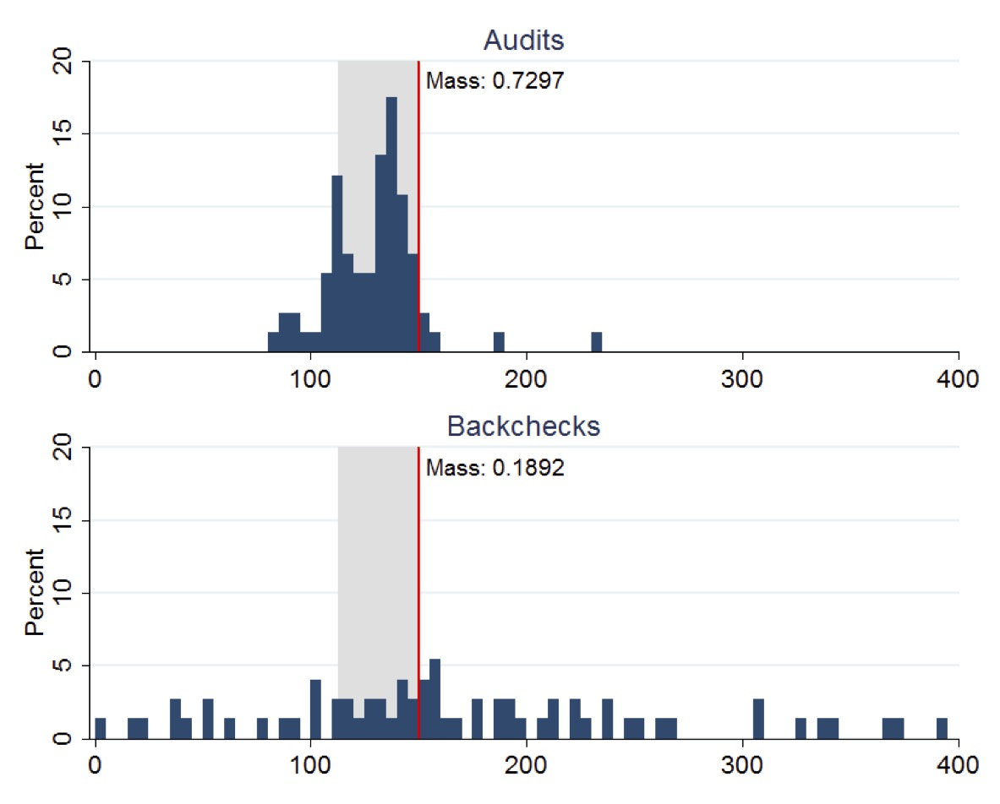
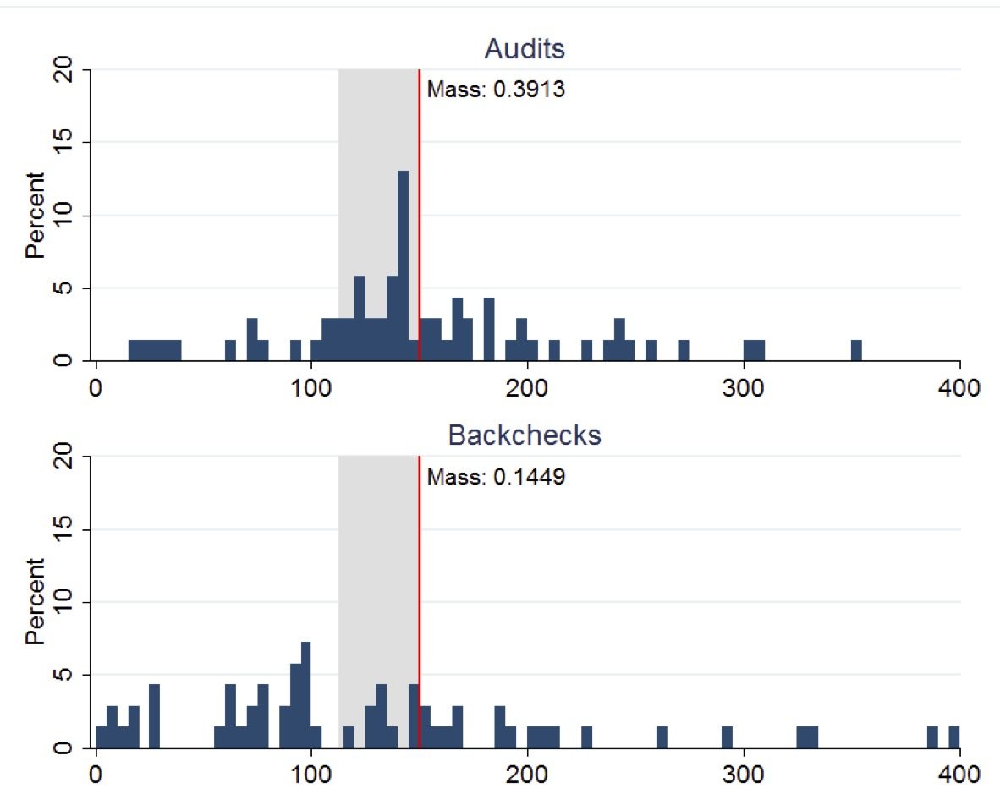
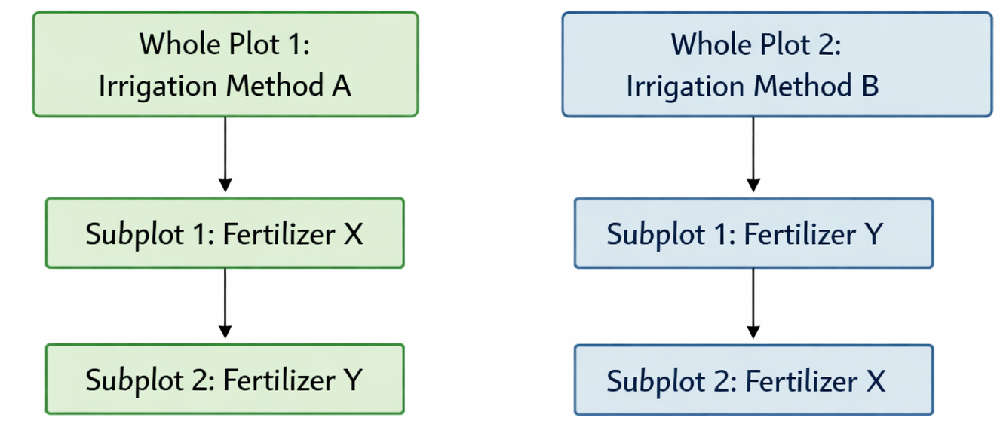



# A/B Testing {#sec-abtesting}

The Internet age opened the door to enormous data collection on personal preferences, behaviors, and actions. The data collected are observational rather than data collected from designed experiments, where we can control the environment to find the effects of interventions. User interface design is a prime example of this. Companies like Google, Amazon, and Netflix run thousands of experiments daily to optimize user experience and revenue. A/B testing is essentially a randomized controlled trial at scale, where two variants (A and B) are compared to determine which one performs better on a specific metric. The statistical machinery remains the same: we formulate a null hypothesis (no difference between variants), collect data, and compute a statistic to see if the observed difference is significant or just noise. The A/B variations can be physical, such as different colors or layouts, or they can be algorithmic, such as different search algorithms or recommendation systems.

However, a key distinction exists between traditional scientific hypothesis testing and modern A/B testing: the objective. In scientific research, the primary goal is often *truth discovery*, establishing a reproducible fact about the world. This necessitates a conservative approach with strict control over False Positives (Type I errors). In contrast, the goal of A/B testing in industry is often *decision making*, choosing the best option to maximize a business metric like revenue or engagement. Here, the cost of a missed opportunity (Type II error) can be just as detrimental as a false alarm. Consequently, industry practitioners may focus more on the magnitude of the effect (effect size) and the expected value of the decision, rather than relying solely on a rigid $p$-value threshold.

Throughout this chapter, we use the classical testing language as an operational planning tool: Type I and Type II errors, power, and significance levels. In particular, $\alpha$ denotes a frequentist Type I error rate (test size). @sec-hypothesis revisits the same problems from a Bayesian decision-theoretic viewpoint, where posterior probabilities, Bayes factors, and explicit losses take center stage; when we discuss credibility or posterior uncertainty, we will avoid overloading $\alpha$ with a second meaning.

How do we know if the difference between variants is real or just noise? Consider a coin flip: if it comes up heads twice in a row, is the coin biased? Obviously two tosses aren't enough to tell. Hypothesis testing formalizes this intuition: it tells us whether we have enough evidence to draw a conclusion, or whether we need more data.

You work as a quant for a trading firm, and you have developed a new algorithm to trade stocks. You tested your algorithm on historical data, and it outperformed the existing algorithm used in your company. Now, the important question is whether your trading strategy can truly outperform the market or it just got lucky. We need to analyze the performance of the algorithm after it was created and decide whether we have truly discovered a dominant strategy.  The effect we try to measure is usually present in some statistics that we calculate from data, for example, sample mean, proportion, or difference in means.

## Hypothesis Testing

::: {#exm-pyx}
### Pyx Trial

The "Pyx Trial" refers to an ancient ceremony held in the United Kingdom's Royal Mint. This tradition, dating back to the 12th century, is a method of testing the quality of minted coins to ensure it meets the standards of weight and purity set by law. The term "Pyx" comes from the Greek word "pyxis," meaning a small box, which is used to hold the sample coins that are to be tested.


Sir Isaac Newton became Warden of the Mint in 1696 and later the Master of the Mint. His role was central to reforming the coinage and improving its quality. Newton was rigorous in enforcing standards and combating counterfeiting and clipping (the practice of shaving off small amounts of precious metal from coins). Newton applied his scientific mind to the problems of minting, including refining assays (the testing of the purity of metals), improving the design of coins to prevent clipping, and introducing milled edges on coins.

The trial starts by selecting $n$ coins from each batch produced by the Royal Mint. These coins are placed in a box called the Pyx. The number of coins used in the Trial of the Pyx can vary each year and depends on several factors, including the variety and quantity of coins produced by the Royal Mint in that particular year. Typically, a representative sample of each type of coin minted is selected for testing. Then, for each coin attribute (weight, size, composition), the mean (average) value of the sample is calculated as well as the variance of the mean. 

Suppose we have minted one million of coins and collected the sample of $n=100$ coins, the legal weight tolerance for a certain coin is 0.05 grams. 

We will use the simulated data for our analysis. Let's simulate the weights of all of the coins produced
```{r mi-vote-sim}
#| echo: true
set.seed(17) # Kharlamov
allcoins <- runif(1000000, 4.95, 5.05)
```
Now, we survey 100 randomly selected coins
```{r}
#| echo: true
survey_sample <- sample(allcoins, size = 100, replace = FALSE)
xbar <- mean(survey_sample)
```
The sample mean of `r xbar` is very close to the true mean of 5. However, if we were to collect a different sample, the sample mean would be slightly different.
```{r}
survey_sample <- sample(allcoins, size = 100, replace = FALSE)
xbar <- mean(survey_sample)
```
A second survey gives a sample mean of `r xbar`. Now, we simulate 2000 surveys and calculate the sample mean for each survey. 
```{r}
#| cache: true
#| label: mi-vote-plot
#| fig-cap: Histogram of sample means from 2000 simulated surveys.
#| echo: true
prep <- replicate(2000, mean(sample(allcoins, size = 100, replace = FALSE)))
hist(prep, breaks = 30, freq = F, main = "", xlab = "Sample mean weight (grams)", col = "lightblue")
p <- seq(4.9, 5.1, length.out = 500)
lines(p, dnorm(p, mean(prep), sd(prep)), col = "red", lwd = 3)
```

We see that the bell-curve (normal density) is a good model for the distribution over the means calculated from samples. In fact, the *central limit theorem* says that sample means follow a normal distribution. We need to estimate the mean and standard deviation of this bell curve. It is natural to use the sample mean as the estimate of the mean of the bell curve `mean(prep)`: `r mean(prep)`.
The mean 
$$
\bar x = \frac{1}{n}\sum_{i=1}^{n} x_i
$$
is close to the true population mean of 5. We sometimes use the notation $\hat \mu$ to denote an estimate. So we have $\hat \mu = \bar x$. 

However, the standard deviation is much lower compared to the standard deviation of the population
```{r}
#| echo: true
sd(prep)
sd(allcoins)
```
The variance of the mean measures how much the sample mean is expected to vary from one sample to another, if you were to take multiple samples from the same population.

Assuming that samples are uncorrelated (correct sampling procedure is important!), the variance of the mean is given by
$$
\Var{\bar X} = \text{Var}\left(\frac{1}{n} \sum_{i=1}^{n} X_i\right) = \frac{1}{n^2} \sum_{i=1}^{n} \Var{X_i} = \frac{\sigma^2}{n}.
$$

Therefore, the variance of the mean formula is
$$
\Var{\bar X} = \frac{\sigma^2}{n}.
$$
If we know the population variance $\Var{X_i} = \sigma^2$, then we can calculate the variance of the mean. However, in practice, we do not know the population variance. Instead, we estimate it using the sample variance $s^2$. The estimated variance of the mean is then
$$
\Var{\bar X} = \frac{s^2}{n}.
$$
The standard deviation of the mean is called the *standard error* and is given by
$$
s_{\bar X} = \sqrt{\Var{\bar X}} = \frac{s}{\sqrt{n}}.
$$


Let's compare the standard error of the mean and standard deviation calculated from the simulations
```{r}
#| echo: true
sd(prep)
sd(allcoins) / sqrt(100)
```
They are very close!

This statistical property allows us to quantify uncertainty about the sample mean and say something about the true value of the mean $\mu$, in terms of a probabilistic interval statement. 
:::

*Central Limit Theorem*

CLT states that, given a sufficiently large sample size, the distribution of the sample means will be approximately normally distributed, regardless of the shape of the population distribution. This normal distribution is also known as the Gaussian distribution. The theorem applies to a wide range of population distributions, including distributions that are not normal. This universality underlies its central role in statistics.

The Central Limit Theorem originates from the [De Moivre-Laplace theorem](https://en.wikipedia.org/wiki/De_Moivre-Laplace_theorem), published by de Moivre in 1738, which established the normal approximation to the binomial distribution. According to this theorem, the standard normal distribution arises as the limit of scaled and centered Binomial distributions, in the following sense. Let $x_1,\ldots,x_n$ be independent, identically distributed Rademacher random variables, that is, independent random variables with distribution
$$
P(X_i = 1) = P(X_i = -1) = \frac{1}{2}.
$$
Then, the distribution of the sum of these random variables converges to the standard normal distribution as $n$ tends to infinity. That is, for any $a<b$, we have
$$
\lim_{n\to\infty} P\left(a \le \frac{X_1+\cdots+X_n}{\sqrt{n}} \le b\right) = \int_a^b \frac{1}{\sqrt{2\pi}} e^{-x^2/2} dx.
$$
In this case, the sum $X_1+\cdots+X_n$ has mean $n\mu$ and variance $n\sigma^2$, so that the standardized sum $(X_1+\cdots+X_n - n\mu)/\sqrt{n\sigma^2}$ has mean $0$ and variance $1$. The theorem then states that the distribution of this standardized sum converges to the standard normal distribution as $n$ tends to infinity.

Francis Galton devised a mechanical illustration of this limit, now called the Galton board, and described it in his book *Natural Inheritance* [@galton1889natural]. A ball dropped at the top of the board meets one pin in every row of pins, is deflected to the left or to the right, and comes to rest in one of the bins at the bottom. Consider a board with 12 rows. At each pin the ball takes a $\text{Bernoulli}(1/2)$ step, equal to 1 when it goes right and 0 when it goes left, and each row contributes one such step as a summand. The bin of a ball is its number of right steps, a sum of 12 independent steps, so the bin follows a $\text{Binomial}(12, 1/2)$ distribution with mean $12/2 = 6$ and variance $12/4 = 3$. The code below drops 1000 balls through such a board, draws the number of balls in each bin as bars, and adds the normal density with the same mean and variance, scaled to counts. Already with 12 rows, the bar heights follow the normal curve of the central limit theorem closely (@fig-galton).

```{r}
#| label: fig-galton
#| fig-cap: "A simulated Galton board with 12 rows of pins and 1000 balls. The bars show the number of balls in each bin and the curve is the normal density with mean 6 and variance 3, scaled to counts."
#| fig-height: 2.3
#| echo: true
set.seed(1889)
n <- 1000
rows <- 12
steps <- matrix(rbinom(n * rows, 1, 0.5), n, rows)
bin <- rowSums(steps)
hist(bin, breaks = seq(-0.5, rows + 0.5), main = "", col = "gray80",
     xlab = "Bin (number of right steps)", ylab = "Number of balls",
     ylim = c(0, 250))
curve(n * dnorm(x, rows / 2, sqrt(rows / 4)), add = TRUE, lwd = 2)
```


::: {#exm-android-earthquake}
### Android Earthquake Alerts

A fantastic modern example of the Central Limit Theorem in action is Google's Android Earthquake Alerts System. The core idea is to use the accelerometers present in billions of Android smartphones to create a global earthquake detection network.

Each individual phone's accelerometer is a "noisy sensor." It can be triggered by many events that are not earthquakes, such as the phone being dropped, vibrations from a passing truck, or even loud music. A signal from a single phone is therefore a "weak signal": on its own, it's not reliable enough to issue an earthquake alert.

However, Google's system aggregates signals from a vast number of phones in a specific geographic area. When a real earthquake occurs, thousands or even millions of phones in the affected region will detect the seismic waves (P-waves and S-waves) at roughly the same time.

By averaging the readings from this massive number of sensors, the system can effectively cancel out the random noise from individual phones. A single phone dropping is a random, isolated event. But thousands of phones vibrating in a synchronized pattern is a clear, strong signal that is highly unlikely to be due to chance.

This is a direct application of the principle that the standard error of the mean is inversely proportional to the square root of the sample size ($s_{\bar x} = s/\sqrt{n}$). Here, $n$ is the number of phones. With a massive $n$, the standard error of the average measurement becomes incredibly small. This allows the system to have a very high level of confidence that the detected event is a real earthquake, enabling it to send out timely alerts to people who may be in danger.
:::

## Confidence Intervals
The fact that the distribution of the simulated means from the Pyx example can be described well by a normal bell curve, in fact has a theoretical justification. It is called the *Central Limit Theorem*. The Central Limit Theorem states that, given a sufficiently large sample size, the distribution of the sample means will be approximately normally distributed, regardless of the shape of the population distribution. This normal distribution is also known as the Gaussian distribution.

There are a few conditions. The sampled observations must be independent. In practice, this means that the sampling should be random, and one observation should not influence another. Further, the sample size should be sufficiently large. While there is no strict rule for what constitutes "large enough," a common guideline is a sample size of 30 or more. However, if the population distribution is far from normal, a larger sample size may be required.

We can estimate the mean of this bell curve using $\bar x$ and the standard deviation (standard error) using $s/\sqrt{n}$.

The square-root nature of this relation is somewhat unfortunate. To double your certainty about the population mean, you need to quadruple the sample size.

One of the main applications of this result is the construction of *confidence intervals*. A confidence interval is a range of values that is likely to contain the true value of the population mean. The confidence interval is calculated using the sample mean $\bar x$ and the standard error $s/\sqrt{n}$ as follows
$$
\bar x \pm 1.96s_{\bar x}, ~ s_{\bar x} = \frac{s}{\sqrt{n}}.
$$

Here are a few conclusions we can make thus far

1. Mean estimates are based on random samples and therefore random (uncertain) themselves  
   We need to account for this uncertainty!

2. Standard Error measures the uncertainty of an estimate

3. Using properties of the Normal distribution, we can construct $95$% Confidence Intervals  
   This provides us with a plausible range for the quantity we are trying to estimate.

Recall the Patriots coin toss example from @sec-prob, we know that they won 19 out of 25 tosses during the 2014--2015 season. In this example, our observations are values 0 (lost toss) and 1 (won toss), and the average over those 0-1 observations is called the *proportion* and is denoted by $\hat p$ *instead of* $\bar x$. When we deal with proportions, we can calculate the sample variance from its mean $\hat p$ as follows
$$
s^2_{\hat p} = \frac{\hat p(1-\hat p)}{n}.
$$
Thus, we know that given our observations and CLT, the sampling distribution of our estimator $\hat{p}$ is normal. Our best guess at the mean $\hat p$ is $19/25 = 0.76$ and variance $s^2 = 0.76(1-0.76)/25 = 0.0073$
$$
\hat p \sim N(0.76, 0.0073).
$$
Then a $95\%$ Confidence Interval is calculated by
```{r}
#| echo: true
0.76 + c(-1.96, 1.96) * sqrt(0.0073)
```
Since 0.5 is outside the confidence interval, we have enough evidence to say that the coin tosses were not fair. 

Then we formulate a hypothesis that we are to test. Our status-quo assumption (there is no effect) is called the null hypothesis and is typically denoted by $H_0$.

### Mythbusters Example

While A/B testing is industry-standard for software, the same methodology applies to testing physical phenomena or human behavior, dealing with small sample sizes where uncertainty is higher. In 2006 the creators of Mythbusters TV show on Discovery channel wanted to test whether yawning is contagious in humans. They recruited 50 participants and each of those went through an interview. At the end of 34 randomly selected interviews, the interviewer did yawn. Then participants were asked to wait in a next-door room. Out of 34 participants from the experimental group, 10 did yawn (29.4%), and only 4 out of 16 (25%) in the control group did yawn. The difference in the proportion of those who did yawn was 4.4%. The show hosts Kari Byron, Tory Belleci and Scottie Chapman concluded that yawn is indeed contagious.

To translate the question from this experiment into language of hypothesis testing, we say that our null hypothesis is that the proportion of yawning participants in the control group ($p_c$) and in the experimental group ($p_e$) is the same, $H_0: p_c - p_e = 0$, and the alternative hypothesis is $H_1: p_c < p_e$. Hypotheses are always statements about the population proportions $p_c$ and $p_e$, never about the sample estimates $\hat p_c$ and $\hat p_e$, which are what we observe. The goal is to use the data to tell us if the hypothesis is correct or not.

A key statistical fact behind the hypothesis testing is the Central Limit Theorem. It states that if we have a sample $\{x_1,\ldots,x_n\}$ with $n$ i.i.d. observations from any distribution with finite mean $\mu$ and variance $\sigma^2$, then the average of the sample follows a Normal distribution with mean $\mu$ and variance $\sigma^2/n$ 
$$
\bar X = \frac{1}{n}\sum_{i=1}^{n}X_i \sim N(\mu, \sigma^2/n)
$$

Let us use a simple simulated dataset to demonstrate the central limit theorem. We generate 100 outcomes of a Bernoulli trial with $p=0.3$ and calculate the mean of this sample $\hat p$. We repeat it 2000 times and compare the empirical distribution of $\hat p$ with $N(0.3, 0.046^2)$.
```{r, echo=-1}
par(mar = c(2.5, 2.5, 0.7, 1.5), bty = "n")
set.seed(1)
a <- replicate(2000, mean(rbinom(100, 1, 0.3)))
plot(density(a), main = "", xlab = expression(hat(p)))
se <- sqrt(0.3 * (1 - 0.3) / 100) #  0.046
x <- seq(0, 0.5, length.out = 300)
lines(x, dnorm(x, mean = 0.3, sd = se), col = "red", lwd = 3)
legend("topright", c("simulated", "normal approximation"), col = c("black", "red"), lwd = c(1, 3), bty = "n", cex = 0.7)
```

There are three ways to quantify uncertainty in hypothesis testing. The first approach relies on calculating confidence intervals, as we did for the yawn example. There are two complementary approaches. One is to calculate what is called a $p$-value, that is the probability of getting the result observed in the data, assuming null-hypothesis is true. If $p$-value is low, then we reject the null-hypothesis. For the yawn example, the conditional probability that the observed difference in proportions is greater than 0.044, given null hypothesis is true is given by

$$
p\text{-value} = P(\hat p_e - \hat p_c \ge 0.044 \mid H_0),
$$
which can be calculated using `pnorm` function
```{r}
#| echo: true
1 - pnorm(0.044, 0, sqrt(0.0177))
```

The $p$-value of 0.37 means that there is a 37% chance to observe the difference to be greater than 0.044 assuming the null-hypothesis. It is quite high! We want the $p$-value to be low, only then we can claim that we have discovered a new fact, i.e., that yawning is contagious. In many applications we require this number to be at most 0.05. This cut-off is called the *significance level* and is typically denoted as $\alpha$. We can test the hypothesis at different levels of significance $\alpha$. Further we assume that the statistic we are analyzing follows the sampling distribution. The probability distribution of the statistics values is either Normal or $t$-distribution for continuous variable.

Fundamentally, a statistical hypothesis is a testable statement about a population parameter that can be evaluated using observed data. To summarize the process of testing a significance of our discovery for proportions, we perform the hypothesis testing following the 5-step process.

- *Step 1*: Formulate the Null Hypothesis ($H_0$), which we assume to be true unless there is sufficient evidence to the contrary. Then, alternative Hypothesis ($H_1$): test against the null, e.g., $H_0: p_e - p_c = 0$, and $H_a: p_e - p_c > 0$. If there is evidence that $H_0$ is false, we accept $H_1$.
- *Step 2*: Select the significance level $\alpha$. While $\alpha = 0.05$ (the 5\% level) is the most commonly used, $\alpha = 0.01$ (the 1\% level) is prevalent in medical and quality assurance examples.
- *Step 3*: Compute the Test Statistic ($Z$ or $T$)
- *Step 4*: Formulate the Decision Rule. For example, reject the Null hypothesis if $|Z| > 1.96$
- *Step 5*: Make a Decision, Compute the $p$-value. $p$-value is the smallest significance level at which a null hypothesis can be rejected. If $p$-value $<\alpha$, we have evidence that $H_1$ is true, we accept $H_1$ and claim we have a discovery. If $p$-value is $\ge \alpha$, then we cannot reject the null-hypothesis.

In Steps 1-2 we formulate the hypothesis. In steps 3-5 we make a decision.

In the context of hypothesis testing, we come back to the type I and type II errors we already discussed. They can be used to describe two types of errors you can make when testing

| Error Type | Description |
|------------|-------------|
| Type I Error | Rejecting a true $H_0$ |
| Type II Error | Not rejecting a false $H_0$ |

And the significance level is then
$$
P(\mbox{reject } H_0 \mid H_0 \; \mbox{ true}) =
P(\mbox{type I error}).
$$

Hypothesis testing is often used in scientific reporting. For example, the discovery of Higgs Boson was announced as a result of hypothesis testing. Scientists used the five-sigma concept to test the Higgs-Boson hypothesis. This concept, however, is somewhat counter-intuitive. If the particle doesn't exist, one in 3.5 million is the chance an experiment just like the one announced would nevertheless come up with a result appearing to confirm it does exist. So we can talk about the significance level as $p$-value to be one-in-3.5-million and then the $Z$-score is five.

The test statistic ($T$ or $Z$) quantifies uncertainty between the null-hypothesis value and the observed one and is equal to the number of standard deviations they are apart from each other. This value is called the $Z$-score, and is calculated as 
$$
Z = \frac{ \bar{x} - \mu_0 }{s/\sqrt{n}},
$$ 
where $\mu_0$ is the mean assumed under null-hypothesis. The square root of the statistic's variance $s/\sqrt{n}$ is called standard error and is denoted by $se(\bar X)$.

Let's calculate the $Z$-score for the yawning example. Let $\mu_0 = 0$, $\hat{p} = \hat p_e - \hat p_c = 0.044$, $\Var{\hat p }=\Var{\hat p_e - \hat p_c} = 0.0177$, we get $Z$ statistic to be 0.33. Thus, our observed difference is very close to 0.

To summarize the duality of confidence interval, $p$-value and $Z$-score, the following statements are equivalent:

| Statement | Condition |
|-----------|-----------|
| 0 is inside the 95% confidence interval | $p$-value is greater than 0.05 |
| $p$-value is greater than 0.05 | $Z$-statistic is less than 1.96 |
| $Z$-statistic is less than 1.96 | 0 is inside the 95% confidence interval |

::: {#exm-crash1987}
### Stock Market Crash 1987 (Z-score)

Prior to the October, 1987 crash, SP500 monthly returns were 1.2% with a risk/volatility of 4.3%. The question is how extreme was the 1987 crash of $-21.76$%?
$$
X \sim N \left(1.2, 4.3^2 \right )
$$
This probability distribution can be standardized to yield
$$
Z =\frac{X-\mu}{\sigma} = \frac{X - 1.2}{4.3} \sim N(0,1) .
$$
Now, we calculate the observed $Z$, given the outcome of the crash event
$$
Z = \frac{-0.2176 - 0.012}{0.043} = -5.34
$$
That is a $5$-sigma event in terms of the distribution of $X$. Meaning that -0.2176 is 5 standard deviations away from the mean. Under a normal model that is equivalent to $P(X < -0.2176) = 4.6593\times 10^{-8}$.

:::

### Other Applications

::: {#exm-coke}
#### Coke vs Pepsi
The most famous hypothesis test in history in whether people can decide the difference between Coke and Pepsi. We run a double blind experiment, neither the experimenter or subject know the allocation. Pepsi claimed that more than half of Diet Coke drinkers said they preferred to drink Diet Pepsi. That is our alternative hypothesis. The data come from a random sample of $100$ drinkers. We find that $56$ favor Pepsi.

This is a hypothesis test about the proportion of drinkers who prefer Pepsi
$$H_0 : p = \frac{1}{2} \; \; \mathrm{ and} \; \; H_1 : p > \frac{1}{2}$$
Let's estimate our statistics form data:
$$\hat{p} = X/n = 56/100 = 0.56$$

This is my best estimate of the true $p$. The standard error of my
statistic 
$$se(\hat{p}) =  \sqrt{\hat{p}(1-\hat{p})/n} = 0.0496 .$$

The $95$% is then
$$0.56 \pm 1.96 (0.0496) = 0.56 \pm 0.097 = ( 0.463, 0.657 )$$ 
$p=0.5$
lies inside the confidence interval, so we cannot reject $H_0$: the data do not give significant evidence for Pepsi's claim.

The $Z$-score now with $s_{ \hat{p} }= \sqrt{ p_0(1-p_0)/n} = 0.05$
$$Z = \frac{ \hat{p} - p_0 }{ s_{\hat{p} }} = \frac{ 0.56-0.5}{0.05} = 1.2 < 1.64$$
Let's take the usual $\alpha = 0.05$. 
```{r}
#| echo: true
prop.test(56, 100, alternative = "greater", conf.level = 0.95) %>% fmt_prop_test()
```

Don't reject $H_0$ for a one-sided test at $5$% level ($p$-value: 0.14). We need a larger $n$ to come to a more definitive conclusion. One of the downsides of hypothesis testing is that it generates a yes/no answer without having any uncertainty associated with it.
:::

::: {#exm-Avonex}
#### Avonex
Biogen made the following assertion: "Avonex delivers the highest rate of satisfaction: 95% among patients" In response to that statement, the U.S. Food and Drug Administration (FDA) on October 30th, 2002, informed the biotech company Biogen to stop publishing misleading promotions for its multiple sclerosis drug Avonex. To clarify the issue, FDA did run an experiment. The FDA found that in a random sample of $75$ patients surveyed, only 60% said they were satisfied with Avonex. The question is: Who is right?

Let's use hypothesis testing to get an answer. Following our five-step process to set up a Hypothesis Test:
1. Formulate the Null Hypothesis: $H_0 : p = 0.95 = p_0$. The alternative hypothesis: $H_1 : p < 0.95$. A 1-sided alternative.
2. We'll use a small significance level, 1%.
3. The appropriate test statistic is $Z = -14$.

To complete our analysis, we need to determine the critical region and calculate the $p$-value for this test. For a one-sided test at the 1% significance level, the critical region is $Z < -2.32$. Since our observed test statistic of $Z = -14$ falls well within this rejection region, we reject the null hypothesis.

This procedure can be implemented in `R` in the `prop.test` function.
```{r}
#| echo: true
prop.test(45, 75, 0.95) %>% fmt_prop_test()
```
The $p$-value is less than $2.2 \times 10^{-16}$, which is essentially zero. This extremely small $p$-value provides overwhelming statistical evidence that the FDA is correct and Biogen's claim is false.
:::


::: {#exm-Pfizer}
#### Pfizer
Pfizer introduced Viagra in early 1998. During $1998$, of the $6$ million Viagra users, $77$ died from coronary problems such as heart attacks. Pfizer claimed that this rate is no more than the general population. A clinical study found $11$ out of $1{,}500{,}000$ men who were not on Viagra died of coronary problems during the same length of time as the $77$ Viagra users who died in $1998$. The question is whether the drug is safe. Let's calculate the confidence interval. A 95% confidence interval for a difference in proportions $p_1 - p_2$ is
$$
( \hat{p}_1 - \hat{p}_2 ) \pm 1.96 
\sqrt{ \frac{ \hat{p}_1 ( 1 - \hat{p}_1 ) }{ n_1 }  + 
    \frac{ \hat{p}_2 ( 1 - \hat{p}_2 ) }{ n_2 } }
$$

We can do a confidence interval or a $Z$-score test. With Viagra, $\hat{p}_1 = 77/6000000 = 0.00001283$ and without Viagra $\hat{p}_2 = 11/1500000 = 0.00000733$.
We need to test whether these are equal. With a $95$% confidence interval for $(p_1 - p_2)$ you get an interval $( 0.0000003 , 0.0000107).$

Since this confidence interval does not contain zero, we have evidence that the proportion of deaths from coronary problems is significantly higher among Viagra users compared to the general population. Despite the small proportions involved, the measurement is highly accurate due to the large sample sizes in both groups. For hypothesis testing, we would use a one-sided test with a significance level of $\alpha = 0.01$ to test whether the proportion of deaths is higher in the Viagra group. The difference in proportions can be analyzed as follows:

```{r}
#| echo: true
prop.test(x = c(11, 77), n = c(1500000, 6000000), alternative = "greater", conf.level = .95) %>%
  fmt_prop_test()
```

The $p$-value for the Null is $1-0.948 =0.052$. This $p$-value is greater than 0.01, so we cannot reject the null hypothesis. These two conclusions are not contradictory: the evidence is borderline, significant at the 5% two-sided level of the interval but not at the stricter 1% one-sided level of the test (note that `c(11, 77)` lists the non-Viagra group first, so `prop.test` reports 0.948 for `alternative = "greater"`, and its complement $1-0.948 = 0.052$ is the $p$-value for the intended alternative that Viagra carries the higher rate).
:::


::: {#exm-Rayleigh}
### Lord Rayleigh's Argon Discovery
Lord Rayleigh won the Nobel Prize for discovery of Argon. This discovery occurred when he noticed a small discrepancy between two sets of measurements on nitrogen gas that he had extracted from the air and one he had made in the lab.

First, he removed all oxygen from a sample of air. He measured the density of the remaining gas in a fixed volume at constant temperature and pressure. Second, he prepared the same volume of pure nitrogen by the chemical decomposition of nitrous oxide ($N_2 O$) and nitric oxide $NO$. Here's the results. Table on the left shows the measurements. Boxplot on the right shows the distribution of the measurements.

```{r}
#| layout-ncol: 2
#| fig-width: 2.6
#| fig-height: 2.25
air <- c(2.31017, 2.30986, 2.31010, 2.31001, 2.31024, 2.31010, 2.31028, NA) # Missing data point
decomp <- c(2.30143, 2.29890, 2.29816, 2.30182, 2.29869, 2.29940, 2.29849, 2.29889)
d <- data.frame("Air" = air, "Chemical Decomposition" = decomp, check.names = FALSE)
knitr::kable(d, booktabs = TRUE)
boxplot(d, col = c("red", "green"), names = c("Air", "Chemical decomposition"), ylab = "Gas density")
```
Although the averages are very close 2.31 vs 2.30, the small standard deviations ($1.43 \times 10^{-4}$ and $1.38 \times 10^{-3}$) suggest that the measurements are very precise. 
```{r argon-code, echo=-1}
# \ echo: true
t.test(air, decomp, var.equal = T)
```
The $t$-test confirms that with the $t$-statistic of 20, the difference is statistically significant. It is a 20-sigma event and we've found Argon!
:::


## A/B Testing Applications

::: {#exm-simcity}
### SimCity
In the gaming industry, A/B testing is central to optimizing revenue. Electronic Arts is a company that makes video games. SimCity 5, one of EA's most popular video games, sold 1.1 million copies in the first two weeks of its launch. 50% of sales were digital downloads, thanks to a strong A/B testing strategy designed to maximize the conversion rate of pre-orders.

As EA prepared to release the new version of SimCity, they released a promotional offer to drive more game pre-orders. The offer was displayed as a banner across the top of the pre-order page---front-and-center for shoppers. But according to the team, the promotion was not driving the increase in pre-orders they had expected.

They decided to test some other options to see what design or layout would drive more revenue.

::: {#fig-simsity layout-ncol=2}

{width="87%"}

{width="100%"}

SimCity banner
:::

One variation removed the promotional offer from the page altogether. The test led to some very surprising results: The variation with no offer messaging whatsoever drove 43.4% more purchases. Data revealed that customers preferred a direct purchase path, indicating that additional incentives were unnecessary.

Most people believe that direct promotions drive purchases, but for EA, this turned out to be totally false. Testing gave them the information needed to maximize revenue in a way that would not have been otherwise possible.

We define the `abtestfunc` function to examine whether a black or pink background results in more purchases. Run experiment for one week:

-   Pink background: $40$% purchase rate with $500$ visitors

-   Black background: $30$% purchase rate with $550$ visitors

Let's run the AB test to see which is more effective. The question is about the difference of the two purchase rates, so the `abtestfunc` function below computes that difference, its 95% confidence interval with the standard error $\sqrt{\hat p_1(1-\hat p_1)/n_1 + \hat p_2(1-\hat p_2)/n_2}$, and the two-proportion $z$ statistic, which uses the pooled rate $\hat p$ of both groups under the null hypothesis of equal rates.
```{r}
#| echo: true
site1 <- c(.40, 500) # pink
site2 <- c(.30, 550) # black
abtestfunc <- function(ad1, ad2) {
  d <- ad1[1] - ad2[1]
  se <- sqrt(ad1[1] * (1 - ad1[1]) / ad1[2] + ad2[1] * (1 - ad2[1]) / ad2[2])
  p <- (ad1[1] * ad1[2] + ad2[1] * ad2[2]) / (ad1[2] + ad2[2])
  z <- d / sqrt(p * (1 - p) * (1 / ad1[2] + 1 / ad2[2]))
  round(c(diff = d, lower = d - 1.96 * se, upper = d + 1.96 * se, z = z), 3)
}
abtestfunc(site1, site2)
```
The pink background sells to 10 more visitors in 100, with a 95% confidence interval of 4.2 to 15.8 points, and $z = 3.40$ (two-sided $p$-value 0.0007), so the purchase rate of the pink background is significantly higher. A common shortcut compares the two separate intervals, here the 80% intervals [37, 43] for pink and [28, 32] for black, and calls the difference significant when they do not overlap. That is not a test of the difference: two intervals can overlap while the difference is significant, and the level of the separate intervals says nothing about the level of the comparison.
:::


::: {#exm-Mythbusters}
### Mythbusters

We now return to the Mythbusters yawning experiment to analyze it using the standard error of the difference in proportions.

The question is what happens if we are to re-run this experiment several times with different groups of participants, will we see the same difference of 4.4%? The fact is that from one experiment to another calculated proportions of yawners in both groups will be different.

In our example, the proportion of yawners in the experimental group is $\hat p_e = 0.294$ and in the control group is $\hat p_c = 0.25$. Thus,
$$
\hat \sigma^2_e = 0.294(1-0.294) = 0.208,~~~\hat \sigma^2_c = 0.25(1-0.25) = 0.188
$$


We can apply CLT and calculate the uncertainty about $\hat p_{e}$ and $\hat p_{c}$
$$
\hat p_e\sim N(0.294, 0.208/34),~~~ \hat p_c\sim N(0.25, 0.188/16).
$$
Now, instead of comparing proportions (numbers), we can compare their distributions and thus quantify uncertainties. If we plot density functions of those two Normal variables, we can see that although means are different, there is a large overlap of the two density functions.
```{r, echo=-1}
par(mar = c(4, 4, 0.1, 0.1), bty = "n")
p <- seq(0.0, 0.6, length.out = 200)
plot(p, dnorm(p, 0.25, sqrt(0.188 / 16)), col = 2, type = "l", lwd = 3, ylab = "Density", ylim = c(0, 5))
lines(p, dnorm(p, 0.294, sqrt(0.208 / 34)), col = 3, lwd = 3, lty = 2, ylim = c(0, 6))
legend("topright", c("control", "experiment"), col = c(2, 3), lwd = 3, lty = c(1, 2), bty = "n")
```

The amount of overlap is the measure of how certain we are that $p_e$ and $p_c$ are different. Large overlap means we are not very certain if proportions are truly different. For example, both $p_e$ and $p_c$ have a high probability of being between 0.2 and 0.4. We can use properties of normal distribution to say specifically what is the amount of this overlap by calculating the corresponding 95% confidence interval of the difference between the proportions. Note that the difference of two Normal random variables is another Normal
$$
\hat p_e - \hat p_c \sim N(0.294 - 0.25, 0.208/34 + 0.188/16) = N(0.044, 0.0177)
$$ 
Now we can calculate 95% confidence interval for $\hat p_e - \hat p_c$, again using properties of Normal
```{r}
#| echo: true
0.044 + c(-1.96, 1.96) * sqrt(0.0177)
```
The interval is wide and most importantly, it does contain 0. Thus, we cannot say for sure that the proportions are different. They might just appear to be different due to chance (sampling error). Meaning that if we are to re-run the experiment, we should expect the difference to be anywhere between -0.22 and 0.30 in 95% of the cases.

Thus, statistical analysis does not confirm the conclusion made by the show hosts and indicates that there is no evidence that the proportion of yawners is different between the control and experimental groups.
:::

::: {#exm-google}
### Search Algorithm
For tech giants, even small improvements in metrics can lead to massive gains. Let's look at another example and test effectiveness of Google's new search algorithm. We measure effectiveness by the number of users who clicked on one of the search results. As users send the search requests, they will be randomly processed with Algo 1 or Algo 2. We wait until 2500 search requests were processed by each of the algorithms and calculate the following table based on how often people clicked through

|                | Algo1 | Algo2 |
|----------------|:-----:|:-----:|
| success        |  1755 |  1828 |
| failure        |  745  |  672  |
| total          |  2500 |  2500 |

  : Google Search Algorithm


The probability of success is estimated to be $\hat{p}_1 = 1755/2500 = 0.702$ for the current algorithm and $\hat{p}_2 = 1828/2500 = 0.731$ for the new algorithm. We can calculate the 95% confidence interval or 95% Bayesian credible region for both estimated proportions.

```{r}
#| echo: true
p1 <- 1755 / 2500
p2 <- 1828 / 2500
Algo1 <- round(p1 + c(-1.96, 1.96) * sqrt(p1 * (1 - p1) / 2500), 3)
Algo2 <- round(p2 + c(-1.96, 1.96) * sqrt(p2 * (1 - p2) / 2500), 3)
kable(rbind(Algo1, Algo2), col.names = c("Lower", "Upper"), caption = "95% Confidence Interval for the Proportions")
```
Given that the intervals do slightly overlap, there is not enough evidence to say that algorithms are different, and the new Algo 2 is not necessarily more efficient.

We will get a slightly more precise estimation of uncertainty if we calculate confidence interval for the difference of the proportions. Since $p_1$ and $p_2$ both follow Normal distribution, their difference is also normally distributed
$$
p_1 - p_2 \sim N(\hat p_1 - \hat p_2, s_1^2/n + s_2^2/n).
$$
Applying this formula for the Google search algorithm experiment, we calculate the 95% confidence interval for the difference.
```{r}
#| results: hide
diff <- p1 - p2 + c(-1.96, 1.96) * sqrt(p1 * (1 - p1) / 2500 + p2 * (1 - p2) / 2500)
print(diff, digits = 5)
```
The confidence interval for the difference is (`r round(diff[1], 3)`, `r round(diff[2], 3)`), which does not contain 0, and thus we can say that we are confident that algorithms are different!

More generally, if the number of observations in two groups are different, say $n_1$ and $n_2$ then the 
$$
s_{ \bar{X}_1 - \bar{X}_2 } = \sqrt{ \frac{ s^2_1 }{n_1} + \frac{ s^2_2 }{n_2} }
$$ 
or for proportions, we compute 
$$
s_{ \hat{p}_1 - \hat{p}_2 } = \sqrt{ \frac{ \hat{p}_1 (1- \hat{p}_1)}{n_1} + \frac{ \hat{p}_2 (1- \hat{p}_2)}{n_2} }.
$$
:::


::: {#exm-google-unequal}
### Search Algorithm with Unequal Sample Sizes

Let's consider a variation of the previous example where the sample sizes are different. Suppose we have the following data:

|                | Algo1 | Algo2 |
|----------------|:-----:|:-----:|
| success        |  1824 |  1867 |
| failure        |  776  |  683  |
| total          |  2600 |  2550 |

  : Google Search Algorithm with Unequal Sample Sizes

The probability of success is estimated to be $\hat{p}_1 = 1824/2600 = 0.702$ for Algo1 and $\hat{p}_2 = 1867/2550 = 0.732$ for Algo2. Now we calculate the 95% confidence interval for the difference in proportions using the formula for unequal sample sizes:
```{r}
#| echo: true
p1 <- 1824 / 2600
p2 <- 1867 / 2550
diff <- p1 - p2 + c(-1.96, 1.96) * sqrt(p1 * (1 - p1) / 2600 + p2 * (1 - p2) / 2550)
print(diff, digits = 5)
```
The confidence interval for the difference does not contain 0, and thus we can say that we are confident that algorithms are different!
:::


## Challenges in A/B Testing

### Multiple Testing
Consider this simple multiple-testing scenario. If we want to test 1000 hypotheses and we test each hypothesis one-by-one, say the ground truth is that only 10% (100) of those hypotheses are true. Using $\alpha=0.05$ rule, we assume that out of 900 false hypotheses $0.05 \cdot 900 = 45$ will show up as positive (false positives). Now we run our one-by-one hypothesis tests, and our procedure correctly identified 80 out of 100 true positives and incorrectly identified 45 false positives and 20 false negatives. Now, among 125 hypotheses identified as positives, 45 in fact are not! Another way to look at it is to calculate the probability of at least one false positive $P(\mbox{at least one false positive}) = 1 - (1-0.05)^{1000} = 1$. We are almost guaranteed to see at least one false positive.
```{r}
#| fig-cap: Probability of At Least 1 False Positive.
plot(1:100, 1 - (1 - 0.05)^{
  1:100
}, type = "l", ylab = "False Positive Rate", xlab = "Number of Tests", col = "red", lwd = 2)
```

One way to deal with the problem is to lower the cut-off to $\alpha/n$. This approach is called the Bonferroni correction. For the case of 1000 hypotheses, we set $\alpha = 0.00005$. However, this conservative approach will lead to many false negatives. The probability of identifying at least one significant result is then $1 - (1-0.00005)^{1000} = 0.049$.

                 $H_0$ Accepted   $H_0$ Rejected   Total
  ------------- ---------------- ---------------- -------
   $H_0$ True          TN               FD         $T_0$
   $H_0$ False         FN               TD         $T_1$
      Total           $N$              $D$          $m$

Table: Classification of results for a testing procedure. T/F = True/False, D/N = Discovery/Non-discovery. We observe $m$, $D$ and $N$.

A more practical approach is to use the *False Discovery Rate*
$$
\text{FDR} = \E{\frac{FD}{D}}
$$ 
which is the expected proportion of false positives among all significant results. We aim to set a cutoff so that FDR $\le Q$. The FDR approach allows us to increase the power while maintaining some principled bound on error.

Benjamini and Hochberg developed a procedure based on FDR to perform multiple testing [@benjamini1995controlling]. Under their procedure, we put individual $p$-values in order from smallest to largest. Then we choose the largest $p_k$ value that is at most $(k/m)Q$ where $Q$ is the false discovery rate you choose. Then all hypotheses with index $i \le k$ are significant. Benjamini and Hochberg showed that under this procedure the FDR $\le Q$ when the tests are independent.

As an example, @garcia-arenzana2014calorie tested associations of 25 dietary variables with mammographic density, an important risk factor for breast cancer, in Spanish women. They found the following results:
```{r cancer-diad}
#| tbl-cap: Dietary Risk Factors of Cancer
d <- read.csv("data/cancer-diet.csv")
knitr::kable(d[1:6, ], booktabs = TRUE)
```

If we choose $Q = 0.25$, then $k=6$ (Nuts) is our cut-off rank, because its $p$-value $0.06$ equals $(6/25) \cdot 0.25$. Thus we reject $H_0$ for the first six tests. Note that the traditional hypothesis testing procedure controls the Type 1 error rate of each single test, while the FDR-based procedure controls the expected proportion of false discoveries among the discoveries and has more power than the Bonferroni correction.

## Randomized Controlled Trials and Causality {#sec-ab-rct}

Florence Nightingale (1820--1910), widely known for her role in the Crimean War, was also a pioneering statistician and a champion of evidence-based medicine. She can be considered the mother of observational studies. To her, every piece of legislation was an experiment in the laboratory of society deserving study and demanding evaluation. Nightingale recognized the importance of collecting accurate and reliable data to understand healthcare outcomes. She developed standardized methods for collecting data on hospital admissions, deaths, causes of death, and other relevant factors. This systematic data collection allowed for more rigorous and reliable analysis of healthcare practices and their impact on patient outcomes. During the Crimean War (1853--1856), she collected and analyzed data on mortality rates among soldiers. She created statistical diagrams, such as the famous polar area diagram or "coxcomb," to illustrate the causes of mortality. Nightingale's observations and statistical analyses led her to emphasize the importance of sanitation and hygiene in healthcare settings. She advocated for improvements in cleanliness, ventilation, and sanitation in hospitals, recognizing the impact of these factors on the health and well-being of patients. Beyond the battlefield, Nightingale continued her work in public health. She used statistical evidence to advocate for healthcare reforms and improvements in public health infrastructure. Her efforts shaped public health policies and practices.

The work of Nightingale would today be classified as an observational study. An observational study is a research design where researchers observe and collect data on existing groups of people or phenomena without intervening or manipulating any variables. Unlike randomized controlled trials, researchers do not assign participants to different groups and do not directly influence the outcome.

In contrast, George Washington (1732--1799) advanced agriculture through rigorous experimentation, employing methods remarkably similar to modern controlled experiments. He was deeply interested in improving agricultural techniques and conducted numerous experiments at his Mount Vernon estate. One of his most notable experiments involved dividing his land into plots and testing different crop rotations and fertilization methods. Washington recognized the importance of sustainable agriculture and the detrimental effects of monoculture (growing the same crop year after year) on soil fertility. He observed how tobacco, his primary cash crop at the time, depleted the soil nutrients, leading to diminishing yields. To address this issue and improve the long-term health of his land, he began experimenting with crop rotation and soil management techniques.

Washington divided his land into several plots, each receiving different treatments. He experimented with various crop rotations, including wheat-fallow, wheat-rye-fallow, and corn-wheat-fallow. These rotations aimed to prevent soil depletion and promote its natural restoration by planting nitrogen-fixing crops like rye and clover. He also tested different fertilizer applications on various plots. He used manure, compost, and even imported materials like gypsum and marl to improve soil fertility and crop yields.

Washington meticulously documented his experiments in his agricultural diaries. He recorded planting dates, yields, weather conditions, and observations on crop growth and soil health. This meticulous record-keeping allowed him to analyze the effectiveness of different treatments and compare their impact on crop yields and soil quality.

Washington's experiments yielded valuable insights into sustainable agricultural practices. He discovered that crop rotation and fertilization improved soil health and increased crop yields over time. He abandoned tobacco as his primary crop and shifted towards wheat, which was less soil-depleting and offered a more stable income source.

The historic trades staff at Mount Vernon have recreated Washington's experiment at the Pioneer Farm, using the same plot layout, crops, and fertilization methods described in his diaries. This allows visitors to learn about his innovative farming techniques and their impact on the land. @fig-gw shows the plot layout at the Pioneer Farm.

<!-- https://www.mountvernon.org/george-washington/farming/re-creating-a-washington-farming-experiment/#:~:text=George%20Washington%20often%20used%20experimental,wheat%2C%20oats%2C%20and%20barley. -->

{#fig-gw width="70%"}

Later, at the turn of the 20th century, Ronald Fisher (1890--1962) developed the theory of experimental design which allowed for controlled experiments, known as randomized controlled trials (RCT). Fisher's work laid the foundation for modern experimental design and analysis, providing a rigorous statistical framework for conducting randomized controlled trials. His contributions to experimental design and ANOVA established the importance of randomized trials in research. He emphasized the importance of randomization and control groups in experimental design, recognizing their central role in establishing causal relationships.

### The Question of Causation

Randomized controlled trials (RCTs) and field experiments are widely considered the gold standard for establishing causation because they allow researchers to isolate the effect of a specific intervention or treatment from other confounding factors. The importance of distinguishing causation from correlation is not merely academic: it lies at the heart of rational decision-making. As Newcomb's problem illustrates (@exm-newcomb), even the definition of "rational choice" becomes contentious when the causal structure between decisions and outcomes is unclear. In that paradox, whether you should "one-box" or "two-box" depends entirely on whether your choice *causes* the predictor's action or merely *correlates* with it. RCTs resolve such ambiguities by ensuring that treatment assignment is causally independent of potential outcomes. The main principle of RCTs and field experiments is randomization, which ensures that the treatment and control groups are similar in all respects except for the treatment. This allows researchers to attribute any differences in outcomes between the two groups to the treatment, rather than to other factors.

Randomization helps to control for confounding variables, which are factors that are associated with both the treatment and the outcome variable. By randomly assigning participants to groups, researchers can ensure that any confounding variables are evenly distributed between the groups. The control group serves as a baseline for comparison. It is a group that is not exposed to the treatment or intervention being studied. By comparing the outcomes of the treatment group and the control group, researchers can isolate the effect of the treatment. Any differences in the outcomes between the two groups can be attributed to the treatment.

From a Bayesian modeling perspective, randomization is a practical route to approximate exchangeability between groups, making comparisons less sensitive to unobserved confounding (@sec-bl).

The modern randomized controlled trial (RCT) in medicine is most often attributed to Sir Austin Bradford Hill. In 1948, Hill published a landmark paper titled "Streptomycin Treatment of Pulmonary Tuberculosis" in the British Medical Journal, which described the first fully randomized, controlled clinical trial. This study is considered a turning point in the history of medical research and established the RCT as the gold standard for evaluating the effectiveness of medical treatments.

Randomized trials and observational studies are two distinct approaches to gathering and analyzing data in research studies. Here's a breakdown of their key differences:

:::: {layout-ncol="2"}

:::: {.column}
#### Randomized Trials

-   *Definition*: Participants are randomly assigned to different groups, with one group receiving the intervention being studied and the other group receiving a control intervention or placebo.
-   *Purpose*: Determine whether the intervention causes the observed outcome by controlling for other factors that might influence the results.
-   *Strengths*: High internal validity, strong causal inference due to randomization, allows for isolating the effect of the intervention, minimizes selection bias through random assignment.
-   *Weaknesses*: Can be expensive and time-consuming to conduct, may not be ethical or feasible for all interventions, may not be generalizable to real-world settings.
::::

:::: {.column}
#### Observational Data

-   *Definition*: Data are collected on existing groups of people without any intervention being implemented. Researchers observe and analyze the data to identify relationships between variables.
-   *Purpose*: Explore potential associations between variables, generate hypotheses for further research, and investigate the natural course of a phenomenon.
-   *Strengths*: Often less expensive and time-consuming, can provide insights into real-world settings, can investigate interventions that are not ethically feasible to test in randomized trials.
-   *Weaknesses*: Lower internal validity, susceptibility to confounding variables, cannot establish causal relationships conclusively.
::::
::::

If you happen to have a choice between randomized trials and observational data (often you do not have that choice), which one should you choose? Consider the following:

-   *Research question*: If the research question aims to establish causation, a randomized trial is generally preferred. However, if the goal is to explore associations or generate hypotheses, observational data may be sufficient.
-   *Available resources*: Randomized trials require significant resources, while observational studies can be less expensive and time-consuming.
-   *Ethical considerations*: Randomizing individuals to certain interventions may be unethical, making observational data the only option.
-   *Generalizability*: Randomized trials often involve carefully controlled environments, which may limit their generalizability to real-world settings. Observational data can provide insights into how interventions work in real-world situations.

Ultimately, both randomized trials and observational data play important roles in research. Combining these two approaches provides a fuller understanding of the relationship between interventions and outcomes.

:::: {#exm-russianfraud}
### Russian Election Fraud: A Field Experiment

@enikolopov2013field show how a field experiment can be used to estimate electoral fraud in Russian parliamentary elections held on December 4, 2011. They randomly assigned independent observers to 156 of 3,164 polling stations in the city of Moscow. The observers were trained by the nongovernmental organization Citizen Observer. The authors compared the vote shares of the incumbent United Russia party at polling stations with and without observers. They found that the presence of observers decreased the reported vote share of United Russia by almost 11 percentage points. This suggests that the extent of the fraud was sufficient to have changed the outcome of the elections.

```{r}
#| label: fig-russianfraud
#| fig-cap: "Histogram comparison of the share of votes received by different parties and the share of those eligible voters who actually voted (turnout)."
#| layout-nrow: 3
#| fig-width: 2.6
#| fig-height: 1.8
#| fig-subcap:
#|  - "United Russia Share"
#|  - "Turnout Share"
#|  - "Yabloko Share"
#|  - "Just Russia Share"
#|  - "LDPR Share"
#|  - "Communists Share"
d <- read.csv("data/PNAS_data_2011.csv")

d %>% ggplot(aes(x = er_share, fill = as.factor(s))) +
  geom_density(alpha = 0.6, color = "#e9ecef") +
  labs(fill = "Observers") +
  xlab(NULL) +
  scale_fill_manual(values = c("#69b3a2", "#404080"), labels = c("Without", "With")) +
  theme_gray(base_size = 8) +
  theme(legend.position = "bottom")
d %>% ggplot(aes(x = turnout_share, fill = as.factor(s))) +
  geom_density(alpha = 0.6, color = "#e9ecef") +
  labs(fill = "Observers") +
  xlab(NULL) +
  scale_fill_manual(values = c("#69b3a2", "#404080"), labels = c("Without", "With")) +
  theme_gray(base_size = 8) +
  theme(legend.position = "bottom")
d %>% ggplot(aes(x = apple_share, fill = as.factor(s))) +
  geom_density(alpha = 0.6, color = "#e9ecef") +
  labs(fill = "Observers") +
  xlab(NULL) +
  scale_fill_manual(values = c("#69b3a2", "#404080"), labels = c("Without", "With")) +
  theme_gray(base_size = 8) +
  theme(legend.position = "bottom")
d %>% ggplot(aes(x = sr_share, fill = as.factor(s))) +
  geom_density(alpha = 0.6, color = "#e9ecef") +
  labs(fill = "Observers") +
  xlab(NULL) +
  scale_fill_manual(values = c("#69b3a2", "#404080"), labels = c("Without", "With")) +
  theme_gray(base_size = 8) +
  theme(legend.position = "bottom")
d %>% ggplot(aes(x = ldpr_share, fill = as.factor(s))) +
  geom_density(alpha = 0.6, color = "#e9ecef") +
  labs(fill = "Observers") +
  xlab(NULL) +
  scale_fill_manual(values = c("#69b3a2", "#404080"), labels = c("Without", "With")) +
  theme_gray(base_size = 8) +
  theme(legend.position = "bottom")
d %>% ggplot(aes(x = com_share, fill = as.factor(s))) +
  geom_density(alpha = 0.6, color = "#e9ecef") +
  labs(fill = "Observers") +
  xlab(NULL) +
  scale_fill_manual(values = c("#69b3a2", "#404080"), labels = c("Without", "With")) +
  theme_gray(base_size = 8) +
  theme(legend.position = "bottom")
```

```{r}
#| label: fig-russianfraud2
#| fig-cap: "Bar plot comparison of the share of votes received by different parties and the share of those eligible voters who actually voted (turnout)."
#| fig-width: 5.5
#| fig-height: 4.2
dl <- d %>% dplyr::select(ends_with("_share"), s, uik)
dl <- dl %>% pivot_longer(cols = c(er_share, apple_share, turnout_share, sr_share, ldpr_share, com_share), names_to = "party", values_to = "share")
df2 <- dl %>%
  group_by(party, s) %>%
  dplyr::summarise(mu = mean(share), sd = sd(share) / sqrt(dplyr::n()))
ggplot(df2, aes(x = party, y = mu, fill = as.factor(s))) +
  geom_bar(stat = "identity", color = "#e9ecef", position = position_dodge()) +
  geom_errorbar(aes(ymin = mu - 2.58 * sd, ymax = mu + 2.58 * sd), width = .2, position = position_dodge(.9)) +
  scale_fill_manual(values = c("#69b3a2", "#404080"), name = "", labels = c("Control group", "Treatment group")) +
  scale_x_discrete(labels = c("Yabloko", "Communist", "United Russia", "LDPR", "Just Russia", "Turnout")) +
  ylab("Mean Share") +
  xlab(NULL) +
  theme(axis.text.x = element_text(angle = 90, hjust = 1)) +
  theme(legend.position = "right", legend.margin = margin(r = -5), plot.margin = margin(5.5, 20, 5.5, 5.5))
```

[@fig-russianfraud; @fig-russianfraud2] show the results of the experiments and plot histograms of the vote shares. The first histogram compares the share of the ruling United Russia party at the polling stations without observers (treatment = 0) and with observers (treatment = 1). On average, United Russia vote share is decreased by 11 percentage points when observers were present. The calculations made by @enikolopov2013field showed that this amount of manipulation was enough to preserve the majority of United Russia in the parliament; it would have lost it without manipulations. While "adding" votes for UR, the results indicate that all other parties were hurt by electoral fraud. The Liberal Democratic Party of Russia (LDPR) was hurt the least and is believed to be the most loyal to the ruling party.
::::

::: {#exm-pollution}
### Pollution in India

Randomized Controlled Trials (RCTs) have transformed economic research and policy-making by providing a rigorous methodology to establish causal relationships between interventions and outcomes. The 2019 Nobel Prize in Economics awarded to Esther Duflo, Abhijit Banerjee, and Michael Kremer recognized their pioneering work in applying experimental approaches to alleviating global poverty and transforming development economics. Their experimental approach has fundamentally changed how economists tackle complex social problems by breaking them down into smaller, more manageable questions that can be answered through carefully designed experiments.

The paper @duflo2013truthtelling exemplifies this experimental approach. This two-year field experiment conducted in Gujarat, India, examined how altering the market structure for environmental audits could improve the accuracy of pollution reporting and ultimately reduce industrial pollution. The study demonstrates how RCTs can identify causal mechanisms in complex regulatory environments and provide evidence for effective policy reforms.

The researchers randomly assigned 473 industrial plants to either a treatment or control group. In the treatment group, they implemented a package of reforms to the environmental audit system:

| Reform | Description |
|--------|-------------|
| *Random Assignment* | Auditors were randomly assigned to plants (rather than plants choosing their auditors) |
| *Central Payment* | Auditors were paid from a central pool at a fixed rate |
| *Random Backchecks* | Independent technical agencies conducted random backchecks of auditor reports |
| *Incentive Pay* | In the second year, incentive pay was provided for accurate reporting | 

In the control group, auditors were paid by the plants they audited. This created a blatant conflict of interest: plants could simply hire auditors who would provide favorable reports, leading to systematic misreporting of pollution levels. In contrast, the treatment group broke this client-auditor relationship by paying auditors from a central pool and independently verifying their work. The random backchecks served as a robust deterrent against misreporting, while the incentive pay further encouraged honesty.

Further, researchers performed backchecks, which are independent verification. Backchecks are follow-up visits conducted by independent technical agencies to verify the accuracy of pollution readings reported by third-party auditors. They serve as a quality control mechanism to monitor whether auditors are truthfully reporting actual pollution levels or manipulating data to show false compliance with regulatory standards.

The figure below (copied from the original paper) displays the distribution of Suspended Particulate Matter (SPM) concentrations measured in boiler-stack samples during the midline survey. Left plot presents the distributions of readings from both audits and backchecks at control plants, while right plot presents the corresponding distributions for treatment plants. A vertical line indicates the regulatory maximum concentration limit of 150 mg/N m3 for SPM, with the region between 75% and 100% of this limit highlighted in gray shading.

::: {layout-ncol=2}





Distribution of Suspended Particulate Matter. Source: @duflo2013truthtelling.
:::

This figure clearly demonstrates how the RCT revealed systematic misreporting in the status quo audit system and how the treatment intervention improved reporting accuracy. The stark difference between audit reports and backcheck readings in the control group (Panel A) provides visual evidence of corruption that would have been difficult to establish through observational methods alone.

The experiment yielded three main results. First, regarding status quo corruption, under the existing system, auditors systematically reported plant emissions just below the regulatory standard, even though true emissions were typically higher. Second, the treatment improved reporting accuracy, causing auditors to report pollution levels more truthfully, with treatment auditors reporting pollution readings 50--70% higher than control auditors. Third, plants in the treatment group reduced their actual emissions by 0.21 standard deviations, with reductions concentrated among the highest-polluting plants.

The work of Duflo, Banerjee, Kremer, and their collaborators has fundamentally changed how economists approach questions of causality and policy effectiveness. By adapting experimental methods from medical research to address economic and social questions, they have developed a rigorous set of methods for identifying effective interventions to address poverty and other global challenges.

The Gujarat environmental audit experiment exemplifies how RCTs can uncover hidden mechanisms (in this case, corruption in regulatory reporting) and test solutions that might not have been evident from observational data alone. The study's findings demonstrate that reformed incentives for third-party auditors can improve their reporting and make regulation more effective, with tangible benefits for environmental quality.

:::

### Split-Plot Designs and Rothamsted

While Fisher championed randomization, practical constraints in agriculture often made complete randomization difficult. At the Rothamsted Experimental Station, where Fisher worked, researchers frequently encountered situations where some factors were difficult or expensive to randomize across small individual plots, while others were easy.

For example, consider an experiment testing the effects of two factors: irrigation methods (Factor A) and fertilizer types (Factor B). Applying different irrigation methods (e.g., flood vs. drip) typically requires large equipment and infrastructure, making it impractical to switch methods for every small plot of land. In contrast, changing fertilizer types is relatively easy and can be done by hand on smaller patches.

If we were to use a completely randomized design, we would have to randomly assign irrigation and fertilizer combinations to every small plot, which might require an impossible amount of plumbing/setup changes. Fisher and his colleagues formalized the split-plot design to handle this.

In a split-plot design, the experimental units are nested:
1.  Whole Plots: Large areas of land to which the "hard-to-change" factor (e.g., irrigation) is applied.
2.  Subplots: Smaller divisions within each whole plot to which the "easy-to-change" factor (e.g., fertilizer) is applied.

This design is a compromise. By restricting randomization of the main factor to larger blocks, we sacrifice some precision in estimating the main effect of Factor A (irrigation). However, we gain higher precision in estimating the effect of Factor B (fertilizer) and the interaction between A and B, because comparisons between fertilizers are made within the same whole plot, holding the irrigation method constant.

{width="70%"}

This hierarchical structure is not limited to agriculture. In modern industrial and medical experiments, we often see similar structures. For instance, in a hospital trial, a new sanitation protocol (Factor A) might be applied to entire hospital wings (Whole Plots) because it's hard to have different protocols for adjacent rooms, while individual patients within those wings (Subplots) might be randomized to receive different medications (Factor B). Understanding these constraints is needed to ensure that the statistical analysis accounts for the correlations among subplots within the same whole plot; ignoring this nesting leads to underestimated standard errors and overconfident conclusions.

### Digital Experimentation (A/B Testing)

For many years, the main areas of application of randomized trials were medicine and agriculture. However, with the rise of the internet, randomized trials have become increasingly popular for testing the effectiveness of online interventions, such as email campaigns, website designs, and social media ads. When applied to user experience and marketing, randomized trials are often called A/B tests. The idea of A/B testing is the same as in traditional RCTs: randomly assign users to different versions of a website or an email campaign and compare the outcomes.

However, digital A/B tests often operate with fewer constraints on randomization protocols and sample selection than clinical or agricultural trials. There are fewer strict rules about ethics, randomization, sample size, and statistical analysis. For example, randomization is sometimes completely ignored in A/B testing. Instead of assigning users randomly to groups, they are divided into groups based on factors like time of day, location, or browsing history. This can introduce bias into the results, as the groups may not be comparable. As a result, A/B testing is cheap and quick to conduct, as it can be done online without the need for IRB approval or recruitment of participants. A/B testing is primarily focused on measuring the comparative performance of variations without necessarily establishing a causal relationship (e.g., "Which version of our web page leads to more clicks?").

### The Era of Observational Data

Yet, not all digital data come from structured experiments. We rely heavily on observational data streams. Diane Lambert was a pioneer in promoting proper statistical methods for observational data in the tech industry. She highlighted how to detect selection bias in data streams drawn from transaction logs and ad systems, and how to use diagnostics to judge when confounding bias is severe enough to overwhelm the causal signal. She advocated for practical fixes such as propensity-score weighting and simulation to ensure that credible causal conclusions can still be drawn from field data.

The advent of digital data has fundamentally transformed the practice of statistics, shifting the field from a discipline focused on small, carefully collected samples to one that must grapple with massive, often messy datasets generated as byproducts of digital systems. In the pre-digital era, statisticians worked primarily with structured, purposefully collected data through surveys, experiments, and clinical trials. Today, organizations routinely collect terabytes of data from web traffic, sensor networks, financial transactions, and social media interactions. This shift has necessitated new statistical approaches that can handle high-dimensional data and complex dependencies. Machine learning algorithms have become essential tools for extracting patterns from these vast datasets. However, this transition has also introduced new challenges: the need to distinguish correlation from causation in observational data, the importance of addressing selection bias in non-random samples, and the ethical considerations of privacy and algorithmic fairness.

### From Experiments to Observational Data

While randomized controlled trials remain the gold standard for establishing causality, conducting them is not always feasible. In many real-world scenarios, especially in policy, economics, and social science, we cannot ethically or practically assign treatments randomly. We are often left with observational data, where the "treatment" (e.g., a job training program, a medical procedure, or a new law) was assigned based on complex, often unobserved, human decisions. This brings us back to the fundamental problem of causal inference: how do we estimate the effect of a treatment when the treated and control groups are systematically different? To solve this, we need rigorous statistical frameworks that can adjust for these differences and impute the missing counterfactual outcomes.

Tree-based Bayesian methods are one modern approach to this problem. In particular, BART-based causal inference is developed in the tree chapter; see @sec-bart-causal.

## Exercises {.unnumbered}



