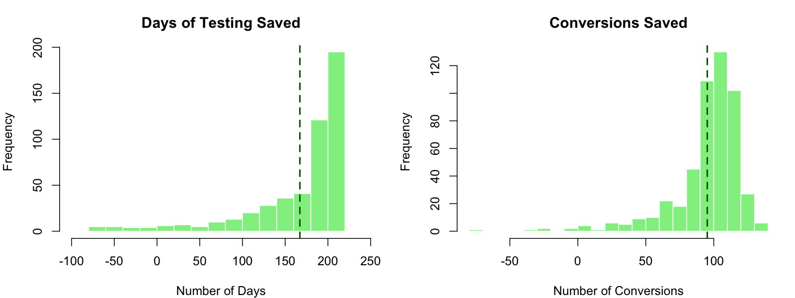



# Bayesian Hypothesis Testing {#sec-hypothesis}

The hypothesis testing problem is as follows. Based on a sample of data, $y$, generated from $p\left( y \mid \theta\right)$ for $\theta\in\Theta$, the goal is to determine if $\theta$ lies in $\Theta_{0}$ or in $\Theta_{1}$, two disjoint subsets of $\Theta$. In general, the hypothesis testing problem involves an action: accepting or rejecting a hypothesis. The problem is described in terms of a null, $H_{0}$, and alternative hypothesis, $H_{1}$, which are defined as
$$
H_{0}:\theta\in\Theta_{0}\;\;\mathrm{and}\;\;H_{1}%
:\theta\in\Theta_{1}\text{.}%
$$ 


As a scope note, we will be explicit about notation: in this chapter $\alpha$ and $\beta$ refer to Type I and Type II error probabilities in the classical sense, defined through repeated-sampling performance of a decision rule. When we discuss Bayesian evidence, we instead emphasize posterior probabilities and Bayes factors, and when we talk about posterior uncertainty we use credible intervals and posterior summaries without reusing $\alpha$ as a credibility-level parameter.

Different types of regions generate different types of hypothesis tests. If the null hypothesis assumes that $\Theta_{0}$ is a single point, $\Theta _{0}=\theta_{0}$, this is known as a simple or "sharp" null hypothesis. If the region consists of multiple points, the hypothesis is called composite; this occurs when the space is unconstrained or corresponds to an interval of the real line. In the case of a single parameter, typical one-sided tests are of the form $H_{0}:\theta<\theta_{0}$ and $H_{1}:\theta>\theta_{0}$.

There are two correct decisions and two possible types of errors. The correct decisions are accepting a null or an alternative that is true, whereas a Type I error incorrectly rejects a true null and a Type II error incorrectly accepts a false null.

|                          | $\theta\in\Theta_{0}$ | $\theta\in\Theta_{1}$ |
|--------------------------|-----------------------|-----------------------|
| Accept $H_{0}$           | Correct decision      | Type II error         |
| Accept $H_{1}$           | Type I error          | Correct decision      |

Formally, the probabilities of Type I ($\alpha$) and Type II ($\beta$) errors are defined as:
$$
\alpha=P \left[  \text{reject }H_{0} \mid H_{0}\text{
is true }\right]  \text{ and }\beta=P \left[  \text{accept
}H_{0} \mid H_{1}\text{ is true }\right]  \text{.}%
$$

It is useful to think of the decision to accept or reject as a decision rule, $d\left( y\right)$. In many cases, the decision rules form a critical region $R$, such that $d\left( y\right) =d_{1}$ if $y\in R$. These regions often take the form of simple inequalities. Next, defining the decision to accept the null as $d\left( y\right) =d_{0}$, and the decision to accept the alternative as $d_{1},$ the error types are 
\begin{align*}
\alpha_{\theta}\left(  d\right)   &  =P \left[  d\left(  y\right)
=d_{1} \mid \theta\right]  \text{ if }\theta\in\Theta_{0}\text{ }(H_{0}\text{ is true})\\
\beta_{\theta}\left(  d\right)   &  =P \left[  d\left(  y\right)
=d_{0} \mid \theta\right]  \text{ if }\theta\in\Theta_{1}\text{ }(H_{1}\text{ is true})\text{.}%
\end{align*} 
where both types of errors explicitly depend on the decision and the true parameter value. Notice that both of these quantities are determined by the population properties of the data. In the case of a composite null hypothesis, the size of the test (the probability of making a type I error) is defined as 
$$
\alpha = \underset{\theta\in\Theta_{0}}{\sup}~\alpha_{\theta}\left( d\right)
$$ 
The supremum ($\sup$) is the least upper bound of a set. For finite sets, $\sup=\max$. For a standard reference, see @billingsley1995probability.
and the power is defined as $1-\beta_{\theta}\left( d\right)$. It is always possible to set either $\alpha_{\theta}\left( d\right)$ or $\beta_{\theta }\left( d\right)$ equal to zero by finding a test that always rejects the alternative or null, respectively.

The total probability of making an error is $\alpha_{\theta}\left(d\right) +\beta_{\theta}\left(d\right)$, and ideally one would seek to minimize the total error probability, absent additional information. The optimal action $d^*$ minimizes the posterior expected loss; $d^* = d_0 = 0$ if the posterior probability of hypothesis $H_0$ exceeds 1/2, and $d^* = d_1=1$ otherwise
$$
d^* = 1\left(  P \left(  \theta \in \Theta_0 \mid y\right) < P \left(  \theta \in \Theta_1 \mid y\right)\right)  = 1\left(P \left(  \theta \in \Theta_0 \mid y\right)<1/2\right).
$$
Formally, a decision rule selects the hypothesis with higher posterior probability.

The easiest way to reduce the error probability is to gather more data, as the additional evidence should lead to more accurate decisions. In some cases, it is easy to characterize optimal tests, those that minimize the sum of the errors. Simple hypothesis tests of the form $H_{0}:\theta=\theta_{0}$ versus $H_{1}:\theta=\theta_{1}$ are one such case admitting optimal tests. Defining $d^{\ast}$ as a test accepting $H_{0}$ if $a_{0}f\left( y \mid \theta_{0}\right) >a_{1}f\left( y \mid \theta_{1}\right)$ and $H_{1}$ if $a_{0}f\left( y \mid \theta_{0}\right) <a_{1}f\left( y \mid \theta _{1}\right)$, for some $a_{0}$ and $a_{1}$. Either $H_{0}$ or $H_{1}$ can be accepted if $a_{0}f\left(y \mid \theta_{0}\right) =a_{1}f\left( y \mid \theta_{1}\right)$. Then, for any other test $d$, it is not hard to show that
$$
a_{0}\alpha\left(  d^{\ast}\right)  +a_{1}\beta\left(  d^{\ast}\right)  \leq
a_{0}\alpha\left(  d\right)  +a_{1}\beta\left(  d\right),
$$ 
where $\alpha_{d}=\alpha_{d}\left( \theta\right)$ and $\beta_{d}=\beta_{d}\left( \theta\right)$. This result highlights the optimality of tests defining rejection regions in terms of the likelihood ratio statistic, $f\left( y \mid \theta_{0}\right)/f\left( y \mid \theta_{1}\right)$. It turns out that the results are in fact stronger. In terms of decision theoretic properties, tests that define rejection regions based on likelihood ratios are not only admissible decisions, but form a minimal complete class, the strongest property possible.


One of the main problems in hypothesis testing is that there is often a tradeoff between the two goals of reducing type I and type II errors: decreasing $\alpha$ leads to an increase in $\beta$, and vice versa. Because of this, it is common to fix $\alpha_{\theta}\left( d\right)$, or $\sup~\alpha_{\theta}\left( d\right)$, and then find a test to minimize $\beta_{d}\left( \theta\right)$. This leads to "most powerful" tests. There is an important result from decision theory: test procedures that use the same size level of $\alpha$ in problems with different sample sizes are inadmissible. This is commonly done where significance is indicated by a fixed size, say 5%.

## Likelihood Principle
Given observed data $y$ and likelihood function $l(\theta) = p(y\mid \theta)$, the likelihood principle states that all relevant experimental information is contained in the likelihood function for the observed $y$. Furthermore, two likelihood functions contain the same information about $\theta$ if they are proportional to each other. For example, the widely used maximum-likelihood estimation does satisfy the likelihood principle. However, frequentist hypothesis testing procedures often violate this principle. The likelihood principle is a fundamental principle in statistical inference, and it is a key reason why Bayesian procedures are often preferred.

::: {.callout-note}
## Decision Theoretic Concepts

* *Admissibility*: A decision rule $\delta$ is *admissible* if there exists no other rule $\delta^{\prime}$ such that $R\left( \theta,\delta^{\prime}\right) \leq R\left( \theta,\delta\right)$ for all $\theta$, with strict inequality for at least one $\theta$. In other words, an admissible rule cannot be uniformly improved upon.

* *Complete and Essentially Complete Classes*: A class of rules $\mathcal{C}$ is *complete* if for any rule $\delta \notin \mathcal{C}$ there exists a rule $\delta^{\prime} \in \mathcal{C}$ that dominates it, i.e., $R\left( \theta,\delta^{\prime}\right) \leq R\left( \theta,\delta\right)$ for all $\theta$ with strict inequality for at least one $\theta$. It is *essentially complete* if the same holds with only the weak inequality, so that $\delta^{\prime}$ need merely be at least as good. A *minimal complete class* is a complete class no proper subset of which is complete; when one exists, it consists exactly of the admissible rules.
:::

::: {#exm-likelihood}
## Testing Fairness
Suppose we are interested in testing $\theta$, the unknown probability of heads for a possibly biased coin. Suppose,
$$
H_0 :~\theta=1/2 \quad\text{v.s.} \quad  H_1 :~\theta>1/2.
$$
An experiment is conducted and 9 heads and 3 tails are observed. This information is not sufficient to fully specify the model $p(y\mid \theta)$. There are two approaches. 

*Scenario 1*: Number of flips, $n = 12$, is predetermined. Then number of heads $Y \mid \theta$ is binomial $B(n, \theta)$, with probability mass function
$$
p(y\mid \theta)= {n \choose y} \theta^{y}(1-\theta)^{n-y} = 220 \cdot \theta^9(1-\theta)^3
$$
For a frequentist, the $p$-value of the test is
$$
P(Y \geq 9\mid H_0)=\sum_{y=9}^{12} {12 \choose y} (1/2)^y(1-1/2)^{12-y} = (1+12+66+220)/2^{12} =0.073,
$$
and if you recall the classical testing, $H_0$ is not rejected at level $\alpha = 0.05$.
 
*Scenario 2*: The number of tails (successes) $r = 3$ is predetermined; that is, flipping continues until 3 tails are observed. Then, $Y$, the number of heads (failures) observed until 3 tails appear, follows a Negative Binomial distribution $NB(3, 1- \theta)$,
$$
p(y\mid \theta)= {r+y-1 \choose r-1} \theta^{y}(1-\theta)^{r} = {3+9-1 \choose 3-1} \theta^9(1-\theta)^3 = 55\cdot \theta^9(1-\theta)^3.
$$
For a frequentist, large values of $Y$ are critical and the $p$-value of the test is
$$
P(Y \geq 9\mid H_0)=\sum_{y=9}^{\infty} {3+y-1 \choose 2} (1/2)^{y}(1/2)^{3} = 0.0327.
$$
We used the following identity here
$$
\sum_{x=k}^{\infty} {2+x \choose 2}\dfrac{1}{2^x} = \dfrac{8+5k+k^2}{2^k}.
$$
The hypothesis $H_0$ is rejected, and this change in decision is not caused by observations.

According to the Likelihood Principle, all relevant information is in the likelihood 
$l(\theta) \propto \theta^9(1 - \theta)^3$, and Bayesians could not agree more!

Edwards, Lindman, and Savage (1963, 193) note: The likelihood principle emphasized in Bayesian statistics implies, among other things, that the rules governing when data collection stops are irrelevant to data interpretation. It is entirely appropriate to collect data until a point has been proven or disproven, or until the data collector runs out of time, money, or patience.

:::


## The Bayesian Approach

Formally, the Bayesian approach to hypothesis testing is a special case of the model comparison results to be discussed later. The Bayesian approach just computes the posterior distribution of each hypothesis. By Bayes 
$$
P \left(  H_{i} \mid y\right)  =\frac{p\left(  y \mid H_{i}\right)  P \left(  H_{i}\right)  }{p\left(  y\right)}    , ~\text{for} ~ i=0,1
$$ 
where $P \left( H_{i}\right)$ is the prior probability of $H_{i}$, 
$$
p\left( y \mid H_{i}\right) =\int_{\theta \in \Theta_i} p\left( y \mid \theta\right) p\left( \theta \mid H_{i}\right) d\theta
$$ 
is the marginal likelihood under $H_{i}$, $p\left( \theta \mid H_{i}\right)$ is the parameter prior under $H_{i}$, and
$$
p\left(  y\right)  = \sum_{i=0,1} p\left(  y \mid H_{i}\right)  P \left( H_{i}\right).
$$

If the hypotheses are mutually exclusive, $P \left( H_{0}\right) =1-P \left( H_{1}\right)$.

The posterior *odds* of the null to the alternative is
$$
\text{Odds}_{0,1}=\frac{P \left(  H_{0} \mid y\right)  }{P %
\left(  H_{1} \mid y\right)  }=\frac{p\left(  y \mid H_{0}\right)
}{p\left(  y \mid H_{1}\right)  }\frac{P \left(  H_{0}\right)  }{P \left(  H_{1}\right)  }\text{.}%
$$ 

The odds ratio updates the prior odds, $P \left( H_{0}\right) /P \left( H_{1}\right)$, using the Bayes factor, 
$$
\mathrm{BF}_{0,1}=\dfrac{p\left(y \mid H_{0}\right)}{p\left( y \mid H_{1}\right)}.
$$ 
With exhaustive competing hypotheses, $P \left( H_{0} \mid y\right)$ simplifies to
$$
P \left(  H_{0} \mid y\right)  =\left(  1+\left(  \mathrm{BF}_{0,1}\right)  ^{-1}\frac{\left(  1-P \left(  H_{0}\right)
\right)  }{P \left(  H_{0}\right)  }\right)  ^{-1}\text{,}%
$$
and with equal prior probability, $P\left( H_{0} \mid y\right) =\left( 1+\left( \mathrm{BF}_{0,1}\right) ^{-1}\right) ^{-1}$. Both Bayes factors and posterior probabilities can be used for comparing hypotheses. Jeffreys (1961) advocated using Bayes factors, and provided a scale for measuring the strength of evidence that was given earlier. Bayes factors merely indicate that the null hypothesis is more likely if $\mathrm{BF}_{0,1}>1$, $p\left( y \mid H_{0}\right) >p\left( y \mid H_{1}\right)$. The Bayesian approach merely compares density ordinates of $p\left( y \mid H_{0}\right)$ and $p\left( y \mid H_{1}\right)$, which mechanically involves plugging in the observed data into the functional form of the marginal likelihood.

For a point null, $H_{0}:\theta=\theta_{0}$, the parameter prior is $p\left( \theta \mid H_{0}\right) =\delta_{\theta_{0}}\left( \theta\right)$ (a Dirac mass at $\theta_{0}$), which implies that 
$$
p\left( y \mid H_{0}\right) =\int p\left( y \mid \theta_{0}\right) p\left( \theta \mid H_{0}\right) d\theta=p\left( y \mid \theta_{0}\right).
$$ 
With a general alternative, $H_{1}:\theta\neq\theta_{0}$, the probability of the null is
$$
P \left(  \theta=\theta_{0} \mid y\right)  =\frac{p\left(  y \mid \theta
_{0}\right)  P \left(  H_{0}\right)  }{p\left(  y \mid \theta
_{0}\right)  P \left(  H_{0}\right)  +\left(  1-P\left( H_{0}\right)  \right)  \int_{\Theta}p\left(  y \mid \theta,H_{1}\right)  p\left(  \theta \mid H_{1}\right)  d\theta},
$$ 
where $p\left( \theta \mid H_{1}\right)$ is the parameter prior under the alternative.

Bayes factors and posterior null probabilities measure the relative weight of evidence of the hypotheses. Traditional hypothesis testing involves an additional decision or action: to accept or reject the null hypothesis. For Bayesians, this typically requires some statement of the utility/loss that codifies the benefits/costs of making a correct or incorrect decision. The simplest situation occurs if one assumes a zero loss of making a correct decision. The loss incurred when accepting the null (alternative) when the alternative is true (false) is $L\left( d_{0} \mid H_{1}\right)$ and $L\left( d_{1} \mid H_{0}\right)$, respectively.

The Bayesian will accept or reject based on the posterior expected loss. If the expected loss of accepting the null is less than the alternative, the rational decision maker will accept the null. The posterior loss of accepting the null is
$$
\E{\mathcal{L}\mid d_{0},y}  =L\left(  d_{0} \mid H_{0}\right)
P \left(  H_{0} \mid y\right)  +L\left(  d_{0} \mid H_{1}\right)  P \left(  H_{1} \mid y\right)  =L\left( d_{0} \mid H_{1}\right)  P \left(  H_{1} \mid y\right)  ,
$$ 
since the loss of making a correct decision, $L\left( d_{0} \mid H_{0}\right)$, is zero. Similarly,
$$
\E{\mathcal{L} \mid d_{1},y}  =L\left(  d_{1} \mid H_{0}\right)
P \left(  H_{0} \mid y\right)  +L\left(  d_{1} \mid H_{1}\right)  P \left(  H_{1} \mid y\right)  =L\left( d_{1} \mid H_{0}\right)  P \left(  H_{0} \mid y\right)  .
$$ 
Thus, the null is accepted if
$$
\E{\mathcal{L} \mid d_{0},y}  <\E{\mathcal{L} \mid d_{1},y}
\Longleftrightarrow L\left(  d_{0} \mid H_{1}\right)  P \left( H_{1} \mid y\right)  <L\left(  d_{1} \mid H_{0}\right)
P \left(  H_{0} \mid y\right)  ,
$$ 
which further simplifies to
$$
\frac{L\left(  d_{0} \mid H_{1}\right)  }{L\left(  d_{1} \mid H_{0}\right)  }<\frac{P \left(  H_{0} \mid y\right)  }{P \left(  H_{1} \mid y\right)  }.
$$ 
In the case of equal losses, this simplifies to accept the null if $P \left( H_{1} \mid y\right) <P \left( H_{0} \mid y\right)$. One advantage of Bayes procedures is that the resulting estimators and decisions are always admissible.

::: {#exm-enigma}
## Enigma Code Breaking
Consider an alphabet of $A=26$ letters. Let $x$ and $y$ be two transmitted messages of length $T$. We want to determine if they were encoded by the same Enigma machine setting ($H_1$) or by different/random settings ($H_0$).

To compute the Bayes factor, we compare the likelihood of the observed pair $(x, y)$ under each hypothesis:
$$
P( x,y\mid  H_0 ) \; \; \mathrm{ and} \; \; P( x,y\mid  H_1 ).
$$ 
Under $H_0$ (different settings), the two messages are effectively independent random sequences. The probability of any specific pair of letters is $(1/A)^2$, so for length $T$:
$$
P(x, y \mid H_0) = \prod_{i=1}^T \left(\frac{1}{A}\right)^2 = \left(\frac{1}{A}\right)^{2T}.
$$

Under $H_1$ (same setting), the messages are correlated. Specifically, if the letters at position $i$ are the same ($x_i = y_i$), it implies a "match." The probability of a match, denoted by $m$, depends on the language's letter frequencies $p_t$ (for English, $m = \sum p_t^2 \approx 0.066$ or about $2/26$). If they don't match, the probability is distributed among the remaining pairs.
Thus:
$$
P( x_i , y_i \mid H_1 ) = \begin{cases} 
\frac{m}{A} & \text{if } x_i = y_i \text{ (match)} \\
\frac{1-m}{A(A-1)} & \text{if } x_i \neq y_i \text{ (mismatch)}
\end{cases}
$$
The term $1/A$ appears because we approximate the marginal probability of $x_i$ as uniform, but the conditional probability $P(y_i \mid x_i)$ is boosted to $m$ if $x_i=y_i$.

The log Bayes factor is the sum of contributions from matches ($M$) and mismatches ($N$):
\begin{align*} 
\ln \frac{P( x,y\mid  H_1 )}{P( x,y\mid  H_0 )} & = M \ln \frac{ m/A}{1/A^2} +N \ln \frac{ ( 1-m ) / A(A-1) }{ 1/ A^2} \\
& = M \ln (mA)  + N \ln \frac{ ( 1-m )A }{A-1 }
\end{align*} 
Substituting values for English ($A=26, m \approx 0.066$):
The first term (match) adds $\ln(0.066 \times 26) \approx 0.54$.
The second term (mismatch) subtracts $\ln(\frac{0.934 \times 26}{25}) \approx -0.03$.
In decibans (ten times the base-10 logarithm of the likelihood ratio, a unit introduced by A. Turing and I.J. Good [@good1979turing]), a match provides roughly 2.3 decibans of evidence, while a mismatch provides a slight penalty of about 0.13 decibans.

Example: With $T=51$ letters, suppose we observe $M=4$ matches and $N=47$ mismatches. This yields:
$$
4 \times 2.3 - 47 \times 0.13 \approx 9.2 - 6.1 = 3.1 \text{ decibans}.
$$
This corresponds to a Bayes factor of roughly $10^{0.31} \approx 2$, providing evidence for $H_1$.

How long a sequence do you need to look at? Calculate the expected log odds.
Turing and Good figured you needed sequences of about length $400$. Can also look at doubles and triples.
:::

::: {#exm-dice-odds}
## Dice and Odds Updating
Suppose that you wish to assess whether a die is loaded or not. $H_0 : p = 1/6$ vs $H_1 : p = 1/5$.
How will the evidence accumulate in each case?  

Let $x = \# 6$'s and $y = \#$ non-$6$'s.  Then $x + y = n$.  The posterior odds will update via the likelihood ratio (a.k.a. Bayes factor) as 
\begin{align*}
O ( H_0 \mid D ) & = \left ( \frac{1/6}{1/5} \right )^x \left ( \frac{5/6}{4/5} \right )^y O ( H_0 )  \\
  & = \left ( \frac{5}{6} \right )^x \left ( \frac{25}{24} \right )^y O ( H_0 ) 
\end{align*}
Under $H_0 : p = 1/6$ we can replace the data with the empirical cdf (a.k.a. $x/n = 1/6$) and similarly under $H_1$ we have $x/n = 1/5$.

Hence, we have
$$
\frac{ O ( H_0 \mid D ) }{O(H_0)}  \approx \left \{ \left ( \frac{5}{6} \right )^{1/6} \left ( \frac{25}{24} \right )^{5/6}  \right \}^n   = ( 1.00364 )^n = 10^{0.00158 n }
$$
Hence, on the deciban scale of the previous section (ten times the base-10 logarithm of the likelihood ratio), evidence accumulates at rate $0.0158$ decibans per roll in favor of $H_0$.

Under $H_1$, we have
$$
\frac{ O ( H_0 \mid D )}{O(H_0) }   \approx \left \{ \left ( \frac{5}{6} \right )^{1/5} \left ( \frac{25}{24} \right )^{4/5}  \right \}^n   = ( 0.9962 )^n  = 10^{- 0.00165 n }
$$
Hence, on the same scale, evidence accumulates at rate $0.0165$ decibans per roll against $H_0$.

The Chernoff-Stein information lemma formalises this [@cover2006elements].
:::

::: {#exm-credset}
## Signal Transmission
Suppose that the random variable $X$ is transmitted over a noisy communication channel. Assume that the received signal is given by
$$
Y=X+W,
$$
where $W\sim N(0,\sigma^2)$ is independent of $X$. Suppose that $X=1$ with probability $p$, and $X=-1$ with probability $1-p$. The goal is to decide between $X=1$ and $X=-1$ by observing the random variable $Y$. We will assume symmetric loss and will accept the hypothesis with the higher posterior probability. This is also sometimes called the maximum a posteriori (MAP) test. 

We assume that $H_0: ~ X = 1$, thus $Y\mid H_0 \sim N(1,\sigma^2)$, and $Y\mid H_1 \sim N(-1,\sigma^2)$. The Bayes factor is simply the likelihood ratio
$$
\dfrac{p(y\mid H_0)}{p(y \mid H_1)} =  \exp\left( \frac{2y}{\sigma^2}\right).
$$
The prior odds are $p/(1-p)$, thus the posterior odds are
$$
\exp\left( \frac{2y}{\sigma^2}\right)\dfrac{p}{1-p}.
$$
We choose $H_0$ (true $X$ is 1) if the posterior odds are greater than 1, i.e., 
$$
y > \frac{\sigma^2}{2} \log\left( \frac{1-p}{p}\right) = c.
$$

Further, we can calculate the error probabilities of our test.
$$
p(d_1\mid H_0) = P(Y<c\mid X=1) = \Phi\left( \frac{c-1}{\sigma}\right),
$$
and
$$
p(d_0\mid H_1) = P(Y>c\mid X=-1) = 1- \Phi\left( \frac{c+1}{\sigma}\right).
$$
Let's plot the total error rate as a function of $p$ and assuming $\sigma=0.2$
$$
P_e = p(d_1\mid H_0)\, p + p(d_0\mid H_1) (1-p)
$$
```{r}
#| fig-cap: Total error rate $P_e$, multiplied by $10^7$, as a function of $p$ for $\sigma=0.2$.
#| label: fig-signal-error-rate
sigma <- 0.2
p <- seq(0.01, 0.99, 0.01)
c <- sigma^2 / 2 * log((1 - p) / p)
Pe <- pnorm((c - 1) / sigma) * p + (1 - pnorm((c + 1) / sigma)) * (1 - p)
plot(p, Pe * 1e7, type = "l", xlab = "p", ylab = expression(10^7 ~ P[e]))
```

@fig-signal-error-rate shows the resulting Bayes (MAP) error rate as the prior probability $p$ varies. As expected from the symmetry of the model, the curve is symmetric around $p=1/2$, where it peaks: when the two hypotheses are equally likely, the prior favors neither, the decision threshold $c$ is 0, and the total probability of error is largest. As $p$ approaches 0 or 1, the threshold shifts to favor the more likely hypothesis, which reduces one type of mistake but increases the other; the mistake that grows concerns the unlikely hypothesis and is weighted in $P_e$ by the small prior probability of that hypothesis ($p$ or $1-p$), so the overall error rate falls toward 0.
:::

::: {#exm-normalhypothesis}
## Hockey: Hypothesis Testing for Normal Mean

The general manager of Washington Capitals (an NHL hockey team) thinks that their star center player Evgeny Kuznetsov is underperforming and is thinking of trading him to a different team. He uses the number of goals per season as a metric of performance. He knows that historically, a top forward scores on average 30 goals per season with a standard deviation of 5, $\theta \sim N(30,25)$. In the 2022--2023 season, Kuznetsov scored 12 goals. For the number of goals $X\mid \theta$, he uses a normal likelihood $N(\theta, 36)$. Kuznetsov's performance was not stable over the years, thus the high variance in the likelihood. Thus, the posterior is $N(23,15)$. 
```{r hockey-posterior}
#| echo: true
sigma2 <- 36
sigma02 <- 25
mu <- 30
y <- 12
k <- sigma02 + sigma2
mu1 <- sigma2 / k * mu + sigma02 / k * y
sigma21 <- sigma2 * sigma02 / k
mu1
sigma21
```
The manager thinks that Kuznetsov simply had a bad year and his true performance is at least 24 goals per season $H_0: \theta \geq 24$, $H_1: \theta<24$. The posterior probability of the $H_0$ hypothesis is
```{r hockey-post-prob}
#| echo: true
a <- 1 - pnorm(24, mu1, sqrt(sigma21))
a
```
It is less than 1/2, only 36%. Thus, we should reject the null hypothesis. The posterior odds in favor of the null hypothesis are
```{r hockey-post-odds}
#| echo: true
a / (1 - a)
```
If underestimating (and trading) Kuznetsov is two times more costly than overestimating him (fans will be upset and team spirit might be affected), that is $L(d_1\mid H_0) = 2L(d_0\mid H_1)$, then we should accept the null when posterior odds are greater than 1/2. This is the case here, 0.56 is greater than 1/2. The posterior odds are in favor of the null hypothesis. Thus, the manager should not trade Kuznetsov.

Kuznetsov was traded to Carolina Hurricanes towards the end of the 2023--2024 season.

Notice, when we try to evaluate a newcomer to the league, we use the prior probability of $\theta \geq 24$:
```{r hockey-prior-prob}
#| echo: true
a <- 1 - pnorm(24, mu, sqrt(sigma02))
print(a)
a / (1 - a)
```
Thus, the prior odds in favor of $H_0$ are 7.7.
:::

::: {#exm-twosided}
## Hypothesis Testing for Normal Mean: Two-Sided Test
In the case of two sided test, we are interested in testing 

- $H_0: \theta = \theta_0$, $p\left( \theta \mid H_{0}\right) =\delta_{\theta_0}\left( \theta\right)$
- $H_1: \theta \neq \theta_0$, $p\left( \theta \mid H_{1}\right) = N\left( \theta_0,\sigma^{2}/n_0\right)$

Where $n$ is the sample size and $\sigma^2$ is the variance (known) of the population. Observed samples are $Y = (y_1, y_2, \ldots, y_n)$ with
$$
y_i \mid \theta,\sigma^2 \sim N(\theta, \sigma^2).
$$

The Bayes factor can be calculated analytically. The sample mean $\bar y$ is sufficient for $\theta$, with $\bar y \mid \theta \sim N(\theta, \sigma^2/n)$, and the factors that do not involve $\theta$ cancel in the ratio, so we may work with $\bar y$ throughout:
$$
BF_{0,1} = \frac{p(\bar y\mid \theta = \theta_0, \sigma^2 )}
{\int p(\bar y\mid \theta, \sigma^2) p(\theta \mid \theta_0, n_0, \sigma^2)\, d \theta}
$$
$$
\int p(\bar y\mid \theta, \sigma^2) p(\theta \mid \theta_0, n_0, \sigma^2)\, d \theta = \sqrt{\frac{n\,n_0}{2\pi\sigma^2\left(n_0+n\right)}}\exp\left\{-\frac{n\,n_0(\theta_0-\bar y)^2}{2\left(n_0+n\right)\sigma^2}\right\}
$$
$$
p(\bar y\mid \theta = \theta_0, \sigma^2 ) = \sqrt{\frac{n}{2\pi\sigma^2}}\exp\left\{-\frac{n(\bar y-\theta_0)^2}{2 \sigma ^2}\right\}
$$
Thus, the Bayes factor is
$$
BF_{0,1} = \left(\frac{n_0+n}{n_0}\right)^{1/2}\exp\left\{-\frac{n^{2}(\theta_0-\bar y)^2}{2\left(n_0+n\right)\sigma^2}\right\}
$$

$$
BF_{0,1} =\left(\frac{n + n_0}{n_0} \right)^{1/2} \exp\left\{-\frac{1}{2} \frac{n }{n + n_0} Z^2 \right\}
$$

$$
Z =  \frac{(\bar{Y} - \theta_0)}{\sigma/\sqrt{n}}
$$

One way to interpret the scaling factor $n_0$ is to look at the standard effect size
$$
\delta = \frac{\theta - \theta_0}{\sigma}.
$$
The prior of the standard effect size is
$$
\delta \mid H_1 \sim N(0, 1/n_0).
$$
This allows us to think about a standardized effect independent of the units of the problem.

Let's now consider the example of the discovery of argon, using the nitrogen densities measured by Lord Rayleigh (@exm-Rayleigh). 
```{r argon-data}
#| echo: true
air <- c(2.31017, 2.30986, 2.31010, 2.31001, 2.31024, 2.31010, 2.31028, 2.31028)
decomp <- c(2.30143, 2.29890, 2.29816, 2.30182, 2.29869, 2.29940, 2.29849, 2.29889)
```
Our null hypothesis is that the mean of the difference equals zero. We assume the lab measurements have normal errors, hence the normal likelihood. We empirically calculate the standard deviation of our likelihood. The Bayes factor is
```{r argon-bayes-factor} 
#| echo: true
y <- air - decomp
n <- length(y)
m0 <- 0
sigma <- sqrt(var(air) + var(decomp))
n0 <- 1
Z <- (mean(y) - m0) / (sigma / sqrt(n))
BF <- sqrt((n + n0) / n0) * exp(-0.5 * n / (n + n0) * Z^2)
format(BF, scientific = TRUE, digits = 3)
```
We have extremely strong evidence in favor $H_1: \theta \ne 0$ hypothesis. The posterior probability of the alternative hypothesis is numerically 1!
```{r argon-post-prob}
#| echo: true
a <- 1 / (1 + BF)
a
```
:::

::: {#exm-prophypothesis}
## Hypothesis Testing for Proportions

Let's look at it again at the effectiveness of  Google's new search algorithm. We measure effectiveness by the number of users who clicked on one of the search results. As users send the search requests, they will be randomly processed with Algo 1 or Algo 2. We wait until 2500 search requests were processed by each of the algorithms and calculate the following table based on how often people clicked through

|                | Algo1 | Algo2 |
|----------------|:-----:|:-----:|
| success        |  1755 |  1818 |
| failure        |  745  |  682  |
| total          |  2500 |  2500 |

Here we assume binomial likelihood and use conjugate beta prior, for mathematical convenience. We are putting independent beta priors on the click-through rates of the two algorithms, $p_1\sim Beta(\alpha_1,\beta_1)$ and $p_2\sim Beta(\alpha_2,\beta_2)$. The posterior for $p_1$ and $p_2$ are independent Beta distributions
$$
p(p_1, p_2 \mid y) \propto p_1^{\alpha_1 + 1755 - 1} (1-p_1)^{\beta_1 + 745 - 1}\times p_2^{\alpha_2 + 1818 - 1} (1-p_2)^{\beta_2 + 682 - 1}.
$$ 

The easiest way to explore this posterior is via Monte Carlo simulation of the posterior.
```{r proportions-monte-carlo}
#| echo: true
#| fig-cap: Posterior Difference in Click-Through Rates.
set.seed(92) # Kuzy
y1 <- 1755
n1 <- 2500
alpha1 <- 1
beta1 <- 1
y2 <- 1818
n2 <- 2500
alpha2 <- 1
beta2 <- 1
m <- 10000
p1 <- rbeta(m, y1 + alpha1, n1 - y1 + beta1)
p2 <- rbeta(m, y2 + alpha2, n2 - y2 + beta2)
rd <- p2 - p1
plot(density(rd), main = "", xlab = expression(p[2] - p[1]), ylab = "Density", lwd = 3)
q <- quantile(rd, c(.05, .95))
print(q)
abline(v = q, col = "red", lwd = 2)
```

:::


## Interval Estimation: Credible Sets
The interval estimators of model parameters are called credible sets. If we use the posterior measure to assess the credibility, the credible set is a set of parameter values that are consistent with the data and gives us is a natural way to measure the uncertainty of the parameter estimate. 

Those who are familiar with the concept of classical confidence intervals (CI's) often make an error by stating that the probability that the CI interval $[L, U ]$ contains parameter $\theta$ is $1 - \alpha$. The right statement seems convoluted; one needs to generate data from such a model many times and for each dataset to exhibit the CI. Now, the proportion of CI's covering the unknown parameter is "tends to" $1 - \alpha$. Bayesian interpretation of a credible set $C$ is natural: The probability of a parameter belonging to the set $C$ is $1 - \alpha$. A formal definition follows. Assume the set $C$ is a subset of the domain of the parameter $\Theta$. Then, $C$ is a credible set with credibility $(1 - \alpha)\cdot 100\%$ if
$$
p(\theta \in C \mid y) = \int_{C}p(\theta\mid y)d\theta \ge 1 - \alpha.
$$
If the posterior is discrete, then the integral becomes a sum (counting measure) and
$$
p(\theta \in C \mid y) = \sum_{\theta_i\in C}p(\theta_i\mid y) \ge 1 - \alpha.
$$
This is the definition of a $(1 - \alpha)100\%$ credible set, and of course, for a given posterior function, such a set is not unique.

For a given credibility level $(1 - \alpha)100\%$, the shortest credible set is of interest. To minimize size the sets should correspond to the highest posterior probability (density) areas. Thus the acronym HPD.

::: {#def-hpd}
### Highest Posterior Density (HPD) Credible Set
The $(1 - \alpha)100\%$ HPD credible set for parameter $\theta$ is a set $C \subset \Theta$ of the form
$$
C = \{ \theta \in \Theta : p(\theta \mid y) \ge k(\alpha) \},
$$
where $k(\alpha)$ is the largest value such that
$$
P(\theta\in C \mid y) = \int_{C}p(\theta\mid y)d\theta \ge 1 - \alpha.
$$
Geometrically, if the posterior density is cut by a horizontal line at the height $k(\alpha)$, the set $C$ is the projection on the $\theta$ axis of the region where the posterior density lies above the line.
:::

```{r hpd-visualization, echo=FALSE}
theta <- seq(0, 1, 0.01)
p <- dbeta(theta, 8, 5)
plot(theta, p, type = "l", xlab = expression(theta), ylab = "Density")
abline(h = 2.5, col = "red")
abline(v = c(0.55, 0.715), col = "blue")
text(0.2, 2.7, expression(k(alpha)), col = "red", cex = 1)
arrows(0.55, 0.1, 0.715, 0.1, code = 3, col = "blue", angle = 15)
text(0.62, 0.25, "C", col = "blue", cex = 1)
``` 

::: {#lem-hpd}
The HPD set $C$ minimizes the size among all sets $D \subset \Theta$ for which 
$$
P(\theta \in D) = 1 - \alpha.
$$
:::

::: {.proof}
The proof is essentially a special case of Neyman-Pearson lemma. If $I_C(\theta) = 1(\theta \in C)$ and $I_D(\theta) = 1(\theta \in D)$, then the key observation is
$$
\left(p(\theta\mid y) - k(\alpha)\right)(I_C(\theta) - I_D(\theta)) \ge 0.
$$
Indeed, for $\theta$'s in $C\cap D$ and $(C\cup D)^c$, the factor $I_C(\theta)-I_D(\theta) = 0$. If $\theta \in C\cap D^c$, then $I_C(\theta)-I_D(\theta) = 1$ and $p(\theta\mid y)-k(\alpha) \ge 0$. If, on the other hand, $\theta \in D\cap C^c$, then $I_C(\theta)-I_D(\theta) = -1$ and $p(\theta\mid y)-k(\alpha) \le 0$. Thus,
$$
\int_{\Theta}(p(\theta\mid y) - k(\alpha))(I_C(\theta) - I_D(\theta))d\theta \ge 0.
$$
The statement of the theorem now follows from the chain of inequalities,
$$
\int_{C}(p(\theta\mid y) - k(\alpha))d\theta \ge \int_{D}(p(\theta\mid y) - k(\alpha))d\theta
$$
$$
(1-\alpha) - k(\alpha)\text{size}(C) \ge (1-\alpha) - k(\alpha)\text{size}(D)
$$
$$
size(C) \le size(D).
$$
The size of a set is simply its total length if the parameter space $\theta$ is one-dimensional, total area if $\theta$ is two-dimensional, and so on.
:::

Note, when the distribution  $p(\theta \mid y)$ is unimodal and symmetric, using quantiles of the posterior distribution is a good way to obtain the HPD set.

An equal-tailed interval (also called a central interval) of confidence level  
$$
I_{\alpha} = [q_{\alpha/2}, q_{1-\alpha/2}],
$$
here $q$'s   are the quantiles of the posterior distribution. This is an interval on whose both right and left side lies $(1-\alpha/2)100\%$ of the probability mass of the posterior distribution; hence the name equal-tailed interval. 

Usually, when a credible interval is mentioned without specifying which type of the credible interval it is, an equal-tailed interval is meant.

However, unless the posterior distribution is unimodal and symmetric, there are points outside of the equal-tailed credible interval having a higher posterior density than some points of the interval. If we want to choose the credible interval so that this not happen, we can do it by using the highest posterior density criterion for choosing it. 

::: {#exm-Cauchy}
## Cauchy

Assume that the observed samples
```{r cauchy-data}
#| echo: true
y <- c(2, -7, 4, -6)
```
come from a Cauchy distribution. The likelihood is
$$
p(y\mid \theta, \gamma) = \frac{1}{\pi\gamma} \prod_{i=1}^{4} \frac{1}{1+\left(\dfrac{y_i-\theta}{\gamma}\right)^2}.
$$
We assume unknown location parameter $\theta$ and scale parameter $\gamma=1$. For the flat prior $\pi(\theta) = 1$, the posterior is proportional to the likelihood. 
```{r cauchy-posterior}
#| echo: true
par(mar = c(4, 4, 0, 0), bty = "n")
lhood <- function(theta) 1 / prod(1 + (y - theta)^2)
theta <- seq(-10, 10, 0.1)
post <- sapply(theta, lhood)
post <- 10 * post / sum(post)
plot(theta, post, type = "l", xlab = expression(theta), ylab = "Posterior Density")
abline(h = c(0.008475, 0.0159, 0.1, 0.2), col = "red")
```
The four horizontal lines correspond to four credible sets 

| $k$      | $C$                                     | $P(\theta \in C \mid y)$ |
| :------- | :-------------------------------------- | :----------------------- |
| 0.008475 | [-8.498, 5.077]                         | 99%                      |
| 0.0159   | [-8.189, -3.022] $\cup$ [-0.615, 4.755] | 95%                      |
| 0.1      | [-7.328, -5.124] $\cup$ [1.591, 3.120]  | 64.2%                    |
| 0.2      | [-6.893, -5.667]                        | 31.2%                    |

Notice that for $k = 0.0159$ and $k = 0.1$ the credible set is not compact. This shows that two separate intervals "clash" for the ownership of $\theta$ and this is useful information. This non-compactness can also point out that the prior is not agreeing with the data. There is no frequentist counterpart for the CI for $\theta$ in the above model.
:::

## Alternative Approaches

The two main alternatives to the Bayesian approach are significance testing using $p$-values, developed by Ronald Fisher, and the Neyman-Pearson approach.

### Significance Testing Using $p$-values

Fisher's approach posits a test statistic, $T\left( y\right)$, based on the observed data. In Fisher's mind, if the value of the statistic was highly unlikely to have occurred under $H_{0}$, then the $H_{0}$ should be rejected. Formally, the $p$-value is defined as
$$
p=P \left[  T\left(  Y\right)  >T\left(  y\right)   \mid H_{0}\right]  ,
$$ 
where $y$ is the observed sample and $Y=\left( Y_{1}, \ldots ,Y_{T}\right)$ is a random sample generated from model $p\left( Y \mid H_{0}\right)$, that is, the null distribution of the test-statistic in repeated samples. Thus, the $p$-value is the probability that a dataset would generate a more extreme statistic under the null hypothesis, and not the probability of the null, conditional on the data.

The testing procedure is simple. Fisher (1946, p. 80) argues that "*if P (the $p$-value) is between $0.1$ and $0.9$, there is certainly no reason to suspect the hypothesis tested. If it is below $0.02$, it is strongly indicated that the hypothesis fails to account for the whole of the facts. We shall not be astray if we draw a line at $0.05$ and consider that higher values of $\mathcal{X}^{2}$ indicate a real discrepancy.*" Defining $\alpha$ as the significance level, the tests rejects $H_{0}$ if $p<\alpha$. Fisher advocated a fixed significance level of $5\%$, based largely that $5\%$ is roughly the tail area of a mean-zero normal distribution more than two standard deviations from $0$, indicating a statistically significant departure. In practice, testing with $p$-values involves identifying a critical value, $t_{\alpha}$, and rejecting the null if the observed statistic $t\left( y\right)$ is more extreme than $t_{\alpha}$. For example, for a significance test of the sample mean, $t\left( y\right) =\left( \overline{y}-\theta_{0}\right) /se\left( \overline{y}\right)$, where $se\left( \overline{y}\right)$ is the standard error of $\overline{y}$; the $5\%$ critical value is 1.96; and Fisher would reject the null if $t\left( y\right) >t_{\alpha}$.

Fisher interpreted the $p$-value as the weight or measure of evidence of the null hypothesis. The alternative hypothesis is noticeable in its absence in Fisher's approach. Fisher largely rejected the consideration of alternatives, believing that researchers should weigh the evidence or draw conclusions about the observed data rather than making decisions such as accepting or rejecting hypotheses based on it.

There are a number of issues with Fisher's approach. The first and most obvious criticism is that it is possible to reject the null when the alternative hypothesis is less likely. This is an inherent problem in using population tail probabilities--essentially rare events. Just because a rare event has occurred does not mean the null is incorrect, unless there is a more likely alternative. This situation often arises in court cases, where a rare event like a murder has occurred. Decisions based on $p$-values generates a problem called the prosecutor's Fallacy, which is discussed below. Second, Fisher's approach relies on population properties (the distribution of the statistic under the null) that would only be revealed in repeated samples or asymptotically. Thus, the testing procedure relies on data that is not yet seen, a violation of what is known as the likelihood principle. As noted by Jeffreys' (1939, pp. 315--316): "*What the use of P implies, therefore, is that a hypothesis that may be true may be rejected because it has not predicted observable data that have not occurred. This seems a remarkable procedure*" <!-- \label{Jeffreys, p. 385}   -->

Third, Fisher is agnostic regarding the source of the test statistics, providing no discussion of how the researcher decides to focus on one test statistic over another. In some simple models, the distribution of properly scaled sufficient statistics provides natural test statistics (e.g., the $t$-test). In more complicated models, Fisher is silent on the sources. In many cases, there are numerous test statistics (e.g., testing for normality), and test choice is clearly subjective. For example, in Generalized Method of Moments (GMM) tests, the choice of test moments is clearly a subjective choice. Finally, from a practical perspective, $p$-values have a serious deficiency: tests using $p$-values often appear to give the wrong answer, in the sense that they provide a highly misleading impression of the weight of evidence in many samples. A number of examples of this will be given below, but in all cases, Fisher's approach tends to over-reject the null hypotheses.


### Bayes vs P-value

The fundamental difference between the Bayesian and frequentist approaches can be summarized by how they quantify evidence. As R.A. Fisher famously wrote: "... for the one chance in a million will undoubtedly occur, with no less and no more than its appropriate frequency, however surprised we may be that it should occur to us ...".

The Bayesian evidence is quantified by the Bayes factor:
$$
BF = \frac{P(D \mid H_0)}{P(D \mid H_1)}
$$
If we consider the data definition used in frequentist testing, where $D = \{T(x) > t\}$, then the numerator $P(D \mid H_0)$ corresponds precisely to the *$p$-value*. The crucial limitation of the $p$-value is that it considers only the numerator. Even if this probability is small (suggesting the data are rare under the null), the denominator $P(D \mid H_1)$—the probability of observing such data under the alternative—might be *even smaller*!

In a case with mutually exhaustive hypotheses ($P(H_0) + P(H_1) = 1$), it is perfectly possible for the $p$-value to be small (e.g., 0.05), yet for the Bayes factor to be greater than 1 ($BF > 1$), indicating that the evidence actually favors $H_0$. This highlights the danger of assessing hypotheses in isolation rather than comparing them relative to one another.


::: {#exm-novick1965bayesian}
## Ulcer Treatment Clinical Trial

One of the earliest applications of Bayesian methods to clinical trials was presented by @novick1965bayesian, who analyzed data from an ongoing experiment comparing four operative treatments for duodenal ulcers. Doctors assessed patient outcomes as Excellent, Fair, or Death. The data, collected sequentially over the course of the trial, are shown below:

| Treatment | Excellent | Fair | Death | Total |
|:---------:|:---------:|:----:|:-----:|:-----:|
| A         | 76        | 17   | 7     | 100   |
| B         | 89        | 10   | 1     | 100   |
| C         | 86        | 13   | 1     | 100   |
| D         | 88        | 9    | 3     | 100   |

: Outcomes by treatment for duodenal ulcer surgery. {#tbl-ulcer}

When I present these data to students and ask which treatment they would prefer, most choose Treatment B. The reasoning is intuitive: Treatment B has the highest number of excellent outcomes (89) and the lowest death rate (only 1 death, tied with C). Treatment A, despite being listed first, has only 76 excellent outcomes and 7 deaths, the worst performance on both metrics. The students' intuition is correct, but can we quantify how confident we should be that B is truly better than A?

A classical chi-square test of homogeneity across treatments yields a $p$-value greater than 0.05, leading to the conclusion that we *cannot reject* the null hypothesis that all treatments are equally effective at the 5% significance level. This non-rejection is often misinterpreted as evidence that the treatments are equivalent.

But consider what the $p$-value actually measures: $p = P(D \mid H_0)$, the probability of observing data at least as extreme as what we saw, assuming the null hypothesis is true. The critical insight is that $P(D \mid H_1)$, the probability of the data under any specific alternative, can be much smaller than $P(D \mid H_0)$. A small $p$-value does not mean the alternative is more likely; it only means the observed data would be rare under the null. This is the essence of the Bayesian critique: inference should be *relative*, comparing the evidence for different hypotheses, not absolute.

The Bayesian approach directly addresses the question of interest: given the observed data, what is the probability that one treatment is better than another? Let $p_i$ denote the death rate under treatment $i$. Using independent Beta priors for each treatment's death rate, say $p_i \sim \text{Beta}(1, 1)$ (uniform), the posteriors after observing the data are:
$$
p_A \mid \text{data} \sim \text{Beta}(1 + 7, 1 + 93) = \text{Beta}(8, 94)
$$
$$
p_B \mid \text{data} \sim \text{Beta}(1 + 1, 1 + 99) = \text{Beta}(2, 100)
$$

```{r ulcer-posterior}
#| echo: true
# Posterior distributions for death rates
# Treatment A: 7 deaths out of 100
# Treatment B: 1 death out of 100
alpha_A <- 1 + 7
beta_A <- 1 + 93
alpha_B <- 1 + 1
beta_B <- 1 + 99

# Monte Carlo estimate of P(p_A > p_B | data)
set.seed(123)
n_sims <- 100000
p_A_samples <- rbeta(n_sims, alpha_A, beta_A)
p_B_samples <- rbeta(n_sims, alpha_B, beta_B)

prob_A_worse <- mean(p_A_samples > p_B_samples)
cat("P(death rate A > death rate B | data) =", round(prob_A_worse, 3), "\n")
```

The posterior probability that Treatment A has a higher death rate than Treatment B is approximately 0.98. This is a direct, interpretable answer to the clinical question: there is a 98% probability that patients receiving Treatment A face a higher mortality risk than those receiving Treatment B.

The chi-square test fails to reject equality at the 5% level, which many would interpret as "no difference." The Bayesian analysis reveals that we can be 98% confident that Treatment A is worse than Treatment B in terms of mortality. The difference arises because the Bayesian approach compares hypotheses directly, while the $p$-value only measures how surprising the data would be under the null.

```{r ulcer-chisquare}
#| results: hide
# Frequentist chi-square test of homogeneity
# Construct the contingency table (Excellent, Fair, Death) x (Treatment A, B, C, D)
outcome_matrix <- matrix(c(
  76, 17, 7, # Treatment A
  89, 10, 1, # Treatment B
  86, 13, 1, # Treatment C
  88, 9, 3 # Treatment D
), nrow = 4, byrow = TRUE)
rownames(outcome_matrix) <- c("A", "B", "C", "D")
colnames(outcome_matrix) <- c("Excellent", "Fair", "Death")

# Chi-square test
chisq_result <- suppressWarnings(chisq.test(outcome_matrix))
cat("Chi-square statistic:", round(chisq_result$statistic, 2), "\n")
cat("Degrees of freedom:", chisq_result$parameter, "\n")
cat("P-value:", round(chisq_result$p.value, 3), "\n")

# Fisher's exact test for just the death column (A vs B)
death_table <- matrix(c(7, 93, 1, 99), nrow = 2, byrow = TRUE)
rownames(death_table) <- c("A", "B")
colnames(death_table) <- c("Death", "Survival")
fisher_result <- fisher.test(death_table, alternative = "greater")
cat("\nFisher's exact test (A vs B, deaths only):\n")
cat("P-value:", round(fisher_result$p.value, 3), "\n")
```

The chi-square test of homogeneity gives a statistic of `r round(chisq_result$statistic, 1)` on `r chisq_result$parameter` degrees of freedom and a $p$-value of `r round(chisq_result$p.value, 3)`, which exceeds the conventional 0.05 threshold. Even a one-sided Fisher's exact test comparing only the death rates between Treatments A and B gives a $p$-value of `r round(fisher_result$p.value, 3)`, which is only marginally significant and provides no sense of the magnitude of the difference or our confidence in it.

This example illustrates a fundamental principle: *Bayesian inference is relative*. We do not ask whether the data are unlikely in some absolute sense; we ask which hypothesis better explains the data. There are no absolutes in Bayesian inference, only comparisons. A treatment is not declared "effective" or "ineffective" in isolation; it is compared to alternatives, with uncertainty fully quantified.

```{r ulcer-plot-posteriors}
#| fig-cap: "Posterior distributions of death rates."

p_grid <- seq(0, 0.2, length.out = 500)
plot(p_grid, dbeta(p_grid, alpha_A, beta_A),
  type = "l", col = "red", lwd = 2,
  xlab = "Death rate", ylab = "Posterior density", ylim = c(0, 40)
)
lines(p_grid, dbeta(p_grid, alpha_B, beta_B), col = "blue", lwd = 2, lty = 3)
legend("topright",
  legend = c("Treatment A", "Treatment B"),
  col = c("red", "blue"), lwd = 2, lty = c(1, 3), bty = "n"
)

# Add posterior means
abline(v = alpha_A / (alpha_A + beta_A), col = "red", lty = 2)
abline(v = alpha_B / (alpha_B + beta_B), col = "blue", lty = 2)
```

Treatment A's death rate is concentrated around 7-8%, while Treatment B's is concentrated around 1-2%. The overlap is minimal, corresponding to our finding that $P(p_A > p_B \mid \text{data}) \approx 0.98$.

*Prior Sensitivity Analysis*

A natural concern with Bayesian analysis is whether the conclusions depend heavily on the choice of prior. We used a uniform Beta(1,1) prior, but what if we had used different priors? The table below shows how $P(p_A > p_B \mid \text{data})$ varies across several reasonable prior specifications:

```{r ulcer-sensitivity}
# Prior sensitivity analysis
set.seed(456)
n_sims <- 100000

# Data: Treatment A: 7 deaths, 93 survivals; Treatment B: 1 death, 99 survivals
deaths_A <- 7
survivals_A <- 93
deaths_B <- 1
survivals_B <- 99

# Different priors to consider
priors <- data.frame(
  Prior = c(
    "Uniform Beta(1,1)",
    "Jeffreys Beta(0.5,0.5)",
    "Skeptical Beta(2,20)",
    "Optimistic Beta(1,10)",
    "Strong Beta(5,50)"
  ),
  alpha = c(1, 0.5, 2, 1, 5),
  beta = c(1, 0.5, 20, 10, 50)
)

# Calculate P(p_A > p_B | data) for each prior
results <- sapply(1:nrow(priors), function(i) {
  a <- priors$alpha[i]
  b <- priors$beta[i]

  # Posterior parameters
  alpha_A_post <- a + deaths_A
  beta_A_post <- b + survivals_A
  alpha_B_post <- a + deaths_B
  beta_B_post <- b + survivals_B

  # Monte Carlo
  p_A <- rbeta(n_sims, alpha_A_post, beta_A_post)
  p_B <- rbeta(n_sims, alpha_B_post, beta_B_post)
  mean(p_A > p_B)
})

priors$`Prior Mean` <- round(priors$alpha / (priors$alpha + priors$beta), 3)
priors$`P(p_A > p_B | data)` <- round(results, 3)
knitr::kable(priors[, c("Prior", "Prior Mean", "P(p_A > p_B | data)")],
  caption = "Sensitivity of posterior probability to prior specification"
)
```

Regardless of whether we use a uniform prior, the Jeffreys prior, or informative priors centered on different mortality rates, the posterior probability that Treatment A has a higher death rate than Treatment B remains above 0.93. This robustness occurs because the sample size (100 patients per treatment) is large enough that the likelihood generally dominates the prior.

This sensitivity analysis is particularly important in clinical settings, where different stakeholders may have different prior beliefs about treatment efficacy. The fact that all reasonable priors lead to the same qualitative conclusion (strong evidence that A is worse than B) strengthens the case for preferring Treatment B.

:::

### Neyman-Pearson

The motivation for the Neyman-Pearson (NP) approach was W.S. Gosset, the famous `Student` who invented the $t$-test. In analyzing a hypothesis, Student argued that a hypothesis is not rejected unless an alternative is available that provides a more plausible explanation of the data, in which case. Mathematically, this suggests analyzing the likelihood ratio,
$$
\mathcal{LR}_{0,1}=\frac{p\left(  y \mid H_{0}\right)  }{p\left( y \mid H_{1}\right)  }\text{,}%
$$ 
and rejecting the null in favor of the alternative when the likelihood ratio is small enough, $\mathcal{LR}_{0,1}<k$. This procedures conforms in spirit with the Bayesian approach.

The main problem was one of finding a value of the cut-off parameter $k.$ From the discussion above, by varying $k$, one varies the probabilities of type one and type two errors in the testing procedure. Neyman and Pearson (1933a) argued that the balance between Type I and II errors is subjective: "*how the balance (between the type I and II errors) should be struck must be left to the investigator.*" This approach, however, was not "objective," and they then advocated fixing $\alpha$, the probability of a type I error, in order to determine $k$. This led to their famous lemma: 

::: {#lem-np} 
## Neyman-Pearson Lemma
Consider the simple hypothesis test of $H_{0}:\theta=\theta_{0}$ versus $H_{1}:\theta =\theta_{1}$ and suppose that the null is rejected if $\mathcal{LR}_{0,1}<k_{\alpha}$, where $k_{\alpha}$ is chosen to fix the probability of a type I error at $\alpha:$%
$$
\alpha=P \left[  y:\mathcal{LR}_{0,1}<k_{\alpha} \mid H_{0}\right]  \text{.}%
$$ 
Then, this test is the most powerful test of size $\alpha$ in the sense that any other test with greater power, must have a higher size.
:::

In the case of composite hypothesis tests, parameter estimation is required under the alternative, which can be done via maximum likelihood, leading to the likelihood ratio
$$
\mathcal{LR}_{0,1}=\frac{p\left(  y \mid H_{0}\right)  }{\underset
{\theta\in\Theta}{\sup}p\left(  y \mid \Theta\right)  }=\frac{p\left( y \mid H_{0}\right)  }{p\left(  y \mid \widehat{\theta}\right)  }\text{,}%
$$ 
where $\widehat{\theta}$ is the MLE. Because of this, $0\leq\mathcal{LR}_{0,1}\leq 1$ for composite hypotheses. In multi-parameter cases, finding the distribution of the likelihood ratio is more difficult, requiring asymptotic approximations to calibrate $k_{\alpha}.$ 


At first glance, the NP approach appears similar to the Bayesian approach, as it takes into account the likelihood ratio. However, like the $p$-value, the NP approach has a critical flaw. Neyman and Pearson fix the Type I error and then minimizes the type II error. In many practical cases, $\alpha$ is set at $5\%$, and the resulting $\beta$ is often very small, close to 0. Why is this a reasonable procedure? Given the previous discussion, this is essentially a very strong prior over the relative benefits/costs of different types of errors. While these assumptions may be warranted in certain settings, it is difficult to a priori understand why this procedure would generically make sense.


## Sequential Analysis

Sequential analysis applies Bayesian reasoning to accumulating data, allowing researchers to make principled decisions about when sufficient evidence has been gathered. Unlike fixed-sample designs that predetermine the number of observations, sequential methods continuously update beliefs about hypotheses and can terminate data collection once a satisfactory conclusion is reached.

The foundations of sequential analysis were laid by Abraham Wald during World War II, with his development of the Sequential Probability Ratio Test (SPRT) [@wald1945sequential]. Wald's work, later expanded in his book *Sequential Analysis* [@wald1947sequential], demonstrated that sequential procedures could reduce the expected sample size by up to 50% compared to fixed-sample tests while maintaining the same error rates. The key insight was that rather than collecting a predetermined number of observations and then analyzing them, one could examine the data after each observation and stop as soon as the evidence was sufficiently strong in either direction.

### The Bayesian Framework for Sequential Testing

Consider testing $H_0: \theta \in \Theta_0$ versus $H_1: \theta \in \Theta_1$. After observing data $y_1, y_2, \ldots, y_n$, the posterior odds are
$$
\frac{P(H_0 \mid y_{1:n})}{P(H_1 \mid y_{1:n})} = \frac{p(y_{1:n} \mid H_0)}{p(y_{1:n} \mid H_1)} \cdot \frac{P(H_0)}{P(H_1)}.
$$

A natural stopping rule is to continue sampling until the posterior probability of one hypothesis exceeds some threshold. For example, stop and accept $H_0$ if $P(H_0 \mid y_{1:n}) > 1 - \alpha$, or stop and accept $H_1$ if $P(H_1 \mid y_{1:n}) > 1 - \beta$. This approach has a compelling interpretation: we continue gathering evidence until we are sufficiently confident in our conclusion.

The Bayesian perspective offers a key advantage over frequentist sequential procedures: the posterior probability is always valid, regardless of when or why sampling stopped. As @edwards1963bayesian noted, the likelihood principle implies that the rules governing when data collection stops are irrelevant to data interpretation. This property, sometimes called *optional stopping*, means that Bayesian inference is immune to the criticism that plagues frequentist sequential analysis, where $p$-values become invalid if the stopping rule is not prespecified.

### Wald's Sequential Probability Ratio Test

While Wald's SPRT was developed from a frequentist perspective, it has deep connections to Bayesian testing. For simple hypotheses $H_0: \theta = \theta_0$ versus $H_1: \theta = \theta_1$, the SPRT accumulates the likelihood ratio
$$
\Lambda_n = \frac{p(y_{1:n} \mid \theta_1)}{p(y_{1:n} \mid \theta_0)} = \prod_{i=1}^{n} \frac{p(y_i \mid \theta_1)}{p(y_i \mid \theta_0)}
$$
and stops when $\Lambda_n \leq A$ (accept $H_0$) or $\Lambda_n \geq B$ (accept $H_1$), where the boundaries $A$ and $B$ are chosen to achieve desired error rates.

This is precisely the Bayes factor for simple hypotheses. With equal prior probabilities, the SPRT stopping rule becomes: stop and accept $H_0$ when the posterior probability exceeds $B/(1+B)$, or stop and accept $H_1$ when it exceeds $1/(1+A)$. Wald proved that among all tests with the same error rates, the SPRT minimizes the expected sample size under both hypotheses, an optimality property.

### Applications in Clinical Trials

Clinical trials represent perhaps the most important application of sequential analysis, where the ethical imperative to minimize patient exposure to inferior treatments aligns with the statistical goal of efficient inference. Peter Armitage pioneered the application of sequential methods to clinical trials in the 1950s and 1960s [@armitage1975sequential], demonstrating how these methods could reduce trial duration and the number of patients receiving suboptimal treatments.

Modern clinical trial design frequently employs *group sequential designs*, which allow interim analyses at predetermined points during patient accrual. The key challenge is controlling the overall Type I error rate when multiple looks at the data are permitted. Frequentist approaches use spending functions to allocate alpha across interim analyses [@demets1994interim], while Bayesian approaches naturally handle multiple looks through the posterior probability framework.

The Bayesian approach to clinical trial design has been championed by Donald Berry, whose seminal work [@berry1985interim] critiqued traditional hypothesis testing and advocated for a framework where sampling stops when the posterior probability that one treatment is superior exceeds a specified threshold. This methodology, later expanded by @berry2006bayesian, integrates Bayesian decision theory into trial design and monitoring, enabling continuous assessment of accumulating data and facilitating decisions on early termination for efficacy or futility.

#### Berry's Bayesian Framework for Clinical Trials

Consider a clinical trial comparing a new treatment to a control, where the primary outcome is binary (success or failure). Let $p_T$ denote the success probability under treatment and $p_C$ under control. The quantity of interest is typically the treatment effect, which can be parameterized as the risk difference $\delta = p_T - p_C$, the relative risk $p_T/p_C$, or the odds ratio.

Berry's approach specifies conjugate beta priors for each success probability:
$$
p_C \sim \text{Beta}(\alpha_C, \beta_C) \quad \text{and} \quad p_T \sim \text{Beta}(\alpha_T, \beta_T).
$$
Non-informative priors correspond to $\alpha = \beta = 1$ (uniform) or $\alpha = \beta = 0.5$ (Jeffreys). After observing $x_C$ successes in $n_C$ control patients and $x_T$ successes in $n_T$ treated patients, the posteriors are
$$
p_C \mid \text{data} \sim \text{Beta}(\alpha_C + x_C, \beta_C + n_C - x_C)
$$
$$
p_T \mid \text{data} \sim \text{Beta}(\alpha_T + x_T, \beta_T + n_T - x_T).
$$

The key quantity for decision-making is the posterior probability that treatment is superior:
$$
P(p_T > p_C \mid \text{data}) = \int_0^1 \int_{p_C}^{1} f(p_C \mid \text{data}) f(p_T \mid \text{data}) \, dp_T \, dp_C,
$$
where $f(\cdot \mid \text{data})$ denotes the posterior density. This integral can be computed via Monte Carlo simulation by drawing samples from each posterior and computing the proportion where $p_T^{(s)} > p_C^{(s)}$.

Berry's stopping rules are defined in terms of posterior probability thresholds:

- *Efficacy stopping*: Stop and declare treatment effective if $P(p_T > p_C + \delta_{\min} \mid \text{data}) > \theta_E$, where $\delta_{\min}$ is the minimum clinically meaningful difference, and $\theta_E$ is the efficacy threshold (e.g., 0.95 or 0.99).

- *Futility stopping*: Stop for futility if $P(p_T > p_C \mid \text{data}) < \theta_F$, where $\theta_F$ is the futility threshold (e.g., 0.05 or 0.10).

A more sophisticated approach uses *predictive probability of success* (PPoS), which accounts for future data that might be collected. The PPoS at interim analysis is the probability, given current data, that the trial will demonstrate efficacy if continued to the planned maximum sample size:
$$
\text{PPoS} = P\left( P(p_T > p_C \mid \text{all data}) > \theta_E \mid \text{current data} \right).
$$
This is computed by averaging over the predictive distribution of future outcomes. If PPoS falls below a threshold (e.g., 0.05), continuing the trial is unlikely to yield a positive result, making futility stopping appropriate.

#### Operating Characteristics

The operating characteristics of a Bayesian sequential design, including the Type I error rate, power, and expected sample size, are determined through simulation. For a given set of true parameter values $(\pi_C, \pi_T)$, one simulates many trials, applies the stopping rules at each interim analysis, and tabulates the outcomes. This approach allows calibration of the thresholds $\theta_E$ and $\theta_F$ to achieve desired frequentist properties if regulatory requirements demand it.

Berry emphasized that Bayesian methods do not require such calibration for logical validity, the posterior probability is always a coherent measure of evidence regardless of the stopping rule. However, demonstrating acceptable operating characteristics facilitates regulatory acceptance and provides assurance that the design performs well across plausible scenarios.

The FDA has increasingly recognized the value of Bayesian methods in the development of medical devices, issuing guidance on their use [@fda2010bayesian]. Berry Consultants has designed hundreds of adaptive trials using these methods, demonstrating their practical viability across therapeutic areas including oncology, cardiovascular disease, and rare diseases.

::: {#exm-berry-trial}
## Bayesian Sequential Trial for a Rare Disease

Consider a Phase II trial for a rare autoimmune condition where the standard of care has a 30% response rate. A new therapy is hypothesized to improve response to 50%. Due to the rarity of the condition, we plan for a maximum of 60 patients (30 per arm) with interim analyses every 10 patients per arm.

We use weakly informative Beta(1,1) priors for both response rates. The efficacy threshold is $\theta_E = 0.95$ for declaring $P(p_T > p_C \mid \text{data}) > 0.95$, and the futility threshold is $\theta_F = 0.10$.

```{r berry-trial-setup}
set.seed(2024)

# True parameters (unknown to trialists)
p_control_true <- 0.30
p_treatment_true <- 0.50

# Prior parameters (Beta(1,1) = uniform)
alpha_prior <- 1
beta_prior <- 1

# Trial parameters
n_max_per_arm <- 30
interim_points <- c(10, 20, 30) # Patients per arm at each look
n_sims <- 10000 # Monte Carlo samples for posterior probability

# Efficacy and futility thresholds
theta_E <- 0.95
theta_F <- 0.10
```
```{r berry-simulate-outcomes}
#| echo: true
# Simulate patient outcomes
n_control <- n_max_per_arm
n_treatment <- n_max_per_arm
control_outcomes <- rbinom(n_control, 1, p_control_true)
treatment_outcomes <- rbinom(n_treatment, 1, p_treatment_true)
```
Now we perform the sequential analysis according to the rules we have set up. We stop the trial if the posterior probability of the treatment being superior to the control is greater than 0.95 or less than 0.10.

At each interim analysis, we compute the posterior distributions for both response rates using the accumulated data. For the control arm, the posterior is $\text{Beta}(\alpha_{\text{prior}} + x_C, \beta_{\text{prior}} + n - x_C)$, where $x_C$ is the number of responders observed. Similarly, for the treatment arm, the posterior is $\text{Beta}(\alpha_{\text{prior}} + x_T, \beta_{\text{prior}} + n - x_T)$.

To evaluate the probability that the treatment response rate exceeds the control rate, $P(p_T > p_C \mid \text{data})$, we draw Monte Carlo samples from both posterior distributions and compute the proportion of samples where $p_T > p_C$. This probability is then compared against our decision thresholds: if it exceeds $\theta_E = 0.95$, we stop for efficacy; if it falls below $\theta_F = 0.10$, we stop for futility; otherwise, we continue enrolling patients.

```{r berry-sequential}
# Storage for results
results <- data.frame(
  interim = integer(),
  n_per_arm = integer(),
  x_control = integer(),
  x_treatment = integer(),
  p_superior = numeric(),
  decision = character()
)

# Conduct sequential analysis
final_decision <- "Continue"
for (k in seq_along(interim_points)) {
  n_current <- interim_points[k]

  # Accumulated data
  x_C <- sum(control_outcomes[1:n_current])
  x_T <- sum(treatment_outcomes[1:n_current])

  # Posterior parameters
  alpha_C_post <- alpha_prior + x_C
  beta_C_post <- beta_prior + n_current - x_C
  alpha_T_post <- alpha_prior + x_T
  beta_T_post <- beta_prior + n_current - x_T

  # Monte Carlo estimate of P(p_T > p_C | data)
  p_C_samples <- rbeta(n_sims, alpha_C_post, beta_C_post)
  p_T_samples <- rbeta(n_sims, alpha_T_post, beta_T_post)
  p_superior <- mean(p_T_samples > p_C_samples)

  # Decision
  if (p_superior > theta_E) {
    decision <- "Stop for Efficacy"
    final_decision <- decision
  } else if (p_superior < theta_F) {
    decision <- "Stop for Futility"
    final_decision <- decision
  } else {
    decision <- "Continue"
  }

  results <- rbind(results, data.frame(
    interim = k,
    n_per_arm = n_current,
    x_control = x_C,
    x_treatment = x_T,
    p_superior = round(p_superior, 4),
    decision = decision
  ))

  if (decision != "Continue") break
}

# Display results
knitr::kable(results,
  col.names = c(
    "Interim", "N per arm", "Control successes",
    "Treatment successes", "P(Treatment > Control)", "Decision"
  ),
  caption = "Sequential analysis results"
)
```

```{r}
#| label: fig-berry-posteriors
#| fig-cap: "Posterior distributions of the response probability in the treatment and control arms at the final analysis. Dashed vertical lines mark the true values."
#| fig-height: 2.5
# Plot posterior distributions at final analysis
final_n <- results$n_per_arm[nrow(results)]
final_x_C <- results$x_control[nrow(results)]
final_x_T <- results$x_treatment[nrow(results)]

# Posterior parameters
alpha_C_final <- alpha_prior + final_x_C
beta_C_final <- beta_prior + final_n - final_x_C
alpha_T_final <- alpha_prior + final_x_T
beta_T_final <- beta_prior + final_n - final_x_T

# Create plot
p_grid <- seq(0, 1, length.out = 500)
par(mar = c(4, 4, 2, 1))
plot(p_grid, dbeta(p_grid, alpha_T_final, beta_T_final),
  type = "l",
  col = "blue", lwd = 2, ylim = c(0, 6),
  xlab = "Response probability", ylab = "Posterior density",
  main = "Posterior distributions at final analysis"
)
lines(p_grid, dbeta(p_grid, alpha_C_final, beta_C_final), col = "red", lwd = 2, lty = 4)
abline(v = p_control_true, col = "gray", lty = 2)
abline(v = p_treatment_true, col = "gray", lty = 2)
legend("topright",
  legend = c("Treatment", "Control", "True values"),
  col = c("blue", "red", "gray"), lwd = c(2, 2, 1), lty = c(1, 4, 2), bty = "n", cex = 0.8
)
```

We can also examine the posterior distribution of the treatment effect (risk difference):

```{r berry-risk-diff}
#| echo: true
# Posterior of risk difference via Monte Carlo
set.seed(123)
p_C_samples <- rbeta(50000, alpha_C_final, beta_C_final)
p_T_samples <- rbeta(50000, alpha_T_final, beta_T_final)
risk_diff <- p_T_samples - p_C_samples
```
```{r berry-summary}
#| echo: false
#| results: hide
# Summary statistics
cat("Posterior summary for risk difference (p_T - p_C):\n")
cat("  Mean:", round(mean(risk_diff), 3), "\n")
cat(
  "  95% Credible Interval: [", round(quantile(risk_diff, 0.025), 3), ",",
  round(quantile(risk_diff, 0.975), 3), "]\n"
)
cat("  P(p_T > p_C):", round(mean(risk_diff > 0), 4), "\n")
cat("  P(p_T > p_C + 0.10):", round(mean(risk_diff > 0.10), 4), "\n")

# Plot
hist(risk_diff,
  breaks = 50, probability = TRUE, col = "lightblue",
  main = "Posterior distribution of risk difference",
  xlab = expression(p[T] - p[C])
)
abline(v = 0, col = "red", lwd = 2, lty = 2)
abline(v = mean(risk_diff), col = "blue", lwd = 2)
abline(v = quantile(risk_diff, c(0.025, 0.975)), col = "gray", lwd = 1, lty = 2)
legend("topleft",
  legend = c("Posterior mean", "Null (no effect)", "95% CI"),
  col = c("blue", "red", "gray"), lwd = 2, lty = c(1, 2, 2), bty = "n", cex = 0.5
)
```

The posterior mean of the risk difference is `r round(mean(risk_diff), 3)`, with a 95% credible interval from $`r round(quantile(risk_diff, 0.025), 2)`$ to $`r round(quantile(risk_diff, 0.975), 2)`$. The posterior probability that the treatment is better than the control is `r round(mean(risk_diff > 0), 2)`, and that it is better by more than 0.10 is `r round(mean(risk_diff > 0.10), 2)`.

:::

::: {#exm-operating-chars}
## Operating Characteristics via Simulation

To understand how the Bayesian sequential design performs across different scenarios, we simulate its operating characteristics. This involves running many hypothetical trials under various true parameter values and recording the outcomes.
The simulation proceeds by generating a large number of hypothetical trials under each scenario. For each trial, patient outcomes are generated according to the true response probabilities, and the sequential monitoring procedure is applied at each interim analysis point. At each look, posterior distributions are updated, and the probability that treatment is superior to control is computed via Monte Carlo sampling. The trial stops early for efficacy if this probability exceeds the efficacy threshold $\theta_E = 0.95$, or for futility if it falls below the futility threshold $\theta_F = 0.10$. If neither stopping criterion is met at any interim analysis, the trial continues to the maximum sample size.

Four scenarios are evaluated by running 1,000 simulated trials under each: no treatment effect ($p_T = 0.30 = p_C$), small effect ($p_T = 0.40$ vs $p_C = 0.30$), moderate effect ($p_T = 0.50$), and large effect ($p_T = 0.60$). The operating characteristics—probability of declaring efficacy, probability of stopping for futility, and expected sample size per arm—are computed by aggregating outcomes across the replicated trials.

```{r}
#| eval: false
#| echo: true

# Function to simulate one trial
simulate_trial <- function(p_C_true, p_T_true, n_max = 30,
                           interim_points = c(10, 20, 30),
                           theta_E = 0.95, theta_F = 0.10,
                           alpha_prior = 1, beta_prior = 1, n_mc = 5000) {
  # Generate all outcomes upfront
  control_outcomes <- rbinom(n_max, 1, p_C_true)
  treatment_outcomes <- rbinom(n_max, 1, p_T_true)

  for (n_current in interim_points) {
    x_C <- sum(control_outcomes[1:n_current])
    x_T <- sum(treatment_outcomes[1:n_current])

    # Posterior samples
    p_C_samp <- rbeta(n_mc, alpha_prior + x_C, beta_prior + n_current - x_C)
    p_T_samp <- rbeta(n_mc, alpha_prior + x_T, beta_prior + n_current - x_T)
    p_superior <- mean(p_T_samp > p_C_samp)

    if (p_superior > theta_E) {
      return(list(decision = "Efficacy", n_final = n_current, p_superior = p_superior))
    } else if (p_superior < theta_F) {
      return(list(decision = "Futility", n_final = n_current, p_superior = p_superior))
    }
  }

  # Reached max sample size
  return(list(decision = "Max reached", n_final = n_max, p_superior = p_superior))
}
```

```{r operating-chars}
#| eval: false
#| echo: false

# Simulate under different scenarios
set.seed(42)
n_trials <- 1000
scenarios <- data.frame(
  scenario = c("Null (no effect)", "Small effect", "Moderate effect", "Large effect"),
  p_C = c(0.30, 0.30, 0.30, 0.30),
  p_T = c(0.30, 0.40, 0.50, 0.60)
)

results_all <- list()
for (i in 1:nrow(scenarios)) {
  trials <- replicate(n_trials,
    simulate_trial(scenarios$p_C[i], scenarios$p_T[i]),
    simplify = FALSE
  )

  decisions <- sapply(trials, function(x) x$decision)
  n_finals <- sapply(trials, function(x) x$n_final)

  results_all[[i]] <- data.frame(
    Scenario = scenarios$scenario[i],
    `True p_C` = scenarios$p_C[i],
    `True p_T` = scenarios$p_T[i],
    `P(Efficacy)` = mean(decisions == "Efficacy"),
    `P(Futility)` = mean(decisions == "Futility"),
    `E[N per arm]` = mean(n_finals),
    check.names = FALSE
  )
}

op_chars <- do.call(rbind, results_all)
knitr::kable(op_chars,
  digits = 3,
  caption = "Operating characteristics of the Bayesian sequential design"
)
```

|Scenario         | True $p_C$| True $p_T$| P(Efficacy)| P(Futility)| E[N]|
|:----------------|--------:|--------:|-----------:|-----------:|------------:|
|Null (no effect) |      0.3|      0.3|       0.095|       0.181|        26.28|
|Small effect     |      0.3|      0.4|       0.281|       0.071|        25.53|
|Moderate effect  |      0.3|      0.5|       0.543|       0.028|        22.91|
|Large effect     |      0.3|      0.6|       0.807|       0.002|        19.59|

: Operating characteristics of the Bayesian sequential design. {#tbl-operating-chars}

The results in @tbl-operating-chars reveal several important properties of the sequential design. Under the null hypothesis (no treatment effect), the probability of declaring efficacy is 9.5%, which represents the Type I error rate—the false positive rate when there is truly no benefit. This exceeds the traditional 5% threshold, reflecting the fact that the sequential procedure with its multiple interim looks increases the chance of a spurious efficacy declaration. If stricter Type I error control were required, the efficacy threshold $\theta_E$ could be raised above 0.95.

The power of the design—the probability of correctly identifying an effective treatment—increases substantially as the true treatment effect grows: 28.1% for the small effect, 54.3% for moderate, and 80.7% for large effects. The relatively modest power for small effects (10 percentage point difference in response rates) reflects the inherent difficulty of detecting subtle improvements with limited sample sizes. More patients would be needed to reliably identify small but clinically meaningful benefits.

Perhaps most striking is the expected sample size, which demonstrates the efficiency gains from sequential stopping. Under the null hypothesis, the average trial uses only 26.3 patients per arm rather than the maximum of 30, as 18.1% of trials stop early for futility. When the treatment effect is large, the average sample size drops to just 19.6 per arm, with 80.7% of trials stopping early for efficacy. This adaptive efficiency means fewer patients are exposed to inferior treatments and trial results become available sooner, accelerating the translation of effective therapies into clinical practice.

:::

### Sequential Analysis for Rare Diseases

Sequential and adaptive designs are particularly valuable for clinical trials in rare diseases, where small patient populations make traditional fixed-sample designs impractical. With potentially only hundreds or even dozens of patients worldwide having a particular condition, every enrolled patient provides precious information that must be used efficiently.

Several innovative approaches have emerged for rare disease trials. The small n Sequential Multiple Assignment Randomized Trial (snSMART) design [@tamura2016small; @wei2018small] provides a framework for testing multiple treatments within a single trial, re-randomizing non-responding patients to alternative therapies in subsequent stages. This design achieves increased statistical power over traditional single-stage designs by leveraging information from all treatment sequences.

@vanderlee2008efficient gave an overview of design options for valid randomized trials in rare diseases and vulnerable populations such as children. Sequential designs, including group sequential, boundaries and adaptive designs, evaluate the accumulating data and so reduce the average size of a trial. The sample size at the end of the trial is unknown at the start and can turn out larger than with a fixed design, but simulations show that on average it is smaller.

The application of Bayesian methods specifically to rare disease trials is reviewed by @kidwell2022application, who discuss both the scopes and the hurdles in this setting. The Bayesian framework naturally accommodates informative priors based on historical data, external controls, or expert elicitation, which is particularly valuable when patient populations are too small for purely data-driven inference. However, the authors caution that prior sensitivity analyses are essential when sample sizes are small, as the prior can dominate posterior conclusions.

@nikolakopoulos2018sequential evaluated the performance of sequential methods specifically in small-sample settings with normally distributed responses. They found that careful attention to the distribution of test statistics is necessary to maintain nominal Type I error rates, as large-sample approximations may not hold. Their recommendations provide practical guidance for implementing sequential designs in trials with limited participants.

### Multi-Armed Bandit Experiments {#sec-mab-experiments}

A closely related approach to sequential analysis is the multi-armed bandit, a framework that has changed how online experiments are conducted in the digital economy. While classical A/B tests require predetermining sample sizes and waiting for experiments to conclude before making decisions, multi-armed bandits adaptively allocate traffic based on accumulating evidence. This approach, implemented in platforms like Google Analytics Content Experiments [@scott2013bandit; @scott2015multiarmed], represents a practical application of Bayesian sequential analysis at a massive scale.

A multi-armed bandit is a type of experiment characterized by two key features: the goal is to find the best or most profitable action (or *arm*), and the randomization distribution can be updated as the experiment progresses. The colorful name originates from a hypothetical scenario where a gambler faces several slot machines (colloquially called one-armed bandits) with potentially different, unknown payoff rates. The gambler wants to find the machine with the best payout, but also wants to maximize winnings during the search. This creates the fundamental tension between *exploiting* arms that have performed well in the past and *exploring* new or seemingly inferior arms that might perform even better.

The theoretical resolution to this trade-off was provided by John Gittins in 1979. He proved that for the discounted multi-armed bandit problem, optimal policies have a simple index form. The *Gittins index* is a value assigned to each arm that depends only on its own state (its current posterior distribution) and the discount factor. The optimal strategy is to always play the arm with the highest index. Intuitively, the index represents the guaranteed reward rate that would make a rational agent indifferent between the arm and the guaranteed reward. While the Gittins index provides the optimal solution, it can be computationally intensive to calculate. In practice, especially for large-scale internet applications, simpler heuristics like Thompson sampling (discussed below) are widely used and often achieve near-optimal performance.

#### The Bayesian Approach to Bandits

Suppose we have $K$ arms (variations), each with an unknown success probability $\theta_k$ for $k = 1, \ldots, K$. Using Bayes' theorem, we can compute the probability that each arm is the best based on observed data. Let $x_k$ denote the number of successes and $n_k$ the number of trials for arm $k$. With a Beta prior $\theta_k \sim \text{Beta}(\alpha, \beta)$, the posterior after observing data is
$$
\theta_k \mid x_k, n_k \sim \text{Beta}(\alpha + x_k, \beta + n_k - x_k).
$$

The probability that arm $k$ is optimal is
$$
P(\theta_k > \theta_j \text{ for all } j \neq k \mid \text{data}),
$$
which can be computed via Monte Carlo integration by sampling from the posterior distributions and counting how often arm $k$ produces the largest sample.

The key insight from @scott2015multiarmed is that these posterior probabilities of optimality can serve directly as allocation weights. An arm that appears to be doing well receives more traffic, while an arm that is clearly underperforming receives less. The adjustments consider sample size and performance metrics together, providing confidence that we are adjusting for real performance differences rather than random chance.

#### Thompson Sampling

The algorithm that implements this Bayesian allocation is called Thompson sampling [@thompson1933likelihood], one of the oldest heuristics for the bandit problem, dating to 1933. For binary outcomes with Beta priors, the algorithm proceeds as follows:

1. Initialize $\alpha_k = \beta_k = 1$ for each arm (uniform prior).

2. At each decision point, sample $\tilde{\theta}_k$ from the current posterior $\text{Beta}(\alpha_k, \beta_k)$ for each arm.

3. Select the arm with the highest sampled value: $a_t = \arg\max_k \tilde{\theta}_k$.

4. Observe the outcome $Y_t \in \{0, 1\}$ and update: $\alpha_{a_t} \leftarrow \alpha_{a_t} + Y_t$, $\beta_{a_t} \leftarrow \beta_{a_t} + (1 - Y_t)$.

Thompson sampling automatically balances exploration and exploitation. Arms with high posterior means are selected frequently (exploitation), but arms with high posterior variance, which indicates uncertainty, also have a chance of producing high samples (exploration). As data accumulates, posteriors concentrate around true values, and the algorithm increasingly exploits the best arm.

#### Benefits over Classical A/B Testing

Experiments based on multi-armed bandits are typically much more efficient than classical A/B experiments based on hypothesis testing. As @scott2013bandit explains, they are just as statistically valid but can produce answers far more quickly. The efficiency gains arise from two sources: traffic moves toward winning variations gradually rather than waiting for a final answer, and samples that would have gone to obviously inferior variations can be assigned to potential winners.

Consider a concrete example from @scott2013bandit. Suppose a website has a 4% conversion rate, and a new variation actually converts at 5%. A standard power calculation requires 22,330 observations (11,165 per arm) to have a 95% chance of detecting the shift from 4% to 5% at the usual two-sided 5% significance level. That 95% is *power*, the probability of detecting a difference that is really there, not a confidence level; at the more conventional 80% power the requirement falls to about 6,700 per arm. At 100 visits per day, the 95%-power experiment would take 223 days to complete.

With a multi-armed bandit, the experiment can finish much sooner. Scott reports two distinct results, and they are worth keeping separate. His illustrative single run ended after 66 days, saving 157 days of testing. Re-running that simulation 500 times, the bandit identified the correct arm in 482 of them, 96.4%, about the same error rate as the classical test, and saved an average of 175 days. So 66 days is one path, not an average, and the 96.4% comes from the repeated-sampling summary rather than from that path. The savings compound when experiments have more arms, because the classical approach requires Bonferroni-type corrections for multiple comparisons while the bandit naturally handles multiple arms through the posterior probability framework.

::: {#exm-scott-bandit}
## Reproducing Scott's Bandit Experiment

We reproduce the simulation from @scott2013bandit. The setup involves an original page with a 4% conversion rate and a variation with a 5% conversion rate, with 100 visits per day. A classical power calculation requires 223 days; we will see how the bandit performs.

Three details of the mechanism matter. Traffic is split by *serving weights* equal to the current posterior probability that each arm is best, and those weights are held fixed for the whole day and refreshed once overnight, rather than being redrawn at every visit. Day 1 therefore splits the traffic evenly, because no data has arrived yet. Second, the stopping rule is tested on the posterior that already includes the day's data, so the experiment never ends on yesterday's evidence. Third, an experiment cannot end before two weeks; without that floor a quarter of runs declare a winner within five days on a few hundred visits, and the error rate suffers.

```{r bandit-single-trial}
#| results: hide
set.seed(42)

# True conversion rates
theta_true <- c(0.04, 0.05) # Original, Variation
K <- 2
arm_names <- c("Original", "Variation")

# Experiment parameters
visits_per_day <- 100
max_days <- 300
min_days <- 14 # an experiment runs at least two weeks
classical_days <- 223 # From power calculation

# Initialize Beta(1,1) priors
alpha_params <- c(1, 1)
beta_params <- c(1, 1)

# Day 1 serving weights: no data yet, so split the traffic evenly
prob_optimal <- rep(1 / K, K)

# Storage
prob_optimal_history <- matrix(0, max_days, K)
n_mc <- 10000

# Run single trial
end_day <- max_days
for (day in 1:max_days) {
  # Serve the day's traffic with this morning's weights, held fixed all day
  visits <- as.vector(rmultinom(1, visits_per_day, prob_optimal))
  conversions <- rbinom(K, visits, theta_true)

  # Overnight: one batch update, then fresh weights for tomorrow
  alpha_params <- alpha_params + conversions
  beta_params <- beta_params + (visits - conversions)

  theta_samples <- cbind(
    rbeta(n_mc, alpha_params[1], beta_params[1]),
    rbeta(n_mc, alpha_params[2], beta_params[2])
  )
  # max.col credits exactly one arm per draw, so the weights sum to 1
  prob_optimal <- tabulate(max.col(theta_samples, ties.method = "first"), K) / n_mc
  prob_optimal_history[day, ] <- prob_optimal

  # Stop on evidence that already includes today, never before two weeks
  if (day >= min_days && max(prob_optimal) > 0.95) {
    end_day <- day
    break
  }
}

# Plot: Optimal arm probabilities over time
par(mfrow = c(1, 2))
plot(1:end_day, prob_optimal_history[1:end_day, 1],
  type = "l",
  col = "black", lwd = 2, ylim = c(0, 1),
  xlab = "Time period", ylab = "Probability of being optimal",
  main = "Optimal Arm Probabilities"
)
lines(1:end_day, prob_optimal_history[1:end_day, 2], col = "red", lwd = 2, lty = 2)
abline(h = c(0.05, 0.95), lty = 3, col = "gray40")
legend("right",
  legend = arm_names, col = c("black", "red"),
  lwd = 2, lty = c(1, 2), cex = 0.8, bty = "n"
)

# True success rates
barplot(theta_true,
  names.arg = 1:2, col = c("black", "red"),
  xlab = "Arm", ylab = "", main = "True success rate",
  ylim = c(0, 0.06)
)

cat("Experiment ended on day:", end_day, "\n")
cat("Days saved vs classical:", classical_days - end_day, "\n")
```

The left panel shows the probability that each arm is optimal at the end of each day. Because each Monte Carlo draw credits exactly one arm, the two curves sum to 1 exactly, and they fluctuate until one crosses the 95% threshold. The right panel shows the true success rates that are unknown to the algorithm.

This single path ends on day `r end_day`, saving `r classical_days - end_day` days. It is one draw from a wide distribution, not a target to be matched: across seeds the same code finishes anywhere from the two-week floor to well past 100 days, so no single run reproduces Scott's 66-day path. Only the repeated-sampling summary below is comparable to his headline numbers.

To understand the distribution of outcomes, we run 500 simulations and compare to the classical experiment. Each run repeats the trial above without the plots and keeps the day count, the conversions accumulated, and which arm won.

```{r bandit-simulations}
#| cache: true
#| eval: false
set.seed(2024)

# Parameters
theta_true <- c(0.04, 0.05)
K <- 2
visits_per_day <- 100
classical_days <- 223
n_simulations <- 500
n_mc <- 5000
min_days <- 14

# Function to run one bandit trial
run_bandit_trial <- function(theta_true, visits_per_day, max_days = 300) {
  alpha_params <- c(1, 1)
  beta_params <- c(1, 1)
  prob_optimal <- rep(1 / K, K)
  total_conversions <- 0

  for (day in 1:max_days) {
    # Allocate the day's traffic by this morning's serving weights
    visits <- as.vector(rmultinom(1, visits_per_day, prob_optimal))
    conversions <- rbinom(K, visits, theta_true)
    alpha_params <- alpha_params + conversions
    beta_params <- beta_params + (visits - conversions)
    total_conversions <- total_conversions + sum(conversions)

    # Overnight update of the probability each arm is optimal
    theta_samples <- cbind(
      rbeta(n_mc, alpha_params[1], beta_params[1]),
      rbeta(n_mc, alpha_params[2], beta_params[2])
    )
    prob_optimal <- tabulate(max.col(theta_samples, ties.method = "first"), K) / n_mc

    # Check stopping
    if (day >= min_days && max(prob_optimal) > 0.95) break
  }
  winner <- which.max(prob_optimal)
  list(
    day = day, conversions = total_conversions,
    winner = winner, correct = (winner == 2)
  )
}

# Run simulations
results <- lapply(1:n_simulations, function(i) run_bandit_trial(theta_true, visits_per_day))

# Extract results
bandit_days <- sapply(results, function(x) x$day)
bandit_conversions <- sapply(results, function(x) x$conversions)
correct_arm <- sapply(results, function(x) x$correct)

# Classical experiment: fixed allocation for 223 days
# Expected conversions per day: 50 * 0.04 + 50 * 0.05 = 4.5
classical_conversions_per_day <- visits_per_day * mean(theta_true)
classical_total_conversions <- classical_days * classical_conversions_per_day

# For bandit, compute expected conversions if we ran to classical_days
# with optimal allocation after stopping
expected_bandit_conversions <- bandit_conversions +
  (classical_days - bandit_days) * visits_per_day * max(theta_true)

# Days saved and conversions saved
days_saved <- classical_days - bandit_days
conversions_saved <- expected_bandit_conversions - classical_total_conversions

# Plot histograms
par(mfrow = c(1, 2), mar = c(4, 4, 3, 1))

hist(days_saved,
  breaks = 20, col = "lightgreen", border = "white",
  main = "Days of Testing Saved", xlab = "Number of Days",
  ylab = "Frequency", xlim = c(-100, 250)
)
abline(v = mean(days_saved), col = "darkgreen", lwd = 2, lty = 2)

hist(conversions_saved,
  breaks = 20, col = "lightgreen", border = "white",
  main = "Conversions Saved", xlab = "Number of Conversions",
  ylab = "Frequency"
)
abline(v = mean(conversions_saved), col = "darkgreen", lwd = 2, lty = 2)

# Summary statistics
cat("Simulation results (n =", n_simulations, "):\n")
cat(
  "  Correct arm identified:", sum(correct_arm), "/", n_simulations,
  "(", round(100 * mean(correct_arm), 1), "%)\n"
)
cat("  Average days to finish:", round(mean(bandit_days), 1), "\n")
cat("  Average days saved:", round(mean(days_saved), 1), "\n")
cat("  Average conversions saved:", round(mean(conversions_saved), 1), "\n")
```


{#fig-bandit-simulation-results width=90%}


The histograms in @fig-bandit-simulation-results show the distribution of days saved (left) and conversions saved (right) compared to the classical 223-day experiment. The key results from 500 simulations are summarized in @tbl-bandit-results:

| Metric | Value | Scott's value |
|:-------|------:|------:|
| Correct arm identified | 479 / 500 (95.8%) | 482 / 500 (96.4%) |
| Median days to finish | 31 | not reported |
| Average days to finish | 55.8 | 48 |
| Average days saved | 167.2 | 175 |
| Average conversions saved | 95.2 | 97.5 |

: Simulation results for multi-armed bandit vs. classical experiment (n = 500), alongside the figures @scott2013bandit reports for the same setup. {#tbl-bandit-results}

On average, the bandit saves about 167 days of testing (a 75% reduction) while finding the correct arm 95.8% of the time, an error rate comparable to the classical test's. All three quantities land close to Scott's published values, which is the sense in which this is a reproduction; the residual gap comes from his production system reweighting twice a day rather than once, and from the fact that his stopping rule is the value-remaining criterion discussed below rather than the simpler 95% threshold used here. The distribution is right-skewed, with a median of 31 days against a mean of 55.8, so a typical experiment finishes sooner than the average suggests. The conversion savings come from two sources: ending the experiment earlier and allocating more traffic to the better-performing variation during the experiment.


:::

#### Stopping Rules, Value Remaining, and Regret

Several questions arise in practice: when should we stop the experiment? How do we quantify the potential benefit of continuing? @scott2015multiarmed describes two complementary stopping criteria. The first is the probability that each variation beats the original; if we are 95% confident that a variation is best, a winner can be declared. The second criterion is the *value remaining in the experiment*, which measures the expected improvement from switching away from the current champion. When there is at least a 95% probability that the value remaining is less than 1% of the champion's conversion rate, the experiment can end.

Another perspective is *regret*, the cumulative cost of not always selecting the optimal arm. These concepts, along with detailed mathematical treatment and code examples for computing stopping criteria, are covered in @sec-RL (see the section on Multi-Armed Bandits, specifically "When to End Experiments").

This framework also extends to clinical trials, where @villar2015multi reviewed how response-adaptive randomization can reduce the number of patients receiving inferior treatments. For contextual bandits, design considerations, and extensions to reinforcement learning, see @sec-RL.

### Practical Considerations

Sequential analysis requires careful consideration of several practical issues. First, the definition of *sufficient evidence* must be specified in advance, whether through posterior probability thresholds, Bayes factor bounds, or expected utility calculations. Second, the frequency of interim analyses affects operational aspects of trials, including regulatory interactions and data monitoring committee responsibilities. Third, the potential for early stopping must be balanced against the need for long-term safety data and secondary endpoint analyses.

The choice between Bayesian and frequentist sequential methods often depends on regulatory requirements and institutional preferences. However, the coherence of Bayesian inference under optional stopping, the natural incorporation of prior information, and the interpretability of posterior probabilities make Bayesian sequential analysis an increasingly attractive option, particularly in challenging settings like rare disease trials where traditional approaches are impractical.


## Examples and Paradoxes

This section provides a number of paradoxes arising when using different hypothesis testing procedures.

::: {#exm-nptest}
## Neyman-Pearson Tests

Consider testing $H_{0}:\mu=\mu_{0}$ versus $H_{1}:\mu=\mu_{1}$, $y_{t}\sim\mathcal{N}\left( \mu,\sigma^{2}\right)$ and $\mu_{1}>\mu_{0}$. For this simple test, the likelihood ratio is given by
$$
\mathcal{LR}_{0,1}=\frac{\exp\left(  -\frac{1}{2\sigma^{2}}%
%TCIMACRO{\tsum \nolimits_{t=1}^{T}}%
%BeginExpansion
{\textstyle\sum\nolimits_{t=1}^{T}}
%EndExpansion
\left(  y_{t}-\mu_{0}\right)  ^{2}\right)  }{\exp\left(  -\frac{1}{2\sigma
^{2}}%
%TCIMACRO{\tsum \nolimits_{t=1}^{T}}%
%BeginExpansion
{\textstyle\sum\nolimits_{t=1}^{T}}
%EndExpansion
\left(  y_{t}-\mu_{1}\right)  ^{2}\right)  }=\exp\left(  -\frac{T}{\sigma^{2}%
}\left(  \mu_{1}-\mu_{0}\right)  \left(  \overline{y}-\frac{1}{2}\left( \mu_{0}+\mu_{1}\right)  \right)  \right)  \text{.}%
$$ 
Since $\mathrm{BF}_{0,1}=\mathcal{LR}_{0,1}$, assuming equal prior probabilities and symmetric losses, the Bayesian accepts $H_{0}$ if $\mathrm{BF}_{0,1}>1$. Thus, the Bayes procedure rejects $H_{0}$ if $\overline{y}>\frac{1}{2}\left( \mu_{0}+\mu_{1}\right)$ for any $T$ and $\sigma^{2}$, with $\mu_{0}$,$\mu_{1}$, $T,$ and $\sigma^{2}$ determining the strength of the rejection. If $\mathrm{BF}_{0,1}=1$, there is equal evidence for the two hypotheses.


The NP procedure proceeds by first setting $\alpha=0.05,$ and rejects when $\mathcal{LR}_{0,1}$ is large. This is equivalent to rejecting when $\overline{y}$ is large, generating an \`optimal' rejection region of the form $\overline{y}>c$. The cutoff value $c$ is calibrated via the size of the test,
$$
P \left[  reject\text{ }H_{0} \mid H_{0}\right]
=P \left[  \overline{y}>c \mid \mu_{0}\right]  =P \left[
\frac{\left(  \overline{y}-\mu_{0}\right)  }{\sigma/\sqrt{T}}>\frac{\left( c-\mu_{0}\right)  }{\sigma/\sqrt{T}} \mid H_{0}\right] .
$$ 
The size equals $\alpha$ if $\sqrt{T}\left( c-\mu_{0}\right) /\sigma =z_{\alpha}$. Thus, the NP test rejects if then if $\overline{y}>\mu _{0}+\sigma z_{\alpha}/\sqrt{T}$. Notice that the test rejects regardless of the value of $\mu_{1}$, which is rather odd, since $\mu_{1}$ does not enter into the size of the test, only the power. The probability of a type II error is
$$
\beta=P \left[  \text{accept }H_{0} \mid H_{1}\right]
=P \left[  \overline{y}\leq\mu_{0}+\frac{\sigma}{\sqrt{T}}z_{\alpha
} \mid H_{1}\right]  =\int_{-\infty}^{\mu_{0}+\frac{\sigma}{\sqrt{T}%
}z_{\alpha}}p\left(  \overline{y} \mid \mu_{1}\right)  d\overline{y}\text{,}%
$$ 
where $p\left( \overline{y} \mid \mu_{1}\right) \sim\mathcal{N}\left( \mu _{1},\sigma^{2}/T\right)$.

These tests can generate strikingly different conclusions. Consider a test of $H_{0}:\mu=0$ versus $H_{1}:\mu=5$, based on $T=100$ observations drawn from $y_{t}\sim\mathcal{N}\left( \mu,10^{2}\right)$ with $\overline{y}=2$. For NP, since $\sigma/\sqrt{T}=1$, $\overline{y}$ is two standard errors away from $0$; thus $H_{0}$ is rejected at the 5% level (the same conclusion holds for $p$-values). Since $p(\overline {y}=2 \mid H_{0})=0.054$ and $p(\overline{y}=2 \mid H_{1})=0.0044$, the Bayes factor is $\mathrm{BF}_{0,1}=12.18$ and $P \left( H_{0} \mid y\right) =92.41\%$. Thus, the Bayesian is quite sure the null is true, while the Neyman-Pearson test rejects the null.

The paradox can be seen in two different ways. First, although $\overline{y}$ is actually closer to $\mu_{0}$ than $\mu_{1}$, the NP test rejects $H_{0}$. This is counterintuitive and makes little sense. The problem is one of calibration. The classical approach develops a test such that 5% of the time, a correct null would be rejected. The power of the test is easy to compute and implies that $\beta=0.0004$. Thus, this testing procedure will virtually never accept the null if the alternative is correct. For Bayesian procedure, assuming the prior odds is $1$ and $L_{0}=L_{1}$, then $\alpha=\beta=0.0062$. Notice that the overall probability of making an error is 1.24% in the Bayesian procedure compared to 5.04% in the classical procedure. It should seem clear that the Bayesian approach is more reasonable, absent a specific motivation for inflating $\alpha$. Second, suppose the null and alternative were reversed, testing $H_{0}:\mu=\mu_{1}$ versus $H_{1}:\mu=\mu_{0}$ In the previous example, the Bayes approach gives the same answer, while NP once again rejects the null hypothesis! Again, this result is counterintuitive and nonsensical, but is common when arbitrarily fixing $\alpha$, which essentially hardwires the test to over-reject the null.
:::

::: {#exm-lindleyparadox}
## Lindley's Paradox

Consider the case of testing whether or not a coin is fair, based on observed coin flips,
$$
H_{0}:\theta=\frac{1}{2}\text{ versus }H_{1}:\theta
\neq\frac{1}{2}\text{,}%
$$
based on $T$ observations from $y_{t}\sim Ber\left( \theta\right)$. As an example, @tbl-lindley provides 4 datasets of differing lengths. Prior to considering the formal hypothesis tests, form your own opinion on the strength of evidence regarding the hypothesis in each dataset. It is common for individuals, when confronted with these data, to conclude that the fourth sample provides the strongest evidence for the null and the first sample the weakest.

|                     | #1  | #2  | #3  | #4     |
|---------------------|-----|-----|-----|--------|
| \# Flips            | 50  | 100 | 400 | 10,000 |
| \# Heads            | 32  | 60  | 220 | 5098   |
| Percentage of heads | 64  | 60  | 55  | 50.98  |

: Lindley's paradox {#tbl-lindley}

Fisher's solution to the problem posits an unbiased estimator, the sample mean, and computes the $t$-statistic, which is calculated under $H_{0}$:
$$
t\left(  y\right)  =\frac{\overline{y}-\E{\overline{y} \mid \theta
_{0}}  }{se\left(  \overline{y}\right)  }=\sqrt{T}\left(  2\widehat
{\theta}-1\right)  \text{,}%
$$
where $se\left(\overline{y}\right)$ is the standard error of $\overline{y}$. The Bayesian solution requires marginal likelihood under the null and alternative, which are
$$
p\left(  y \mid \theta_{0}=1/2\right)  =\prod_{t=1}^{T}p\left(  y_{t} \mid \theta
_{0}\right)  =\left(  \frac{1}{2}\right)  ^{\sum_{t=1}^{T}y_{t}}\left( \frac{1}{2}\right)  ^{T-\sum_{t=1}^{T}y_{t}}=\left(  \frac{1}{2}\right)  ^{T},
$$ {#eq-Bernoulli_marginal} and, from @eq-Bernoulli_marginal, $p\left( y \mid H_{1}\right) =B\left( \alpha_{T},\beta_{T}\right) /B\left(\alpha,\beta\right)$ assuming a beta prior distribution.

To compare the results, note first that in the datasets given above, $\widehat{\theta}$ and $T$ generate $t_{\alpha}=1.96$ in each case. Thus, for a significance level of $\alpha=5\%$, the null is rejected for each sample size. Assuming a flat prior distribution, the Bayes factors are
$$
\mathrm{BF}_{0,1}=\left\{
\begin{array}
[c]{l}%
0.8178\text{ for }N=50\text{ }\\
1.0952\text{ for }N=100\\
2.1673\text{ for }N=400\\
11.689\text{ for }N=10000
\end{array}
\right.  ,
$$
showing increasingly strong evidence in favor of $H_{0}$. Assuming equal prior weight for the hypotheses, the posterior probabilities are 0.45, 0.523, 0.684, and 0.921, respectively. For the smallest samples, the Bayes factor implies roughly equal odds of the null and alternative. As the sample size increase, the weight of evidence favors the null, with a 92% probability for $N=10K$.

Next, consider testing $H_{0}:\theta_{0}=0$ vs. $H_{1}:\theta_{0}\neq0,$ based on $T$ observations from $y_{t}\sim \mathcal{N}\left( \theta_{0},\sigma^{2}\right)$, where $\sigma^{2}$ is known. This is the formal example used by Lindley to generate his paradox. Using $p$-values, the hypothesis is rejected if the $t$-statistic is greater than $t_{\alpha}$. To generate the paradox, consider datasets that are exactly $t_{\alpha}$ standard errors away from $\overline{y}$, that is, $\overline {y}^{\ast}=\theta_{0}+\sigma t_{\alpha}/\sqrt{n}$, and a uniform prior over the interval $\left( \theta_{0}-I/2,\theta_{0}+I/2\right)$. If $p_{0}$ is the probability of the null, then, 
\begin{align*}
P \left(  \theta=\theta_{0} \mid \overline{y}^{\ast}\right)   &\\
&=\frac{\exp\left(  -\frac{1}{2}\frac{T\left(  \overline{y}^{\ast}-\theta
_{0}\right)  ^{2}}{\sigma^{2}}\right)  p_{0}}{\exp\left(  -\frac{1}{2}%
\frac{T\left(  \overline{y}^{\ast}-\theta_{0}\right)  ^{2}}{\sigma^{2}%
}\right)  p_{0}+\left(  1-p_{0}\right)  \int_{\theta_{0}-I/2}^{\theta_{0}%
+I/2}\exp\left(  -\frac{1}{2}\frac{T\left(  \overline{y}^{\ast}-\theta\right)
^{2}}{\sigma^{2}}\right)  I^{-1}d\theta}\\
&  =\frac{\exp\left(  -\frac{1}{2}t_{\alpha}^{2}\right)  p_{0}}{\exp\left( -\frac{1}{2}t_{\alpha}^{2}\right)  p_{0}+\frac{\left(  1-p_{0}\right)  }%
{I}\int_{\theta_{0}-I/2}^{\theta_{0}+I/2}\exp\left(  -\frac{1}{2}\left( \frac{\left(  \overline{y}^{\ast}-\theta\right)  }{\sigma/\sqrt{T}}\right)^2
\right)  d\theta}\\
&  \geq\frac{\exp\left(  -\frac{1}{2}t_{\alpha}^{2}\right)  p_{0}}{\exp\left( -\frac{1}{2}t_{\alpha}^{2}\right)  p_{0}+\frac{\left(  1-p_{0}\right)  }%
{I}\sqrt{2\pi\sigma^{2}/T}}\rightarrow1\text{ as }T\rightarrow\infty\text{.}%
\end{align*} 

In large samples, the posterior probability of the null approaches 1, whereas a frequentist test at level $\alpha$ always rejects the null. This is the paradox: the Bayesian analysis increasingly supports the null, while the frequentist test rejects it. This holds for any $t_{\alpha}$; even if the test were performed at the 1% level or lower, the posterior probability of the null would still converge to 1.
:::

## Prior Sensitivity

The paradoxes discussed above, particularly Lindley's Paradox, often invite criticism regarding the choice of the prior distribution. A common frequentist counter-argument is that the Bayesian result is driven by a specific, perhaps "biased", prior. How do we know that the chosen prior is not artificially inflating the probability of the null? One elegant way to address this is to search over classes of priors to find the one that *minimizes* the evidence for the null hypothesis, effectively constructing a "worst-case" Bayesian scenario.

To see this, consider the case of testing $H_{0}:\mu_{0}=0$ vs. $H_{1}:\mu_{0}\neq0$ with observations drawn from $y_{t} \sim\mathcal{N}\left( \theta_{0},\sigma^{2}\right)$, with $\sigma$ known. With equal prior null and alternative probability, the probability of the null is $p\left( H_{0} \mid y\right) =\left( 1+\left( \mathrm{BF}_{0,1}\right) ^{-1}\right) ^{-1}$. Under the null,
$$
p\left(  y \mid H_{0}\right)  =\left(  \frac{1}{2\pi\sigma^{2}/T}\right)
^{\frac{1}{2}}\exp\left(  -\frac{1}{2}\left(  \frac{\left(  \overline
{y}-\theta_{0}\right)  }{\sigma/\sqrt{T}}\right)  ^{2}\right)  \text{.}%
$$
The criticism applies to the priors under the alternative. To analyze the sensitivity, consider four classes of priors under the alternative: (a) the class of normal priors, $p\left( \theta \mid H_{1}\right) \sim\mathcal{N}\left( a,A\right)$; (b) the class of all symmetric unimodal prior distributions; (c) the class of all symmetric prior distributions; and (d) the class of all proper prior distributions.

In the first case, consider the standard conjugate prior distribution, $p\left( \mu \mid H_{1}\right) \sim\mathcal{N}\left( \mu_{0},A\right)$. Under the alternative, \begin{align*}
p\left(  y \mid H_{1}\right)   &  =\int p\left(  y \mid \mu,H_{1}\right)  p\left(  \mu \mid H_{1}\right)  d\mu\\
&  =\int p\left(  \overline{y} \mid \mu,H_{1}\right)  p\left( \mu \mid H_{1}\right)  d\mu\text{,}%
\end{align*} using the fact that $\overline{y}$ is a sufficient statistic. Noting that $p\left( \overline{y} \mid \mu,H_{1}\right) \sim N\left( \mu ,\sigma^{2}/T\right)$ and $p\left( \mu \mid H_{1}\right) \sim N\left( \mu_{0},A\right)$, we can use the "substitute" instead of integrate trick to assert that
$$
\overline{y}=\mu_{0}+\sqrt{A}\eta+\sqrt{\sigma^{2}/T}\varepsilon\text{,}%
$$
where $\eta$ and $\varepsilon$ are standard normal. Then, $p\left( \overline{y} \mid H_{1}\right) \sim\mathcal{N}\left( \mu_{0},A+\sigma^{2}/T\right)$. Thus,
$$
\mathrm{BF}_{0,1}=\frac{p\left(  y \mid H_{0}\right)  }{p\left( y \mid H_{1}\right)  }=\frac{p\left(  \overline{y} \mid H_{0}\right)
}{p\left(  \overline{y} \mid H_{1}\right)  }=\frac{\left(  \sigma^{2}/T\right)
^{-\frac{1}{2}}}{\left(  \sigma^{2}/T+A\right)  ^{-\frac{1}{2}}}\frac
{\exp\left(  -\frac{1}{2}t^{2}\right)  }{\exp\left(  -\frac{1}{2}\frac
{t^{2}\sigma^{2}/T}{A+\sigma^{2}/T}\right)  }\text{.} \label{BF_normal}%
$$
To operationalize the test, $A$ must be selected. $A$ is chosen to minimize the posterior probability of the null, with $P_{norm}\left( H_{0} \mid y\right)$ being the resulting lower bound on the posterior probability of the null. For $|t|\geq1$, the lower bound on the posterior probability of the null is
$$
P_{norm}\left(  H_{0} \mid y\right)  =\left[
1+ |t|^{-1}\exp\left(  \tfrac{t^{2}-1}{2}\right)  \right]  ^{-1},
$$
which is the posterior probability implied by the minimum Bayes factor $\sqrt{e}\,|t|\,e^{-t^{2}/2}$ over the normal-prior class, derived in a reference cited in the notes. This choice provides a maximal bias of the Bayesian approach toward rejecting the null. This is not a reasonable prior, as it was intentionally constructed to bias the null toward rejection.

For the class of all proper prior distributions, it is also easy to derive the bound. From the equation above, minimize the posterior probability is equivalent to minimizing the Bayes factor,
$$
\mathrm{BF}_{0,1}=\frac{p\left(  y \mid H_{0}\right)  }{p\left( y \mid H_{1}\right)  }\text{.}%
$$
Since
$$
p\left(  y \mid H_{1}\right)  =\int p\left(  y \mid \theta,H_{1}\right)  p\left(  \theta \mid H_{1}\right)  d\theta\leq p\left( y \mid \widehat{\theta}_{MLE},H_{1}\right)  \text{,}%
$$
where $\widehat{\theta}_{MLE}=\arg\underset{\theta\neq0}{\max}p\left( y \mid \theta\right)$. The maximum likelihood estimator maximizes the probability of the alternative, and provides a lower bound on the Bayes factor,
$$
\underline{\mathrm{BF}}_{0,1}=\frac{p\left(  y \mid H_{0}\right)
}{\underset{\theta\neq0}{\sup}p\left(  y \mid \theta\right)  }\text{.}%
$$
In this case, the bound is particularly easy to calculate and is given by
$$
P_{all}\left(  H_{0} \mid y\right)  =\left( 1+\exp\left(  \frac{t^{2}}{2}\right)  \right)  ^{-1}\text{.}%
$$
A reference cited in the notes provides the bounds for the second and third cases, generating $P_{s,u}\left( H_{0} \mid y\right)$ and $P_{s}\left( H_{0} \mid y\right)$, respectively. All of the bounds only depend on the $t$-statistic and constants.

@tbl-berger reports the $t$-statistics and associated $p$-values, with the remaining columns providing the posterior probability bounds. For the normal prior and choosing the prior parameter $A$ to minimize the probability of the null, the posterior probability of the null is much larger than the $p$-value, in every case. For the standard case of a $t$-statistic of 1.96, $P\left( H_{0} \mid y\right)$ is more than six times greater than the $p$-value. For $t=2.576$, $P\left( H_{0} \mid y\right)$ is almost 13 times greater than the $p$-value. These probabilities fall slightly for more general priors. For example, for the class of all priors, a $t$-statistic of 1.96/2.576 generates a lower bound for the posterior probability of 0.128/0.035, more than 2 to 3 times the $p$-value.

| $t$-stat | $p$-value | $P_{norm}\left(H_{0} \mid y\right)$ | $P_{s,u}\left( H_{0} \mid y\right)$ | $P_{s}\left(H_{0} \mid y\right)$ | $P_{all}\left(H_{0} \mid y\right)$ |
|:----------:|:----------:|:----------:|:----------:|:----------:|:----------:|
|  1.645   |   0.100   |                0.412                |                0.39                 |               0.34               |               0.205                |
|  1.960   |   0.050   |                0.321                |                0.29                 |              0.227               |               0.128                |
|  2.576   |   0.010   |                0.133                |                0.11                 |              0.068               |               0.035                |
|  3.291   |   0.001   |               0.0235                |                0.018                |              0.0088              |               0.0044               |

: Comparison of strength of evidence against the point null hypothesis. The numbers are reproduced from Berger (1986). {#tbl-berger}


## The Difference between $p$-values and Bayesian Evidence

Suppose that you routinely reject two-sided hypotheses at a fixed level of significance, $\alpha = 0.05$. Furthermore, suppose that half the experiments under the null are actually true: $p(H_0) = p(H_1) = \frac{1}{2}$.

The observed $p$-value is not a probability in any real sense. The observed $t$-value is a realization of a statistic that happens to be $N(0,1)$ under the null hypothesis. Suppose that we observe $t = 1.96$.

Then the *maximal evidence* against the null hypothesis, which corresponds to $t = 0$, will be achieved by evaluating the likelihood ratio at the observed t-ratio. We get
$$
\frac{p(y \mid H_0)}{p(y \mid H_1)} \geq \frac{p(y \mid \theta = \theta_0)}{p(y \mid \theta = \hat{\theta})}
$$

Technically, $p(y \mid H_1) = \int p(y \mid \theta) p(\theta \mid H_1) d\theta \leq p(y \mid \hat{\theta})$.

For testing, this gives:
$$
\frac{p(y \mid H_0)}{p(y \mid H_1)} \geq \frac{\frac{1}{\sqrt{2\pi}} e^{-\frac{1}{2} \cdot 1.96^2}}{\frac{1}{\sqrt{2\pi}} e^{-\frac{1}{2} \cdot 0^2}} = 0.146
$$

In terms of probabilities, with $p(H_0) = p(H_1)$, we have:
$$
p(H_0 \mid y) = \frac{1}{1 + \frac{p(y \mid H_1)}{p(y \mid H_0)} \frac{p(H_1)}{p(H_0)}} \geq 0.128
$$

Hence, there's still a 12.8% chance that the null is true! That's very different from the $p$-value of 5%.

Moreover, among experiments with $p$-values of 0.05, at least 28.8% will actually turn out to be true nulls [@sellke2001calibration]! Put another way, the probability of rejecting a true null *conditional* on the observed $p = 0.05$ is nearly 29%. You are throwing away good null hypotheses and claiming you have found effects!

## Jeffreys' Decision Rule

@jeffreys1998theory provided a famous rule for hypothesis testing. Consider testing $H_0: \beta = 0$ versus $H_1: \beta \neq 0$ with a $t$-statistic $\frac{\hat{\beta}}{s_{\hat{\beta}}}$. Jeffreys proposed the rule:
$$
\left(\frac{\hat{\beta}}{s_{\hat{\beta}}}\right)^{2} > \log\left(\frac{2n}{\pi}\right)
\quad\text{equivalently}\quad
\frac{\hat{\beta}}{s_{\hat{\beta}}} > \sqrt{\log\left(\frac{2n}{\pi}\right)}
$$

This result can be understood through the *Dickey-Savage density ratio*, which states that for a sharp null hypothesis $H_0: \beta=0$ nested within an alternative $H_1$, the Bayes factor is the ratio of the posterior density to the prior density evaluated at the null value:
$$
BF_{01} = \frac{p(\beta = 0 \mid y, H_1)}{p(\beta = 0 \mid H_1)}.
$$
Assuming a Cauchy($0, \sigma$) prior for $\beta$ under $H_1$, the prior density at the null is $p(0 \mid H_1) = 1/(\pi\sigma)$. For the posterior, we can approximate it using a normal distribution centered at the MLE $\hat{\beta}$ with standard error $s_{\hat{\beta}}$. Evaluating this approximate posterior at 0 gives:
$$
p(0 \mid y, H_1) \approx \frac{1}{\sqrt{2\pi}s_{\hat{\beta}}} \exp\left(-\frac{1}{2}\left(\frac{0 - \hat{\beta}}{s_{\hat{\beta}}}\right)^2\right).
$$
Substituting these into the ratio, the condition for evidence neutrality ($BF=1$) becomes:
$$
\frac{\frac{1}{\sqrt{2\pi}s_{\hat{\beta}}} e^{-t^2/2}}{1/(\pi\sigma)} = 1 \implies \sqrt{\frac{n\pi}{2}} e^{-t^2/2} \approx 1,
$$
where we've used the approximation $s_{\hat{\beta}} \approx \sigma/\sqrt{n}$. Taking logarithms gives $t^{2} \approx \log(n\pi/2)$: the critical value grows like $\sqrt{\log n}$ rather than staying fixed. The constant inside the logarithm depends on the scale of the prior; with Jeffreys' scaling the boundary is $t^{2} = \log(2n/\pi)$, the form he tabulates.

Because the threshold is on $t^{2}$, the critical value of the $t$-statistic itself is the *square root* of the tabulated quantity, and it therefore grows very slowly:

| $n$     | $\log(2n/\pi)$ | $\hat{\beta}/s_{\hat{\beta}} = \sqrt{\log(2n/\pi)}$ |
|---------|----------------|-----------------------------------------------------|
| 5       | 1.16           | 1.08                                                |
| 10      | 1.85           | 1.36                                                |
| 100     | 4.15           | 2.04                                                |
| 100,000 | 11.06          | 3.33                                                |

: Jeffreys' decision rule critical values @jeffreys1998theory.

For instance, when $n = 10$, we have $\hat{\beta}/s_{\hat{\beta}} = \sqrt{\log(20/\pi)} = 1.36$, and for $n = 100$, we have $\hat{\beta}/s_{\hat{\beta}} = \sqrt{\log(200/\pi)} = 2.04$.

Jeffreys then explains the consequences of this sample-size dependence. A fixed critical value such as $1.96$ does not properly track the evidence, but the correction is gentler than it might appear: the Jeffreys threshold sits *below* $1.96$ for small samples, crosses it near $n \approx 73$, and rises only very slowly thereafter. As Jeffreys observes, even at $n = 100{,}000$ the required $t$ is still only about $3.3$, not the much larger value a linear-in-$\log n$ reading of the table would suggest.

## Cromwell's Rule

The discussion of hypothesis testing throughout this chapter reveals a fundamental tension between the desire for certainty and the reality of uncertainty in statistical inference. This tension is captured by *Cromwell's Rule*, a principle that serves as a philosophical foundation for Bayesian hypothesis testing.

We can write Bayes' rule for updating models as follows:
$$
p(M \mid D) = \frac{p(D \mid M)}{p(D)} p(M)
$$

Thus, if $p(M) = 0$, then $p(M \mid D) = 0$ for all $D$.

This result has a direct consequence: if you assign zero prior probability to a hypothesis, no amount of evidence can ever change your mind. The posterior probability remains zero regardless of how strongly the data might support that hypothesis.

This principle is named after Oliver Cromwell's famous plea to the Church of Scotland in 1650:

 > *I beseech you, in the bowels of Christ, think it possible you may be mistaken*

The rule suggests that we should never assign zero probability to hypotheses that could plausibly be true, as doing so makes us unable to learn from any amount of contradictory evidence.

The rule emphasizes the importance of careful prior specification. As we saw in the section on prior sensitivity, even when we try to bias our priors against the null hypothesis, the resulting posterior probabilities often remain substantially higher than corresponding $p$-values. Cromwell's Rule reminds us that assigning zero probability to any reasonable hypothesis is not just mathematically problematic—it's epistemologically unsound.

Cromwell's Rule further aligns with the likelihood principle discussed earlier. Just as the likelihood principle states that all relevant experimental information is contained in the likelihood function, Cromwell's Rule ensures that we remain open to learning from all possible evidence. By avoiding zero prior probabilities, we maintain the ability to update our beliefs based on observed data.

## Exercises {.unnumbered}

