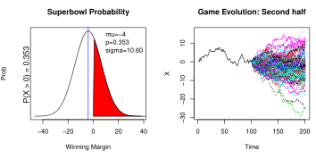
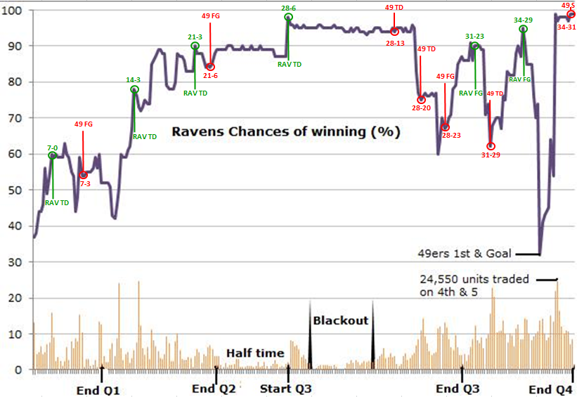
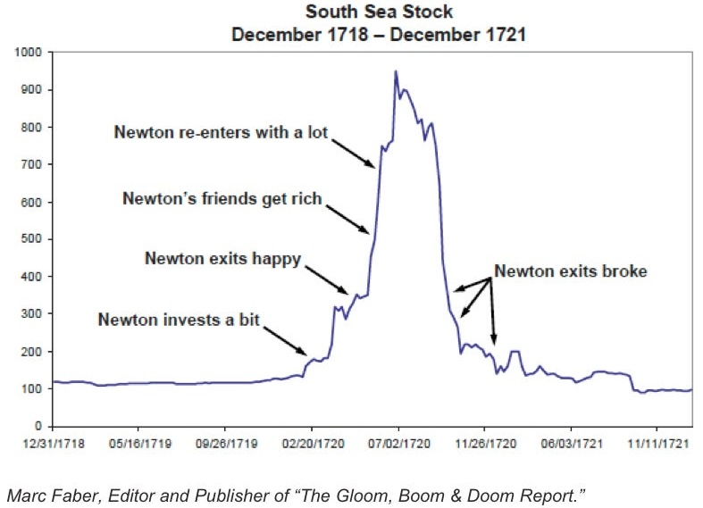
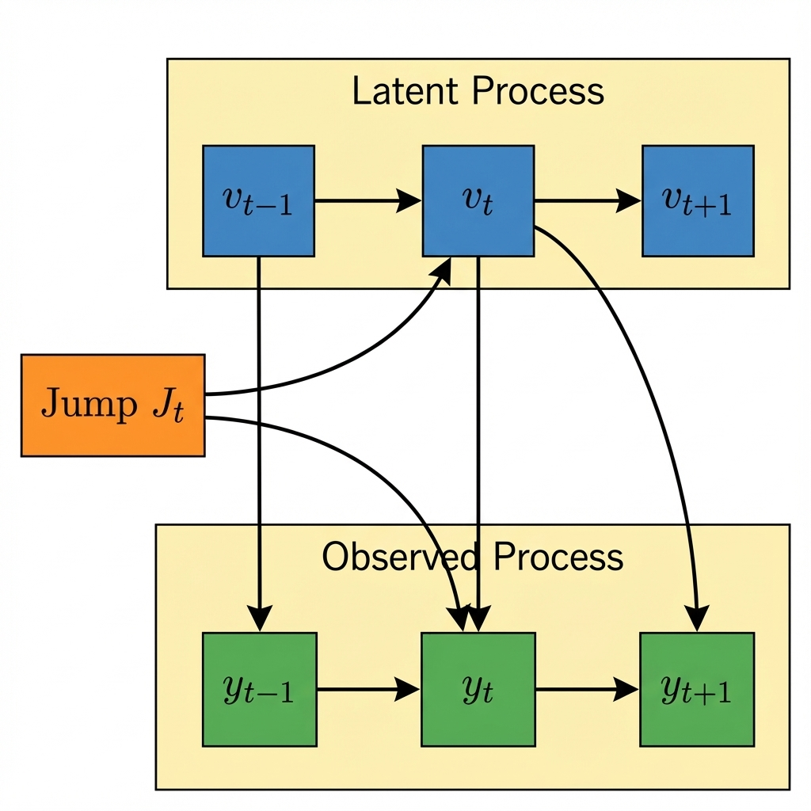



# Stochastic Processes {#sec-sp}
Yet another fundamental concept that is useful for probabilistic reasoning is a stochastic process. An instance of a process is a function $X\colon \Omega \rightarrow S$ from an index set $\Omega$ to a set of possible values $S$, called the state space. The state space of a stochastic process is the set of all possible states that the process can be in. The process then is the *distribution over the space of functions* from $\Omega$ to $S$. The term process is used because the function $X$ is often thought of as a time-varying quantity, and the index set $\Omega$ is often interpreted as time. While time is the most common index, the index set $\Omega$ is general; for example, in geostatistics, the process is indexed by spatial coordinates rather than time. Both the index set and the state space can be discrete or continuous.

A key concept in many stochastic processes is the *Markov property*, which states that the future state of the process depends only on the current state, not on the sequence of events that preceded it. Formally, $P(X_{t+1}\mid X_t, X_{t-1}, \ldots) = P(X_{t+1}\mid X_t)$.

A stochastic process is a family of random variables that describes the evolution through time of some (physical) process. We denote this by $X = \{X_t,~t\in T\}$, with $t$ representing time and $X_t = \omega$ is the state of the process at time $t$. We will get a realization (a.k.a. sample path). In the case when time is discrete, the realization is a sequence of observed $X = \Omega = \{\omega_1,\omega_2,\ldots\}$. Common discrete-time processes are Markov chains. Brownian motion is a central process in continuous time and state with almost surely continuous but nowhere differentiable paths. Poisson processes are commonly used to account for jumps in the process.

Here are some widely used stochastic processes:

1. Random Walk: A simple example where the next state depends on the current state and some random movement. In finance, stock prices are often modeled as a type of random walk.
2. Markov Chains: A process where the next state depends only on the current state and not on the path taken to reach the current state.
3. Poisson Process: Used to model the number of times an event occurs in a fixed interval of time or space, where events occur with a known constant mean rate and independently of the time since the last event.
4. Queuing Theory: Models used in operations research where the stochastic process represents the number of customers in a queue, varying over time as customers arrive and are served.
5. Brownian Motion: This process models the random movement of particles suspended in a fluid. It has applications in physics, finance (to model stock market prices), and biology.
6. Gaussian Processes: These are a collection of random variables, any finite number of which have a joint Gaussian distribution. They are used in machine learning for regression and classification tasks.


Data variability can be modeled as i.i.d. processes or as stochastic processes with serial, spatial, or other dependencies. Modeling these dependencies moves beyond descriptive statistics to predictive frameworks that quantify uncertainty. The early sections of @davison2003statistical offer a primer on developing and applying stochastic models.


## Brownian Motion
Brownian Motion, named after botanist Robert Brown who observed pollen particles following irregular random trajectories in water, is fundamental to stochastic processes. A one-dimensional Brownian Motion (Wiener process) $B_t,~t\ge 0$ has the following properties:

- $B_0 = 0$ almost surely
- $B_t$ has stationary independent increments: $B_t - B_s \sim N(0, t-s)$ for $0 \le s < t$
- $B_t$ is a continuous function of $t$
- For each time $t > 0$, the random variable $B_t$ is normally distributed with mean 0 and variance $t$, i.e., $B_t \sim N(0, t)$.

Formally, Brownian motion is a continuous-time stochastic process $B_t$ for $t \ge 0$ used to model random continuous evolution.

@fig-brownian below shows three sample paths of Brownian Motion.

```{r}
#| echo: true
#| fig-cap: "Brownian Motion"
#| label: fig-brownian
# Brownian Motion
set.seed(92)
t <- seq(0, 1, 0.001)
bm <- function() c(0, cumsum(rnorm(1000, 0, sqrt(0.001))))
plot(t, bm(),
  type = "l", xlab = "t",
  ylab = expression(B[t]), lwd = 2, ylim = c(-1.4, 2.1)
)
lines(t, bm(), lwd = 2, col = 2)
lines(t, bm(), lwd = 2, col = 3)
```

Thus, for any times $0 \leq t_1 < t_2 < \ldots < t_n$, the random variables $B(t_2) - B(t_1)$, $B(t_3) - B(t_2)$, \ldots, $B(t_n) - B(t_{n-1})$ are independent and the function $t \mapsto B_t$ is continuous almost surely.

Some properties of Brownian Motion are:

- Scale Invariance: If $B_t$ is a Brownian motion, then for any $a > 0$, the process $aB(t/a^2)$ is also a Brownian motion.
- Fractal Nature: Brownian motion paths are nowhere differentiable but continuous everywhere, reflecting a fractal-like nature.

The normal assumption of asset returns was first proposed in 1900 in the PhD thesis of Louis Bachelier, who was a student of Henri Poincare. Bachelier was interested in developing statistical tools for pricing options (predicting asset returns) on the Paris stock exchange. Although Bachelier's work laid the foundation for the modern theory of stochastic processes, he was never given credit by his contemporaries, including Einstein, Levy and Borel. 

In 1905, Einstein published a paper which used the same statistical model as Bachelier to describe the 1827 discovery by botanist Robert Brown, who observed that pollen particles suspended in water followed irregular random trajectories. Thus, we call the stochastic process that describes these phenomena Brownian motion. Einstein's advisor at the University of Zurich was Hermann Minkowski, who was a friend and collaborator of Poincare. Thus, it is likely Einstein knew about the work of Bachelier, but he never mentioned it in his paper. Einstein’s omission of references was not without precedent; his 1905 relativity paper similarly lacked citations, famously omitting Poincaré’s 1898 contributions. Poincare published a paper @poincare1898mesure on relativity theory in 1898, seven years before Einstein. This paper was published in a philosophy journal, and thus Poincare avoided using any mathematical formulas except for the famous $E=mc^2$. Poincare discussed his results on relativity theory with Minkowski. Minkowski asked Einstein to read Poincare's work @arnold2006forgotten. However, Einstein never referenced the work of Poincare until 1945 [@arnold2006forgotten]. One of the reviewers for the 1905 paper on relativity by Einstein was Poincare and he wrote a very positive review mentioning it as a breakthrough. When Minkowski asked Poincare why he did not claim his priority on the theory, Poincare replied that our mission is to support young scientists. More about why credit is mistakenly given to Einstein for relativity theory is discussed by @logunov2004henri.

Einstein was not the only one who ignored the work of Bachelier; Paul Levy did so as well. Paul Levy was considered a pioneer and authority on stochastic processes during Bachelier's time, although Bruno de Finetti introduced a dual concept of infinite divisibility in 1929, before the works of Levy in the early 1930s on this topic. Levy never mentioned the work of the obscure and little-known mathematician Bachelier. The first to give credit to Bachelier was Kolmogorov in his 1931 paper @kolmogoroff1931uber (Russian translation @a.n.kolmogorov1938analytic and English translation @shiryayev1992analytical). Later, L.J. Savage translated Bachelier's work to English and showed it to Paul Samuelson. Samuelson extended the work of Bachelier by considering the log-returns rather than absolute numbers, popularized the work of Bachelier among economists, and the translation of Bachelier's thesis was finally published in English in 1964 @cootner1967random. Many economists who extended the work of Bachelier won Nobel prizes, including Eugene Fama, known for work on the efficient markets hypothesis; Paul Samuelson, and Myron Scholes for the Black-Scholes model, as well as Robert Merton.

Originally developed to model financial markets by Louis Bachelier in 1900, Brownian Motion applies to biology (biomolecule movement), environmental science (diffusion of pollutants), and mathematics (stochastic calculus).

::: {#exm-mc-portfolio}
## Yahoo Stock Price Simulation
Investing in volatile stocks can be very risky. The Internet stocks during the late 1990's were notorious for their volatility. For example, the leading Internet stock Yahoo! started 1999 at \$62,rose to \$122, then fell back to \$55 in August, only to end the year at  \$216.  Even more remarkable is the fact that by January 2000, Yahoo! had risen more than 100-fold  from its offering price of \$1.32 on April 12, 1996. In comparison, the Nasdaq 100, a benchmark market index, was up about 5-fold during the same period.

Stock prices fluctuate somewhat randomly. Maurice Kendall, in his seminal 1953 paper on the random walk nature of stock and commodity prices, observed that  "*The series looks like a wandering one, almost as if once a week the Demon of Chance drew a random number from a symmetrical population of fixed dispersion and added to it the current price to determine next week's price (p. 87).*" While a pure random walk model for Yahoo!'s stock price is in fact not reasonable since its price cannot fall below zero, an alternative model that appears to provide reasonable results assumes that the logarithms of price changes, or returns, follow a random walk.  This alternative model is the basis for the results in this example.


To evaluate a stock investment, we take the initial price as $X_0$, and then we need to determine what the stock price might be in year  $T$, namely $X_T$. Our approach draws from the Black-Scholes  Model for valuing stock options. Technically,  the Black-Scholes Model assumes that $X_T$ is determined by the solution to a stochastic differential equation. This leads to the *Geometric Brownian Motion* 
$$
X_T = X_0 \exp\left( (\mu - 1/2\sigma^2)T + \sigma B_T  \right),
$$
where $B_T$ is a standard Brownian motion; that is, $B_0 = 0$, $B_t - B_s$ is independent of $B_s$, and its distribution depends only on $t-s$ with $B_t \sim N(0,t)$. Hence, $B_t = \sqrt{t}Z$, where $Z \sim N(0,1)$.

Then, the expected value is
\begin{align*}
\E{X_T} = &X_0 \exp\left( (\mu - 1/2\sigma^2)T \right) \E{\exp(\sigma B_T)}\\
& = X_0\exp\left( (\mu - 1/2\sigma^2)T \right) \E{\exp(\sigma \sqrt{T}Z)}\\
&= X_0\exp\left( (\mu - 1/2\sigma^2)T \right) \exp\left( \frac{1}{2}\sigma^2T \right) = X_0\exp\left( \mu T \right).
\end{align*}
The $\E{\exp(\sigma \sqrt{T}Z)} = \exp\left( 1/2\sigma^2T \right)$ is due to the moment property of the log-normal distribution. This follows from the property that the expectation of a log-normal variable $e^Y$ where $Y \sim N(\mu, \sigma^2)$ is $e^{\mu + \sigma^2/2}$. We can interpret $\mu$ as the expected rate of return
$$
\hat \mu = \frac{1}{T}\log\left( \frac{X_T}{X_0} \right).
$$
One caveat matters here: with the *observed* $X_T$, this estimator targets the growth rate $\mu - \sigma^2/2$ rather than the drift $\mu$, since $\log(X_T/X_0)$ has mean $(\mu - \tfrac{1}{2}\sigma^2)T$. Recovering the drift itself uses the *expected* price $\E{X_T} = X_0 e^{\mu T}$, so that $\mu = \frac{1}{T}\log\left(\E{X_T}/X_0\right)$.


The variance is
\begin{align*}
\Var{X_T} = &X_0^2 \exp\left( 2(\mu - 1/2\sigma^2)T \right) \Var{\exp(\sigma B_T)}\\
& = X_0^2 \exp\left( 2(\mu - 1/2\sigma^2)T \right) \Var{\exp(\sigma \sqrt{T}Z)}\\
& = X_0^2 \exp\left( 2(\mu - 1/2\sigma^2)T \right) \exp\left( 2\sigma^2T \right) - X_0^2\exp\left( 2(\mu - 1/2\sigma^2)T \right)\exp\left( \sigma^2T \right)\\
& = X_0^2\exp\left( 2\mu T \right)\left( \exp\left( \sigma^2T \right) - 1 \right).
\end{align*}


The important consequence of the model for predicting future prices is that  $\log(X_T/X_0)$ has a normal distribution with mean $(\mu-\frac{1}{2} \sigma^2)T$ and variance $\sigma^2 T$ which is equivalent to saying that  the ratio $X_T/X_0$ has a log-normal distribution.  It is interesting that although the Black-Scholes result is a standard tool for valuing options in finance, the  log-normal predictive distribution that follows from its assumptions is not commonly studied.  In order to forecast $X_T$ we need to estimate the unknowns $\mu$ and $\sigma$ (recall $X_0$ is known). The unknown parameters $\mu$ and $\sigma$ can be interpreted as the instantaneous expected rate of return and the volatility, respectively. The mean parameter $\mu$ is known as the expected rate of return because the expected value of $X_T$ is $X_0e^{\mu T}$.  There are a number of ways of estimating the unknown parameters. One approach is to use an equilibrium model for returns, such as  the Capital Asset Pricing Model or CAPM. We will discuss this model later. Another approach is to use historical data to estimate the parameters.  For example, the expected rate of return can be estimated as the average historical return.  The volatility can be estimated as the standard deviation of historical returns.  The Black-Scholes model is a continuous-time model, but in practice we use discrete-time data.  The Black-Scholes model can be adapted to discrete-time by replacing the continuous-time Brownian motion with a discrete-time random walk.  
:::


### Optimal Portfolio Allocation: The Merton Rule {#sec-merton-rule}

Given Geometric Brownian Motion for asset prices, a natural question arises: what fraction of wealth should an investor allocate to the risky asset to maximize long-run growth? This is the continuous-time analog of the Kelly criterion introduced in @sec-bl for discrete bets.

Consider an investor who can allocate fraction $f$ to a risky asset following GBM with expected return $\mu$ and volatility $\sigma$, with the remainder in a risk-free asset. The investor's wealth $W_t$ evolves as:
$$
W_T = W_0 \exp\left((f\mu - \tfrac{1}{2}f^2\sigma^2)T + f\sigma B_T\right)
$$

Maximizing the expected log-growth rate $\E{\log(W_T/W_0)}/T$ yields the *Merton rule*:
$$
f^* = \frac{\mu}{\sigma^2}
$$ {#eq-merton}
where $\mu$ is the expected excess return (risk premium) over the risk-free rate and $\sigma^2$ is the variance. This is precisely the Kelly criterion in the log-normal limit.

The intuition is clear: allocate more to the risky asset when the expected return is high and less when volatility is high. The ratio $\mu/\sigma^2$ balances reward against risk, measured by variance rather than standard deviation because variance compounds geometrically over time.

In practice, the full Merton allocation can be aggressive. The *fractional Merton* (or fractional Kelly) strategy scales down by a risk-aversion parameter:
$$
f^* = \frac{1}{\gamma} \frac{\mu}{\sigma^2}
$$
where $\gamma$ is the coefficient of relative risk aversion from CRRA utility $U(W) = W^{1-\gamma}/(1-\gamma)$. Setting $\gamma = 1$ recovers log utility and full Merton; $\gamma = 2$ gives "Half-Kelly."

::: {#exm-merton-sp500}
## Merton Rule for S&P 500
Historically, the S&P 500 has had an annual excess return of approximately $\mu \approx 0.06$ (6%) and volatility $\sigma \approx 0.16$ (16%). The Merton rule suggests:
$$
f^* = \frac{0.06}{0.16^2} = \frac{0.06}{0.0256} \approx 2.3
$$
This implies leveraging 230% into equities—borrowing 130% and investing 230%! Such aggressive positioning explains why practitioners often use fractional Kelly with $\gamma = 2$ or $\gamma = 3$, yielding allocations of 115% or 77%, respectively.
:::


## Black-Scholes Model for Sports Betting
Sports betting involves wagering on the outcome of athletic events. Bettors' assessments of these outcomes are aggregated in markets that provide key metrics like the point spread, which is the expected margin of victory, and moneyline odds, which imply the probability of a team winning. These market-based measures can be used to analyze the uncertainty, or volatility, inherent in a sports game.

To quantify the uncertainty in a game's outcome, the score difference between two teams over time can be modeled as a stochastic process. Specifically, we use a Brownian motion model, first proposed by @stern1994brownian, to represent the evolution of a team's lead. In this framework, the score difference at time $t$, denoted as $X_t$, is assumed to follow a normal distribution with a mean (or "drift") that grows over time and a variance that also increases with time.

This can be expressed mathematically as:
$$
X_t = \mu t + \sigma B_t \sim N(\mu t, \sigma^2 t)
$$
where $\mu$ is the drift parameter, representing the favored team's point advantage over the whole game (derived from the point spread), $\sigma$ is the volatility parameter, representing the standard deviation of the final outcome, and $t$ is the time elapsed in the game, scaled from 0 to 1. We normalize the game duration to $T=1$.

This model allows for the calculation of a team's win probability at any point in the game and provides a formal way to measure the uncertainty of the final score.

The concept of deriving a game's volatility from betting markets is directly analogous to the Black-Scholes model in finance. In finance, the Black-Scholes formula is used to price options. If the market price of an option is known, one can work backward to solve for the volatility of the underlying stock; this is called *implied volatility*. The model in sports betting does the same: it uses the market-set point spread ($\mu$) and win probability ($p$) to solve for the game's implied volatility ($\sigma$).

Both models use a Brownian motion framework to describe how a variable changes over time. However, there is a key difference. The sports model uses a standard Brownian motion, where the score changes additively. In contrast, the Black-Scholes model uses a geometric Brownian motion, which assumes that a stock price changes by a certain percentage, not by a fixed amount.

### Implied Volatility for Sports Games

In the context of sports betting, implied volatility represents the market's assessment of the uncertainty in a game's final outcome, derived from observable betting market data.

Given the point spread $\mu$ (which represents the expected margin of victory) and the win probability $p$ (derived from moneyline odds), we can solve for the implied volatility $\sigma$ using the relationship:

$$
p = \Phi\left(\frac{\mu}{\sigma}\right)
$$

Rearranging this equation, the implied volatility is given by:

$$
\sigma = \frac{\mu}{\Phi^{-1}(p)}
$$

where $\Phi^{-1}$ is the inverse of the standard normal cumulative distribution function (the quantile function).

This approach mirrors the methodology used in financial markets, where option prices are used to infer the market's expectation of future stock price volatility. In sports betting, the "option price" is effectively the betting odds, and the "underlying asset" is the game outcome.

For example, a game between two closely matched teams might have high implied volatility, reflecting greater uncertainty in the outcome, while a game featuring a heavily favored team against a significant underdog would typically exhibit lower implied volatility, as the outcome is more predictable.


::: {#exm-brownian}
## Black-Scholes Model for Super Bowl

In order to define the implied volatility of a sports game, we begin with  a distributional model for the evolution of the outcome in a sports game, which we develop from @stern1994brownian. The model specifies the distribution of the lead of team A over team B, $X_t$ for any $t$ as  a Brownian motion process. If $B_t$ denotes a standard Brownian motion with distributional property $B_t \sim N(0,t)$ and we incorporate drift, $\mu$, and volatility, $\sigma$, terms, then the evolution of the outcome $X_t$ that is given by:
$$
 X_t=\mu t + \sigma B_t \sim N( \mu t , \sigma^2 t).
$$
This distribution of the game outcome is similar to the Black-Scholes model of the distribution of a stock price.

This specification results in several useful measures (or, this specification results in closed-form solutions for a number of measures of interest). The distribution of the final score follows a normal distribution, $X_1\sim N(\mu, \sigma^2)$.
We can calculate the probability of team A winning, 
denoted $p=\prob{X_1>0}$, from the spread and probability distribution.
Given the normality assumption, $X_1 \sim N(\mu, \sigma^2)$, we have
$$
p = \prob{X_1>0} = \Phi \left ( \frac{\mu}{\sigma} \right )
$$
where $\Phi$ is the standard normal cdf.
@tbl-probability uses $\Phi$ to convert team A's advantage $\mu$ to a probability scale 
using the information ratio $\mu/\sigma$. 

| $\mu/\sigma$         | 0   | 0.25 | 0.5  | 0.75 | 1    | 1.25 | 1.5  | 2     |
|----------------------|-----|------|------|------|------|------|------|-------|
| $p=\Phi(\mu/\sigma)$ | 0.5 | 0.60 | 0.69 | 0.77 | 0.84 | 0.89 | 0.93 | 0.977 |


: Probability of Winning $p$ versus the Sharpe Ratio $\mu/\sigma$ (measure of risk-adjusted return). {#tbl-probability}


If teams are evenly matched and $\mu/\sigma =0$ then $p=0.5$.
For example, if the point spread $\mu=-4$ and volatility is $\sigma=10.6$, then the team has a $\mu/\sigma = -4/10.6 = - 0.38$ volatility point disadvantage.
The probability of winning is $\Phi(-0.38) = 0.353 < 0.5$. A common scenario is that team A has an edge equal to half a volatility, so that $\mu/\sigma =0.5$
and then $p= 0.69$.

Of particular interest here are conditional probability assessments made as the game progresses. For example,
suppose that the current lead at time $t$ is $l$ points and so $X_t = l$. The model can then be used to update your assessment of the
distribution of the final score with the conditional distribution  $(X_1 \mid X_t=l )$. To see this, we can re-write the distribution of $X_1$ given $X_t$ by noting that $X_1 = X_t+ X_1 - X_t$. Using the formula above and substituting $t$ for $1$ where appropriate and noting that $X_t = l$ by assumption, this simplifies to 
$$
 X_1= l + \mu(1- t) + \sigma (B(1) - B_t).
$$
Here $B(1) - B_t  \stackrel{D}{=} B(1-t)$ which is independent of $X_t$ with distribution $N(0,1-t)$.
The mean and variance of $X_1\mid X_t=l$ decay to zero as $t \rightarrow 1$ and the outcome becomes certain at the realised value of $X_1$. 
We leave open the possibility of a tied game and overtime to determine the outcome.

To determine this conditional distribution, we note that there are $1-t$ time units left together with a drift $\mu$, and as shown above in this case  the uncertainty can be modeled as $\sigma^2(1-t)$. Therefore, we can write the distribution of the final outcome after $t$ periods with a current lead of $l$ for team A as the conditional distribution:
$$
 ( X_1 \mid X_t=l) =  (X_1-X_t) + l   \sim N( l + \mu(1 - t) , \sigma^2 (1 - t) )
$$
From the conditional distribution
$(X_1 \mid X_t=l) \sim N(l+\mu(1-t), \sigma^2 (1-t))$,  we can calculate the conditional probability of winning as the game evolves.
The probability of team A winning at time $t$ given a current lead of $l$ point is: 
$$
p_t = P ( X_1 > 0 \mid X_t = l) = \Phi \left ( \frac{ l + \mu ( 1 - t)  }{ \sigma \sqrt{ ( 1-t) } } \right )
$$


{#fig-score-evolution width=100%}

@fig-score-evolution A and B illustrate our methodology with an example. Suppose we are analyzing data for a Superbowl game between teams A and B with team A favored.  Figure A presents the information available at the beginning of the game from the perspective of the underdog team B. If the initial point spread, or the market’s expectation of the expected outcome, is $-4$ and the volatility is $10.6$ (assumed given for the moment; more on this below), then the probability that the underdog team wins is $p = \Phi ( \mu /\sigma ) = \Phi ( - 4/ 10.6) = 35.3$\%.  This result relies on our assumption of a normal outcome distribution on the outcome as previously explained.  Another way of saying this is $\prob{X(1)>0}=0.353$  for an outcome distribution  $X(1) \sim N(-4, 10.6^2)$. Figure A illustrates this with the shaded area under the curve.

@fig-score-evolution  B illustrates the information and potential outcomes at half-time. Here we show 
the evolution of the actual score until half-time as the solid black line. From half-time onwards, we simulate a set of possible Monte Carlo paths to the end of the game. 

Specifically, we discretise the model with time interval $\Delta =1/200$ and simulate possible outcomes given the score at half-time. 
The volatility  plays a key role in turning the point spread into a probability of winning, as 
the greater the volatility of the distribution of the outcome, $X_1$, the greater the range of outcomes projected in the Monte Carlo simulation.
Essentially the volatility provides a scale which calibrates the advantage implied by a given point spread.

We can use this relationship to determine how volatility decays over the course of the game. The conditional distribution of the outcome given the score at time $t$ is $(X_1\mid X_t=l)$ with a variance of $\sigma^2(1-t)$ and volatility of $\sigma \sqrt{1-t}$. The volatility is a decreasing function of $t$, illustrating that the volatility dissipates over the course of a game. For example, if there is an initial volatility of $\sigma = 10.6$, then at half-time when $t=\frac{1}{2}$, 
the volatility is $10.6 / \sqrt{2} = 7.5$ volatility points left.

| $t$                 | 0    | $\frac{1}{4}$ | $\frac{1}{2}$ | $\frac{3}{4}$ | 1 |
|---------------------|------|---------------|---------------|---------------|---|
| $\sigma \sqrt{1-t}$ | 10.6 | 9.18          | 7.50          | 5.3           | 0 |

: Volatility Decay over Time. {#tbl-volatility-decay}

To provide insight into the final outcome given the current score, @tbl-probability and @tbl-volatility-decay can be combined to measure the current outcome, $l$, in terms of standard deviations of the outcome.  
For example, suppose that you have Team B, an underdog, so from their perspective $\mu = -4$ and at half-time team B has a lead of 15, $l= 15$. Team B's expected outcome as presented earlier is $l + \mu (1-t)$ or $15 - 4 \times \frac{1}{2} = 13$. If initial volatility is $\sigma = 10.60$    then the remaining volatility at half-time is $10.6/\sqrt{2} = 7.50$ and team B's expected outcome of $13$ in terms of standard deviations is $13/7.5 = 1.73$. Thus team B's expected outcome is at the 96th percentile of the distribution, $\Phi ( 1.73 ) = 0.96$, implying a 96% chance of winning.


*Implied Volatility*

The previous discussion assumed that the variance (or volatility) parameter $\sigma$ was a known constant.  We are now in a position to define the *implied volatility* implicit in the two betting lines that are available.
Given our model, we will use the *money-line* odds to provide a market assessment of the probability of winning, $p$,
and the *point spread* to assess the expected margin of victory, $\mu$. The money line odds are shown for each team A and B and provide information on the payoff from a bet on the team winning. This calculation will also typically require an adjustment for the bookmaker's spread. With these, we can infer the *implied volatility*, $\sigma_{IV}$,
by solving 
$$
\sigma_{IV}: \; \; \;  \; \; p = \Phi \left ( \frac{\mu}{\sigma_{IV}} \right ) \; \; \text{ which   gives} \; \; 
\sigma_{IV} = \frac{ \mu }{ \Phi^{-1} ( p ) } \; .
$$
Here $\Phi^{-1}(p)$ denotes the standard normal quantile function such that
the area under the standard normal curve to the left of $\Phi^{-1}(p)$ is equal to $p$. In our example, we calculate this using the  `qnorm` in `R`.
Note that when $\mu =0$ and $p= \frac{1}{2}$ there's no market information about the volatility, as $\mu / \Phi^{-1} (p)$ is undefined. This is the special case where the teams are seen as evenly matched---the expected outcome has a zero point spread, and there is an equal probability that either team wins.

*Time Varying Implied Volatility*

Up to this point, the volatility rate has been assumed constant through the course of the game, i.e., that the same value of $\sigma$ is relevant.  The amount of volatility remaining in the game is not constant, but the basic underlying parameters has been assumed constant.  This need not be true, and the betting markets may provide some information about the best estimate of the volatility parameter at a given point of time.  This is important because time-varying volatility provides an interpretable quantity that can allow one to assess the value of a betting  opportunity.  

With the advent of online betting there is a virtually continuous traded contract available to assess implied expectations of the probability of team A winning
at any time $t$. 
The additional information available from the continuous contract allows for further update of the implied conditional volatility. 
We assume that the online betting market gives us a
current assessment of $p_t$, that is the current probability that team A will win. 
We will then solve for $\sigma^2$ and in turn define resulting time-varying volatility, 
as $\sigma_{IV,t}$, using the resulting equation to solve for $\sigma_{IV,t}$ with
$$
p_t = \Phi \left ( \frac{ l + \mu(1-t)  }{\sigma_{IV,t} \sqrt{1-t}} \right )
\; \text{ which   gives} \; \; 
\sigma_{IV,t} = \frac{ l + \mu ( 1-t ) }{ \Phi^{-1} ( p_t )  \sqrt{1-t}}
$$
We will use our methodology to find evidence of time-varying volatility in the SuperBowl XLVII probabilities. 


*Super Bowl XLVII: Ravens vs San Francisco 49ers*

Super Bowl  XLVII was held at the Superdome in New Orleans on February 3, 2013, and featured the San Francisco 49ers against the Baltimore Ravens. 
Going into Super Bowl XLVII, the San Francisco 49ers were favorites to win
which was not surprising following their impressive season. 
It was a fairly bizarre Super Bowl with a $34$ minute power outage affecting the game by ultimately an exciting finish with the Ravens 
causing an upset victory $34-31$. We will build our model from the viewpoint of the Ravens.
Hence $X_t$ will correspond to the Raven's score minus the San Francisco 49ers.
@tbl-superbowl provides the score at the end of each quarter.

| $t$      | 0 | $\frac{1}{4}$ | $\frac{1}{2}$ | $\frac{3}{4}$ | 1  |
|----------|---|---------------|---------------|---------------|----|
| Ravens   | 0 | 7             | 21            | 28            | 34 |
| 49ers    | 0 | 3             | 6             | 23            | 31 |
| $X_t$   | 0 | 4             | 15            | 5             | 3  |

: SuperBowl XLVII by Quarter. {#tbl-superbowl}

To determine the parameters of our model, we first use the *point spread* which was set at 
the Ravens being a four-point underdog, i.e., $\mu=-4$. This sets the mean of our outcome, $X_1$, as
$$
\mu = \E{X_1} =-4 .
$$
In reality, it was an exciting game with the Ravens upsetting the 49ers by $34-31$. Hence, the realised outcome is
$X_1= 34-31=3$, with the point spread being beaten by $7$ points or the equivalent of a touchdown.

{#fig-superbowl}

To determine the markets' assessment of the probability that the Ravens would win at the beginning of the game, we use the *money-line* odds. These odds were quoted as San Francisco $-219$ and Baltimore Ravens $+155$. This implies that a bettor would have to place \$219 to win \$100 on the 49ers, and a bet of \$100 on the Ravens would lead to a win of \$155. We  can convert both of these money-lines to *implied probabilities* of the each team winning, by the equations 
$$
p_{SF} = \frac{219}{100+219} = 0.686 \; \; \text{ and} \; \; p_{Ravens} = \frac{100}{100+155} = 0.392
$$
The probability sum to one plus the market overround: 
$$ 
p_{SF} + p_{Ravens} = 0.686+0.392 = 1.078 
$$ 
namely a $7.8$\% edge for the bookmakers. Put differently, if bettors place money proportionally  across both teams then the bookies *vig* will be
$$
\text{Vig} = \dfrac{0.078}{0.078+1} = 0.072
$$
This means that the bookmaker is expected to make a profit of 7.2% of the total amount staked, no matter what happens to the outcome of the game.

To account for this edge in our model, we use the mid-point of the spread to determine $p$ implying that
$$
p = \frac{1}{2} p_{Ravens} + \frac{1}{2} (1 - p_{SF} ) = 0.353
$$
From the Ravens perspective we have $p = \prob{X_1>0} =0.353$.

@fig-superbowl shows the evolution of the markets' conditional probability of winning $p_t$ for the Ravens. The data are from the online betting website `TradeSports.com`. Starting at $p=0.353$, we see how dramatically the markets' assessment of the Ravens winning can fluctuate. Given their commanding lead at half-time, the probability has as high as $0.90$. At the end of the four quarter when the 49ers nearly went into the lead with a touchdown, at one point the probability had dropped to $30$\%.

Our main question of interest is then: *What implied volatility is consistent with market expectations?*

To calculate the implied volatility of the Superbowl we substitute the pair $(\mu,p)$ into our definition and solve for $\sigma_{IV}$. We obtain 
$$ 
\sigma_{IV} = \frac{\mu}{\Phi^{-1}(p)} = \frac{-4}{-0.377}  = 10.60
$$
where we have used $\Phi^{-1} ( p) = qnorm(0.353) = -0.377$. So on a volatility scale, the $4$ point advantage assessed for the 49ers is under a $\frac{1}{2} \sigma$ favorite. This is consistent with a win probability of $p=\Phi(\frac{1}{2})=0.69$. Another feature is that a $\sigma=10.6$ is historically low, as a typical volatility of an NFL game is $14$ (see Stern, 1991). This implies a standard deviation of the final score differential of approximately 10.6 points. However, the more competitive the game one might expect a lower volatility. In reality, the outcome $X_1=3$ was within one standard deviation of the model, which had an expectation of $\mu=-4$ and volatility $\sigma=10.6$. Another question of interest is

What's the probability of the Ravens winning given their lead at half-time?

<!-- To illustrate the dynamic nature of the odds and to infer a time-varying implied volatility we ask the question,    -->
At half-time the Ravens were leading $21$ to $6$. This gives us $X(\frac{1}{2})=21-6=15$. 
From the online betting market we also have traded contracts on `TradeSports.com` that yield a current probability of $p_{\frac{1}{2}} = 0.90$.
<!-- Now we can ask  -->

An alternative view is to assume that the market assesses time varying volatility and the prices fully reflect the underlying probability.
Here we ask the question

*What's the implied volatility for the second half of the game?*

We now have an implied volatility
$$
\sigma_{IV,t=\frac{1}{2}} = \frac{ l + \mu ( 1-t ) }{ \Phi^{-1} ( p_t )  \sqrt{1-t}} = \frac{15-2}{ \Phi^{-1}(0.9) / \sqrt{2} } = 14
$$
where `qnorm(0.9)=1.28`. 
Notice that $14> 10.6$, our assessment of the implied volatility at the beginning of the game.

*What's a valid betting strategy?*

An alternative approach is to assume that the initial moneyline and point spread set the volatility and this stays constant throughout the game.
This market is much larger than the online market, and this is a reasonable assumption unless there has been material information as the game progresses
such as a key injury.  

Hence the market was expected a more typical volatility in the second half.
If a bettor believed that the volatility was closer to the historical average of $\sigma=14$ (Stern, 1991), rather than the implied $10.6$, then their assessment of
the Ravens win probability would be lower. The remaining volatility would be $14/\sqrt{2} \approx 9.9$, yielding a Z-score of $13/9.9 \approx 1.31$. This corresponds to a win probability of $\Phi(1.31) \approx 0.905$. Compared to the market probability of $0.90$, this represents a small edge.

The Kelly criterion [@kelly1956new] yields the optimal betting fraction $f^*$:
$$
f^* = p - \dfrac{q}{b} = 0.905 - \frac{0.095}{1/9} \approx 0.05
$$
where $q = 1-p$ is the probability of losing, and $b$ is the odds received (net fractional odds). That is, $5$\% of capital.
A more realistic strategy is to use 
the fractional Kelly criterion, which scales the bet by a risk-aversion parameter $\gamma$. 
For example, in this case if $\gamma =3$, we would bet $0.05/3 \approx 0.017$, or $1.7$\% of our capital on this betting opportunity.


Finally, odds changes can be dramatic at the end of the fourth quarter, and this Super Bowl was no exception.
With the score at $34$–$29$ and only a few minutes remaining, the 49ers were at first-and-goal. A few minutes after this, 
the probability of the Ravens winning had dropped precipitously from over $90$\% to $30$\%, see @fig-superbowl.
On San Francisco's final offensive play of the game, Kaepernick threw a pass on fourth down to Michael Crabtree, but Ravens cornerback Jimmy Smith appeared to hold the wide receiver during the incompletion, No call was given and the final result was a Ravens win.
:::


## Poisson Process

A Poisson process models random events occurring independently at a constant average rate---customer arrivals, call center traffic, or goals in a soccer match. A counting process $\{N_t, t \geq 0\}$ is a Poisson process with rate $\lambda > 0$ if:

1. $N(0) = 0$ (the process starts at zero)
2. The process has independent increments: for any $0 \leq t_1 < t_2 < \ldots < t_n$, the random variables $N(t_2) - N(t_1), N(t_3) - N(t_2), \ldots, N(t_n) - N(t_{n-1})$ are independent
3. The process has stationary increments: for any $s < t$, the distribution of $N_t - N(s)$ depends only on the length of the interval $t - s$
4. For any interval of length $t$, the number of events follows a Poisson distribution:
$$
P(N_t = k) = \frac{e^{-\lambda t}(\lambda t)^k}{k!}, \quad k = 0, 1, 2, \ldots
$$

The parameter $\lambda$ represents the rate at which events occur per unit time. The expected number of events in an interval of length $t$ is $\E{N_t} = \lambda t$, and the variance is $\Var{N_t} = \lambda t$.

@fig-poisson below shows three sample paths of a Poisson process with rate $\lambda = 5$ events per unit time. The function `simulate_poisson` builds one path by adding independent exponential waiting times with rate $\lambda$ until it passes the horizon `T_max`, a construction that rests on the inter-arrival characterization given below.

```{r}
#| echo: true
# Poisson Process with rate lambda = 5
set.seed(92)
lambda <- 5
T_max <- 1

# Function to simulate one Poisson process trajectory
simulate_poisson <- function(lambda, T_max) {
  # Generate inter-arrival times (exponential with rate lambda)
  event_times <- c(0)
  current_time <- 0

  while (current_time < T_max) {
    inter_arrival <- rexp(1, rate = lambda)
    current_time <- current_time + inter_arrival
    if (current_time <= T_max) {
      event_times <- c(event_times, current_time)
    }
  }

  # Create step function, carrying the last count to T_max
  n_events <- length(event_times)
  counts <- 0:(n_events - 1)

  return(list(times = c(event_times, T_max), counts = c(counts, n_events - 1)))
}
```

```{r}
#| echo: false
#| fig-cap: "Poisson Process Trajectories."
#| label: fig-poisson
# Simulate three trajectories
traj1 <- simulate_poisson(lambda, T_max)
traj2 <- simulate_poisson(lambda, T_max)
traj3 <- simulate_poisson(lambda, T_max)

# Plot
plot(traj1$times, traj1$counts,
  type = "s", xlab = "t", ylab = expression(N[t]),
  lwd = 2, ylim = c(0, max(c(traj1$counts, traj2$counts, traj3$counts)) + 1),
  xlim = c(0, T_max), col = 1
)
lines(traj2$times, traj2$counts, type = "s", lwd = 2, col = 2)
lines(traj3$times, traj3$counts, type = "s", lwd = 2, col = 3)
```


An equivalent characterization of the Poisson process is through the inter-arrival times between consecutive events. If $T_1, T_2, \ldots$ denote the times between successive events, then these are independent and identically distributed exponential random variables with mean $1/\lambda$. This connection between the Poisson and exponential distributions is fundamental: the Poisson process counts events while the exponential distribution models the waiting time between events.

The Poisson process can be viewed from two complementary perspectives. From a *continuous-time* viewpoint, we track the evolution of the counting process $N_t$ as time progresses, asking questions about the probability of observing a certain number of events by time $t$ or the distribution of event times. From a *discrete count data* perspective, we observe the number of events that occurred during a fixed time interval and use this to make inferences about the underlying rate parameter $\lambda$. 

@sec-bl introduced Poisson models in the context of count data and Bayesian inference. The Poisson distribution (discussed in the section on Poisson Model for Count Data) emerges naturally when we observe a Poisson process over a fixed time interval. For instance, when modeling the number of goals scored by a soccer team in a match, we implicitly assume that goals occur according to a Poisson process with some rate $\lambda$, and we observe the total count at the end of the match.

The Bayesian approach to learning about the rate parameter $\lambda$ (covered in the section on Poisson-Gamma: Learning about a Poisson Intensity in @sec-bl) becomes particularly powerful in the continuous-time setting. When we observe a Poisson process over time, we can update our beliefs about $\lambda$ as new events occur. The Gamma distribution serves as a conjugate prior for $\lambda$, meaning that if we start with a Gamma prior and observe events from a Poisson process, the posterior distribution remains in the Gamma family with updated parameters.

The connection between these perspectives matters for applications. In many real-world scenarios, we observe event counts over fixed intervals (discrete perspective) but need to make predictions about future events or the timing of the next event (continuous perspective). The Poisson process framework unifies these views, allowing us to seamlessly move between counting events and modeling their temporal dynamics.


::: {#exm-eplodds}
## EPL Betting

@feng2016market employ a Skellam process (a difference of Poisson random variables) to model real-time betting odds for English Premier League (EPL) soccer games. Given a matrix of market odds on all possible score outcomes, we estimate the expected scoring rates for each team. The expected scoring rates then define the implied volatility of an EPL game. As events in the game evolve, they re-estimate the expected scoring rates and our implied volatility measure to provide a dynamic representation of the market's expectation of the game outcome. They use real-time market odds data for a game between Everton and West Ham in the 2015--2016 season. We show how the implied volatility for the outcome evolves as goals, red cards, and corner kicks occur.

Gambling on soccer is a global industry with revenues of over $1 trillion a year (see "Football Betting - the Global Gambling Industry worth Billions," BBC Sport). Betting on the result of a soccer match is a rapidly growing market, and online real-time odds exist (Betfair, Bet365, Ladbrokes). Market odds for all possible score outcomes ($0-0, 1-0, 0-1, 2-0, \ldots$) as well as outright win, lose, and draw are available in real time. In this paper, we employ a two-parameter probability model based on a Skellam process and a non-linear objective function to extract the expected scoring rates for each team from the odds matrix. The expected scoring rates then define the implied volatility of the game.

*Skellam Process*

To model the outcome of a soccer game between team A and team B, we let the difference in scores, $N_t = N_{A,t} - N_{B,t}$, where $N_{A,t}$ and $N_{B,t}$ are the team scores at time point $t$. Negative values of $N_t$ indicate that team A is behind. We begin at $N(0) = 0$ and end at time one with $N_1$ representing the final score difference. The probability $\prob{N_1 > 0}$ represents the ex-ante odds of team A winning. Half-time score betting, which is common in Europe, is available for the distribution of $N_{1/2}$.

Then we find a probabilistic model for the distribution of $N_1$ given $N_t = \ell$, where $\ell$ is the current lead. This model, together with the current market odds, can be used to infer the expected scoring rates of the two teams and then to define the implied volatility of the outcome of the match. We let $\lambda^A$ and $\lambda^B$ denote the expected scoring rates for the whole game. We allow for the possibility that the scoring abilities (and their market expectations) are time-varying, in which case we denote the expected scoring rates after time $t$ by $\lambda^A_t$ and $\lambda^B_t$, respectively, instead of $\lambda^A(1-t)$ and $\lambda^B(1-t)$.

The Skellam distribution is defined as the difference between two independent Poisson variables given by:

$$
\begin{aligned}
N_{A,t} &= W_{A,t} + W_t \\
N_{B,t} &= W_{B,t} + W_t
\end{aligned}
$$

where $W_{A,t}$, $W_{B,t}$, and $W_t$ are independent processes with:

$$
W_{A,t} \sim \text{Poisson}(\lambda^A t), \quad W_{B,t} \sim \text{Poisson}(\lambda^B t).
$$

Here $W_t$ is a Poisson process used to induce a correlation between the numbers of goals scored.

$$
N_t = N_{A,t} - N_{B,t} \sim \text{Skellam}(\lambda^A t, \lambda^B t).
$${#eq-skellam}

At time $t$, we have the conditional distributions:

$$
\begin{aligned}
W_A(1) - W_{A,t} &\sim \text{Poisson}(\lambda^A(1-t)) \\
W_B(1) - W_{B,t} &\sim \text{Poisson}(\lambda^B(1-t)).
\end{aligned}
$$

Now letting $N^*(1-t)$, the score difference of the sub-game which starts at time $t$ and ends at time 1 and the duration is $(1-t)$. By construction, $N_1 = N_t + N^*(1-t)$. Since $N^*(1-t)$ and $N_t$ are differences of two Poisson process on two disjoint time periods, by the property of Poisson process, $N^*(1-t)$ and $N_t$ are independent. Hence, we can re-express equation (@eq-skellam) in terms of $N^*(1-t)$, and deduce

$$
%N^*(1-t) = W^*_A(1-t) - W^*_B(1-t) \sim Skellam(\lambda^A (1-t),\lambda^B (1-t) )
N^*(1-t) = W^*_A(1-t) - W^*_B(1-t) \sim \text{Skellam}(\lambda^A_t,\lambda^B_t)
$$

where $W^*_A(1-t) = W_A(1) - W_{A,t}$, $\lambda^A = \lambda^A_0$ and $\lambda^A_t=\lambda^A(1-t)$. A natural interpretation of the expected scoring rates, $\lambda^A_t$ and $\lambda^B_t$, is that they reflect the "net" scoring ability of each team from time $t$ to the end of the game. The term $W_t$ models a common strength due to external factors, such as weather. The "net" scoring abilities of the two teams are assumed to be independent of each other as well as the common strength factor. We can calculate the probability of any particular score difference, given by $\prob{N_1=x\mid\lambda^A,\lambda^B}$, at the end of the game where the $\lambda$'s are estimated from the matrix of market odds. Team strength and "net" scoring ability can be influenced by various underlying factors, such as the offensive and defensive abilities of the two teams. The goal of our analysis is to only represent these parameters at every instant as a function of the market odds matrix for all scores.

Another quantity of interest is the conditional probability of winning as the game progresses. If the current lead at time $t$ is $\ell$, and $N_t=\ell=N_{A,t}-N_{B,t}$, the Poisson property implied that the final score difference $(N_1\mid N_t=\ell)$ can be calculated by using the fact that  $N_1=N_t+N^*(1-t)$ and $N_t$ and $N^*(1-t)$ are independent. Specifically, conditioning on $N_t=\ell$, we have the identity 

$$ N_1=N_t+N^*(1-t)=\ell+\text{Skellam}(\lambda^A_t,\lambda^B_t). $$

We are now in a position to find the conditional distribution ($N_1=x\mid N_t=\ell$) for every time point $t$ of the game given the current score. Simply put, we have the time homogeneous condition

$$
\begin{aligned}
\prob{N_1=x\mid\lambda^A_t,\lambda^B_t,N_t=\ell} &= \prob{N_1-N_t=x-\ell \mid\lambda^A_t,\lambda^B_t,N_t=\ell} \\
&= \prob{N^* (1-t)=x-\ell \mid\lambda^A_t,\lambda^B_t}
\end{aligned}
$$

where $\lambda^A_t$, $\lambda^B_t$, $\ell$ are given by market expectations at time $t$. See Feng et al. for details. 

*Market Calibration*

Our information set at time $t$ includes the current lead $N_t = \ell$ and the market odds for $\{Win, Lose, Draw, Score\}_t$, where $Score_t = \{ ( i - j ) : i, j = 0, 1, 2, ....\}$. These market odds can be used to calibrate a Skellam distribution which has only two parameters $\lambda^A_t$ and $\lambda^B_t$. The best fitting Skellam model with parameters $\{\hat\lambda^A_t,\hat\lambda^B_t\}$ will then provide a better estimate of the market's information concerning the outcome of the game than any individual market (such as win odds), as they are subject to a "vig" and liquidity. 

Suppose that the fractional odds for all possible final score outcomes are given by a bookmaker. Fractional odds, commonly used in the UK, express the ratio of profit to stake. For example, odds of $3:1$ (read as "three-to-one") mean that for every \$1 wagered, the bettor receives \$3 in profit if the bet wins, plus the original \$1 stake returned, for a total payout of \$4. In this case, if the bookmaker offers $3:1$ odds on a 2-1 final score, the bookmaker pays out three times the amount staked by the bettor if the outcome is indeed 2-1. This contrasts with American money-line odds, where positive numbers indicate the profit on a \$100 stake (e.g., +300 means \$300 profit on \$100 wagered), and negative numbers indicate the stake needed to win \$100.

The market implied probability makes the expected winning amount of a bet equal to 0. For fractional odds of $3:1$, the implied probability is calculated as $p = \frac{1}{1+3} = \frac{1}{4} = 0.25$ or 25%. We can verify this creates a fair bet: the expected winning amount is $\mu = -1 \times (1-1/4) + 3 \times (1/4) = -0.75 + 0.75 = 0$. We denote these odds as $odds(2,1) = 3$. To convert all the available odds to implied probabilities, we use the identity

$$ \prob{N_A(1) = i, N_B(1) = j}=\frac{1}{1+odds(i,j)}. $$

The market odds matrix, $O$, with elements $o_{ij}=odds(i-1,j-1)$, $i,j=1,2,3...$ provides all possible combinations of final scores. Odds on extreme outcomes are not offered by the bookmakers. Since the probabilities are tiny, we set them equal to 0. The sum of the possible probabilities is still larger than 1  (see @dixon1997modelling). This "excess" probability corresponds to a quantity known as the "market vig." For example, if the sum of all the implied probabilities is 1.1, then the expected profit of the bookmaker is 10\%. To account for this phenomenon, we scale the probabilities to sum to 1 before estimation. 

To estimate the expected scoring rates,  $\lambda^A_t$ and $\lambda^B_t$, for the sub-game $N^*(1-t)$, the odds from a bookmaker should be adjusted by $N_{A,t}$ and $N_{B,t}$. For example, if $N_A(0.5)=1$, $N_B(0.5)=0$ and $odds(2,1)=3$ at half-time, these observations actually says that the odds for the second half score being 1-1 is 3 (the outcomes for the whole game and the first half are 2-1 and 1-0, respectively, thus the outcome for the second half is 1-1). The adjusted ${odds}^*$ for $N^*(1-t)$ is calculated using the original odds as well as the current scores and given by 

$$
{odds}^*(x,y)=odds(x+N_{A,t},y+N_{B,t}).
$$

At time $t$ $(0\leq t\leq 1)$, we calculate the implied conditional probabilities of score differences using odds information

$$
\prob{N_1=k\mid N_t=\ell}=\prob{N^*(1-t)=k-\ell}=\frac{1}{c}\sum_{i-j=k-\ell}\frac{1}{1+{odds}^*(i,j)}
$$

where $c=\sum_{i,j} \frac{1}{1+{odds}^*(i,j)}$ is a scale factor, $\ell=N_{A,t}-N_{B,t}$, $i,j\geq 0$ and $k=0,\pm 1,\pm 2\ldots$.


*Example: Everton vs West Ham (3/5/2016)*

Table below shows the implied Skellam probabilities.

| Everton \ West Ham | 0   | 1   | 2   | 3   | 4   | 5   |
|--------------------|------|------|------|------|------|------|
| 0                  | 11/1 | 12/1 | 28/1 | 66/1 | 200/1| 450/1|
| 1                  | 13/2 | 6/1  | 14/1 | 40/1 | 100/1| 350/1|
| 2                  | 7/1  | 7/1  | 14/1 | 40/1 | 125/1| 225/1|
| 3                  | 11/1 | 11/1 | 20/1 | 50/1 | 125/1| 275/1|
| 4                  | 22/1 | 22/1 | 40/1 | 100/1| 250/1| 500/1|
| 5                  | 50/1 | 50/1 | 90/1 | 150/1| 400/1|      |
| 6                  | 100/1| 100/1| 200/1| 250/1|      |      |
| 7                  | 250/1| 275/1| 375/1|      |      |      |
| 8                  | 325/1| 475/1|      |      |      |      |

: Original odds data from Ladbrokes before the game started. {#tbl-Table1}

@tbl-Table1 shows the raw data of odds right the game. We need to transform odds data into probabilities. For example, for the outcome 0-0, 11/1 is equivalent to a probability of 1/12. Then we can calculate the marginal probability of every score difference from -4 to 5. We neglect those extreme scores with small probabilities and rescale the sum of event probabilities to one.


| Score difference      | -4   | -3   | -2   | -1    | 0     | 1     | 2     | 3     | 4     | 5     |
|----------------------|------|------|------|-------|-------|-------|-------|-------|-------|-------|
| Market Prob. (%)     | 0.54 | 2.03 | 4.88 | 12.33 | 21.93 | 22.06 | 16.58 | 9.82  | 4.72  | 2.23  |
| Skellam Prob. (%)    | 0.78 | 2.50 | 6.47 | 13.02 | 19.50 | 21.08 | 16.96 | 10.61 | 5.37  | 2.27  |

: Market-implied probabilities for the score differences versus Skellam-implied probabilities at different time points. The estimated parameters $\hat\lambda^A=2.33$, $\hat\lambda^B=1.44$. {#tbl-Table2}

@tbl-Table2 shows the model-implied probability for the outcome of score differences before the game, compared with the market-implied probability. As we see, the Skellam model appears to have longer tails.  Different from independent Poisson modeling in @dixon1997modelling, our model is more flexible with the correlation between two teams. However, the trade-off of flexibility is that we only know the probability of score difference instead of the exact scores. 

. Market implied probabilities (expressed as percentages) for three different results (Everton wins, West Ham wins and draw) are shown as three stacked bands, which vary dynamically as the game proceeds. The top band is Everton wins, the light middle band is draw and the bottom band is West Ham wins, which fills the column at the end. The vertical lines mark significant events in the game, such as goals and red cards. Five goals in this game are 13' Everton, 56' Everton, 78' West Ham, 81' West Ham and 90' West Ham.](fig/game2.png){#fig-game2 width=70%}

@fig-game2 examines the behavior of the two teams and represent the market predictions on the final result. We see the probability change of win/draw/loss for important events during the game: goals scoring and a red card penalty. In such a dramatic game, the winning probability of Everton gets raised to 90\% before the first goal of West Ham in 78th minutes. The first two goals scored by West Ham in the space of 3 minutes completely reverses the probability of winning. The probability of draw gets raised to 90\% until we see the last-gasp goal of West Ham that decides the game. 

@fig-ivcompare plots the path of implied volatility throughout the course of the game. Instead of a downward sloping line, we see changes in the implied volatility as critical moments occur in the game. The implied volatility path provides a visualization of the conditional variation of the market prediction for the score difference. For example, when Everton lost a player by a red card penalty at 34th minute, our estimates $\hat\lambda^A_t$ and $\hat\lambda^B_t$ change accordingly. There is a jump in implied volatility and our model captures the market expectation adjustment about the game prediction. The change in $\hat\lambda_A$ and $\hat\lambda_B$ are consistent with the findings of @vecer2009estimating where the scoring intensity of the penalized team drops while the scoring intensity of the opposing team increases. When a goal is scored in the 13th minute, we see the increase of $\hat\lambda^B_t$ and the market expects that the underdog team is pressing to come back into the game, an effect that has been well-documented in the literature. Another important effect that we observe at the end of the game is that as goals are scored (in the 78th and 81st minutes), the markets expectation is that the implied volatility increases again as one might expect. 

{#fig-ivcompare width=85%}

| t    | 0    | 0.11 | 0.22 | 0.33 | 0.44 | 0.50 | 0.61 | 0.72 | 0.83 | 0.94 | 1    |
|:-------------------------------|-----:|-----:|-----:|-----:|-----:|-----:|-----:|-----:|-----:|-----:|-----:|
| $\hat\lambda^A_t/(1-t)$ | 2.33 | 2.51 | 2.53 | 2.46 | 1.89 | 1.85 | 2.12 | 2.12 | 2.61 |  4.61 |  0    |
| $\hat\lambda^B_t/(1-t)$ | 1.44 | 1.47 | 1.59 | 1.85 | 2.17 | 2.17 | 2.56 | 2.90 | 3.67 | 5.92 | 0    |
| $(\hat\lambda^A_t+\hat\lambda^B_t)/(1-t)$ | 3.78  | 3.98  | 4.12  | 4.31  | 4.06  | 4.02  | 4.68  | 5.03  | 6.28 | 10.52  |0    |
| $\sigma_{t}^{\text{upd}}$ | 1.94 | 1.88 | 1.79 | 1.70 | 1.50 | 1.42 | 1.35 | 1.18 | 1.02 | 0.76 | 0    |

: The calibrated $\{\hat\lambda^A_t, \hat\lambda^B_t\}$ divided by $(1-t)$ and the updating implied volatility $\sigma_{t}^{\text{upd}} = \sqrt{\hat\lambda^A_t+\hat\lambda^B_t}$ of @fig-ivcompare during the game. $\{\lambda^A_t, \lambda^B_t\}$  are expected goals scored for rest of the game. The less the remaining time, the less likely to score goals. Thus $\{\hat\lambda^A_t, \hat\lambda^B_t\}$ decrease as $t$ increases to 1. Dividing them by $(1-t)$ produces an updated version of $\hat\lambda_{0}$'s for the whole game, which are in general time-varying (but not decreasing necessarily). {#tbl-lambda}

@fig-ivcompare compares the updating implied volatility of the game with implied volatilities of fixed $(\lambda^A+\lambda^B)$. At the beginning of the game, the thick line (updating implied volatility) is under the thin line labeled 4 ($\lambda^A+\lambda^B=4$); while at the end of the game, it's above the thin line labeled 8 ($\lambda^A+\lambda^B=8$). As we expect, the value of $(\hat\lambda^A_t + \hat\lambda^B_t)/(1-t)$ in @tbl-lambda rises from 3.78 at the start of the game to 10.52 near the end, apart from a dip after the red card, implying that the game became more and more intense and the market continuously updates its belief in the odds.
:::

## The Lévy-Itô Decomposition in Finance

One of the central results in the theory of stochastic processes is the Lévy-Itô decomposition theorem [@sato1999levy], which provides a universal framework for understanding how randomness evolves over time. The theorem states that any Lévy process (a stochastic process with stationary and independent increments and càdlàg paths, with $X_0 = 0$) can be uniquely decomposed into three fundamental components:

1. A deterministic drift term (linear trend)
2. A continuous Gaussian component (Brownian motion)
3. A pure jump component characterized by the Lévy measure $\nu$

The full statement requires the Lévy measure $\nu$ to satisfy $\int_{\mathbb{R}\setminus\{0\}}(1\wedge |z|^2)\,\nu(dz)<\infty$, which controls the behavior of small jumps. Under this condition, any Lévy process $X_t$ can be written as:
$$
X_t = \mu t + \sigma B_t + J_t
$$
where $\mu$ is the drift coefficient, $B_t$ is standard Brownian motion with volatility $\sigma$, and $J_t$ represents the jump component. For a compound Poisson approximation with jump rate $\lambda$ and i.i.d. jump sizes $Z_i$:
$$
J_t = \sum_{i=1}^{N_t} Z_i
$$
where $N_t$ is a Poisson process counting the number of jumps up to time $t$.

This decomposition tells us that no matter how complex a stochastic process might appear, if it has independent and stationary increments, it can always be broken down into these three intuitive building blocks: a predictable trend, continuous random fluctuations, and discrete jumps.

The Lévy-Itô decomposition provides a natural motivation for studying Brownian motion and Poisson processes as fundamental objects. Brownian motion captures the continuous, infinitesimal random perturbations that accumulate over time, while the Poisson process models rare, discrete events that cause sudden changes in the system state. Together with a deterministic drift, these components form a complete toolkit for modeling virtually any phenomenon with independent increments.

In finance, asset returns exhibit both continuous price movements (modeled by Brownian motion) and sudden jumps due to news announcements or market shocks (modeled by Poisson processes). In telecommunications, network traffic consists of a steady baseline load (drift) plus continuous fluctuations (Brownian component) and sudden spikes from large file transfers (jumps). In insurance, claim amounts follow a baseline trend with continuous variation and occasional catastrophic events.

::: {#exm-levy-ito-finance}
## Financial Asset Prices

Consider modeling the logarithm of a stock price. The Lévy-Itô decomposition suggests we should account for:

- *Drift*: The expected return on the asset, reflecting long-term growth trends in the economy
- *Brownian component*: Day-to-day price fluctuations driven by the continuous arrival of market information and trading activity
- *Jump component*: Sudden price movements triggered by earnings announcements, regulatory changes, or macroeconomic shocks

For instance, during the 2008 financial crisis, stock prices exhibited massive downward jumps that could not be explained by a pure Brownian motion model. The Lehman Brothers bankruptcy on September 15, 2008 caused the S&P 500 to drop by 4.7% in a single day—an event that would have probability essentially zero under a Gaussian model but is naturally accommodated by the jump component in the Lévy-Itô framework.

The practical application of this decomposition led to the development of jump-diffusion models in quantitative finance, where option prices are calculated by accounting for both continuous price movements and discrete jumps. This approach provides more realistic pricing and risk assessment compared to the classical Black-Scholes model, which assumes only continuous price movements.

:::


::: {#newton-southsea}
## Newton and the South Sea Bubble

The South Sea Bubble of 1720 stands as one of history's most spectacular financial disasters, demonstrating that even the greatest scientific minds can fall victim to speculative mania. The South Sea Company, established in 1711 ostensibly to trade with South America, proposed an audacious scheme: it would assume England's national debt in exchange for company shares and exclusive trading privileges. By early 1720, the company's directors launched an unprecedented campaign of stock manipulation, spreading rumors of fabulous wealth, bribing politicians and royalty, and offering generous credit terms that allowed investors to purchase shares with only a small down payment. The stock price soared from about £126 at the start of 1720 to a peak of £950 in July, a 7.5-fold increase in six months (@fig-south-sea-prices; Gregorian dates). Sir Isaac Newton, then Master of the Royal Mint, sold most of his South Sea holdings early in 1720 at a profit that @odlyzko2019newton estimates at about £20,000, not the £7,000 usually told, but he was drawn back into the market as shares continued to climb. The loss that he took in the crash is traditionally put at £20,000, roughly ten years of his earnings at the Mint (somewhat over £2,000 a year around 1720), and Odlyzko's reconstruction of his dealings suggests that this understates it. He was not ruined, however: he died rich, with an estate of about £30,000 [@odlyzko2019newton]. Asked about the rise of the stock, Newton is said to have answered that he could not calculate the madness of the people, the earliest known form of a remark that later retellings extended to the motions of the heavenly bodies [@odlyzko2019newton]. His experience reveals how market psychology and the fear of missing out can overwhelm even the most disciplined rational minds.


{#fig-south-sea width=50%}

In the midst of this frenzy, Parliament passed the Bubble Act in June 1720, less than three weeks before South Sea stock reached its peak. While ostensibly designed to protect investors from fraudulent schemes, the Act was actually lobbied for by South Sea Company directors seeking to eliminate competition from rival ventures attracting investor capital. The Act required all joint-stock companies to obtain expensive royal charters and imposed severe penalties on unauthorized companies, effectively giving the South Sea Company a monopoly on investor enthusiasm. Paradoxically, by forcing the shutdown of smaller speculative ventures and drying up alternative investments, the Act may have hastened the bubble's collapse by causing investors to question the sustainability of the broader market euphoria. The Act's unintended consequences proved severe and long-lasting: it severely restricted the development of joint-stock companies in Britain for over a century until its repeal in 1825, arguably impeding industrialization by creating legal obstacles for large-scale ventures requiring significant capital. The episode offers enduring lessons about financial markets: price bubbles exhibit the characteristics of non-stationary stochastic processes with time-varying volatility and jump risk, leverage amplifies both gains and losses, regulatory interventions can create unintended consequences, and even rational agents can behave irrationally when caught in speculative manias, all phenomena that modern stochastic models attempt to capture.

The plot of the prices (@fig-south-sea-prices), from the database of @frehen2013new, reveals the interconnected nature of early 18th-century financial manias and demonstrates the stochastic features that modern models attempt to capture. The South Sea Bubble exhibits the classic pattern of explosive growth followed by catastrophic collapse: the price fell by 18% in one day on 28 September 1720 (Gregorian calendar, from £535 to £440), against a median absolute daily change of 1.25% in that year, a jump that continuous Brownian motion alone cannot explain. The contagion spread across markets: the Bank of England, Royal African Company, and Old East India Company all show synchronized price movements during 1720, rising in sympathy with the South Sea speculation before experiencing their own sharp corrections. The Mississippi Company, John Law's concurrent bubble in France, is not plotted here, but its price peaked in January 1720, six months before the South Sea peak. The four series rise and fall together, a dependence that motivates the stochastic volatility models with correlated jumps discussed later in this chapter. These price paths exhibit all three components of the Lévy-Itô decomposition: drift during the accumulation phase, continuous Brownian fluctuations throughout, and sudden jumps in both directions, such as the rise of 27% on 3 April and the fall of 18% on 28 September for South Sea.

```{r}
#| label: fig-south-sea-prices
#| echo: false
#| fig-height: 3
#| fig-cap: "Share prices of the South Sea Company and three other companies, August 1719 to December 1720 (Gregorian dates). Data of @frehen2013new."
d <- read.csv("data/sea_bubble.csv", header = TRUE)
d$date <- as.Date(d$Gregorian.Date, format = "%d-%m-%Y")
# head(d)
par(mar = c(5, 4, 1, 1), bty = "n")
plot(d$date, d[, 5], type = "l", xlab = "Date", ylab = "Prices", main = "", col = 2, lty = 1, lwd = 2, ylim = c(0, 1000))
lines(d$date, d[, 2], col = 3, lty = 2, lwd = 2)
lines(d$date, d[, 3], col = 4, lty = 3, lwd = 2)
lines(d$date, d[, 4], col = 5, lty = 4, lwd = 2)
legend("topleft", legend = c("South Sea Company", "Bank of England", "Royal African Company", "Old East India Company"), col = c(2, 3, 4, 5), lty = 1:4, lwd = 2, bty = "n")
```
:::

## Stochastic Volatility: Financial Economics

Financial markets exhibit time-varying volatility—periods of calm trading alternate with episodes of extreme price movements. The October 1987 crash dramatically illustrated the limitations of constant volatility models: the Dow Jones index fell 23% in a single day, an event that had probability essentially zero under the lognormal model assumed by the Black-Scholes framework. This observation motivated the development of stochastic volatility models that allow uncertainty itself to evolve randomly over time. The crash was precipitated by "portfolio insurance," an automated strategy that sold equities as markets declined, creating a self-reinforcing downward spiral.

Robert Merton, who was a student of Samuelson, proposed a major extension to the work of Bachelier by introducing jumps to the model. The additive jump term addresses the issues of asymmetry and heavy tails in the distribution. Merton's Jump Stochastic volatility model has a discrete-time version for log-returns, $y_t$, with jump times, $J_t$, jump sizes, $Z_t$, and spot stochastic volatility, $V_t$, given by the dynamics
\begin{align*}
	y_{t} & \equiv \log \left( S_{t}/S_{t-1}\right) =\mu + V_t \varepsilon_{t}+J_{t}Z_{t} \\V_{t+1} & = \alpha_v + \beta_v V_t + \sigma_v \sqrt{V_t} \varepsilon_{t}^v
\end{align*}
where $\prob{J_t =1} = \lambda$, $S_t$ denotes a stock or asset price, and log-returns $y^t = (y_1,\ldots,y_t)$ are the log-returns. The errors $(\varepsilon_{t},\varepsilon_{t}^v)$ are possibly correlated bivariate normals. The investor must obtain optimal filters for $(V_t,J_t,Z_t)$, and learn the posterior densities of the parameters $(\mu, \alpha_v, \beta_v, \sigma_v^2 , \lambda )$. These estimates will be conditional on the information available at each time.

### Motivation: Combining Brownian Motion and Jumps

The Lévy-Itô decomposition provides the theoretical foundation for modeling asset prices. Recall that any Lévy process can be decomposed into three fundamental components: deterministic drift, continuous Brownian fluctuations, and discrete jumps. In finance, this decomposition maps naturally to observed price dynamics:

- *Drift* ($\mu t$): The expected return on the asset, reflecting long-term growth trends
- *Brownian component* ($\sigma B_t$): Continuous price fluctuations driven by the steady arrival of market information  
- *Jump component* ($\sum_{i=1}^{N_t} Z_i$): Sudden price movements triggered by earnings announcements, regulatory changes, or macroeconomic shocks

Traditional models like Black-Scholes use only the first two components, assuming constant volatility $\sigma$. However, empirical evidence overwhelmingly shows that volatility itself is stochastic and exhibits its own patterns: it clusters (high volatility follows high volatility), it mean-reverts to long-run averages, and it can experience sudden jumps during crises.

Stochastic volatility models extend the Lévy-Itô framework by allowing the volatility parameter to follow its own stochastic process. The most general formulation combines:

1. *Brownian motion* for continuous price and volatility fluctuations
2. *Poisson processes* for rare but important jump events in both prices and volatility
3. *Correlation structure* to capture the *leverage effect*—the empirical observation that volatility tends to rise when prices fall

::: {#exm-levy-finance-crashes}
## Financial Crashes and the Need for Jumps

Consider the distribution of daily S&P 500 returns. Under a Gaussian model with annualized volatility of 15%, a one-day drop of 5% should occur roughly once every 10,000 years. Yet such events occurred multiple times in recent decades: October 1987 (-20.5%), October 2008 (-9.0%), March 2020 (-12.0%). The empirical distribution exhibits *heavy tails*—extreme events occur far more frequently than predicted by the normal distribution.

Jump-diffusion models accommodate these events naturally. Instead of treating crashes as impossible outliers, they model them as rare but expected occurrences from the Poisson jump component. This provides more realistic risk assessment and option pricing, particularly for out-of-the-money puts that protect against market crashes.
:::

### The Stochastic Volatility Model


The basic stochastic volatility (SV) model extends the geometric Brownian motion of Black-Scholes by allowing volatility to evolve as a latent stochastic process. In continuous time, the log-price $\log S_t$ and its variance $v_t$ jointly evolve as:

\begin{align*}
d\log S_{t} &= \mu dt + \sqrt{v_t} dB_{t}^{s}  \\
d\log v_{t} &= \kappa_{v}(\theta_{v} - \log v_t) dt + \sigma_{v} dB_{t}^{v}
\end{align*}

where $B_{t}^{s}$ and $B_{t}^{v}$ are (potentially correlated) Brownian motions. The variance follows a mean-reverting process in logs with:

- $\theta_v$: Long-run average log-variance
- $\kappa_v$: Speed of mean reversion (how quickly volatility returns to its average)
- $\sigma_v$: Volatility of volatility (how much randomness in the volatility process)

Discretizing this model at daily or weekly intervals yields the discrete-time specification:

\begin{align*}
y_{t} &= \mu + \sqrt{v_{t-1}} \varepsilon_{t}^{s}  \\
\log v_{t} &= \alpha_{v} + \beta_{v} \log v_{t-1} + \sigma_{v} \varepsilon_{t}^{v}
\end{align*}

where $y_t = \log(S_t/S_{t-1})$ are log-returns, $\varepsilon_{t}^{s}, \varepsilon_{t}^{v} \sim N(0,1)$ are standard normal innovations, and the parameters relate to the continuous-time specification via $\alpha_v = \kappa_v \theta_v \Delta$ and $\beta_v = 1 - \kappa_v \Delta$ for time interval $\Delta$.

This model exhibits several desirable features:

1. *Volatility clustering*: Since $\log v_t$ follows an AR(1), periods of high volatility tend to persist
2. *Stationarity*: The mean-reverting specification ensures volatility doesn't explode or collapse to zero
3. *Flexibility*: The correlation between $\varepsilon_t^s$ and $\varepsilon_t^v$ allows for leverage effects

An important empirical regularity in equity markets is that volatility tends to increase when prices fall—a phenomenon known as the *leverage effect*. While originally attributed to changing debt-to-equity ratios as stock prices move, it is now understood as a more general feature of risk dynamics.

To incorporate the leverage effect, we allow the innovations in returns and volatility to be correlated:
\begin{align*}
y_{t} &= \mu + \sqrt{v_{t-1}} \varepsilon_{t}^{s}  \\
\log v_{t} &= \alpha_{v} + \beta_{v} \log v_{t-1} + \sigma_{v}\left[\rho \varepsilon_{t}^{s} + \sqrt{1-\rho^2} \varepsilon_{t}^{v}\right]
\end{align*}
where $\rho < 0$ for equity returns. A negative return shock ($\varepsilon_t^s < 0$) directly increases log-volatility through the $\rho$ term, generating the observed inverse relationship between prices and volatility.

While stochastic volatility captures the time-varying nature of market uncertainty, it still relies on continuous Brownian motion for price movements. To accommodate the extreme events and heavy tails observed in returns, we augment the model with jump components—invoking the full Lévy-Itô decomposition.

The *stochastic volatility with jumps* (SVJ) model extends the basic SV specification by adding a Poisson-driven jump process to returns:
\begin{align*}
y_{t} &= \mu + \sqrt{v_{t-1}} \varepsilon_{t}^{s} + J_t Z_t  \\
\log v_{t} &= \alpha_{v} + \beta_{v} \log v_{t-1} + \sigma_{v} \varepsilon_{t}^{v}
\end{align*}
where:

- $J_t \sim \text{Bernoulli}(\lambda)$ indicates whether a jump occurs at time $t$
- $Z_t \sim N(\mu_Z, \sigma_Z^2)$ is the jump size when a jump occurs
- $\lambda$ is the jump intensity (probability of a jump per period)

The total variance of returns now decomposes into two sources:
$$
\Var{y_t} = \E{v_{t-1}} + \lambda \E{Z_t^2}
$$

The first term captures diffusive volatility from continuous fluctuations, while the second captures jump variance from discrete events. This allows the model to simultaneously fit the day-to-day variations (through $v_t$) and occasional crashes (through jumps).

The 2008 financial crisis revealed another important feature: volatility itself experiences sudden jumps. The VIX index (a measure of market volatility expectations) more than doubled in a matter of days during the Lehman Brothers collapse. To capture this, we extend the model to allow jumps in both returns and volatility.

{#fig-sv width=50%}

The graphical structure of this model is shown in @fig-sv, illustrating how the latent volatility process $v_t$ evolves over time and influences the observed returns $y_t$, with jumps $J_t$ affecting both processes simultaneously.

The *stochastic volatility with correlated jumps* (SVCJ) model specifies:

\begin{align*}
y_{t} &= \mu + \sqrt{v_{t-1}} \varepsilon_{t}^{s} + J_t Z_t  \\
v_{t} &= \alpha_{v} + \beta_{v} v_{t-1} + \sigma_{v}\sqrt{v_{t-1}} \varepsilon_{t}^{v} + J_t W_t
\end{align*}

where:

- The same Bernoulli $J_t$ triggers jumps in both returns and volatility (correlated jumps)
- $Z_t \mid W_t \sim N(\mu_Z + \rho_J W_t, \sigma_Z^2)$ allows jump sizes to be correlated
- $W_t \sim \text{Exponential}(\mu_W)$ ensures volatility jumps are positive

The correlation parameter $\rho_J < 0$ captures the empirical finding that large negative return jumps are typically accompanied by large positive volatility jumps. For example, during the March 2020 COVID-19 crash, the S&P 500 fell sharply while the VIX spiked to record levels.

An even more flexible specification, the *stochastic volatility with independent jumps* (SVIJ) model, allows jumps in returns and volatility to occur independently, governed by separate Poisson processes with intensities $\lambda_Z$ and $\lambda_W$. This provides maximum flexibility but requires more data to estimate reliably.

To understand the empirical importance of these model features, consider parameter estimates from S&P 500 daily returns (1980--1999):

| Feature | SV | SVJ | SVCJ | SVIJ |
|---------|-----|-----|------|------|
| Stochastic volatility | + | + | + | + |
| Return jumps | – | + | + | + |
| Volatility jumps | – | – | + | + |
| Independent jumps | – | – | – | + |

: Model features {#tbl-sv-features}

The estimated average annualized volatility across models is remarkably stable (around 15%), closely matching the sample standard deviation of 16%. However, the decomposition of variance sources differs:

- *SV model*: All variation comes from the stochastic volatility component
- *SVJ model*: 85% from stochastic volatility, 15% from return jumps
- *SVCJ model*: 90% from stochastic volatility, 10% from return jumps
- *SVIJ model*: 92% from stochastic volatility, 8% from return jumps

The diminishing role of return jumps as we add volatility jumps reflects an important finding: much of what appears as "jumps in returns" in simpler models is actually driven by *jumps in volatility*. When volatility suddenly spikes, even Brownian motion can generate large price movements that might be misidentified as jumps.

The mean reversion parameter $\kappa_v$ also varies across specifications. In the SVCJ and SVIJ models, $\kappa_v$ roughly doubles compared to the SV model, indicating that volatility reverts more quickly when jumps account for sudden large moves. The volatility-of-volatility parameter $\sigma_v$ correspondingly falls, as jumps handle the extreme variations.

### Bayesian Inference for Stochastic Volatility Models

Estimating stochastic volatility models presents a significant challenge: the volatility $v_t$ is never directly observed, appearing as a latent state variable. Classical maximum likelihood approaches require integrating out the entire volatility path, which is computationally intractable for nonlinear models with jumps.

The Bayesian approach via MCMC provides an elegant solution by treating the latent volatilities and jump indicators as parameters to be sampled alongside model parameters. The Clifford-Hammersley theorem structures the algorithm efficiently.

For the basic SV model with parameter vector $\theta = (\alpha_v, \beta_v, \sigma_v^2)$ and latent volatilities $v = (v_1, \ldots, v_T)$, the joint posterior factors as:

$$
p(\theta, v \mid y) \propto p(y \mid v) p(v \mid \theta) p(\theta)
$$

The MCMC algorithm alternates between:

1. *Parameter update*: $p(\theta \mid v, y)$

   - Given volatilities, returns are conditionally normal: $y_t \mid v_{t-1} \sim N(\mu, v_{t-1})$
   - Log-volatilities follow AR(1): $\log v_t \mid \log v_{t-1} \sim N(\alpha_v + \beta_v \log v_{t-1}, \sigma_v^2)$
   - With conjugate priors, conditional posteriors are standard (Normal-Inverse-Gamma)

2. *Volatility update*: $p(v_t \mid v_{t-1}, v_{t+1}, \theta, y)$

   - The conditional posterior for each $v_t$ combines information from:
     - The likelihood $p(y_{t+1} \mid v_t)$ (observed return depends on current volatility)
     - The state evolution $p(v_t \mid v_{t-1})$ (Markov dynamics from previous period)
     - The forward evolution $p(v_{t+1} \mid v_t)$ (Markov dynamics to next period)
   - This distribution is non-standard and requires Metropolis-Hastings sampling

For the jump-augmented models (SVJ, SVCJ, SVIJ), we additionally sample:

3. *Jump indicators*: $p(J_t \mid v, Z, \theta, y)$  

   - Each $J_t \in \{0,1\}$ follows a Bernoulli posterior
   - Large observed returns increase the probability of $J_t = 1$

4. *Jump sizes*: $p(Z_t \mid J_t = 1, v, \theta, y)$  

   - Conditional on a jump occurring, the jump size has a Normal posterior
   - The posterior mean balances the jump prior and the size needed to explain the observed return

This modular structure allows us to build up from simpler models (SV) to more complex specifications (SVIJ) by adding components one at a time, reusing the same basic algorithmic building blocks.


Stochastic volatility models with jumps have become standard tools in quantitative finance for several applications:

*Option Pricing*: The Black-Scholes model systematically misprices options, particularly out-of-the-money puts. The *volatility smile*—the observation that implied volatilities increase for strikes far from the current price—reflects the market's recognition of jump risk and stochastic volatility. Jump-diffusion models with stochastic volatility can reproduce these patterns, providing more accurate prices and hedging strategies.

*Risk Management*: Value-at-Risk (VaR) and Expected Shortfall calculations based on constant-volatility Gaussian models dramatically underestimate tail risks. By properly accounting for stochastic volatility and jumps, firms can better quantify their exposure to extreme market movements. During the 2008 crisis, many institutions discovered their VaR models had severely underestimated potential losses.

*Portfolio Allocation*: The presence of stochastic volatility creates hedging demands even for long-horizon investors. An investor who correctly anticipates that volatility is mean-reverting will reduce equity exposure when volatility is high (because expected returns are temporarily compressed) and increase exposure when volatility is low. This generates countercyclical trading strategies.

*Market Timing*: The predictable component of volatility can be exploited for tactical asset allocation. Since volatility tends to mean-revert, unusually high volatility signals elevated future returns (as compensation for risk), making it an opportune time to increase risky asset exposure. Conversely, unusually low volatility may warrant defensive positioning.

## Exercises {.unnumbered}


