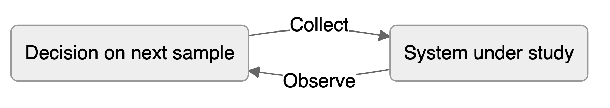
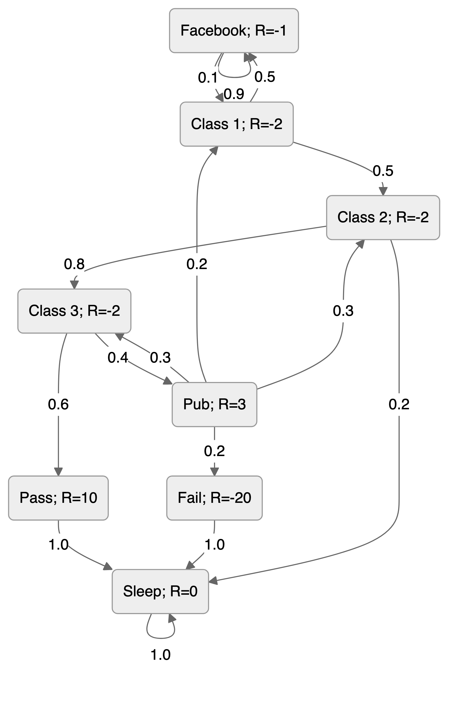
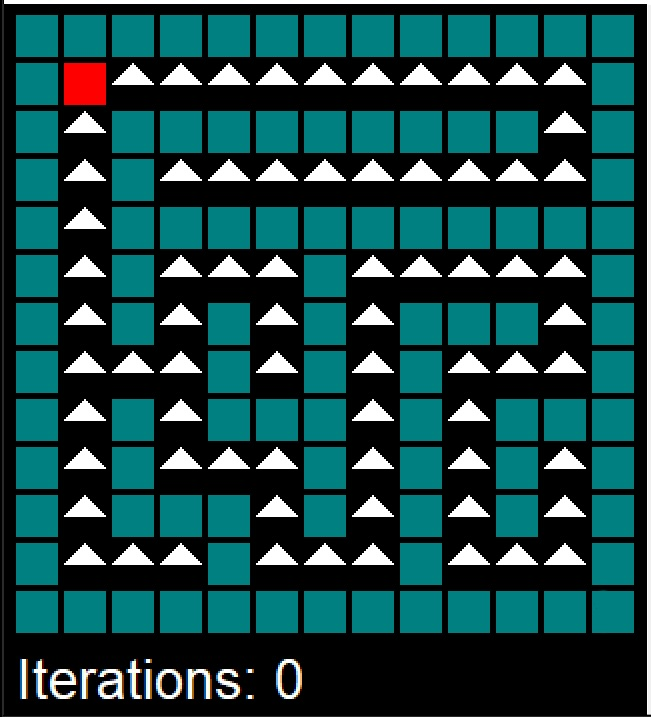
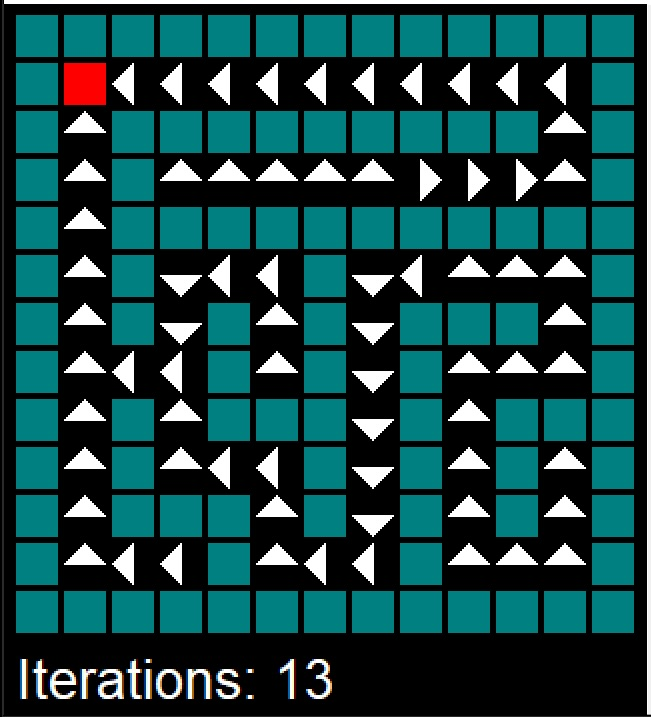
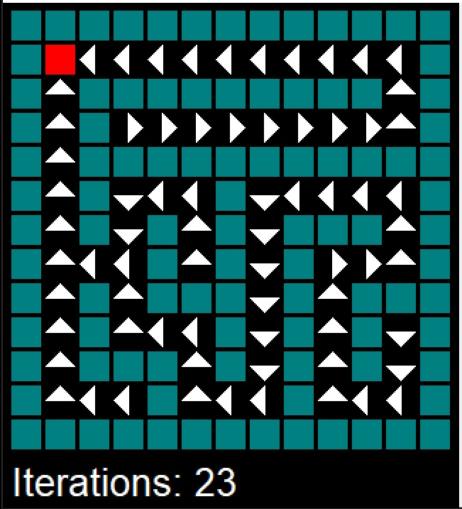
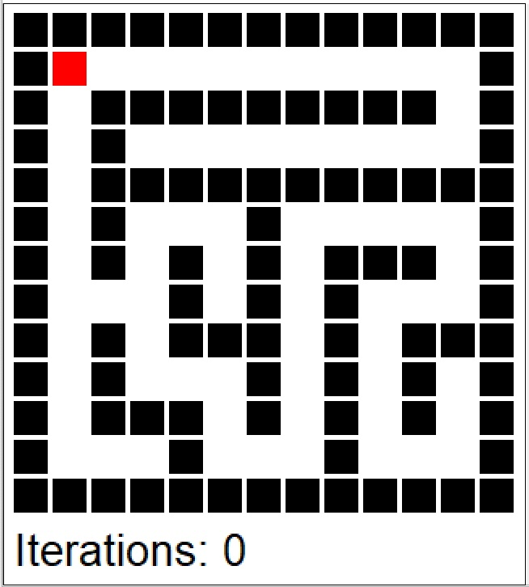
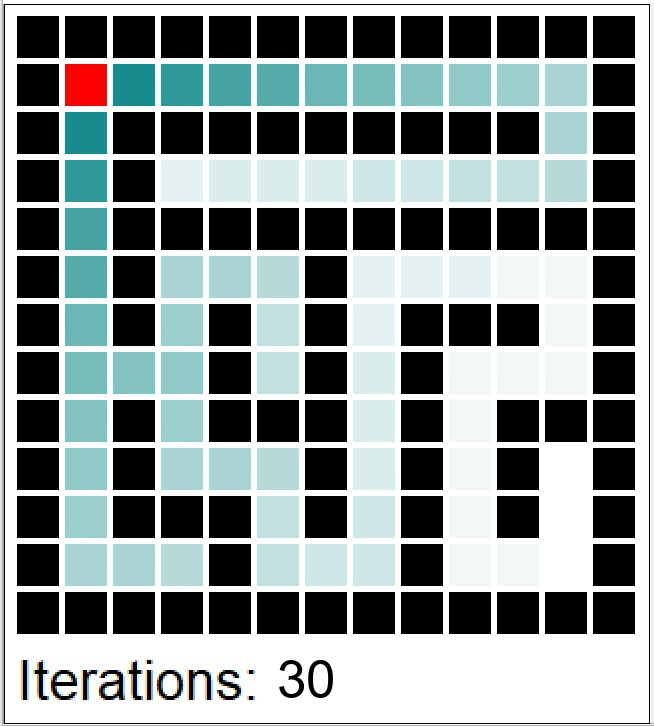
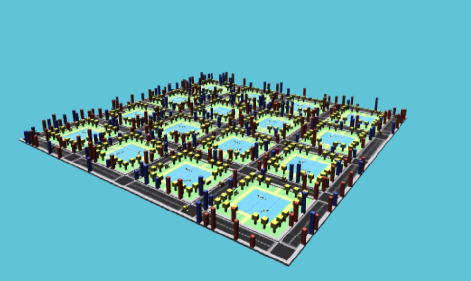



> "*Information is the resolution of uncertainty.*"---Claude Shannon, 1948

# Reinforcement Learning {#sec-RL}
Thus far we have discussed making decisions under uncertainty (@sec-Decisions and @sec-abtesting) and two modes of data collection: field experiments and observational studies. In a field experiment we control the data‐generation process before the study begins, whereas in an observational study we have no such control and must work with whatever data are produced. 

What if we can choose which data to collect *while* the experiment is running? This leads to sequential (or adaptive) experimental design, in which each new observation is selected on the basis of the data gathered so far, creating a feedback loop between data generation and decision-making.

{#fig-rl-loop width=85% fig-alt="A loop in which a decision on the next sample collects data from the system under study, and observing the system feeds the next decision."}

This framework supports a wide range of applications and is implemented through several key algorithms. In this section, we will consider the most widely used among them: (i) Multi-Armed Bandits, (ii) Q-Learning, and (iii) Bayesian Optimization.

One of the first practical demonstrations of reinforcement learning (then called *trial-and-error learning*) was Claude Shannon's 1950s mechanical mouse *Theseus*, which learned to find its way through a maze. 

## Multi-Armed Bandits
When the number of alternatives is large and the testing budget limited, a different approach to A/B testing—the *multi-armed bandit* (MAB)—can be more sample-efficient. MABs allow us to balance *exploration* (trying new things) and *exploitation* (sticking with what works) simultaneously, minimizing *regret* (the difference between our choice and the optimal one). MABs require that the outcome of each experiment is available immediately or with a small delay to decide on the next experiment [@scott2015multiarmed]. When time is of the essence, and there is an opportunity cost associated with delaying the decision, MABs are a better choice than traditional A/B testing.

The mathematical framework, the foundational Bayesian solution—Thompson sampling—and a comparison with classical A/B testing are covered in @sec-hypothesis (see @sec-mab-experiments). Here we focus on practical aspects: when to end experiments, how to handle contextual information, and design considerations.

Formally, there are $K$ alternatives (arms) and each arm $a$ is associated with a reward distribution $v_a$, the value of this arm. The goal is to find the arm with the highest expected reward and accumulate the highest total reward in doing so. The reward distribution is unknown, and we can only observe the reward after we select an arm $a$, but we assume that we know the distribution $f_a(y\mid \theta)$, where $a$ is the arm index, $y$ is the reward, and $\theta$ is the set of unknown parameters to be learned. Here are a few examples:

1.  In online advertisements, we have $K$ possible ads to be shown and the probability of a user clicking is given by the vector $\theta = (\theta_1,\ldots,\theta_K)$ of success probabilities for $K$ independent binomial models, with $v_a(\theta) = \theta_a$. The goal is to find the ad with the highest click-through rate.
2.  In website design, we have two design variables: the color of a button (red or blue) and its pixel size (27 or 40). We introduce two dummy variables, $x_c$ for color and $x_s$ for size, and the probability of a user clicking is given by 
$$
\mathrm{logit} P(\text{click} \mid \theta) = \theta_0 + \theta_x x_c + \theta_s x_s + \theta_{cs}x_cx_s,
$$ 
with $v_a(\theta) = P(\text{click} \mid \theta)$.

Variations include controlling for background variables (covariates not under our control, such as time of day or user location) or replacing the binary outcome with a continuous variable (time spent on the website, money spent) using linear regression or another appropriate generalized linear model.

The key challenge is that acting greedily—always choosing the arm with the highest estimated reward $\hat a = \arg\max_a v_a(\hat \theta)$—may cause us to miss better alternatives. We are not sure about our estimates $\hat \theta$ and need to explore other options. Thompson sampling [@thompson1933likelihood], the oldest and most elegant Bayesian solution, addresses this by sampling from the posterior distribution of each arm's success probability and selecting the arm with the highest sample. This naturally balances exploration and exploitation: arms with high uncertainty have a chance to produce high samples and get selected, while arms with high posterior means are selected frequently. The algorithm achieves optimal regret bounds of $O(\log T)$ (meaning the regret scales logarithmically with time $T$) over $T$ time steps.


### When to End Experiments
Step 2 of the TS algorithm can be replaced by calculating the probability of an arm $a$ being the best $w_{at}$ and then choosing the arm by sampling from the discrete distribution $w_{1t},\ldots,w_{Kt}$. The probability of an arm $a$ being the best is given by
$$
w_{at} = P(a \text{ is optimal } \mid y^t) = \int P(a \text{ is optimal } \mid \theta) P(\theta \mid y^t) d\theta,
$$ 
where $y^t = (y_1,\ldots,y_t)$ is the history of observations up to time $t$. We can calculate the probabilities $w_{at}$ using Monte Carlo. We can sample $\theta^{(1)},\ldots,\theta^{(G)}$ from the posterior distribution $p(\theta \mid y^t)$ and calculate the probability as 
$$
w_{at}\approx \dfrac{1}{G}\sum_{g=1}^G I(a = \arg\max_i v_i(\theta^{(g)})),
$$ 
where $I(\cdot)$ is the indicator function. This is simply the proportion of times the arm was the best in the $G$ samples. 

Although using a single draw from posterior $p(\theta \mid y^t)$ (as in the original algorithm) is equivalent to sampling proportional to $w_{at}$, the explicitly calculated $w_{at}$ yields a useful statistic that can be used to decide on when to end the experiment. 

We will use the regret statistic to decide when to stop. Regret is the difference in values between the truly optimal arm and the arm that is apparently optimal at time $t$. Although we cannot know the regret (it is unobservable), we can compute samples from its posterior distribution. We simulate the posterior distribution of the regret by sampling $\theta^{(1)},\ldots,\theta^{(G)}$ from the posterior distribution $p(\theta \mid y^t)$ and calculating the regret as
$$
r^{(g)} =  \max_a v_a(\theta^{(g)}) - v_{a^*_t}(\theta^{(g)}),
$$
where the first term is the value of the best arm *within draw $g$*, which varies from draw to draw, and $a^*_t$ is the champion, the single arm that is optimal most often across all draws,
$$
a^*_t = \arg\max_a w_{at}.
$$
The two need to be kept apart: the regret is positive exactly on those draws in which some arm beats the champion.

Often, it is convenient to measure the regret on the percent scale, and then we use 
$$
r^{(g)} \leftarrow r^{(g)}/v_{a^*_t}(\theta^{(g)})
$$

We can demonstrate with a small example. The function below generates samples $\theta^{(g)}$
```{r}
#| echo: true
bandit <- function(x, n, alpha = 1, beta = 1, ndraws = 5000) {
  K <- length(x) # number of bandits
  prob <- matrix(nrow = ndraws, ncol = K)
  no <- n - x
  for (a in 1:K) { # posterior draws for each arm
    prob[, a] <- rbeta(ndraws, x[a] + alpha, no[a] + beta)
  }
  prob
}
```
Say we have three arms with 20, 30, and 40 sessions that have generated 12, 20, and 30 conversions. We assume a uniform prior for each arm $\theta_i \sim Beta(1,1)$ and generate 6 samples from the posterior of $\theta \mid y^t$.
```{r bandit-example, echo=1:4}
x <- c(12, 20, 30)
n <- c(20, 30, 40)
set.seed(17) # Kharlamov
prob <- bandit(x, n, ndraws = 6)
rownames(prob) <- c("1", "2", "3", "4", "5", "6")
knitr::kable(prob, digits = 2, col.name = c("$\\theta_1$", "$\\theta_2$", "$\\theta_3$"), row.names = T)
```
Now, we calculate the posterior probabilities $w_{at} = P(a \text{ is optimal } \mid y^t)$ for each of the three arms
```{r, echo=1}
wat <- table(factor(max.col(prob), levels = 1:3)) / 6
knitr::kable(t(wat), digits = 2)
```
Thus far, the third arm is the most likely to be optimal, with probability 67%. Now, we calculate the regret for each of the six draws from the posterior of $\theta \mid y^t$.
```{r, echo=1}
regret <- (apply(prob, 1, max) - prob[, 3]) / prob[, 3]
knitr::kable(t(regret), digits = 2)
```
We compute the value row by row by subtracting the element in column 3 from the largest element of that row (arm 3 is the champion, because it has the highest chance of being optimal), and dividing by that same column 3 entry. All rows but 1 and 3 are zero. In the first row, the value is $(0.63-0.58)/0.58 = 0.09$, because column 2 is 0.05 larger than column 3. If we keep going down each row, we get a distribution of values that we could plot in a histogram. We can generate one for a larger number of draws (10000), redrawn from the same posteriors rather than continuing the six above.
```{r, echo=c(2,3,6)}
#| fig-cap: "The histogram of the value remaining in an experiment (regret). The vertical line is the 95th percentile, or the potential value remaining."
#| fig-height: 3
set.seed(17)
prob <- bandit(x, n, ndraws = 10000)
regret <- (apply(prob, 1, max) - prob[, 3]) / prob[, 3]
hist(regret, breaks = 10, xlab = "Regret", main = "")
abline(v = quantile(regret, 0.95), col = "red")
wat <- table(factor(max.col(prob), levels = 1:3)) / 10000
knitr::kable(t(wat), digits = 2)
```

Arm 3 has a 72% probability of being the best arm, so the value of switching away from arm 3 is zero in 72% of the cases. The 95th percentile of the value distribution is the potential value remaining in the experiment, a relative gap rather than a conversion rate, which in this case works out to be about 17%.
```{r}
#| echo: true
quantile(regret, 0.95)
```
You interpret this number as "We're still unsure about the CvR for arm 3, but whatever it is, one of the other arms might beat it by as much as 17%."

Google Analytics [@scott2013bandit], for example, "ends the experiment when there's at least a 95% probability that the value remaining in the experiment is less than 1% of the champion's conversion rate. That's a 1% improvement, not a one percentage point improvement. So if the best arm has a conversion rate of 4%, then we end the experiment if the value remaining in the experiment is less than .04 percentage points of CvR."

Our three-arm experiment is far from that threshold. Its potential value remaining is 17%, well above 1%, so under this rule the experiment would keep running rather than declare arm 3 the winner.


### Contextual Bandits
Traditional multi-armed bandit models, like the binomial model, assume independent observations with fixed reward probabilities. This works well when rewards are consistent across different groups and times. However, for situations with diverse user bases or fluctuating activity patterns, such as international audiences or browsing behavior, this assumption can be misleading.


For instance, companies with a global web presence may experience temporal effects as markets in Asia, Europe, and the Americas become active at different times of the day. Additionally, user behavior can change based on the day of the week, with people engaging in different browsing patterns and purchase behaviors. For example, individuals may research expensive purchases during work hours but make actual purchases on weekends.

Consider an experiment with two arms, A and B. Arm A performs slightly better during the weekdays when users browse but don't make purchases, while Arm B excels during the weekends when users are more likely to make purchases. High traffic volume might lead a binomial model to declare Arm A the winner before observing any weekend behavior. This risk exists regardless of whether the experiment is conducted as a bandit or a traditional experiment. Bandit experiments, however, are particularly vulnerable to this bias due to their typically shorter durations.


To mitigate the risk of being misled by distinct sub-populations, two methods can be employed. If the specific sub-populations are known in advance or if there is a proxy for them, such as geographically induced temporal patterns, the binomial model can be adapted to a logistic regression model.
$$
\mathrm{logit} P(\text{click}_a \mid \theta, x) = \beta_{0a} + \beta^\top x,
$$
where $x$ describes the circumstances or context of the observation. The success probability for selecting arm $a$ under the context $x$ is represented as $P(\text{click}_a \mid \theta, x)$. Each arm $a$ has its own specific coefficient denoted as $\beta_{0a}$ with one arm's coefficient set to zero as a reference point. Additionally, there is another set of coefficients represented as $\beta$ that are associated with the contextual data and are learned as part of the model. The value function can then be
$$
v_a(\theta) = \mathrm{logit}^{-1}(\beta_{0a}).
$$

If we lack knowledge about the crucial contexts, one option is to make the assumption that contexts are generated randomly from a context distribution. This approach is often exemplified by the use of a hierarchical model like the beta-binomial model.
\begin{align*}
\theta_{at} &\sim Beta(\alpha_a,\beta_a)\\
\text{click}_a \mid \theta &\sim Binomial(\theta_{at}),
\end{align*}
where $\theta = \{\alpha_a,\beta_a ~:~ a = 1,\ldots,K \}$, with value function $v_a(\theta) = \alpha_a/(\alpha_a + \beta_a)$

### Summary of MAB Experimentation

The design phase begins with defining your arms by identifying the different options you want to evaluate, such as different website layouts, pricing strategies, or marketing campaigns. Next, choose a bandit algorithm that balances exploration and exploitation in various ways. Popular choices include Epsilon-greedy, Thompson Sampling, and Upper Confidence Bound (UCB). Then set your parameters by configuring the algorithm parameters based on your priorities and expected uncertainty. For example, a higher exploration rate encourages trying new arms earlier. Finally, randomize allocation by assigning users to arms randomly, ensuring unbiased data collection.

During the analysis phase, track rewards by defining and measuring the reward metric for each arm, such as clicks, conversions, or profit. Monitor performance by regularly analyzing the cumulative reward and arm selection probabilities to see which arms are performing well and how the allocation strategy is adapting. Use statistical tools like confidence intervals or Bayesian methods to compare performance between arms and assess the significance of findings. Make adaptive adjustments by modifying the experiment based on ongoing analysis. You might adjust algorithm parameters, stop arms with demonstrably poor performance, or introduce new arms.

Start with a small pool of arms to avoid information overload by testing a manageable number of options initially. Set a clear stopping criterion by deciding when to end the experiment based on a predetermined budget, time limit, or desired level of confidence in the results. Consider ethical considerations by ensuring user privacy and informed consent if the experiment involves personal data or user experience changes. Interpret results in context by remembering that MAB results are specific to the tested conditions and might not generalize perfectly to other contexts.

## Bellman Principle of Optimality

> "An optimum policy has the property that whatever the initial state and initial decision are, the remaining decision sequence must be optimum for the state resulting from the first decision."---Richard Bellman

To solve sequential decision problems like the one above, we rely on a fundamental concept in dynamic programming.

::: {#exm-secretary}
## Secretary Problem
The Secretary Problem, also known as the marriage problem or sultan's dowry problem, is a classic problem in decision theory and probability theory. The scenario involves making a decision on selecting the best option from a sequence of candidates or options. The problem is often framed as hiring a secretary, but it can be applied to various situations such as choosing a house, a spouse, or any other scenario where you sequentially evaluate options and must make a decision.

In this problem, you receive $T$ offers and must either accept or reject the offer "on the spot." You cannot return to a previous offer once you have moved on to the next one. Offers are in random order and can be ranked against those previously seen. The aim is to maximize the probability of choosing the offer with the greatest rank. There is an optimal $r$ ($1 \le r < T$) to be determined such that we examine and reject the first $r$ offers. Then of the remaining $T - r$ offers, we choose the first one that is best seen to date. 

A decision strategy involves setting a threshold such that the first candidate above this threshold is hired, and all candidates below the threshold are rejected. The optimal strategy, known as the 37% rule, suggests that one should reject the first $r=T/e$ candidates and then select the first candidate who is better than all those seen so far.

The reasoning behind the 37% rule is based on the idea of balancing exploration and exploitation. By rejecting the first $T/e$ candidates, you gain a sense of the quality of the candidates but avoid committing too early. After that point, you select the first candidate who is better than the best among the initial $r$ candidates.

The 37% rule provides a probabilistic guarantee of selecting the best candidate with a probability close to 1/e (approximately 37%) as $T$ becomes large. 

To solve the secretary problem, we will use the principle of optimality due to Richard Bellman. The principle states that an optimal policy has the property that whatever the initial state and initial decision are, the remaining decisions must constitute an optimal policy with regard to the state resulting from the first decision.

The solution to the secretary problem can be found via dynamic programming. Given an agent with utility function $u(x,d)$, with current state $x$, and decision $d$. The law of motion of $x_t$ is given by $x_{t+1} = p(x_t,d_t)$. Bellman principle of optimality states that the optimal policy is given by the following recursion 
$$
V(x_t) = \max_{d_t} \left \{ u(x_t,d_t) + \gamma \E{V(x_{t+1})} \right \}
$$
where $\gamma$ is the discount factor. The optimal policy is given by
$$
d_t^* = \arg \max_{d_t} \left \{ u(x_t,d_t) + \gamma \E{V(x_{t+1})} \right \}.
$$

Now, back to the secretary problem. Let $y^t = (y_1,\ldots,y_t)$ denote the history of observations up to time $t$. State $x_t=1$ if the $t$th candidate is the best seen so far and $x_t=0$ otherwise. The decision $d_t=1$ if the $t$th candidate is hired and $d_t=0$ otherwise. Only hiring the overall best counts, so the utility is $u(x_t,d_t) = d_t\, I(t\text{th candidate is best overall})$, and it is worth noting that this is not the same as $x_t d_t$, which would pay for hiring any candidate who merely leads at the time.
<!-- The law of motion is given by $x_{t+1} = \max \{ x_t, x_{t+1} \}$.  -->
Before writing the Bellman equation we need the probability that a candidate who is best so far is best overall. Since "best of $T$" implies "best of the first $t$", Bayes' rule gives
$$
P(\text{best of }T\mid x_t=1) = \dfrac{P(\text{best of }T)}{P(x_t=1)} = \dfrac{1/T}{1/t} = \dfrac{t}{T}.
$$
So the expected utility of hiring at a record at time $t$ is $\E{u \mid x_t=1, d_t=1} = t/T$, and this is the payoff that appears in the Bellman equation below.
The $t$th offer is the best seen so far and places no restriction on the relative ranks of the first $t-1$ offers. Therefore,
$$
p(x_t=1,y^{t-1}) = p(x_t=1)p(y^{t-1}) 
$$
by the independence assumption. Hence, we have
$$
p(x_t=1 \mid y^{t-1}) = p(x_t=1) = \dfrac{1}{t}.
$$

Let $p^*(x_{t-1}=0)$ be the probability under the optimal strategy. Now we have to select the best candidate, given we have seen $t-1$ offers so far and the last one was not the best or worse. The probability satisfies the Bellman equation
$$
p^*(x_{t-1}=0) = \frac{t-1}{t} p^*(x_{t}=0) + \frac{1}{t}\max\left(t/T, p^*(x_{t}=0)\right).
$$
Once $t/T \ge p^*(x_t=0)$, that is, past the optimal threshold, the maximum is attained by $t/T$ and the recursion telescopes to
$$
p^*(x_{t-1}=0) = \frac{t-1}{T} \sum_{\tau=t-1}^{T-1}\dfrac{1}{\tau}.
$$
Below the threshold it is optimal to keep looking, the maximum is attained by $p^*(x_t=0)$, and the value stays flat at whatever it reaches at the threshold. The expression above is therefore the value of the fixed policy that starts accepting at $t-1$, which is exactly how it is used next.

Remember, the strategy is to reject the first $r$ candidates and then select the first. The probability of selecting the best candidate is given by
$$
P(\text{success}) = \dfrac{1}{T}\sum_{a=r+1}^T \dfrac{r}{a-1} = \dfrac{r}{T}\sum_{b=r}^{T-1} \dfrac{1}{b} \approx  \dfrac{1}{T}\int_{r}^{T}\dfrac{r}{a} da = \dfrac{r}{T} \log \left ( \dfrac{T}{r} \right ).
$$
The summand is $r/(a-1)$, not $r/a$: candidate $a$ is hired exactly when it is the best of the first $a$, which has probability $1/a$, *and* the best of the first $a-1$ fell in the rejected block, which has probability $r/(a-1)$. This is the same expression as the value function above with $t-1=r$.
We optimize over $r$ by setting the derivative to zero:
$$
\frac{\log \left(\frac{T}{r}\right)}{T}-\frac{1}{T} = 0,
$$
which gives the optimal $r=T/e$.

If we plug in $r=T/e$ back to the probability of success, we get
$$
P(\text{success}) \approx \dfrac{1}{e} \log \left ( e \right ) = \dfrac{1}{e}.
$$


*Monte Carlo Simulations*
Simulations support decision-making when a system is too complex for exact mathematical analysis. They appear in finance, economics, and engineering, and can also be used to test hypotheses and generate data for statistical analysis.

We start by showing how the secretary problem can be analyzed using simulations rather than the analytical derivations provided above. 
```{r eval=FALSE}
#| echo: true
set.seed(17) # Kharlamov
nmc <- 1000
n <- 1000
sz <- 300
rules <- round(n * seq(0.002, 0.8, length.out = sz))
rules <- unique(rules[rules > 0])
sz <- length(rules)
cnt <- rep(0, sz)
quality <- rep(0, sz)
for (i in 1:sz)
{
  for (j in 1:nmc) {
    x <- sample(1:n, n)
    screen <- x[1:(rules[i] - 1)]
    best_screen <- max(screen)
    xchoice <- x[(rules[i]):n]
    better_candidates <- which(xchoice > best_screen)
    if (length(better_candidates) == 0) {
      choice <- x[n]
    } else {
      choice <- xchoice[min(better_candidates)]
    }
    cnt[i] <- cnt[i] + (choice == max(x))
    quality[i] <- quality[i] + choice
  }
}
d <- data.frame(cnt = cnt, quality = quality, nmc = nmc, rules = rules)
```
```{r include=FALSE, eval=FALSE}
d <- data.frame(cnt = cnt, quality = quality, nmc = nmc, rules = rules)
write.csv(d, "data/secretary.csv", row.names = FALSE)
```
The double loop is slow, so we ran it once and saved the table in `data/secretary.csv`, which the plots below read.
```{r}
#| layout-ncol: 2
#| fig-width: 2.6
#| fig-height: 1.8
d <- read.csv("data/secretary.csv")
# rules[i] is the index of the first candidate that can be chosen,
# so the number screened (rejected) is rules - 1.
par(mar = c(2.5, 3.2, 0.7, 0.5))
plot(d$rules - 1, d$cnt / d$nmc,
  type = "l", col = 3, lwd = 3, xlab = "Number of Candidates Screened",
  ylab = "Probability of\nPicking the Best"
)
plot(d$rules - 1, d$quality / 1000,
  type = "l", col = 3, lwd = 3, xlab = "Number of Candidates Screened",
  ylab = "Average Quality\nof Candidate"
)
```

The left panel confirms the theoretical result: the probability of selecting the best candidate peaks at approximately 37% when we screen roughly 370 out of 1000 candidates (close to $T/e \approx 368$). The right panel reveals an interesting trade-off: average quality peaks much earlier, at roughly 20 to 60 candidates screened, then steadily declines. This happens because being too selective (screening too many) increases the risk of rejecting all strong candidates and being forced to accept the last one, regardless of quality. The two plots together illustrate the tension between *maximizing the chance of finding the absolute best* (left) and *maximizing expected quality* (right), objectives that lead to different optimal stopping rules.
:::

## Markov Decision Processes


A Markov Decision Process (MDP) is a discrete-time stochastic control process which provides a mathematical framework for modeling decision making in situations where outcomes are partly random and partly under the control of a decision maker. Almost all dynamic programming and reinforcement learning problems are formulated using the formalism of MDPs. MDPs were known at least as early as the 1950s; a core body of research resulted from Ronald Howard's 1960 book, [Dynamic Programming and Markov Processes](https://www.rand.org/pubs/papers/P2081.html). In fact, the multi-armed bandit problem considered before is a special case of MDP with one state.

An MDP is defined by:

1. *States ($S$)*: A set of states representing different scenarios or configurations. A key assumption is the Markov property: the future depends only on the current state and action, not on the history.
2. *Actions ($A$)*: A set of actions available in each state.
3. *Transition Probability ($P$)*: $P(s', r \mid s, a)$ is the probability of transitioning to state $s'$, receiving reward $r$, given that action $a$ is taken in state $s$.
4. *Reward ($R$)*: A reward function $R(s, a, s')$ that gives the feedback signal immediately after transitioning from state $s$ to state $s'$, due to action $a$.
5. *Discount Factor ($\gamma$)*: A factor between 0 and 1, which reduces the value of future rewards.

### Mathematical Representation

The states $s_t$ and rewards $R_t$ in MDP are indexed by time $t$. The state at time $t+1$ is distributed according to the transition probability
$$
P(s_{t+1}\mid s_t,a_t).
$$
The reward function is $R_s^a = \E{R_{t+1} \mid s, a}$. 

The Markov property of the state is that the transition probability depends only on the current state and action and not on the history of states and actions.
$$
P(s_{t+1}\mid s_t,a_t) = P(s_{t+1}\mid s_t,a_t,s_{t-1},a_{t-1},\ldots,s_0,a_0).
$$ 
The state is a sufficient statistic for the future.

In the case when the number of states is finite, we can represent the transition probability as a matrix $P_{ss'}^a = P(s_{t+1} = s' \mid s_t = s, a_t = a)$, where $s,s' \in S$ and $a \in A$. For a given action $a$, the transition probability matrix $P^a$ is a square matrix of size $|S| \times |S|$, where each row sums to 1
$$
P^a = \begin{bmatrix}
P_{11}^a & P_{12}^a & \cdots & P_{1|S|}^a \\
P_{21}^a & P_{22}^a & \cdots & P_{2|S|}^a \\
\vdots & \vdots & \ddots & \vdots \\
P_{|S|1}^a & P_{|S|2}^a & \cdots & P_{|S||S|}^a
\end{bmatrix}
$$
The reward function is also a matrix $R_s^a = \E{R_{t+1} \mid s_t = s, a_t = a}$.

*Markov Reward Process*

We can consider a simpler example of Markov Process. This is a special case of MDP when there is no action and the transition probability is simply a matrix $P_{ss'} = P(s_{t+1} = s' \mid s_t = s)$, where $s,s' \in S$. With no action to condition on, the transition probability matrix $P$ is a single square matrix of size $|S| \times |S|$ whose rows sum to 1.

::: {#exm-mdp-classes}
## Student Example
The graph below represents possible states (nodes) and transitions (links). Each node has a reward assigned to it, which corresponds to the reward function $R(s)$. The transition probabilities are shown on the links. The graph represents a Markov Chain where transitions are probabilistic and not controlled by an agent. The chain is adapted from the student example in David Silver's UCL lectures on reinforcement learning [@silver2015lectures].

{#fig-rl-student width=80% fig-alt="A Markov chain over the states Facebook, Class 1, Class 2, Class 3, Pub, Pass, Fail and Sleep, with a reward for each state and a transition probability on each arrow."}

There are no actions here, only transitions, so this is a Markov reward process rather than a full MDP. If we pick an initial state and sample a trajectory (a path on the graph above) by following the transition probabilities out of each state, we get a random walk on the graph. Sleep absorbs the walk: once there, it stays there and collects reward 0 forever. The reward for each state is shown in the graph. Counting from the state we currently occupy, the discounted value of the trajectory is
$$
G_t = R(s_t) + \gamma R(s_{t+1}) + \gamma^2 R(s_{t+2}) + \cdots = \sum_{k=0}^\infty \gamma^k R(s_{t+k}),
$$
where $\gamma$ is the discount factor. The discount factor is a number between 0 and 1 that determines the present value of future rewards. A discount factor of 0 makes the agent myopic and only concerned about immediate rewards. A discount factor of 1 makes the agent strive for a long-term high reward. The discount of less than 1 is used to avoid infinite returns in cyclic Markov chains and allows us to discount less certain future rewards. The value of $\gamma$ is usually close to 1, for example 0.9 or 0.99. The value of $\gamma$ can be interpreted as the probability of the agent surviving from one time step to the next. We use the deliberately small $\gamma = 0.5$ below so that the arithmetic stays legible and short trajectories capture most of the return.

We can calculate sample returns $G_t$ for this Markov Chain. We first read in the reward matrix
```{r, }
#| tbl-cap: Rewards
# Reward function
R <- read.csv("data/student-reward.tab", header = T, sep = "\t", row.names = 1)
t(R) %>% knitr::kable()
getR <- function(s) R[s, ]
```
and then the transition probability matrix
```{r, }
# Read transition probability matrix
p <- read.csv("data/student-mdp.tab",
  header = T, sep = "\t", row.names = 1, check.names = FALSE
)
# Blank the exact zeros only. Do not gsub("0"), which would also eat the
# digit inside 0.9, 0.1 and 0.8 and leave ".9", ".1", ".8" in the table.
disp <- as.data.frame(lapply(p, function(x) ifelse(x == 0, "", as.character(x))),
  check.names = FALSE, row.names = rownames(p)
)
knitr::kable(disp, align = "r")
```

Now we check that all of the rows sum to 1
```{r, }
#| tbl-cap: "Transition probability matrix row sums."
p <- as.matrix(p)
rowSums(p) %>%
  t() %>%
  knitr::kable()
```
Given the transition probability matrix `p`, we can sample possible trajectories. First, we define a `tr(s,m)` convenience function that generates a trajectory of length `m` starting from state `s`
```{r, }
#| tbl-cap: Sample trajectories
#| fig-cap: Sample trajectories
#| echo: true
set.seed(17)
# Sample column s' using probabilities in row s
jump <- function(s) sample(rownames(p), 1, prob = p[s, ])
# Function to generate a trajectory
tr <- function(s, m) {
  traj <- c(s)
  for (i in 1:m) {
    traj <- c(traj, jump(traj[i]))
  }
  return(traj)
}
```

Now, we generate 6 trajectories of length 5 starting from state "Pub"  
```{r, }
traj <- t(replicate(6, tr("Pub", 5)))
knitr::kable(traj)
```
Now we can calculate the discounted value $G_t$ of each of the trajectories
```{r, }
#| tbl-cap: "Discounted value of each trajectory."
trajR <- apply(traj, 1:2, getR)
disc <- 0.5^(0:5)
trajR %*% disc %>%
  t() %>%
  knitr::kable()
```


We can calculate the discounted value for 1000 trajectories, where `getR(s)` returns the reward of state `s` from the reward table above
```{r echo=T}
#| tbl-cap: "Discounted value of 1000 trajectories."
# Value function of a trajectory
value <- function(s, m, gamma = 0.5) {
  traj <- tr(s, m)
  disc <- gamma^(0:m)
  return(sum(sapply(traj, getR) * disc))
}
vpub <- replicate(1000, value("Pub", 6))
hist(vpub, main = "", xlab = "Discounted reward")
mean(vpub)
```

We can see that the discounted rewards fall into two clusters, and what separates them is not whether a path reaches "Fail" but *when*. The left cluster is the single value $-7$, which has probability $0.2$: these are the paths that go from Pub straight to Fail on the first step, each worth $3 + 0.5 \times (-20) = -7$. All other paths are worth between $0.25$ and $4.5$, including the 5.7% that reach Fail later, because by then the $-20$ is discounted by a factor of $0.125$ or less. This right cluster has two bumps: a spike at $4.5$ with probability $0.18$, the paths that go from Pub to Class 3 to Pass and then to Sleep, worth $3 + 0.5 \times (-2) + 0.25 \times 10 = 4.5$, and a broad bump between $1$ and $3$ that holds 55% of the paths.

This average is a Monte Carlo estimate of a return truncated at seven states, not the infinite-horizon value. We can get the value exactly. Writing the Bellman equation for every state at once as $V = R + \gamma P V$ and solving,
$$
V = (I - \gamma P)^{-1} R,
$$
```{r}
#| echo: true
#| tbl-cap: "Exact state values."
gamma <- 0.5
V <- solve(diag(nrow(p)) - gamma * p, R[rownames(p), ])
names(V) <- rownames(p)
knitr::kable(t(V), digits = 2)
```
Truncating at seven states costs almost nothing here: the exact seven-state return from Pub is $0.648$ against an exact value of $0.646$, a bias of about $0.001$, because at $\gamma = 0.5$ the tail is worth very little even for the 22% of paths still short of the absorbing Sleep state. The remaining distance to the simulated $0.72$ is Monte Carlo error, not truncation: the standard error of an average over 1000 paths is about $0.12$ here.
:::

The value of a state is the expected discounted reward starting from that state
$$
V(s) = \E{G_t \mid s_t = s}.
$$
It evaluates the long-term value of state $s$ (the goodness of a state). It can be drastically different from the reward value associated with the state. In our student example, the reward for the "Pub" state is 3, but the value is only 0.65, because a fifth of the time the Pub leads to Fail and its reward of $-20$.

The value of a state can be calculated recursively using the Bellman equation
\begin{align*}
V(s) &= \E{G_t \mid s_t = s} \\
&= \E{R(s_t) + \gamma R(s_{t+1}) + \gamma^2 R(s_{t+2}) + \cdots \mid s_t = s} \\
&= \E{R(s_t) + \gamma G_{t+1} \mid s_t = s} \\
&= R(s) + \gamma\,\E{V(s_{t+1}) \mid s_t = s} \\
&= \sum_{s'} P(s' \mid s) \left[R(s) + \gamma V(s')\right],
\end{align*}
where the last step uses $\sum_{s'} P(s' \mid s) = 1$ to pull the known $R(s)$ back inside the sum. In matrix form this is $V = R + \gamma P V$, the system solved in @exm-mdp-classes.

::: {#exm-mdp-forest}
## MDP for Forest Management

We can consider one of the classic examples of a Markov Decision Process (MDP). Imagine you need to calculate an optimal policy to manage a forest to prevent possible fires. The goal is to decide between two possible actions to either 'Wait' or 'Cut'. They correspond to balancing between ecological preservation and economic gain, considering the random event of a fire. We can break down the elements of this model. 

1. *States:* Represent the age of the forest. The states are denoted as $\{1, 2,\ldots, S\}$, where 1 is the youngest state (just after a fire or cutting), and $S$ is the oldest state of the forest.

2. *Actions:* There are two actions available:
   - 'Wait' (Action 1): Do nothing and let the forest grow for another year.
   - 'Cut' (Action 2): Harvest the forest, which brings immediate economic benefit but resets its state to the youngest.

3. *Probabilities:* There's a probability 'p' each year that a fire occurs, regardless of the action taken. If a fire occurs, the forest returns to state 1.

4. *Transition Matrix (P):* This matrix defines the probabilities of moving from one state to another, given a specific action. 

We build the transition probability array and the reward matrix of the Forest example in R, for four states, a fire probability of $p = 0.01$ per year, a reward $r_1 = 10$ for waiting in the oldest state and a reward $r_2 = 1$ for harvesting once the forest has grown beyond the youngest state.

```{r}
#| echo: true
fire <- 0.01
P_forest <- array(0, c(4, 4, 2))
P_forest[cbind(1:4, c(2, 3, 4, 4), 1)] <- 1 - fire  # Wait: the forest grows a year older
P_forest[, 1, 1] <- P_forest[, 1, 1] + fire         # a fire sends it back to state 1
P_forest[, 1, 2] <- 1
R_forest <- cbind(Wait = c(0, 0, 0, 10), Cut = c(0, 1, 1, 1))
```

The array $P$ has size $(|S| \times |S| \times |A|)$, so that `P_forest[s, s', a]` is $P(s' \mid s, a)$ and the two action slices are `P_forest[,,1]` and `P_forest[,,2]`. There are four states, $S = \{1,2,3,4\}$, and two actions $A = \{1,2\}$. The transition probability matrices for each action are:
$$
P(\cdot \mid s, a=1) = \begin{bmatrix}
0.01 & 0.99 & 0.00 & 0.00 \\
0.01 & 0.00 & 0.99 & 0.00 \\
0.01 & 0.00 & 0.00 & 0.99 \\
0.01 & 0.00 & 0.00 & 0.99
\end{bmatrix}, \quad
P(\cdot \mid s, a=2) = \begin{bmatrix}
1 & 0 & 0 & 0 \\
1 & 0 & 0 & 0 \\
1 & 0 & 0 & 0 \\
1 & 0 & 0 & 0
\end{bmatrix}
$$

The reward matrix $R$ of size $|S| \times |A|$ specifies the immediate reward for taking each action in each state:

$$
R = \begin{bmatrix}
0 & 0 \\
0 & 1 \\
0 & 1 \\
10 & 1
\end{bmatrix}
$$

With these transition probabilities and rewards defined, we can solve for the optimal policy using either value iteration or policy iteration. Value iteration works by iteratively updating the value function until convergence, while policy iteration alternates between policy evaluation and policy improvement steps. In exact arithmetic both algorithms converge to the same optimal policy, though they may differ in computational efficiency depending on the problem structure.

Value iteration takes a few lines of R. Starting from $V = 0$, it applies the update $V(s) \leftarrow \max_a \left\{ R(s,a) + \gamma \sum_{s'} P(s' \mid s, a) V(s') \right\}$ until the largest change in $V$ is below a tolerance, and then returns the value function and the action that attains the maximum in each state.

```{r}
#| echo: true
value_iteration <- function(P, R, gamma, tol = 1e-10) {
  V <- rep(0, nrow(R))
  repeat {
    Q <- sapply(1:ncol(R), function(a) R[, a] + gamma * P[, , a] %*% V)
    V_new <- apply(Q, 1, max)
    if (max(abs(V_new - V)) < tol) break
    V <- V_new
  }
  list(V = V_new, policy = max.col(Q, ties.method = "first"))
}
vi <- value_iteration(P_forest, R_forest, gamma = 0.9)
cat("Optimal policy:", vi$policy, "\nValues:", sprintf("%.1f", vi$V), "\n")
```

For this simple MDP with a discount factor of $\gamma = 0.9$, the optimal policy is $\pi^* = (1, 1, 1, 1)$: the *Wait* action is optimal in every state, and the values of the four states are 70.7, 78.7, 87.6 and 97.6. Because a fire strikes with probability only $p = 0.01$ while the mature-forest reward $r_1 = 10$ dwarfs the harvest reward $r_2 = 1$, cutting is never worthwhile; letting the forest keep growing and collecting $r_1$ repeatedly in the oldest state yields a higher expected discounted reward than harvesting.
:::

::: {#exm-mdp-chess}
## Game of Chess as an MDP
We can consider a simple example of a game of chess. 

In chess, a state $s$ represents the configuration of the chessboard at any given time. This includes the positions of all the pieces (pawns, knights, bishops, rooks, queen, and king) for both players (white and black). The arrangement alone is not a Markov state: the identical placement admits castling in one game and not in another, depending on whether the king or rook has already moved. A state must therefore record the placement together with the side to move, the remaining castling rights, the en-passant square if any, the halfmove counter for the fifty-move rule, and the number of times the position has already occurred (a draw may be declared when the same position recurs). With those components the state does determine the legal moves and the game is Markov. The game starts in a standard initial state (the standard chess setup) and progresses through a series of states as moves are made. If the game is played to completion, it ends in a terminal state (checkmate, stalemate, or draw). In a timed game, the game can also end when a player runs out of time.

Actions $a$ in chess are the legal moves that can be made by the player whose turn it is to move. This includes moving pieces according to their allowed movements, capturing opponent pieces, and special moves like castling or en passant. The set of actions available changes with each state, depending on the position of the pieces on the board.

In chess, the transition probability is deterministic for the most part, meaning that the outcome of a specific action (move) is certain and leads to a predictable next state. For example, moving a knight from one position to another (assuming it's a legal move) will always result in the same new configuration of the chessboard. However, in the context of playing against an opponent, there is uncertainty in predicting the opponent's response, which can be seen as introducing a probabilistic element in the larger view of the game.

Defining a reward function $R$ in chess can be complex. In the simplest form, the reward could be associated with the game's outcome: a win, loss, or draw. Wins could have positive rewards, losses negative, and draws could be neutral or have a small positive/negative value. Alternatively, more sophisticated reward functions can be designed to encourage certain strategies or positions, like controlling the center of the board, protecting the king, or capturing opponent pieces.

Chess is a game of perfect information, meaning all information about the game state is always available to both players. While the number of states in chess is finite, it is extremely large, making exhaustive state analysis (like traditional MDP methods) computationally impractical.


In practice, solving chess as an MDP, especially using traditional methods like value iteration or policy iteration, is not feasible due to the enormous state space. Modern approaches involve heuristic methods, machine learning, and deep learning techniques. For instance, advanced chess engines and AI systems like AlphaZero use deep neural networks and reinforcement learning to evaluate board positions and determine optimal moves, but they do not solve the MDP in the classical sense.
:::


The goal in an MDP is to find a policy $\pi(a \mid s)$, a distribution over actions in each state, of which a deterministic policy $a = \pi(s)$ is the special case putting all mass on one action, that maximizes the sum of discounted rewards:
$$
V^\pi(s) = \E[\pi]{G_t \mid S_t = s},
$$
where 
$$
G_t = \sum_{k=0}^{\infty} \gamma^k R(s_{t+k}, \pi(s_{t+k}), s_{t+k+1})
$$


Function $V^\pi(s)$ is the value of state s under policy $\pi$. Similarly we can define the action-value function $Q^\pi(s,a)$ as the value of taking action $a$ in state $s$ under policy $\pi$:
$$
Q^\pi(s,a) = \E[\pi]{G_t \mid S_t = s, A_t = a}.
$$


Bellman Equations for MDP simply state that the value of a state is the sum of the immediate reward and the discounted value of the next state
$$
V^\pi(s) = \E[\pi]{R_{t+1} + \gamma V^{\pi}(S_{t+1})\mid S_t = s} = \sum_{a\in A}\pi(a\mid s)\left(R_s^a + \gamma \sum_{s'\in S}P^a_{ss'}V^\pi(s') \right).
$$
The action-value function satisfies the following Bellman equation
$$
Q^\pi(s,a) = \E[\pi]{R_{t+1} + \gamma Q^{\pi}(S_{t+1}, A_{t+1})\mid S_t = s, A_t = a}.
$$
The value function can be defined as an expectation over the action-value function
$$
V^\pi(s) = \E[\pi]{Q^\pi(s,a)\mid S_t = s} = \sum_{a\in A}\pi(a\mid s)Q^\pi(s,a).
$$
In matrix form, we have
$$
Q^\pi(s,a) = R_s^a + \gamma \sum_{s'\in S}P_{ss'}^a V^\pi(s') = R_s^a + \gamma \sum_{s'\in S}P_{ss'}^a\sum_{a'\in A}\pi(a'\mid s')Q^\pi(s',a').
$$
Now we can define the Bellman equation in the matrix form
$$
V^\pi = R^\pi + \gamma P^\pi V^\pi.
$$
The direct solution is then 
$$
V^\pi = (I - \gamma P^\pi)^{-1}R^\pi.
$$
The optimal value function $V^*(s)$ is the value function for the optimal policy $\pi^*(s)$
$$
V^*(s) = \max_\pi V^\pi(s).
$$
The optimal action-value function $Q^*(s,a)$ is the action-value function for the optimal policy $\pi^*(s)$
$$
Q^*(s,a) = \max_\pi Q^\pi(s,a).
$$
The optimal policy $\pi^*(s)$ is the policy that maximizes the value function
$$
\pi^*(s) = \arg\max_a Q^*(s,a).
$$
The optimal value function satisfies the Bellman optimality equation
$$
V^*(s) = \max_a Q^*(s,a).
$$
and vice versa
$$
Q^*(s,a) = R_s^a + \gamma \sum_{s'\in S}P_{ss'}^a V^*(s').
$$

The Bellman optimality equation is non-linear and is typically solved iteratively using Value Iteration, Policy Iteration, or Q-learning, which we return to below. 

:::{#exm-deal}
## Q-Values and Deal or No Deal
Deal or No Deal is a popular TV show where a contestant is presented with a number of sealed boxes, each containing a prize. The contestant selects a box and then proceeds to open the remaining boxes one by one. After a certain number of boxes have been opened, the banker makes an offer to buy the contestant's box. The contestant can either accept the offer and sell the box or reject the offer and continue opening boxes. The game continues until the contestant either accepts an offer or opens all the boxes. The goal is to maximize the expected utility of the amount received, either the banker's offer if the contestant deals, or the prize in their own box if they refuse every offer. The rule of thumb is to continue as long as there are two large prizes left. Continuation value is large. For example, with three prizes and two large ones, risk averse people will naively choose deal, when if they incorporated the continuation value they would choose no deal.

Let $s$ denote the current state of the system and $a$ an action. The $Q$-value, $Q_t(s,a)$, is the value of using action $a$ today and then proceeding optimally in the future. We use $a=1$ to mean no deal, and $a=0$ means deal. The Bellman equation for $Q$-values becomes
$$
Q_{t} ( s , a) = u( s , a  ) + \sum_{ s^\star } P( s^\star \mid s ,a ) \max_{ a' } Q_{t+1} ( s^\star , a' )
$$
where $u(s,a)$ is the immediate utility of taking action $a$ in state $s$. Because the transition model is fully specified here, these $Q$-values are computed exactly by backward induction, in contrast to the model-free Q-learning introduced later in the chapter, which estimates them from sampled episodes. The value function and optimal action are given by 
$$ 
V(s) = \max_a Q ( s , a ) \; \; \text{and} \; \;  a^\star = \arg\max_a Q ( s , a )
$$ 

*Transition Matrix*: Consider the problem where you have three prizes left. Now $s$ is the current state of three prizes.
$$
s^\star = \{ \text{all   sets   of   two   prizes} \} \; \; \text{and} \; \; P( s^\star \mid s, a =1) = \frac{1}{3}
$$
where the transition matrix is uniform to the next state. There's no continuation for $P( s^\star \mid s, a =0)$.


*Utility*: The utility of the next state depends on the contestant's value for money and the bidding function of the banker
$$
u( B ( s^\star ) ) = \frac{ B ( s^\star )^{1-\eta} -1 }{1 - \eta }
$$
in the power utility case, where $\eta$ is the coefficient of relative risk aversion. This is the same parameter written $\gamma$ in @exm-risk; we rename it here only to avoid colliding with the discount factor $\gamma$ used throughout this chapter.


Expected value implies $B( s ) = \bar{s}$ where $s$ are the remaining prizes. 


The website uses the following criteria:
with three prizes left: 
$$ 
B( s) = 0.305 \times \text{big} + 0.5 \times \text{small} 
$$
and with two prizes left 
$$
B( s) = 0.355 \times \text{big} + 0.5 \times \text{small}   
$$

Three prizes left: $s = \{ 750 , 500 , 25 \}$.


Assume the contestant is risk averse with log-utility $U(x) = \log x$, which is the $\eta \to 1$ limit of the power utility above. Risk aversion is what drives the example: under expected value alone the two branches below are exactly indifferent, both worth 425. Banker offers the expected value we get
$$
u( B( s = \{ 750 , 500 , 25 \}) ) = \log ( 1275/3  ) = 6.052
$$
and so $Q_t ( s , a= 0 ) = 6.052$.
	
In the continuation problem, $s^\star = \{ s_1^\star , s_2^\star , s_3^\star  \}$ where $s_1^\star = \{750,500 \}$ and $s_2^\star = \{ 750,25 \}$ and $s_3^\star = \{ 500,25 \}$.

We'll have offers $625 , 387.5 , 262.5$ under the expected value. As the banker offers expected value, the optimal action at time $t+1$ is
to take the deal $a=0$ with Q-values given by
\begin{align*}
Q_{t} ( s , a=1) & = \sum_{ s^\star } P( s^\star \mid s ,a =1) \max_{ a } Q_{t+1} ( s^\star , a ) \\
& = \frac{1}{3} \left (  \log (625) + \log (387.5) + \log (262.5) \right ) = 5.989 
\end{align*}
as immediate utility $u( s,a ) = 0$. Hence as 
$$ 
Q_{t} ( s , a=1)=5.989 <  6.052 = Q_{t} ( s , a=0)
$$ 
the optimal action is $a^\star = 0$, deal. Continuation value is not large enough to overcome the generous (expected value) offered by the banker.

*Sensitivity analysis*: we perform it by assuming different Banker's bidding function. If we use the function from the website (2 prizes): 
$$
B( s) = 0.355 \times \text{big} + 0.5 \times \text{small},
$$
Hence 
\begin{align*}
B( s_1^\star = \{750,500 \}) &  = 516.25 \\
B( s_2^\star = \{ 750,25 \}) & =  278.75 \\
B( s_3^\star = \{ 500,25 \}) &  = 190  
\end{align*}

The optimal action with two prizes left for the contestant is 
\begin{align*}
Q_{t+1} ( s_1^\star , a=1) & = \frac{1}{2} \left (  \log (750) + \log (500) \right ) = 6.417 \\
& > 6.246 = Q_{t+1} ( s_1^\star , a=0) = \log \left ( 516.25 \right ) \\
Q_{t+1} ( s_2^\star , a=1) & = \frac{1}{2} \left (  \log (750) + \log (25) \right ) = 4.9194 \\
& < 5.63 = Q_{t+1} ( s_2^\star , a=0)  = \log \left ( 278.75 \right ) \\
Q_{t+1} ( s_3^\star , a=1) & = \frac{1}{2} \left (  \log (500) + \log (25) \right ) = 4.716 \\
& < 5.247 = Q_{t+1} ( s_3^\star , a=0)  = \log \left ( 190 \right ) \\ 
\end{align*}
Hence the future optimal policy will be no deal under $s_1^\star$, and deal under $s_2^\star , s_3^\star$.

Therefore solving for $Q$-values at the previous step gives
\begin{align*}
Q_{t} ( s , a=1) & = \sum_{ s^\star } P( s^\star \mid s ,a =1) \max_{ a } Q_{t+1} ( s^\star , a ) \\
& = \frac{1}{3} \left (  6.417+ 5.63 + 5.247 \right ) = 5.764
\end{align*}
with a monetary equivalent as $\exp(5.764  ) = 318.62$.


With three prizes, we have
\begin{align*}
Q_{t} ( s , a=0) & = u( B( s = \{ 750 , 500 , 25 \}) ) \\
& = \log \left ( 0.305 \times 750 + 0.5 \times 25 \right ) \\
& = \log ( 241.25 ) = 5.48.
\end{align*}
The contestant is offered \$ 241.

Now we have $Q_{t} ( s , a=1)= 5.764  > 5.48 = Q_{t} ( s , a=0)$ and the optimal action is $a^\star = 1$, no deal. The continuation value is large. The offer is \$241 against a certainty equivalent of \$319, a 32% premium for continuing.
:::


### MDP Solvers
The underlying approach behind all MDP solvers is to iteratively apply the Bellman equations until convergence. The main difference between the solvers is how they update the value function. All of them use a dynamic programming approach to find an optimal policy. Dynamic programming is a method for solving complex problems by breaking them down into simpler subproblems. It is applicable to problems exhibiting the properties of overlapping subproblems and optimal substructure. If a problem can be solved by combining optimal solutions to non-overlapping subproblems, the strategy is called divide and conquer instead. This is why dynamic programming is applicable to solving MDPs. 


First, we consider how to find the values of states under a given policy $\pi$. We can iteratively apply Bellman expectation backup. We update the values using the following update rule
$$
V_{k+1}(s) = \sum_{a} \pi(a \mid s) \sum_{s'} P(s' \mid s, a)[R(s, a, s') + \gamma V_k(s')].
$$
We will introduce the short-cut notation
$$  
P_{ss'}^a = P(s' \mid s, a), \quad R_s^a = \sum_{s'} P(s' \mid s, a)R(s, a, s').
$$
Then in matrix form the update rule becomes
$$
V_{k+1} = R^{\pi} + \gamma P^{\pi} V_k.
$$

#### Policy Iteration
The policy iteration algorithm involves two main steps: policy evaluation and policy improvement, which are iteratively applied until convergence. We start with an arbitrary value function, often initialized to zero for all states. 
\begin{align*}
V_0(s) &= 0 \\
V^{\pi_k} &= R^{\pi_k} + \gamma P^{\pi_k} V^{\pi_k} = (I - \gamma P^{\pi_k})^{-1} R^{\pi_k} \\
\pi_{k+1} &= \arg\max_a \left( R^a + \gamma P^a V^{\pi_k} \right) = \arg\max_a Q^{\pi_k}(s,a)
\end{align*}
The evaluation step is run to convergence (or solved directly, as the inverse above shows) before each improvement; stopping the evaluation after a single sweep gives a different algorithm, modified policy iteration, with a different iteration count.
The last step is to simply choose the action that maximizes the expected return in each state. Convergence is guaranteed, but by a different argument than for value iteration: each improvement step yields a policy at least as good (the policy improvement theorem), and a finite MDP has finitely many deterministic policies, so policy iteration terminates after finitely many improvements. It is the $\gamma$-contraction property of the Bellman operator, not of the value function itself, that gives value iteration its geometric convergence. We stop when a full improvement pass leaves the policy unchanged.


The Bellman optimality equation is a fundamental part of finding the best policy in MDPs.
$$
V^*(s) = \max_a \sum_{s', r} P(s', r \mid s, a)[r + \gamma V^*(s')]
$$
The optimal policy is then
$$
\pi^*(s) = \arg\max_a \sum_{s', r} P(s', r \mid s, a)[r + \gamma V^*(s')]
$$
The optimal policy is the one that maximizes the value function. The optimal value function is the value function for the optimal policy. The optimal policy can be found by maximizing the right-hand side of the Bellman optimality equation.

Given an optimal policy, we can subdivide it into two parts: the optimal first action $A^*$ and the optimal policy from the next state $S'$. The optimal value $V^*$ can be found using one-step lookahead
$$
V^*(s) = \max_a R_s^a +  \gamma \sum_{s'\in S} P_{ss'}^a V^*(s')
$$

#### Value Iteration
This allows us to define another approach to solving MDPs, called value iteration. The value iteration algorithm starts with an arbitrary value function and iteratively applies the Bellman optimality backup. The algorithm updates the value function using the following update rule
$$
V_{k+1}(s) = \max_a R_s^a +  \gamma \sum_{s'\in S} P_{ss'}^a V_k(s').
$$
In matrix form, the update rule becomes
$$
V_{k+1} = \max_a R^a + \gamma P^a V_k.
$$
The algorithm stops when the maximum change in the value function is below a threshold. The optimal policy can be found by maximizing the right-hand side of the Bellman optimality equation
$$
\pi^*(s) = \arg\max_a R_s^a +  \gamma \sum_{s'\in S} P_{ss'}^a V^*(s').
$$

In practice, exactly solving the Bellman Expectation Equation in the policy evaluation step can be computationally expensive for large state spaces. Approximate methods may be used. Policy Iteration is particularly effective when the optimal policy needs to be very precise, as in high-stakes decision-making environments.


::: {#exm-mdp-maze}
## MDP for a Maze

We use a [`mazemdp`](https://github.com/sally-gao/mazemdp) archive by Sally Gao, Duncan Rule, Yi Hao to demonstrate the value and policy iterations. Both are applied to the problem of finding an optimal policy for a maze. The maze is represented as a grid, with each cell either being a wall or empty. Both solvers are model-based, so the agent (decision maker) knows the layout and the transition structure, and each computes an optimal action for *every* cell rather than a single path; following the greedy actions from any starting cell then traces an optimal route to the goal in the top left corner. The agent can move up, down, left, or right, but not diagonally (actions). Moving into a wall keeps the agent in the same cell. Every cell carries a reward of $-1$ except the goal, which carries $+10$, and rewards are discounted with $\gamma=0.9$. Discounting is what makes short paths preferable: a cell $d$ steps from the goal has value $-10 + 110(0.9)^d$, strictly decreasing in $d$. The goal is not absorbing in this implementation, since bumping into the outer wall keeps the agent in place, so $V(\text{goal}) = 10/(1-\gamma) = 100$. The goal is to find the optimal policy that maximizes the expected return (sum of discounted rewards) for the agent.

Figures below show the snapshot from policy (top row) and value (bottom row) iterations.

::: {#fig-maze-policy layout-ncol=3}







Policy Iteration Solver. Arrows show the greedy action in each cell; $k$ indexes the solver iteration, and $k=0$ is the initial policy, which points up everywhere. The goal is the open cell in the top left corner.
:::

::: {#fig-maze-value layout-ncol=3}






Value Iteration Solver. Walls are black; in the open cells, shading encodes the value function, from white (low) to dark (high), so the high-value region spreads outward from the goal as the sweeps proceed.
:::

Policy iteration converged after 23 iterations, the sweep at which a full pass leaves the policy unchanged.
:::


A more general form of a value function is the action-value function $Q^\pi(s,a)$, which represents the expected return when starting from state $s$, taking action $a$, and following policy $\pi$ thereafter. 
$$
Q^\pi(s,a) = \E[\pi]{G_t \mid s_t = s, a_t = a}.
$$
We can derive both the value and optimal policy functions from the action-value function:
$$
V^\pi(s) = \sum_{a \in A} \pi(a \mid s) Q^\pi(s,a)
$$
$$
\pi^*(s) = \arg\max_a Q^*(s,a)
$$

### Model-Free Methods
Both policy and value iterations we've considered thus far assume that transition probabilities between states given actions are known. However, this is often not the case in many real-world problems. Model-free methods learn through trial and error, by interacting with the environment and observing the rewards. The first method we consider is Monte Carlo methods. Monte Carlo methods for Markov Decision Processes (MDPs) are a class of algorithms used for finding optimal policies when the model of the environment (i.e., the transition probabilities and rewards) is unknown or too complex to model explicitly. These methods rely on learning from experience, specifically from complete episodes of interaction with the environment.

1. *Generate Episodes:* An episode is a sequence of states, actions, and rewards, from the start state to a terminal state.
$$
S_0, A_0, R_1, S_1, A_1, R_2, \ldots, S_{T-1}, A_{T-1}, R_T \sim \pi.
$$
In Monte Carlo methods, these episodes are generated through actual or simulated interaction with the environment, based on a certain policy.
2. *Estimate Value Functions:* Unlike dynamic programming methods, which update value estimates based on other estimated values, Monte Carlo methods update estimates based on actual returns received over complete episodes. This involves averaging the returns received after visits to each state. We use empirical mean to estimate the expected value. 
3. *Policy Improvement:* After a sufficient number of episodes have been generated and value functions estimated, the policy is improved based on these value function estimates.

Monte Carlo methods require complete episodes to update value estimates. This makes them particularly suitable for episodic tasks, where interactions naturally break down into separate episodes with clear starting and ending points. MC methods require sufficient exploration of the state space. This can be achieved through various strategies, like $\epsilon$-greedy policies, where there's a small chance of taking a random action instead of the current best-known action. In this case, the policy is given by 
$$
\pi(a \mid s) = \begin{cases}
1 - \epsilon + \frac{\epsilon}{|A|} & \text{if } a = \arg\max_{a'} Q(s,a') \\
\frac{\epsilon}{|A|} & \text{otherwise}
\end{cases}
$$
where $\epsilon$ is the probability of taking a random action and $|A|$ is the number of actions. The $\epsilon$-greedy policy is an example of an exploration-exploitation strategy, where the agent explores the environment by taking random actions (exploration) while also exploiting the current knowledge of the environment by taking the best-known action (exploitation). The value of $\epsilon$ is typically decayed over time, so that the agent explores more in the beginning and exploits more later on.


Monte Carlo methods are model-free, meaning they do not require a model of the environment (transition probabilities and rewards). However, they can be inefficient due to high variance and the need for many episodes to achieve accurate value estimates. They also require careful handling of the exploration-exploitation trade-off. The two main approaches for Monte Carlo methods are first-visit and every-visit methods.

1. First-Visit MC: In this approach, the return for a state is averaged over all first visits to that state in each episode.
2. Every-Visit Monte Carlo: Here, the return is averaged over every visit to the state, not just the first visit in each episode.

Monte Carlo Policy Iteration involves alternating between policy evaluation (estimating the value function of the current policy using Monte Carlo methods) and policy improvement (improving the policy based on the current value function estimate). This process is repeated until the policy converges to the optimal policy. Policy iteration with exact evaluation is guaranteed to do so in a finite number of steps for finite MDPs [@puterman2014markov]; with Monte Carlo estimates the evaluation is noisy and this guarantee does not carry over.

To find the optimal policy, a balance between exploration and exploitation must be maintained. This is achieved through strategies like $\epsilon$-greedy exploration. In Monte Carlo Control, the policy is often improved in a greedy manner based on the current value function estimate.


Recall that an arithmetic average can be updated recursively
$$
\bar{x}_n = \frac{1}{n}\sum_{i=1}^n x_i = \frac{1}{n}\left(x_n + \sum_{i=1}^{n-1} x_i\right) = \frac{1}{n}\left(x_n + (n-1)\bar{x}_{n-1}\right) = \bar{x}_{n-1} + \frac{1}{n}(x_n - \bar{x}_{n-1}).
$$
This is called a running average. We can use this recursion to update the value function $V(s)$ incrementally, each time we visit state $s$ at time $t$.
$$
V(s_t) = V(s_t) + \frac{1}{N(s_t)}(G_t - V(s_t)),
$$
where $N(s_t)$ is the number of times we visited state $s_t$ up to and including time $t$ and $G_t$ is the return at time $t$. This is called every-visit Monte Carlo method. Alternatively, we can use first-visit Monte Carlo method, where we update the value function only at the first visit to state $s$ in each episode, with $N(s)$ counting only those first visits.

Alternatively, we can use a learning rate $\alpha$
$$
V_{n+1} = V_n + \alpha(G_n - V_n).
$$
This is called a constant step size update. The learning rate is a hyperparameter that needs to be tuned. The constant step size update is more convenient because it does not require keeping track of the number of visits to each state. The constant step size update is also more robust to non-stationary problems.

*Temporal Difference Learning (TD Learning)*
Similar to MC, TD methods learn directly from raw experience without a model of the environment. However, unlike MC methods, TD methods update value estimates based on other learned estimates, without waiting for the end of an episode. This is called bootstrapping. TD methods combine the sampling efficiency of Monte Carlo methods with the low variance of dynamic programming methods. However, they are more complex than MC methods and require careful tuning of the learning rate.

A simple TD method is TD(0), which updates value estimates based on the current reward and the estimated value of the next state. The update rule is
$$
V(S_t) = V(S_t) + \alpha(R_{t+1} + \gamma V(S_{t+1}) - V(S_t)),
$$
where $\alpha$ is the learning rate. The TD(0) method is also called one-step TD because it only looks one step ahead. The $R_{t+1} + \gamma V(S_{t+1})$ term is called the TD target and is a biased estimate of $V(S_t)$. The difference $R_{t+1} + \gamma V(S_{t+1}) - V(S_t)$ is called the TD error. The TD target is an estimate of the return $G_t$ and the TD error is the difference between the TD target and the current estimate $V(S_t)$. Although TD algorithms have lower variance than MC methods, they have higher bias. In practice, TD methods are more efficient than MC methods.


## Q-Learning
Q-learning is an off-policy algorithm that learns the optimal policy by directly estimating the optimal action-value function $Q^*(s,a)$. The algorithm iteratively updates the action-value function using the Bellman optimality backup. Off-policy means that the algorithm learns the optimal policy while following a different policy. The algorithm can learn the optimal policy while following a random policy, for example. The update rule is
$$
Q(S_t,A_t) = Q(S_t,A_t) + \alpha(R_{t+1} + \gamma \max_a Q(S_{t+1},a) - Q(S_t,A_t)),
$$
where $\alpha$ is the learning rate.

1. Initialize $Q(s,a)$ arbitrarily
2. Repeat for each episode:
   1. Initialize $S$
   2. Repeat for each step of the episode:
      1. Choose $A$ from $S$ using policy derived from $Q$ (e.g., $\epsilon$-greedy)
      2. Take action $A$, observe $R$, $S'$
      3. $Q(S,A) = Q(S,A) + \alpha(R + \gamma \max_a Q(S',a) - Q(S,A))$
      4. $S = S'$
   3. Until $S$ is terminal

Then we can simplify the update rule to
$$
Q(S_t,A_t) = (1-\alpha)Q(S_t,A_t) + \alpha(R_{t+1} + \gamma \max_a Q(S_{t+1},a)).
$$


## Bayesian Optimization
Bayesian Optimization solves an optimization problem using sequential design of experiments, which is the same in spirit as reinforcement learning but focuses on finding the optimum of a static function rather than a policy.

Bayesian optimization is a sequential design strategy for global optimization of black-box functions that does not assume any functional forms. It is particularly useful when the objective function is expensive to evaluate. Bayesian optimization uses a surrogate model to approximate the objective function and an acquisition function to decide where to sample next. The surrogate model is typically a Gaussian process (GP) model, which is a probabilistic model that defines a distribution over functions. The acquisition function is a heuristic that trades off exploration and exploitation to decide where to sample next. Bayesian optimization is derivative-free: it needs only evaluations of $f$, never its gradient. It targets the global optimum rather than a local one. Unlike convex optimization, it offers no guarantee of finding the true global optimum; instead, it seeks near-global optima efficiently by balancing exploration and exploitation. It is sample-efficient, finding good solutions with far fewer function evaluations than grid search or random search. However, it can be slow in practice and is not suitable for high-dimensional problems.

Given a function $f(x)$ that is not known analytically (it can represent, for example, the output of a complex computer program), the goal is to optimize
$$
x^* = \arg\min_x f(x).
$$

The Bayesian approach to this problem is the following:

1. Define a prior distribution over $f(x)$
1. Calculate $f$ at a few points $x_1, \ldots, x_n$
1. Repeat until convergence:
   1. Update the prior to get the posterior distribution over $f(x)$
   1. Choose the next point $x^+$ to evaluate $f(x)$
   1. Calculate $f(x^+)$
1. Pick $x^*$ that corresponds to the smallest value of $f(x)$ among evaluated points

The prior distribution is typically a Gaussian process (GP) model, which is a probabilistic model that defines a distribution over functions. The GP model is defined by a mean function $m(x)$ and a covariance function $k(x,x')$. The mean function is typically set to zero. The covariance function is typically a squared exponential function
$$
k(x,x') = \sigma_f^2 \exp\left(-\frac{(x-x')^2}{2l^2}\right),
$$
where $\sigma_f^2$ is the signal variance, and $l$ is the length scale. The covariance function defines the similarity between two points $x$ and $x'$. The covariance function is also called a kernel function. 


Now we need to decide where to sample next. We can use the acquisition function to decide where to sample next. The acquisition function is a heuristic that trades off exploration and exploitation to decide where to sample next. The expected improvement (EI) function is a popular acquisition function. Suppose 
$$
f^* = \min_i y_i
$$
is the smallest response among the evaluated points $y_1,\ldots,y_n$. At a candidate point $x$, let $Y(x)$ denote the posterior predictive for the response there, which is the random quantity we have not yet observed. The expected improvement function is defined as
$$
a(x) = \E{\max(0, f^* - Y(x))},
$$
The function that we calculate the expectation of
$$
u(x) = \max(0, f^* - Y(x))
$$
is the utility function. Thus, the acquisition function is the expected value of the utility function. 


The acquisition function is high when $Y(x)$ is likely to be lower than $f^*$, and low when it is likely to be higher. Given the GP prior, we can calculate the acquisition function analytically. The posterior predictive is normal, $Y(x) \sim N(\mu,\sigma^2)$ with $\mu = \mu(x)$ and $\sigma^2 = \sigma^2(x)$, so writing $y$ for the dummy integration variable the acquisition function is
\begin{align*}
a(x) &= \E{\max(0, f^* - Y(x))} \\
&= \int_{-\infty}^{\infty} \max(0, f^* - y) \phi(y,\mu,\sigma^2) dy \\
& \text{Since we are interested in improvement } f^* - y > 0 \text{, i.e., } y < f^* \text{,} \\
& \text{the integral is from } -\infty \text{ to } f^* \\
&= \int_{-\infty}^{f^*} (f^* - y) \phi(y,\mu,\sigma^2) dy
\end{align*}
where $\phi(y,\mu,\sigma^2)$ is the probability density function of the normal distribution. A useful identity is 
$$
\int y \phi(y,\mu,\sigma^2) dy =\frac{1}{2} \mu ~  \text{erf}\left(\frac{y-\mu }{\sqrt{2} \sigma }\right)-\frac{\sigma 
   e^{-\frac{(y-\mu )^2}{2 \sigma ^2}}}{\sqrt{2 \pi }},
$$
where $\Phi(y,\mu,\sigma^2)$ is the cumulative distribution function of the normal distribution. Thus, 
$$
\int_{-\infty}^{f^*} y \phi(y,\mu,\sigma^2) dy = \frac{1}{2} \mu (1+\text{erf}\left(\frac{f^*-\mu }{\sqrt{2} \sigma
   }\right))-\frac{\sigma  e^{-\frac{(f^*-\mu )^2}{2 \sigma ^2}}}{\sqrt{2 \pi}} = \mu \Phi(f^*,\mu,\sigma^2) - \sigma^2 \phi(f^*,\mu,\sigma^2).
$$

we can write the acquisition function as
$$
a(x) = \sigma^2 \phi(f^*,\mu,\sigma^2) + (f^*-\mu)\Phi(f^*,\mu,\sigma^2)
$$


We can implement it
```{r} 
#| echo: true
# p must be the predGP output on the grid the caller will index into.
acq <- function(p, fstar) {
  d <- fstar - p$mean
  s <- sqrt(diag(p$Sigma))
  return(s * dnorm(d / s) + d * pnorm(d / s))
}
```

::: {#exm-bayesopt}
## Taxi Fleet Optimisation

We will use the taxi fleet simulator from [Emukit project](https://github.com/amzn/emukit-playground). For a given demand (the frequency of trip requests) and the number of taxis in the fleet, it simulates the taxi fleet operations and calculates the profit. The simulator is a black-box function, meaning it does not have an analytical form and can only be evaluated at specific points. The goal is to find the optimal number of taxis in the fleet that maximizes the profit. We will use Bayesian optimization to solve this problem.

{width=50%}

We start with an initial set of three designs $x = (10,90,30)$, where $x$ is the number of taxis in the fleet, and observe the corresponding profits $(3.1, 3.6, 6.6)$. When $x=10$, the demand for taxis exceeds the supply and passengers need to wait for their rides, leading to missed profit opportunities. At another extreme, when we have 90 taxis, the profit is slightly better. However, there are many empty taxis, which is not profitable. The optimal number of taxis must be somewhere in the middle. Finally, we try 30 taxis and observe that the profit is higher than both of our previous attempts. However, should we increase or decrease the number of taxis from here? We can use Bayesian optimization to answer this question. First, we use a convenience function, `plotgp`, that plots the GP emulator: the observations, the posterior median and a 90% band.

```{r plotgp, }
plotgp <- function(x, y, XX, p) {
  q1 <- qnorm(0.05, mean = p$mean, sd = sqrt(diag(p$Sigma)))
  q2 <- qnorm(0.95, mean = p$mean, sd = sqrt(diag(p$Sigma)))
  q3 <- qnorm(0.5, mean = p$mean, sd = sqrt(diag(p$Sigma)))
  ggplot() +
    geom_line(aes(x = XX, y = q3), col = 2, lwd = 2) +
    geom_ribbon(aes(x = XX, ymin = q1, ymax = q2), fill = "blue", alpha = 0.2) +
    geom_point(aes(x = x, y = y), shape = 21, fill = "white", size = 2.5) +
    labs(x = "Number of taxis", y = "Negative profit")
}
```

Now, we fit the GP emulator using our initial set of observed taxi-profit pairs, the result is shown in @fig-inittaxi.
```{r}
#| fig-height: 2
#| fig-cap: "Initial GP emulator fit to the taxi-profit pairs."
#| label: fig-inittaxi
#| echo: true
library(laGP)
x <- matrix(c(10, 90, 30), ncol = 1)
xx <- seq(1, 100, length = 500)
XX <- matrix(xx, ncol = ncol(x))
profit <- -c(3.1, 3.6, 6.6)
gp <- newGP(x, profit, 1000, 1e-6, dK = TRUE)
p <- predGP(gp, XX)
plotgp(x, profit, XX, p)
```
Instead of maximizing the profit, we minimize the negative profit. We see that there is potentially a better value at around 50 taxis. We can use the acquisition function to decide where to sample next. We define two functions: `nextsample` that uses the acquisition function to decide where to sample next and `updgp` that updates the GP emulator with the new sample. Then we call those two functions four times. The acquisition function successively suggests 48, 58, 45, and 100 taxis. The fleet simulator was run at 44, 57, 45, and 100, so the first two evaluations sit a few taxis below the acquisition maximum; this shifts the design slightly but not the region the search settles on.
```{r}
#| layout: "[[1,1], [1,1], [1,1], [1,1]]"
#| fig-width: 2.6
#| fig-height: 1.8
#| fig-cap: "Each Bayesian optimization step: expected improvement (left) and the GP emulator refitted to the taxi-profit pairs (right)."
#| echo: true
nextsample <- function() {
  ei <- acq(p, min(profit))
  plot(xx, ei, type = "l", col = 2, lwd = 2, xlab = "Number of taxis", ylab = "Expected improvement")
  xnext <- as.integer(xx[which.max(ei)])
  return(xnext)
}
updgp <- function(xnext, f) {
  profit <<- c(profit, f)
  x <<- rbind(x, xnext)
  gp <<- newGP(x, profit, 1000, 1e-6, dK = TRUE)
  p <<- predGP(gp, XX)
  plotgp(x, profit, XX, p) + theme_gray(base_size = 8)
}
invisible(nextsample()) # suggests 48; simulator was run at 44
updgp(44, -8.4)
invisible(nextsample()) # suggests 58; simulator was run at 57
updgp(57, -7.1)
invisible(nextsample()) # suggests 45
updgp(45, -8.5)
invisible(nextsample()) # suggests 100
updgp(100, -3.3)
```

If we run `nextsample` one more time, we get 47, close to our current best of 45. Further, the model is confident at this location. It means that we can stop the algorithm and declare victory, shown in @fig-stopbayes.
```{r }
#| fig-cap: "The acquisition function after four optimization steps, with seven design points. The maximum is at 47."
#| label: fig-stopbayes
#| echo: true
nextsample()
```


:::


## Concluding Remarks

This chapter developed three interconnected frameworks for sequential decision-making under uncertainty: multi-armed bandits for experimentation, MDPs and Q-learning for dynamic optimization, and Bayesian optimization for expensive black-box functions. The common thread is the exploration-exploitation tradeoff---balancing information gathering against immediate reward. Thompson sampling, Bellman's principle of optimality, and expected improvement each resolve this tradeoff differently, but all rely on maintaining and updating a probabilistic model of the unknown.

## Exercises {.unnumbered}

