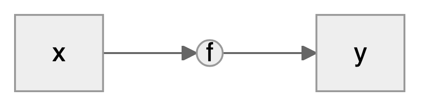
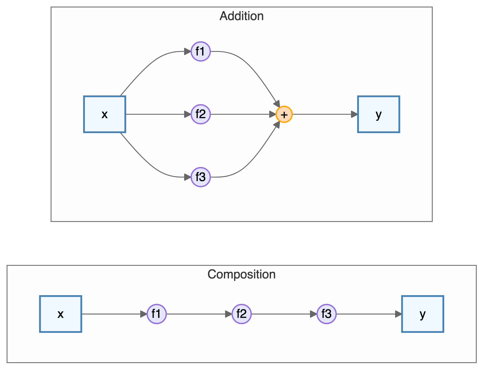



> "*Prediction is very difficult, especially about the future.*"---Often attributed to Niels Bohr, Danish physicist and Nobel laureate

# Pattern Matching {#sec-pattern}
The history of data analysis is closely intertwined with the development of pattern matching techniques. The ability to identify and understand patterns in data has been central to scientific discoveries, technological advancements, and decision-making. From the early days of astronomy to modern machine learning, pattern matching has played a pivotal role in advancing our understanding of the world around us.

Data science involves two major steps: collection and cleaning of data and building a model or applying an algorithm. In this chapter, we present the process of building predictive models. To illustrate the process, think of your data as being generated by a black box in which a set of input variables $x$ go through the box and generate an output variable $y$. 

## Why Pattern Matching?
For Gauss, Laplace, and many other scientists, the central challenge was estimating parameters when the functional form of the relationship was already known, often linear (as in the Earth-shape example) or multiplicative (e.g., Newton’s $F=ma$ or Einstein's $E=mc^2$). In many modern problems, however, the relationship itself is unknown and defies simple mathematical description; human behaviour and natural language are prominent examples (@halevy2009unreasonable).

In such cases, a *pattern-matching* approach can uncover the hidden relationships directly from data. Pattern matching means identifying recurring sequences, relationships, or structures within a dataset, much like finding a puzzle piece that completes a picture. Recognising these patterns yields insights, reveals trends, supports prediction, and ultimately improves decisions. Initial pattern-matching studies have often sparked major scientific advances, as the early history of mammography illustrates.

::: {#exm-mammography}
## Mammography and Early Pattern Matching
Early mammography relied on visual pattern matching to detect cancer signs like masses and microcalcifications. Radiologists used their expertise to distinguish these patterns from normal tissue, though the process was subjective and error-prone. Despite these challenges, this visual pattern matching laid the foundation for modern screening.

German surgeon Albert Salomon pioneered this field with his 1913 monograph (@nicosia2023history). By comparing X-rays of surgically removed tissue with the actual specimens, he identified characteristic features of tumors and was among the first to link microcalcifications to breast cancer, a correlation that remains a key biomarker today, even as the underlying molecular mechanisms are still being studied (@bonfiglio2021molecular).
:::

### Richard Feynman on Pattern Matching and Chess
Richard Feynman, the renowned physicist, argued that many scientific discoveries begin with pattern matching, a skill experts develop to identify structures and regularities in their domain. He frequently engaged in discussions about artificial intelligence, often using chess as an analogy to illustrate the difference between human intuition and machine calculation.

Feynman observed that while novices calculate moves, masters recognize patterns. They understand the "laws" of the board much like physicists understand the laws of nature. In an interview, he described learning the rules of chess simply by observing games: first noting that bishops maintain their color, then realizing they move diagonally. This process of uncovering rules from observations is the essence of scientific discovery.

Regarding machine intelligence, Feynman was pragmatic. He noted that machines need not "think" like humans to achieve similar or superior results. Just as airplanes fly without flapping wings like birds, computers can play chess (or solve other problems) using different underlying mechanisms, such as massive calculation or statistical optimization, yet achieve superhuman performance.

> "If we would like to make something that runs rapidly over the ground... we could try to make a machine that runs like a cheetah. But, it's easier to make a machine with wheels... later machines are not going to think like people think."---Richard Feynman

This distinction matters in modern AI. Today's systems, like AlphaZero, combine pattern matching (via neural networks) with search (Monte Carlo simulation), effectively "learning" chess principles from scratch. They don't rely on human heuristics (like "control the center") but discover their own statistical patterns that maximize the probability of winning.

Discussions with professional pianist Beatrice Rana revealed an interesting parallel. She compared modern AI's ability to produce incredible results to a pianist capable of remembering and reproducing complex pieces of music, calling it *"intelligenza artigiana"*, or the intelligence of hands: a mastery of execution and pattern without necessarily possessing human-like consciousness.

How do we translate this conceptual "pattern matching" into concrete algorithms? In data science, we formalize this process by defining a mathematical structure (a model) and using data to adjust its parameters. Whether we are predicting election outcomes or classifying images, the core task remains the same: finding a function that maps inputs to outputs in a way that generalizes to new, unseen data.

## Supervised Learning

Prediction and forecasting are central challenges in data analysis, predominantly solved using pattern matching approaches. In business and engineering, the main motivation is to make better decisions; in science, to test and validate theories. By uncovering trends and patterns in historical data, analysts can make *informed decisions* about the future, identify *potential risks and opportunities*, and develop proactive strategies to capitalize on them. While unsupervised learning (clustering, dimensionality reduction) finds patterns without labeled data, this chapter focuses on *supervised learning*, where we have a target variable we wish to predict.

The problem of supervised learning is to learn patterns from observed data to make predictions on new, unseen data. The key idea is that we have input-output pairs $(x_i, y_i)$ where we know the correct output $y_i$ for each input $x_i$, and we use these examples to learn a function that maps inputs to outputs. 

Supervised learning powers a surprising range of modern systems. Manufacturing plants use sensor data to predict equipment failures before they happen. Autonomous vehicles rely on it for object detection, lane recognition, and real-time decision-making from camera and LiDAR feeds. Medical imaging systems detect diseases from X-rays and MRIs with accuracy rivaling radiologists. Banks use it for fraud detection and credit scoring; retailers for demand forecasting and inventory optimization; marketing teams for churn prediction and lead scoring.

The common thread: you have historical data with known outcomes, and you want to predict outcomes for new cases.

A typical prediction problem involves building a rule that maps observed inputs $x$ into the output $y$. The inputs $x$ are often called predictors, features, or independent variables, while the output $y$ is often called the response or dependent variable. The goal is to find a predictive rule
$$
y = f(x).
$$

The map $f$ can be viewed as a black box which describes how to find the output $y$ from the input $x$. One of the key requirements of $f$ is that we should be able to efficiently find this function using an algorithm. In the simple case, $y$ and $x$ are both univariate (scalars), and we can view the map as

{#fig-xfy width=40% fig-alt="Diagram of a black box: the input x goes into a circle labelled f, and an arrow leads from f to the output y."}

The goal of machine learning is to reconstruct this map from observed data. In a multivariate setting $x = (x_1,\ldots,x_p)$ is a list of $p$ variables. This leads to a model of the form $y = f(x_1,\ldots,x_p)$. There are a number of possible goals of analysis, such as estimation, inference or prediction. The main one being prediction. 

The prediction task is to calculate a response that corresponds to a new feature input variable. An example of inference is the task of establishing causation, with the goal of extracting information about the nature of the black box association of the response variable to the input variables.  

In either case, the goal is to use data to find a pattern that we can exploit. The pattern will be "statistical" in its nature. To uncover the pattern we use a training dataset, denoted by 
$$
D = (y_i,x_i)_{i=1}^n
$$ 

where $x_i$ is a set of $p$ predictors, and $y_i$ is response variable. Prediction problem is to use a training dataset $D$ to design a rule that can be used for predicting output values $y$ for new observations $x$. 

Let $f(x)$ be predictor of $y$, we will use notation
$$
\hat{y} = f(x).
$$ 

To summarize, we will use the following notation. 

|          |                                               |
|----------|-----------------------------------------------|
| $y$      | output variable (response/outcome)            |
| $x$      | input variable (predictor/covariate/feature)  |
| $f(x)$   | predictive rule                               |
| $\hat y$ | predicted output value                        |

We distinguish several types of input or output variables. First, *binary* variables that can only have two possible values, e.g., yes/no, left/right, 0/1, up/down, etc. A generalization of binary variable is a *categorical* variable that can take a fixed number of possible values, for example, marriage status. Additionally, some of the categorical variable can have a natural order to them, for example, education level or salary range. Those variables are called *ordinal*. Lastly, the most common type of a variable is *quantitative* which is described by a real number. 

Depending on the type of the output variable, there are three types of prediction problems. 

| Output Variable Type | Description | Prediction Problem |
|---------------------|-------------|-------------------|
| Binary | $y\in \{0,1\}$ | Classification |
| Categorical | $y\in \{0,\ldots,K-1\}$ for $K$ possible categories | Classification |
| Quantitative | $y \in \mathbb{R}$ (any real number) | Regression |
| Ordinal | $y$ has natural ordering | Ranking |

: Types of output variables and corresponding prediction problems.

Here are some examples of prediction problems:

Binary Classification: Predicting whether an email is spam or not spam involves input variables such as email content, sender information, presence of certain keywords, and email length. The output variable is $y \in \{0,1\}$ where 0 = not spam, 1 = spam. The goal is to classify new emails as spam or legitimate.

Categorical Classification: Predicting the type of social media content based on text and image features uses input variables including text content, image features, user engagement metrics, posting time, and hashtags. The output variable is $y \in \{0,1,2,3,4\}$ where 0 = news, 1 = entertainment, 2 = educational, 3 = promotional, 4 = personal. The goal is to automatically categorize social media posts for content moderation and recommendation systems.

Regression (Quantitative): Predicting house prices based on features uses input variables such as square footage, number of bedrooms, location, age of house, and lot size. The output variable is $y \in \mathbb{R}$ (house price in dollars). The goal is to predict the selling price of a new house.

Ranking (Ordinal): Predicting customer satisfaction ratings involves input variables including product quality, customer service experience, delivery time, and price. The output variable is $y \in \{1,2,3,4,5\}$ where 1 = very dissatisfied, 5 = very satisfied. The goal is to predict customer satisfaction level for new customers.

There are several simple predictive rules we can use to predict the output variable $y$. For example, in the case of regression problem, the simplest rule is to predict the average value of the output variable. This rule is called the *mean rule* and is defined as
$$
\hat f(x) = \bar{y} = \frac{1}{n} \sum_{i=1}^n y_i.
$$

Notice, this model does not depend on the input variable $x$ and will predict the same value for all observations. This rule is simple and easy to implement, but it is not very accurate. In the case of binary $y$, we can apply thresholding to the mean rule to obtain a binary classifier.
$$
f(x) = \begin{cases}
1 & \text{if } \bar{y} > 0.5, \\
0 & \text{if } \bar{y} \leq 0.5.
\end{cases}
$$

A more sophisticated rule is the *nearest neighbor rule*. This rule predicts the output value $y$ for a new observation $x$ by finding the closest observation in the training dataset and using its output value. The nearest neighbor rule is defined as
$$
f(x) = y_{i^*},
$$
where 
$$i^* = \arg\min_{i=1,\ldots,n} \|x_i - x\|$$ 
is the index of the closest observation in the training dataset. These two models represent two extreme cases of predictive rules: the mean rule is "stubborn" (it always predicts the same value) and the nearest neighbor rule is "flexible" (can be very sensitive to small changes in the inputs). Using the language of statistics, the mean rule is of high bias and low variance, while the nearest neighbor rule is of low bias and high variance. Although those two rules are simple, they sometimes lead to useful models that can be used in practice. Further, those two models represent a trade-off between accuracy and complexity (the bias-variance trade-off). We will discuss this trade-off in more detail in the later section. 

The nearest neighbor model belongs to a class of so-called *non-parametric* models. The non-parametric models do not make explicit assumption about the form of the function $f(x)$. In contrast, parametric models assume that the predictive rule $f(x)$ is a specific function defined by vector of parameters, which we will denote as $\theta$. A typical notation is then 
$$
f_{\theta}(x).
$$

The mean rule is the simplest parametric model: a constant $f_\theta(x) = \theta$, estimated by $\hat\theta = \bar{y}$.

Traditional modeling culture employs statistical models characterized by single-layer transformations (transforming inputs directly into outputs without intermediate hidden layers), where the relationship between input variables and output is modeled through direct, interpretable mathematical formulations. These approaches typically involve linear combinations, additive structures, or simple nonlinear transformations that maintain analytical tractability and statistical interpretability. The list of widely used models includes:

| Model                              | Formula                                                                  | Parameters / Hyperparameters                   |
|-------------------------------------|-------------------------------------------------------------------------|------------------------------------------------|
| Linear Regression                   | $y = \beta_0 + \beta_1 x_1 + \ldots + \beta_p x_p$                      | $\theta = (\beta_0, \beta_1, \ldots, \beta_p)$ |
| Generalized Linear Model (GLM)      | $y = f^{-1}(\beta_0 + \beta_1 x_1 + \ldots + \beta_p x_p)$              | $\theta = (\beta_0, \beta_1, \ldots, \beta_p)$ |
| Generalized Additive Model (GAM)    | $y = \beta_0 + f_1(x_1) + \ldots + f_k(x_k)$                            | $\theta = (\beta_0, f_1, \ldots, f_k)$         |
| Principal Component Regression (PCR)| $y = \beta^\top (W x),\quad W \in \mathbb{R}^{k \times p},\ k < p$         | $\theta = (\beta, W)$                          |
| k-Nearest Neighbors (KNN)           | $y = \frac{1}{k} \sum_{x_i \in N_k(x)} y_i$                             | $k$ (neighbors count)                          |

: Traditional statistical models. {#tbl-traditional tbl-colwidths="[30,45,25]"}

We wish to find map $f$ such that 
\begin{align*}
y &= f ( x ) \\
y &=  f ( x_1 , \ldots , x _p ) 
\end{align*}

Essentially, the goal is to perform the pattern matching, also known as nonparametric regression. It involves finding complex relationships in data without assuming a specific functional form.

## Complex Functions

In contrast to single-layer approaches, Deep Learning employs sophisticated high-dimensional multi-layer neural network architectures that can capture complex, non-linear relationships in data through hierarchical feature learning. In deep learning, we use composite functions rather than additive functions. We write the superposition of univariate functions as 
$$
f = f_L \circ \ldots \circ f_1   \; \; \text{versus}  \; \; f_1 +  \ldots + f_L 
$$
where composition $f = f_L(f_{L-1}(\ldots f_1(x)))$ creates a "deep" hierarchical structure, as opposed to the "flat" additive structure of models like GAMs.

{#fig-func-comp-add width=95% fig-alt="Two diagrams: under composition the input x passes through f1, f2 and f3 in turn to give y, while under addition x feeds f1, f2 and f3 in parallel and their outputs are summed to give y."}

Each function $f_i$ in the composition is typically a combination of a linear transformation and a non-linear activation function
$$
f_i(x) = \sigma(W_i x + b_i),
$$
The set of parameters that we need to find is $\theta = (W_1, b_1, \ldots, W_L, b_L)$. The depth and complexity of these architectures allow deep learning models to automatically discover intricate patterns, such as edges in images or grammar in text, from raw input data.

## Model Estimation
There are two main approaches to finding the set of parameters $\theta$. The first is optimization approach that minimizes a loss function. Loss function measures how well predictive rule $f$ captures the relationship between input and output variables. The most common loss function is the mean squared error (MSE). The second approach is to use full Bayesian inference and to calculate the distribution over parameter $\theta$ given the observed data. 

From the perspective of representation, feature engineering can be viewed as the search for low-dimensional summaries of $x$ that retain the information needed for prediction: an informal echo of the role of sufficient statistics in classical inference (@sec-bl).

Both approaches start with formulating likelihood function. Likelihood is a function that tells us how probable the observed data are, given a particular value of the parameter in a statistical model. It is not the same as probability; instead, it's a function of the parameter, with the data fixed. Suppose you flip a biased coin 10 times and get 7 heads. You want to estimate the probability of getting heads on a single toss. You try different values of $\theta$ and ask: "How likely is it to get exactly 7 heads out of 10 flips if the true probability is $\theta$?" This leads to the likelihood function. Formally, given $y_i \sim f(y_i\mid x_i,  \theta)$ as exchangeable (often simplified to i.i.d.) samples from a distribution with parameter $\theta$, the likelihood function is defined as
$$
L(\theta) = \prod_{i=1}^n p(y_i\mid x_i,  \theta).
$$
It treats the data $D = (y_i,x_i)_{i=1}^n$ as fixed and varies $\theta$.

Likelihood connects our model to the data-generating process by quantifying how likely it is to observe the actual data we have under different parameter values. For example, if we assume our data follow a normal distribution $y \sim N(f_\theta(x), \sigma^2)$ with mean $f_\theta(x)$ and variance $\sigma^2$, the likelihood function would be:

$$
L(\theta) = \prod_{i=1}^n \frac{1}{\sqrt{2\pi\sigma^2}} \exp\left(-\frac{(y_i - f_\theta(x_i))^2}{2\sigma^2}\right).
$$ {#eq-normal-likelihood}

For the case of classification problem, we assume that $y_i$ follows a Bernoulli distribution $y_i \sim \text{Bernoulli}(p_i)$. The likelihood function is defined as
$$
L(\theta) = \prod_{i=1}^n p_i^{y_i} (1-p_i)^{1-y_i}.
$$
Here $p_i$ is the probability of the response variable taking on a value of 1, given the input variables. A typical approach to calculate $p_i$ is to use logistic function $\sigma(\cdot)$
\begin{align*}
f_{\beta}(x_i) = & \beta^\top x_i\\
p_i  = & \sigma(f_{\beta}(x_i)) =  \frac{e^{f_{\beta}(x_i)}}{1+e^{f_{\beta}(x_i)}},
\end{align*}
Notice that logistic function $\sigma(\cdot)$ is restricted to output values in $(0,1)$.

The optimization-based approach is to find the set of parameters $\theta$ that maximizes the likelihood function.
$$
\theta^* = \arg\max_{\theta} L(\theta).
$$

Although most often, it is easier to optimize the log-likelihood function. We define the log-likelihood by
$$
\ell(\theta) = \log L(\theta) = \sum_{i=1}^n \log p(y_i\mid x_i,  \theta).
$$
Notice that the log-likelihood is a sum of per-observation contributions, which is convenient for both analysis and computation. In many estimation problems we will instead minimize the negative log-likelihood (which plays the role of a loss),
$$
l(\theta) = -\ell(\theta),
$$
which for the Bernoulli likelihood of a classification problem is called the *cross-entropy* loss function. For the normal likelihood it reduces to the squared error loss derived below.

*Why does the solution not change?* Since the logarithm is a monotonically increasing function, if $L(\theta_1) > L(\theta_2)$, then $\log L(\theta_1) > \log L(\theta_2)$. This means that the parameter value that maximizes the likelihood function will also maximize the log-likelihood function.

The value of parameters $\theta$ that maximizes the log-likelihood is called the *maximum likelihood estimate* (MLE).

Now, rather than maximizing the log-likelihood function, we minimize the negative log-likelihood function
$$
\theta^* = \arg\min_{\theta} l(\theta).
$$
Then the negative log-likelihood function is called the *loss function*. Thus the problem of finding maximum likelihood estimate is equivalent to minimizing the loss function.

Let's calculate the loss function that corresponds to the normal likelihood function given by @eq-normal-likelihood. Using the fact that the logarithm of a product is a sum of logarithms, we can write the negative log-likelihood as
$$
l(\theta) = -\sum_{i=1}^n \log \frac{1}{\sqrt{2\pi\sigma^2}} \exp\left(-\frac{(y_i - f_\theta(x_i))^2}{2\sigma^2}\right).
$$
Inside the sum, we have a product of two terms. The first term is a constant with respect to $\theta$ and the second term is a function of $\theta$. We can rewrite the likelihood function as
$$
l(\theta) = -\sum_{i=1}^n \left[\log \frac{1}{\sqrt{2\pi\sigma^2}} + \log \exp\left(-\frac{(y_i - f_\theta(x_i))^2}{2\sigma^2}\right)\right].
$$

The first term $\log \frac{1}{\sqrt{2\pi\sigma^2}}$ is a constant with respect to $\theta$, so we can drop it from the optimization problem. The second term can be simplified using the fact that $\log \exp(x) = x$:

$$
l(\theta) = \sum_{i=1}^n \left[\frac{(y_i - f_\theta(x_i))^2}{2\sigma^2}\right] + C,
$$

where $C$ is a constant that does not depend on $\theta$. Since we are minimizing $l(\theta)$, we can drop constant terms that do not depend on $\theta$:

$$
l(\theta) = \frac{1}{2\sigma^2}\sum_{i=1}^n (y_i - f_\theta(x_i))^2.
$$

This is the *mean squared error (MSE)* loss function, which is the most commonly used loss function for regression problems. The factor $\frac{1}{2\sigma^2}$ is often absorbed into the learning rate or regularization parameter in optimization algorithms. Thus, another name of the estimator is the *least squares estimator*. It is the same as the maximum likelihood estimator, assuming that $y_i$ is normally distributed with mean $f_\theta(x_i)$.

### Penalized Likelihood

While maximum likelihood estimation provides a principled approach to parameter estimation, we can often find better estimators using what is called a penalized likelihood. In fact, there are certain cases when penalized estimator leads to universally better estimators. In statistics, we would say that the MLE of a multivariate normal mean is inadmissible under squared error loss in dimensions of 3 or higher, meaning there exists another estimator (like the James-Stein estimator) that is strictly better in terms of expected squared error (risk) by "shrinking" estimates towards a central value [@james1961estimation]. Later in @sec-theoryai, we will discuss the theory of penalized estimators in more detail.

Penalized likelihood addresses overfitting by adding a regularization term to the likelihood function. Instead of maximizing just the likelihood, we maximize:

$$
L_{\text{penalized}}(\theta) = L(\theta) \cdot \exp(-\lambda \phi(\theta))
$$

Or equivalently, we minimize the negative log-likelihood plus a penalty:
$$
l(\theta) =\sum_{i=1}^n l(y_i, f_{\theta} (x_i)) +\lambda \sum_{j=1}^p \phi(\theta_j),
$$
where $\lambda > 0$ is the regularization parameter that controls the strength of regularization, and $\phi(\theta)$ is the penalty function that measures model complexity. In machine learning, the technique of adding the penalty term to the loss function is called regularization.

Regularization can be viewed as constraint on the model space. The techniques were originally applied to solve ill-posed problems where a slight change in the initial data could significantly alter the solution. Regularization techniques were then proposed for parameter reconstruction in a physical system modeled by a linear operator implied by a set of observations. It had long been believed that ill-conditioned problems offered little practical value, until Tikhonov published his seminal paper @tikhonov1943stability on regularization. @tikhonov1963solution proposed methods for solving regularized problems. In our notation, this corresponds to finding parameters $\theta$ that minimize
$$
\min_\theta  \|y- X\theta\|^2_2   + \lambda\|(\theta - \theta^{(0)})\|^q_q.
$$
Here $\lambda$ is the weight on the regularization penalty, and the $\ell_q$-norm is defined by $\|\theta\|_q = (\sum_i |\theta_i|^q)^{1/q}$. This optimization problem is a Lagrangian form of the constrained problem given by
$$
\mbox{minimize}_{\theta}\quad\|y- X\theta\|^2_2\qquad\mbox{subject to }\sum_{i=1}^{p}\phi(\theta_i) \le s.
$$
with $\phi(\theta_i) = |\theta_i - \theta_i^{(0)}|^q$.

Later, sparsity became a primary driving force behind new regularization methods. The idea is that the vector of parameters $\theta$ is sparse, meaning that most of its elements are zero. This is a natural assumption for many models, such as the linear regression model. We will discuss the sparsity in more detail later in the book.

There are multiple optimization algorithms that can be used to find the solution to the penalized likelihood problem. Later in the book, we will discuss the Stochastic Gradient Descent (SGD) algorithm, which is a popular tool for training deep learning models.

### Bayesian Approach
Similar to the likelihood maximization approach, the Bayesian approach to model estimation starts with the likelihood function. The difference is that we assume that the parameters $\theta$ are random variables and follow some prior distribution. Then we use Bayes' rule to find the posterior distribution of the parameters, given the data $D = (y_i,x_i)_{i=1}^n$:
$$
p(\theta \mid D,\lambda) \propto L(\theta) p(\theta\mid\lambda),
$$
where $p(\theta\mid\lambda)$ is the prior distribution with hyperparameter $\lambda$ and $L(\theta)$ is the likelihood function. It is a distribution over the parameters, not a single value.

Penalized likelihood has a natural Bayesian interpretation. The penalty term corresponds to a prior distribution on the parameters:
$$
p(\theta) = \dfrac{1}{Z(\lambda)} \exp(-\lambda \phi(\theta))
$$
Then the penalized likelihood is proportional to the posterior distribution:
$$
p(\theta \mid y) \propto p(y \mid \theta) \cdot p(\theta) = L(\theta) ~ \dfrac{1}{Z(\lambda)} \exp(-\lambda \phi(\theta))
$$

This means maximizing the penalized likelihood is equivalent to finding the maximum a posteriori (MAP) estimate, which is the mode of the posterior distribution.

## Prediction Accuracy
After we fit our model and find the optimal value of the parameter $\theta$, denoted by $\hat \theta$, we need to evaluate the accuracy of the predictive model. Once $\hat{\theta}$ is obtained, it involves comparing the model's predictions to actual outcomes. We can simply use the value of the loss function from the training step to evaluate model's predictive power. However, this only tells us how well the model fits the training data. It doesn't tell us how well the model will perform on unseen data. To evaluate the model's performance on unseen data, we need to use a different approach. 

The most common approach is to split the data into training and test sets. The training set is used to train the model, while the test set is used to evaluate its performance. This approach is known as the train-test split. It is a simple and effective way to evaluate how well model predicts for unseen inputs.

Another approach is to use *cross-validation*. It involves splitting the data into smaller subsets and using them to train and test the model multiple times. When our sample size is small, this allows for a more robust estimate of the model's performance than simply splitting the data into a single training and test set. For small datasets, simple train-test split approach will be sensitive to choice of test samples, thus the estimated predicted performance will be unstable (high variance). Cross-validation helps to reduce this variance by averaging the performance across multiple folds.

Cross-validation involves several steps. The data are randomly divided into $k$ equal-sized chunks (folds). For each fold, the model is trained on $k-1$ folds and tested on the remaining fold. This process is repeated $k$ times, ensuring each fold is used for testing once. The performance of the model is evaluated on each fold using a chosen metric, such as accuracy, precision, recall, or F1 score. The average of the performance metrics across all k folds is reported as the final estimate of the model's performance.

A common choice for $k$ is 5 or 10. When $k=n$ (where $n$ is the sample size), this is known as leave-one-out cross-validation. This method can be computationally expensive but is less likely to overfit the data. Stratified cross-validation ensures that each fold contains approximately the same proportion of each class as in the entire dataset. This is important for imbalanced datasets where one class is significantly larger than the others.

Notice that cross-validation requires re-training the model multiple times, which can be computationally expensive. Thus, for large datasets, we typically prefer a simple train-test split. However, for small datasets, cross-validation can provide a more robust estimate of the model's performance.

Either method is limited to evaluating the model's performance on data that is available to the modeler. What if we start using our model on data that is different from the training and test sets? Unlike physics, where models often represent universal laws, data science deals with data generated by processes that may vary across contexts. For example, if we are building a model to predict the price of a house, we can train and test the model on data from a specific city. However, if we start using the model to predict the price of a house in a different city, the model might not perform as well. This is because the data from the new city might be different from the data used to train and test the model. This is known as the problem of generalization. It refers to the ability of a model to perform well on data that is different from the training and test sets.

### Evaluation Metrics for Regression
There are several metrics that can be used to evaluate the performance of regression models. We can simply use the same function as we use for fitting the model, e.g., least squares 
$$
\text{MSE} = \dfrac{1}{m}\sum_{i=1}^m (y_i -\hat y_i)^2,
$$
here $\hat y_i$ is the predicted value of the i-th data point by the model $\hat y_i = f(x_i,\hat\theta)$ and $m$ is the total number of data points used for the evaluation. This metric is called the *Mean Squared Error (MSE)*. It is the average squared difference between the actual and predicted values. Lower MSE indicates better model performance.

A slight variation of this metric is Root Mean Squared Error (RMSE). This is the square root of MSE and is also commonly used due to its units being the same as the target variable. 
$$
\text{RMSE} = \sqrt{\text{MSE}}.
$$
However, MSE is sensitive to outliers, as it squares the errors, giving more weight to large errors. This can lead to misleading results when the data contain outliers. 

*Mean Absolute Error (MAE)* solves the sensitivity to the outliers problem. It is the mean of the absolute errors, providing a more robust measure than MSE for skewed error distributions
$$
\text{MAE} = \dfrac{1}{m}\sum_{i=1}^m |y_i -\hat y_i|.
$$
A variation of it is the *Mean Absolute Percentage Error (MAPE)*, which is the mean of the absolute percentage errors
$$
\text{MAPE} = \dfrac{1}{m}\sum_{i=1}^m \left | \dfrac{y_i -\hat y_i}{y_i} \right |.
$$

#### Why $R^2$ Should Be Avoided

The *coefficient of determination* $R^2 = 1 - \sum(y_i -\hat y_i)^2/\sum(y_i -\bar y)^2$ is often misused as a measure of model quality. As Shalizi argues in [*The Truth About Linear Regression*](https://www.stat.cmu.edu/~cshalizi/TALR/TALR.pdf), $R^2$ fundamentally does not measure goodness of fit:

- *$R^2$ can be arbitrarily low when the model is completely correct.* By having high noise variance $\sigma^2$ or low predictor variance $\Var{X}$, we can drive $R^2$ toward 0 even when every assumption of the linear model holds perfectly.

- *$R^2$ can be arbitrarily close to 1 when the model is totally wrong.* A nonlinear, heteroskedastic model can produce $R^2 \approx 0.8$ simply because a tilted line fits better than a flat one, not because the linear model is correct.

Furthermore, $R^2$ says nothing about prediction error, cannot be compared across datasets, and the "variance explained" interpretation is misleading since regressing $Y$ on $X$ gives the same $R^2$ as regressing $X$ on $Y$. Use MSE, MAE, or cross-validation error instead.

Finally, we can use graphics to evaluate the model's performance. For example, we can create a scatterplot of the actual and predicted values of the target variable to visually compare them. We can also plot the histogram or a boxplot of the residuals (errors) to see if they are normally distributed. 

### Evaluation Metrics for Classification
*Accuracy* is the most fundamental metric used to evaluate models. It is defined as the ratio of the number of correct predictions to the total number of predictions. The formula is given by 
$$\text{Accuracy} = \frac{\text{TP+TN}}{\text{TP+TN+FP+FN}},$$ 
where TP, TN, FP, and FN are the numbers of true positives, true negatives, false positives, and false negatives, respectively. However, it can be misleading for imbalanced datasets where one class is significantly larger than others. For example, if 95% of the data belongs to one class, a model that always predicts this class will be 95% accurate, even though it's not very useful. 

A fuller understanding of model performance can be achieved by calculating the sensitivity (recall) and specificity as well as the confusion matrix discussed in @sec-sensitivity. The confusion matrix is 

| Actual/Predicted | Positive | Negative |
|------------------|----------|----------|
| Positive         | TP       | FN       |
| Negative         | FP       | TN       |

*Precision* measures the proportion of positive predictions that are actually positive. It is useful for evaluating how good the model is at identifying true positives. *Recall* measures the proportion of actual positives that are correctly identified by the model. It is useful for evaluating how good the model is at not missing true positives.

Then we can use those to calculate *F1 Score* which is a harmonic mean of precision and recall, providing a balanced view of both metrics. The formula is given by
$$
\text{F1 Score} = 2 \cdot \frac{\text{Precision} \cdot \text{Recall}}{\text{Precision} + \text{Recall}}.
$$
Higher F1 score indicates better overall performance. If misclassifying certain instances is more costly than others, weighted metrics account for these different costs. For imbalanced datasets, metrics like F1 score or balanced accuracy are important to avoid misleading interpretations.

Sometimes, we use multiple metrics to get a thorough assessment of the model's performance. Additionally, consider comparing the model's performance to a baseline model or other existing models for the same task. Sometimes, it is hard to beat a "coin flip" classification model, when the model predicts the class randomly with equal probability. In regression, a simple baseline model is $f(x_i) = \bar y$, which is the mean of the target variable.

## Exercises {.unnumbered}


