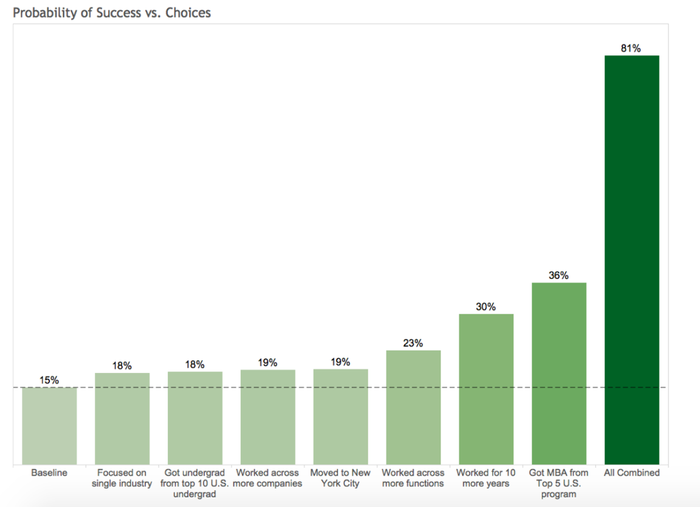
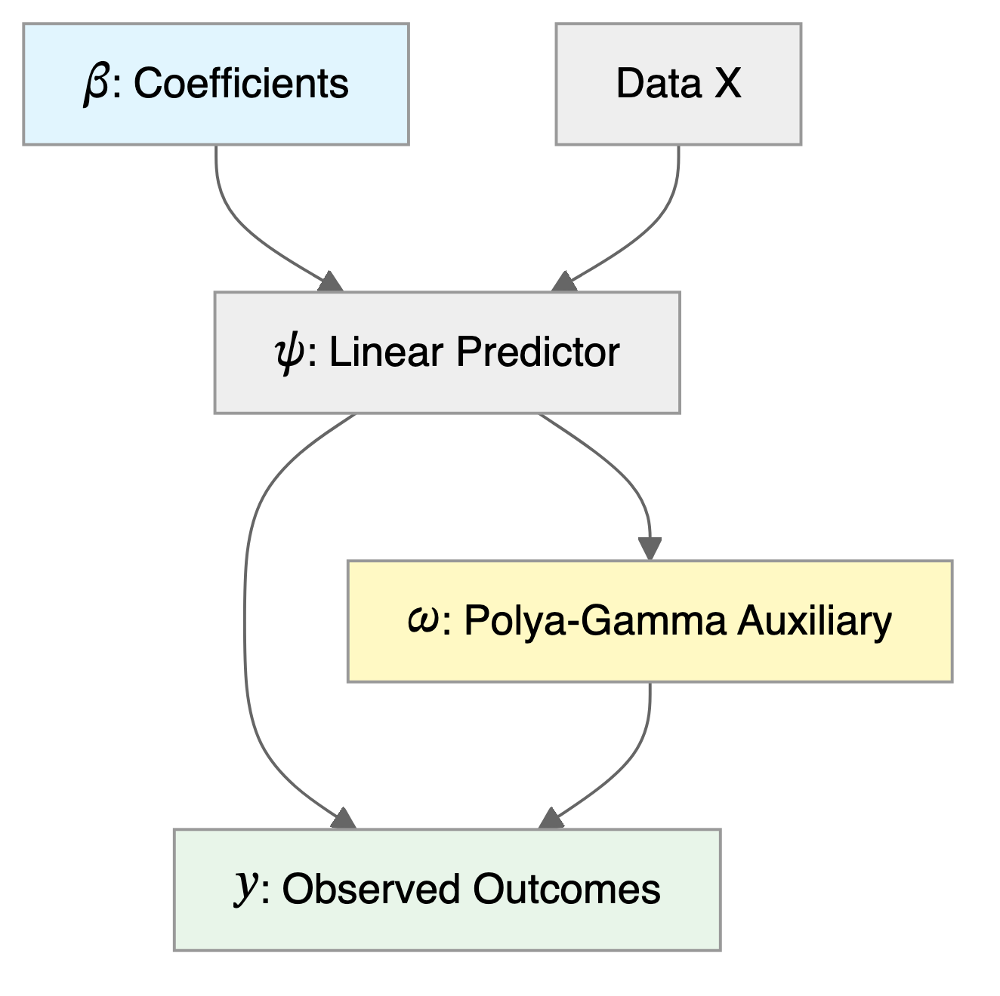



# Logistic Regression and Generalized Linear Models {#sec-logistic}

Classification predicts categories rather than numbers. Does this patient have the disease or not? Is this email spam? Is that object in the camera feed a pedestrian, a vehicle, or a traffic sign? The output is discrete, often just 0 or 1 (binary classification), sometimes multiple classes. Self-driving cars classify objects in real-time from camera feeds; medical systems flag high-risk patients; fraud detection systems sort transactions into suspicious and legitimate.

Given observed data $(x_i,y_i)_{i=1}^n$, where each $y_i$ is either 0 or 1, we start by assuming a binomial likelihood function for the response variable, defined as follows:
$$
P(y_i = 1\mid p_i) = p_i^{y_i} (1-p_i)^{1-y_i},
$$
where $p_i$ is the function of the inputs $x_i$ and coefficients $\beta$ that gives us the probability of the response variable taking on a value of 1, given the input variables. A typical approach to calculate $p_i$ is to use the logistic function
\begin{align*}
f_{\beta}(x_i) = & \beta^\top x_i\\
p_i  = & \sigma(f_{\beta}(x_i)) =  \frac{e^{f_{\beta}(x_i)}}{1+e^{f_{\beta}(x_i)}},
\end{align*}

where $\beta$ is a vector of parameters. The logistic function $\sigma(\cdot)$ maps any real number to the interval $(0, 1)$, interpreting the output as a probability.

## Model Fitting
Then we fit the model using binomial log-likelihood minimization. It leads us to the maximum likelihood estimator for parameters $\beta$ (a.k.a *cross-entropy estimator*), defined as
$$
\hat \beta = \arg\min_{\beta}\mathcal{L}(\beta),
$$
where
$$
\mathcal{L}(\beta) =  -\sum_{i=1}^n \left[ y_i \log p_i  + (1-y_i) \log \left ( 1-p_i \right ) \right].
$$
Similar to the least squares estimator, the cross-entropy estimator optimization problem is convex, so any local minimum is global, and there is at most one solution when the columns of the design matrix $X$ (rows $x_i^\top$) are linearly independent. A solution need not exist: if a hyperplane separates the two classes perfectly, the loss keeps decreasing as $\beta$ is scaled up along the separating direction and there is no finite estimate.

In the unconditional case (an intercept-only model with no inputs $x$), all $p_i$ equal a common value $p = \sigma(\beta_0)$, and the cross-entropy estimator of $p$ simplifies to the sample mean. If we take the derivative of the above expression with respect to $p$ and set it to zero, we get
$$
- \frac{d}{dp}\sum_{i=1}^n \left[ y_i \log \left ( p \right ) + (1-y_i) \log \left ( 1-p \right ) \right] = -\sum_{i=1}^n \left[ \frac{y_i}{p} - \frac{1-y_i}{1-p} \right] = 0
$$
which gives us the solution
$$
\hat{p} = \frac{1}{n}\sum_{i=1}^n y_i,
$$
which is the sample mean $\bar y$. The estimate of the intercept is its log-odds, $\hat{\beta}_0 = \log\left(\bar y/(1-\bar y)\right)$.

Unlike the least squares estimator or the unconditional case, the system of equations
$$
\nabla \mathcal{L}(\beta) = 0
$$
is not linear and cannot be solved by inverting a matrix. However, there are efficient iterative numerical optimization algorithms that can be used to find the optimal solution. The most common one is the *BFGS* (Broyden-Fletcher-Goldfarb-Shanno) algorithm. It is a quasi-Newton method that's particularly well-suited for optimizing the cross-entropy loss function in logistic regression.

When we have more than two classes $y \in \{1,\ldots,K\}$, we build $K-1$ models $f_{\beta_1}(x),\ldots, f_{\beta_{K-1}}(x)$, one for each of the first $K-1$ classes, while treating the $K$-th class as the reference class with $f_{\beta_K}(x) = 0$. We then use the softmax function to convert the outputs into probabilities:

For classes $j = 1, \ldots, K-1$:
$$
P(y = j \mid x) = \frac{\exp(f_{\beta_j}(x))}{1 + \sum_{i=1}^{K-1} \exp(f_{\beta_i}(x))}
$$

For the reference class $K$:
$$
P(y = K \mid x) = \frac{1}{1 + \sum_{i=1}^{K-1} \exp(f_{\beta_i}(x))}
$$

Some implementations of logistic regression use $K$ models, one for each class, and then use the softmax function to convert the outputs into probabilities. This is equivalent to the above approach, but it is more computationally expensive.

The vector of non-scaled outputs $(f_{\beta_1}(x),\ldots, f_{\beta_{K-1}}(x))$ is called the *logits*.

The softmax function is a generalization of the logistic function to the case of more than two classes. It is often used as the activation function in the output layer of neural networks for multi-class classification problems. It converts the output of each model into a probability distribution over the classes.

The logistic function has a nice statistical interpretation. It is the CDF of the logistic distribution, which is a symmetric distribution with mean 0 and variance $\pi^2/3$, thus $p_i$ is simply a value of this CDF, evaluated at $\beta^\top x_i$.

Further, Logistic regression models the log-odds (logit) of the probability as a linear function of the predictors, which aligns with the maximum likelihood estimation framework. Specifically, if we invert the logistic function,
$$
p_i  = \sigma(\beta^\top x_i) =  \frac{e^{\beta^\top x_i}}{1+e^{\beta^\top x_i}},
$$
we get the log-odds
$$
\log\left(\frac{p_i}{1-p_i}\right) = \beta^\top x_i.
$$
Meaning that $\beta^\top x_i$ measures how the probability of $y_i = 1$ changes with respect to the change in $x_i$ on the log-odds scale. It allows us to interpret the model coefficients as the log-odds ratios of the response variable.

In some disciplines, such as econometrics, psychology, and natural sciences, a normal CDF is used instead of the logistic CDF. This is often done for historical reasons or because the normal CDF implies slightly different theoretical assumptions that may be more appropriate for specific datasets.

In the case of the normal CDF, the model is called *probit*; it stands for probability unit, and the link function is called *probit link*. The probit model is defined as
$$
\Phi^{-1}(p_i) =  \beta^\top x_i.
$$
where $\Phi(\cdot)$ is the normal CDF.


The  term probit was coined in the 1930's by biologists studying the dosage-cure rate link. We can fit a probit model using `glm` function in `R`.
```{r}
#| echo: true
set.seed(92) # Kuzy
x <- seq(-3, 3, length.out = 100)
y <- pnorm(x + rnorm(100)) > 0.5
probitModel <- glm(y ~ x, family = binomial(link = "probit"))
mc <- as.double(coef(probitModel))
# we want to predict outcome for x = -1
xnew <- -1
(yt <- mc[1] + mc[2] * xnew)
(pnorm(yt))
(pred <- predict(probitModel, list(x = c(xnew)), type = "response"))
``` 

```{r}
u <- seq(-4, 4, length.out = 100)
nd <- dnorm(u)
plot(u, nd, type = "l", col = "red", xlab = "linear predictor", ylab = "density")
polygon(c(-4, u[u < yt], yt, yt), c(0, nd[u < yt], dnorm(yt), 0), col = "blue")
```
Our prediction is the shaded area which is equal to 0.195.


Outside fields like behavioral economics, the logistic function is generally preferred over the probit model due to the interpretability of log-odds and its natural extension to multi-class problems.
The PDF of the logistic distribution is very similar to the normal PDF.
```{r}
logitModel <- glm(y ~ x, family = binomial(link = "logit"))
pred_logit <- predict(logitModel, list(x = x), type = "response")
pred_probit <- predict(probitModel, list(x = x), type = "response")
plot(x, pred_probit, pch = 1, col = "red", cex = 0.9, ylab = "y")
lines(x, pred_logit, type = "p", pch = 20, cex = 0.5, col = "blue")
lines(x, y, type = "p", pch = 21, cex = 0.5, bg = "lightblue")
legend("bottomright", pch = c(20, 1), legend = c("Logit", "Probit"), col = c("blue", "red"), y.intersp = 2, bty = "n")
```

The two fitted curves are almost identical, as the similarity of the two densities suggests.


::: {#exm-nba}
## Example: NBA Point Spread
We will use the NBA point spread data to illustrate the logistic regression. The data are available in the `NBAspread.csv` file. The data contain the point spread for each game in the NBA from 2013 to 2014 season. The data also contains the outcome of the game, whether the favorite won or not. The point spread is the number of points by which the favorite is expected to win the game and is predicted by the bookmakers. We simply want to see how well the point spread predicts the outcome of the game.

```{r}
NBA <- read.csv("data/NBAspread.csv")
n <- nrow(NBA)
head(NBA)
```
```{r}
#| layout-ncol: 2
#| fig-width: 2.6
#| fig-height: 1.8
hist(NBA$spread[NBA$favwin == 1], breaks = seq(0, 40, 2), col = 5, main = "", xlab = "spread")
hist(NBA$spread[NBA$favwin == 0], breaks = seq(0, 40, 2), add = TRUE, col = 6)
legend("topright", legend = c("Favorite wins", "Favorite loses"), fill = c(5, 6), bty = "n", cex = 0.7)
boxplot(NBA$spread ~ NBA$favwin, names = c("No", "Yes"), col = c(6, 5), horizontal = TRUE, ylab = "Favorite wins", xlab = "spread")
```
Does the Vegas point spread predict whether the favorite wins or not? The histogram shows the distribution of point spreads for games where the favorite won (favwin = 1, light bars) versus games where the favorite lost (favwin = 0, dark bars). Let's fit a logistic regression model to quantify this relationship:
```{r}
#| echo: true
nbareg <- glm(favwin ~ spread - 1, family = binomial, data = NBA)
nbareg %>%
  tidy() %>%
  kable()
```

```{r}
s <- seq(0, 30, length = 100)
fit <- exp(s * nbareg$coef[1]) / (1 + exp(s * nbareg$coef[1]))
plot(s, fit, typ = "l", col = 4, lwd = 2, ylim = c(0.5, 1), xlab = "spread", ylab = "Probability favorite wins")
```

The $\beta$ measures how our log-odds change. For this model, we have $\beta = 0.156$, meaning that for every one point increase in the point spread, the log-odds of the favorite winning increases by 0.156.

Now, we can use the model to predict the probability of the favorite winning for a new game with a point spread of 8 or 4.
```{r}
#| echo: true
predict(nbareg, newdata = data.frame(spread = c(8, 4)), type = "response")
```


The code above simply "Plugs-in" the values for the new game into our logistic regression
$$
{ P \left ( \mathrm{ favwin}  \mid  \mathrm{ spread} \right ) = \frac{ e^{ \beta x } }{ 1 + e^{\beta x} } }
$$
We can calculate it manually as well.
```{r}
#| echo: true
exp(0.156 * 8) / (1 + exp(0.156 * 8))
exp(0.156 * 4) / (1 + exp(0.156 * 4))
```

Check that when $\beta =0$ we have $p= \frac{1}{2}$.

Given our new values spread$=8$ or spread$=4$, the win probabilities are $78$% and $65$%, respectively. Clearly, the bigger spread means a higher chance of winning.
:::

Notice that the predict function returns a numeric value between 0 and 1. However, if we want to make a decision (to bet or not to bet), we need to have a binary outcome. A simple method to move between the predicted probability and binary value is to use thresholding.
$$
\hat y_i = \begin{cases}
1 & \text{if } \hat p_i > \alpha \\
0 & \text{if } \hat p_i \leq \alpha
\end{cases}
$$
where $\alpha$ is a threshold value. A typical choice is $\alpha = 0.5$.

Now let's calculate the number of correct predictions using threshold $\alpha = 0.5$. `R` has a convenient `table` function that can summarize the counts of the predicted and actual values in a table. 
```{r}
#| echo: true
table(NBA$favwin, as.integer(predict(nbareg, type = "response") > 0.5), dnn = c("Actual", "Predicted"))
```
Our model gets `r 422/(131+422)` of the predictions correctly. This number is called *accuracy* of the model.


## Confusion Matrix
We will analyse the tennis dataset to show what is the decision boundary for the logistic regression model. The decision boundary is the line that separates the two classes. It is defined as the line where the probability of the favorite winning is 0.5. Then we will use the confusion matrix to evaluate the performance of the model.

::: {#exm-tennis}
## Logistic Regression for Tennis Classification
Data science plays a major role in tennis; you can learn about recent AI tools developed by IBM from this [Yahoo! Finance Article](https://finance.yahoo.com/video/ibm-serving-ai-technology-tennis-150742376.html).

We will analyze the [Tennis Major Tournament Match Statistics Data Set](https://archive.ics.uci.edu/ml/datasets/Tennis+Major+Tournament+Match+Statistics) from the UCI ML repository. The dataset has one per each game from four major Tennis tournaments in 2013 (Australia Open, French Open, US Open, and Wimbledon).

Let's look at a few columns of the randomly selected five rows of the data
```{r}
set.seed(11) # Messier
d <- read.csv("data/tennis.csv")
d[sample(1:943, size = 5), c("Player1", "Player2", "Round", "Result", "gender", "surf")]
```


We have data for 943 matches, and for each match we have 44 columns, including names of the players, their gender, surface type, and match statistics.  Let's look at the number of break points won by each player. We will plot BPW (break points won) by each player on the scatter plot and will mark each dot by the outcome (circle if player 1 won, triangle if player 2 won).
```{r}
set.seed(10) # Lafleur
n <- dim(d)[1]
plot(d$BPW.1 + rnorm(n), d$BPW.2 + rnorm(n),
  pch = ifelse(d$Result == 1, 21, 24), col = d$Result + 2, cex = 0.6, bg = "yellow", lwd = 0.8,
  xlab = "BPW by Player 1", ylab = "BPW by Player 2"
)
legend("bottomright", c("P1 won", "P2 won"), col = c(3, 2), pch = c(21, 24), pt.bg = "yellow", bty = "n")
```

We can clearly see that the number of break points won is a clear predictor of the match outcome. This is obvious and follows from the rules; to win a match, a player must win break points. Now, we want to understand the impact of winning a break point on the overall match outcome. We do it by building a logistic regression model
```{r}
#| echo: true
which(is.na(d$BPW.1)) # there is one row with NA value for the BPW.1 value and we remove it
d <- d[-171, ]
n <- dim(d)[1]
m <- glm(Result ~ BPW.1 + BPW.2 - 1, data = d, family = "binomial")
m %>%
  tidy() %>%
  kable()
```

The predicted values are stored in the `fitted.values` field of the model object. Those are the probabilities of player 1 winning the match. We need to convert them to binary predictions  using $0.5$ as a threshold for our classification. 
```{r}
#| echo: true
table(d$Result, as.integer(m$fitted.values > 0.5), dnn = c("Actual", "Predicted"))
```
This table shows the number of correct and incorrect predictions for each class. The rows are the actual outcomes and the columns are the predicted outcomes. Since `table` orders the levels $0$ then $1$, the first row is the matches player 1 lost, so its first entry counts losses the model correctly predicted as losses. The second row is the matches player 1 won, and its second entry counts wins correctly predicted as wins. Thus, our model got (400+416)/942 = `r 100*(400+416)/942`% of the predictions correctly! The accuracy is the ratio of the number of correct predictions to the total number of predictions.

This table is called *confusion matrix*. Formally, it is defined as

                 Predicted: YES   Predicted: NO
  ------------- ---------------- ---------------
   Actual: YES      TPR             FNR 
   Actual: NO       FPR             TNR 

: Confusion Matrix. TPR - True Positive Rate, FPR - False Positive Rate, TNR - True Negative Rate, FNR - False Negative Rate.

Fundamentally, logistic regression attempts to construct a linear boundary that separates the two classes. In our case, we have two predictors $x_1$ = BPW.1 and $x_2$ = BPW.2 and our model is
$$
\log\left(\dfrac{p}{1-p}\right) = \beta_1x_1 + \beta_2 x_2,
$$
where $p$ is the probability of player 1 winning the match. We want to find the line along which the probability is 1/2, meaning that $p/(1-p) = 1$ and log-odds $\log(p/(1-p)) = 0$, thus the equation for the line is $\beta_1x_1 + \beta_2 x_2 = 0$ or
$$
x_2 = \dfrac{-\beta_1}{\beta_2}x_1
$$


Let's see the line found by the `glm` function
```{r, echo=4:6}
set.seed(91) # Tavares
plot(d$BPW.1 + rnorm(n), d$BPW.2 + rnorm(n),
  pch = ifelse(d$Result == 1, 21, 24), col = d$Result + 2, cex = 0.6, bg = "yellow", lwd = 0.8,
  xlab = "BPW by Player 1", ylab = "BPW by Player 2"
)
legend("bottomright", c("P1 won", "P2 won"), col = c(3, 2), pch = c(21, 24), pt.bg = "yellow", bty = "n")

x <- seq(0, 30, length.out = 200)
y <- -m$coefficients[1] * x / m$coefficients[2]
lines(x, y, lwd = 2, col = "red")
```


There are a couple of observations. First, the effect of a break point on the game outcome is significant and symmetric; the effect of losing a break point is the same as the effect of winning one. We also can interpret the effect of winning a break point in the following way. We will keep BPW.2 = 0 and will calculate what happens to the probability of winning when BPW.1 changes from 0 to 1. The odds ratio for player 1 winning when BPW.1 = 0 is `exp(0)` which is 1, meaning that the probability that P1 wins is 1/2. Now when BPW.1 = 1, the odds ratio is
```{r}
#| echo: true
exp(0.4019)
```
We can calculate the probability of winning from the regression equation
$$
\dfrac{p}{1-p} = 1.5,~~~p = 1.5(1-p),~~~2.5p = 1.5,~~~p = 0.6
$$
Thus the probability of winning goes from 50% to 60%; we can use `predict` function to get this result
```{r}
#| echo: true
predict.glm(m, newdata = data.frame(BPW.1 = c(0), BPW.2 = c(0)), type = "response")
predict.glm(m, newdata = data.frame(BPW.1 = c(1), BPW.2 = c(0)), type = "response")
```

What happens to the chances of winning when P1 wins three more break points compared to the opponent?
```{r}
#| results: hide
predict.glm(m, newdata = data.frame(BPW.1 = c(0), BPW.2 = c(0)), type = "response")
predict.glm(m, newdata = data.frame(BPW.1 = c(3), BPW.2 = c(0)), type = "response")
```
The probability of winning goes from 50% to `r round(100 * predict.glm(m, newdata = data.frame(BPW.1 = 3, BPW.2 = 0), type = "response"))`%, a gain of `r round(100 * predict.glm(m, newdata = data.frame(BPW.1 = 3, BPW.2 = 0), type = "response")) - 50` percentage points.

Tennis is arguably the sport in which men and women are treated equally. Both men's and women's matches are shown during prime-time on TV, and they both have the same prize money. However, one of the comments you hear often is that women's matches are "less predictable", meaning that an upset (when the favorite loses) is more likely to happen in a women's match compared to men's matches. We can test this statement by counting upsets, the matches in which the player favored by the model (fitted probability above one half) lost.
```{r}
#| echo: true
d$upset <- (fitted(m) > 0.5) != (d$Result == 1)
tab <- table(Gender = d$gender, Upset = d$upset)
tab
```

Let's test whether the upset rates of men's and women's matches differ:
```{r}
#| echo: true
pt <- prop.test(tab[, "TRUE"], rowSums(tab))
pt
```
The favorite lost `r tab["M", "TRUE"]` of `r sum(tab["M", ])` men's matches (`r sprintf("%.1f", 100 * tab["M", "TRUE"] / sum(tab["M", ]))`%) and `r tab["W", "TRUE"]` of `r sum(tab["W", ])` women's matches (`r sprintf("%.1f", 100 * tab["W", "TRUE"] / sum(tab["W", ]))`%). The difference is small and not statistically significant ($p$-value `r sprintf("%.2f", pt$p.value)`), so, by this measure, these data do not support the claim that women's matches are less predictable.
:::

## ROC Curve and Confounding Variables
Using default dataset, we will illustrate the concept of ROC curve and confounding variables.

::: {#exm-HorseRacing}
## Horse Race Betting

This example uses data from the Hong Kong Jockey Club, one of the world's largest horse racing operations (see the Benter case study for comprehensive analysis).

Studies of racetrack betting find a *favorite-longshot bias*: favorites win more often than the odds suggest, while longshots win less often [@thaler1988anomalies]. We check it for Hong Kong favorites with a logistic regression that predicts whether the favorite wins.

First, we load and prepare the data. Hong Kong win odds $O$ are dividends: a winning \$1 ticket returns \$$O$, stake included. A horse's implied probability is therefore $1/O$, normalized within its race to sum to one, which removes the track's take of about 17.5%. We identify the favorite in each race as the horse with the highest implied probability from the betting odds.
```{r}
#| label: load-hkjc
#| results: hide
library(tidyverse)

# Load HKJC race data
df <- read_csv("data/df_hkjc_with_factors.csv",
  show_col_types = FALSE
)

# Identify favorite in each race and create race-level dataset
race_df <- df |>
  group_by(race_id) |>
  mutate(is_favorite = rank(-public_prob, ties.method = "first") == 1) |>
  filter(is_favorite) |>
  ungroup() |>
  dplyr::select(
    race_id, venue, field_size, date, public_prob, win, win_odds,
    jockey_win_rate, trainer_win_rate, draw_normalized, rating_diff
  )

cat(sprintf(
  "Dataset: %d races from %s to %s\n",
  nrow(race_df), min(race_df$date), max(race_df$date)
))
cat(sprintf("Favorite win rate: %.1f%%\n", mean(race_df$win) * 100))
```

The resulting data frame `race_df` has one row for the favorite of each of the `r nrow(race_df)` races, run from `r min(race_df$date)` to `r max(race_df$date)`; the favorite wins `r round(100 * mean(race_df$win), 1)`% of them.

Our outcome variable is whether the favorite won (`win = 1`) or not (`win = 0`). The favorite's implied probability from public odds should be a strong predictor; if the market is perfectly calibrated, this probability would equal the true win rate.

```{r}
#| label: betting-model
#| echo: true
glm.fit <- glm(win ~ public_prob, data = race_df, family = binomial)
glm.fit %>%
  tidy() %>%
  kable()
```

The positive coefficient on `public_prob` confirms that higher implied probability predicts higher actual win probability.

```{r}
#| label: betting-prob-plot

x <- seq(0.15, 0.45, length.out = 100)
y <- predict(glm.fit, newdata = data.frame(public_prob = x), type = "response")
plot(x, y,
  type = "l", col = "red", lwd = 2,
  xlab = "Public Implied Probability", ylab = "P(Favorite Wins)"
)
abline(a = 0, b = 1, lty = 2, col = "gray50") # Perfect calibration line
legend("topleft",
  legend = c("Model prediction", "Perfect calibration"),
  col = c("red", "gray50"), lty = c(1, 2), bty = "n"
)
```

The curve lies above the 45-degree line over the whole plotted range, but close to it: less than one point above for implied probabilities between 0.25 and 0.40, and about three points at 0.15, where few favorites lie. Favorites win `r round(100 * mean(race_df$win), 1)`% of races against a mean implied probability of `r round(100 * mean(race_df$public_prob), 1)`%, a gap of about one point, under two standard errors. The crowd's probabilities for favorites are close to calibrated, with at most a small bias.

Now we build the confusion matrix. In betting, the threshold choice has financial implications: being too aggressive (low threshold) means betting on too many "favorites" that lose, while being too conservative means missing winners.
```{r}
#| label: betting-confusion
pred <- predict(glm.fit, type = "response")
confusion_matrix <- table(
  Actual = factor(race_df$win, levels = c(0, 1)),
  Predicted = factor(as.integer(pred > 0.3), levels = c(0, 1))
)
# Convert to rates
cm_rates <- prop.table(confusion_matrix, margin = 1)
cm_rates %>% kable(digits = 3)
```

We use a threshold of 0.3 because the baseline win rate for favorites is around 30%. The ROC curve helps us understand the trade-off between correctly identifying winners (sensitivity) and avoiding false predictions on losers (specificity).

```{r}
#| label: betting-roc-fn
roc <- function(p, y, ...) {
  y <- factor(y, levels = c(0, 1))
  n <- length(p)
  p <- as.vector(p)
  alpha <- seq(0, 1, length.out = 100)
  Q <- p > matrix(rep(alpha, n), ncol = 100, byrow = TRUE)
  # Calculate specificity and sensitivity, handling missing classes
  if (sum(y == 0) > 0) {
    specificity <- colMeans(!Q[y == 0, , drop = FALSE])
  } else {
    specificity <- rep(1, 100)
  }
  if (sum(y == 1) > 0) {
    sensitivity <- colMeans(Q[y == 1, , drop = FALSE])
  } else {
    sensitivity <- rep(0, 100)
  }
  return(list(specificity = specificity, sensitivity = sensitivity, alpha = alpha))
}
```

```{r}
#| label: betting-roc-plot

res <- roc(p = pred, y = race_df$win)
plot(1 - res$specificity, res$sensitivity,
  type = "l", bty = "n",
  xlab = "1 - Specificity", ylab = "Sensitivity",
  main = "ROC: Predicting Favorite Wins", lwd = 3
)
abline(a = 0, b = 1, lty = 2, col = 8)

# Mark specific thresholds
points(
  x = 1 - mean((pred < 0.3)[race_df$win == 0]),
  y = mean((pred > 0.3)[race_df$win == 1]),
  cex = 1.5, pch = 24, col = "red", bg = "white", lwd = 2
)
points(
  x = 1 - mean((pred < 0.5)[race_df$win == 0]),
  y = mean((pred > 0.5)[race_df$win == 1]),
  cex = 1.5, pch = 22, col = "blue", bg = "white", lwd = 2
)
legend("bottomright",
  pch = c(24, 22), col = c("red", "blue"), pt.bg = "white", pt.lwd = 2,
  legend = c("alpha=0.3", "alpha=0.5"), bty = "n", title = "cutoff"
)
```

The ROC curve shows reasonable predictive power above the diagonal. The choice of threshold depends on the betting strategy: a lower threshold captures more true winners but also more false positives.

Now let's examine multiple predictors. Hong Kong has two racetracks: Happy Valley (a tight urban track) and Sha Tin (a modern facility with longer straights). We might expect venue to affect favorite performance.

```{r}
#| label: betting-multi
#| echo: true
race_df$venue_ST <- as.integer(race_df$venue == "ST")

glm.fit2 <- glm(win ~ public_prob + field_size + venue_ST,
  data = race_df, family = binomial
)
glm.fit2 %>%
  tidy() %>%
  kable()
```

The coefficient for `field_size` is positive and the coefficient for `venue_ST` (Sha Tin) is negative, but neither is significant (see the p-values in the table). Given the public probability, field size and venue add little, because the odds already reflect them. Does the venue coefficient change when field size is left out of the model?

Let's check for confounding by examining field sizes at each venue:
```{r}
#| label: betting-confounding
boxplot(field_size ~ factor(venue, levels = c("HV", "ST"), labels = c("Happy Valley", "Sha Tin")),
  data = race_df,
  xlab = "Venue", ylab = "Field Size", col = c(2, 3)
)
glm.venue <- glm(win ~ public_prob + venue_ST, data = race_df, family = binomial)
fs_mean <- tapply(race_df$field_size, race_df$venue, mean)
```

Sha Tin races have larger fields: `r sprintf("%.1f", fs_mean["ST"])` horses on average against `r sprintf("%.1f", fs_mean["HV"])` at Happy Valley. Venue and field size are correlated, so the venue coefficient depends on whether field size is in the model. Given the public probability, larger fields go with slightly better favorite results, and Sha Tin's larger fields mask most of its negative venue effect when field size is left out. Including field size moves the venue coefficient from `r sprintf("%.2f", coef(glm.venue)["venue_ST"])` to `r sprintf("%.2f", coef(glm.fit2)["venue_ST"])`.

To see this more clearly, let's compare predictions across venues for races with the same field size:
```{r}
#| label: betting-adjusted


# Predictions for 10-horse races at each venue
x_hv <- data.frame(
  public_prob = seq(0.2, 0.4, length.out = 50),
  field_size = 10, venue_ST = 0
)
x_st <- data.frame(
  public_prob = seq(0.2, 0.4, length.out = 50),
  field_size = 10, venue_ST = 1
)
y_hv <- predict(glm.fit2, newdata = x_hv, type = "response")
y_st <- predict(glm.fit2, newdata = x_st, type = "response")

plot(x_hv$public_prob, y_hv,
  type = "l", col = "red", lwd = 2,
  xlab = "Public Implied Probability", ylab = "P(Favorite Wins)",
  ylim = c(0.2, 0.5)
)
lines(x_st$public_prob, y_st, col = "blue", lwd = 2, lty = 2)
legend("topleft",
  legend = c("Happy Valley", "Sha Tin"),
  col = c("red", "blue"), lwd = 2, lty = c(1, 2), bty = "n"
)
```

For ten-horse races the predicted chance is about one point lower at Sha Tin at every public probability. None of these effects is significant, so we do not attribute the gap to track characteristics.

Adding a correlated predictor can change a coefficient: here the venue effect looks different with and without field size. With effects this small, check the standard errors before interpreting a coefficient.
:::

Now, a natural question is how to choose the cut-off value $\alpha$? In betting, we place a bet when $p(\text{win}) > \alpha$. Here $\alpha$ is our confidence threshold. If we choose $\alpha = 0$ and bet on everything, we'll lose money on bad bets. If we choose $\alpha = 1$, we never bet and make no money. In order to choose an appropriate $\alpha$, we need to know the payoffs.

For betting on favorites at typical odds (say, decimal odds of 2.5, so a winning \$1 bet returns \$2.50), the pay-off matrix looks like:

                   Win    Lose
-------------- ------- -------
Bet               1.5      -1
Don't bet          0        0

: Pay-off matrix for betting.

If we bet \$1 and win at decimal odds of 2.5, we gain \$1.50 profit. If we lose, we lose our \$1 stake. If we don't bet, we neither gain nor lose.

Given this pay-off matrix, we can calculate the expected profit across different thresholds using our horse racing data.
```{r}
#| label: betting-payoff

# Recalculate predictions using our betting model from the earlier example
pred_bet <- predict(glm.fit2, type = "response")
res_bet <- roc(p = pred_bet, y = race_df$win)
alpha <- res_bet$alpha
specificity <- res_bet$specificity # correctly identify non-winners
sensitivity <- res_bet$sensitivity # correctly identify winners

# Payoffs: win gives +1.5, lose gives -1, no bet gives 0
# sensitivity = P(predict win | actual win), (1-specificity) = P(predict win | actual lose)
# Expected profit = P(win) * sensitivity * 1.5 - P(lose) * (1-specificity) * 1
base_rate <- mean(race_df$win) # ~30%
profit <- base_rate * sensitivity * 1.5 - (1 - base_rate) * (1 - specificity) * 1
par(mar = c(2.5, 3, 0.7, 0.5))
plot(alpha, profit,
  type = "l", xlab = expression("Threshold " * alpha), ylab = "", yaxt = "n",
  lwd = 3, col = "red", cex.lab = 0.8
)
axis(2, at = seq(-0.25, 0, by = 0.05), las = 1, mgp = c(1.5, 0.6, 0))
title(ylab = "Expected Profit ($)", line = 2, cex.lab = 0.8)
abline(h = 0, lty = 2)
```
To identify the most effective strategy, we evaluate the expected profit across all possible thresholds $\alpha$. The expected profit per race, when we bet \$1 on the favorite whenever the predicted probability exceeds $\alpha$, is calculated as a weighted average of the gains from true positives and the losses from false positives:
$$\E{\text{Profit} \mid \alpha} = P(\text{win}) \cdot \text{Sensitivity}(\alpha) \cdot 1.5 - P(\text{lose}) \cdot (1 - \text{Specificity}(\alpha)) \cdot 1.0$$
where $P(\text{win})$ is the base rate of winners in the training data. This calculation allows us to identify the *profitable threshold range* (where expected profit is positive), the *optimal threshold* (which maximizes profit), and the resulting *maximum expected profit*.

```{r}
#| label: betting-optimal-threshold
#| results: hide
real_return <- mean((race_df$win * race_df$win_odds - 1)[pred_bet > alpha[which.max(profit)]])
if (any(profit > 0)) {
  cat(sprintf(
    "Profitable threshold range: %.2f to %.2f\n",
    min(alpha[profit > 0]), max(alpha[profit > 0])
  ))
  cat(sprintf("Optimal threshold: %.2f\n", alpha[which.max(profit)]))
  cat(sprintf("Maximum expected profit: $%.3f per race\n", max(profit)))
} else {
  cat("No threshold produces positive expected profit at these odds\n")
}
```
Expected profit is positive for thresholds between `r sprintf("%.2f", min(alpha[profit > 0]))` and `r sprintf("%.2f", max(alpha[profit > 0]))` and largest at `r sprintf("%.2f", alpha[which.max(profit)])`, where it equals `r sprintf("%.3f", max(profit))` dollars per race. Unlike academic classification problems where we might default to $\alpha = 0.5$, real-world applications require understanding the asymmetric costs of different types of errors.

The pay-off matrix pays every winning favorite \$2.50, but the favorites the rule bets on are shorter: their median odds are `r sprintf("%.1f", median(race_df$win_odds[pred_bet > alpha[which.max(profit)]]))`. At the real odds the best-threshold rule loses `r round(-100 * real_return)` cents per \$1 bet, close to the track's take. The profitable range is a feature of the assumed pay-off, not of the data.


::: {#exm-LinkedIn}
## LinkedIn Study
How to Become an Executive [@irwin2016how; @berger2016how]?

Logistic regression was used to analyze the career paths of about $459{,}000$ LinkedIn members who worked at a [top 10 consultancy](http://www.vault.com/company-rankings/consulting/best-consulting-firms-prestige?sRankID=77) between 1990 and 2010 and became a VP, CXO, or partner at a company with at least 200 employees. About $64{,}000$ members reached this milestone, $\hat{p} = 0.1394$, conditional on making it into the database. The goals of the analysis were the following

1. Look at their profiles---educational background, gender, work
    experience, and career transitions.
2. Build a predictive model of the probability of becoming an executive
3. Provide a tool for analysis of "what if" scenarios. For example, if
    you are to get a master's degree, how your job perspectives change
    because of that.

Let's build a logistic regression model with $8$ key features (a.k.a.
covariates):
$$
\log\left ( \frac{p}{1-p} \right ) = \beta_0 + \beta_1x_1 + \beta_2x_2 + ... + \beta_8x_8
$$

Here $p$ is the probability of "success"---meaning the person reaches VP/CXO/Partner seniority at a company with at least 200 employees. The features to predict the "success" probability are $x_i (i=1,2,\ldots,8)$

- $x_1$: Metro region: whether a member has worked in  one of the top 10 largest cities in the U.S. or globally.
- $x_2$: Gender: Inferred from member names: 'male', or 'female'
- $x_3$: Graduate education type: whether a member has an MBA from a top U.S. program / a non-top program / a top non-U.S. program / another advanced degree
- $x_4$: Undergraduate education type: whether a member has attended a school from the U.S. News national university rankings / a top 10 liberal arts college /a top 10 non-U.S. school       
- $x_5$: Company count: \# different companies in which a member has worked   
- $x_6$: Function count: \# different job functions in which a member has worked
- $x_7$: Industry sector count: \# different industries in which a member has worked  
- $x_8$: Years of experience: \# years of work experience, including years in consulting, for a member.

The following estimated $\hat\beta$s of features were obtained. With a sample size of 459,000 they are measured rather accurately.

| Category | Feature | Coefficient ($\hat{\beta}$) |
|----------|---------|------------------------------|
| Location | Metro region | 0.28 |
| Personal | Gender (Male) | 0.31 |
| Education | Graduate education type | 1.16 |
| Education | Undergraduate education type | 0.22 |
| Work Experience | Company count | 0.14 |
| Work Experience | Function count | 0.26 |
| Work Experience | Industry sector count | -0.22 |
| Work Experience | Years of experience | 0.09 |

Here are three main findings

1.  Working across job functions, like marketing or finance, is good. Each additional job function provides a boost that, on average, is equal to three years of work experience. Switching industries has a     slight negative impact. Learning curve? lost relationships?
2.  MBAs are worth the investment. But pedigree matters. *Top five program equivalent to $13$ years of work experience!!!*
3.  Location matters. For example, NYC helps.

We can also personalize the prediction for possible executives. For example, [Person A (p=6%)]{style="color: blue"}: Male in Tulsa, Oklahoma, Undergraduate degree, 1 job function for 3 companies in 3 industries, 15-year experience.

[Person B (p=15%)]{style="color: blue"}: Male in London, Undergraduate degree from top international school, Non-MBA Master, 2 different job functions for 2 companies in 2 industries, 15-year experience.

[Person C (p=63%)]{style="color: blue"}: Female in New York City, Top undergraduate program, Top MBA program, 4 different job functions for 4 companies in 1 industry, 15-year experience.

Let's re-design Person B.

[Person B (p=15%)]{style="color: blue"}: Male in London, Undergraduate degree from top international school, Non-MBA Master, 2 different job functions for 2 companies in 2 industries, 15-year experience.

1.  Work in one industry rather than two. Increase $3$%
2.  Undergrad from top $10$ US program rather than top international
    school. $3$%
3.  Worked for $4$ companies rather than $2$. Another $4$%
4.  Move from London to NYC. $4$%
5.  Four job functions rather than two. $8$%. A $1.5$x effect.
6.  Worked for $10$ more years. $15$%. A $2$X effect.

Choices and Impact (Person B) are shown below in @fig-choice. When all these positive choices are combined, the probability skyrockets to 81%.

{width="70%" fig-align="center" #fig-choice}

:::

## Imbalanced Data
Often, you have many more observations with a specific label; such a sample is called imbalanced. For example, in fraud detection, legitimate transactions vastly outnumber fraudulent ones; in medical diagnosis, healthy patients often outnumber those with rare diseases; and in manufacturing, defective products are typically much rarer than non-defective ones.

When dealing with imbalanced data, you should avoid using accuracy as a metric to choose a model. Consider a binary classification problem with 95% of samples labeled as class 1. A naive classifier that simply assigns label 1 to every input will achieve 95% accuracy, making it appear deceptively good while being completely useless for practical purposes.

Instead, more appropriate evaluation metrics should be used. The Receiver Operating Characteristic (ROC) curve plots the true positive rate (sensitivity) against the false positive rate (1-specificity) at various classification thresholds. The Area Under the Curve (AUC) provides a single scalar value that measures the model's ability to distinguish between classes, regardless of the chosen threshold. An AUC of 0.5 indicates random guessing, while 1.0 represents perfect classification.

The F1 score combines precision and recall into a single score, providing a balanced measure that penalizes models that are either too conservative or too aggressive:
$$
F1 = 2\dfrac{\mathrm{precision} \times \mathrm{recall}}{\mathrm{precision} + \mathrm{recall}}
$$
where precision measures the proportion of true positives among predicted positives, and recall measures the proportion of true positives that were correctly identified.

The precision-recall curve is particularly useful for imbalanced datasets, as it plots precision against recall at various thresholds, focusing on the performance of the positive class. Cohen's Kappa measures agreement between predicted and actual classifications while accounting for agreement by chance, making it more robust to class imbalance than accuracy.

To address imbalanced data, several strategies can be employed. Data-level approaches include oversampling, where you synthetically generate more samples of the minority class using techniques like bootstrap sampling with replacement, SMOTE (Synthetic Minority Over-sampling Technique) which creates synthetic examples by interpolating between existing minority class samples, or generative models like GANs or variational autoencoders to create realistic synthetic data. Undersampling reduces the majority class samples, which is particularly effective when the dataset is large enough. Hybrid approaches combine both oversampling and undersampling techniques.

Algorithm-level approaches include cost-sensitive learning, where you assign different misclassification costs to different classes, ensemble methods using techniques like bagging or boosting that can naturally handle imbalanced data, and threshold adjustment to modify the classification threshold to optimize for specific metrics like F1-score.

It is often beneficial to experiment with multiple techniques and evaluate their performance using appropriate metrics rather than relying solely on accuracy.


## Kernel Trick
While logistic regression is a powerful linear classifier, there are cases where the classes are not linearly separable in the original feature space. For example, one class might be encircled by another. In such situations, we need to extend our linear methods to handle non-linear decision boundaries.

The kernel trick is a method of using a linear classifier to solve a non-linear problem. The idea is to map the data into a higher-dimensional space, where it becomes linearly separable. The kernel trick is to use a kernel function $K(x_i,x_j)$ to calculate the inner product of two vectors in the higher dimensional space without explicitly calculating the mapping $\phi(x_i)$ and $\phi(x_j)$. The kernel function is defined as $K(x_i,x_j) = \phi(x_i)^\top\phi(x_j)$. The most popular kernel functions are the polynomial kernel $K(x_i,x_j) = (x_i^\top x_j)^d$ and Gaussian kernel $K(x_i,x_j) = \exp(-\gamma||x_i-x_j||^2)$. The kernel trick is used in Support Vector Machines (SVM) and Gaussian Processes (GP). 

```{r}
#| code-fold: true
gencircledata <- function(numSamples, radius, noise) {
  d <- matrix(0, ncol = 3, nrow = numSamples) # matrix to store our generated data
  # Generate positive points inside the circle.
  for (i in 1:(numSamples / 2)) {
    r <- runif(1, 0, radius * 0.4)
    angle <- runif(1, 0, 2 * pi)
    x <- r * sin(angle)
    y <- r * cos(angle)
    noiseX <- runif(1, -radius, radius) * noise
    noiseY <- runif(1, -radius, radius) * noise
    d[i, ] <- c(0, x + noiseX, y + noiseY)
  }

  # Generate negative points outside the circle.
  for (i in (numSamples / 2 + 1):numSamples) {
    r <- runif(1, radius * 0.8, radius)
    angle <- runif(1, 0, 2 * pi)
    x <- r * sin(angle)
    y <- r * cos(angle)
    noiseX <- runif(1, -radius, radius) * noise
    noiseY <- runif(1, -radius, radius) * noise
    d[i, ] <- c(1, x + noiseX, y + noiseY)
  }
  colnames(d) <- c("label", "x1", "x2")
  return(d)
}
```

```{r}
#| label: fig-circle-data
#| fig-width: 3.2
#| fig-height: 3
set.seed(13) # Sundin
d <- gencircledata(numSamples = 200, radius = 1, noise = 0.001)
plot(d[, 2], d[, 3], col = d[, 1] + 1, pch = 19, xlab = expression(x[1]), ylab = expression(x[2]), asp = 1)
```


The data in @fig-circle-data are not linearly separable in two dimensions; however, projecting it into a three-dimensional space via the following transformation allows for a linear separation:
$$
\begin{aligned}
\phi: R^{2} & \longrightarrow R^{3} \\
\left(x_{1}, x_{2}\right) & \longmapsto\left(z_{1}, z_{2}, z_{3}\right)=\left(x_{1}^{2}, \sqrt{2} x_{1} x_{2}, x_{2}^{2}\right),
\end{aligned}
$$
and attempt to linearly separate the transformed data, the decision boundaries become hyperplanes in $R^{3}$, expressed as $\omega^\top z + b = 0$. In terms of the original variables $x$, these boundaries take the form:
$$
\omega_{1} x_{1}^{2} + \omega_{2} \sqrt{2} x_{1} x_{2} + \omega_{3} x_{2}^{2} + b = 0,
$$
which corresponds to the equation of an ellipse centered at the origin when the quadratic form is positive definite and $b < 0$. This demonstrates that we can apply a linear algorithm to transformed data to achieve a non-linear decision boundary with minimal effort.

Now, consider what the algorithm is actually doing. It relies solely on the Gram matrix $K$ of the data. Once $K$ is computed, the original data can be discarded:
$$
\begin{aligned}
K & = \left[\begin{array}{ccc}
x_{1}^\top x_{1} & x_{1}^\top x_{2} & \cdots \\
x_{2}^\top x_{1} & \ddots & \\
\vdots & &
\end{array}\right]_{n \times n} = X X^\top, \\
\text{where} \quad X & = \left[\begin{array}{c}
x_{1}^\top \\
\vdots \\
x_{n}^\top
\end{array}\right]_{n \times d}.
\end{aligned}
$$
Here, $X$, which contains all the data, is referred to as the design matrix.

When we map the data using $\phi$, the Gram matrix becomes:
$$
K = \left[\begin{array}{ccc}
\phi\left(x_{1}\right)^\top \phi\left(x_{1}\right) & \phi\left(x_{1}\right)^\top \phi\left(x_{2}\right) & \cdots \\
\phi\left(x_{2}\right)^\top \phi\left(x_{1}\right) & \ddots & \\
\vdots & &
\end{array}\right].
$$

Let us compute these inner products explicitly. For vectors $r$ and $s$ in $R^{3}$ corresponding to $a$ and $b$, respectively:
$$
\begin{aligned}
\langle r, s \rangle & = r_{1} s_{1} + r_{2} s_{2} + r_{3} s_{3} \\
& = a_{1}^{2} b_{1}^{2} + 2 a_{1} a_{2} b_{1} b_{2} + a_{2}^{2} b_{2}^{2} \\
& = \langle a, b \rangle^{2}.
\end{aligned}
$$

Thus, instead of explicitly mapping the data via $\phi$ and then computing the inner product, we can compute it directly in one step, leaving the mapping $\phi$ implicit. In fact, we do not even need to know $\phi$ explicitly; all we require is the ability to compute the modified inner product. This modified inner product is called a kernel, denoted $K(x, y)$. The matrix $K$, which contains the kernel values for all pairs of data points, is also referred to as the kernel matrix.

Since the kernel itself is the primary object of interest, rather than the mapping $\phi$, we aim to characterize kernels without explicitly relying on $\phi$. Mercer's Theorem provides the theoretical guarantee for this: it states that for any symmetric, positive-definite function $K(x, y)$, there exists a mapping $\phi$ such that $K(x, y) = \langle \phi(x), \phi(y) \rangle$. This ensures we can implicitly work in a high-dimensional space just by defining a valid kernel function.

Let's implement it

```{r}
#| echo: true
phi <- function(x1, x2) {
  z1 <- x1^2
  z2 <- sqrt(2) * x1 * x2
  z3 <- x2^2
  return(cbind(z1, z2, z3))
}
```

```{r scatterplot3d}
#| fig-width: 4
#| fig-height: 3.6
library("scatterplot3d")

# Generate sample 2D data (you can replace this with your actual data)
# Apply the transformation
transformed_data <- phi(d[, 2], d[, 3])
par(xpd = TRUE)
scatterplot3d(transformed_data,
  color = ifelse(d[, 1] == 0, "red", "blue"), pch = ifelse(d[, 1] == 0, 19, 17), cex.symbols = 0.5,
  xlab = expression(z[1] == x[1]^2), ylab = expression(z[2] == sqrt(2) * x[1] * x[2]), zlab = expression(z[3] == x[2]^2),
  main = "3D Scatter Plot of Transformed Data", angle = 40, scale.y = 0.8, mar = c(3, 2.6, 1.5, 2), cex.axis = 0.5,
  grid = FALSE, box = FALSE
)
par(xpd = FALSE)
```

## Generalized Linear Models {#sec-glm}

Logistic regression is one member of a larger family of models called generalized linear models (GLMs). A GLM has three components:

1. a distributional assumption for $Y$ from the exponential family (e.g., Normal, Bernoulli, Poisson, Gamma),
2. a linear predictor $\eta_i = x_i^\top \beta$,
3. a link function $g(\cdot)$ connecting the mean response to the linear predictor, $g(\E{Y_i\mid x_i})=\eta_i$.

This framework makes it easy to move between problem types (continuous, binary, counts, positive-valued responses) while keeping a common estimation story based on likelihood and its negative log (@sec-pattern).

The link function encodes how predictors move the mean response. Common choices include:

| Link Function | Distribution | Use Case |
|--------------|--------------|----------|
| logit | Bernoulli/binomial | logistic regression for binary outcomes |
| probit | Bernoulli/binomial | Normal-CDF alternative for binary data |
| log | Poisson, Gamma | count data and positive-valued responses |
| inverse | Gamma | positive continuous data (alternative parameterization) |


For count outcomes $Y_i \in \{0,1,2,\ldots\}$, a standard GLM is *Poisson regression*:
$$
Y_i \mid x_i \sim \mathrm{Poisson}(\lambda_i), \qquad \log \lambda_i = x_i^\top \beta.
$$
The log link ensures $\lambda_i>0$. Coefficients have a multiplicative interpretation: increasing a covariate by one unit changes the mean count by a factor of $\exp(\beta_j)$, holding other predictors fixed.


For continuous responses that are strictly positive and right-skewed (e.g., waiting times, costs), a common GLM choice is *Gamma regression*. One parameterization is
$$
Y_i \mid x_i \sim \mathrm{Gamma}(\text{shape},\text{rate}), \qquad \E{Y_i\mid x_i}=\mu_i, \qquad \log \mu_i = x_i^\top \beta,
$$
where the log link again enforces positivity of the mean. Alternatives include an inverse link, depending on the modeling context.

### Deviance and Model Comparison

In GLMs, goodness-of-fit is often summarized by the deviance, a likelihood-based measure that quantifies how well a fitted model explains the data relative to a benchmark. 
A *saturated model* is one that fits the data perfectly by using as many parameters as there are observations. For binary logistic regression with $n$ distinct covariate patterns, a saturated model assigns a separate probability parameter $\hat{p}_i$ to each observation, setting $\hat{p}_i = y_i$. This achieves the maximum possible log-likelihood for the given data structure, though at the cost of using $n$ parameters and having no degrees of freedom left for testing or prediction. The saturated model serves as an upper bound on how well any model can fit the observed data.

Formally, the *deviance* of a fitted GLM is defined as
$$
D = 2\left[\ell(\text{saturated}) - \ell(\hat{\beta})\right],
$$
where $\ell(\text{saturated})$ is the log-likelihood of the saturated model and $\ell(\hat{\beta})$ is the log-likelihood of the fitted model with parameter estimates $\hat{\beta}$. The factor of 2 appears for historical reasons related to asymptotic chi-squared distributions and makes the deviance directly comparable to likelihood ratio test statistics.

For binary logistic regression, this becomes
$$
D = 2\sum_{i=1}^n \left[y_i \log\left(\frac{y_i}{\hat{p}_i}\right) + (1-y_i)\log\left(\frac{1-y_i}{1-\hat{p}_i}\right)\right],
$$
where $\hat{p}_i = \sigma(x_i^\top\hat{\beta})$ are the fitted probabilities. When $y_i \in \{0,1\}$, terms with $y_i\log(y_i)$ or $(1-y_i)\log(1-y_i)$ equal zero by convention ($0\log 0 = 0$), so each observation contributes either $-2\log(\hat{p}_i)$ when $y_i=1$ or $-2\log(1-\hat{p}_i)$ when $y_i=0$.

Lower deviance indicates better fit: a deviance of zero means the model fits as well as the saturated model. In practice, deviance is most useful for comparing nested models rather than as an absolute measure. Suppose we have two nested models with $M_1 \subset M_2$, where model $M_1$ has $p_1$ parameters and model $M_2$ has $p_2 > p_1$ parameters. The difference in deviances
$$
\Delta D = D_1 - D_2 = 2\left[\ell(\hat{\beta}_2) - \ell(\hat{\beta}_1)\right]
$$
follows approximately a $\chi^2_{p_2-p_1}$ distribution under the null hypothesis that the simpler model $M_1$ is adequate. This provides a formal likelihood ratio test: if $\Delta D$ exceeds the critical value from the chi-squared distribution, we reject $M_1$ in favor of the more complex $M_2$.

This framework generalizes beyond logistic regression to all GLMs. For Poisson regression with counts $y_i$ and fitted means $\hat{\mu}_i$, the deviance takes the form
$$
D = 2\sum_{i=1}^n \left[y_i\log\left(\frac{y_i}{\hat{\mu}_i}\right) - (y_i - \hat{\mu}_i)\right].
$$
The specific formula changes with the exponential family distribution, but the interpretation remains consistent: deviance measures twice the log-likelihood gap between the fitted and saturated models, enabling principled comparison of nested specifications. This connects naturally to the model selection criteria in @sec-select, where penalized versions of deviance like AIC and BIC trade off fit against model complexity.

## Bayesian Logistic Regression with the Polya-Gamma Distribution {#sec-bayes-logistic}

To perform Bayesian inference for logistic regression, we often need to sample from the posterior distribution of the coefficients $\beta$. Conceptually this follows the same updating pattern as in @sec-bl: posterior $\propto$ likelihood $\times$ prior. It also connects to the likelihood-to-loss framing in @sec-pattern: the same likelihood that defines the posterior also defines an optimization objective through its negative log. However, the logistic likelihood does not have a conjugate prior, making direct sampling difficult. A powerful modern approach uses data augmentation with Polya-Gamma variables to make the sampling exact and efficient.

The Polya-Gamma distribution, denoted as PG(b,c), is carefully constructed as a subset of infinite convolutions of gamma distributions (essentially, a weighted sum of an infinite number of independent Gamma variables) [@polson2013bayesian]. A random variable X follows a Polya-Gamma distribution with parameters $b > 0$ and $c \in \mathbb{R}$ if:

$$
X \stackrel{d}{=} \frac{1}{2\pi^2} \sum_{k=1}^{\infty} \frac{g_k}{(k-1/2)^2 + c^2/(4\pi^2)},
$$
where $g_k \sim \text{Ga}(b,1)$ are independent gamma random variables, and $\stackrel{d}{=}$ indicates equality in distribution.

The Polya-Gamma family exhibits several useful properties that make it ideal for data augmentation:

1. *Laplace Transform*: For $\omega \sim \text{PG}(b,0)$, the Laplace transform is $\E{\exp(-\omega t)} = \cosh^{-b}(\sqrt{t/2})$.

2. *Exponential Tilting*: The general PG(b,c) distribution arises through exponential tilting of the PG(b,0) density:

$$
p(x \mid b,c) = \frac{\exp(-c^2x/2)p(x \mid b,0)}{\E{\exp(-c^2\omega/2)}},
$$

where the expectation is taken with respect to PG(b,0)

3. *Convolution Property*: The family is closed under convolution for random variates with the same tilting parameter

4. *Known Moments*: All finite moments are available in closed form, with the expectation given by:

$$\E{\omega} = \frac{b}{2c}\tanh(c/2) = \frac{b}{2c}\frac{e^c-1}{1+e^c}.$$

::: {.callout-tip}
## Computational Advantage
The known moments and convolution properties make the Polya-Gamma distribution computationally tractable and theoretically well-behaved.
:::

### The Data-Augmentation Strategy

The core of the Polya-Gamma methodology rests on a fundamental integral identity that represents binomial likelihoods as mixtures of Gaussians [@polson2013bayesian]. The key theorem states:

::: {#res-polya-gamma-identity .theorem}
*Theorem 1*: For $b > 0$ and $a \in \mathbb{R}$, the following integral identity holds:

$$\frac{(e^\psi)^a}{(1+e^\psi)^b} = 2^{-b}e^{\kappa\psi} \int_0^{\infty} e^{-\omega\psi^2/2} p(\omega) d\omega$$

where $\kappa = a - b/2$, and $p(\omega)$ is the density of $\omega \sim \text{PG}(b,0)$[@polson2013bayesian].

Moreover, the conditional distribution $p(\omega \mid \psi)$ is also in the Polya-Gamma class: $(\omega \mid \psi) \sim \text{PG}(b,\psi)$[@polson2013bayesian].
:::

::: {#res-polya-gamma-gibbs}

This integral identity leads directly to a simple two-step Gibbs sampler for Bayesian logistic regression [@polson2013bayesian]. For a dataset with observations $y_i \mid \psi_i \sim \text{Binom}(n_i, 1/(1+e^{-\psi_i}))$ where $\psi_i = x_i^\top\beta$, and a Gaussian prior $\beta \sim N(b,B)$, the algorithm iterates:

1. *Sample auxiliary variables*: $(\omega_i\mid\beta) \sim \text{PG}(n_i, x_i^\top\beta)$ for each observation
2. *Sample parameters*: $(\beta\mid y,\omega) \sim N(m_\omega, V_\omega)$ where:
   - $V_\omega = (X^\top\Omega X + B^{-1})^{-1}$
   - $m_\omega = V_\omega(X^\top\kappa + B^{-1}b)$
   - $\kappa = (y_1-n_1/2, \ldots, y_n-n_n/2)$
   - $\Omega = \text{diag}(\omega_1, \ldots, \omega_n)$

:::

This approach requires only Gaussian draws for the main parameters and Polya-Gamma draws for a single layer of latent variables, making it significantly simpler than previous methods [@polson2013bayesian].

{width=65% fig-alt="Graph of the Polya-Gamma data augmentation model: the coefficients and the data X give the linear predictor, which feeds both the Polya-Gamma auxiliary variable and the observed outcomes, and the auxiliary variable also feeds the outcomes."}


The practical success of the Polya-Gamma method depends on efficient simulation of Polya-Gamma random variables [@polson2013bayesian]. The authors developed a sophisticated accept-reject sampler based on the alternating-series method of Devroye [@devroye1986nonuniform]. For the fundamental PG(1,c) case, the sampler uses exponential and inverse-Gaussian draws as proposals, achieving an acceptance probability uniformly bounded below at 0.99919. This high acceptance rate requires no tuning for optimal performance. The acceptance criterion is evaluated using iterative partial sums, making the algorithm both efficient and robust.

For integer values of b, PG(b,z) random variables are generated by summing b independent PG(1,z) draws, exploiting the convolution property. This approach maintains efficiency for moderate values of b, though computational cost scales linearly with the total number of counts in negative binomial applications.

The `BayesLogit` package provides efficient tools for sampling from the Polya-Gamma distribution. The version used here (2.1) focuses on core functionality: sampling from the Polya-Gamma distribution through the `rpg()` function and its variants.

We demonstrate the `BayesLogit` using a simulated data example. We generate $n = 100$ observations with two predictors (plus an intercept term). The predictor matrix $X$ consists of an intercept column and two columns of independent standard normal random variables. The true regression coefficients are set to $\beta = (-0.5,1.2,-0.8)$. The binary outcomes $y_i$ are generated from a binomial distribution where the success probability for each observation follows the logistic transformation $p_i = 1/(1 + \exp(-x_i^\top\beta))$. This setup allows us to verify that the Bayesian inference procedure can recover the true parameter values from the simulated data.

The function below alternates the two Gibbs steps above, drawing the auxiliary variables $\omega$ with `rpg` and then $\beta$ from its Gaussian conditional with `mvrnorm`.

```{r}
#| echo: true
bayesian_logit_pg <- function(y, X, n_iter = 5000, burn_in = 1000) {
  n <- length(y)
  p <- ncol(X)
  # Prior specification (weakly informative)
  beta_prior_mean <- rep(0, p)
  beta_prior_prec <- diag(0.01, p) # Precision matrix

  # Storage for samples
  beta_samples <- matrix(0, n_iter, p)
  omega_samples <- matrix(0, n_iter, n)

  # Initialize
  beta <- rep(0, p)

  for (iter in 1:n_iter) {
    # Step 1: Sample omega (auxiliary variables)
    psi <- X %*% beta
    omega <- rpg(n, h = 1, z = psi)

    # Step 2: Sample beta (regression coefficients)
    # Posterior covariance and mean
    V_omega <- solve(t(X) %*% diag(omega) %*% X + beta_prior_prec)
    kappa <- y - 0.5
    m_omega <- V_omega %*% (t(X) %*% kappa + beta_prior_prec %*% beta_prior_mean)

    # Sample from multivariate normal
    beta <- mvrnorm(1, m_omega, V_omega)

    # Store samples
    beta_samples[iter, ] <- beta
    omega_samples[iter, ] <- omega
  }

  # Return samples after burn-in
  list(
    beta = beta_samples[(burn_in + 1):n_iter, ],
    omega = omega_samples[(burn_in + 1):n_iter, ],
    n_samples = n_iter - burn_in
  )
}
```

```{r}
#| label: bayesian-logit-implementation
#| fig-cap: Posterior distributions for Bayesian Logistic Regression with Polya-Gamma Data Augmentation. Dashed line shows true value, solid line shows posterior mean.

library("BayesLogit")

# Bayesian Logistic Regression with Polya-Gamma Data Augmentation
# Example usage with simulated data
set.seed(123)
n <- 100
X <- cbind(1, matrix(rnorm(n * 2), n, 2)) # Intercept + 2 predictors
beta_true <- c(-0.5, 1.2, -0.8)
logits <- X %*% beta_true
probs <- 1 / (1 + exp(-logits))
y <- rbinom(n, 1, probs)

# Fit model
results <- bayesian_logit_pg(y, X, n_iter = 3000, burn_in = 500)

# Posterior summaries
posterior_means <- colMeans(results$beta)
posterior_sds <- apply(results$beta, 2, sd)
# Visualize posterior distributions
par(mfrow = c(1, 3))
for (j in 1:3) {
  hist(results$beta[, j],
    breaks = 30, main = "", xlab = bquote(beta[.(j - 1)]),
    col = "lightblue", border = "white", cex.axis = 0.75, cex.lab = 1.05
  )
  abline(v = beta_true[j], col = "red", lwd = 2, lty = 2)
  abline(v = posterior_means[j], col = "blue", lwd = 2)
}
par(mfrow = c(1, 1))
```

The package offers several sampling methods for $\omega$.

- `rpg()`: Main function that automatically selects the best method
- `rpg.devroye()`: Devroye-like method for integer $h$ values
- `rpg.gamma()`: Sum of gammas method (slower but works for all parameters)
- `rpg.sp()`: Saddlepoint approximation method

In the example above we use the automatic function `rpg`.

::: {#exm-betting}
## Bayesian Analysis of Horse Race Betting

We now apply the Polya-Gamma methodology to the horse racing data from @exm-HorseRacing, where we predict whether the race favorite wins. The Bayesian approach provides posterior distributions for the coefficients, quantifying uncertainty in our predictions, which is essential when making betting decisions.

The implementation uses Polya-Gamma augmentation to efficiently sample from the posterior distribution. The full R code for this analysis is available in `code/13-logistic-benter.R`, which implements the Gibbs sampler and generates all results shown below.

{#fig-bayesian-betting}

The posterior distributions (@fig-bayesian-betting) reveal important insights for betting strategy. @tbl-bayesian-betting-summary shows the posterior summaries compared to maximum likelihood estimates:

| Parameter | Posterior Mean | Posterior SD | 95% CI Lower | 95% CI Upper | MLE |
|-----------|---------------|--------------|--------------|--------------|-----|
| Intercept | -0.884 | 0.029 | -0.941 | -0.827 | -0.884 |
| Public Prob (scaled) | 0.425 | 0.029 | 0.367 | 0.482 | 0.425 |
| Field Size (scaled) | 0.032 | 0.029 | -0.025 | 0.090 | 0.032 |

: Bayesian posterior summaries for horse racing logistic regression. {#tbl-bayesian-betting-summary}

The Bayesian analysis confirms our findings: the public probability is a strong positive predictor of favorite success (posterior mean = 0.425, 95% CI: [0.367, 0.482]). The field size effect is weakly positive but uncertain, with the 95% credible interval spanning from $-0.025$ to $0.090$, and a 13.4% posterior probability that this effect is negative. This uncertainty is valuable for betting applications: we can propagate the posterior distribution through the Kelly criterion to obtain a *distribution* of optimal bet sizes rather than a single point estimate, leading to more robust position sizing.
:::
### Theoretical Guarantees

The Polya-Gamma Gibbs sampler enjoys strong theoretical properties that distinguish it from many other MCMC approaches [@polson2013bayesian]. Perhaps most importantly, @choi2013polya proved that the sampler is *uniformly ergodic*, a property that guarantees geometric convergence to the stationary distribution regardless of the starting point. This uniform ergodicity result ensures that central limit theorems hold for Monte Carlo averages computed from the sampler output, enabling valid inference and standard error calculations for posterior quantities of interest.

The property of requiring no tuning parameters represents a significant practical advantage. Traditional Metropolis-Hastings algorithms demand careful calibration of proposal distributions, a task that typically requires pilot runs, domain expertise, and iterative adjustment [@roberts2001optimal]. Poorly tuned proposals can lead to slow mixing or even apparent convergence to incorrect distributions, and diagnosing such failures often proves difficult. The Polya-Gamma sampler sidesteps these concerns entirely: each conditional distribution in the Gibbs sampling scheme is fully specified by the model, leaving no algorithmic parameters for the practitioner to adjust.

Equally important is the property of exact sampling from the target posterior distribution. Many popular alternatives to MCMC, such as variational inference or Laplace approximations, sacrifice exactness for computational speed, producing samples from an approximating distribution rather than the true posterior. While such approximations work well in many settings, they can introduce systematic biases that are difficult to quantify, particularly in hierarchical models where the posterior may exhibit complex dependencies. The Polya-Gamma Gibbs sampler, by contrast, produces draws from the exact posterior distribution. Combined with the ergodicity guarantee, this means that averages of the sampled values converge to true posterior expectations as the number of iterations increases, providing asymptotically exact inference without the approximation errors inherent in alternative methods

::: {.callout-warning}
## Important Note
The theoretical guarantees hold under standard regularity conditions, and the method requires proper prior specification for optimal performance.
:::

The Polya-Gamma methodology extends naturally to negative binomial regression through direct application of the same data-augmentation scheme. For multinomial logistic models, the approach can be extended through partial difference of random utility models [@fruhwirth-schnatter2010data; @polson2013bayesian]. The framework also allows seamless incorporation of random effects structures in mixed effects models, and provides efficient inference for spatial count data models. @windle2013efficient showed application to dynamic binary time series models through state-space formulations.

Recent developments have expanded the methodology's applicability. @wenzel2018scalable applied it to Gaussian process classification that relies on scalable variational approaches using Polya-Gamma augmentation. @ye2023calibration demonstrated integration with neural network architectures by adding a Gaussian process layer with Pólya-Gamma augmentation to deep neural retrieval models for improved calibration and uncertainty estimation.

As computational demands continue to grow and models become increasingly complex, the Polya-Gamma methodology's advantages become even more pronounced, and it is now a standard tool of Bayesian logistic regression (see @tiao2019polyagamma for a primer).

## Exercises {.unnumbered}


