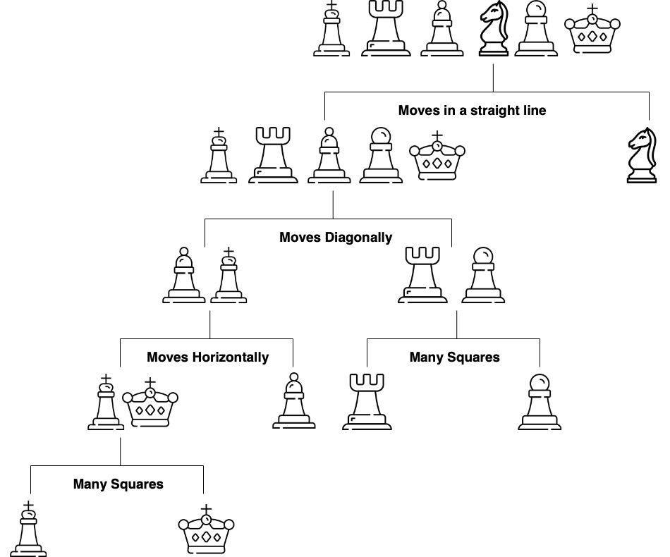
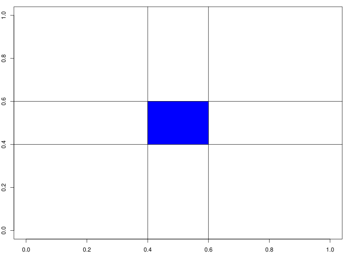
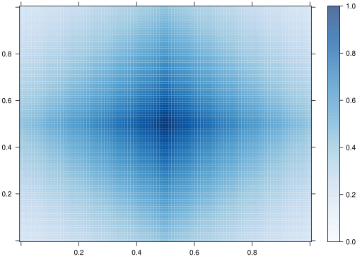
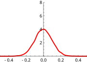
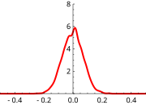
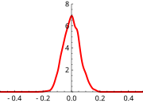
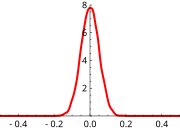



# Tree Models

Imagine you're a jewelry appraiser tasked with determining a diamond's value. You might follow a series of questions: Is the carat weight above 1.0? If yes, is the clarity VS1 or better? Each question leads to another, creating a decision path that eventually arrives at a price estimate. This is precisely how decision trees work---they mirror our natural decision-making process by creating a flowchart of if-then rules.

Logistic regression is a deliberately structured model: it trades flexibility for interpretability and stable estimation. Tree-based methods reverse that trade-off by letting the data determine interactions and nonlinearities. The cost is that algorithmic choices (splitting, pruning, ensembling) become part of the statistical model. This chapter introduces trees as a first major step into nonparametric prediction.

We've used decision trees before to describe the decision-making process as a sequence of actions and conditions. In this section, we'll use decision trees to make predictions. You can think of a prediction as a decision task, where you need to decide which value of $y$ to use for a given $x$. Similar to a decision tree, a predictive tree model is a nested sequence of if-else statements that map any input data point $x$ to a predicted output $y$. Each if-else statement checks a feature of $x$ and sends the data left or right along the tree branch. At the end of the branch, a single value of $y$ is predicted.

@fig-chesstree shows a decision tree for predicting a chess piece given a four-dimensional input vector that describes the types of moves available to the piece. The tree is a sequence of nested if-else statements that check the values of the input vector. The tree has six leaves, one for each of the chess pieces and has a depth of four. The tree is a predictive model that maps a four-dimensional input vector to a single output categorical value with six possible values.

{width="50%" #fig-chesstree}

The prediction mechanism is straightforward: traverse the tree from the root to a leaf node following the conditional logic. The process of building a tree, given a set of training data, is more complicated and has three main components:

1. *Splitting*. The process of dividing the training data into subsets based on the value of a single feature. The goal is to create subsets that are as homogeneous as possible. The subsets are then used to create the nodes of the tree.
2. *Stopping*. The process of deciding when to stop splitting. The goal is to create a tree that is as accurate as possible without overfitting the training data.
3. *Pruning*. The process of removing nodes from the tree that do not improve the accuracy of the tree. The goal is to create a tree that is as accurate as possible without overfitting the training data.

The crux of the tree-building process lies in splitting: determining the optimal feature and threshold that best separates the data. At each step, the splitting process needs to decide on the feature index $j$ to be used for splitting and the location of the split. For a binary variable, there is only one possible split location, but for continuous variables, there are many possible split locations. The goal is to find the split that creates the most homogeneous subsets. In the case of regression trees, the best split is the one that minimizes the sum of squared errors. In the case of classification trees, the best split is the one that minimizes the Gini impurity. The Gini impurity is a measure of how homogeneous the subsets are.

Below we'll explore tree-based models using the classic diamonds dataset, which contains prices and attributes for 53,940 diamonds. We'll start with simple decision trees, progress to ensemble methods like random forests and gradient boosting, and develop deep insights into how these algorithms work, when to use them, and how to avoid common pitfalls.

Let's look at the data, which has 10 variables:

| Variable | Description | Values |
|----------|-------------|---------|
| `carat` | Weight of the diamond | Numeric |
| `cut` | Quality of the cut | Fair, Good, Very Good, Premium, Ideal |
| `color` | Color of the diamond | J, I, H, G, F, E, D |
| `clarity` | Clarity of the diamond | I1, SI2, SI1, VS2, VS1, VVS2, VVS1, IF |
| `depth` | Total depth, `z` as a percentage of the mean of `x` and `y` | Numeric |
| `table` | Width of the diamond's table | Numeric |
| `price` | Price in US dollars | Numeric |
| `x` | Length in mm | Numeric |
| `y` | Width in mm | Numeric |
| `z` | Depth in mm | Numeric |

```{r}
library(ggplot2)
data(diamonds)
head(diamonds)
```

Let's plot price vs carat. Notice the strong non-linear relationship between carat and price. This suggests that log-transformations might help make the relationship linear.
```{r}
#| fig-cap: "Price vs carat by clarity (left) and log price vs log carat with a linear fit (right)."
#| label: fig-price-carat
#| layout-ncol: 2
#| fig-width: 2.6
#| fig-height: 1.8
#| code-fold: true
#| code-summary: "Plot price vs carat"
ggplot(diamonds, aes(x = carat, y = price, color = clarity)) +
  geom_point(size = 0.6) +
  theme_gray(base_size = 8) +
  theme(legend.key.size = unit(0.35, "cm"))
# Create log-transformed price for better linear relationships
diamonds <- diamonds %>%
  mutate(
    log_price = log(price),
    log_carat = log(carat)
  )

# Examine the linearized relationship
ggplot(diamonds, aes(x = log_carat, y = log_price)) +
  geom_point(alpha = 0.05, color = "darkblue", size = 0.6) +
  geom_smooth(method = "lm", color = "red", linewidth = 0.5) +
  labs(x = "Log(Carat)", y = "Log(Price)") +
  theme_gray(base_size = 8)
```
Unlike linear regression, tree models are naturally indifferent to non-linear relationships between predictors and the response. In general, we do not need to transform the variables.

Although carat is the most important factor in determining the price of a diamond, it is not the only factor. We can see in @fig-price-carat-1 that there is a lot of variability in the price of diamonds with the same carat. The densities below compare the price for the different clarity levels.
```{r}
#| fig-height: 4
# use density plot to compare price for different clarity levels
ggplot(diamonds, aes(x = price)) +
  geom_density() +
  facet_wrap(~ clarity) +
  scale_x_continuous(breaks = c(0, 5000, 10000, 15000), labels = c("0", "5k", "10k", "15k"))
```

Let's start with a simple decision tree using just two predictors to visualize how trees partition the feature space:
```{r}
#| fig-height: 4
#| echo: true
library(rpart)
library(rpart.plot)
tree_model <- rpart(price ~ carat + clarity, data = diamonds)
# node means in full, with thousands separators (the default prints 12e+3)
plain <- function(x, labs, digits, varlen) {
  value <- format(round(x$frame$yval), big.mark = ",", trim = TRUE)
  paste0(value, sub("^[^\n]*", "", labs))
}
rpart.plot(tree_model, node.fun = plain)
```

The tree structure reveals several patterns:

1. *Primary split on carat*: The tree first splits at carat = 1, confirming carat weight as the strongest price determinant.

2. *Secondary splits on clarity*: Within carat regions, further partitioning on clarity levels shows its secondary predictive value.

3. *Interpretability*: Each leaf shows the predicted price. For example, diamonds with carat between 1 and 1.5 and lower clarity (I1, SI2, SI1, VS2) have a predicted price $5,371.

4. *Feature interactions*: The hierarchical structure captures how clarity's effect on price depends on carat weight.

This demonstrates the key advantages of decision trees: non-linear relationships, interpretable rules, and automatic feature interactions.

Let's plot the data.
```{r warning=FALSE}
ggplot(diamonds, aes(x = carat, y = clarity, colour = price)) +
  geom_point() +
  scale_color_viridis_c(end = 0.9)
```
We can see that small diamonds (below about half a carat) are cheap whatever their clarity, and that most large diamonds (above 2 carats) are expensive whatever their clarity. At around 1 carat, the price depends on the clarity: the higher clarity levels sell at higher prices. Clarity becomes important at this level.


Now let's plot the data with the tree regions.
```{r}
#| cache: true
# Plot the rectangle areas that represent the regions of the tree
pred_data <- expand.grid(
  carat = seq(min(diamonds$carat), max(diamonds$carat), length.out = 50),
  clarity = unique(diamonds$clarity)
)

pred_data$pred_price <- predict(tree_model, pred_data)

# Plot regions
ggplot(pred_data, aes(x = carat, y = clarity, fill = pred_price)) +
  geom_raster() +
  scale_fill_viridis_c(end = 0.9) +
  labs(title = "Tree Regions: Carat vs Clarity", fill = "Predicted price")
```

The plot above shows the decision tree's prediction regions as colored tiles, where each tile represents a specific combination of carat and clarity values. The color gradient from dark purple to yellow-green indicates the predicted price, with lighter tiles representing higher predicted prices.

The strongest predictor is clearly carat, as evidenced by the vertical bands of similar shades. As carat increases (moving right on the x-axis), the predicted prices generally increase (the tiles shift from dark to light). The tree captures non-linear patterns that a simple linear model would miss. For example, the rate of price increase with carat is not uniform across all clarity levels. Unlike smooth regression surfaces, the tree creates distinct rectangular regions with sharp boundaries, reflecting the binary splitting nature of decision trees.

## Building a Tree via Recursive Binary Splitting

The prediction using a tree is straightforward. The tree divides the predictor space-that is, the set of possible values for $x_1, x_2, \ldots, x_p$ - into $J$ distinct and non-overlapping boxes, $R_1,R_2,...,R_J$. For every observation that falls into the region $R_j$, we make the same prediction, which is simply the mean of the response values for the training observations in $R_j$.
$$
f(x) = \bar y_j, \text{ for } x \in R_j, \text{ where } \bar y_j = \text{Average}(y_i \mid x_i \in R_j)
$$

The overall goal of building a tree is to find regions that lead to minima of the total Residual Sum of Squares (RSS)
$$
\mathrm{RSS} = \sum_{j=1}^J\sum_{i \in R_j}(y_i - \bar{y}_j)^2 \rightarrow \mathrm{minimize}
$$

Unfortunately, it is computationally infeasible (NP-hard problem) to consider every possible partition of the feature space into $J$ boxes. We can find a good approximate solution using a top-down approach (the CART algorithm).

It begins with the entire dataset at the "root" node and repeatedly splits the data into two "child" nodes. This process continues recursively on each new node, with the goal of making the resulting groups (nodes) as homogeneous as possible with respect to the target variable, price. At each iteration we decide on which variable $j$ to split and the split point $s$.
$$
R_1(j, s) = \{x\mid x_j < s\} \mbox{ and } R_2(j, s) = \{x\mid x_j \ge s\},
$$
thus, we seek to minimize (in case of regression tree)
$$
\min_{j,s}\left[ \sum_{i:x_i\in R_1}(y_i - \bar{y}_1)^2 + \sum_{i:x_i \in R_2}(y_i - \bar{y}_2)^2\right]
$$
As a result, every observed input point belongs to a single region.

## Pruning: Taming an Overfit Tree

Now let's discuss how many regions we should have. At one extreme end, we can have $n$ regions, one for each observation. Then the tree model will work similar to the one-nearest neighbor model. At the other end, we can have one big region for the entire input space, and then every prediction will be the same (average across observed $y$'s). Both models can be used, but usually the best one is in the middle. The number of regions (branches) controls the complexity of the model. We need to find a good size on the variance-bias scale. A smaller tree with fewer splits (that is, fewer regions $R_1,...,R_J$) might lead to lower variance and better interpretation at the cost of a little bias.
Deep trees often suffer from high variance, where slight perturbations in the training data produce vastly different structures, rendering the model unstable.

How do we construct a tree with a "manageable" number of branches? This is accomplished through the steps of forward tree construction and backward pruning. The forward step is a greedy algorithm that begins with a single region and divides it into two. This procedure is repeated until a certain stopping criterion is met. A practical method is to continue building the tree until the Residual Sum of Squares (RSS) plateaus. However, this method can be myopic, as an initially unproductive split might be followed by a highly beneficial one, leading to a significant decrease in RSS in subsequent iterations. A more effective strategy is to grow an extensive tree $T_0$, and then trim it down to obtain a subtree. The size of the subtree can be determined using cross-validation. However, be aware that the number of subtrees can be exponential!

Instead of considering all possible sub-trees, we will do cost complexity pruning - also known as weakest link pruning. We consider a sequence of trees indexed by a nonnegative tuning parameter $\alpha$. For each value of $\alpha$ there corresponds a subtree $T \subset T_0$ such that minimizes
$$
\sum_{m=1}^{|T|}\sum_{i:x_i\in R_m}(y_i - \bar{y}_m)^2 + \alpha |T|
$$
The parameter $\alpha$ balances the complexity of the subtree and its adherence to the training data. When we increment $\alpha$ starting from zero, branches are predictably and sequentially pruned from the tree, making it straightforward to acquire the entire series of subtrees as a function of $\alpha$. We determine the optimal value $\hat \alpha$ through cross-validation. Afterward, we refer back to the complete dataset and extract the subtree that corresponds to $\hat \alpha$.

### Example: Boston Housing Data

To demonstrate pruning and decision boundaries on a standard benchmark, we switch to the Boston Housing dataset. This dataset contains information about housing values in suburbs of Boston. We used it in previous chapters, but here it allows us to easily visualize pruning on a well-known problem.

```{r}
library(MASS)
data(Boston)
head(Boston)
```

We will focus on predicting `medv` (median value of owner-occupied homes in $1000s) using `lstat` (lower status of the population percent) and other variables.

First we build a big tree:
```{r bostontree}
#| echo: true
library(tree)
# mindev param controls stopping: smaller value = bigger tree
temp <- tree(medv ~ lstat, data = Boston, mindev = .0001)
length(unique(temp$where)) # first big tree size
```
Then prune it down to one with 7 leaves:
```{r}
#| echo: true
boston.tree <- prune.tree(temp, best = 7)
length(unique(boston.tree$where)) # pruned tree size
```

The upper panel shows the pruned tree, the lower panel the step function it fits to `medv`, with the cutpoints as dashed lines.
```{r}
#| fig-width: 5.5
#| fig-height: 3
plot(boston.tree, type = "uniform") # pruned tree
text(boston.tree, label = NULL, col = "blue", cex = .8, adj = 1.05) # rules end left of the branch that comes down
text(boston.tree, splits = FALSE, col = "blue", label = "yval", cex = .8, digits = 3)
boston.fit <- predict(boston.tree) # get training fitted values
plot(Boston$lstat, Boston$medv, cex = .5, pch = 16, xlab = "lstat", ylab = "medv") # plot data
oo <- order(Boston$lstat)
lines(Boston$lstat[oo], boston.fit[oo], col = "red", lwd = 3) # step function fit
cvals <- c(9.725, 4.65, 3.325, 5.495, 16.085, 19.9) # cutpoints from tree
for (i in seq_along(cvals)) abline(v = cvals[i], col = "magenta", lty = 2) # cutpoints
```


Now let's use more variables. We pick `dis` (weighted mean of distances to five Boston employment centres), `lstat`, and `medv`.
```{r }
#| results: hide
# Select specific columns by name
df2 <- Boston[, c("dis", "lstat", "medv")]
print(names(df2))
```
Build the big tree.
```{r}
#| results: hide
temp <- tree(medv ~ ., df2, mindev = .0001)
length(unique(temp$where)) #
```
It has `r length(unique(temp$where))` leaves. Then prune it down to one with 7 leaves.
```{r }
boston.tree <- prune.tree(temp, best = 7)
```

```{r boston-partition}
#| fig-width: 5.5
#| fig-height: 3
plot(boston.tree, type = "u") # plot tree and partition in x.
text(boston.tree, label = NULL, col = "blue", cex = .8, adj = 1.05)
text(boston.tree, splits = FALSE, col = "blue", label = "yval", cex = .8, digits = 3)
partition.tree(boston.tree)
```

Get predictions on 2d grid and make perspective plot:
```{r , fig.height=4, fig.align='center'}
pv <- seq(from = .01, to = .99, by = .05)
x1q <- quantile(df2$lstat, probs = pv)
x2q <- quantile(df2$dis, probs = pv)
xx <- expand.grid(x1q, x2q) # matrix with two columns using all combinations of x1q and x2q
dfpred <- data.frame(dis = xx[, 2], lstat = xx[, 1])
lmedpred <- predict(boston.tree, dfpred)

# Create a perspective plot (3D surface)
# theta sets the viewing angle, zlim ensures the vertical axis covers the data range
persp(x1q, x2q, matrix(lmedpred, ncol = length(x2q), byrow = T),
  theta = 150, xlab = "dis", ylab = "lstat", zlab = "medv",
  zlim = c(min(df2$medv), 1.1 * max(df2$medv))
)
```

*Advantages*: Decision trees are intuitive, visually interpretable, and handle qualitative predictors without dummy variables.

*Disadvantages*: The main drawback is instability—deep trees suffer from high variance, where small data perturbations produce vastly different structures.

## Classification Trees

A classification tree operates much like a regression tree. The prediction is made based on the "majority vote", which means selecting the class that appears most frequently within the region. The process of developing a classification tree is largely the same as that of a regression tree, involving recursive binary splitting. However, instead of using the Residual Sum of Squares (RSS), we use criteria better suited for categorical data.

We start by introducing some notations. Let
$$
p_{mk} = \dfrac{1}{N_m}\sum_{x_i \in R_m} I(y_i=k),
$$
be the proportion of observations of class $k$ in region $m$.

The classification is then done by:
$$
p_m = \max_k p_{mk},~~~ E_m = 1-p_m
$$
where $k(m) = \arg\max_k p_{mk}$ is the most frequent class in region $m$. The error rate $E_m$ is simply the proportion of observations in the region that do NOT belong to the majority class.

Then classification prediction is:
$$
P(y=k) = \sum_{j=1}^J p_{jk} I(x \in R_j)
$$

An alternative method to evaluate the quality of a split in a classification tree is through the use of the Gini Index or Cross-Entropy. Let's consider a scenario where we have an equal number of observations in each class, say 400 in each.

Now, suppose we create a tree that results in two regions: one with a distribution of (300,100) and the other with (100,300). This means that in the first region, 300 observations belong to one class and 100 to the other, and vice versa in the second region.
Consider another scenario where we have a different tree that results in two regions with distributions of (200,400) and (200,0).

In both cases, the misclassification rate is 0.25, meaning that 25% of the observations are incorrectly classified. However, the second tree is more desirable. Why is that? The second tree has a region with no misclassifications at all (200,0), which means it is perfectly classifying all observations in that region.

The Gini Index or Cross-Entropy are preferred for growing trees because they are more sensitive to node purity.

The Gini index:
$$
G_m = \sum_{k=1}^K p_{mk}(1-p_{mk})
$$
It measures a variance across the $K$ classes. It takes on a small value if all of the $p_{mk}$'s are close to zero or one (pure nodes).

An alternative to the Gini index is cross-entropy (a.k.a deviance), given by
$$
D_m = -\sum_{k=1}^Kp_{mk}\log p_{mk}
$$
It is near zero if the $p_{mk}$'s are all near zero or near one. Gini index and the cross-entropy led to similar results.

### Example: Classifying Diamond Quality

Let's use a classification tree to predict the `cut` of a diamond based on its price, carat, and clarity. We will try to distinguish "Ideal" cuts from others. To make it a clear binary problem for visualization, let's create a binary variable `is_ideal`.

```{r, echo=-1}
#| fig-height: 4
par(mar = c(1, 1, 2, 1))
diamonds_class <- diamonds %>%
  mutate(is_ideal = as.factor(ifelse(cut == "Ideal", "Ideal", "Non-Ideal")))

# Fit classification tree
class_tree <- rpart(is_ideal ~ carat + price + clarity, data = diamonds_class, method = "class")
rpart.plot(class_tree, main = "Classification Tree for Ideal Cut")
```

The tree shows how `clarity` and `carat` effectively separate Ideal cut diamonds from the rest. The nodes display the predicted class and the probability of that class, illustrating how the model estimates class probabilities ($p_{mk}$) in each region.

## Ensemble Methods

Pruning reduces overfitting by simplifying the tree. Two alternative approaches are *Random Forests* (averaging multiple trees) and *Boosting* (sequentially fitting trees to residuals).

The simple idea behind every ensemble method is that the variance of the average is lower than the variance of individual models (see @sec-bias-variance-galton for a historical perspective on how Galton's ox-weighing experiment illustrates this principle). Say we have $B$ models $f_1(x),\ldots,f_B(x)$ then we combine those
$$
f_{avg}(x) = \dfrac{1}{B}\sum_{b=1}^Bf_b(x)
$$
Combining models helps fight overfitting. On the negative side, it is harder to interpret these ensembles compared to a single decision tree.

### Bagging

In the *bagging* approach, we treat the sample as if it were the population and then take i.i.d. draws. That is, you sample with replacement so that you can get the same original sample value more than once in a bootstrap sample.

To bootstrap aggregate (Bag) we:

- Take $B$ bootstrap samples from the training data, each of the same size as the training data.
- Fit a large tree to each bootstrap sample (we know how to do this fast!). This will give us $B$ trees.
- Combine the results from each of the $B$ trees to get an overall prediction.

When the target variable $y$ is numeric, the bagging process is straightforward: the final prediction is simply the average. When $y$ is categorical, we use a voting system or average the predicted probabilities.

Let's experiment with the number of trees in the model using the Boston dataset again. We calculate the mean squared error for each number of trees. With the single predictor `lstat` there is nothing for `randomForest` to sample at a split, so its fit is plain bagging.
```{r, message=FALSE}
#| echo: true
library(randomForest)
set.seed(1)
n <- nrow(Boston)
ntreev <- c(10, 500, 5000)
fmat <- matrix(0, n, 3)
for (i in 1:3) {
  rffit <- randomForest(medv ~ lstat, data = Boston, ntree = ntreev[i], maxnodes = 15)
  fmat[, i] <- predict(rffit)
  mse <- mean((fmat[, i] - Boston$medv)^2, na.rm = TRUE)
  cat("Mean Squared Error with", ntreev[i], "trees:", round(mse), "\n")
}
```

Let's plot the results
```{r}
#| layout-ncol: 3
#| fig-width: 1.74
#| fig-height: 1.5
oo <- order(Boston$lstat)
for (i in 1:3) {
  plot(Boston$lstat, Boston$medv, xlab = "lstat", ylab = "medv", pch = 16, cex = 0.3, col = "grey60")
  ok <- !is.na(fmat[oo, i])
  lines(Boston$lstat[oo][ok], fmat[oo, i][ok], col = "black", lwd = 1.5)
  title(main = paste0("Bagging, ", ntreev[i], " trees"))
}
```

- With 10 trees, our fit is too jumbly (high variance).
- With 500 and 5,000 trees the fit is smoother and very similar.
- Note that although our method is based on multiple trees (average over), we no longer have a simple step function!

### Random Forest

In the bagging technique, models can become correlated, which prevents the achievement of a $1/B$ reduction in variance. This happens because most, if not all, of the trees will use the most influential predictor in the top split. As a result, bagged trees tend to look very similar to each other.

Random Forests, on the other hand, introduce an element of randomness that helps to decorrelate the trees. Instead of considering all $p$ predictors for a split, a random sample of $m$ predictors is chosen as split candidates. This subset of predictors is different for each split.

The number of predictors considered at each split, $m$, is typically chosen to be the square root of the total number of predictors, $p$ for classification, or $p/3$ for regression.

One of the "interpretation" tools that comes with ensemble models is importance ranking: the total amount that the deviance (loss) is decreased due to splits over a given predictor, averaged over all trees.

```{r, echo=-1}
#| fig-height: 3
par(cex.axis = 0.8, mfrow = c(1, 2), mar = c(4, 5, 0.5, 1), mgp = c(2, 0.8, 0))
set.seed(1)
rf.boston <- randomForest(medv ~ ., data = Boston, mtry = 4, importance = TRUE, ntree = 50)
imp <- importance(rf.boston)
for (j in 1:2) dotchart(sort(imp[, j]), xlim = c(min(0, imp[, j]), max(imp[, j])), pch = 21, bg = "lightblue", cex = 0.7, xlab = colnames(imp)[j])
```


```{r }
#| fig-cap: "Random Forest Fit."
#| fig-height: 2
set.seed(1)
rf.boston <- randomForest(medv ~ ., data = Boston, mtry = 6, ntree = 50, maxnodes = 50)
yhat.rf <- predict(rf.boston, newdata = Boston)
oo <- order(Boston$lstat)
plot(Boston$lstat[oo], Boston$medv[oo], pch = 21, bg = "grey", xlab = "lstat", ylab = "medv") # plot data
lines(Boston$lstat[oo], yhat.rf[oo], col = "red", lwd = 3) # step function fit
```

### Boosting

Boosting, like Random Forests, is a method that combines multiple trees to create a more powerful predictive model.

Here's how Boosting works:

1. Initially, a single decision tree is fitted to the data. This initial tree is intentionally made weak.
2. We then examine the residuals, which represent the portion of the target variable $y$ not explained by the weak tree.
3. A new tree is then fitted to these residuals, essentially trying to predict the error of the first tree.
4. This new tree is also "weakened" or "shrunk" (multiplied by a learning rate $\lambda$). The prediction from this tree is then added to the prediction of the previous trees.
5. This process is repeated iteratively. The final model is the sum of all these "shrunk" trees.

The key idea behind Boosting is to iteratively improve the model by focusing on the parts of the data that the current model is not explaining well (the residuals).

Mathematically, we want to minimize a loss function $\mathcal{L}$. For regression, we might take $\mathcal{L}(y_i , \theta_i ) = (y_i - \theta_i )^2$.
We solve:
$$\mathrm{minimize}_{\beta \in R^B} \sum_{i=1}^n \mathcal{L} \left(y_i, \sum_{b=1}^B \beta_b \cdot T_b(x_i)\right)$$

Gradient boosting acts like gradient descent in function space.
Start with an initial model, e.g., fit a single tree $\theta^{(0)} = T_0$. Repeat:
Evaluate gradient $g$ at latest prediction $\theta^{(k-1)}$,
		$$g_i = \left.\left[\frac{\partial \mathcal{L}(y_i, \theta_i)}{\partial \theta_i}\right]\right|_{\theta_i = \theta_i^{(k-1)}},\ i=1,\ldots,n$$
Find a tree $T_k$ that is close to $-g$, i.e., $T_k$ solves
		$$\mathrm{minimize}_{\text{trees }T} \sum_{i=1}^n (-g_i - T(x_i))^2$$
Update our prediction:
		$$\theta^{(k)} = \theta^{(k-1)} + \lambda \cdot T_k$$

*Algorithm:*
1. Set $\hat{f}(x)=0$ and $r_i=y_i$ for all $i$ in training set.
2. For $b=1,2,\ldots,B$, repeat:
    (a) Fit a tree $\hat{f}^b$ with $d$ splits (interactions) to the training data $(X, r)$.
    (b) Update $\hat{f}$ by adding a shrunken version of the new tree:
        $$\hat{f}(x) \leftarrow \hat{f}(x) +\lambda \hat{f}^b(x)$$
    (c) Update the residuals:
        $$r_i \leftarrow r_i - \lambda \hat{f}^b(x_i)$$
3. Output the boosted model:
   $$\hat{f}(x) = \sum_{b=1}^B \lambda \hat{f}^b(x)$$

The parameter $\lambda$ is the *learning rate* or *shrinkage* parameter. By multiplying the new tree's contribution by a small number (e.g., 0.01 or 0.1), we prevent the model from adapting too quickly to outliers or noise.

Here we fit a boosting model with 5,000 trees and interaction depth 4, using the `gbm` default shrinkage $\lambda = 0.1$.
```{r , echo=-2, message=FALSE}
library(gbm)
set.seed(1)
boost.boston <- gbm(medv ~ .,
  data = Boston, distribution = "gaussian",
  n.trees = 5000, interaction.depth = 4
)
yhat.boost <- predict(boost.boston, newdata = Boston, n.trees = 5000)
mean((yhat.boost - Boston$medv)^2)
```

```{r ,echo=-1, fig.height=5}
par(mar = c(0, 2, 0, 0))
summary(boost.boston, plotit = FALSE)
```

Partial dependence plots [@friedman2001greedy] show the effect of the two most influential variables, `rm` and `lstat`, on `medv` after integrating out the others:
```{r, echo=-1}
#| layout-ncol: 2
#| fig-width: 2.6
#| fig-height: 1.8
lattice::trellis.par.set(fontsize = list(text = 8))
plot(boost.boston, i = "rm", ylab = "Partial dependence")
plot(boost.boston, i = "lstat", ylab = "Partial dependence",
  scales = list(x = list(at = seq(0, 40, 10))))
```

*Boosting vs Random Forests*:

*   *Boosting* often provides better accuracy by correcting specific errors (residuals), but is more prone to overfitting and noise. It requires careful tuning of $\lambda$ and $B$.
*   *Random Forests* are more robust "out of the box", easier to parallelize (trees are independent), and less prone to overfitting, but might not reach the same peak accuracy as a well-tuned boosting model.

## BART for Causal Inference {#sec-bart-causal}

Estimating the causal effect of an intervention, such as a new drug, a marketing campaign, or a public policy, is a central goal across science and industry. While the gold standard for causal inference is the Randomized Controlled Trial (RCT), it is often infeasible, unethical, or too expensive to conduct. Researchers must therefore turn to observational data, where the assignment of treatment is not controlled by the investigator. This introduces a fundamental challenge: individuals who receive the treatment may be systematically different from those who do not, a problem known as confounding. Separating the true effect of the treatment from these pre-existing differences is the primary task of causal inference from observational data.

To formalize causal questions, we rely on the Rubin Causal Model (RCM), also known as the potential outcomes framework. For a binary treatment $Z$ (where $Z_i=1$ if individual $i$ receives the treatment and $Z_i=0$ otherwise), we posit that each individual $i$ has two potential outcomes:

*   $Y_i(1)$: The outcome that would be observed if individual $i$ were exposed to the treatment.
*   $Y_i(0)$: The outcome that would be observed if individual $i$ were exposed to the control (no treatment).

This framework leads directly to what Holland (1986) termed the "fundamental problem of causal inference": for any given individual, we can only ever observe one of these two potential outcomes. The outcome we do not see is the counterfactual. Causal inference can thus be viewed as a missing data problem, where the goal is to estimate the values of the unobserved potential outcomes.

From this foundation, we can define several key causal quantities, or estimands:

*   Individual Treatment Effect (ITE): The effect for a single individual, defined as $$\tau_i = Y_i(1) - Y_i(0).$$ This is typically unobservable.
*   Average Treatment Effect (ATE): The average effect across the entire population, $$\tau_{ATE} = \E{Y(1) - Y(0)}.$$ This is often the primary estimand of interest for broad policy questions.
*   Average Treatment Effect on the Treated (ATT): The average effect for those who actually received the treatment, $$\tau_{ATT} = \E{Y(1) - Y(0) \mid Z=1}.$$
*   Conditional Average Treatment Effect (CATE): The average effect for a subpopulation defined by a set of covariates $X=x$, $$\tau(x) = \E{Y(1) - Y(0) \mid X=x}.$$ Understanding the CATE allows for the exploration of treatment effect heterogeneity.

To estimate these causal estimands from observational data, we must rely on a set of critical, untestable assumptions that connect the observed data to the unobserved potential outcomes. These are known as identification assumptions.

1.  Stable Unit Treatment Value Assumption (SUTVA): This assumption has two parts. First, it assumes there is no interference between units, meaning one individual's treatment status does not affect another's outcome. Second, it assumes there are no hidden variations of the treatment; the treatment assigned to one individual is the same as the treatment assigned to any other.
2.  Ignorability (or Unconfoundedness): This is the most demanding assumption. It states that, conditional on a set of observed pre-treatment covariates $X$, treatment assignment $Z$ is independent of the potential outcomes: $$(Y(0), Y(1)) \perp Z \mid X$$. In essence, it assumes that we have measured all the common causes of both treatment selection and the outcome. If this holds, then within any stratum defined by the covariates $X$, the treatment assignment is "as-if" random.
3.  Positivity (or Overlap/Common Support): This assumption requires that for any set of covariate values $x$ present in the population, there is a non-zero probability of being in either the treatment or the control group: $0 < P(Z=1 \mid X=x) < 1$. This ensures that we can find both treated and control individuals with similar characteristics, making comparison meaningful and avoiding extrapolation to regions with no data.

To demonstrate the application of Bayesian methods to this challenge, we use the famous Lalonde dataset, a canonical benchmark in the causal inference literature. The dataset addresses a real-world policy question: evaluating the effectiveness of the National Supported Work (NSW) Demonstration, a federally funded job training program implemented in the US from 1975--1979. The program was designed to help individuals facing significant social and economic barriers (e.g., former drug addicts, ex-convicts, high school dropouts) improve their labor market prospects. The treatment ($treat$) is participation in this program, and the primary outcome ($re78$) is the individual's real earnings in 1978, after the program.

The historical importance of this dataset stems from Robert Lalonde's 1986 paper, which delivered a powerful critique of the non-experimental methods used at the time. Lalonde started with data from an actual RCT, which provided an unbiased estimate of the program's effect. He then took the treated group from the experiment but replaced the experimental control group with a non-experimental comparison group drawn from large public surveys---the Panel Study of Income Dynamics (PSID) and the Current Population Survey (CPS). He showed that the standard econometric models of the era failed to replicate the experimental benchmark when applied to this new, confounded dataset, casting serious doubt on their reliability for policy evaluation. Our task is to see if a modern, flexible Bayesian method---Bayesian Additive Regression Trees (BART)---can succeed where these earlier methods failed.

The challenge posed by the Lalonde dataset becomes immediately apparent when we examine the pre-treatment characteristics of the treated group versus the non-experimental control group. A naive comparison of their 1978 earnings would be deeply misleading because the groups were profoundly different before the program even began. @tbl-imbalance illustrates this imbalance for key covariates, including age, education, race, marital status, and earnings in the years prior to the intervention (1974 and 1975).

The Standardized Mean Difference (SMD) provides a scale-free measure of the difference between the group means. A common rule of thumb suggests that an absolute SMD greater than 0.1 indicates a potentially meaningful imbalance. As the table shows, the groups differ substantially on every measured characteristic except years of education. The treated individuals were younger, more likely to lack a degree, more likely to be from minority groups, and had drastically lower earnings in the years before the program. This severe selection bias is precisely what makes the Lalonde dataset such a difficult and important test case for causal inference methods. Any credible method must be able to adjust for these vast pre-existing differences to isolate the true causal effect of the job training program.

| Covariate | Treated Mean | Control Mean | Std. Mean Diff. |
| :--- | :--- | :--- | :--- |
| Age (years) | 25.82 | 28.03 | -0.24 |
| Education (years) | 10.35 | 10.24 | 0.04 |
| Black (indicator) | 0.84 | 0.20 | 1.67 |
| Hispanic (indicator) | 0.06 | 0.14 | -0.28 |
| Married (indicator) | 0.19 | 0.51 | -0.72 |
| No Degree (indicator) | 0.71 | 0.60 | 0.24 |
| Earnings 1974 | 2095.57 | 5619.24 | -0.60 |
| Earnings 1975 | 1532.06 | 2466.48 | -0.29 |

: Covariate Balance in the Lalonde Non-Experimental Dataset. *Note: Data corresponds to the widely used Dehejia and Wahba (1999) sample of the Lalonde dataset. Standardized Mean Difference is calculated as the difference in means divided by the pooled standard deviation, the square root of the average of the two group variances.* {#tbl-imbalance}

To address the challenge of confounding, we need a method that can flexibly model the relationship between the outcome, the treatment, and the many covariates shown to be imbalanced. Bayesian Additive Regression Trees (BART) is a non-parametric machine learning algorithm that is well-suited for this task. It combines the predictive power of ensemble methods with a rigorous Bayesian framework for regularization and uncertainty quantification.

At its core, BART models the expected value of an outcome $Y$ as a sum of many individual regression trees. For a set of predictors $x$, the model is:

$$Y = \sum_{j=1}^{m} g(x; T_j, M_j) + \epsilon, \quad \text{where} \quad \epsilon \sim N(0, \sigma^2)$$

Here, $m$ is the number of trees in the ensemble (typically around 200), and each function $g(x; T_j, M_j)$ represents a single regression tree. The structure of the tree is denoted by $T_j$, and $M_j$ is the set of parameter values in its terminal nodes (or leaves).

Each individual tree is designed to be a "weak learner". It is kept shallow and simple, meaning it explains only a small fraction of the variation in the outcome. The final prediction comes from summing up the contributions of all these simple components. This sum-of-trees structure allows BART to automatically capture very complex relationships, including high-order interactions and non-linearities, without the user needing to specify them in advance. For example, an interaction between age and education is implicitly modeled if a tree splits on education within a branch that has already been split on age. This flexibility is a major advantage in observational studies where the true functional form of the relationship between the outcome and the confounders is unknown.

In most machine learning algorithms, overfitting is controlled through techniques like cross-validation or complexity penalties. BART, being a fully Bayesian method, achieves this through a carefully specified set of regularization priors. These priors are designed to keep each tree simple and prevent any single tree from dominating the overall fit.

The key priors are:

1.  Prior on Tree Structure: This prior strongly encourages shallow trees. It is defined by a rule governing the probability that a node at a certain depth $d$ will be split further. This probability is typically modeled as 
$$P_{\text{split}}(d) = \alpha(1+d)^{-\beta},$$
where $\alpha \in (0,1)$ and $\beta \ge 0$ are hyperparameters. Setting $\beta$ to a value like 2 ensures that the probability of splitting decreases rapidly with depth, keeping the trees small.
2.  Prior on Terminal Node Parameters: After the response variable $Y$ is centered and scaled, the values $\mu_{jk}$ in the terminal nodes of each tree are given a Normal prior, 
$$
\mu_{jk} \sim N(0, \sigma_{\mu}^2).
$$ 
This prior shrinks the predictions within each leaf towards zero. Because the final prediction is a sum over $m$ trees, this shrinkage ensures that the contribution of each individual tree is small.
3.  Prior on Error Variance: The residual variance $\sigma^2$ is typically given a conjugate Inverse-Gamma prior. This prior is usually chosen to be weakly informative, allowing the data to dominate the posterior estimate of the noise level, but it still constrains the variance to be reasonable.

Together, these priors act as a sophisticated regularization mechanism that allows BART to fit complex functions while being highly resistant to overfitting.

BART models are fit using a Markov chain Monte Carlo (MCMC) algorithm, specifically a form of Gibbs sampler known as Bayesian backfitting. The algorithm does not find a single "best" model. Instead, it generates thousands of samples from the joint posterior distribution of all model parameters: $p(T_1,\ldots,T_m, M_1,\ldots,M_m, \sigma \mid Y, X)$.

The fitting process works iteratively:

1.  Initialize all $m$ trees and $\sigma$.
2.  For each tree $j$ from 1 to $m$:
    a.  Calculate the "partial residual" by subtracting the predictions of all other trees from the outcome: $$R_j = Y - \sum_{k \neq j} g(x; T_k, M_k)$$.
    b.  Draw a new tree structure $T_j$ and its leaf parameters $M_j$ from their posterior distribution conditional on this partial residual, $$p(T_j, M_j \mid R_j, \sigma).$$
3.  After iterating through all trees, draw a new value for $\sigma$ from its posterior conditional on the current residuals.
4.  Repeat steps 2 and 3 for thousands of iterations.

The output of this process is not one set of trees, but a collection of (e.g., 5000) sets of trees, where each set represents a plausible regression function drawn from the posterior distribution. This collection of draws is the key to quantifying uncertainty in a Bayesian way.

The power of BART for causal inference lies in how it leverages the full posterior distribution to estimate counterfactuals. The strategy aligns perfectly with the Bayesian view of causal inference as a missing data problem, as articulated by Rubin (1978).

The standard approach for causal inference with BART is to model the outcome $Y$ as a function of both the covariates $X$ and the treatment indicator $Z$. The model learns a single, flexible response surface:

$$\E{Y \mid X, Z} = f(X, Z)$$

Here, the treatment $Z$ is included as if it were "just another covariate" in the set of predictors fed to the BART algorithm. The model is free to discover how the effect of $Z$ varies with $X$ through the tree-splitting process. The Conditional Average Treatment Effect (CATE) is then simply the difference in the predictions from this learned function:

$$\tau(x) = f(x, Z=1) - f(x, Z=0)$$ 

The core of the estimation process is a predictive step that is repeated for each draw from the MCMC sampler. Suppose the MCMC algorithm has produced $S$ posterior draws of the function $f$. For each draw $s = 1,\ldots, S$:

1.  We take the full dataset of $n$ individuals with their observed covariates $X$.
2.  We create two hypothetical, or counterfactual, datasets:
    *   Treated World: The observed covariates $X$ for all $n$ individuals, but with the treatment indicator set to $Z=1$ for everyone.
    *   Control World: The observed covariates $X$ for all $n$ individuals, but with the treatment indicator set to $Z=0$ for everyone.
3.  Using the fitted BART model corresponding to posterior draw $s$ (i.e., $f^{(s)}$), we predict the outcome for every individual under both scenarios. This gives us a full set of posterior predictive draws for the potential outcomes: $\tilde{Y}_i(1)^{(s)}$ and $\tilde{Y}_i(0)^{(s)}$ for each individual $i$.

This process is a direct implementation of the missing data analogy. For an individual $i$ who was actually treated ($Z_i=1$), their observed outcome $Y_i$ is their potential outcome $Y_i(1)$. The BART model provides a posterior predictive draw for their missing counterfactual outcome, $\tilde{Y}_i(0)^{(s)}$. Conversely, for a control subject, we use the model to predict their missing $\tilde{Y}_i(1)^{(s)}$.

Once we have the posterior draws of the potential outcomes for every individual at each MCMC iteration, we can compute a posterior draw for any causal estimand of interest. For example, at each iteration $s$:

*   ITE draw: $$\tau_i^{(s)} = \tilde{Y}_i(1)^{(s)} - \tilde{Y}_i(0)^{(s)}$$
*   ATE draw: $$\tau_{ATE}^{(s)} = \frac{1}{n} \sum_{i=1}^{n} \tau_i^{(s)}$$

By collecting these values across all $S$ MCMC iterations, we obtain 
$$\{\tau_{ATE}^{(1)}, \tau_{ATE}^{(2)},\ldots, \tau_{ATE}^{(S)}\}.$$ 
This set is a Monte Carlo approximation of the entire posterior distribution of the Average Treatment Effect.

Instead of a single point estimate and a standard error, the Bayesian approach yields a full probability distribution for the unknown causal effect. From this posterior distribution, we can easily calculate a posterior mean (our best point estimate) and a 95% credible interval. Unlike a frequentist confidence interval, the Bayesian credible interval has a direct and intuitive probabilistic interpretation: given our data and model, there is a 95% probability that the true value of the ATE lies within this range. This propagation of uncertainty from the model parameters all the way to the final causal estimate is a hallmark of the Bayesian approach.

We now apply this framework to the Lalonde dataset to estimate the causal effect of the NSW job training program on 1978 earnings.

The analysis is streamlined by using the `bartCause` package in `R`, which is specifically designed for causal inference with BART. The package provides a wrapper around the core `dbarts` implementation, simplifying the process of fitting the model and generating counterfactuals. A typical function call would look like this:

```{r}
#| label: bartc-fit
#| echo: true
#| eval: false
#| code-summary: "Fitting a BART model with the bartCause package"

# Load the package and the non-experimental sample
library(bartCause)
data(lalonde, package = "MatchIt") # 185 NSW treated, 429 PSID controls
lalonde$black <- as.integer(lalonde$race == "black")
lalonde$hisp <- as.integer(lalonde$race == "hispan")

# Define confounders
confounders <- c("age", "educ", "black", "hisp", "married", "nodegree", "re74", "re75")

# Fit the BART model
fit <- bartc(
  response = lalonde$re78,
  treatment = lalonde$treat,
  confounders = lalonde[, confounders],
  estimand = "att",
  commonSup.rule = "sd" # Rule to handle poor overlap
)
```
In this call, we specify the outcome (`re78`), the binary treatment (`treat`), and the matrix of pre-treatment confounders. We set `estimand = "att"` to target the effect on the treated, which is the estimand the experimental benchmark measures. Setting `estimand = "ate"` instead would average over the PSID controls as well, extrapolating to a population the program never served.

Before interpreting the causal estimates, it is essential to perform MCMC diagnostics to ensure the algorithm has converged to a stable posterior distribution. The bartCause package provides plotting functions for this purpose. Trace plots for key parameters, such as the posterior draws of the ATE and the residual standard deviation ($\sigma$), should be examined. These plots should show the chains mixing well and exploring a consistent region of the parameter space, without long-term drifts or stuck periods, indicating that the sampler has converged.

The primary result can be obtained by calling `summary(fit)`. This provides the posterior mean of the ATE, which serves as our point estimate, along with a 95% credible interval. For a richer view, we can plot the entire posterior distribution of the ATE, which visualizes our uncertainty about the treatment effect.

The value of this result is clearest when placed alongside other estimates, as shown in @tbl-ate-estimate. The naive difference in means between treated and control units in the non-experimental data is *negative*, wrongly suggesting that the program lowered earnings. That is a direct consequence of the confounding: the PSID comparison group starts from a much stronger position, earning \$2,466 in 1975 against \$1,532 for the NSW participants. The experimental benchmark from the original randomized trial for these treated individuals is a gain of about \$1,794. Every method that adjusts for the observed confounders reverses the sign of the naive estimate and lands within roughly one standard error of the benchmark, and the experimental value sits well inside BART's 95% posterior interval of $(-1247, 3269)$. Two lessons follow. A flexible non-parametric model such as BART can undo much of the selection bias that defeated earlier econometric methods. But that interval also covers zero, so with 185 treated units the honest conclusion is that the data cannot distinguish a substantial benefit from no benefit at all. The credible interval reports this directly, whereas a point estimate alone would hide it.

| Method                    | Estimate | Std. error / posterior SD |
| :---                      |     ---: |                      ---: |
| Experimental Benchmark    |  1794.34 |                    671.00 |
| Naive Difference-in-Means |  -635.03 |                    677.20 |
| Propensity Score Matching |   894.37 |                    730.29 |
| Double Machine Learning   |  1213.06 |                    717.37 |
| Causal BART               |  1011.18 |                   1151.95 |

: Comparison of treatment-effect estimates for the NSW program. All estimates target the effect on the treated. The experimental benchmark is the difference in means from the randomized trial; the remaining rows use the non-experimental sample of 185 NSW treated units and 429 PSID controls. Propensity score matching is nearest-neighbour matching on a logistic propensity score, and double machine learning is a five-fold cross-fitted partially linear estimator with BART nuisance models. Uncertainty is the posterior standard deviation for BART and the standard error otherwise. {#tbl-ate-estimate}

While the ATE provides a useful summary, it can mask important variations in how the treatment affects different people. A policy might be beneficial on average but ineffective or even harmful for certain subgroups. A key advantage of BART is its ability to move beyond the average and explore this Heterogeneous Treatment Effect (HTE), which is critical for developing more targeted and effective policies.

Estimating HTE allows us to answer questions like: "For whom does this program work best?" or "Are there individuals for whom the program is detrimental?" In settings with limited resources, this information is vital for allocating the intervention to those most likely to benefit. The flexibility of BART, which does not assume a constant treatment effect, makes it an ideal tool for this task.

Because BART provides a posterior predictive distribution of potential outcomes for every individual in the dataset, we can estimate an Individual Conditional Average Treatment Effect (ICATE) for each person. By plotting a histogram of the posterior means of these ICATEs, we can visualize the distribution of effects across the sample. This reveals whether the effect is consistent for everyone or if there is substantial variation, with some individuals benefiting much more than others.

To understand what drives this heterogeneity, we can examine how the estimated CATE varies as a function of key pre-treatment covariates. These relationships are often visualized using partial dependence plots. For the Lalonde data, such analyses have revealed that the effect of the job training program is not constant but varies non-linearly with characteristics like age and pre-treatment income (re74). For instance, the program's benefit might increase with age up to a certain point and then decline, or it might be most effective for individuals with low-to-moderate prior earnings but less so for those with very low or higher earnings. These are nuanced, data-driven insights that would be completely missed by a standard linear regression model that only estimates a single average effect.

A subtle but important issue can arise when using flexible regularized models like BART for causal inference in the presence of strong confounding, as is the case here. The regularization priors, which are designed to prevent overfitting, can shrink the estimated effects of the confounders towards zero. Because the treatment Z is highly correlated with these confounders, the model may mistakenly attribute some of the effect of the confounders to the treatment, leading to a bias known as Regularization-Induced Confounding (RIC).

A solution, proposed by @hahn2020bayesian, is to first estimate the propensity score, $\pi(x) = P(Z=1 \mid X)$, which is the probability of receiving treatment given the covariates X. This score serves as a one-dimensional summary of all confounding information. This estimated propensity score is then included as an additional predictor in the BART outcome model. By providing this confounding summary directly to the model, we help the BART algorithm differentiate between the prognostic effects of the covariates (captured by $\pi(x)$) and the causal effect of the treatment Z, thereby mitigating RIC. This "ps-BART" approach is easily implemented in the `bartCause` package by setting the argument `p.scoreAsCovariate = TRUE` (its default).

### BART versus Propensity Score Matching (PSM)

BART is one of several methods for causal inference from observational data. BART and PSM represent two different philosophies for tackling confounding. Propensity Score Matching (PSM): This approach focuses on the design of the study. The goal is to use the observed data to construct a new sample in which the treatment and control groups are balanced on their observed covariates, thereby mimicking the properties of an RCT. The propensity score is the central tool used to achieve this balance. The analysis of the outcome is then performed on this newly created, "balanced" dataset.

BART focuses on the analysis stage. The goal is to build a highly flexible and accurate predictive model for the outcome that explicitly includes the treatment and confounders, $\E{Y \mid X,Z}$. It uses the full dataset and relies on the model's ability to correctly adjust for the confounding variables to isolate the causal effect.

Each approach has its own set of advantages and disadvantages. PSM is often praised for its transparency; one can assess the quality of the covariate balance achieved by the matching procedure before ever looking at the outcome variable, reducing the risk of "$p$-hacking" or specification searching. However, PSM can be inefficient, as it often requires discarding a significant portion of the control group that does not have good matches in the treated group (i.e., poor overlap). It can also suffer from residual confounding if the matches are not sufficiently close. BART, on the other hand, is highly efficient as it uses all available data. Its main strengths are its flexibility in capturing unknown functional forms and interactions, its ability to easily estimate heterogeneous effects, and its principled framework for uncertainty quantification. Its primary weakness is that it can be perceived as a "black box" if not diagnosed carefully. Its validity, like all modeling approaches, depends on the untestable ignorability assumption, and as discussed, it can be susceptible to regularization-induced confounding if not applied with care.

In modern practice, the line between these two philosophies is blurring. For example, many practitioners use flexible machine learning models, including BART itself, to estimate the propensity scores used for matching or weighting, which can improve the quality of the covariate balance over simpler logistic regression models. Conversely, the ps-BART approach incorporates the propensity score directly into the outcome model. This convergence reflects a mature understanding that both balancing the data structure and flexibly modeling the outcome are complementary and powerful tools for robust causal inference.

|Feature                  |Propensity Score Matching (PSM)|Bayesian Additive Regression Trees (BART)|
|-------------------------|-------------------------------|-----------------------------------------|
|Primary Goal             |Create balanced treatment/control groups (Design)|Flexibly model the outcome-covariate relationship (Analysis)|
|Use of Data              |Often discards unmatched units, reducing sample size|Uses all available data                  |
|Confounding Control      |Achieved by balancing covariates via matching/weighting|Achieved by conditioning on covariates in a flexible model|
|Key Assumption           |Correct specification of the propensity score model|Correct specification of the outcome model (though BART is very flexible)|
|Treatment Effect         |Primarily estimates ATT; ATE can be harder to estimate|Easily estimates ATE, ATT, and CATE/HTE  |
|Uncertainty              |Often requires bootstrapping for standard errors|Provides full posterior distributions and credible intervals naturally|
|Flexibility              |Limited by the PS model; main effect is assumed constant after matching|Highly flexible; automatically models non-linearities and interactions|

: Conceptual Comparison of BART and Propensity Score Matching.

This example shows that BART, a flexible non-parametric method, can adjust for severe confounding well enough to turn a badly negative naive estimate into one consistent with the experimental benchmark, a feat that eluded many of the methods available when Lalonde first published his critique. BART is not a panacea, however. Its credible interval here is wide enough to include zero, so the honest reading is agreement with the benchmark rather than confirmation of a large effect. And its validity, like that of any non-experimental method, rests on the untestable assumption of ignorability, that we have measured and adjusted for all relevant confounding variables.

### Conclusion

Randomization remains the cleanest route to causal identification, but it is not always feasible. When randomization is absent, modern Bayesian methods like BART offer a principled path forward: they combine flexible non-parametric modeling with uncertainty quantification and can, under the right assumptions, recover causal effects that approach the quality of experimental benchmarks. The broader narrative on experiments, randomization, and when we must rely on observational data is developed in @sec-abtesting.

## Appendix: Theoretical Foundations

### Why Ensembles Work: A Geometric Perspective

Why does combining multiple weak learners improve performance? The answer lies in the *bias-variance tradeoff* and the geometry of high-dimensional spaces.

### Smoothing and Variance Reduction

Individual decision trees are low-bias but high-variance estimators. They can capture complex patterns (low bias) but are sensitive to noise (high variance). When we average many such trees, as in Bagging or Random Forests, we are effectively performing *smoothing*.

Quantitatively, if we have $N$ uncorrelated predictors $f_1, \dots, f_N$, the variance of their average is:
$$
\text{Var}\left(\frac{1}{N}\sum_{i=1}^N f_i\right) = \frac{1}{N} \text{Var}(f_i)
$$
Averaging $N$ uncorrelated models reduces the variance by a factor of $N$. This is the *$1/N$ rule*. In practice, the trees in a forest are correlated, so the reduction isn't quite $1/N$, but the principle holds: the more diverse (uncorrelated) the trees, the more variance reduction we get. This is why Random Forests Randomly select features at each split---to force the trees to be different.

### The Problem of High Dimensions

One might ask: "Why not just use K-Nearest Neighbors (KNN)? It also averages local points." The problem is the *curse of dimensionality*. In high-dimensional feature spaces, data points become incredibly sparse.

Consider a 50-dimensional ball. If we sample points uniformly, almost all of them will reside near the "crust" or surface of the ball, not in the center (@fig-hd-ball, discussed below, shows only a two-dimensional projection of such a sample).

```{r}
#| label: fig-hd-ball
#| fig-cap: "Projection of 1000 uniform samples from the 50-dimensional ball $B_{50}$ onto its first two coordinates. The circle is the boundary of the unit disc."
#| fig-width: 2.4
#| fig-height: 2.4
set.seed(66) # Lemieux
n <- 1000
p <- 50
z <- matrix(rnorm(n * p), n, p)
y <- z / sqrt(rowSums(z^2)) * runif(n)^(1 / p)
plot(y[, 1], y[, 2], cex = 0.4, col = adjustcolor("black", 0.4), asp = 1, xlim = c(-1, 1), ylim = c(-1, 1), xlab = expression(e[1]^T * Y), ylab = expression(e[2]^T * Y))
theta <- seq(0, 2 * pi, length.out = 200)
lines(cos(theta), sin(theta))
```

This phenomenon means that in high dimensions, "local neighbors" are not actually close to you—they are far away on the other side of the space. A standard KNN algorithm fails because it averages points that aren't truly similar.

### Trees as "Adaptive" Nearest Neighbors

Decision trees solve this by defining "neighbors" differently. Instead of using a fixed distance metric (like Euclidean distance), trees define a neighborhood as a rectangular box (or *cylindrical region*) learned from the data (@fig-cilinder).

::: {#fig-cilinder layout="[[-1,8,-1],[-1,8,-1]]"}




Cylindrical kernels for trees (upper) and random forests (lower).
:::

Constructing the regions is fundamental to reducing the curse of dimensionality. It is useful to imagine a very large dataset, e.g., 100k images, and think about how a new image's input coordinates, $X$, are "neighbors" to data points in the training set. Our predictor will then be a smart conditional average of the observed outputs, $Y$, for our neighbors. When $p$ is large, spheres ($L^2$ balls or Gaussian kernels) are terrible: either no points or all points are "neighbors" of the new input variable. Trees are good as not too many "neighbors."

To illustrate the problem further, @fig-hd-ball shows 1000 uniform samples from a 50-dimensional ball $B_{50}$ projected onto the plane spanned by the first two coordinates, that is the pairs $(e_1^\top Y, e_2^\top Y)$ with $Y \sim U(B_{50})$. The shadow concentrates in a small disc near the origin and none of the samples fall near the boundary, even though in 50 dimensions almost all the mass of $B_{50}$ sits close to its surface.

As dimensionality of the space grows, the variance of the marginal distribution goes to zero. We can empirically see it from @fig-hd-hist, which shows the density of the one-dimensional image of a uniform sample from balls of different dimensionality, i.e., $e_1^\top Y$, where $e_1 = (1,0,\ldots,0)$.

::: {#fig-hd-hist layout-ncol=4}









Density of the one-dimensional projection $e_1^\top Y$ of $Y\sim U(B_p)$ for four dimensions $p$.
:::

Similar central limit results were known to Maxwell, who showed that the rescaled projection $\sqrt{p}\, w^\top Y$ is close to standard normal when $Y \sim U(B_p)$, $p$ is large, and $w$ is a unit vector. The $\sqrt{p}$ matters: without it the projection collapses to zero, which is exactly the concentration seen above. For the history of this fact, see @diaconis1987dozen. More general results in this direction were obtained in @klartag2007central. Further, @milman2009asymptotic presents many analytical and geometrical results for finite-dimensional normed spaces, as the dimension grows to infinity.

Deep learning improves on this by performing a sequence of GLM-like transformations; effectively, DL learns a distributed partition of the input space. Specifically, suppose that we have $K$ partitions. Then the DL predictor takes the form of a weighted average, or in the case of classification, a soft-max of the weighted average of observations in this partition. Given a new high-dimensional input $X_{\mathrm{new}}$, many deep learners are an average of learners obtained by our hyperplane decomposition. Generically, we have

$$
\hat{Y}(X) = \sum_{k \in K} w_k(X)\hat{Y}_k(X),
$$
where $w_k$ are the weights learned in region $k$, and $w_k(X)$ is an indicator of the region with appropriate weighting given the training data. The weight $w_k$ also indicates which partition the new $X_{\mathrm{new}}$ lies in.

The use of pooling (a.k.a. averaging) of multiple predictors is commonplace in machine learning. Ensemble methods (a.k.a. some form of clever conditional averaging) are prevalent in high dimensions. One reason for these procedures is that it is relatively easy to find unbiased predictors, with the caveat that they have large variances due to dimensionality. The following result on exchangeability [@marshall1965inequality; see also @kingman1978uses] shows that we can simply use the $1/N$-rule and average to reduce risk. Specifically, suppose that we have $K$ exchangeable predictors, so that $(Y, \hat{Y}_{\pi(1)}, \ldots, \hat{Y}_{\pi(K)}) \overset{d}{=} (Y, \hat{Y}_1, \ldots, \hat{Y}_K)$ for every permutation $\pi$, collected as

$$
\hat{Y} = ( \hat{Y}_1 , \ldots , \hat{Y}_K )
$$

Find $w$ to attain $\operatorname{argmin}_{w:\, \sum_i w_i = 1} \E{l( Y , w^\top \hat{Y} )}$ where $l$ is convex in the second argument;

$$
\E{l( Y , w^\top \hat{Y} )} = \frac{1}{K!} \sum_\pi \E{l( Y , w_\pi^\top \hat{Y} )} \geq \E{l \left ( Y , \frac{1}{K!} \sum_\pi w_\pi^\top \hat{Y} \right )}
$$
$$
= \E{l \left ( Y , (1/K) \iota^\top \hat{Y} \right )}
$$

where $\iota = ( 1 , \ldots ,1 )$ and $w_\pi = (w_{\pi(1)}, \ldots, w_{\pi(K)})$. The equality is exchangeability (each $w_\pi^\top \hat{Y}$ is $w^\top \hat{Y}$ with the predictors permuted), the inequality is Jensen's, and the last step holds because $\frac{1}{K!}\sum_\pi w_\pi = \frac{1}{K}(\iota^\top w)\,\iota = \frac{1}{K}\iota$. Hence, under exchangeability and a loss that is convex in its second argument, the equal-weight average $w = (1/K)\iota$ is optimal among all weights that sum to one. We now turn to algorithmic issues.

An alternative approach is to perform Bayesian model selection. Here we calculate the optimal Bayes weight for each predictor in accordance with Bayes' rule. We formalize the gains in Classification Risk with the following discussion.

## Classification Variance Decomposition

@amit1999multiple provide a rigorous connection between the strength of individual classifiers and their correlation. To formalize this, we need to establish some notation. Consider a $K$-class classification problem where:

- $X$ denotes the input feature vector
- $Y \in \{1, 2, \ldots, K\}$ denotes the true class label
- $c \in \{1, 2, \ldots, K\}$ represents a specific true class
- $d \in \{1, 2, \ldots, K\}$ represents a candidate class label (the class we're voting for)

In an ensemble setting, let $h(X, d)$ denote an individual classifier (e.g., a single decision tree) that outputs a vote for class $d$ given input $X$. Typically, $h(X, d) \in \{0, 1\}$ for hard voting (1 if the classifier predicts class $d$, 0 otherwise) or $h(X, d) \in [0, 1]$ for soft voting (the probability that the classifier assigns to class $d$).

The ensemble aggregates votes from multiple classifiers. Let $\mathbf{Q}$ denote the distribution over classifiers---this is the randomization scheme (e.g., bootstrap sampling, random feature selection) that generates the trees in the ensemble. The aggregate classifier $H_{\mathbf{Q}}(X, d)$ is the average vote for class $d$ over all classifiers sampled from $\mathbf{Q}$:

$$
H_{\mathbf{Q}}(X, d) = E_{\mathbf{Q}}[h(X, d)] = \frac{1}{B}\sum_{b=1}^B h_b(X, d)
$$

where $h_b$ are individual classifiers sampled from $\mathbf{Q}$ and $B$ is the number of classifiers in the ensemble. In practice, this is simply the proportion of trees that vote for class $d$ (or the average probability assigned to class $d$ across all trees).

The final classification decision $C_{\mathbf{Q}}(X)$ is the class that receives the most votes (or highest average probability):

$$
C_{\mathbf{Q}}(X) = \arg\max_{d \in \{1, \ldots, K\}} H_{\mathbf{Q}}(X, d)
$$

Now, let $P_{c}$ denote the population conditional probability distribution of a point $X$ given $Y=c$, and let $E_{c}$ and $\operatorname{Var}_{c}$ denote the associated conditional expectation and variance operators (i.e., $E_c[\cdot] = E[\cdot \mid Y=c]$ and $\operatorname{Var}_c[\cdot] = \operatorname{Var}[\cdot \mid Y=c]$). Define the vectors of average aggregates conditional on class $c$ as
$$
M_{c}(d)=E_{c}\left[H_{\mathbf{Q}}(X, d)\right]=E\left[H_{\mathbf{Q}}(X, d) \mid Y=c\right]
$$

for $d=1, \ldots, K$. Intuitively, $M_c(d)$ represents the *expected vote share* for class $d$ when the true class is $c$. Ideally, $M_c(c)$ (votes for the correct class) should be much larger than $M_c(d)$ (votes for incorrect classes).

The average conditional margin (ACM) for class $c$ is defined as
$$
\theta_{c}=\min _{d \neq c}\left(M_{c}(c)-M_{c}(d)\right)
$$
This $\theta_c$ measures the "safety gap" between the correct class and the closest competing class. A larger margin means the classifier is more robust.

We assume that $\theta_{c}>0$. This assumption is very weak since it involves only the average over the population of class $c$. It is quite natural since one would not expect good classification results when it is violated. Indeed as shown below it is satisfied in all cases.

Given that $\theta_{c}>0$, the error rate for class $c$ depends on the extent to which the aggregate classifier $H_{\mathbf{Q}}(X, d)$ is concentrated around $M_{c}(d)$ for each $d=1, \ldots, K$. The simplest measure of concentration is the variance of $H_{\mathbf{Q}}(X, d)$ with respect to the distribution $P_{c}$. Using Chebyshev's inequality we write a coarse bound on the misclassification probability with respect to $P_{c}$ as follows.

\begin{align*}
P_{c}\left(C_{\mathbf{Q}}(X) \neq c\right) \leq & P_{c}\left(H_{\mathbf{Q}}(X, c)<M_{c}(c)-\theta_{c} / 2\right) \\
& +\sum_{d \neq c} P_{c}\left(H_{\mathbf{Q}}(X, d)>M_{c}(d)+\theta_{c} / 2\right) \\
\leq & \sum_{d=1}^{K} P_{c}\left(\left|H_{\mathbf{Q}}(X, d)-M_{c}(d)\right|>\theta_{c} / 2\right) \\
\leq & \frac{4}{\theta_{c}^{2}} \sum_{d=1}^{K} \operatorname{Var}_{c}\left[H_{\mathbf{Q}}(X, d)\right] . \tag{10}
\end{align*}

Of course Chebyshev's inequality is coarse and will not give very sharp results in itself, but we state it here as a landmark pointing to the relative importance of margin and variance, and to the tradeoff between the two quantities. To reduce error, we must either *increase the margin* $\theta_c$ (build stronger classifiers) or *decrease the variance* (add more diverse trees).

We rewrite each of the variance terms of the last equation as

\begin{align*}
\operatorname{Var}_{c}\left[H_{\mathbf{Q}}(X, d)\right] & =E_{c}\left[H_{\mathbf{Q}}(X, d)^{2}\right]-\left[E_{c} H_{\mathbf{Q}}(X, d)\right]^{2} \\
& =E_{\mathbf{Q} \otimes \mathbf{Q}} E_{c}\left[h_{1}(X, d) h_{2}(X, d)\right]-E_{\mathbf{Q} \otimes \mathbf{Q}}\left[E_{c}\left[h_{1}(X, d)\right] E_{c}\left[h_{2}(X, d)\right]\right] \\
& =E_{\mathbf{Q} \otimes \mathbf{Q}} \operatorname{Cov}_{c}\left[h_{1}(X, d), h_{2}(X, d)\right] \doteq \gamma_{c, d} \tag{11}
\end{align*}

Here, $E_{\mathbf{Q} \otimes \mathbf{Q}}$ denotes the expectation over the product measure of two independent draws from $\mathbf{Q}$. That is, $h_1$ and $h_2$ are two classifiers sampled independently from the distribution $\mathbf{Q}$, and $E_{\mathbf{Q} \otimes \mathbf{Q}}$ averages over all such pairs. This allows us to express the variance of the ensemble in terms of the covariance between pairs of individual classifiers.

This equation formalizes the intuition: to minimize error, we must minimize the covariance $\gamma_{c, d}$ between trees. This is precisely what *Random Forests* do by randomizing splits (@amit1999multiple).


### The Nearest Neighbor Insight

Why do trees work so well on complex data? @cover1967nearest provided a fundamental result for nearest-neighbor classifiers: as sample size grows, the error rate of a simple 1-Nearest Neighbor classifier is bounded by *twice the Bayes Risk* (the irreducible error).
$$
R^* \le R_{NN} \le 2R^*(1-R^*)
$$
This means that a simple "look at your neighbor" strategy captures at least half the available signal. Decision trees can be viewed as *adaptive nearest-neighbor* models. Instead of using a fixed distance metric (which fails in high dimensions due to sparsity), trees learn a custom metric—dividing space into "blocky" regions based only on relevant features.

## Exercises {.unnumbered}


