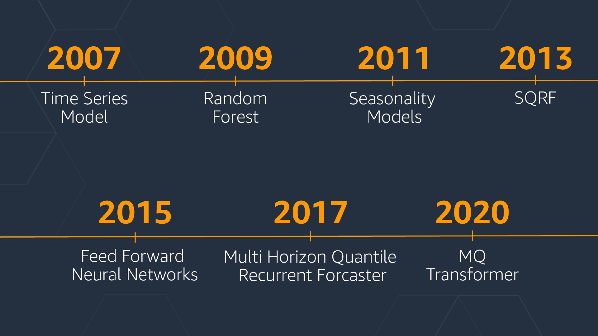
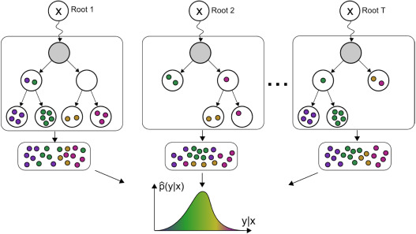
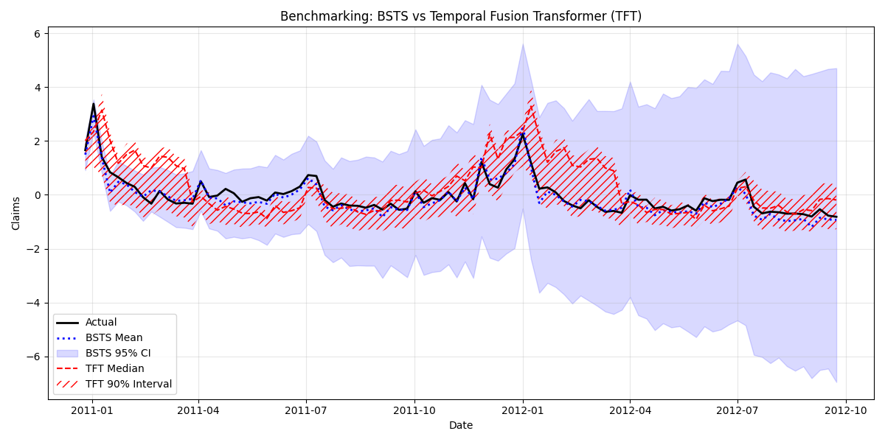



# Forecasting {#sec-forecasting}

The preceding chapters developed models for cross-sectional data, where observations are assumed exchangeable. We now turn to temporal data, where the ordering of observations carries information and prediction means looking forward in time.

In 1766, Daniel Bernoulli developed the first mathematical model of disease transmission for smallpox, writing: *"I wish simply that, in matters which so closely concern the well being of the human race, no decision shall be made without all knowledge which a little analysis and calculation can provide."*

One of the most famous early applications involved the plague of 1665--1666 in the village of Eyam in Derbyshire. The data, shown below, tracked susceptible individuals ($S$) and infected individuals ($I$) over time:

| Date (1666) | Susceptibles | Infectives |
|-------------|--------------|------------|
| Initial     | 254          | 7          |
| July 3      | 235          | 15         |
| July 19     | 201          | 22         |
| Aug 3       | 153          | 29         |
| Aug 19      | 121          | 21         |
| Sept 3      | 108          | 8          |
| Sept 19     | 97           | 8          |
| Oct 3       | -            | -          |
| Oct 19      | 83           | 0          |

The initial population was $N=261$, and by the end of the outbreak, 83 individuals remained susceptible (never infected). This simple dataset illustrates a fundamental challenge in time series forecasting: understanding the *mechanism* driving the dynamics.

The rector of Eyam, William Mompesson, kept detailed records of the outbreak and organized the village quarantine that prevented the plague from spreading to neighboring communities. Mompesson's wife Catherine died during the epidemic. The missing record on Oct 3 reflects the chaos of the outbreak's peak. Mompesson meticulously recorded infection counts, pioneering data collection practices nearly two centuries before Florence Nightingale.

Time series data appear across business, science, healthcare, and engineering. Unlike regression datasets, time series observations are not exchangeable---their order carries information. The modeling replacement for i.i.d. is typically conditional independence or state-space structure, but Bayesian updating logic remains the same as in @sec-bl.

This chapter describes the `bsts` software package, which fits sophisticated time series models with just a few lines of R code. The BSTS (Bayesian Structural Time Series) section is adapted from Steven Scott's blog post: ["Fitting Bayesian structural time series with the bsts R package"](https://www.unofficialgoogledatascience.com/2017/07/fitting-bayesian-structural-time-series.html).

### Epidemic Forecasting: A Motivating Example

The Eyam example highlights several themes central to this chapter:

1. *Self-reinforcing dynamics*: Disease spread accelerates with more infectants, creating nonlinear feedback loops
2. *State-space structure*: The compartments ($S, E, I, R$) represent latent states that evolve according to known dynamics
3. *Parameter uncertainty*: Even with detailed data, parameters like $\beta$ and $\gamma$ must be estimated
4. *Retrospective vs. prospective*: The Eyam analysis was performed in hindsight with complete data; real-time forecasting during an outbreak is considerably more challenging

Modern epidemic forecasting combines SEIR-type models with Bayesian methods to quantify uncertainty. While epidemic models differ from the business and economic time series we'll focus on in this chapter, they share the fundamental state-space structure that makes Bayesian structural time series models so powerful.

### The `bsts` Package

The `bsts` package for R fits Bayesian structural time series models (also called state space models, Kalman filter models, or dynamic linear models). Available on CRAN via `install.packages("bsts")`, it is similar to Prophet but more customizable.


The chapter covers three examples: *Nowcasting* (local linear trend, seasonal models, spike-and-slab priors), *Long-term forecasting* (semilocal linear trend), and *Recession modeling* (non-Gaussian responses, serial dependence).


## Structural Time Series Models
A structural time series model is defined by two equations. The observation equation relates the observed data $y_t$ to a vector of latent variables $\alpha_t$ known as the "state."
$$
y_t = Z_t^\top\alpha_t + \epsilon_t.
$$

The transition equation describes how the latent state evolves through time.
$$
\alpha_{t+1} = T_t \alpha_t + R_t \eta_t.
$$

The error terms $\epsilon_t$ and $\eta_t$ are Gaussian and independent of everything else. The arrays $Z_t$, $T_t$ and $R_t$ are structural parameters. They may contain parameters in the statistical sense, but often they simply contain strategically placed 0's and 1's indicating which bits of $\alpha_t$ are relevant for a particular computation.

The simplest useful model is the "local level model," in which the vector $\alpha_t$ is just a scalar $\mu_t$. The local level model is a random walk observed in noise.
\begin{align*}
y_t = &\mu_t + \epsilon_t\\
\mu_{t+1} = &\mu_t + \eta_t.
\end{align*}
Here $\alpha_t=\mu_t$, and $Z_t$, $T_t$, and $R_t$ all collapse to the scalar value 1. Similar to Bayesian hierarchical models for nested data, the local level model is a compromise between two extremes. The compromise is determined by variances of $\epsilon_t \sim N(0,\sigma^2)$ and $\eta_t \sim N(0,\tau^2)$. If $\tau^2=0$, then $\mu_t$ is a constant, so the data are i.i.d. Gaussian noise. In that case, the best estimator of $y_{t+1}$ is the mean of $y_1,\ldots,y_t$. Conversely, if $\sigma^2=0$ then the data follow a random walk, in which case the best estimator of $y_{t+1}$ is $y_t$. Notice that in one case the estimator depends on all past data (weighted equally) while in the other it depends only on the most recent data point, giving past data zero weight. If both variances are positive, then the optimal estimator of $y_{t+1}$ winds up being "exponential smoothing," where past data are forgotten at an exponential rate determined by the ratio of the two variances. Also notice that while the state in this model is Markov (i.e., it only depends on the previous state), the dependence among the observed data extends to the beginning of the series.

```{r, echo=F, results='hide', message=F,warning=F}
#| label: fig-randomwalk
#| fig-cap: "Apple Adjusted Closing Price."
#| layout-ncol: 2
#| fig-width: 2.6
#| fig-height: 2
library(xts)
AAPL <- read.csv("data/AAPL.csv")
AAPL <- xts(AAPL, order.by = as.Date(rownames(AAPL), "%Y-%m-%d"))
set.seed(17) # Kharlamov
p <- as.numeric(AAPL$AAPL.Adjusted)
mu <- mean(diff(p), na.rm = T)
s <- 0.1 * sd(diff(p), na.rm = T)
n <- length(p)
rw <- rep(p[1], n)
for (i in 2:n) {
  rw[i] <- max(min(p), rw[i - 1] + rnorm(1, mu, s))
}
plot(p, xlab = "Trading day", ylab = "AAPL Price", type = "l", lwd = 2, col = "blue")
plot(rw, type = "l", xlab = "Trading day", ylab = "AAPL Price", lwd = 2, col = "red")
```

In the example above, one of the plots shows the price of Apple stock from 2021-01-01 to 2022-12-31. The other plot is a sequence generated from a random walk model fitted to the Apple price data. Can you spot which one is which?

Structural time series models are useful because they are flexible and modular. The analyst chooses the structure of $\alpha_t$ based on things like whether short- or long-term predictions are more important, whether the data contain seasonal effects, and whether and how regressors are to be included. Many of these models are standard and can be fit using a variety of tools, such as the `StructTS` function distributed with base R or one of several R packages for fitting these models (with the `dlm` package (@petris2010package, @campagnoli2009dynamic) deserving special mention). The `bsts` package handles all the standard cases, but it also includes several useful extensions, described in the next few sections through a series of examples. Each example includes a mathematical description of the model and example `bsts` code showing how to work with the model using the `bsts` software. To keep things short, details about prior assumptions are largely avoided.


::: {#exm-Nowcasting}
## Nowcasting

@scott2014predicting and @scott2015bayesian used structural time series models to show how Google search data can be used to improve short-term forecasts ("nowcasts") of economic time series. The figure below shows the motivating dataset from @scott2014predicting, which is also included with the `bsts` package. The data consist of the weekly initial claims for unemployment insurance in the US, as reported by the US Federal Reserve. Like many official statistics, they are released with delay and subject to revision. At the end of the week, the economic activity determining these numbers has taken place, but the official numbers are not published until several days later. For economic decisions based on these and similar numbers, it would help to have an early forecast of the current week's number as of the close of the week. Thus the output of this analysis is truly a "nowcast" of data that has already happened rather than a "forecast" of data that will happen in the future.

```{r, warning=F,message=F, fig.height=2.5}
#| label: fig-bsts
#| fig-cap: "Weekly initial claims for unemployment in the US."
library(bsts) # load the bsts package
data(iclaims) # bring the initial.claims data into scope
plot(initial.claims$iclaimsNSA, lwd = 2, xlab = "Year", ylab = "Initial claims (standardized)", col = "blue")
```

There are two sources of information about the current value $y_t$ in the initial claims series: past values $y_{t-\tau}$ describing the time series behavior of the series, and contemporaneous predictors $x_t$ from a data source which is correlated with $y_t$, but which is available without the delay exhibited by $y_t$. The time series structure shows an obvious trend (in which the financial and housing crises in 2008--2009 are apparent) as well as a strong annual seasonal pattern. The external data source explored by Scott and Varian was search data from Google trends with search queries such as "how to file for unemployment" having obvious relevance.

Scott and Varian modeled the data using a structural time series with three state components: 

- trend $\mu_t$
- seasonal pattern $\tau_t$  
- regression component $\beta^\top x_t$. 

The model is
\begin{align*}
y_t = & \mu_t + \tau_t + \beta^\top x_t + \epsilon_t\\
\mu_{t+1} = &\mu_t + \delta_t + \eta_{0t}\\
\delta_{t+1} = &\delta_t + \eta_{1t}\\
\tau_{t+1} = &-\sum_{s = 1}^{S-1}\tau_{t+1-s} + \eta_{2t}.
\end{align*}

The trend component looks similar to the local level model above, but it has an extra term $\delta_t$. Notice that $\delta_t$ is the amount of extra $\mu$ you can expect as $t\rightarrow t+1$, so it can be interpreted as the slope of the local linear trend. Slopes normally multiply some $x$ variable, but in this case $x=\Delta t$, which is omitted from the equation because it is always 1. The slope evolves according to a random walk, which makes the trend an integrated random walk with an extra drift term. The local linear trend is a better model than the local level model if you think the time series is trending in a particular direction and you want future forecasts to reflect a continued increase (or decrease) seen in recent observations. Whereas the local level model bases forecasts around the average value of recent observations, the local linear trend model adds in recent upward or downward slopes as well. As with most statistical models, the extra flexibility comes at the price of extra volatility.

The best way to understand the seasonal component $\tau_t$ is in terms of a regression with seasonal dummy variables. Suppose you had quarterly data, so that $S=4$. You might include the annual seasonal cycle using 3 dummy variables, with one left out as a baseline. Alternatively, you could include all four dummy variables but constrain their coefficients to sum to zero. The seasonal state model takes the latter approach, but the constraint is that the $S$ most recent seasonal effects must sum to zero in expectation. This allows the seasonal pattern to slowly evolve. Scott and Varian described the annual cycle in the weekly initial claims data using a seasonal state component with $S=52$. Of course, weeks don't neatly divide years, but given the small number of years for which Google data are available, the occasional one-period seasonal discontinuity was deemed unimportant.

Let's ignore the regression component for now and fit a `bsts` model with just the trend and seasonal components to the series `initial.claims$iclaimsNSA` (loaded with `library(bsts)` and `data(iclaims)`).

```{r, eval=FALSE}
#| echo: true
ss <- AddLocalLinearTrend(list(), initial.claims$iclaimsNSA)
ss <- AddSeasonal(ss, initial.claims$iclaimsNSA, nseasons = 52)
model1 <- bsts(initial.claims$iclaimsNSA, state.specification = ss, niter = 1000)
```
```{r, include=F}
load("data/timeseries/model123.RData")
```

The first thing to do when fitting a `bsts` model is to specify the contents of the latent state vector $\alpha_t$. The `bsts` package offers a library of state models, which are included by adding them to a state specification (which is just a list with a particular format). The call to `AddLocalLinearTrend` above adds a local linear trend state component to an empty state specification (the `list()` in its first argument). The call to `AddSeasonal` adds a seasonal state component with 52 seasons to the state specification created on the previous line. The state vector $\alpha_t$ is formed by concatenating the state from each state model. Similarly, the vector $Z_t$ is formed by concatenating the $Z$ vectors from the two state models, while the matrices $T_t$ and $R_t$ are combined in block-diagonal fashion.

The state specification is passed as an argument to `bsts`, along with the data and the desired number of MCMC iterations. The model is fit using an MCMC algorithm, which in this example takes about 20 seconds to produce 1000 MCMC iterations. The returned object is a list (with class attribute `bsts`). You can see its contents by typing
```{r}
#| echo: true
names(model1)
```
The first few elements contain the MCMC draws of the model parameters. Most of the other elements are data structures needed by various S3 methods (`plot, print, predict`, etc.) that can be used with the returned object. MCMC output is stored in vectors (for scalar parameters) or arrays (for vector or matrix parameters), where the first index in the array corresponds to MCMC iteration number, and the remaining indices correspond to dimension of the deviate being drawn.

Most users won't need to look inside the returned `bsts` object because standard tasks like plotting and prediction are available through familiar S3 methods. For example, there are several plot methods available.
```{r, echo=-(1:3)}
#| label: fig-claims
#| fig-cap: "Structural time series model for unemployment claims."
#| fig-subcap:
#|   - "Prediction"
#|   - "Components"
#| layout-nrow: 2
#| fig-height: 2.5
par(mar = c(4, 4, 2, 0))
model1$state.specification[[1]]$name <- dimnames(model1$state.contributions)[[2]][1] <- "Trend"
model1$state.specification[[2]]$name <- dimnames(model1$state.contributions)[[2]][2] <- "Seasonal"
plot(model1, ylab = "Claims (standardized)")
plot(model1, "components", ylab = "Contribution")
```
The @fig-claims-1 above shows the posterior distribution of the model state. Circles are actual data points. The @fig-claims-2 shows the individual state components. The plot looks fuzzy because it is showing the marginal posterior distribution at each time point.


The default plot method plots the posterior distribution of the conditional mean $Z_t^\top\alpha_t$ given the full data $y=y_1,\ldots,y_T$. Other plot methods can be accessed by passing a string to the plot function. For example, to see the contributions of the individual state components, pass the string "components" as a second argument, as shown above. You can get a list of all available plots by passing the string `help` as the second argument.

To predict future values, there is a `predict` method. For example, to predict the next 12 time points, you would use the following commands.
```{r predict1, echo=-1}
#| fig-align: "center"
#| fig-height: 2.5
par(mar = c(4, 4, 0.5, 0))
pred1 <- predict(model1, horizon = 12)
plot(pred1, plot.original = 156, ylab = "Claims (standardized)", xlab = "Year")
```

The output of predict is an object of class `bsts.prediction`, which has its own `plot` method. The `plot.original = 156` argument says to plot the prediction along with the last 156 time points (3 years) of the original series. 
:::

## Regression with Spike and Slab Priors

Now let's add a regression component to the model described above, so that we can use Google search data to improve the forecast. The `bsts` package only includes 10 search terms with the initial claims dataset, to keep the package size small, but @scott2014predicting considered examples with several hundred predictor variables. When faced with large numbers of potential predictors, it is important to have a prior distribution that induces sparsity. A spike and slab prior is a natural way to express a prior belief that most of the regression coefficients are exactly zero.

A spike and slab prior is a prior on a set of regression coefficients that assigns each coefficient a positive probability of being zero. Upon observing data, Bayes' theorem updates the inclusion probability of each coefficient. When sampling from the posterior distribution of a regression model under a spike and slab prior, many of the simulated regression coefficients will be exactly zero. This is unlike the "lasso" prior (the Laplace, or double-exponential distribution), which yields MAP estimates at zero but where posterior simulations will be all nonzero. You can read about the mathematical details of spike and slab priors in @scott2014predicting.

When fitting `bsts` models that contain a regression component, extra arguments captured by `...` are passed to the SpikeSlabPrior function from the BoomSpikeSlab package. This allows the analyst to adjust the default prior settings for the regression component from the `bsts` function call. To include a regression component in a `bsts` model, simply pass a model formula as the first argument.

```{r,eval=FALSE}
#| echo: true
# Fit a bsts model with expected model size 1, the default.
model2 <- bsts(iclaimsNSA ~ ., state.specification = ss, niter = 1000, data = initial.claims)
# Fit a bsts model with expected model size 5, to include more coefficients.
model3 <- bsts(iclaimsNSA ~ ., state.specification = ss, niter = 1000, data = initial.claims, expected.model.size = 5) # Passed to SpikeSlabPrior.
```

To examine the output you can use the same plotting functions as before. For example, to see the contribution of each state component, you can type
```{r plotmodel2, echo=-(1:3)}
#| fig-height: 2.6
par(mar = c(4, 4, 3, 0), cex.axis = 0.75, cex.lab = 1.05, cex.main = 0.75)
model2$state.specification[[1]]$name <- dimnames(model2$state.contributions)[[2]][1] <- "Trend"
model2$state.specification[[2]]$name <- dimnames(model2$state.contributions)[[2]][2] <- "Seasonal"
plot(model2, "comp", ylab = "Contribution")
```

It produces the  contribution of each state component to the initial claims data, assuming a regression component with default prior. Compare to the previous model. The regression component is explaining a substantial amount of variation in the initial claims series.

There are also plotting functions that you can use to visualize the regression coefficients. The following commands plot posterior inclusion probabilities for predictors in the "initial claims" nowcasting example assuming an expected model size of  1 and  5.
```{r, echo=-c(1, 4)}
#| label: fig-model23
#| fig-cap: "Variable Importance"
#| fig-subcap:
#|   - "Expected model size 1"
#|   - "Expected model size 5"
#| layout-ncol: 2
#| fig-width: 2.6
#| fig-height: 2.4
op <- par(ps = 4, cex.axis = 1.5, cex.lab = 2.1, mar = c(2.5, 0, 0.3, 0.5)) # bsts sets the left margin from the width of the names at this font size
plot(model2, "coef")
plot(model3, "coef")
par(op)
```

The search terms "unemployment office" and "Idaho unemployment" show up with probability close to one in both models. Increasing the expected model size from 1 (the default) to 5 gives noticeable probability to other terms, such as "New Jersey unemployment" and "filing unemployment" (about 0.4 and 0.3), but none of them is included with high probability.

Those probabilities are calculated from the histogram of the samples of each $\beta$ calculated by the estimation algorithm (MCMC)

```{r}
#| label: fig-bstshist
#| fig-cap: "Sample from the distribution over two beta parameters."
#| fig-subcap:
#|   - "Expected model size 5"
#|   - "Expected model size 5"
#|   - "Expected model size 1"
#| layout-ncol: 3
#| fig-width: 1.74
#| fig-height: 1.8
# unemployment.office
hist(model3$coefficients[-(1:SuggestBurn(0.1, model3)), 10], breaks = 25, main = "", xlab = expression(beta * ", unemployment office"), col = "lightblue")
# idaho.unemployment
hist(model3$coefficients[-(1:SuggestBurn(0.1, model3)), 3], breaks = 25, main = "", xlab = expression(beta * ", Idaho unemployment"), col = "lightblue")
hist(model2$coefficients[-(1:SuggestBurn(0.1, model2)), 3], breaks = 25, main = "", xlab = expression(beta * ", Idaho unemployment"), col = "lightblue")
```


## Model Diagnostics: Did the Google Data Help?

As part of the model fitting process, the algorithm generates the one-step-ahead prediction errors  $y_t - \E{y_t \mid Y_{t-1}, \theta}$, where  $Y_{t-1}=y_1,\ldots,y_{t-1}$, and the vector of model parameters  $\theta$  is fixed at its current value in the MCMC algorithm. The one-step-ahead prediction errors can be obtained from the `bsts` model by calling `bsts.prediction.errors(model1)`.

The one-step prediction errors are a useful diagnostic for comparing several `bsts` models that have been fit to the same data. They are used to implement the function `CompareBstsModels`, which is called as shown below.

```{r compareRUE, echo=-1}
#| fig-height: 3.5
#| fig-cap: "Comparison of Errors for the three models."
# bsts::CompareBstsModels with shorter axis titles, a gap between the two panels and an unboxed legend in the lower right
CompareBstsModels <- function(model.list, colors, lwd = 2, xlab = "Time") {
  burn <- SuggestBurn(0.1, model.list[[1]])
  cum <- sapply(model.list, function(m) cumsum(abs(colMeans(bsts.prediction.errors(m, burn = burn)$in.sample))))
  idx <- model.list[[1]]$timestamp.info$timestamps
  op <- par(mfrow = c(2, 1), mar = c(0.5, 2.5, 0.5, 0.5))
  plot(zoo(cum[, 1], idx), ylim = range(cum), ylab = "Cumulative abs. error", xaxt = "n", lwd = lwd, col = colors[1])
  axis(2)
  for (i in 2:ncol(cum)) lines(zoo(cum[, i], idx), lty = i, col = colors[i], lwd = lwd)
  grid(nx = NA)
  legend("bottomright", names(model.list), lty = 1:ncol(cum), col = colors, lwd = lwd, bg = "white", box.col = "white", cex = 0.7)
  par(mar = c(2.5, 2.5, 0.5, 0.5))
  plot(model.list[[1]]$original.series, main = "", ylab = "Claims (standardized)", xlab = xlab)
  grid(nx = NA)
  par(op)
  invisible(cum)
}
CompareBstsModels(
  list(
    "Model 1" = model1,
    "Model 2" = model2,
    "Model 3" = model3
  ),
  colors = c("black", "red", "blue")
)
```

The bottom panel shows the original series. The top panel shows the cumulative total of the mean absolute one-step prediction errors for each model. The final time point in the top plot is proportional to the mean absolute prediction error for each model, but plotting the errors as a cumulative total lets you see particular spots where each model encountered trouble, rather than just giving a single number describing each model's predictive accuracy. This figure shows that the Google data help explain the large spike near 2009, where model 1 accumulates errors at an accelerated rate, but models 2 and 3 continue accumulating errors at about the same rate they had been before. The fact that the lines for models 2 and 3 overlap in this figure means that the additional predictors allowed by the relaxed prior used to fit model 3 do not yield additional predictive accuracy.

::: {#exm-LongTermForecasting}
## Long-term Forecasting
A common question about `bsts` is "which trend model should I use?" To answer that question, it helps to know a bit about the different models that the `bsts` software package provides, and what each model implies.
In the local level model, the state evolves according to a random walk:
$$
\mu_{t+1}=\mu_t+\eta_t.
$$
If you place your eye at time 0 and ask what happens at time $t$, you find that $\mu_t \sim N(\mu_0,t\sigma^2_\eta)$. The variance continues to grow with $t$, all the way to $t=\infty$. The local linear trend is even more volatile. When forecasting far into the future, the flexibility provided by these models becomes a double-edged sword, as local flexibility in the near term translates into extreme variance in the long term.

An alternative is to replace the random walk with a stationary AR process. For example
$$
\mu_{t+1}=\rho\mu_t+\eta_t,
$$

with $\eta_t \sim N(0,\sigma^2_{\eta})$ and $|\rho|<1$. This model has stationary distribution 
$$
\mu_{\infty} \sim N\left(0,\frac{\sigma^2_{\eta}}{1-\rho^2}\right),
$$
which means that uncertainty grows to a finite asymptote, rather than infinity, in the distant future. The `bsts` package offers autoregressive state models through the functions `AddAr`, when you want to specify a certain number of lags, and `AddAutoAr` when you want the software to choose the important lags for you.

A hybrid model modifies the local linear trend model by replacing the random walk on the slope with a stationary AR(1) process, while keeping the random walk for the level of the process. The `bsts` package refers to this is the "semilocal linear trend" model.
\begin{align*}
\mu_{t+1}=&    \mu_t+\delta_t+\eta_{0t}\\
\delta_{t+1}=& D+\rho(\delta_t-D)+\eta_{1t}
\end{align*}
The $D$ parameter is the long-run slope of the trend component, to which $\delta_t$ will eventually revert. However, $\delta_t$ can have short-term autoregressive deviations from the long-term trend, with memory determined by $\rho$. Values of $\rho$ close to 1 will lead to long deviations from $D$. To see the impact this can have on long-term forecasts, consider the time series of daily closing values for the S&P 500 stock market index over the ten years from 2013 to 2022, shown below.
```{r, message=F,results='hide'}
#| label: sp500
#| fig-cap: "Daily closing values for the S&P 500 stock market index."
#| fig-height: 3
GSPC <- read.csv("data/GSPC.csv")
GSPC <- xts(GSPC, order.by = as.Date(rownames(GSPC), "%Y-%m-%d"))
knitr::kable(head(GSPC))
plot(GSPC$GSPC.Adjusted, main = "")
```

Consider two forecasts of the daily values of this series, the column `GSPC.Adjusted` of the `xts` object `GSPC`, for the next 360 days. The first assumes the local linear trend model. The second assumes the semilocal linear trend.
```{r spmodel,eval=F}
#| echo: true
sp500 <- GSPC$GSPC.Adjusted
ss1 <- AddLocalLinearTrend(list(), sp500)
model1 <- bsts(sp500, state.specification = ss1, niter = 1000)
ss2 <- AddSemilocalLinearTrend(list(), sp500)
model2 <- bsts(sp500, state.specification = ss2, niter = 1000)
```

The figure below shows long-term forecasts of the S&P 500 closing values under the (left) semilocal linear trend and (right) local linear trend state models.

```{r}
#| label: fig-sp500
#| fig-cap: "S&P 500 Prediction."
#| fig-subcap:
#|   - "Semi-local trend"
#|   - "Local trend"
#| layout-ncol: 2
#| fig-width: 2.6
#| fig-height: 1.8
load("data/timeseries/model12-sp500.RData")
pred1 <- predict(model1, horizon = 360)
pred2 <- predict(model2, horizon = 360)
plot(pred2, plot.original = 360, ylim = range(pred1), ylab = "S&P 500 closing value", xlab = "Year")
plot(pred1, plot.original = 360, ylim = range(pred1), ylab = "S&P 500 closing value", xlab = "Year")
```

Not only are the forecast expectations from the two models different, but the forecast errors from the local linear trend model are implausibly wide, including a small but nonzero probability that the S&P 500 index could close near zero in the next 360 days. The error bars from the semilocal linear trend model are far more plausible, and more closely match the uncertainty observed over the life of the series thus far.
:::

::: {#exm-Recession}
## Recession Modeling Using Non-Gaussian Data
Although we have largely skipped details about how the `bsts` software fits models, the Gaussian error assumptions in the observation and transition equations are important for the model fitting process. Part of that process involves running data through the Kalman filter, which assumes Gaussian errors in both the state and transition equations. In many settings where Gaussian errors are obviously inappropriate, such as for binary or small count data, one can introduce latent variables that give the model a conditionally Gaussian representation. Well known "data augmentation" methods exist for probit regression (@albert1993bayesian) and models with student-T errors (@gelman2013bda). Somewhat more complex methods exist for logistic regression (@fruhwirth-schnatter2007auxiliary, @held2006bayesian, @gramacy2012simulationbased) and Poisson regression (@fruhwirth-schnatter2008improved). Additional methods exist for quantile regression (@benoit2012binary), support vector machines (@polson2011data), and multinomial logit regression (@fruhwirth-schnatter2010data). These are not currently provided by the `bsts` package, but they might be added in the future.

To see how non-Gaussian errors can be useful, consider the analysis done by @berge2016which, who used Bayesian model averaging (BMA) to investigate which of several economic indicators would best predict the presence or absence of a recession. We will focus on their nowcasting example, which models the probability of a recession at the same time point as the predictor variables. @berge2016which also analyzed the data with the predictors at several lags.

The model used in @berge2016which was a probit regression, with Bayesian model averaging used to determine which predictors should be included. The response variable was the presence or absence of a recession (as determined by NBER). 

```{r nber}
#| fig-cap: "Recession periods identified by NBER."
#| fig-height: 2
dat <- read.csv("data/timeseries/rec_data_20160613.csv")
rec <- ts(dat$nber, start = c(1973, 1), end = c(2016, 5), frequency = 12)
plot(rec, type = "l", col = "blue", ylab = "Recession")
```

The BMA done by @berge2016which is essentially the same as fitting a logistic regression under a spike-and-slab prior with the prior inclusion probability of each predictor set to 1/2. That analysis can be run using the BoomSpikeSlab R package (@scott2022boomspikeslab), which is similar to `bsts`, but with only a regression component and no time series.

The logistic regression model is highly predictive, but it ignores serial dependence in the data. To capture serial dependence, consider the following dynamic logistic regression model with a local level trend model.
\begin{align*}
\mathrm{logit}(p_t)= &  \mu_t+\beta^\top x_t\\
\mu_{t+1}= &            \mu_t+\eta_t
\end{align*}
Here  $p_t$  is the probability of a recession at time $t$, and $x_t$ is the set of economic indicators used by @berge2016which in their analysis. The variables are listed in the table below


| Variable                          | Definition/notes                       | Transformation    |
|-----------------------------------|----------------------------------------|-------------------|
| *Financial Variables*             |                                        |                   |
| Slope of yield curve              | 10-year Treasury less 3-month yield    |                   |
| Curvature of yield curve          | 2 x 2-year minus 3-month and 10-year   |                   |
| GZ index                          | Gilchrist and Zakrajsek (AER, 2012)    |                   |
| TED spread                        | 3-month ED less 3-month Treasury yield |                   |
| BBB corporate spread              | BBB less 10-year Treasury yield        |                   |
| S&P 500, 1-month return           |                                        | 1-month log diff. |
| S&P 500, 3-month return           |                                        | 3-month log diff. |
| Trade-weighted dollar             |                                        | 3-month log diff. |
| VIX                               | CBOE and extended following Bloom      |                   |
| *Macroeconomic Indicators*        |                                        |                   |
| Real personal consumption expend. |                                        | 3-month log diff. |
| Real disposable personal income   |                                        | 3-month log diff. |
| Industrial production             |                                        | 3-month log diff. |
| Housing permits                   |                                        | 3-month log diff. |
| Nonfarm payroll employment        |                                        | 3-month log diff. |
| Initial claims                    | 4-week moving average                  | 3-month log diff. |
| Weekly hours, manufacturing       |                                        | 3-month log diff. |
| Purchasing managers index         |                                        | 3-month log dif   |


First, we prepare the data by shifting it by $h$, which is the forecast horizon ($h=0$ is the nowcast): `y.h` is the recession indicator and `dat.h` the table of predictors.
```{r shift-nber}
h <- 0
# predict h months ahead
y.h <- dat$nber[-(1:h)]
hh <- length(dat$nber) - h
dat.h <- dat[1:hh, -1]
# h=0 is a special case
if (h == 0) y.h <- dat$nber
if (h == 0) dat.h <- dat[, -1]
```


To fit this model, we can issue the commands shown below.
```{r gdp-model, results='hide', eval=F}
#| echo: true
# Because 'y' is 0/1 and the state is on the logit scale the default prior
# assumed by AddLocalLevel won't work here, so we need to explicitly set the
# priors for the variance of the state innovation errors and the initial value
# of the state at time 0.  The 'SdPrior' and 'NormalPrior' functions used to
# define these priors are part of the Boom package.  See R help for
# documentation.  Note the truncated support for the standard deviation of the
# random walk increments in the local level model.
ss <- AddLocalLevel(list(), y.h,
  sigma.prior = SdPrior(
    sigma.guess = .1,
    sample.size = 1,
    upper.limit = 1
  ),
  initial.state.prior = NormalPrior(0, 5)
)
# Tell bsts that the observation equation should be a logistic regression by
# passing the 'family = "logit"' argument.
ts.model <- bsts(y.h ~ ., ss, data = dat.h, niter = 20000, family = "logit", expected.model.size = 10)
```
```{r load-nber-model, include=F}
load("data/timeseries/tsmodel-nber.RData")
```

Now let's plot the results. The shaded bands in the right panel mark the recessions.

```{r nber-plot}
#| layout-ncol: 2
#| fig-width: 2.6
#| fig-height: 3
op <- par(ps = 6, cex.axis = 1, cex.lab = 1.4, mar = c(2.5, 2.5, 0.5, 1))
plot(ts.model, "coef")
plot(ts.model, ylab = expression(logit(p[t])), xlab = "Month")
r <- rle(y.h == 1)
e <- cumsum(r$lengths)
for (i in which(r$values)) rect(e[i] - r$lengths[i] + 1, par("usr")[3], e[i], par("usr")[4], col = adjustcolor("blue", 0.2), border = NA)
par(op)
```

```{r ts.model}
#| fig-width: 5.5
#| fig-height: 4.1
incl <- colMeans(ts.model$coefficients[-(1:SuggestBurn(0.1, ts.model)), ] != 0)
incl <- sort(incl[incl > 0.1], decreasing = TRUE)
plot(ts.model, "predictors", show.legend = FALSE, ylim = c(-4.8, 13.5))
legend("top", c("recession", paste(round(incl, 2), names(incl))), lty = c(1, seq_along(incl)), lwd = c(3, rep(1, length(incl))), col = c("blue", gray(1 - incl)), ncol = 3, bty = "n", cex = 0.7)
title(xlab = "Month")
```
Notice that the distribution of $\mathrm{logit}(p_t)$ is moving to very large values during a recession, and to very small values outside of a recession. This effect captures the strong serial dependence in the recession data. Recessions are rare, but once they occur they tend to persist. Assuming independent time points is therefore unrealistic, and it substantially overstates the amount of information available to identify logistic regression coefficients. 
::: 

## Final Remarks on Structural Models
The preceding examples have shown that the `bsts` software package can handle several nonstandard, but useful, time series applications. These include the ability to handle large numbers of contemporaneous predictors with spike and slab priors, the presence of trend models suitable for long-term forecasting, and the ability to handle non-Gaussian data.  Further, `bsts` offers support for multiple seasonalities. For example, if you have several weeks of hourly data, then you will have an hour-of-day effect as well as a day-of-week effect. You can model these using a single seasonal effect with 168 seasons (which would allow for different hourly effects on weekends and weekdays), or you can assume additive seasonal patterns using the season.duration argument to `AddSeasonal`.
```
ss <- AddSeasonal(ss, y, nseasons = 24)
ss <- AddSeasonal(ss, y, nseasons = 7, season.duration = 24)
```
The latter specifies that each daily effect should remain constant for 24 hours. For modeling physical phenomena, `bsts` also offers trigonometric seasonal effects, which are sine and cosine waves with time-varying coefficients. You obtain these by calling AddTrig. Time varying effects are available for arbitrary regressions with small numbers of predictor variables through a call to `AddDynamicRegression`.

In addition to the trend models discussed so far, the function `AddStudentLocalLinearTrend` gives a version of the local linear trend model that assumes student-t  errors instead of Gaussian errors. This is a useful state model for short-term predictions when the mean of the time series exhibits occasional dramatic jumps. Student-t  errors can be introduced into the observation equation by passing the `family = "student"` argument to the `bsts` function call. Allowing for heavy-tailed errors in the observation equation makes the model robust against individual outliers, while heavy tails in the state model provides robustness against sudden persistent shifts in level or slope. This can lead to tighter prediction limits than Gaussian models when modeling data that have been polluted by outliers. The observation equation can also be set to a Poisson model for small count data if desired.

Finally, the most recent update to `bsts` supports data with multiple observations at each time stamp. The Gaussian version of the model is
\begin{align*}
y_{it} = &\beta^\top x_{it} + Z_t^\top\alpha_t + \epsilon_{it}\\
\alpha_{t+1} = & T_t \alpha_t + R_t \eta_t,
\end{align*}
which is best understood as a regression model with a time varying intercept.

## Beyond State-Space Models: Machine Learning Approaches

Structural time series models and `bsts` provide interpretable, probabilistic forecasts, but the field has evolved rapidly in response to the scale of commercial applications. *A fundamental trade-off runs through this evolution: state-space models offer transparency and uncertainty quantification, while modern machine learning approaches prioritize raw predictive performance.*

### Modern Era Forecasting
A recent post by the Amazon Science group @amazon2021history describes the evolution of the time series algorithms used for forecasting from 2007 to 2021.

{width=60% fig-align="center"}

They went from standard textbook time series forecasting methods to make predictions to the quantile-based transformer models. The main problem of the traditional TS models is that they assume stationarity. A stationary time series is one whose properties do not depend on the time at which the series is observed. For example, a white noise series is stationary - it does not matter when you observe it; it should look much the same at any point in time.

```{r whitenoise}
#| fig-width: 3.3
#| fig-height: 1.6
#| fig-align: "center"

set.seed(97) # McDavid
yt <- rnorm(100)
plot(yt, type = "l", xlab = "Time", ylab = expression(y[t]))
```
In other words, all the coefficients of a time series model do not change over time. We know how to deal with trends and seasonality quite well. Thus, those types of non-stationary are not an issue. Below some of the example of time series data. Although most of those are not stationary, we can model them using traditional techniques (@hyndman2021forecasting).

```{r, echo=FALSE, warning=FALSE,message=F,echo=F}
#| label: fig-stationary
#| fig-cap: "Which of these series are stationary? (a) Dow Jones index on 292 consecutive days; (b) Daily change in the Dow Jones index on 292 consecutive days; (c) Annual number of strikes in the US; (d) Monthly sales of new one-family houses sold in the US; (e) Annual price of a dozen eggs in the US (constant dollars); (f) Monthly total of pigs slaughtered in Victoria, Australia; (g) Annual total of lynx trapped in the McKenzie River district of north-west Canada; (h) Monthly Australian beer production; (i) Monthly Australian electricity production."
#| fig-height: 5.4
library(fma)
library(fpp2)
library(gridExtra)
pl <- list()
pl[[1]] <- autoplot(dj, main = "(a)", xlab = "Day", ylab = "Dow Jones index") + theme_bw() + theme(axis.text.x = element_blank(), axis.ticks.x = element_blank(), panel.grid.major = element_blank(), panel.grid.minor = element_blank())
pl[[2]] <- autoplot(diff(dj), main = "(b)", xlab = "Day", ylab = "Daily change") + theme_bw() + theme(axis.text.x = element_blank(), axis.ticks.x = element_blank(), panel.grid.major = element_blank(), panel.grid.minor = element_blank())
pl[[3]] <- autoplot(strikes, main = "(c)", xlab = "Year", ylab = "Strikes") + theme_bw() + theme(axis.text.x = element_blank(), axis.ticks.x = element_blank(), panel.grid.major = element_blank(), panel.grid.minor = element_blank())
pl[[4]] <- autoplot(fma::hsales, main = "(d)", xlab = "Year", ylab = "House sales") + theme_bw() + theme(axis.text.x = element_blank(), axis.ticks.x = element_blank(), panel.grid.major = element_blank(), panel.grid.minor = element_blank())
pl[[5]] <- autoplot(eggs, main = "(e)", xlab = "Year", ylab = "Egg price") + theme_bw() + theme(axis.text.x = element_blank(), axis.ticks.x = element_blank(), panel.grid.major = element_blank(), panel.grid.minor = element_blank())
pl[[6]] <- autoplot(pigs, main = "(f)", xlab = "Year", ylab = "Pigs slaughtered") + theme_bw() + theme(axis.text.x = element_blank(), axis.ticks.x = element_blank(), panel.grid.major = element_blank(), panel.grid.minor = element_blank())
pl[[7]] <- autoplot(lynx, main = "(g)", xlab = "Year", ylab = "Lynx trapped") + theme_bw() + theme(axis.text.x = element_blank(), axis.ticks.x = element_blank(), panel.grid.major = element_blank(), panel.grid.minor = element_blank())
pl[[8]] <- autoplot(beer, main = "(h)", xlab = "Year", ylab = "Beer production") + theme_bw() + theme(axis.text.x = element_blank(), axis.ticks.x = element_blank(), panel.grid.major = element_blank(), panel.grid.minor = element_blank())
pl[[9]] <- autoplot(elec, main = "(i)", xlab = "Year", ylab = "Electricity") + theme_bw() + theme(axis.text.x = element_blank(), axis.ticks.x = element_blank(), panel.grid.major = element_blank(), panel.grid.minor = element_blank())
gridExtra::marrangeGrob(pl, nrow = 3, ncol = 3, top = "")
```

However, when you try to forecast for a time series with no prior history or non-recurrent "jumps", like recessions, traditional models are unlikely to work well.

Amazon used a sequence of "patches" to hack the model and to make it produce useful results. All of those required manual feature engineering and led to less transparent and fragile models. One solution is to use random forests.

## Quantile Regression Forests
Most estimators during prediction return $\E{Y \mid X}$, which can be interpreted as the answer to the question, what is the expected value of your output given the input?

Quantile methods return $y$ at $q$ for which $F(Y=y \mid X)=q$ where $q$ is the percentile and $y$ is the quantile. One quick use-case where this is useful is when there are a number of outliers which can influence the conditional mean. It is sometimes important to obtain estimates at different percentiles (when grading on a curve is done for instance.)

Note, Bayesian models return the entire distribution of $P(Y \mid X)$.

It is fairly straightforward to extend a standard decision tree to provide predictions at percentiles. When a decision tree is fit, the trick is to store not only the sufficient statistics of the target at the leaf node, such as the mean and variance, but also all the target values in the leaf node. At prediction, these are used to compute empirical quantile estimates.

The same approach can be extended to Random Forests, giving the quantile regression forests of @meinshausen2006quantile. To estimate $F(Y=y \mid x)=q$ each target value in training $y$s is given a weight. Formally, the weight given to $y_j$ while estimating the quantile is
$$
\frac{1}{T} \sum_{t=1}^{T} \frac{\mathbb{1}(x_j \in L_t(x))}{\sum_{i=1}^N \mathbb{1}(x_i \in L_t(x))},
$$
where $L_t(x)$ denotes the leaf of tree $t$ that $x$ falls into.

Informally, what it means that for a new unknown sample, we first find the leaf that it falls into at each tree. Then for each $(X, y)$ in the training data, a weight is given to $y$ at each tree in the following manner.

1. If it is in the same leaf as the new sample, then the weight is the fraction of samples in the same leaf.
1. If not, then the weight is zero.

These weights for each y are summed up across all trees and averaged. Now, since we have an array of target values and an array of weights corresponding to these target values, we can use this to measure empirical quantile estimates.


Motivated by the success of gradient boosting models for predicting Walmart sales (@kaggle2020m5), @januschowski2022forecasting tries to explain why tree-based methods were so widely used for forecasting.  

{#fig-tree fig-align="center"}

The @fig-tree illustrates the mechanics of Quantile Regression Forests. For a given input $x$, the forest identifies the leaf node it falls into across all trees in the ensemble (Roots 1 to $T$). Each leaf contains a subset of target values from the training data. By aggregating these observations across the entire forest, the model constructs a full empirical distribution $\hat{p}(y \mid x)$, enabling the calculation of quantiles and capturing the uncertainty of the prediction.


## Deep Learning for Time Series: Temporal Fusion Transformers

While Random Forests and Gradient Boosting Machines are powerful for tabular regression, deep learning architectures designed specifically for time series have gained significant traction. A prominent example, introduced by @lim2021temporal, is the *Temporal Fusion Transformer (TFT)*.

TFT combines the strengths of several model components:
1.  *Gating mechanisms* (GRN) to skip over unused components, allowing the model to adapt its depth.
2.  *Variable selection networks* to select relevant input variables at each time step.
3.  *Static covariate encoders* to integrate context (like location or store ID) that doesn't change over time.
4.  *Temporal self-attention* (multi-head attention) to learn long-term dependencies across time steps.
5.  *Quantile output* to generate probabilistic forecasts (intervals) rather than just point estimates.

This architecture addresses a key critique of black-box models by offering *interpretability*: the attention weights can be visualized to show which past time points were most influential in making the current prediction.

### Benchmark: BSTS vs. TFT on Initial Claims

To illustrate the trade-off between traditional probabilistic models and modern deep learning, we compare a `bsts` model against a TFT model on the `iclaims` dataset.

*BSTS Implementation:*
We fit a standard local linear trend plus seasonal model using `bsts`.

```r
# R: Fit BSTS
ss <- AddLocalLinearTrend(list(), y_train)
ss <- AddSeasonal(ss, y_train, nseasons = 52)
model1 <- bsts(y_train, state.specification = ss, niter = 1000)
pred <- predict(model1, horizon = length(y_test))
```

*TFT Implementation and The Reality of Tuning:*
We use the `pytorch-forecasting` library to train a *Temporal Fusion Transformer*. While Deep Learning models are often praised for their "auto-regressive" capabilities, achieving a sensible forecast on this dataset required a significant, iterative tuning process that highlights the practical challenges of these methods compared to `bsts`.

1.  *Iterative Tuning*: Initially, the model produced flat lines or massive biases. Correcting this required:
    *   *Feature Engineering*: Explicitly adding a "week of year" feature to help the model latch onto seasonality.
    *   *Normalization Battles*: We had to revert from trend-aware scalers to standard scaling (`GroupNormalizer`) to ensure the model didn't learn artificial offsets.
    *   *Translation Invariance*: The most critical step was *removing* the global time index (`time_idx`) from the inputs. Without this, the model memorized the global trend of the training set and extrapolated it erroneously into the future.
2.  *Ensembling*: To reduce the inherent variance of the neural network weights, we had to train an ensemble of 3 independent models and average their predictions.

Despite this "tedious" process, the TFT demonstrated *flexibility*. Unlike `bsts`, where we explicitly defined "Local Linear Trend" and "Seasonal" components, the TFT eventually learned these patterns entirely from the data structure, without us specifying the mathematical form of the trend.

```python
# Python: Fit TFT (Ensemble of 3 models)
# Note: Global time index is excluded to enforce translation invariance
tft = TemporalFusionTransformer.from_dataset(
    training_dataset,
    learning_rate=0.015,
    hidden_size=64,
    attention_head_size=4,
    time_varying_known_reals=[], # No global time index
    loss=QuantileLoss([0.05, 0.5, 0.95])
)
trainer.fit(tft, train_dataloaders=train_dataloader)
```

*Comparison Code*:
The full code for this case study, including the R script for BSTS and the Python script for TFT, along with the data files, is available in the `code/` folder of the book's repository (`15-forecasting-bsts-claims.R` and `15-forecasting-tft.py`), and the data files in `data/tft/`.

*Results Comparison:*
The figure below compares the out-of-sample forecasts.

{#fig-bsts-tft}

*Critical Assessment*:
Comparing the two forecasts reveals a fundamental difference in "honesty":

*   *BSTS (The Sensible Benchmark)*: The BSTS forecast (the wide band) is highly sensible. The predictive mean tracks the actual data closely throughout the horizon. More importantly, the *95% Credible Interval naturally expands* as the forecast moves further into the future. This is a desirable, "honest" feature of the structural model: it admits that uncertainty accumulates over time.
*   *TFT (The Overconfident Learner)*: The TFT forecast (the narrow band), while capturing the rhythm of the seasonality, exhibits *undesirable overconfidence*. Its prediction intervals are surprisingly narrow and do not expand over time, implying it is equally confident about next week as it is about next year. Furthermore, for many periods, the actual observed data fall outside the TFT's 90% interval, suggesting the model is underestimating the true noise in the system.

This comparison serves as a reminder: while Deep Learning offers immense flexibility and power for complex patterns, structural Bayesian models often provide more reliable, well-calibrated, and "sane" defaults for decision-making in standard business forecasting contexts.

## Conclusion

This chapter focused on *Structural Time Series* models via `bsts` because they offer a practical balance for scientific and business applications:

1.  *Interpretability*: BSTS decomposes time series into understandable components—trends, seasonality, and regressor effects—allowing analysts to explain *why* a forecast takes a particular value.
2.  *Uncertainty Quantification*: The Bayesian framework provides credible intervals, not just point forecasts.
3.  *Flexibility*: Priors like spike-and-slab enable robust variable selection even with noisy data or many predictors.

When pure predictive accuracy on massive datasets with complex non-linear interactions is the goal, gradient boosted trees and deep learning (Transformers) can outperform state-space models. Use `bsts` when you need mechanistic understanding and uncertainty quantification; consider deep learning when marginal accuracy gains justify the interpretability cost.

## Advanced Theory: Under the Hood

::: {.callout-tip}
*Optional Section*: This section delves into the mathematical machinery driving the models. Readers focused primarily on application can skip ahead to the Conclusion or the "Beyond State-Space Models" section.
:::

::: {.callout-note}
*A Note on Notation*: In this section, we transition to the standard state-space notation to align with the classic literature, and $\alpha_t$ becomes $x_t$. Two conventions appear, and they disagree about which letter does what, so it is worth pinning them down before we start.

|  | Observation matrix | Transition matrix |
|---|---|---|
| Derivation below (Bayesian DLM) | $F_t$ | $G_t$ |
| Robot example (engineering/Kalman) | $G$ | $A$ |

The letter $G$ is the one to watch: in the derivation it multiplies the previous state, and in the robot example it multiplies the current state inside the observation equation. Read it from its position in the equation, not from the letter alone.
:::


The models we have discussed in the `bsts` framework are all special cases of the *linear Gaussian state space model* (also known as the Dynamic Linear Model). While `bsts` provides a convenient high-level interface to fit these models using MCMC, understanding the underlying machinery provides deeper insight into how these forecasts are generated and updated as new data arrive.

The core algorithm for exact inference in linear Gaussian systems is the *Kalman Filter*. Originally developed for control engineering, it is the mathematical engine that computes the posterior distribution of the latent state $\alpha_t$ (or $x_t$ in general notation) given the data up to time $t$. The recursive nature of the Kalman Filter---updating the state estimate with each new observation---is what allows structural time series models to adapt dynamically to changing trends and seasonal patterns.


The classic filtering and prediction algorithms for linear and Gaussian systems are described in @kalman1960new and @kalman1961new.
Early work on discrete recursions for hidden Markov models is in @baum1970maximization, who use an EM-type algorithm; @viterbi1967error, who provides a modal state filter estimate; and recursions developed in @lindgren1978markov. While these can be used to evaluate the marginal likelihood for the parameters, they are computationally too intensive to solve the filtering and learning, @lindgren1978markov. @scott2002bayesian provides a review of FFBS algorithms for discrete HMMs.

Markov chain Monte Carlo (MCMC) algorithms for parameter learning in nonlinear non-Gaussian state space models were developed by @carlin1992monte. For linear and Gaussian systems, @carter1994gibbs introduced the filter forward and backwards sample (FFBS) algorithm, which efficiently draws the entire block of hidden states. For handling multinomial logit models, @scott2002bayesian and @fruhwirth-schnatter2008improved developed mixture of normals approximation methods. Additionally, @west1997bayesian proposed conditionally conjugate priors that allow parameters to be marginalized out of the updating equations, leading to more efficient inference procedures.

### Kalman Filtering
The Normal/ Normal Bayesian learning model provides the basis for shrinkage estimation of multiple means and the basis of the Kalman filter for dynamically tracking a path of an object.

The Kalman filter is arguably the most common application of Bayesian inference. The Kalman filter assumes a linear and Gaussian state-space model:
$$
y_{t}=x_{t}+\sigma\varepsilon_{t}^{y}\text{ and }x_{t}=x_{t-1}+\sigma
_{x}\varepsilon_{t}^{x},
$$
where $\varepsilon_{t}^{y}$ and $\varepsilon_{t}^{x}$ are i.i.d. standard normal and $\sigma$ and $\sigma_{x}$ are known. The observation equation posits that the observed data, $y_{t}$, consists of the random-walk latent state, $x_{t}$, that is polluted by noise, $\sigma\varepsilon_{t}^{y}$. Further, $\sigma_{x}/\sigma$ is the "signal-to-noise" ratio, measures the information content of the signal. As $\sigma$ increases relatively to $\sigma_{x}$, the observations become noisier and less informative. The model is initialized via a prior distribution over $x_{0}$, which simply for analytical tractability must be normally distributed, $x_{0}\sim\mathcal{N}\left( \mu_{0},\sigma_{0}^{2}\right)$.

The posterior distribution solves the filtering problem and is defined recursively via Bayes' rule:
$$
p\left(  x_{t+1} \mid y^{t+1}\right)  =\frac{p\left(  y_{t+1} \mid x_{t+1}\right)
p\left(  x_{t+1} \mid y^{t}\right)  }{p\left(  y_{t+1} \mid y^{t}\right)  }\propto
p\left(  y_{t+1} \mid x_{t+1}\right)  p\left(  x_{t+1} \mid y^{t}\right)  \text{.}%
$$
and the likelihood function, $p\left( y_{t+1} \mid x_{t+1}\right)$. The predictive distribution summarizes all of the information about $x_{t+1}$ based on lagged observations. The likelihood function summarizes the new information in $y_{t+1}$ about $x_{t+1}$.


The Kalman filter relies on an inductive argument: assume that $p\left( x_{t} \mid y^{t}\right) \sim\mathcal{N}\left( \mu_{t},\sigma_{t}^{2}\right)$ and then verify that $p\left( x_{t+1} \mid y^{t+1}\right) \sim\mathcal{N}\left( \mu_{t+1},\sigma_{t+1}^{2}\right)$ with analytical expressions for the hyperparameters. To verify, note that since $p\left(x_{t} \mid y^{t}\right) \sim\mathcal{N}\left( \mu_{t},\sigma_{t}^{2}\right)$, $x_{t}=\mu_{t}+\sigma_{t}\eta_{t}$ for some standard normal $\eta_{t}$. Substituting into the state evolution, the predictive is $x_{t+1} \mid y^{t}\sim\mathcal{N}\left( \mu_{t},\sigma_{t}^{2}+\sigma_{x}^{2}\right)$. Since $p\left( y_{t+1} \mid x_{t+1}\right) \sim\mathcal{N}\left(x_{t+1},\sigma^{2}\right)$, the posterior is 
\begin{align*}
p\left(  x_{t+1} \mid y^{t+1}\right)   &  \propto p\left(  y_{t+1} \mid x_{t+1}\right)p\left(  x_{t+1} \mid y^{t}\right) \\  
&  \propto\exp\left[  -\frac{1}{2}\left( \frac{\left(  y_{t+1}-x_{t+1}\right)  ^{2}}{\sigma^{2}}+\frac{\left( x_{t+1}-\mu_{t}\right)  ^{2}}{\sigma_{t}^{2}+\sigma_{x}^{2}}\right)  \right] \\
&  \propto\exp\left(  -\frac{1}{2}\frac{\left(  x_{t+1}-\mu_{t+1}\right)
^{2}}{\sigma_{t+1}^{2}}\right)
\end{align*} 
where $\mu_{t+1}$ and $\sigma_{t+1}^{2}$ are computed by completing the square: 
\begin{equation}
\frac{\mu_{t+1}}{\sigma_{t+1}^{2}}=\frac{y_{t+1}}{\sigma^{2}}+\frac{\mu_{t}%
}{\sigma_{t}^{2}+\sigma_{x}^{2}}\text{ and }\frac{1}{\sigma_{t+1}^{2}}%
=\frac{1}{\sigma^{2}}+\frac{1}{\sigma_{t}^{2}+\sigma_{x}^{2}}\text{.}\nonumber
\end{equation} 
Here, inference on $x_{t}$ is merely running the Kalman filter, that is, sequential computing $\mu_{t}$ and $\sigma_{t}^{2}$, which are state-sufficient statistics.

The Kalman filter provides an excellent example of the mechanics of Bayesian inference: given a prior and likelihood, compute the posterior distribution. The same approach applied to learning fixed static parameters. In this case, $y_{t}=\mu+\sigma\varepsilon_{t},$ where $\mu\sim\mathcal{N}\left( \mu_{0},\sigma_{0}^{2}\right)$ is the initial distribution. Using the same arguments as above, it is easy to show that $p\left(\mu \mid y^{t+1}\right) \sim\mathcal{N}\left( \mu_{t+1},\sigma_{t+1}^{2}\right)$, where 
\begin{align*} 
\frac{\mu_{t+1}}{\sigma_{t+1}^{2}}  &  =\left(  \frac{y_{t+1}}{\sigma^{2}}+\frac{\mu_{t}}{\sigma_{t}^{2}}\right)  =\frac{\left(  t+1\right) \overline{y}_{t+1}}{\sigma^{2}}+\frac{\mu_{0}}{\sigma_{0}^{2}}\text{,}\\ 
\frac{1}{\sigma_{t+1}^{2}}  &  =\frac{1}{\sigma^{2}}+\frac{1}{\sigma_{t}^{2}}=\frac{\left(  t+1\right)  }{\sigma^{2}}+\frac{1}{\sigma_{0}^{2}}\text{,}
\end{align*} 
and  $\overline{y}_{t}=t^{-1}\sum_{s=1}^{t}y_{s}$.

This intuition extends directly to the state variable learning problem, offering a coherent framework for sequential learning. In this case, researchers often have different feelings about assuming a prior distribution over the state variable and a parameter. In the state filtering problem, it is difficult to separate the prior distribution and the likelihood. In fact, one could view the initial distribution over $x_{0}$, the linear evolution for the state variable, and the Gaussian errors as the "prior" distribution.

Now consider a linear multivariate Gaussian state space model:
\begin{align*}
y_{t} &  =F_{t}x_{t}+\varepsilon_{t} \; \; \text{where} \; \; \varepsilon_{t}\sim\mathcal{N}\left( 0,\Sigma_{t}^{y}\right) \\
x_{t} &  =G_{t}x_{t-1}+\varepsilon_{t}^{x} \; \; \text{where} \; \; \varepsilon_{t}^x\sim\mathcal{N}\left( 0,\Sigma_{t}^x\right)
\end{align*}
where we allow for heteroscedasticity in the error variance-covariance matrices.
We complete the model specification with a normal prior on the initial starting condition $x_{0}\sim\mathcal{N}\left(  \mu_{0},\Sigma_{0}\right)$.
It is important to recognize that $\varepsilon_{t}$ and $\varepsilon_{t}^{x}$ need only be conditionally normal. 
There are a number of distributions of interest
\begin{align*}
\text{Filtering}  &  :p\left(  x_{t} \mid y^{t}\right)  \text{ }t=1,...,T\\
\text{Forecasting}  &  :p\left(  x_{t+1} \mid y^{t}\right)  \text{ } t=1,...,T\\
\text{Smoothing}  &  :p\left(  x_{t} \mid y^{t+1}\right)  \text{ }t=1,...,T \\
\text{Prediction}  &  :p\left(  y_{t+1} \mid y^{t}\right)  \text{ }t=1,...,T
\end{align*}
For known parameters with linearity and Gaussianity, we have the following
Kalman filter recursions for calculation these distributions. 

The fundamental filtering relationship is based on the fact that the filtering distribution is of the form
$$
p(x_{t} \mid y^{t})\sim\mathcal{N}\left(  \mu_{t\mid t},\Sigma_{t\mid t}\right)
\;\;\mathrm{and}\;\;p(x_{t+1} \mid y^{t+1})\sim\mathcal{N}\left(  \mu
_{t+1\mid t+1},\Sigma_{t+1\mid t+1}\right)
$$
where $(\mu_{t+1\mid t+1},\Sigma_{t+1\mid t+1})$ are related to $(\mu_{t\mid t}%
,\Sigma_{t\mid t})$ via the Kalman filter recursions. In the following, it is sometimes useful to write this as
$$
p(x_{t} \mid y^{t})\sim\mathcal{N}\left(  \mu_{t\mid t},\Sigma_{t\mid t}\right) \; \Rightarrow \; x_{t}=\mu_{t\mid t}+\Sigma_{t\mid t}^{\frac{1}{2}}\widehat{\varepsilon}_{t}%
$$
where $\widehat{\varepsilon}_{t} \sim \mathcal{N}(0,1)$. Before we derive the filtering recursions and characterize the state filtering distribution we first find the forecasting distribution. The predictive or forecast distribution is defined as follows.

*Predictive Distribution, $p( x_{t+1} \mid y^{t} )$.*

The key distributions in Bayes' rule are the predictive and the conditional
state posterior given by
$$
p( x_{t+1} \mid y^{t} )\sim\mathcal{N}\left(  \mu_{t+1\mid t},\Sigma_{t+1\mid t}\right)
$$
To compute the predictive or forecasting distribution note that:\
$$
p\left(  x_{t+1} \mid y^{t}\right)  =p\left(  G_{t+1}x_{t}+\varepsilon_{t+1}%
^{x} \mid y^{t}\right)  \sim\mathcal{N}\left(  \mu_{t+1\mid t},\Sigma_{t+1\mid t} \right)
$$
where the predictive moments are

\begin{align*}
\mu_{t+1\mid t}  &  =G_{t+1}\mu_{t\mid t}\\
\Sigma_{t+1\mid t}  &  =G_{t+1}\Sigma_{t\mid t}G_{t+1}^\top+\Sigma_{t+1}^{x}.
\end{align*}
We now state and derive the main Kalman filtering recursions for linear Gaussian
models with known parameters.

*Filtering Distribution* The classic Kalman filter characterisation of the state filtering
distribution $p(x_{t+1} \mid y^{t+1})$ and moment recursions are given by
$$
p(x_{t+1} \mid y^{t+1})\sim\mathcal{N}\left(  \mu_{t+1\mid t+1},\Sigma_{t+1\mid t+1}\right)
$$
The updated posterior means and variances are defined by
\begin{align*}
\mu_{t+1\mid t+1} &  =\mu_{t+1\mid t}+K_{t+1}e_{t+1}\\
\Sigma_{t+1\mid t+1} &  =(I-K_{t+1}F_{t+1})\Sigma_{t+1\mid t}%
\end{align*}
where the Kalman gain $K_{t+1}$ matrix and innovations vector $e_{t+1}$ are
\begin{align*}
K_{t+1}  &  = \Sigma_{t+1\mid t} F_{t+1}^\top\left(  F_{t+1} \Sigma_{t+1\mid t}
F_{t+1}^\top+ \Sigma_{t+1}^{y} \right)  ^{-1}\\
e_{t+1}  &  = y_{t+1} - F_{t+1} \mu_{t+1\mid t}%
\end{align*}

To prove this result, we use the predictive distribution and an application of Bayes' rule which implies that \
\begin{align*}
p\left(  x_{t+1} \mid y^{t+1}\right)   & = p\left(  x_{t+1} \mid y_{t+1}%
,y^{t}\right) \\
&  = \frac{ p\left(  y_{t+1} \mid x_{t+1}\right)  p\left(  x_{t+1} \mid y^{t}\right)}{  p\left(  y_{t+1} \mid y^t\right) }
\text{.}%
\end{align*}
Under the normality assumption, the likelihood term is
\begin{align*}
p( y_{t+1} \mid x_{t+1} ) = & ( 2 \pi )^{-\frac{p}{2}} | \Sigma_{t+1}^{y} |^{-\frac{1}{2}} \\
& \exp \left ( - \frac{1}{2} ( y_{t+1} - F_{t+1} x_{t+1} )^\top\left(\Sigma_{t+1}^{y}\right)^{-1} ( y_{t+1} - F_{t+1} x_{t+1} ) \right )
\end{align*}
Combining with the exponent term from the state predictive distribution then gives an exponent for the
filtering distribution of the form
$$
( y_{t+1} - F_{t+1} x_{t+1} )^\top\left(\Sigma_{t+1}^{y}\right)^{-1} ( y_{t+1} - F_{t+1}
x_{t+1} ) +( x_{t+1} - \mu_{t+1\mid t} )^\top\Sigma_{t+1\mid t}^{-1} ( x_{t+1} -
\mu_{t+1\mid t} )
$$
Now we define the de-meaned state and innovations vectors,  
$$
\tilde{x}_{t+1} = x_{t+1} - \mu_{t+1\mid t} \; \text{and} \; e_{t+1} = y_{t+1} - F_{t+1} \mu_{t+1\mid t} 
$$
Using the usual completing the square trick, we can re-write the exponent as
$$
( e_{t+1} - F_{t+1} \tilde{x}_{t+1} )^\top\left(\Sigma_{t+1}^{y}\right)^{-1} ( e_{t+1} -
F_{t+1} \tilde{x}_{t+1} ) + \tilde{x}_{t+1}^\top\Sigma_{t+1\mid t}^{-1}
\tilde{x}_{t+1}
$$
The sums of squares  can be decomposed further  as 
$$
\tilde{x}_{t+1}^\top\left(  F_{t+1}^\top\left(\Sigma_{t+1}^{y}\right)^{-1}F_{t+1}+
\Sigma_{t+1\mid t}^{-1} \right)  \tilde{x}_{t+1} - 2 \tilde{x}_{t+1}^\top\left(  F_{t+1}^\top\left(\Sigma_{t+1}^{y}\right)^{-1} e_{t+1} \right)  + e_{t+1}^\top\left(\Sigma_{t+1}^{y}\right)^{-1} e_{t+1}
$$
The exponent is then a quadratic form, implying that
the vector $\tilde{x}_{t+1}^\top$ is normal distributed with the appropriate mean
and variance-covariance matrix. The definitions are given by
$$
\Sigma_{t+1\mid t+1} F_{t+1}^\top\left(\Sigma_{t+1}^{y}\right)^{-1} e_{t+1} \; \; \mathrm{and} \; \;
\Sigma_{t+1\mid t+1} = \left(  F_{t+1}^\top\left(\Sigma_{t+1}^{y}\right)^{-1} F_{t+1} +
\Sigma_{t+1\mid t}^{-1} \right)  ^{-1}
$$
respectively.^[For computational purposes, we can further re-express these moments by using a
matrix identity from Lindley and Smith (1972):
for any matrices $A_{1} , A_{2} , B_{1} , B_{2}$ of appropriate dimensions
and inverses we have the identity
$( B_{1} + A_{1} B_{2} A_{1}^\top)^{-1} = \left(  I - B_{1}^{-1} A_{1}
\left(  A_{1}^\top B_{1}^{-1} A_{1} + B_{2}^{-1} \right)  ^{-1}
A_{1}^\top\right)  B_{1}^{-1}$.
In our context of state filtering, we can 
apply this with $B_{1} = \Sigma_{t+1\mid t}^{-1}$ and similarly defined other
matrices to obtain the identities.]
Hence, we obtain the identity
$$
\Sigma_{t+1\mid t+1} = \left(  F_{t+1}^\top\left(\Sigma_{t+1}^{y}\right)^{-1}F_{t+1} + \Sigma_{t+1\mid t}^{-1} \right)  ^{-1} = ( I - K_{t+1} F_{t+1} ) \Sigma_{t+1\mid t}
$$
where $K_{t+1} = \Sigma_{t+1\mid t} F_{t+1}^\top\left(  F_{t+1} \Sigma_{t+1\mid t} F_{t+1}^\top+ \Sigma_{t+1}^{y} \right)^{-1}$ is the Kalman gain matrix.

The mean of the $\tilde{x}_{t+1} = x_{t+1} - \mu_{t+1\mid t}$ distribution is then $K_{t+1}e_{t+1}$. Restoring the mean, we have $x_{t+1} = \mu_{t+1\mid t} + K_{t+1}e_{t+1}$, which leads to the following distributional result
$$
p( x_{t+1} \mid y^{t+1}) \sim\mathcal{N}\left(  \mu_{t+1\mid t+1},\Sigma_{t+1\mid t+1}%
\right)  ,
$$
The moments for the next filtering distribution are given by the classic recursions
\begin{align*}
\mu_{t+1\mid t+1}  &  =\mu_{t+1\mid t}+K_{t+1}\left(  y_{t+1}-F_{t+1}\mu_{t+1\mid t}
\right) \\
\Sigma_{t+1\mid t+1}  &  =\left(  I-K_{t+1}F_{t+1}\right)  \Sigma_{t+1\mid t}\text{.}%
\end{align*}
There are two other distributions to compute: the data predictive $p( y_{t+1} \mid y^t )$ and the state smoothing distribution $p( x_t \mid y^{t+1} )$. These are derived as follows.

The data predictive $p(y_{t+1} \mid y^t)$ is determined from the observation equation and the state
predictive distribution as follows
\begin{align*} 
y_{t+1}  & =F_{t+1}x_{t+1}+\varepsilon_{t+1} \; \text{with} \;   \varepsilon_{t+1}\sim\mathcal{N}\left( 0,\Sigma_{t+1}^{y}\right) \\
p( x_{t+1} \mid y^t ) & \sim \mathcal{N} \left ( \mu_{t+1\mid t} , \Sigma_{t+1\mid t} \right )  
\end{align*}
Then substituting we 
have a predictive distribution for the next observation of the form
$$
p( y_{t+1} \mid y^{t}) \sim\mathcal{N}\left(  F_{t+1}\mu_{t+1\mid t},F_{t+1}%
\Sigma_{t+1\mid t} F_{t+1}^\top+\Sigma_{t+1}^{y} \right)  \text{.}%
$$
The state smoothing distribution $p(x_t \mid y^{t+1} )$ is determined from  the joint distribution, $p( x_{t} , x_{t+1} \mid y^{t} )$
as follows. First, factorise this joint distribution as
$$
p( x_{t+1} , x_{t} \mid y^{t} ) = p( x_{t+1} \mid x_{t} ) p( x_{t} \mid y^{t} )
$$
Then calculate the joint posterior distribution, $p( x_{t+1} , x_{t} \mid y^{t+1} )$ by Bayes' rule as
$$
p(x_{t+1}, x_{t} \mid y^{t+1}) = \frac{p\left(  y_{t+1} \mid x_{t+1}\right)
p(x_{t+1} \mid x_{t})p(x_{t} \mid y^{t})}{p(y_{t+1} \mid y^{t})}%
$$
Now, we can view the system as having two observations on $x_{t+1}$, namely
\begin{align*}
x_{t+1} &  =G_{t+1}x_{t}+\left(\Sigma_{t+1}^{x}\right)^{\frac{1}{2}}\epsilon_{t+1}^{x}\\
x_{t} &  =\mu_{t\mid t}+\Sigma_{t\mid t}^{\frac{1}{2}}\hat{\epsilon}_{t}%
\end{align*}
where the errors $\epsilon_{t+1}^{x},\hat{\epsilon}_{t}$ are independent. 

This leads to a joint posterior with an exponent that is proportional to 
$$
(x_{t+1}-G_{t+1}x_{t})^\top\left(  \Sigma
_{t+1}^{x}\right)  ^{-1}(x_{t+1}-G_{t+1}x_{t})+ (x_{t}-\mu
_{t\mid t})^\top\Sigma_{t\mid t}^{-1}(x_{t}-\mu_{t\mid t})
$$
The first term comes from the state evolution and the second from the current filtering posterior.
Completing the square gives
$$
(x_{t+1}-G_{t+1}x_{t})^\top\left(  \Sigma_{t+1}^{x}\right)  ^{-1}%
(x_{t+1}-G_{t+1}x_{t})+(x_{t}-\mu_{t\mid t})^\top\Sigma_{t\mid t}^{-1}(x_{t}%
-\mu_{t\mid t})
$$
$$
=(x_{t+1}-\mu_{t+1\mid t})^\top\Sigma_{t+1\mid t}^{-1}(x_{t+1}-\mu_{t+1\mid t}%
)+(x_{t}-\mu_{t\mid t+1})^\top\Sigma_{t\mid t+1}^{-1}(x_{t}-\mu_{t\mid t+1})
$$
which leads to the moments of the backward conditional $p(x_t \mid x_{t+1}, y^t)$ (integrating over $p(x_{t+1} \mid y^{t+1})$ yields the smoother)
\begin{align*}
\mu_{t\mid t+1} &  =\Sigma_{t\mid t+1}\left(  \Sigma_{t\mid t}^{-1}\mu_{t\mid t}+G_{t+1}^\top\left(  \Sigma_{t+1}^{x}\right)  ^{-1}x_{t+1}\right)  \\
\Sigma_{t\mid t+1}^{-1} &  =G_{t+1}^\top\left(  \Sigma_{t+1}^{x}\right)^{-1}G_{t+1}+\Sigma_{t\mid t}^{-1}%
\end{align*}
The Kalman filter recursions then follow by induction.

::: {#exm-kalman}
## Kalman Filter for Robot Localization
The Kalman filter estimates the state of a dynamical system from noisy observations. Applications range from robot localization to financial market state estimation. It is especially suited to settings where the state is latent and must be inferred from indirect measurements.

Often KF is used for localization problem: given noisy measurements about the position of a robot and the motion model of the robot, the Kalman filter can estimate the true position of the robot. The Kalman filter is a recursive algorithm that estimates the state of a system at each time step, based on the state estimate from the previous time step and a new observation. We will use the language of state-space models in this example and will use the notation $x_t$ to denote the state of the system at time $t$ (parameter we are trying to estimate), and $y_t$ to denote the observation at time $t$ (observed data). The state-space model is given by
$$
\begin{aligned}
x_{t+1} & = A x_t + w,\quad w \sim N(0,Q)\\
y_t &=G x_t + \nu, \quad \nu \sim N(0,R)\\
x_0 & \sim N(\hat{x}_0, \Sigma_0),
\end{aligned}
$$
where $A$ is the state transition matrix, $G$ is the observation matrix, $w$ is the process noise, and $\nu$ is the observation noise. The process noise and observation noise are assumed to be independent and normally distributed with zero mean and covariance matrices $Q$ and $R$, respectively. The initial state $x_0$ is assumed to be normally distributed with mean $\hat{x}_0$ and covariance matrix $\Sigma_0$. The Kalman filter provides a recursive algorithm for estimating the state of the system at each time step, based on the state estimate from the previous time step and a new observation. The state estimate is normal with  mean $\hat{x}_t$ and the covariance matrix $\Sigma_t$. The Kalman filter equations are given by
$$
\begin{aligned}
\hat{x}_{t+1} &= A \hat{x}_t + K_{t} (y_t - G \hat{x}_t) \\
K_{t} &= A \Sigma_t G^\top(G \Sigma_t G^\top+ R)^{-1}\\
\Sigma_{t+1} &= A \Sigma_t A^\top - K_{t} G \Sigma_t A^\top + Q
\end{aligned}
$$
Kalman filter performs a multivariate normal-normal update using $N(A \hat{x}_t,A \Sigma_t A^\top)$ as prior and $N(y_t, G \Sigma_t G^\top+ R)$ as likelihood. The posterior distribution is $N(\hat{x}_{t+1}, \Sigma_{t+1})$. Matrix $K_{t}$ is called the Kalman gain and provides a weight on the residual between observed and prior $y_t - G \hat{x}_t$ in the update. 

Assume our robot starts at $\hat x_0 = (0.2,-0.2)$ (x-y Cartesian coordinates) and initial covariance is 
$$
\Sigma_0 = \begin{bmatrix} 0.4 & 0.3 \\ 0.3 & 0.45 \end{bmatrix}.
$$
The prior distribution of the robot's position can be visualized in R with a contour plot.
```{r kf-prior}
#| fig-width: 3.2
#| fig-height: 2.8
xhat <- c(0.2, -0.2)
Sigma <- matrix(c(
  0.4, 0.3,
  0.3, 0.45
), ncol = 2)
x1 <- seq(-2, 4, length = 151)
x2 <- seq(-4, 2, length = 151)
f <- function(x1, x2, mean = xhat, varcov = Sigma) {
  # density of the bivariate normal N(mean, varcov)
  d <- cbind(x1 - mean[1], x2 - mean[2])
  exp(-rowSums(d %*% solve(varcov) * d) / 2) / (2 * pi * sqrt(det(varcov)))
}
z <- outer(x1, x2, f)
mycols <- topo.colors(100, 0.5)
image(x1, x2, z,
  col = mycols, main = "Prior density",
  xlab = expression("x"[1]), ylab = expression("x"[2]), asp = 1
)
contour(x1, x2, z, add = TRUE, drawlabels = FALSE)
points(0.2, -0.2, pch = 19)
text(-0.65, 0.65, labels = expression(hat(x)), cex = 0.8)
``` 
Now I get readings from GPS $y_0 = (2.4, -1.9)$ and I know from the manufacturer that the GPS has a covariance matrix of $R = 0.5\Sigma_0$. We assume the measurement matrix $G$ to be the identity matrix, thus
$$
y_t = Gx_t + \nu_t = x_t + \nu, \quad \nu \sim N(0, R).
$$
```{r kf-measure}
#| fig-width: 3.2
#| fig-height: 2.8
R <- 0.5 * Sigma
z2 <- outer(x1, x2, f, mean = c(2.4, -1.9), varcov = R)
image(x1, x2, z2,
  col = mycols, main = "Sensor density",
  xlab = expression("x"[1]), ylab = expression("x"[2]), asp = 1
)
contour(x1, x2, z2, add = TRUE, drawlabels = FALSE)
points(2.4, -1.9, pch = 19)
text(3.1, -2.6, labels = "y", cex = 0.8)
contour(x1, x2, z, add = TRUE, drawlabels = FALSE)
points(0.2, -0.2, pch = 19)
text(-0.65, 0.65, labels = expression(hat(x)), cex = 0.8)
```

Now we combine our initial guess about the location $x_0$ with the measured noisy location data $y_0$ to obtain posterior distribution of the location of the robot $p(x\mid \hat x_0, \Sigma,R) = N(x\mid \hat x_f, \Sigma_f)$
$$
\begin{aligned}
\hat{x}_f & = (\Sigma^{-1} + R^{-1})^{-1} (\Sigma^{-1} \hat{x} + R^{-1} y) \\
\Sigma_f & = (\Sigma^{-1} + R^{-1})^{-1}
\end{aligned}
$$
Using the matrix inversion identity
$$
\begin{aligned}
(A^{-1} + B^{-1})^{-1} & = A - A (A + B)^{-1}A = A (A + B)^{-1} B
\end{aligned}
$$
I can write the above as:
$$
\begin{aligned}
\hat{x}_f & = (\Sigma - \Sigma (\Sigma + R)^{-1}\Sigma)(\Sigma^{-1} \hat{x} + R^{-1}y)\\
& =\hat{x} - \Sigma (\Sigma + R)^{-1} \hat{x} + \Sigma R^{-1} y -\Sigma (\Sigma + R)^{-1}\Sigma R^{-1}y\\
& = \hat{x} + \Sigma (\Sigma + R)^{-1} (y - \hat{x})\\
& = (1.667, -1.333)\\
\Sigma_f &= \Sigma - \Sigma (\Sigma + R)^{-1} \Sigma\\
&=\left[\begin{array}{lll}
0.133 & 0.10\\
0.100 & 0.15
\end{array}
\right]
\end{aligned}
$$
In the more general case when $G$  is not the identity matrix I have
$$
\begin{aligned}
\hat{x}_f & = \hat{x} + \Sigma G^\top(G \Sigma G^\top+ R)^{-1} (y - G \hat{x})\\
\Sigma_f &= \Sigma - \Sigma G^\top(G \Sigma G^\top+ R)^{-1} G \Sigma
\end{aligned}
$$

In the code, `xhat`, `Sigma` and `R` hold $\hat x_0$, $\Sigma_0$ and $R = 0.5\Sigma_0$ from above.

```{r}
#| echo: true
G <- diag(2)
y <- c(2.4, -1.9)
xhatf <- xhat + Sigma %*% t(G) %*% solve(G %*% Sigma %*% t(G) + R) %*% (y - G %*% xhat)
Sigmaf <- Sigma - Sigma %*% t(G) %*% solve(G %*% Sigma %*% t(G) + R) %*% G %*% Sigma
```
```{r kf-post}
#| fig-width: 3.2
#| fig-height: 2.8
z3 <- outer(x1, x2, f, mean = c(xhatf), varcov = Sigmaf)
image(x1, x2, z3,
  col = mycols,
  xlab = expression("x"[1]), ylab = expression("x"[2]),
  main = "Filtered density", asp = 1
)
contour(x1, x2, z3, add = TRUE, drawlabels = FALSE)
points(xhatf[1], xhatf[2], pch = 19)
text(0.97, -2.55, labels = expression(hat(x)[f]), cex = 0.8)
lb <- adjustcolor("black", alpha = 0.5)
contour(x1, x2, z, add = TRUE, col = lb, drawlabels = FALSE)
points(0.2, -0.2, pch = 19, col = lb)
text(-0.65, 0.65, labels = expression(hat(x)), col = lb, cex = 0.8)
contour(x1, x2, z2, add = TRUE, col = lb, drawlabels = FALSE)
points(2.4, -1.9, pch = 19, col = lb)
text(3.1, -2.6, labels = "y", col = lb, cex = 0.8)
```

Now I assume my robot moves according to the following model
$$
x_t = A x_{t-1} + w_t, \quad w_t \sim N(0, Q)
$$
with 
$$
\begin{split}
A = \left( \begin{array}{cc}
1.2 & 0.0 \\
0.0 & -0.2
\end{array} \right),
\qquad
Q = 0.3 \Sigma
\end{split}
$$
Then the next location is normally distributed with the parameters
$$
N(A\hat{x}_f, A \Sigma_f A^\top + Q)
$$
Here $K = A \Sigma G^\top(G \Sigma G^\top+ R)^{-1}$ is so-called Kalman gain matrix. 
```{r}
#| echo: true
A <- matrix(c(
  1.2, 0,
  0, -0.2
), ncol = 2)
Q <- 0.3 * Sigma
K <- A %*% Sigma %*% t(G) %*% solve(G %*% Sigma %*% t(G) + R)
xhatnew <- A %*% xhat + K %*% (y - G %*% xhat)
Sigmanew <- A %*% Sigma %*% t(A) - K %*% G %*% Sigma %*% t(A) + Q
```
```{r kf-predict}
#| fig-width: 3.2
#| fig-height: 2.8
z4 <- outer(x1, x2, f, mean = c(xhatnew), varcov = Sigmanew)
image(x1, x2, z4,
  col = mycols,
  xlab = expression("x"[1]), ylab = expression("x"[2]),
  main = "Predictive density", asp = 1
)
contour(x1, x2, z4, add = TRUE)
points(xhatnew[1], xhatnew[2], pch = 19)
text(2, 1.57, labels = expression(hat(x)[new]), cex = 0.8)
contour(x1, x2, z3, add = TRUE, col = lb, drawlabels = FALSE)
points(xhatf[1], xhatf[2], pch = 19, col = lb)
text(0.97, -2.55, labels = expression(hat(x)[f]), col = lb, cex = 0.8)
contour(x1, x2, z, add = TRUE, col = lb, drawlabels = FALSE)
points(0.2, -0.2, pch = 19, col = lb)
text(-0.65, 0.65, labels = expression(hat(x)), col = lb, cex = 0.8)
contour(x1, x2, z2, add = TRUE, col = lb, drawlabels = FALSE)
points(2.4, -1.9, pch = 19, col = lb)
text(3.1, -2.6, labels = "y", col = lb, cex = 0.8)
```
:::


*Forward filtering and Backwards Sampling*

The Kalman filtering recursions lead to a fully recursive algorithm for characterizing $p( x \mid y)$ known as FFBS (Forward filtering and Backwards
Sampling). This provides the counterpart to the Baum-Welch algorithm  developed earlier for HMMs. The details are as follows. The first step is to factorize the joint posterior distribution of the states via 
\begin{align*}
p\left(  x \mid y^{T}\right)   &  =p\left(  x_{T} \mid y^{T}\right)  \prod_{t=1}%
^{T-1}p\left(  x_{t} \mid x_{t+1},...,x_{T},y^{T}\right)  \\
&  =p\left(  x_{T} \mid y^{T}\right)  \prod_{t=1}^{T-1}p\left(  x_{t} \mid x_{t+1}%
,y^{t}\right) \label{ffbs-1}
\end{align*}
where we have used the fact that $p\left(  x_{t} \mid x_{t+1},...,x_{T},y^{T}\right)  =p\left(  x_{t} \mid x_{t+1},y^{t}\right)$ by the Markov property. Conditioning on $x_{t+1}$ removes two things at once: the later states $x_{t+2},\ldots,x_{T}$, and the later observations $y_{t+1},\ldots,y_{T}$, since in a state space model each $y_{s}$ for $s>t$ depends on the past only through $x_{t+1}$. This is why the conditioning set collapses from $y^{T}$ all the way down to $y^{t}$, which is what makes the backward pass usable: every ingredient is already available from the forward filter. 

This forms the FFBS algorithm:\ forward-filtering, backward sampling algorithm for generating a block sample from $p\left(  x \mid y^{T}\right)$. Filter forward using the Kalman recursions and obtain a sample from $p( x_T \mid y^T)$ and then backwards sample using $p\left(x_{t} \mid x_{t+1},y^{t}\right)$ to generate a block draw of $x$. In what follows, we will often
write
$$
p\left(  x \mid y^{T}\right)  \sim FFBS
$$
to denote that the FFBS algorithm can be used to generate a block draw.

*Backwards Sampling.*

The distribution of the final state given the data history $p( x_{T} \mid y^{T} )$ is given by
the Kalman filter
$$
p( x_{T} \mid y^{T}) \sim\mathcal{N}\left(  \mu_{T},\Sigma_{T}\right)
$$
where $( \mu_{T} , \Sigma_{T} )$ are computed via the Kalman filter recursions. The second distribution comes from the factorization of $p( x_{t}, x_{t+1} \mid y^{t} )$ in the derivation of the Kalman filtering recursions. Hence, the conditional state filtering distribution given $( x_{t+1} , y^t )$ is
$$
p( x_{t} \mid x_{t+1} , y^{t} ) \sim\mathcal{N}\left(  \mu_{t\mid t+1} ,
\Sigma_{t\mid t+1} \right)
$$
where the one-step back smoothed moments are
\begin{align*}
\mu_{t\mid t+1}  &  = \Sigma_{t\mid t+1} \left(  \Sigma_{t\mid t}^{-1} \mu_{t\mid t} +
G_{t+1}^\top\left(  \Sigma^{x}_{t+1} \right)  ^{-1} x_{t+1} \right) \\
\Sigma_{t\mid t+1}^{-1}  &  = G_{t+1}^\top\left(  \Sigma^{x}_{t+1} \right)  ^{-1}
G_{t+1} + \Sigma_{t\mid t}^{-1}%
\end{align*}
as computed above. Then we can sequentially sample from this distribution.


### HMM: Hidden Markov Models
The algorithms described in this section were originally developed by @baum1970maximization and @viterbi1967error. Baum developed original trading algorithms for Renaissance Technology which later became a multi-billion-dollar hedge fund. The algorithms are also known as the Baum-Welch and Viterbi algorithms, respectively. They are used to estimate the parameters of a Hidden Markov Model (HMM) from a sequence of observations. The HMM is a statistical model that describes a system that is assumed to be a Markov process with unobserved (hidden) states. These algorithms are now widely used in many applications, including speech recognition, bioinformatics, and finance.

Viterbi, on the other hand, was one of the founders of what is now known as Qualcomm, a multi-billion-dollar semiconductor and telecommunications equipment company. Viterbi's algorithm is used to find the most likely sequence of hidden states in a Hidden Markov Model (HMM) given a sequence of observations.

Consider a model with a Hidden Chain or regime-switching variable

$$
y_{t} = \mu\left( x_{t}\right) + \sigma\left( x_{t}\right) \varepsilon _{t}\text{.}
$$

Suppose that $x_{t}$ is a finite-state Markov chain with a time-homogeneous transition matrix $P$ with entries $\left\{ p_{ij}\right\}$ which are given by

$$
p_{ij} = P\left( x_{t} = j \mid x_{t-1} = i, \theta\right) \text{.}
$$

We define the marginal filtering and smoothing distributions

$$
p_{i}^{t,t} = P\left( x_{t} = i \mid \theta, y^{t}\right) \text{ and } p_{i}^{t,T} = P\left( x_{t} = i \mid \theta, y^{T}\right)
$$

and the corresponding joint filtering and smoothing matrices:

$$
p_{ij}^{t,t} = P\left( x_{t-1} = i, x_{t} = j \mid \theta, y^{t}\right) \text{ and } p_{ij}^{t,T} = P\left( x_{t-1} = i, x_{t} = j \mid \theta, y^{T}\right) \text{.}
$$

The key to the algorithm is that we are just going to track the joint matrices, and then peel-off marginals from the rows and columns.

#### Forward-filtering

To derive the forward equations

$$
\begin{aligned}
p_{ij}^{t,t} & = P\left( x_{t-1} = i, x_{t} = j \mid \theta, y^{t}\right) \propto p\left( y_{t}, x_{t-1} = i, x_{t} = j \mid \theta, y^{t-1}\right) \\
& \propto p\left( y_{t} \mid x_{t} = j, \theta\right) p\left( x_{t} = j \mid x_{t-1} = i, \theta\right) p\left( x_{t-1} = i \mid \theta, y^{t-1}\right) \\
& \propto p\left( y_{t} \mid x_{t} = j, \theta\right) p_{ij}\left( p_{i}^{t-1,t-1}\right) \text{.}
\end{aligned}
$$

This shows how to compute today's filtering distribution given the likelihood. The advantage of this is that it only requires matrix multiplication.

#### Backward-sampling

The result of the forward-filtering is the final observation $p_{ij}^{T,T}$. Like in the previous section, we can then filter in reverse to compute $p_{ij}^{t,T}$, which is required for the MCMC algorithm. We have that

$$
\begin{aligned}
p_{ij}^{t,T} & = p\left( x_{t-1} = i, x_{t} = j \mid \theta, y^{T}\right) \\
& \propto p\left( x_{t-1} = i \mid x_{t} = j, \theta, y^{T}\right) p\left( x_{t} = j \mid \theta, y^{T}\right) \\
& \propto p\left( x_{t-1} = i \mid x_{t} = j, \theta, y^{t}\right) p\left( x_{t} = j \mid \theta, y^{T}\right) \\
& \propto \frac{p\left( x_{t-1} = i, x_{t} = j \mid \theta, y^{t}\right)}{p\left( x_{t} = j \mid \theta, y^{t}\right)} p\left( x_{t} = j \mid \theta, y^{T}\right) \\
& \propto p_{ij}^{t,t} \frac{p_{j}^{t,T}}{p_{j}^{t,t}} \text{.}
\end{aligned}
$$

In deriving this, we have used the fact that

$$
p\left( x_{t-1} = i \mid x_{t} = j, \theta, y^{T}\right) \propto p\left( x_{t-1} = i \mid x_{t} = j, \theta , y^{t}\right)
$$

because conditional time $t$ information, the past transition is independent of the future. This is the discrete-state version of the FFBS algorithm.

#### Smoothing: Forwards and Backwards

Let $y^T = \{y_1, \dots, y_T\}$ be a sequence of random variables where the conditional distribution

$$
p(y^T \mid x^T) = p (y_1 \mid x_1 ) \prod_{t=2}^T p(y_t \mid x_t, y_{t-1})
$$

where we suppress the dependence of the mixture components on a parameter $\theta$. The full smoothing distribution can be written

$$
p( x \mid y ) = p( x_T \mid y^T ) \prod_{t=1}^{T-1} p( x_t \mid x_{t+1} , \theta , y^{t} )
$$

Suppose $\{x_t\}$ follows a finite-state Markov chain with initial distribution $\pi_0$ and transition probabilities

$$
Q_t(r,s) = Pr(x_t = s \mid x_{t-1} = r) \; \; \mathrm{and} \; \; P_t ( t, r ,s) = Pr(x_{t-1} = r, x_t = s \mid y_1^t)
$$

which we will compute sequentially. Let the current filtering distribution of the state be given by, for $t > 0$,

$$
p_t(s) = Pr(x_t = s \mid y^t) \; \; \mathrm{and} \; \; A_t(x_{t-1}, x_t, y_t) = p(x_{t-1}, x_t, y_t \mid y^{t-1})
$$

By definition,

$$
A_t(r,s,y_t) = p_{t-1}(r) Q_t(r,s) p(y_t \mid x_t = s, y_{t-1}),
$$ {#eq-fwd}

and the marginal likelihood is given by

$$
p(y_t \mid y_{1}^{t-1}) = \sum_{r,s} A_t(r,s,y_t)
$$

The filtered transition distribution

$$
p_{trs} = A_t(r,s,y_t) / p(y_t \mid y^{t-1})
$$

The forward-backward recursions are used to efficiently compute the observed data likelihood

$$
p(y) = \sum_{ x } p(y \mid x)p( x )
$$

where $x = ( x_1 , \ldots , x_T )$. We also need the posterior distribution $p( x \mid y )$ of the latent Markov chain given observed data. The recursions consist of a forward step that computes the distribution of the $t$'th transition given all the data up to time $t$, and a backward recursion that updates each distribution to condition on all observed data.

The forward recursion operates on the set of transition distributions, represented by a sequence of matrices $P_t = ( p_{trs} )$. Computing

$$
p_t(s) = \sum_{r}p_{trs}
$$

sets up the next step in the recursion. The recursion is initialized by replacing $p$ with $p^0$ in equation @eq-fwd.

The observed data log-likelihood can be computed as

$$
\log p(y) = \log p(y_1) + \sum_{t=2}^T \log p(y_t \mid y^{t-1})
$$

With appropriate use of logarithms, $p$ and $p(y_t \mid y^{t-1})$ need only ever be evaluated on the log scale.

The stochastic version of the backward recursion simulates from

$$
p(x \mid y).
$$

Begin with the factorization

$$
\label{eq:bkwd} p(x \mid y) = p(x_T \mid y^T) \prod_{t=1}^{T-1} p(x_{t} \mid x_{t+1}^T, y).
$$

Then notice that, given $x_{t+1}$, $x_t$ is conditionally independent of $y_{t+1}^T$ and all later $x$'s. Thus

$$
p(x_t \mid x_{t+1}, y) = P(x_t = r \mid x_{t+1} = s, y^{t+1}) \propto p_{t+1rs}
$$

Therefore, if one samples $(x_{t-1}, x_t)$ from the discrete bivariate distribution given by $P_t$ and then repeatedly samples $x_t$ from a multinomial distribution proportional to column $x_{t+1}$ of $P_{t+1}$ then $x=(x_1, \ldots , x_T)$ is a draw from $p(x \mid y)$.


### Mixture Kalman Filter

We can also introduce a $\lambda_t$ state variable and consider a system

$$
\begin{aligned}
y_t & = F_{\lambda_t} x_t + D_{\lambda_t} \epsilon_t  \\
x_t & = G_{\lambda_t} x_{t-1} + B_{\lambda_t} v_t
\end{aligned}
$$

The Kalman filter gives moments of the state filtering distribution

$$
x_t \mid \lambda^t , y^t \sim \mathcal{N} \left ( \mu_{t\mid t} , \Sigma_{t\mid t} \right )
$$

Here we assume that the i.i.d. auxiliary state variable shocks $\lambda_t \sim p( \lambda_t )$.

First we marginalize over the state variable $x_t$. Then we can track the sufficient statistics of the filtering distribution of $x_t$ dynamically in time, namely $\left ( \mu_{t\mid t} , \Sigma_{t\mid t} \right )$, just the Kalman filter moments, in the conditionally Gaussian and discrete cases @lindgren1978markov. Then we re-sample $( \mu_{t\mid t} , \Sigma_{t\mid t} , \theta )^{(i)}$ particles.

### Regime Switching Models

The general form of a continuous-time regime switching model is

$$
dy_{t}=\mu\left(  \theta,x_{t},y_{t}\right)  dt+\sigma\left(  \theta
,x_{t},y_{t}\right)  d B_{t}%
$$

where $x_{t}$ takes values in a discrete space with transition matrix $P_{ij}\left(  t\right)$ with parameters $\theta=\left(  \theta_{1},\ldots,\theta_{J}\right)$. Common specifications assume the drift and diffusion coefficients are parametric functions and the parameters switch over time. In this case, it is common to write the model as

$$
dy_{t}=\mu\left(  \theta_{x_{t}},y_{t}\right)  dt+\sigma\left(  \theta_{x_{t}%
},y_{t}\right)  d B_{t}\text{.}%
$$

@scott2002bayesian provides a fast MCMC algorithm for state filtering by adapting the FFBS algorithm. Time-discretized, the model is:

$$
y_{t}=\mu\left(  \theta_{x_{t}},y_{t-1}\right)  +\sigma\left(  \theta_{x_{t}%
},y_{t-1}\right)  \varepsilon_{t}\text{.}%
$$

Note that we use the standard notation from discrete-time models where the time index on the Markov state is equal to the current observation. The discrete-time transition probabilities are

$$
p_{ij}=P\left(  x_{t}=j \mid x_{t-1}=i\right)
$$

and we assume, a priori, that the transition functions are time and state invariant. The joint likelihood is given by

$$
p\left(  y \mid x,\theta\right)  = \prod_{t=1}^{T} p\left(  y_{t} \mid y_{t-1}%
,x_{t-1},\theta\right)$$

where $p\left(  y_{t} \mid y_{t-1},x_{t-1},\theta\right)  =N\left(  \mu\left(
\theta_{x_{t-1}},y_{t-1}\right)  ,\sigma^{2}\left(  \theta_{x_{t-1}}%
,y_{t-1}\right)  \right)$.

Clifford-Hammersley implies that the complete conditionals are given by $p\left(  \theta \mid x ,P , y \right)$,
$p\left(  P \mid x , \theta, y \right)$, and
$p\left(  x \mid P ,\theta, y \right)$. Conditional on the states and the transition probabilities, updating the parameters is straightforward. Conditional on the states, the transition matrix has a Dirichlet distribution, and updating this is also straightforward. To update the states use FFBS.

An important component of regime switching models is the prior distribution. Regime switching models (and most mixture models) are not formally identified. For example, in all regime switching models, there is a labeling problem: there is no unique way to identify the states. A common approach to overcome this identification issue is to order the parameters.

#### Changepoint Problems

@smith1975bayesian introduced the single changepoint problem from a Bayesian perspective. Consider a sequence of random variables $y_{1} , \ldots, y_{T}$ which has a change-point at time $\tau$ in the sense that

$$
y_t \mid \theta_{k} \sim    \left\{
\begin{array}[c]{l}
p( y \mid \theta_{1} ) \; \; \; \; \; \; \mathrm{for} \; \; 1 \leq i \leq\tau \\
p( y \mid \theta_{2} ) \; \; \; \; \; \; \mathrm{for} \; \; \tau+1 \leq
i \leq T
\end{array}  \right\}$$

This can be rewritten as a state space model

$$
y_t = \theta_{ x_t } + \sigma_{ x_t } \epsilon_t
$$

where $x_t$ has a Markov transition evolution.

An idea that appears to be under-exploited is that of *"model reparametrisation"*. The multiple change-point problem, which is computationally expensive if approached directly, has a natural model reparametrisation that makes the implementation of MCMC methods straightforward (see @chib1998estimation). Specifically, suppose that the data generating process $y^{T} = \{ y_{1} , \ldots, y_{T} \}$ is given by a sequence of conditionals $f ( y_{t} \mid y^{t-1} , \theta_{k} )$ for parameters $\theta_{k}$ that change at unknown change-points $\{ \tau_{1} , \ldots,
\tau_{k} \}$.

The model parameterization is based on using a hidden Markov state space model with a vector of latent variables $x_{t}$ where $x_{t}
= k$ indicates that $y_{t}$ is drawn from $p ( y_{t} \mid y^{t-1} ,
\theta_{k} )$. Let the prior distribution on the $x_{t}$'s have a transition matrix where $p_{ij} = P \left(  x_{t} = j \mid x_{t-1} = i
\right)$ is the probability of jumping regimes, with $x_1 = 1$ and $p_{ij} = 0$ unless $j \in \{i, i+1\}$, so the chain either stays in its regime or moves to the next. With this model parameterization, the $k$th change occurs at $\tau_{k}$ if $x_{
\tau_{k} } = k$ and $x_{ \tau_{k} + 1 } = k + 1$. The reparameterisation automatically enforces the order constraints on the change-points, and it is very easy to perform MCMC analysis on the posterior distribution. This provides a more efficient strategy for posterior computation. MCMC analysis of the $x_{t}$'s is straightforward, and the posterior for the $\tau_{k}$'s can be obtained by inverting the definition above. Hence

$$
p( \tau_k = t \mid y ) = p( x_t = k, x_{t+1} = k + 1 \mid y )
$$

The alternative is single-state updating conditional on $\tau$ which is slow for finding the multiple-changeponts.

## Particle Learning for General Mixture Models

Particle learning (PL) offers a powerful and flexible approach for sequential inference in general mixture models. Unlike traditional MCMC methods, which require repeated passes over the entire dataset and can be computationally demanding, particle learning operates in an online fashion. This means it can efficiently update inference as new data arrive, making it particularly well-suited for large or high-dimensional datasets and real-time applications.

The particle learning framework is designed to efficiently and sequentially learn from a broad class of mixture models. At its core, the approach models data as arising from a mixture distribution:

$$
f(z) = \int k(z;\theta) d G(\theta)
$$

where $G$ is a discrete mixing measure and $k(z;\theta)$ is a kernel parameterized by $\theta$. The generality of this formulation allows PL to be applied to a wide variety of models, including finite mixture models, Dirichlet process mixtures, Indian buffet processes, and probit stick-breaking models.

In addition to its generality, particle learning provides an alternative to MCMC for tasks such as online model fitting, marginal likelihood estimation, and posterior cluster allocation.

A general mixture model can be described by three components: a likelihood, a transition equation for latent allocations, and a prior over parameters. Specifically,

- The likelihood is given by $p(y_{t+1} \mid k_{t+1}, \theta)$, representing the probability of the next observation given the current allocation and parameters.
- The transition equation $p(k_{t+1} \mid k^t, \theta)$ governs how the latent allocation variables evolve over time, where $k^t = \{k_1,\ldots, k_t\}$ denotes the history of allocations.
- The parameter prior $p(\theta)$ encodes prior beliefs about the mixture component parameters.

This structure can be expressed in a state-space form:

\begin{align}
y_{t+1} &= f(k_{t+1}, \theta) \\
k_{t+1} &= g(k^t, \theta)
\end{align}

where the first equation is the observation model and the second describes the evolution of the latent allocation states.

The mixture modeling framework described above is closely related to hidden Markov models (HMMs). In this context, the observed data $y_t$ are assumed to be generated from a mixture, with allocation variables $k_t$ determining which mixture component is responsible for each observation. The parameters $\theta_{k_t}$ for each component are drawn from the mixing measure $G$. This structure allows for both standard mixture models, where each observation is assigned to a single component, and more general latent feature models, where multivariate allocation variables $k_t$ allow an observation to be associated with multiple components simultaneously.

A central concept in particle learning is the essential state vector $\mathcal{Z}_t$, which is tracked over time. This vector is constructed to be sufficient for sequential inference, meaning that it contains all the information needed to compute the posterior predictive distribution for new data, update the state as new observations arrive, and learn about the underlying parameters:

- Posterior predictive: $p(y_{t+1} \mid \mathcal{Z}_t)$
- Posterior updating: $p(\mathcal{Z}_{t+1} \mid \mathcal{Z}_t, y_{t+1})$
- Parameter learning: $p(\theta \mid \mathcal{Z}_{t+1})$


### The Particle Learning Algorithm

Particle learning approximates the posterior distribution $p(\mathcal{Z}_t \mid y^t)$ with a set of equally weighted particles $\{\mathcal{Z}_t^{(i)}\}_{i=1}^N$. When a new observation $y_{t+1}$ becomes available, the algorithm proceeds in two main steps:

1. *Resample:* The current set of particles is resampled with weights proportional to the predictive likelihood $p(y_{t+1} \mid \mathcal{Z}_t^{(i)})$. This step focuses computational effort on the most plausible states given the new data.
2. *Propagate:* Each resampled particle is then propagated forward by sampling from the transition distribution $p(\mathcal{Z}_{t+1} \mid \mathcal{Z}_t^{(i)}, y_{t+1})$, thus updating the state to incorporate the new observation.

This two-step process is grounded in Bayes' theorem, where the resampling step corresponds to updating the posterior with the new data, and the propagation step advances the state according to the model dynamics. After these steps, the set of particles provides an updated approximation to the posterior $p(\mathcal{Z}_{t+1} \mid y^{t+1})$.

One important distinction between particle learning and standard particle filtering methods is that the essential state vector $\mathcal{Z}_t$ does not necessarily need to include the full history of allocation variables $k^t$ to be sufficient for inference. This makes PL both more efficient and more flexible than many existing particle filtering approaches for mixture models. Furthermore, the order of resampling and propagation steps is reversed compared to standard filters, which helps mitigate particle degeneracy and improves performance in mixture modeling contexts.

Particle learning also provides an efficient mechanism for sampling from the full posterior distribution of the allocation vector $p(k^t \mid y^t)$. This is achieved using a backwards uncertainty update, which allows for the recovery of smoothed samples of the allocation history. For each particle, and for each time step in reverse order, the allocation variable $k_r$ is sampled with probability proportional to the product of the likelihood and the prior for that allocation, given the state vector. This results in an algorithm with computational complexity linear in the number of particles, making it practical even for large datasets.


The particle learning framework is applicable to a wide range of density estimation problems involving mixtures of the form

$$
f(y;G) = \int k(y ; \theta) dG(\theta)
$$

There are many possible choices for the prior on the mixing measure $G$. Common examples include finite mixture models, which use a finite number of components; Dirichlet process mixtures, which allow for an infinite number of components via a stick-breaking construction; beta two-parameter processes; and kernel stick-breaking processes.

In some cases, it is useful to consider a collapsed state-space model, where the predictive distribution for a new observation is expressed as an expectation over the mixing measure $G$ given the current state vector:

$$
\E{f(y_{t+1};G) \mid \mathcal{Z}_t} = \int k(y_{t+1};\theta) d \E{G(\theta) \mid \mathcal{Z}_t}
$$

If $t$ observations have been allocated to $m_t$ mixture components, the posterior expectation of $G$ can be written as a weighted sum of the base measure and point masses at the component parameters. The predictive density then combines contributions from both new and existing components, weighted according to their posterior probabilities.

::: {#exm-poisson-mixture}
## Particle Learning for Poisson Mixture Models

We will implement Particle Learning (PL) for a finite mixture of Poisson distributions based on the example from @carvalho2010particlea. This example follows Algorithm 1 for finite mixture models from Section 2.1 of the paper.

We generate data from a mixture of two Poisson distributions ($\lambda_1=2$ with weight 0.7, $\lambda_2$=10 with weight 0.3).
```{r}
#| echo: true
set.seed(8) # Ovi
# Simulate data (500 observations)
n_obs <- 500
true_z <- sample(1:2, n_obs, replace = TRUE, prob = c(0.7, 0.3))
y <- ifelse(true_z == 1, rpois(n_obs, 2), rpois(n_obs, 10))
```

```{r}
#| code-fold: true
# Relative frequencies of the counts in each mixture component and in the mixture
k <- 0:23
freq <- function(v) tabulate(v + 1, nbins = length(k)) / length(v)
plot(k, freq(y[true_z == 1]), type = "b", pch = 16, xlab = "y", ylab = "Relative frequency", col = "blue", lwd = 2, ylim = c(0, 0.4))
lines(k, freq(y[true_z == 2]), type = "b", pch = 17, col = "red", lwd = 2, lty = 2)
lines(k, freq(y), type = "b", pch = 15, col = "purple", lwd = 2, lty = 3)
legend("topright", legend = expression("Component 1 (" * lambda == 2 * ")", "Component 2 (" * lambda == 10 * ")", "Mixture"), col = c("blue", "red", "purple"), pch = c(16, 17, 15), lwd = 2, lty = 1:3, bty = "n", cex = 0.7)
```

The implementation (about 80 lines of R, in `code/15-forecasting.R`) follows these steps:

1. Particle Initialization:
    - Each particle tracks sufficient statistics:
        - `s`: Sum of observations per component
        - `n`: Count of observations per component
2. PL Algorithm:
    - Resample: Particles are weighted by the posterior predictive probability of the next observation
    - Propagate: For each particle:
        - Compute component allocation probabilities
        - Sample component assignment
        - Update sufficient statistics
    - Learn: Store posterior estimates of $\lambda$ parameters and mixture weights

The key features of this implementation are the use of the Poisson-Gamma posterior predictive, a negative binomial distribution, both to weight the particles and to allocate the new observation, and the combination of the prior weights of the components with that predictive probability in the allocation.

```{r}
#| label: pl-mixture-code
#| eval: false
#| code-fold: true
# Model parameters
m <- 2 # Number of components
alpha <- c(1, 1) # Gamma prior shape parameters
beta <- c(1, 1) # Gamma prior rate parameters
gamma <- c(1, 1) # Dirichlet prior parameters
n_particles <- 1000 # Number of particles

# Initialize particles
particles <- lapply(1:n_particles, function(i) {
  list(
    s = c(0, 0), # Sufficient statistics (sum of y in each component)
    n = c(0, 0)
  ) # Counts per component
})

# Store posterior samples
posterior_lambda <- matrix(0, nrow = n_obs, ncol = m)
posterior_weights <- matrix(0, nrow = n_obs, ncol = m)

# Particle Learning algorithm
for (t in 1:n_obs) {
  y_t <- y[t]
  log_weights <- numeric(n_particles)

  # 1. Compute weights using posterior predictive
  for (i in 1:n_particles) {
    total_obs <- sum(particles[[i]]$n)
    weight_components <- (particles[[i]]$n + gamma) / (total_obs + sum(gamma))

    # Predictive for each component (Poisson-Gamma: negative binomial)
    pred_prob <- sapply(1:m, function(j) {
      shape_post <- alpha[j] + particles[[i]]$s[j]
      rate_post <- beta[j] + particles[[i]]$n[j]
      dnbinom(y_t, size = shape_post, prob = rate_post / (rate_post + 1))
    })

    log_weights[i] <- log(sum(weight_components * pred_prob))
  }

  # Normalize weights
  max_logw <- max(log_weights)
  weights <- exp(log_weights - max_logw)
  weights <- weights / sum(weights)

  # 2. Resample particles
  idx <- sample(1:n_particles, size = n_particles, replace = TRUE, prob = weights)
  particles <- particles[idx]

  # 3. Propagate state
  for (i in 1:n_particles) {
    # Compute allocation probabilities
    alloc_probs <- sapply(1:m, function(j) {
      shape_post <- alpha[j] + particles[[i]]$s[j]
      rate_post <- beta[j] + particles[[i]]$n[j]
      log_prior <- log(particles[[i]]$n[j] + gamma[j]) - log(sum(particles[[i]]$n) + sum(gamma))
      log_lik <- dnbinom(y_t, size = shape_post, prob = rate_post / (rate_post + 1), log = TRUE)
      exp(log_prior + log_lik)
    })
    alloc_probs <- alloc_probs / sum(alloc_probs)

    # Sample component allocation
    k <- sample(1:m, size = 1, prob = alloc_probs)

    # Update sufficient statistics
    particles[[i]]$s[k] <- particles[[i]]$s[k] + y_t
    particles[[i]]$n[k] <- particles[[i]]$n[k] + 1
  }

  # 4. Learn parameters (store posterior means)
  lambda_samples <- t(sapply(particles, function(p) {
    (alpha + p$s) / (beta + p$n)
  }))
  weight_samples <- t(sapply(particles, function(p) {
    (gamma + p$n) / sum(gamma + p$n)
  }))

  posterior_lambda[t, ] <- colMeans(lambda_samples)
  posterior_weights[t, ] <- colMeans(weight_samples)
}

# Plot the results
library(ggplot2)
# Convert posterior estimates to data frames for ggplot
posterior_df <- data.frame(
  Observation = 1:n_obs,
  Lambda1 = posterior_lambda[, 1],
  Lambda2 = posterior_lambda[, 2],
  Weight1 = posterior_weights[, 1],
  Weight2 = posterior_weights[, 2]
)
# Plot Lambda parameters
ggplot(posterior_df, aes(x = Observation)) +
  geom_hline(yintercept = c(2, 10), colour = "grey70", linewidth = 0.4) +
  geom_line(aes(y = Lambda1, colour = "Component 1", linetype = "Component 1"), linewidth = 0.8) +
  geom_line(aes(y = Lambda2, colour = "Component 2", linetype = "Component 2"), linewidth = 0.8) +
  scale_colour_manual(values = c("black", "grey50")) +
  scale_linetype_manual(values = c("solid", "dashed")) +
  labs(x = "Observation", y = expression(lambda), colour = NULL, linetype = NULL) +
  theme_minimal(base_size = 14) +
  theme(legend.position = "bottom")

# Plot Weights
ggplot(posterior_df, aes(x = Observation)) +
  geom_hline(yintercept = c(0.3, 0.7), colour = "grey70", linewidth = 0.4) +
  geom_line(aes(y = Weight1, colour = "Component 1", linetype = "Component 1"), linewidth = 0.8) +
  geom_line(aes(y = Weight2, colour = "Component 2", linetype = "Component 2"), linewidth = 0.8) +
  scale_colour_manual(values = c("black", "grey50")) +
  scale_linetype_manual(values = c("solid", "dashed")) +
  labs(x = "Observation", y = "Weight", colour = NULL, linetype = NULL) +
  theme_minimal(base_size = 14) +
  theme(legend.position = "bottom")
```

```{r}
#| label: fig-pl-mixture
#| purl: false
#| layout-ncol: 2
#| fig-cap: "Particle Learning for the two-component Poisson mixture: posterior means of the rates and of the weights as the observations arrive. The thin horizontal lines mark the true values."
#| fig-subcap:
#|   - "Rates."
#|   - "Weights."
cached_fig("15-forecasting/fig-pl-mixture")
```

@fig-pl-mixture-1 shows the posterior means of the rates $\lambda$ against the true values (2 and 10), and @fig-pl-mixture-2 the posterior means of the mixture weights against the true weights (0.7 and 0.3). The two components have the same prior, so the data do not fix their labels, and here the labels are swapped relative to the simulation: component 1 ends near 9.8 with weight near 0.32 and component 2 near 2.2 with weight near 0.68. With the labels matched, the estimates end close to what the simulated sample shows: the sample means of the two groups are 2.0 and 10.0, and their shares of the 500 observations are 0.69 and 0.31. The paths settle after about 450 observations. Particle degeneracy is mitigated by resampling the particles at every observation, here with multinomial resampling.

*Advantages of PL for Mixtures:*

1. Sequential Updating: Processes observations one-at-a-time
2. Efficiency: Only tracks sufficient statistics, not full history
3. Flexibility: Easily extends to other mixture types (DP, IBP, etc.)
4. Real-time Inference: Posterior updates after each observation

This implementation demonstrates PL's ability to handle finite mixtures, but the same framework extends to infinite mixtures (DP mixtures) and other general mixture models described in the paper by modifying the propagation and resampling steps.
:::

## Exercises {.unnumbered}



