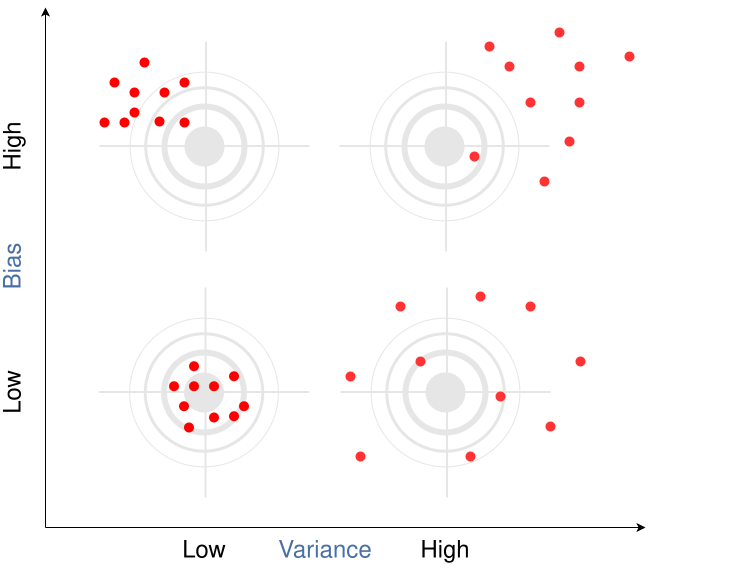
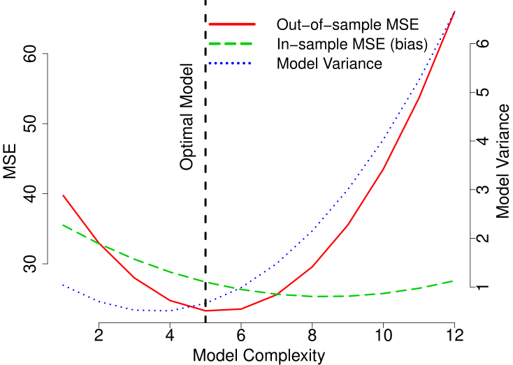
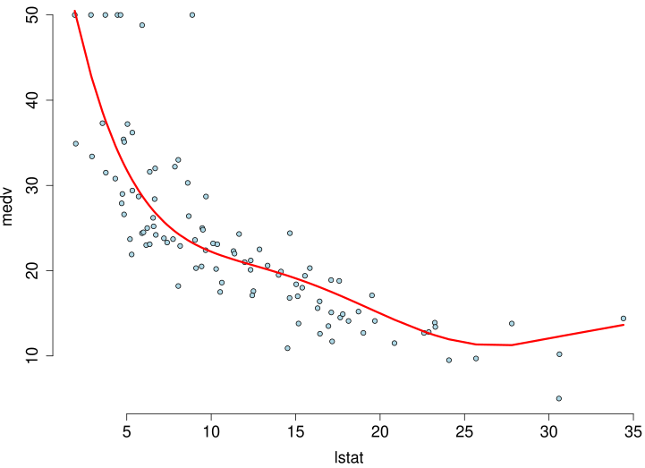
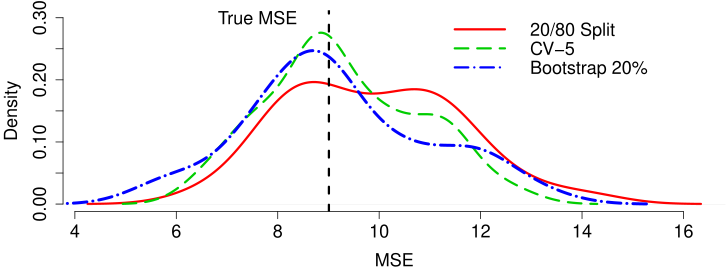
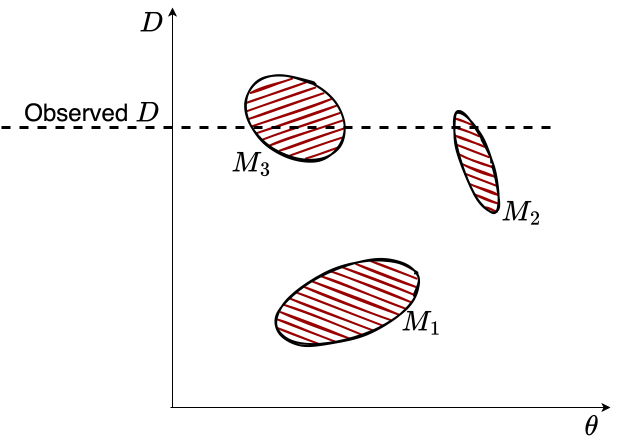



> "*When you have eliminated the impossible, whatever remains, however improbable, must be the truth.*"---Sherlock Holmes

# Model Selection {#sec-select}

Model selection is the art of choosing the model that best captures the true signal while avoiding the trap of fitting noise. Holmes' words apply directly: when confronted with data, we must navigate countless possible models, each representing a different hypothesis, and systematically eliminate those that fail to generalize.

The next chapter (@sec-theoryai) covers regularization techniques (Ridge regression, LASSO, and their Bayesian interpretations), which can also be viewed as model selection mechanisms. Here we focus on the fundamental considerations: the bias-variance tradeoff, overfitting and underfitting, computational constraints, and whether our goal is prediction or interpretation. We draw on Breiman's influential distinction between the "two cultures" of statistical modeling, then develop practical methodologies including cross-validation and information criteria.

## Fundamental Considerations in Model Selection

### Model Complexity and Generalization
Choosing the right model for the relationship between $x$ and $y$ involves navigating a fundamental trade-off between model complexity and generalization ability. If the chosen model is too simple (e.g., linear regression when the true relationship is polynomial), it might underfit the data and fail to capture important relationships, leading to high bias and poor performance on both training and test data. Conversely, a model that is excessively complex (e.g., high-degree polynomials or deep neural networks trained on insufficient data) risks overfitting by memorizing training examples rather than learning the underlying pattern. This results in excellent training performance but poor generalization to unseen examples. This challenge is exacerbated when dealing with non-linear relationships, high-dimensional data, or noisy signals, where the optimal complexity is not immediately obvious. Systematic experimentation with different model architectures, regularization techniques, and hyperparameter tuning is often required to strike the right balance between signal capture and noise rejection.

### Overfitting and Underfitting

Overfitting arises when a statistical learning algorithm captures stochastic noise rather than the underlying signal. This phenomenon typically manifests when a model possesses excessive degrees of freedom relative to the training data size, allowing it to "memorize" specific examples. While such a model may achieve near-zero error on the training set, it fails to generalize to new data because it has learned idiosyncrasies specific to the training sample rather than the general population structure. Common indicators of overfitting include a diverging gap between training and validation error curves or performance degradation on held-out data during training.

Underfitting, conversely, occurs when a model lacks the sufficient complexity to capture the true underlying structure between inputs and outputs. This often results from specifying a model class that is too rigid (e.g., fitting a linear model to quadratic data) or from over-regularization. An underfit model exhibits high bias, performing poorly on both training and test datasets.

### Data Quality and Quantity

The reliability of predictive models is intrinsically linked to the quality and richness of the available data. Noisy, incomplete, or biased data inevitably leads to suboptimal model performance. While sufficient data volume is crucial for learning complex relationships, data *quality* often plays a more decisive role. Issues such as missing values, inconsistent formatting, label noise, and sampling bias are pervasive in real-world applications.

To address these challenges, the industry has seen the rise of data-centric AI platforms. Services like Scale AI and Toloka offer human-in-the-loop solutions for high-quality data annotation and validation. These platforms leverage globally distributed workforces to perform tasks ranging from image segmentation to text classification, ensuring that the ground truth labels used for training are accurate. By implementing rigorous quality control mechanisms (such as consensus voting among multiple annotators and dynamic skill-based routing), these services mitigate the risks associated with poor data quality.

### Model Explainability

In many high-stakes domains, such as healthcare, finance, and criminal justice, predictive accuracy alone is insufficient. Stakeholders require *interpretability*: a clear understanding of how a model arrives at its decisions. This need drives the trade-off between using complex "black box" models (like deep neural networks) and simpler, transparent models (like logistic regression or decision trees).

Regulatory frameworks, including the EU's GDPR, increasingly mandate a "right to explanation," compelling organizations to deploy systems that are not just accurate but also accountable. While we explore specific techniques for achieving this (such as LIME, SHAP, and attention mechanisms) in detail later in this chapter, it is vital to recognize at the outset that the choice of model often dictates the ceiling of explainability.

<!-- The detailed discussion of LIME, SHAP, attention, etc. has been consolidated into the "Model Explainability" section later in the chapter. -->

### Computational Cost

Training and serving predictive models can be computationally expensive, particularly for deep learning architectures operating on massive datasets. In resource-constrained environments, this necessitates a trade-off between model performance and computational efficiency.

Development of specialized hardware has played a pivotal role in addressing this. Graphics Processing Units (GPUs) and Tensor Processing Units (TPUs) allow for massive parallelization of matrix operations, reducing training times from weeks to hours. However, *inference* cost remains a challenge for deployment.

Edge computing (processing data locally on devices rather than in the cloud) has emerged as a solution for low-latency applications like autonomous driving and IoT. To enable this, techniques such as *quantization* (reducing numerical precision from 32-bit floats to 8-bit integers) and *model pruning* (removing redundant connections) are frequently employed. These methods allow complex models to run efficiently on mobile and embedded hardware with minimal loss of accuracy.

### Ethical Considerations

Predictive models are not value-neutral; their deployment can have serious societal consequences. Ethical failures often manifest as *algorithmic bias*, where models perpetuate or amplify existing discrimination. For instance, facial recognition systems trained on imbalanced datasets have demonstrated significantly higher error rates for darker-skinned individuals. Similarly, hiring algorithms trained on historical data may learn to replicate past discriminatory hiring practices.

Fairness in machine learning is an active area of research, dealing with metrics like statistical parity and equalized odds. However, maximizing fairness often requires trade-offs with predictive accuracy, necessitating careful ethical judgment during model development.

Privacy is another key concern. Deep learning models can inadvertently memorize sensitive training data, making them vulnerable to inversion attacks. *Differential privacy* offers a rigorous mathematical framework to mitigate this risk by adding calibrated noise to computations, ensuring that the model's output does not reveal whether any specific individual's data were included in the training set.

Finally, accountability is essential. "Algorithmic impact assessments" and "audits" are becoming standard practice to evaluate potential harms before deployment, ensuring that systems serve the public good while minimizing risk.


## Prediction vs Interpretation

Predictive models can serve two distinct purposes: prediction and interpretation. These goals often conflict. Interpretation requires understanding the relationship between input and output variables, which typically demands simpler, more transparent models.

A model that excels at prediction might not be suitable for interpretation. For example, a complex deep neural network might achieve high predictive accuracy but provide little insight into how the input variables influence the output. Conversely, a simple linear model might be highly interpretable but lack the flexibility to capture complex relationships in the data. A key advantage of linear models is their ability to serve both purposes effectively, unlike more complex models with many parameters that can be difficult to interpret.

Interpretation problems typically require simpler models. We prioritize models that are easy to interpret and explain, even if they have slightly lower predictive accuracy. The evaluation metrics also differ: for interpretation, we typically use the coefficient of determination (R-squared) or $p$-values, which provide insights into the model's fit and the statistical significance of the estimated relationships.

The choice between using a model for prediction or interpretation depends on the specific task and desired outcome. If the primary goal is accurate predictions, a complex model with high predictive accuracy might be preferred, even if it is less interpretable. However, if understanding the underlying relationships and causal mechanisms is crucial, a simpler and more interpretable model might be chosen, even if it has slightly lower predictive accuracy. Interpretive models are commonly used in scientific research, social sciences, and other fields where understanding the underlying causes and relationships is crucial.

In practice, it's often beneficial to consider both prediction and interpretation when building and evaluating models. However, it is not unusual to build two different models, one for prediction and one for interpretation.


### Breiman's Two Cultures

Let $x$ be a high-dimensional input containing a large set of potentially relevant data, and let $y$ represent an output (or response) to a task that we aim to solve based on the information in $x$. @breiman2001statistical summarizes the difference between statistical and machine learning philosophy as follows:

> "There are two cultures in the use of statistical modeling to reach conclusions from data. One assumes that the data are generated by a given stochastic data model. The other uses algorithmic models and treats the data mechanism as unknown."

> "The statistical community has been committed to the almost exclusive use of data models. This commitment has led to irrelevant theory, questionable conclusions, and has kept statisticians from working on a large range of interesting current problems."

> "Algorithmic modeling, both in theory and practice, has developed rapidly in fields outside statistics. It can be used both on large complex data sets and as a more accurate and informative alternative to data modeling on smaller data sets. If our goal as a field is to use data to solve problems, then we need to move away from exclusive dependence on data models and adopt a more diverse set of tools."

Deep learning predictors offer several advantages over traditional predictors:

- Input data can include all data of possible relevance to the prediction problem at hand
- Nonlinearities and complex interactions among input data are accounted for seamlessly
- Overfitting is more easily avoided than with traditional high-dimensional procedures
- Fast, scalable computational frameworks (such as TensorFlow) are available

Tree-based models and deep learning models exemplify the "algorithmic culture" that Breiman describes. These models can capture complex, non-linear relationships in data without requiring explicit specification of the functional form. However, this flexibility comes at the cost of interpretability. While decision trees offer some interpretability through their hierarchical structure, deep neural networks are often considered "black boxes" due to their complex, multi-layered architecture.

The trade-off between interpretability and accuracy is a central theme in modern machine learning. Simple models like linear regression are highly interpretable but may lack the flexibility to capture complex patterns. Complex models like deep neural networks can achieve high accuracy but are difficult to interpret. This has led to the development of various techniques for making complex models more interpretable, including feature importance measures, attention mechanisms, and surrogate models that approximate the behavior of complex models with simpler, more interpretable ones.

## Diagnostics for Model Assumptions

What makes a good model? If the goal is prediction, then the model is as good as its predictions. The easiest way to visualize the quality of predictions is to plot $y$ versus $\hat{y}$. Most of the time we use empirical assessment of model quality. However, sometimes theoretical bounds can be derived for a model that describe its accuracy. For example, in the case of the simple linear regression model, the prediction interval is defined by 
$$
\hat{y} \pm t_{n-2,\,1-\alpha/2}\, s\sqrt{1+\frac{1}{n}+\frac{(x-\bar{x})^2}{\sum_{i=1}^n(x_i-\bar{x})^2}}
$$
where $t_{n-2,\,1-\alpha/2}$ is the $1-\alpha/2$ quantile of the t distribution with $n-2$ degrees of freedom, which gives the interval coverage $1-\alpha$, and $s$ is the standard deviation of the residuals, $s^2 = \sum_{i=1}^n (y_i-\hat{y}_i)^2/(n-2)$. The prediction interval is the confidence interval for the prediction. The prediction interval is wider than the confidence interval because it includes the uncertainty in the prediction.

Assume we have a predictive model 
$$
y = f(x) + \epsilon
$$
and we have some modeling assumption regarding the distribution of $\epsilon$. For example, when we use linear regression or BART, we assume that $\epsilon$ follows a normal distribution. One simple approach to test if observed samples $\epsilon_1,\ldots,\epsilon_n$ follow a specific distribution is to use *Exploratory Data Analysis (EDA)*.

The most common tools for exploratory data analysis are Q-Q plots, scatter plots, and bar plots/histograms.

A Q-Q plot compares the quantiles of your data with the quantiles of a theoretical distribution (like normal, exponential, etc.). A quantile is the fraction (or percent) of points below the given value. That is, the $i$-th quantile is the point $x$ for which $i$% of the data lie below $x$. On a Q-Q plot, if the two datasets come from a population with the same distribution, we should see the points forming a line that's roughly straight. More precisely, if the two datasets $x$ and $y$ come from the same distribution, then the points $(x_{(i)}, y_{(i)})$ should lie roughly on the line $y = x$. If $y$ comes from a distribution that's linear in $x$, then the points $(x_{(i)}, y_{(i)})$ should lie roughly on a line, but not necessarily on the line $y = x$. 

::: {#exm-qqplot}
## Normal Q-Q Plot

@fig-qqplot shows the normal Q-Q plot for the Data on birth weights of babies born in a Brisbane hospital on December 18, 1997. The dataset contains 44 records. A more detailed description of the dataset can be found in [`UsingR manual`](https://rdrr.io/cran/UsingR/man/babyboom.html).


```{r}
#| echo: true
#| fig-cap: "Normal Q-Q plot of baby weights."
#| label: fig-qqplot
babyboom <- read.csv("data/babyboom.csv")
qqnorm(babyboom$wt, bg = "lightblue", main = "", ylab = "Weight (g)")
qqline(babyboom$wt, col = "red", lwd = 3)
```

Visual inspection of the Q-Q plot strongly suggests that birth weights are not normally distributed. We can see that on the left side of the plot the points are below the line. This indicates that the data are skewed to the left.


The Q-Q plots look different if we split the data based on gender.
```{r}
#| layout-ncol: 2
#| fig-width: 2.6
#| fig-height: 1.8
#| label: fig-qqplot-gender
#| fig-cap: "Normal Q-Q plots of baby weights by gender."
#| fig-subcap:
#|   - "Girls"
#|   - "Boys"
par(pch = 21, cex = 1.1)
g <- babyboom %>%
    filter(gender == "girl") %>%
    pull(wt)
b <- babyboom %>%
    filter(gender == "boy") %>%
    pull(wt)
qqnorm(g, bg = "lightblue", main = "", ylab = "Weight (g)")
qqline(g, col = 2)
qqnorm(b, bg = "lightblue", main = "", ylab = "Weight (g)")
qqline(b, col = 2)
```

How about the number of births per hour?
  
```{r}
#| echo: true
#| fig-cap: "Number of hours with a given number of births: observed and expected under a Poisson distribution."
#| fig-height: 3
hr <- ceiling(babyboom$running.time / 60)
BirthsByHour <- tabulate(hr)
# Number of hours with 0, 1, 2, 3, 4 births
ObservedCounts <- table(BirthsByHour)
# Average number of births per hour
BirthRate <- sum(BirthsByHour) / 24
# Expected counts for Poisson distribution, the last bin holds 4 or more births
ExpectedCounts <- c(dpois(0:3, BirthRate), ppois(3, BirthRate, lower.tail = FALSE)) * 24
# bind into matrix for plotting
ObsExp <- rbind(ObservedCounts, ExpectedCounts)
barplot(ObsExp, names = c(0:3, "4+"), beside = TRUE, legend = c("Observed", "Expected"),
        xlab = "Births per hour", ylab = "Number of hours")
```

What about the Q-Q plot?
  
```{r}
#| echo: true
# birth intervals
birthinterval <- diff(babyboom$running.time)
# quantiles of standard exponential distribution (rate=1)
exponential.quantiles <- qexp(ppoints(43))
qqplot(exponential.quantiles, birthinterval, bg = "lightblue",
       xlab = "Exponential quantiles", ylab = "Time between births (minutes)")
lmb <- mean(birthinterval)
lines(exponential.quantiles, exponential.quantiles * lmb, col = 2) # Overlay a line
```

Here 

- `ppoints` function computes the sequence of probability points
- `qexp` function computes the quantiles of the exponential distribution
- `diff` function computes the difference between consecutive elements of a vector
:::


## Out-of-Sample Performance

A parametric model is selected from a family of functions, with optimization finding the best member by minimizing empirical loss or maximizing likelihood. Finding the right family is the *model selection* problem: which predictors, interactions, or transformations achieve the best balance between complexity and accuracy? In practice, several models often perform nearly identically.

The optimal model is rarely the one that fits training data perfectly, which typically indicates overfitting, where the model captures noise rather than signal. A good model balances fit against simplicity to ensure generalization.

The goal of model selection is not only to achieve a good fit but also to reduce complexity by excluding unnecessary parameters. This process typically involves selecting a model from a relevant class of functions while keeping in mind the trade-offs between bias, variance, and model complexity. Techniques such as cross-validation, information criteria (e.g., AIC, BIC), and regularization methods are commonly used to guide the model selection process.

The model selection task is sometimes one of the most time-consuming parts of data analysis. Unfortunately, there is no single rule to find the best model. One way to think about the model choice problem is as yet another optimization problem, with the goal of finding the best family of functions that describe the data. With a small number of predictors, we can use brute force (check all possible models). For example, with $p$ predictors there are $2^p$ possible models with no interactions. Thus, the number of potential function families is huge even for modest values of $p$. One cannot consider all transformations and interactions.

Our goal is to build a model that predicts well for out-of-sample data, i.e., data that was not used for training. Ultimately, we are interested in using our models for prediction, and thus out-of-sample performance is the most important metric and should be used to choose the final model. In-sample performance is of little interest when choosing a predictive model, as one of the winners of the Netflix prize put it: "It's like predicting how much someone will like a movie, having them watch it and tell you how much they really liked it." The goal is to use data to find a pattern that we can exploit. The pattern will be "statistical" in nature. To uncover the pattern, we start with a training dataset, denoted by
$$
D = (y_i,x_i)_{i=1}^n
$$
and to test the validity of our model, we use an out-of-sample testing dataset
$$
D^* = (y_j^*, x_j^*)_{j=1}^m,
$$
where $x_i$ is a set of $p$ predictors and $y_i$ is the response variable.

A good predictor will "generalize" well and provide low MSE out-of-sample. There are a number of methods/objective functions that we will use to find $\hat{f}$. In a parameter-based approach, we will find a black box. There are a number of ways to build our black box model. Our goal is to find the map $f$ that approximates the process that generated the data. For example, data could represent some physical observations, and our goal is to recover the "laws of nature" that led to those observations. One of the pitfalls is to find a map $f$ that does not generalize. Generalization means that our model actually learned the "laws of nature" and not just identified patterns present in training. The lack of generalization of the model is called overfitting. It can be demonstrated in one dimension by remembering the fact from calculus that any set of $n$ points can be approximated by a polynomial of degree $n$, e.g., we can always draw a line that connects two points. Thus, in one dimension we can always find a function with zero empirical risk. However, such a function is unlikely to generalize to observations that were not in our training data. The empirical risk measure for $D^*$ is likely to be very high.

::: {#exm-hard}
## Hard Function

Say we want to approximate the following function 
$$
f(x) = \dfrac{1}{1+25x^2}.
$$ 
This function is simply a ratio of two polynomial functions, and we will try
to build a linear model to reconstruct this function:
```{r}
#| echo: true
x <- seq(-2, 2, by = 0.01)
y <- 1 / (1 + 25 * x^2)
# Approximate with polynomial of degree 1 and 2
m1 <- lm(y ~ x)
m2 <- lm(y ~ poly(x, 2))
# Approximate with polynomial of degree 20 and 5
m20 <- lm(y ~ poly(x, 20))
m5 <- lm(y ~ poly(x, 5))
```

```{r}
#| label: fig-runge
#| fig-cap: Runge function
#| fig-height: 3
x <- seq(-3, 3, by = 0.01)
y <- 1 / (1 + 25 * x^2)
plot(x, y, type = "l", col = "black", lwd = 2)
abline(v = c(-2, 2), col = "gray60")
lines(x, predict(m1, list(x = x)), lwd = 2, col = 1, lty = 3)
lines(x, predict(m2, poly(x, 2)), lwd = 2, col = 2, lty = 2)
lines(x, predict(m5, poly(x, 5)), lwd = 2, col = 3, lty = 4)
lines(x, predict(m20, poly(x, 20)), lwd = 2, col = 4, lty = 5)
legend(0.6, 1.02, legend = c("f(x)", "m1", "m2", "m5", "m20"), col = c("black", 1:4), lty = c(1, 3, 2, 4, 5), lwd = 2, seg.len = 3, cex = 0.8, bty = "n")
```
@fig-runge shows the function itself (solid black line) on the interval $[-3,3]$. We used observations of $x$ from the interval $[-2,2]$ to train the data (between the vertical lines) and from $[-3,-2) \cup (2,3]$ (outside them) to test the model and measure the out-of-sample performance. We tried four different linear functions to capture the relations. We see that the linear model $\hat{y} = \beta_0 + \beta_1 x$ is not a good model. However, as we increase the degree of the polynomial to 20, the resulting model $\hat{y} = \beta_0 + \beta_1x + \beta_2 x^2 +\ldots+\beta_{20}x^{20}$ does fit the training dataset quite well, but does a very poor job on the test dataset. Thus, while in-sample performance is good, the out-of-sample performance is unsatisfactory. We should not use the degree 20 polynomial function as a predictive model. In practice, in-sample loss or classification rates provide us with a metric for comparing different predictors. There should be a penalty for overly complex rules that fit extremely well in-sample but perform poorly on out-of-sample data. As a dictum often attributed to Einstein puts it, "A model should be simple, but not simpler."
:::

To a Bayesian, the solutions to statistical decision problems (estimation, prediction and model choice) are rather obvious: compute posterior distributions, and then make decisions by maximizing expected utility, where the posterior distribution is used to calculate the expectations. Classical solutions to these problems are different, and use repeated sampling ideas, whereby the performance of a decision rule is judged on its performance if the same decision problem were repeated infinitely. Thus, the decisions are made based on their population properties. One of the main uses of statistical decision theory is to compare different estimators or hypothesis testing procedures. This theory generates many important findings, most notably that many of the common classical estimators are "bad", in some sense, and that Bayesian estimators under a proper prior are "good", namely admissible (under mild conditions; Bayes rules from improper priors carry no such guarantee).

## Bias-Variance Trade-off

For any predictive model, we seek to achieve the best possible results, i.e., the smallest MSE or misclassification rate. For a historical perspective on how aggregating independent estimates reduces variance while preserving low bias, see the discussion of Galton's ox-weighing experiment in @sec-bias-variance-galton. However, model performance can vary depending on the specific training/validation split used. A model that performed well on one test set may not produce good results given additional data. Sometimes we observe situations where a small change in the data leads to a large change in the final estimated model, e.g., the parameters of the model. These results exemplify the bias/variance tradeoff, where increasing model bias can reduce variance in the final results. Similarly, low bias can result in high variance, but can also produce an oversimplification of the final model.

{#fig-bias-variance width=50%}


:::{#exm-bias-variance}
## Bias-variance
We demonstrate bias-variance concept using Boston housing example. We fit a model $\mathrm{medv} = f(\mathrm{lstat})$. We use polynomial functions to approximate this relation. We fitted twelve polynomial functions with degree $1,\ldots,12$ ten times. Each time we randomly selected 20% of the sample for testing and the rest for training. We estimated in-of-sample performance (bias) and out-of-sample performance by calculating MSE on training and testing sets correspondingly. For each polynomial $f$ we averaged MSE from each of the ten models.

@fig-boston-bias-variance shows bias and variance for our twelve different models. As expected, bias decreases while variance increases as model complexity grows. On the other hand out-of-sample MSE is a U-shaped curve. The optimal model is the one that has smallest out-of-sample MSE. In our case, it is a polynomial of degree 5!

::: {#fig-boston layout-ncol=2}

{#fig-boston-bias-variance}

{#fig-boston-optimal-model}

Metrics for twelve polynomial functions fitted into Boston housing dataset. Left panel: As model complexity (degree of the polynomial function) increases, model variance increases and bias decreases. Out-of-sample MSE is smallest for 5th degree polynomial function, which is the optimal model in terms of bias-variance trade-off. Right panel: Optimal model, which is 5th degree polynomial used to predict observations from testing dataset. Model predictions (solid line) are compared to actual observed values of medv variable (dots).
:::

Let's take another, more formal look at the bias-variance trade-off for a linear regression problem. We are interested in the decomposition of the error $\E{(y-\hat{y})^2}$ as a function of bias $\E{y-\hat{y}}$ and variance $\Var{\hat{y}}$.

Here $\hat{y} = \hat{f}_{\beta}(x)$ is the prediction from the model, and $y = f(x) + \epsilon$ is the true value, which is measured with noise $\Var{\epsilon} = \sigma^2$, where $f(x)$ is the true unknown function. The expectation above measures the squared error of our model on a random sample $x$. 
$$
\begin{aligned}
\E{(y - \hat{y})^2}
& = \E{y^2 + \hat{y}^2 - 2 y\hat{y}} \\
& = \E{y^2} + \E{\hat{y}^2} - \E{2y\hat{y}} \\
& = \Var{y} + \E{y}^2 + \Var{\hat{y}} + \E{\hat{y}}^2 - 2f\E{\hat{y}} \\
& = \Var{y} + \Var{\hat{y}} + (f^2 - 2f\E{\hat{y}} + \E{\hat{y}}^2) \\
& = \Var{y} + \Var{\hat{y}} + (f - \E{\hat{y}})^2 \\
& = \sigma^2 + \Var{\hat{y}} + \mathrm{Bias}(\hat{y})^2\end{aligned}
$$
Here we used the following identity: $\Var{X} = \E{X^2} - \E{X}^2$ and the fact that $f$ is deterministic and $\E{\epsilon} = 0$, thus $\E{y} = \E{f(x)+\epsilon} = f + \E{\epsilon} = f$.
::: 

## Cross-Validation

If the dataset at hand is small and we cannot dedicate a large enough sample size for testing, simply measuring error on a test dataset can lead to wrong conclusions. When the size of the testing set $D^*$ is small, the estimated out-of-sample performance has high variance, depending on precisely which observations are included in the test set. On the other hand, when the training set $D$ is a large fraction of the entire sample available, the estimated out-of-sample performance will be underestimated. Why?

A simple solution is to perform the training/testing split randomly several times and then use the average out-of-sample errors. This procedure has two parameters: the fraction of samples to be selected for testing $p$ and the number of estimates to be performed $K$. The resulting algorithm is as follows:

```
set.seed(1)
fsz = as.integer(p*n)
error = rep(0,K)
for (k in 1:K)
{
    test_ind = sample(1:n,size = fsz)
    training = d[-test_ind,]
    testing = d[test_ind,]
    m = lm(y~x, data=training)
    yhat = predict(m,newdata = testing)
    error[k] = mean((yhat-testing$y)^2)
}
res = mean(error)
```

@fig-bootstrap shows the process of splitting the dataset randomly five times.

Cross-validation modifies the random splitting approach to use a more "disciplined" way to split the dataset for training and testing. Instead of randomly selecting training data points, CV chooses consecutive observations, and thus each data point is used once for testing. Like the random approach, CV helps address the high variance issue of out-of-sample performance estimation when the available dataset is small. @fig-cv shows the process of splitting the dataset five times using the cross-validation approach.

::: {layout-ncol=2}
{#fig-bootstrap}

{#fig-cv}

Training set (dark squares) and testing set (light squares)
:::

::: {#exm-simulated}
## Simulated
We use a simulated dataset to demonstrate the difference between estimated out-of-sample performance using random 20/80 split, 5-fold cross-validation and bootstrap. We used $x=-2,-1.99,-1.98,\ldots,2$ and $y = 2+3x + \epsilon, ~ \epsilon \sim N(0,\sqrt{3})$. We simulated 35 datasets of size 100. For each of the simulated datasets, we fitted a linear model and estimated out-of-sample performance using three different approaches. @fig-test-error20 compares empirical distribution of errors estimated from 35 samples.


{#fig-test-error20 width=70%}


As we can see the estimated out-of-sample performance by a training set approach is of high variance. While both cross-validation and bootstrap approaches lead to better estimates, they require the model to be fitted 5 times, which can be computationally costly for a complex model. On the other hand, estimate from cross-validation is of lower variance and less bias compared to the bootstrap estimate. Thus, we should prefer cross-validation.
:::


## Model Evaluation: Calibration, Discrimination, and Scoring {#sec-model-eval}

Variable selection is often presented as choosing a subset of predictors. A complementary view is that we are searching for a low-dimensional summary of the inputs that retains predictive information: an informal analogue of the idea of a minimal sufficient statistic from classical inference (@sec-bl).

When we evaluate models, it is useful to separate three questions. First, does the model rank or separate cases well (discrimination)? Second, do the model's predicted probabilities match observed frequencies (calibration)? Third, when we must make decisions, how should we score probabilistic forecasts so that \"better\" means \"closer to the truth\" in a principled way?


For binary outcomes, discrimination is often summarized by the receiver operating characteristic (ROC) curve. For a thresholded score, define the true positive rate (TPR) and false positive rate (FPR) as the threshold varies. The ROC curve plots TPR against FPR across all thresholds, and the area under the curve (AUC) summarizes performance as a single number between 0 and 1, with 0.5 corresponding to random ranking; see @fawcett2006roc.

### Calibration and Calibration Plots

Calibration concerns the probabilistic interpretation of predicted probabilities. A well-calibrated model that outputs $\hat p=0.8$ in many cases should be correct about 80% of the time in those cases. A common diagnostic is a calibration plot (reliability diagram), which bins predictions and compares average predicted probability to the empirical frequency in each bin.

### Proper Scoring Rules (and the Decision-Theory Link)

A proper scoring rule assigns a numerical score to a probabilistic forecast and is designed so that, in expectation, the best strategy is to report the true predictive distribution; see @gneiting2007strictly. Two widely used examples are the log score (negative log predictive density) and the Brier score for binary outcomes @brier1950verification. These connect directly to @sec-Decisions: choosing a scoring rule is equivalent to choosing a loss for probabilistic prediction, and the expected score becomes a decision-theoretic risk.

For Bayesian models, posterior predictive checks compare observed data to replicated data drawn from the posterior predictive distribution. The workflow is: sample parameters from the posterior, simulate replicated datasets, and compare summary statistics or discrepancies between observed and replicated data; see @gelman2013bda.

## Bayesian Model Selection

The probabilistic models of interest are the joint probability distribution $p(D,\theta)$ (called a generative model) and $P(Y,\theta \mid X)$ (discriminative model). Discriminative models are easier to build and are more frequently used in practice. Generative models require modeling a distribution over the set of observed variables, which makes our model more complicated. Text analysis provides an illustrative example. The task of identifying the topic of an article can be solved using a discriminative distribution. The problem of generating a new article requires a generative model.

Let $D$ denote data. Let $\theta_M \in \Theta_M$ denote a set of parameters under model $M \in \mathcal{M}$. Let $\theta_M = (\theta_1, \ldots, \theta_M)$ be the $p$-vector of parameters. The Bayesian approach is straightforward: implement the Bayesian paradigm by executing Bayes' rule. This requires the laws of probability and not optimization techniques. The notion of model complexity is no different. Let $\mathcal{M}$ denote the space of models and $\theta$ be the parameter vector. The Bayesian paradigm simply places probabilities over parameters and models given the data, namely $p(\theta_M, M \mid y)$, where $y = (y_1, \ldots, y_n)$.

This has a number of decompositions. Bayes' theorem calculates the joint posterior over parameters and models given data $D$, namely
$$
    p(\theta_M,M\mid D) = p(\theta_M \mid M,D)P(M\mid D).
$$
Notice how this factors the posterior into two terms: the conditional posterior over parameters given the model and the posterior over models given data.

The key quantity is the weight of *evidence* (a.k.a. marginal distribution of the data $D$ given the model $M$), defined by
$$
p(D \mid M) = \int_{\Theta_M} p(D \mid \theta_M, M) p(\theta_M \mid M) d\theta_M.
$$
Here $p(D \mid \theta_M, M)$ is the traditional likelihood function. The key conditional distribution, however, is the specification of the prior over parameters $p(\theta_M \mid M)$. As this is used in the marginalization, it can affect the Bayes risk dramatically. Occam's razor comes from the fact that this marginalization provides a weight of evidence that favors simpler models over more complex ones.

This leads to a posterior over models, which is calculated as:
\begin{align*}
    P(M\mid D)  & = \dfrac{p(D\mid M)P(M)}{p(D)}, \\
    p(D\mid M ) & = \int_{ \Theta_M} p(D\mid \theta_M , M ) p( \theta_M \mid M ) d \theta_M.
\end{align*}
Notice that this requires a joint prior specification $p(\theta_M, M) = p(\theta_M \mid M)p(M)$ over parameters and models. The quantity $p(M \mid D)$ is the marginal posterior for model complexity given the data.
There is an equivalent posterior $p(\theta_M \mid D)$ for the parameters. $p(D \mid M)$ is the evidence of the data $D$ given the complexity (a.k.a. conditional likelihood). The full evidence is
$$
p( D ) = \int p( D \mid M ) p(M) d M.
$$
This has been used to select the amount of hyperparameter regularization; see, for example, @mackay1992bayesian.

We will see that the prior $p(\theta_M \mid M)$ will lead to an Occam's razor effect, namely that the marginal distribution will favor simpler models. Importantly, this Occam's razor effect is not in conflict with the Bayesian double descent phenomenon, which emerges from the marginal posterior of models given data and the conditional prior specification $p(\theta_M \mid M)$.


:::{#exm-dice-example}
## Dice Example

Let's consider a simple example of throwing a dice. Say, there are three dice: one that has numbers 1 through 6 (regular dice), one with three sides with ones and three sides with 2s (dice 1-2), one with two sides each showing 1, 2, and 3 (dice 1-2-3).

:::{layout-ncol="3"}

{width="30%"}

{width="30%"}

{width="30%"}

:::

You observe the outcome of one dice throw, and it is 3. Which dice is it?

Two out of three explanations are plausible (dice 1-2-3 and regular dice). Intuitively, the 1-2-3 dice is more likely to produce 3 than the regular dice. Thus, if we need to choose, we would choose the 1-2-3 dice. For the sake of completeness, we can use Bayes' rule to calculate the evidence for each model.


Using Bayes' rule:
$$P(M_i \mid D) = \frac{P(D \mid M_i) P(M_i)}{P(D)}$$

where $M_i$ represents each dice model, and $D$ is the observed data (outcome = 3).

We set equal prior probabilities for each dice:
$$P(M_1) = P(M_2) = P(M_3) = \frac{1}{3}.$$
Now, we calculate the likelihood for each model.

| Dice Type       | Probability of Rolling a 3 |
|-----------------|----------------------------|
| Regular dice ($M_1$) | $P(3 \mid M_1) = 1/6$ |
| Dice 1-2 ($M_2$)     | $P(3 \mid M_2) = 0$  |
| Dice 1-2-3 ($M_3$)   | $P(3 \mid M_3) = \frac{1}{3}$  |

Then, the marginal likelihood is:
$$
P(D) = \sum_{i=1}^{3} P(D \mid M_i) P(M_i) = \frac{1}{6} \cdot \frac{1}{3} + 0 \cdot \frac{1}{3} + \frac{1}{3} \cdot \frac{1}{3} = \frac{1}{6}.
$$

Finally, posterior probabilities are

| Dice Type       | Posterior Probability                                                  |
|-----------------|------------------------------------------------------------------------|
| Regular dice    | $P(M_1 \mid D) = \frac{\frac{1}{6} \cdot \frac{1}{3}}{\frac{1}{6}}=1/3$   |
| Dice 1-2        | $P(M_2 \mid D) = \frac{0 \cdot \frac{1}{3}}{\frac{1}{6}}=0$               |
| Dice 1-2-3      | $P(M_3 \mid D) = \frac{\frac{1}{3} \cdot \frac{1}{3}}{\frac{1}{6}}=2/3$   |

Given the observation of outcome 3, the dice 1-2-3 is twice as likely as the regular dice. The dice 1-2 is completely ruled out since it cannot produce a 3. This demonstrates how Bayesian model selection naturally eliminates impossible explanations and provides relative evidence for competing hypotheses.

:::

This example demonstrates how the Bayesian paradigm provides a coherent framework to simultaneously infer parameters and model complexity. The fact that the Bayesian approach selects the most probable model that explains the observed data is called the automatic Occam's razor. Occam's razor is a principle that states that the simplest explanation is the best explanation.


While performing data analysis using learning algorithms, we perform two tasks, namely training and inference which are summarized in the table below

      Step     Given                               Hidden             What to find
  ------------ ----------------------------------- ------------------ ----------------------------------------------
    Training   $D = (X,Y) = \{x_i,y_i\}_{i=1}^n$   $\theta$           $p(\theta \mid D)$
   Prediction  $x_{\text{new}}$                    $y_{\text{new}}$   $p(y_{\text{new}}  \mid  x_{\text{new}}, D)$

The training can be performed via Bayes' rule
$$
p(\theta \mid D) = \dfrac{p(Y \mid \theta,X)p(\theta)}{\int p(Y \mid \theta,X)p(\theta)d\theta}.
$$
Now to perform the second step (prediction), we calculate
$$
p(y_{\text{new}}  \mid  x_{\text{new}}, D) = \int p(y_{\text{new}}  \mid  x_{\text{new}},\theta)p(\theta \mid D)d\theta
$$
Thus, full Bayesian inference requires calculating two integrals, which
might be difficult. We mentioned earlier that MAP allows us to avoid
those calculations by approximating the posterior with
$$
p(\theta \mid D) \approx \delta(\theta_{\text{MAP}}),~~\theta_{\text{MAP}} \in \arg\max_{\theta}p(\theta \mid D)
$$
To calculate $\theta_{\text{MAP}}$, we do not need to know the normalizing constant for calculating posterior, since the solution of the optimization problem does not depend on this constant. Further, the second integral for inference becomes degenerate and gets approximated by
$$
p(y_{\text{new}}  \mid  x_{\text{new}}, D) = \int p(y_{\text{new}}  \mid  x_{\text{new}},\theta)p(\theta \mid D)d\theta \approx p(y_{\text{new}}  \mid  x_{\text{new}},\theta_{\text{MAP}}).
$$


The @fig-bayes-model-selection below illustrates the Bayesian model selection process. The figure shows the joint distribution over parameters and data for three models. You can think of each ellipse as the region where most of the probability mass is concentrated.

{width="50%" #fig-bayes-model-selection}


If we project the ellipses onto the parameter space, we get the prior distributions for each model. We can see that the $M_2$ is the most concentrated. If we project the ellipses onto the data space, we get the prior distributions over data for each model. 

After observing data $D$ (horizontal line), each prior gets updated. The intersection of the observed data line with each ellipse shows how well each model can explain the data. Models with good overlap between prior and observed data will have higher posterior probability. $M_3$ appears to have the best intersection with the observed data; it is the model with the highest marginal likelihood.

This illustrates how Bayesian model selection naturally favors models that achieve the best balance between explaining the observed data and maintaining appropriate complexity, automatically implementing Occam's razor through the evidence calculation.


::: {#exm-racial}
## Racial Discrimination
Say we want to analyze racial discrimination by the US courts. The data of @radelet1981racial cover the 326 defendants charged with murder in 20 Florida counties in 1976 and 1977, and the outcome is whether the defendant was sentenced to death.
We have three variables:

- Murderer: $m \in \{0,1\}$ (white/black)
- Victim: $v \in \{0,1\}$ (white/black)
- Sentence: $d \in \{0,1\}$ (no death penalty/death penalty)

Say we have the data

   m   v   d    n
  --- --- --- -----
   0   0   0   132
   0   0   1   19
   0   1   0    9
   0   1   1    0
   1   0   0   52
   1   0   1   11
   1   1   0   97
   1   1   1    6

We would like to establish a causal relationship between the race and
verdict variables. For this, we consider several models

1.  $p(d \mid m,v) = p(d) = \theta$

2.  $p(d \mid m,v) = p(d \mid v)$;
    $p(d \mid v=0) = \alpha, ~p(d \mid v=1)=\beta$

3.  $p(d \mid v,m) = p(d \mid m)$;
    $p(d \mid m=0) = \gamma,~p(d \mid m=1) = \delta$

4.  $p(d \mid v,m)$ cannot be reduced, and\

       $p(d=1 \mid m,v)$   $m=0$     $m=1$
      ------------------- -------- ---------
             $v=0$         $\tau$   $\chi$
             $v=1$         $\nu$    $\zeta$

We calculate which model describes data the best; we calculate the
evidences. We need to describe the discriminative model
$$
p(Y ,\theta \mid X) = p(Y \mid X,\theta)p(\theta \mid X)
$$
Here $X$ is
the number of cases, and $Y$ is the number of death penalties. We use
an uninformative prior $\theta \sim U[0,1]$. To specify the likelihood, we
use the Binomial distribution
$$
Y \mid X,\theta \sim \text{Bin}(X,\theta),~~\text{Bin}(Y \mid X,\theta) = \binom{X}{Y}\theta^Y(1-\theta)^{X-Y}
$$
We assume $p(\theta)\sim Uniform$. Now lets calculate the evidence
$$
p(Y, \theta \mid X) = \int p(Y  \mid  X,\theta)p(\theta)d\theta
$$
for each of the four models

1.  $p(Y \mid X) = \int \text{Bin}(19 \mid 151,\theta)\text{Bin}(0 \mid 9,\theta)\text{Bin}(11 \mid 63,\theta)\text{Bin}(6 \mid 103,\theta)d\theta$ $\propto \int_0^{1} \theta^{36}(1-\theta)^{290}d\theta = \text{Beta}(37,291) = 2.8\times 10^{-51}$
2.  $p(Y \mid X) = \int\int \text{Bin}(19 \mid 151,\alpha)\text{Bin}(0 \mid 9,\beta)\text{Bin}(11 \mid 63,\alpha)\text{Bin}(6 \mid 103,\beta)d\alpha d\beta \propto 4.7\times 10^{-51}$
3.  $p(d \mid v,m) = p(d \mid m)=\int\int \text{Bin}(19 \mid 151,\gamma)\text{Bin}(0 \mid 9,\gamma)\text{Bin}(11 \mid 63,\delta)\text{Bin}(6 \mid 103,\delta)d\gamma d\delta \propto 0.27\times10^{-51}$
4.  $p(d \mid v,m) = \int\int\int\int \text{Bin}(19 \mid 151,\tau)\text{Bin}(0 \mid 9,\nu)\text{Bin}(11 \mid 63,\chi)\text{Bin}(6 \mid 103,\zeta)d\tau d\nu d\chi d\zeta \propto 0.18\times10^{-51}$

The last model (4) is overly complex. With enough parameters, it can perfectly fit any dataset, including the noise. Ideally, we want a model that fits the data well but is also parsimonious. The Bayesian evidence calculation naturally penalized the complex model for its large parameter space, resulting in the lowest evidence score. This illustrates how the Bayesian approach inherently protects against overfitting without requiring an explicit regularization term.

This dataset also illustrates *Simpson's paradox*, a phenomenon where a trend appears in different groups of data but disappears or reverses when these groups are combined. This highlights the importance of considering confounding variables and the structure of the data. A related conceptual problem is *Bertrand's box paradox*, which demonstrates how conditional probability can be counterintuitive. 
:::

### Bayesian Information Criterion (BIC)

The Bayesian Information Criterion (BIC) is a model selection criterion that penalizes the complexity of the model. It is derived from a Bayesian approach. The BIC is defined as:

$$
\mathrm{BIC} = \log p(D\mid \hat{\theta}_k, M_k) - \frac{k}{2} \log n.
$$

Here $\hat{\theta}_k$ is the MAP estimate of the $k$ parameters in model $M_k$, and $n$ is the sample size. As such, there is a penalty $-\frac{k}{2} \log n$ for increasing the dimensionality $k$ of the model under consideration.

The BIC uses the marginal likelihood of the data under model $M_k$ (denoted $M$ for simplicity here), which is approximated using Laplace's method.

The idea of Laplace's method is to approximate integrals of the form $\int f(\theta) e^{-g(\theta)} d\theta$ where $g(\theta)$ has a sharp minimum at some point $\hat{\theta}$. The method works by approximating $g(\theta)$ with its second-order Taylor expansion around the minimum $\hat{\theta}$. Since $g'(\hat{\theta}) = 0$ at the minimum, we have

$$
g(\theta) \approx g(\hat{\theta}) + \frac{1}{2}g''(\hat{\theta})(\theta-\hat{\theta})^2.
$$
So the integral transforms into a Gaussian form:
$$
\int f(\theta) e^{-g(\theta)} d\theta \approx f(\hat{\theta}) e^{-g(\hat{\theta})} \int e^{-\frac{1}{2}g''(\hat{\theta})(\theta-\hat{\theta})^2} d\theta.
$$

The remaining integral is a standard Gaussian integral that evaluates to $\sqrt{\frac{2\pi}{g''(\hat{\theta})}}$, giving us:

$$
\int f(\theta) e^{-g(\theta)} d\theta \approx f(\hat{\theta}) e^{-g(\hat{\theta})} \sqrt{\frac{2\pi}{g''(\hat{\theta})}}.
$$

In the multivariate case, we have $\theta \in \mathbb{R}^k$ is a $k$-dimensional parameter vector. The second-order Taylor expansion around the minimum $\hat{\theta}$ becomes:
$$
g(\theta) \approx g(\hat{\theta}) + \frac{1}{2}(\theta-\hat{\theta})^\top \mathbf{H}(\hat{\theta}) (\theta-\hat{\theta}),
$$
where $\mathbf{H}(\hat{\theta})$ is the $k \times k$ Hessian matrix of second derivatives at $\hat{\theta}$. The multivariate Gaussian integral then evaluates to:

$$
\int f(\theta) e^{-g(\theta)} d\theta \approx f(\hat{\theta}) e^{-g(\hat{\theta})} (2\pi)^{k/2} |\det(\mathbf{H}(\hat{\theta}))|^{-\frac{1}{2}}
$$

In the context of Bayesian model selection, we apply this to approximate the marginal likelihood (evidence). We have:

$$
P(D\mid M) = \int P(D\mid \theta,M)P(\theta\mid M)d\theta
$$

Taking the logarithm and identifying $g(\theta) = -\log P(D\mid \theta,M)P(\theta\mid M)$, the maximum a posteriori (MAP) estimate $\hat{\theta}$ corresponds to the minimum of $g(\theta)$. The Hessian of the log-posterior, $\mathbf{H}(\hat{\theta}) = \nabla^2 \log\left(P(D\mid \hat{\theta},M)P(\hat{\theta}\mid M)\right)$, is negative definite at this mode and determines the local curvature.

$$
p(D\mid M) = \int p(D\mid \theta,M)p(\theta\mid M)d\theta \approx p(D\mid \hat{\theta},M)p(\hat{\theta}\mid M) (2 \pi)^{k/2} |\det(-\mathbf{H}(\hat{\theta}))|^{-\frac{1}{2}}.
$$

Here $\hat{\theta}$ is the posterior mode (MAP estimate), and $\mathbf{H}(\hat{\theta})$ is the Hessian of the log-posterior at the mode (so $-\mathbf{H}(\hat{\theta})$ is positive definite). Taking the logarithm gives $\log p(D\mid \hat{\theta},M) + \log p(\hat{\theta}\mid M) + \frac{k}{2}\log 2\pi - \frac{1}{2}\log\det(-\mathbf{H}(\hat{\theta}))$. For $n$ i.i.d. observations the log-likelihood is a sum of $n$ terms, so $-\mathbf{H}(\hat{\theta}) \approx n\,\mathbf{I}(\hat{\theta})$, where $\mathbf{I}(\hat{\theta})$ is the Fisher information of a single observation, and $\log\det(-\mathbf{H}(\hat{\theta})) \approx k\log n + \log\det\mathbf{I}(\hat{\theta})$. The Hessian determinant therefore supplies the penalty $-\frac{k}{2}\log n$. The prior term, $\frac{k}{2}\log 2\pi$ and $-\frac{1}{2}\log\det\mathbf{I}(\hat{\theta})$ do not grow with $n$ ($O(1)$) and are dropped, while the log-likelihood grows linearly in $n$ and is kept. We get:

$$
\log p(D\mid M) \approx \log p(D\mid \hat{\theta},M) - \dfrac{k}{2}\log n,
$$

which is proportional to the BIC. (Note: The exact definition and derivation of BIC can vary slightly, but this captures the essence). The BIC approximation shows how the Bayesian approach naturally penalizes model complexity through the dimensionality term $-\frac{k}{2}\log n$.

The Bayesian approach averages over the posterior distribution of models given data. Suppose that we have a finite list of models $M \in \{M_1, \ldots, M_J\}$. Then we can calculate the posterior over models as:

$$
p(M_j \mid y) = \frac{p(y \mid M_j) p(M_j)}{\sum_{i=1}^J p(y \mid M_i) p(M_i)}, \quad \text{where}\; p(y \mid M_j) = \int L_j(\theta_j \mid y) p(\theta_j \mid M_j) d\theta_j.
$$

Laplace's approximation provides a simple [@lindley1961use] illustration of how dimensionality is weighted in the Bayesian paradigm. Hence, BIC is related to a log-posterior approximation. Hence, if prior model probabilities $P(M_j)$ are uniform, then $P(M_j\mid D) \propto P(D \mid M_j) \approx \exp(\mathrm{BIC}_j)$.

In a more general case, the evidence (a.k.a. marginal likelihood) for hypotheses (a.k.a. models) $M_i$ is calculated as follows:

$$
P(D\mid M_i) = \int P(D\mid \theta, M_i)P(\theta\mid M_i)d\theta.
$$

Laplace approximation, in the one-dimensional case ($k=1$), yields:

$$
P(D\mid M_i) \approx P(D\mid \hat{\theta}, M_i)P(\hat{\theta}\mid M_i)\sqrt{2\pi}\sigma_{\text{post}}.
$$

Here $\hat{\theta}$ is the maximum \emph{a posteriori} (MAP) estimate of the parameter and $\sigma_{\text{post}} = (-H(\hat{\theta}))^{-1/2}$ where $H(\hat{\theta})$ is the second derivative of the log-posterior at $\hat{\theta}$.

Generally, in the $k$-dimensional case, we have:

$$
P(D\mid M_i) \approx P(D\mid \hat{\theta}, M_i)P(\hat{\theta}\mid M_i) (2\pi)^{k/2} |\det(-\mathbf{H}(\hat{\theta}))|^{-\frac{1}{2}}.
$$

Here $\mathbf{H}(\hat{\theta}) = \nabla^2\log (P(D\mid \hat{\theta}, M_i)P(\hat{\theta}\mid M_i))$ is the Hessian of the log-posterior function evaluated at the mode $\hat{\theta}$. As the amount of data collected increases, this Gaussian approximation is expected to become increasingly accurate.

MacKay [@mackay1992bayesian] proposes an evidence framework for the selection of neural networks.

### The Evidence Framework

David MacKay's evidence framework applies Bayesian model selection to neural networks by computing approximations to the marginal likelihood for different architectures and hyperparameter configurations.

The evidence framework builds upon the Laplace approximation to estimate the marginal likelihood of neural network models. Given a neural network with parameters $\theta$ and hyperparameters $\alpha$ (such as weight decay parameters), the evidence for a particular model configuration is:

$$
P(D \mid M,\alpha) = \int P(D \mid \theta,M) P(\theta \mid M,\alpha) d\theta
$$

where $D$ represents the training data, $M$ denotes the model architecture, and $P(\theta \mid M,\alpha)$ is the prior distribution over network weights. The Laplace approximation evaluates this integral by expanding the log-posterior around its mode $\hat \theta$, yielding:

$$
\log P(D \mid M,\alpha) \approx \log P(D \mid \hat \theta,M) + \log P(\hat \theta \mid M,\alpha) - \frac{1}{2}\log|H|
$$

where $H$ is the Hessian of the negative log-posterior at the mode $\hat \theta$.

The evidence framework provides a principled approach to several critical decisions in neural network design. For hyperparameter selection, the framework automatically determines optimal regularization strengths by maximizing the evidence with respect to hyperparameters such as weight decay coefficients. Rather than relying on cross-validation, which can be computationally expensive and may not capture the full uncertainty in hyperparameter selection, the evidence provides a direct measure of how well different hyperparameter values support the observed data.

Architecture comparison becomes feasible through direct evidence computation for different network structures. The framework can compare networks with different numbers of hidden units, layers, or connectivity patterns by evaluating their respective marginal likelihoods. This comparison naturally incorporates Occam's razor, as more complex architectures are penalized through the integration over their larger parameter spaces, unless the additional complexity is justified by substantially improved fit to the data.

The Hessian computation required for the Laplace approximation presents significant computational challenges for modern deep networks with millions or billions of parameters. The full Hessian matrix would be prohibitively large to compute and store explicitly. MacKay's original framework addressed this through various approximation strategies, including the use of automatic relevance determination (ARD) priors that allow the network to effectively prune irrelevant connections by driving their associated precision parameters to infinity.

### Automatic Relevance Determination (ARD)
The key insight of *Automatic Relevance Determination (ARD)* is to introduce separate precision hyperparameters for different groups of parameters, allowing the model to automatically determine which features or components are relevant for the task.

In the context of neural networks, consider a network with weights $\mathbf{w} = \{w_{ij}\}$ connecting input features to hidden units. Instead of using a single precision parameter $\alpha$ for all weights, ARD introduces feature-specific precision parameters $\{\alpha_i\}_{i=1}^{p}$ where $p$ is the number of input features. The prior distribution for weights becomes:

$$
p(\mathbf{w} \mid \boldsymbol{\alpha}) = \prod_{i=1}^{p} \prod_{j=1}^{H} \mathcal{N}(w_{ij} \mid 0, \alpha_i^{-1})
$$

where $H$ is the number of hidden units and $\boldsymbol{\alpha} = (\alpha_1, \ldots, \alpha_p)$ are the precision hyperparameters.

The hierarchical Bayesian model is completed by placing hyperpriors on the precision parameters:

$$
p(\alpha_i) = \text{Gamma}(\alpha_i \mid a_i, b_i)
$$

where $a_i$ and $b_i$ are shape and rate parameters, often set to small values (e.g., $a_i = b_i = 10^{-6}$) to create weakly informative priors.

The ARD mechanism works through the evidence framework by optimizing the marginal likelihood with respect to the hyperparameters. For a given precision $\alpha_i$, the effective contribution of feature $i$ to the model evidence can be approximated as:

$$
\log p(D \mid \alpha_i) \approx -\frac{1}{2}\alpha_i \|\mathbf{w}_i\|^2 + \frac{H}{2}\log\alpha_i - \frac{1}{2}\log|\mathbf{A}_i|
$$

where $\mathbf{w}_i$ represents all weights associated with feature $i$, and $\mathbf{A}_i$ is the corresponding block of the Hessian matrix.

When a feature is irrelevant, the optimal precision $\alpha_i^*$ tends to infinity, effectively removing the feature from the model. This occurs because the evidence balances the model fit (first term) against the model complexity (second and third terms). For irrelevant features, the improvement in fit is insufficient to justify the complexity cost, driving $\alpha_i$ to large values.

The ARD update equations, derived by maximizing the marginal likelihood, are:

$$
\alpha_i^{\text{new}} = \frac{\gamma_i}{\|\mathbf{w}_i\|^2}
$$

where $\gamma_i$ is the effective number of parameters associated with feature $i$:

$$
\gamma_i = H - \alpha_i \text{Tr}(\mathbf{A}_i^{-1})
$$

Here, $\text{Tr}(\mathbf{A}_i^{-1})$ represents the trace of the inverse of the Hessian block corresponding to feature $i$.

*Example: Linear Regression with ARD*

Consider a linear regression model with ARD priors:

$$
y = \sum_{i=1}^{p} w_i x_i + \epsilon, \quad \epsilon \sim \mathcal{N}(0, \beta^{-1})
$$

with priors:
$$
w_i \sim \mathcal{N}(0, \alpha_i^{-1}), \quad i = 1, \ldots, p
$$

The posterior distribution for the weights is:

$$
p(\mathbf{w} \mid D, \boldsymbol{\alpha}, \beta) = \mathcal{N}(\mathbf{w} \mid \boldsymbol{\mu}, \boldsymbol{\Sigma})
$$

where:
$$
\boldsymbol{\Sigma} = (\beta \mathbf{X}^\top\mathbf{X} + \text{diag}(\boldsymbol{\alpha}))^{-1}
$$
$$
\boldsymbol{\mu} = \beta \boldsymbol{\Sigma} \mathbf{X}^\top \mathbf{y}
$$

The ARD updates become:
$$
\alpha_i^{\text{new}} = \frac{1 - \alpha_i \Sigma_{ii}}{\mu_i^2}
$$

When $\alpha_i$ becomes very large, the corresponding $\mu_i \approx 0$ and $\Sigma_{ii} \approx 0$, effectively removing feature $i$ from the model.

*Example: Neural Network Feature Selection*

In a neural network with $p$ input features and $H$ hidden units, ARD can automatically determine which input features are relevant. Suppose we have a dataset with features representing different types of measurements, some of which may be irrelevant for the prediction task.

The network architecture is:
$$
h_j = \tanh\left(\sum_{i=1}^{p} w_{ij} x_i + b_j\right), \quad j = 1, \ldots, H
$$
$$
y = \sum_{j=1}^{H} v_j h_j + c
$$

With ARD priors on input weights:
$$
w_{ij} \sim \mathcal{N}(0, \alpha_i^{-1}), \quad \text{for all } j
$$

After training with the evidence framework, features with large $\alpha_i$ values (typically $\alpha_i > 10^6$) are considered irrelevant and can be pruned. This automatic feature selection often reveals that only a subset of the original features are necessary for good predictive performance.

The ARD principle extends beyond feature selection to other forms of model selection, including:

- *Unit pruning*: Using separate precisions for different hidden units to determine optimal network architecture
- *Group selection*: Applying ARD to groups of related parameters (e.g., all weights in a particular layer)
- *Sparse coding*: In dictionary learning, ARD can automatically determine the effective dictionary size

The computational implementation of ARD involves iterating between updating the model parameters (weights) and the hyperparameters (precisions) until convergence. Modern implementations often use variational approximations or sampling methods to handle the computational challenges of the full Bayesian treatment, while maintaining the automatic model selection capabilities that make ARD so valuable in practice.


Modern adaptations of the evidence framework have developed sophisticated methods to handle the computational challenges of contemporary deep learning. For example, linearized Laplace approximations, such as those described by Ritter et al. (2018) [@ritter2018scalable] and Immer et al. (2021) [@immer2021scalable], approximate the neural network through its first-order Taylor expansion around the MAP estimate, reducing the complexity of Hessian computations while maintaining reasonable approximation quality. These linearized approaches are particularly effective for networks that are sufficiently wide or when the posterior is approximately Gaussian.

Kronecker-structured approximations represent another significant advancement, exploiting the structure of neural network computations to factorize the Hessian matrix into more manageable components. By recognizing that gradients in neural networks can be expressed as Kronecker products of activations and error signals, these methods achieve substantial computational savings while preserving much of the information contained in the full Hessian matrix. @singh2024framework revisit and advance the Laplace approximation for Bayesian deep learning, addressing its scalability and effectiveness for modern neural networks. The paper introduces new algorithmic and theoretical developments that make Laplace-based Bayesian inference practical for large-scale deep learning tasks. The authors propose efficient algorithms for computing the Laplace approximation in deep neural networks, leveraging block-diagonal and Kronecker-factored structures to approximate the Hessian of the loss function, which enables uncertainty quantification in models with millions of parameters.

On the theoretical side, the paper provides a new analysis of the Laplace approximation in high-dimensional and overparameterized regimes typical of deep learning. Specifically, the authors derive non-asymptotic error bounds for the Laplace approximation, showing how its accuracy depends on the curvature of the loss landscape and the concentration of the posterior. They analyze the impact of model width and data size on the quality of the Gaussian approximation, and clarify under what conditions the Laplace approximation remains reliable as the number of parameters grows. This theoretical work helps explain when and why Laplace-based uncertainty estimates are trustworthy in modern neural networks, and guides the design of scalable algorithms for practical Bayesian deep learning.

The evidence framework also naturally handles the multiple scales of uncertainty present in neural networks. Parameter uncertainty captures the uncertainty in individual weight values given the training data, while hyperparameter uncertainty reflects uncertainty about the appropriate level of regularization or architectural choices. Model uncertainty encompasses uncertainty about the fundamental model class or architecture family. The hierarchical Bayesian treatment allows simultaneous reasoning about all these sources of uncertainty within a unified framework.


Despite its theoretical elegance, the evidence framework faces practical limitations in very large-scale applications. The computational requirements of Hessian approximation, even with modern efficient methods, can be substantial for networks with hundreds of millions of parameters. The Laplace approximation itself may be inadequate when the posterior is highly non-Gaussian, which can occur in networks with many local minima or complex loss landscapes.


Yet another approach is the Widely applicable Bayesian Information Criterion (WBIC) proposed by @watanabe2013widely. It is a generalization of the traditional BIC that addresses some of its fundamental limitations, particularly when dealing with singular statistical models and complex machine learning architectures. It addresses the problem when BIC's assumptions that the true parameter lies in the interior of the parameter space and that the information matrix is positive definite are violated. These regularity conditions fail for many important models such as neural networks with hidden units, mixture models where the number of components is unknown, tree-based models with unknown structure, and models with parameter constraints or boundaries. Second, BIC requires knowing the effective number of parameters $k$, which can be ambiguous for complex models. This becomes problematic when dealing with shared parameters across different parts of the model, regularization that effectively reduces the parameter dimension, or hierarchical structures where the effective dimensionality depends on the data. The challenge of defining the "true" number of parameters in modern machine learning models makes BIC's penalty term difficult to specify correctly.

## Model Selection and Bayesian Relativity

Bayes' rule provides only relative evidence between models. Classical approaches try to find absolute truth, but Bayesian model selection is fundamentally comparative. Consider the basic relationship:
$$
\frac{p(H_0 \mid D)}{p(H_1 \mid D)} = \frac{p(D \mid H_0)}{p(D \mid H_1)} \frac{p(H_0)}{p(H_1)}
$$

When $D = \{T(y) > t_{obs}\}$, the numerator is the $p$-value. However, this needs to be assessed relative to the $p$-value under the alternative, which might be even more unlikely! As Sherlock Holmes noted: "When you have eliminated the impossible, whatever remains, however improbable, must be the truth." Even though an event may be unlikely under $H_0$, it could be the best available description given the alternatives.

Fisher recognized this issue: "In scientific inference, a hypothesis is never proved but merely shown to be more or less probable relative to the available alternatives." The problem with $p$-values is that they attempt to be an objective measure of model "fit" without considering alternatives. Unlikely events do occur under a "true" model.

### Exhaustive vs Non-Exhaustive Hypotheses

A key point is that you can always calculate the relative evidence between two hypotheses. In cases where hypotheses are exhaustive, $p(H_0) + p(H_1) = 1$, we can directly calculate $p(H_0 \mid D)$ and we obtain the true probability given the data. In general, we have some prior probability left over for a model that is not in the set of models under consideration. But, you can still use Bayes' rule for relative evidence to obtain just a relative ordering:
$$
\frac{p(H_0 \mid D)}{p(H_1 \mid D)} = \frac{p(D \mid H_0)}{p(D \mid H_1)} \frac{p(H_0)}{p(H_1)}
$$

This holds for $p(H_0) + p(H_1) < 1$. An important benefit of this rational approach is that if a new hypothesis $H_2$ comes along, the relative calculation between $H_0$ and $H_1$ doesn't change! This is a benefit of rational decision-making. However, posterior probabilities can change if we re-normalize to account for the new alternative.

## The Asymptotic Carrier

What happens when the "true" model is not in the set of models under consideration? This is a critical question in modern machine learning, where model misspecification is the norm rather than the exception.

The asymptotic behavior of the posterior $p(\theta \mid y)$ is characterized by the *asymptotic carrier* of the posterior. Let $F$ denote the true data-generating process. The set $\mathcal{C}$ is defined by:
$$
\mathcal{C} = \arg\max_{\theta \in \Theta} \int f(y) \log f_\theta(y) dy = \arg\min_{\theta \in \Theta} KL(f, f_\theta)
$$

That is, the posterior over parameters $\theta$ in the model class $\mathcal{M}$ converges to the density that minimizes the Kullback-Leibler (KL) distance between the data-generating process $f$ and the model class.

The posterior has the limiting property that for any open set $A \supset \mathcal{C}$:
$$
\lim_{n \to \infty} P_{\mathcal{M}}[A \mid y_1, \ldots, y_n] = 1 \text{ almost surely under } F
$$

This holds under regularity conditions, such as independent observations from $F$ and a prior that gives positive mass to every neighborhood of $\mathcal{C}$ [@berk1966limiting].

Since @berk1966limiting, there has been extensive work on the limiting behavior of the posterior when the true model $f$ lies outside the class $\{f_\theta\}$ indexed by the models under consideration. This theory provides important insights:

1. *Consistency under misspecification*: Even when the true model is not in our class, the posterior will concentrate on the best approximation within that class.

2. *KL optimality*: The limiting posterior focuses on parameters that minimize the KL divergence, which is often a reasonable criterion for model approximation.

3. *Practical implications*: This suggests that Bayesian methods can be robust to model misspecification, concentrating probability mass on the best available approximation.


## Model Explainability
In some applications, model explainability is an important criterion for model selection. For example, in finance or insurance, model explainability is important for the model to be accepted by the regulators. It is highly unlikely a black box model will ever be used for medical or criminal justice applications. While earlier in this chapter we introduced several explainability techniques in the context of fundamental considerations, here we provide a comprehensive treatment of model explainability methods, their applications, and a broader perspective on the role of explanation in scientific and practical domains.

Modern machine learning has developed a rich toolkit of methods to interpret and explain model predictions. These methods vary in their scope (global vs. local explanations), their model specificity (model-agnostic vs. model-specific), and their theoretical foundations.

*Model-Agnostic Methods* provide explanations that work with any machine learning model by treating it as a black box. LIME (Local Interpretable Model-agnostic Explanations) @ribeiro2016why creates explanations for individual predictions by training simple, interpretable models locally around the prediction of interest. The algorithm perturbs the input and observes how the model's predictions change, then fits a linear model weighted by proximity to the original instance. SHAP (SHapley Additive exPlanations) @lundberg2017unified provides a unified framework based on game theory, specifically Shapley values from cooperative game theory. SHAP assigns each feature an importance value for a particular prediction, satisfying desirable properties like local accuracy, missingness, and consistency. The method has become widely adopted due to its solid theoretical foundation and availability of efficient implementations for various model types.

Partial Dependence Plots (PDP) @friedman2001greedy and Individual Conditional Expectation (ICE) plots @goldstein2015peeking offer visual methods to understand how features influence predictions across the entire dataset. PDPs show the marginal effect of a feature on the predicted outcome by averaging over all other features, while ICE plots show the prediction dependence for individual instances. Accumulated Local Effects (ALE) @apley2020visualizing improve upon PDPs by accounting for feature correlations, providing more reliable interpretations in high-dimensional spaces.

*Gradient-Based Methods* leverage the internal structure of differentiable models, particularly neural networks. Saliency maps @simonyan2013deep compute gradients of the output with respect to input features to identify which inputs most influence predictions. Integrated Gradients @sundararajan2017axiomatic improve upon simple gradients by integrating gradients along a path from a baseline to the actual input, satisfying important axioms like sensitivity and implementation invariance. Grad-CAM (Gradient-weighted Class Activation Mapping) @selvaraju2017grad generates visual explanations for convolutional neural networks by computing gradients of the target class with respect to feature maps in the final convolutional layer, producing class-discriminative localization maps that highlight important regions in images.

*Attention Mechanisms* @bahdanau2014neural provide built-in interpretability, particularly in natural language processing and computer vision. By learning to focus on relevant parts of the input, attention weights offer direct insight into which components the model considers important for its predictions. Transformer architectures @vaswani2017attention have made attention mechanisms ubiquitous in modern deep learning, though interpreting multi-head attention in large language models remains an active research area @clark2019does.

*Model-Specific Interpretability* includes methods designed for particular model architectures. Tree-based models like random forests and gradient boosting machines provide natural feature importance measures based on how much each feature decreases impurity or loss across splits @breiman2001random @friedman2001greedy. Linear models offer direct coefficient interpretation, though care must be taken with correlated features. Rule extraction methods @craven1996extracting attempt to distill complex models into human-readable rule sets.

*Counterfactual Explanations* @wachter2017counterfactual answer the question "what would need to change for the prediction to be different?" by finding the minimal modifications to input features that would alter the model's decision. This approach is particularly valuable in applications like loan decisions, where explaining why an application was rejected is less actionable than explaining what changes would lead to approval.


We now provide detailed mathematical foundations for the most widely-used explainability methods, accompanied by practical demonstrations in R. These methods represent the core toolkit for model interpretation in modern machine learning practice.

### The Imperative for Explainability

The demand for explainability stems from multiple sources, each with distinct requirements and motivations. In regulated industries, explainability is often a legal requirement. The European Union's GDPR includes provisions for algorithmic transparency, requiring that individuals affected by automated decisions receive meaningful information about the logic involved. The Equal Credit Opportunity Act in the United States mandates that financial institutions provide specific reasons for adverse credit decisions. Healthcare applications face similar regulatory scrutiny, where the FDA increasingly requires evidence of interpretability for AI-assisted diagnostic tools.

Trust and adoption present another critical dimension. Medical practitioners are unlikely to rely on diagnostic systems they don't understand, regardless of their accuracy. A radiologist examining a potential tumor needs to see which image features led to the model's assessment, allowing them to combine algorithmic insights with their clinical expertise. Financial advisors similarly require explanations to justify investment recommendations to clients and comply with fiduciary duties.

Debugging and model improvement benefit significantly from interpretability tools. When a model fails on certain types of inputs, understanding its decision-making process helps identify the root cause. Is the model relying on spurious correlations? Has it learned dataset biases? Are certain features being misinterpreted? Explainability methods allow practitioners to diagnose these issues and refine their models accordingly. The famous case of the "wolf detector" that was actually detecting snow backgrounds @ribeiro2016why illustrates how explanations can reveal that models learn unexpected patterns.

Fairness and bias detection represent another crucial application of explainability. When models exhibit disparate performance across demographic groups, understanding which features drive predictions helps identify sources of bias. If a hiring model heavily weights features correlated with protected attributes, explanations can surface these problematic dependencies, enabling corrective action through feature engineering, reweighting, or architectural changes.

Scientific discovery increasingly relies on machine learning models that identify patterns humans might miss. In drug discovery, models that predict molecular properties need to be interpretable to generate scientific insights about structure-activity relationships @jimenezluna2020drug. Climate models, protein folding predictions @jumper2021highly, and materials science applications all benefit from understanding not just what the model predicts, but why it makes those predictions, as these explanations can suggest new hypotheses and research directions.

### The Paradox of Understanding and Utility

The insistence on full explanatory understanding before deploying useful tools, however, represents a historically unusual stance. Many of our most valuable scientific and medical technologies were adopted and saved lives long before we fully understood their mechanisms.

Consider mammography, one of the most important breast cancer screening tools developed in the 20th century. Mammograms began widespread use in the 1960s and 1970s, and large-scale trials in the 1970s and 1980s demonstrated clear mortality reduction in screened populations @shapiro1988selection @tabar1985reduction. Yet our understanding of breast cancer biology, tumor heterogeneity, and the precise mechanisms by which early detection improves outcomes continued to evolve for decades afterward. We still grapple with questions about optimal screening intervals, the balance of benefits and harms, and which tumors are truly aggressive versus indolent. The initial adoption was based on empirical evidence of benefit, not complete mechanistic understanding. The lack of complete explanation did not prevent mammography from saving countless lives.

Similarly, many pharmaceutical interventions were discovered through empirical observation long before their mechanisms were understood. Aspirin was used for decades before we understood its inhibition of cyclooxygenase enzymes. Lithium became a treatment for bipolar disorder in the 1940s, but its precise mechanism of action remains incompletely understood. Anesthesia was used successfully for over 150 years before we developed adequate theories of how it works. In each case, careful empirical validation preceded mechanistic understanding, and the lack of explanation did not preclude tremendous benefit.

Engineering provides equally striking examples. The Navier-Stokes equations, which describe fluid flow and form the foundation of aerodynamics, weather prediction, and countless other applications, were formulated in the 19th century. We use numerical solutions to these equations daily for critical applications: designing aircraft, predicting hurricanes, optimizing turbine efficiency, and modeling blood flow in cardiovascular research. Yet one of the Clay Mathematics Institute's Millennium Prize Problems, offering a million-dollar prize, asks whether solutions to the Navier-Stokes equations even exist and are unique in three dimensions @fefferman2006existence. We have built an entire technological civilization on equations whose mathematical foundations remain unproven. Engineers successfully use these equations not through complete mathematical understanding but through empirical validation, computational approximation, and careful attention to when the models work well and when they fail.

This historical pattern suggests a more nuanced view of explainability in machine learning. The demand that we fully understand and explain every prediction from a neural network before deploying it represents a higher standard than we have applied to many successful technologies. This is not to argue against explainability research, which is valuable and important. Rather, it suggests that we should focus on:

*Empirical validation* through rigorous testing, cross-validation, and real-world performance monitoring. A model that consistently makes accurate predictions on held-out test sets and in production may be deployable even if we cannot fully explain every decision.

*Understanding failure modes* rather than complete mechanistic understanding. Knowing when and where a model is likely to fail, what types of inputs it handles poorly, and how confident it is in its predictions may be more actionable than detailed explanations of every prediction.

*Complementary human oversight* in high-stakes decisions. Rather than requiring complete explainability, we might deploy powerful but less interpretable models in systems where humans remain in the loop, using model predictions as one input among many.

*Appropriate deployment contexts* that match interpretability requirements to stakes and alternatives. A model that routes customer service calls can reasonably be less interpretable than one making parole decisions. The comparison should be to existing alternatives: is the model more or less fair, accurate, and interpretable than current practice?

The goal is not to abandon explainability but to maintain perspective. History suggests that empirically validated tools often precede complete understanding, and this gap need not prevent their careful deployment. As we develop more sophisticated explainability methods, we should simultaneously develop more sophisticated frameworks for when and why explanation is necessary, recognizing that the relationship between understanding and utility is subtle and context-dependent.


## Model Elaboration and Nested Model Testing
An *elaborated model* in Bayesian statistics refers to a model that extends or generalizes a simpler, baseline (or "underlying") model by introducing additional parameters or structure. The purpose of elaboration is to capture more complex features of the data, account for possible deviations from the assumptions of the simpler model, or to allow for greater flexibility in modeling.

Formally, suppose we start with a baseline model $f(y \mid \theta)$, where $\theta$ is a parameter of interest. An elaborated model introduces an additional parameter (or set of parameters) $\lambda$, resulting in a family of models $f(y \mid \theta, \lambda)$ indexed by $\lambda \in \Lambda$. The original model is recovered as a special case for some fixed value $\lambda_0$ (i.e., $f(y \mid \theta) = f(y \mid \theta, \lambda_0)$). The set $\Lambda$ describes the ways in which the model can be elaborated.

When we use elaborated models then we need to compare nested models (where the simpler model is a special case of the more complex one). In Bayesian analysis, inference in an elaborated model involves integrating over the additional parameters, reflecting uncertainty about both the original and the elaborating parameters.

Applying the usual Bayesian paradigm (disciplined probability accounting) to the elaborated framework, we see that inference about $\theta$ is determined by
$$
p(\theta \mid y) = \int_\Lambda p(\theta \mid \lambda, y) p(\lambda \mid y) d\lambda
$$
where
$$
\begin{aligned}
p(\theta \mid \lambda, y) &\propto p(y \mid \theta, \lambda) p(\theta \mid \lambda) \\
p(\lambda \mid y) &\propto p(y \mid \lambda) p(\lambda) \\
\text{where } p(y \mid \lambda) &= \int p(y \mid \theta, \lambda) p(\theta \mid \lambda) d\theta
\end{aligned}
$$

For consistency with the elaborated and underlying model, we take $p(\theta \mid \lambda_0) = p(\theta)$. Since $\lambda$ labels the form of departure from the initial model $M_0: \lambda = \lambda_0$, the form of $p(\lambda)$ should be chosen to reflect this departure.

A classical example is the exponential power elaboration of the traditional normal family, allowing for robustness. Here $\lambda \in (0,3)$ indexes the power and $\lambda_0 = 2$ is the Normal case.

The posterior mean is simply a weighted average with respect to $p(\lambda \mid y)$:
$$
\E{\theta \mid y} = \int \E{\theta \mid \lambda, y} p(\lambda \mid y) d\lambda = \E[\lambda \mid y]{\E{\theta \mid \lambda, y}}
$$

### The Dickey-Savage Approach to Nested Models
The Dickey-Savage approach provides a principled Bayesian method for testing nested models, situations where a simpler model is a special case of a more complex one. This approach is particularly useful when we want to assess whether the data support the inclusion of additional parameters or structure in our model, or whether the simpler, baseline model suffices.

In the context of Bayesian hypothesis testing, the Dickey-Savage method allows us to compute the Bayes factor for comparing a nested (elaborated) model to its simpler counterpart using only the posterior and prior distributions of the parameter(s) that distinguish the two models. This not only streamlines the computation but also clarifies the relationship between the models and the evidence provided by the data.

:::{.callout-note}
## The Bayes Folklore
In essence, the Dickey-Savage result supports the Bayesian strategy of fitting the most comprehensive model possible (sometimes referred to as the 'elephant' model) and testing simpler sub-models as special cases. You fit a model $M$ as complex as allowed by your computational budget and statistical skills. The calculations for any nested model, e.g., $M_0$, can then be performed entirely within the framework of $M$.
:::

Suppose you are conducting a hypothesis test comparing two models, $M_0$ and $M_1$. The null hypothesis $H_0$ is that the simpler model $M_0$ is true, and the alternative hypothesis $H_1$ is that the more complex model $M_1$ is true.

Suppose that $M_0 \subset M$. Let $(\theta, \psi)$ have matching priors such that
$$
p(\psi \mid \theta = 0, M) = p(\psi \mid M_0)
$$
where $\theta = 0$ corresponds to $M_0$. That is, $p(y \mid \theta = 0, \psi, M) = p(y \mid \psi, M_0)$.

Then, we can calculate *solely under model* $M$ the Bayes factor as follows:
$$
BF = \frac{p(\theta = 0 \mid y, M)}{p(\theta = 0 \mid M)} = \frac{p(y \mid M_0)}{p(y \mid M)}
$$

This is a ratio of posterior ordinates, valid as long as models are nested. By definition of marginals:
$$
\begin{aligned}
p(y \mid \theta = 0, M) &= \int p(y \mid \theta = 0, \psi, M) p(\psi \mid \theta = 0, M) d\psi \\
&= \int p(y \mid \psi, M_0) p(\psi \mid M_0) d\psi \\
&= p(y \mid M_0)
\end{aligned}
$$

This elegant result shows that Bayes factors for nested models can be computed entirely within the larger model framework.

## Conclusion

Model selection lies at the heart of the machine learning workflow. Throughout this chapter, we have explored the fundamental tensions that define this task: the bias-variance trade-off, the pursuit of out-of-sample generalization, and the balance between predictive power and interpretability.

Several key principles emerge. First, in-sample performance is a poor guide to model quality; rigorous out-of-sample evaluation via cross-validation or held-out test sets is essential. Second, the Bayesian framework provides a principled, probabilistic approach to model comparison through the *evidence* or marginal likelihood, which naturally implements Occam's razor by penalizing unnecessary complexity. Information criteria like BIC offer practical approximations to this ideal. Third, there is no single "best" model for all purposes: a model optimized for prediction may be entirely unsuitable for causal interpretation, and vice versa.

The chapter also engaged with the critical role of explainability. In high-stakes domains, understanding *why* a model makes its predictions is as important as the predictions themselves. We surveyed the modern toolkit of interpretability methods (SHAP, LIME, PDPs, and others) while cautioning against an unrealistic demand for complete mechanistic understanding before deployment. History teaches us that useful tools often precede full explanation.

Ultimately, model selection is an exercise in informed judgment!

## Exercises {.unnumbered}


