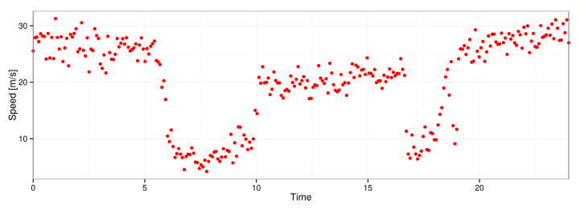
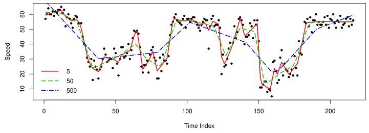
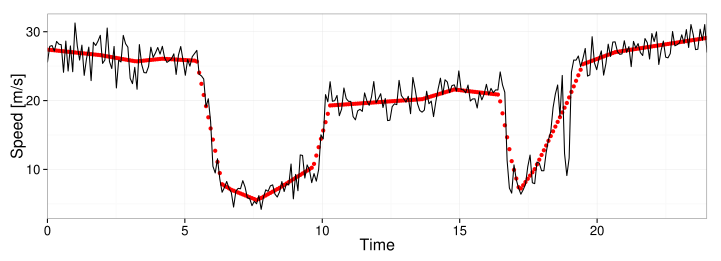
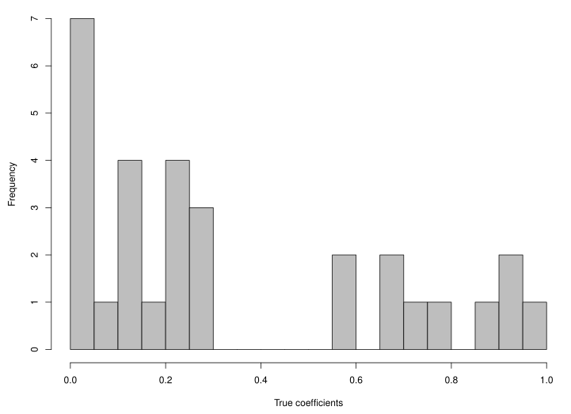
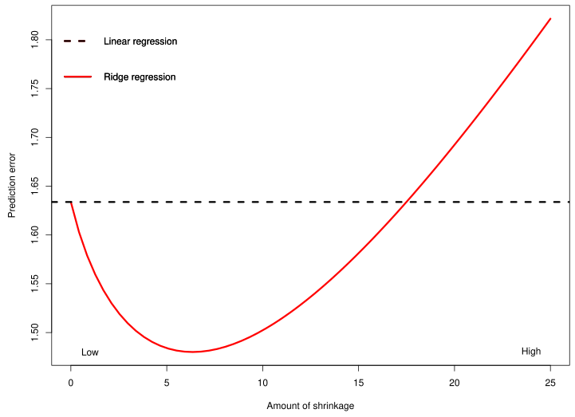
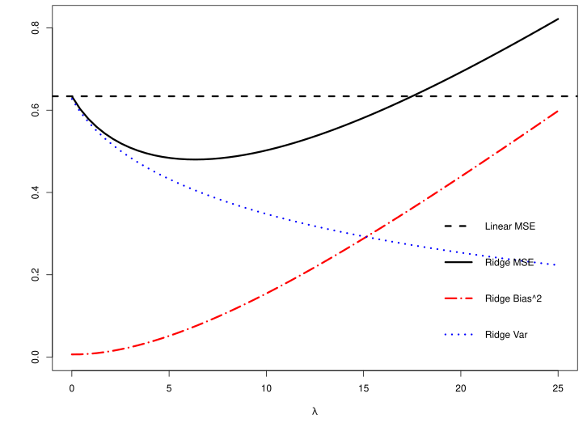
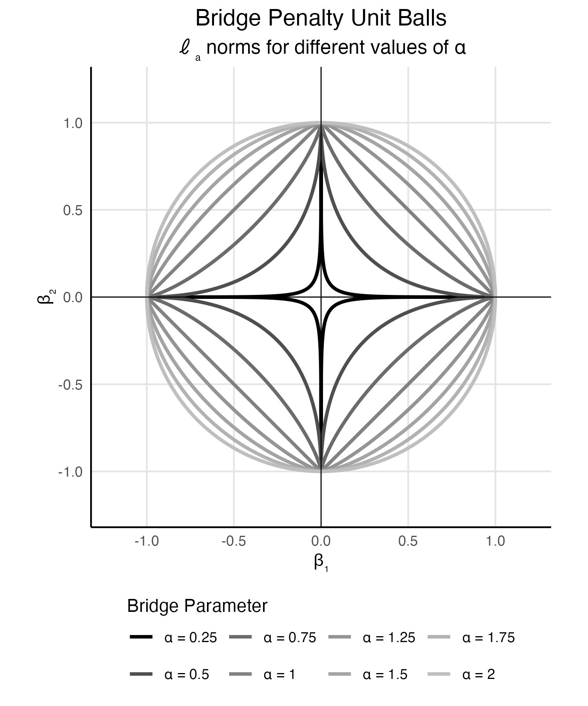
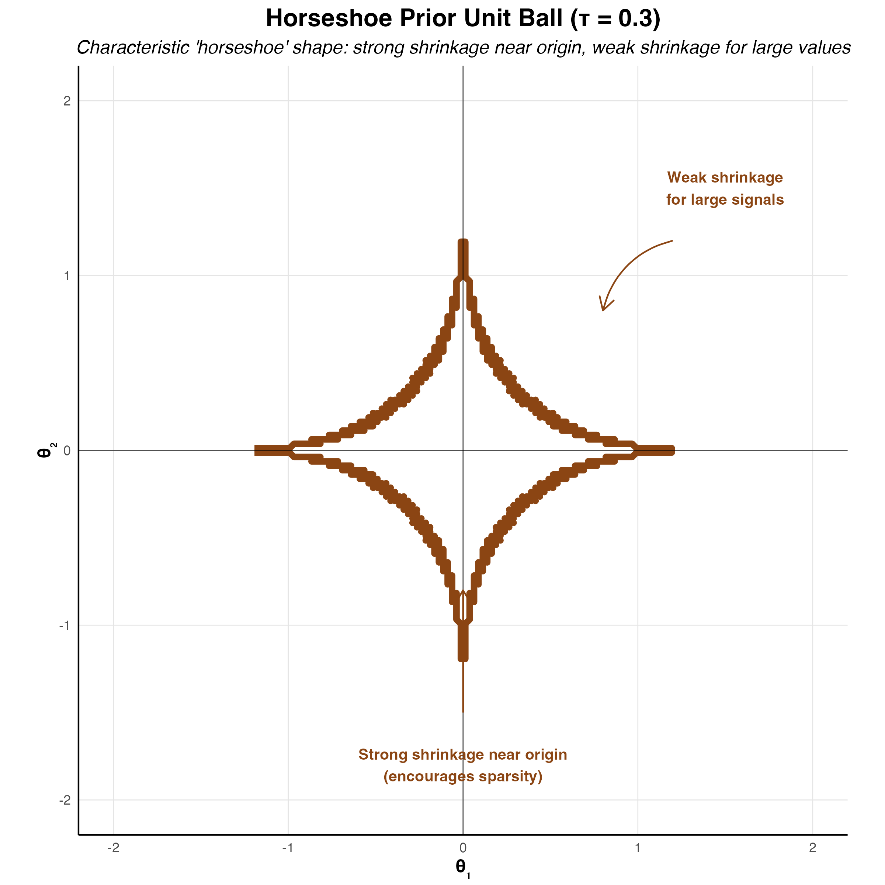
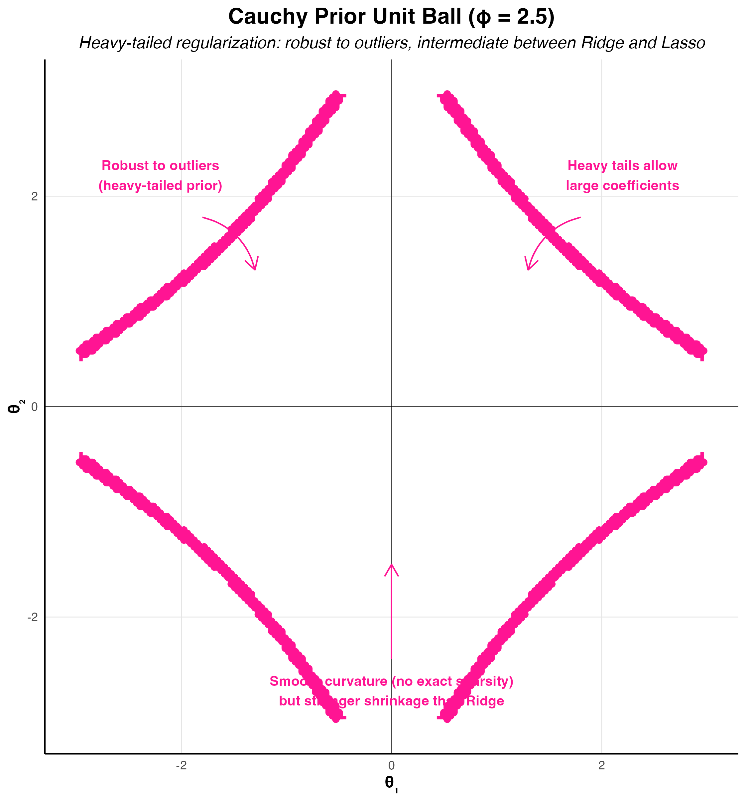



# Statistical Learning Theory and Regularization {#sec-theoryai}

> "*In God we trust; all others must bring data.*"---W. Edwards Deming

When AlphaGo defeated world champion Lee Sedol in 2016, its neural networks contained millions of parameters. How did such a high-capacity model avoid simply memorizing the training data? The answer lies in regularization: the systematic imposition of constraints that prevent models from overfitting to noise. This chapter reveals that regularization is not merely a computational trick but emerges naturally from Bayesian reasoning about uncertainty.

The development of learning algorithms has been driven by two fundamental paradigms: the classical frequentist approach centered around maximum likelihood estimation (MLE) and the Bayesian approach grounded in decision theory. This chapter explores how these seemingly distinct methodologies converge in modern AI theory, particularly through the lens of regularization and model selection.

Maximum likelihood estimation represents the cornerstone of classical statistical inference. Given observed data $\mathcal{D} = (x_i, y_i)_{i=1}^n$ and a parametric model $f_{\theta}(x)$, the MLE principle seeks to find the parameter values that maximize the likelihood function:
$$
\hat{\theta}_{\mathrm{MLE}} = \arg\max_{\theta} L(\theta; \mathcal{D}) = \arg\max_{\theta} \prod_{i=1}^n p(y_i \mid x_i, \theta)
$$

This approach has several appealing properties: it provides consistent estimators under mild conditions, achieves the Cramer-Rao lower bound asymptotically, and offers a principled framework for parameter estimation. These classical guarantees are typically stated under i.i.d. sampling assumptions; from a Bayesian perspective, exchangeability (@sec-bl) is a weaker condition that still supports learning from data in many settings. The Cramer-Rao bound is expressed in terms of Fisher information, and in exponential-family models Fisher information and sufficiency are closely related ways of formalizing how much information the data carry about a parameter.

However, MLE has well-documented limitations, particularly in high-dimensional settings. MLE can lead to overfitting, poor generalization, and numerical instability. Furthermore, as shown by Stein's paradox, MLE can be inadmissible, meaning there are other estimators that have lower risk than the MLE. We will start this chapter with the normal means problem and demonstrate how MLE can be inadmissible.

## Normal Means Problem

Consider the vector of means case where $\theta = (\theta_1, \ldots, \theta_p)$. We have 
$$
\bar y_i \mid \theta_i \sim N(\theta_i, \sigma^2/n_i), \quad i=1,\ldots,p, \quad p > 2
$$ {#eq-normal-mean}
Here $\bar y_i$ is the mean of $n_i$ observations, i.e., $\bar y_i = \frac{1}{n_i} \sum_{j=1}^{n_i} y_{ij}$.

The goal is to estimate the vector of means $\theta = (\theta_1, \ldots, \theta_p)$, and we can achieve this by borrowing strength across the observations. 

This is also a proxy for non-parametric regression, where $y_i = f(x_i) + \varepsilon_i$ and $\theta_i = f(x_i)$. Much has been written on the properties of the Bayes risk as a function of $n$ and $p$, and extensive work has been done on the asymptotic properties of the Bayes risk as $n$ and $p$ grow to infinity.

The classical inference uses the sampling distribution
$$
\hat \theta_i \mid \theta_i \sim N(\theta_i, \sigma^2/n_i),
$$
where the MLE estimate is $\hat \theta_i = \bar y_i$. This is exact in the normal model (not merely asymptotic).

On the other hand, the Bayes estimator is based on $\theta_i \mid \hat \theta_i$, where $\hat \theta_i = \bar y_i$. In other words, the classical approach is subject to the *prosecutor's fallacy*, the logical error of confusing $P(\text{data} \mid \text{hypothesis})$ with $P(\text{hypothesis} \mid \text{data})$. Classical estimators are unbiased, whereas a Bayes estimator is biased.

:::{#exm-corporate-performance}
## Screening Corporate Performance

To illustrate the practical importance of the normal means problem, consider the challenge faced by investment analysts screening thousands of publicly traded companies for sustained superior performance [@polson2012good]. Suppose we have return on assets (ROA) data for $p = 53{,}038$ firms across 93 countries over 45 years. For each firm $i$, we observe an average ROA performance $\bar{y}_i$ over some time period.

The fundamental question is: *Which firms have genuinely superior performance versus those that appear successful due to luck?* This is precisely a massive multiple testing problem in the normal means framework. Using MLE, we would estimate each firm's performance as $\hat{\theta}_i = \bar{y}_i$ and declare any firm with $\bar{y}_i > 0$ as superior. However, this approach ignores the massive multiplicity problem: with over 50,000 firms, many will appear successful purely by chance.

The Bayesian approach with appropriate shrinkage priors can distinguish between truly superior firms and those that are merely lucky. As we'll see, this requires heavy-tailed priors that can accommodate the rare firms with genuine outperformance while shrinking the estimates of mediocre firms toward zero.

In practice, the normal means problem often requires careful preprocessing of the observed data. A common and important step is to normalize the observations by converting them to $z$-scores.

Consider our corporate performance example where we observe ROA values $\bar{y}_i$ for different firms. These firms may operate in different industries, countries, or time periods, making direct comparison problematic. Raw ROA values might range from -20% to +30%, with different scales and baseline expectations across sectors.

The $z$-score transformation standardizes each observation relative to a reference distribution:
$$
z_i = \frac{\bar{y}_i - \mu_i}{\sigma_i}.
$$
where $\mu_i$ and $\sigma_i$ represent the mean and standard deviation  estimated and predicted by an autoregressive model.

In the Polson & Scott study [@polson2012good], standardization was essential for handling the massive heterogeneity across their dataset of 53,038 firms spanning 93 countries and 45 years. The authors faced three critical challenges that $z$-score normalization helped address:

*1. Cross-Country Comparisons*: Raw ROA values varied dramatically across countries due to different accounting standards, economic conditions, and regulatory environments. A 5% ROA in Japan during the 1990s had very different implications than a 5% ROA in Brazil during the same period.

*2. Temporal Adjustments*: Economic cycles, inflation rates, and market conditions changed substantially over the 45-year study period. The authors needed to adjust for these time-varying factors to identify firms with genuinely superior performance rather than those that simply operated during favorable periods.

*3. Industry Heterogeneity*: Different industries have fundamentally different ROA distributions. Technology firms typically show higher volatility and different baseline performance compared to utilities or manufacturing companies.

The authors implemented a sophisticated normalization procedure:
$$
z_{i,t} = \frac{\text{ROA}_{i,t} - \mu_{\text{peer}(i),t}}{\sigma_{\text{peer}(i),t}}
$$

where $\text{peer}(i)$ represents firm $i$'s reference group (defined by industry, country, and size), and the subscript $t$ indicates time-varying adjustments. This created standardized performance measures where:

- $z_{i,t} = 0$ indicates performance exactly at the peer group mean
- $z_{i,t} = 1$ indicates performance one standard deviation above peers  
- $z_{i,t} = -1$ indicates performance one standard deviation below peers

After this rigorous standardization, the authors discovered a *critical finding*: sustained superior performance ($\theta_i > 0$ consistently over time) was rare. Most firms showing high raw ROA were simply benefiting from favorable conditions rather than demonstrating genuine operational excellence. This finding emerged only after proper normalization; without standardization, hundreds of firms would have been incorrectly classified as superior performers.
:::

The goal is to estimate the vector $\theta$ using squared loss:
$$
\mathcal{L}(\theta, \hat{\theta}) = \sum_{i=1}^p (\theta_i - \hat{\theta}_i)^2,
$$
where $\hat{\theta}$ is the vector of estimates. We will compare the MLE estimate with the James-Stein estimate. A principled way to evaluate the performance of an estimator is to average its loss over the data; this metric is called the risk. The MLE estimate $\hat{\theta}_i = y_i$ has a constant risk $p\sigma^2$:
$$
R(\theta,\hat{\theta}) = \E[y]{\mathcal{L}(\theta, \hat{\theta})} = \sum_{i=1}^p \E[y_i]{(y_i - \theta_i )^2}.
$$

Here the expectation is over the data given by distribution @eq-normal-mean (taking $n_i = 1$) and $y_i \sim N(\theta_i, \sigma^2)$, we have $\E[y_i]{(\theta_i - y_i)^2} = \Var{y_i} = \sigma^2$ for each $i$. Therefore:
$$
R(\theta,\hat{\theta}) = \sum_{i=1}^p \sigma^2 = p\sigma^2.
$$


This shows that the MLE risk is constant and does not depend on the true parameter values $\theta$, only on the dimension $p$ and the noise variance $\sigma^2$.

Given that MLE provides a natural baseline estimator with known risk properties, one might ask: can we do better? The Bayesian paradigm offers a fundamentally different perspective that often yields estimators with uniformly lower risk.

The Bayesian approach begins with a prior distribution $p(\theta)$ over the parameter space and updates this belief using Bayes' rule:
$$
p(\theta \mid y) = \frac{p(y \mid \theta) p(\theta)}{p(y)}
$$


The *Bayes estimator* is the value $\hat{\theta}^{B}$ that minimizes the Bayes risk, the expected loss:
$$
\hat{\theta}^{B} = \arg\min_{\hat{\theta}(y)} R(\pi, \hat{\theta}(y))
$$
Here $\pi$ is the prior distribution of $\theta$ and $R(\pi, \hat{\theta}(y))$ is the *Bayes risk* defined as:
$$
R(\pi, \hat{\theta}(y)) = \E[\theta \sim \pi]{\E[y\mid \theta]{\mathcal{L}(\theta, \hat{\theta}(y))}}.
$${#eq-bayes-risk}
For squared error loss, this yields the posterior mean $\E{\theta \mid y}$, while for absolute error loss, it gives the posterior median.

For the normal means problem with squared error loss, this becomes:
$$
R(\pi, \hat{\theta}(y)) = \int_{\theta \in \Theta} \left( \int_{y \in \mathcal{Y}} (\theta - \hat{\theta}(y))^2 p(y\mid\theta) dy \right) \pi(\theta) d\theta
$$

The Bayes risk quantifies the expected performance of an estimator, taking into account both the uncertainty in the data and the prior uncertainty about the parameter. It serves as a benchmark for comparing different estimators: an estimator with lower Bayes risk is preferred under the chosen prior and loss function. In particular, the Bayes estimator achieves the minimum possible Bayes risk for the given prior and loss.

In 1956, Charles Stein proved a startling result, later refined with Willard James in 1961: they constructed an estimator for the mean of a multivariate normal distribution that uniformly dominates the sample mean under squared error loss, a finding that challenged what seemed like an elementary law of statistical theory. This result, now known as *Stein's paradox*, demonstrates that for dimensions $p \geq 3$, there always exists an estimator with strictly lower risk than the MLE for all parameter values.

The empirical evidence is striking: in applications ranging from baseball batting averages to toxoplasmosis prevalence rates to Pearson's chi-square tests, the James-Stein estimator achieves mean squared errors less than half that of the sample mean. This result is paradoxical because it overturns the intuition that unbiased estimators should be optimal: despite introducing bias, the James-Stein estimator achieves strictly lower risk for all parameter values when $p \geq 3$. The philosophical implications extend beyond estimation theory: by demonstrating that individual estimates can be improved by considering them jointly, Stein's paradox provides deep connections to Bayesian thinking and the empirical Bayes framework.

Stein's phenomenon where $y_i \mid \theta_i \sim N(\theta_i, 1)$ and $\theta_i \sim N(0, \tau^2)$ where $\tau \rightarrow \infty$ illustrates this point well. The MLE approach is equivalent to the use of the improper "non-informative" uniform prior and leads to an estimator with poor risk properties.

Let $\|y\|^2 = \sum_{i=1}^p y_i^2$ denote the squared Euclidean norm of $y$. Then, we can make the following probabilistic statements from the model:
$$
P\left( \| y \| > \| \theta \| \right) > \frac{1}{2}
$$
Now for the posterior, this inequality is reversed under a flat Lebesgue measure:
$$
P\left( \| \theta \| > \| y \| \mid y \right) > \frac{1}{2}
$$
which is in conflict with the classical statement. This is a property of the prior which leads to a poor rule (the overall average) and risk.

The shrinkage rule (a.k.a. normal prior) where $\tau^2$ is "estimated" from the data avoids this conflict. More precisely, we have:
$$
\hat{\theta}(y) = \left( 1 - \frac{p-2}{\|y\|^2} \right) y \quad \text{and} \quad \E{\| \hat{\theta} - \theta \|^2 } < p, \; \forall \theta.
$$
Hence, when $\|y\|^2$ is small, the shrinkage factor is more extreme. For example, if $p=10$ and $\|y\|^2=12$, then $\hat{\theta} = (1/3) y$. Now we have the more intuitive result that:
$$
P\left(\|\theta\| > \|y\| \mid y\right) < \frac{1}{2}.
$$

This shows that careful specification of default priors matters in high dimensions. 

The resulting estimator is called the James-Stein estimator and is a shrinkage estimator that shrinks the MLE towards the prior mean. The prior mean is typically the sample mean of the data. The James-Stein estimator is given by:
$$
\hat{\theta}_{i}^{JS} = (1 - \lambda) \hat{\theta}_{i}^{MLE} + \lambda \bar{y},
$$
where $\lambda$ is a shrinkage parameter, and $\bar{y}$ is the sample mean of the data. The shrinkage parameter is typically chosen to minimize the risk of the estimator.

The key idea behind James-Stein shrinkage is that one can "borrow strength" across components. In this sense, the multivariate parameter estimation problem is easier than the univariate one.

Following @efron1975data, we can view the James-Stein estimator through the lens of empirical Bayes methodology. Efron and Morris demonstrate that Stein's seemingly paradoxical result has a natural interpretation when viewed as an empirical Bayes procedure that estimates the prior distribution from the data themselves.

Consider the hierarchical model:
$$
\begin{aligned}
y_i \mid \theta_i &\sim N(\theta_i, \sigma^2) \\
\theta_i \mid \mu, \tau^2 &\sim N(\mu, \tau^2)
\end{aligned}
$$

The marginal distribution of $y_i$ is then $y_i \sim N(\mu, \sigma^2 + \tau^2)$. In the empirical Bayes approach, we estimate the hyperparameters $\mu$ and $\tau^2$ from the marginal likelihood:

$$
m(y \mid \mu, \tau^2) = \prod_{i=1}^p \frac{1}{\sqrt{2\pi(\sigma^2 + \tau^2)}} \exp\left(-\frac{(y_i - \mu)^2}{2(\sigma^2 + \tau^2)}\right)
$$

The maximum marginal likelihood estimators are:
$$
\hat{\mu} = \bar{y} = \frac{1}{p}\sum_{i=1}^p y_i
$$
$$
\hat{\tau}^2 = \max\left(0, \frac{1}{p}\sum_{i=1}^p (y_i - \bar{y})^2 - \sigma^2\right)
$$

The empirical Bayes estimator then becomes:
$$
\hat{\theta}_i^{EB} = \frac{\hat{\tau}^2}{\sigma^2 + \hat{\tau}^2} y_i + \frac{\sigma^2}{\sigma^2 + \hat{\tau}^2} \hat{\mu}
$$

This can be rewritten as:
$$
\hat{\theta}_i^{EB} = \left(1 - \frac{\sigma^2}{\sigma^2 + \hat{\tau}^2}\right) y_i + \frac{\sigma^2}{\sigma^2 + \hat{\tau}^2} \bar{y}
$$

When $\mu = 0$ and using the estimate $\hat{\tau}^2 = \max(0, \|y\|^2/p - \sigma^2)$, this reduces to a form closely related to the James-Stein estimator:
$$
\hat{\theta}_i^{JS} = \left(1 - \frac{(p-2)\sigma^2}{\|y\|^2}\right) y_i
$$

Efron and Morris show that the empirical Bayes interpretation provides insight into why the James-Stein estimator dominates the MLE. The key insight is that the MLE implicitly assumes an improper flat prior $\pi(\theta) \propto 1$, which leads to poor risk properties in high dimensions.

The Bayes risk of the James-Stein estimator can be explicitly calculated due to the conjugacy of the normal prior and likelihood:
$$
R(\theta, \hat{\theta}^{JS}) = p\sigma^2 - (p-2)^2\sigma^2 \E{\frac{1}{\|\theta + \epsilon\|^2/\sigma^2}}
$$

where $\epsilon \sim N(0, \sigma^2 I)$. Since the second term is always positive, we have:
$$
R(\theta, \hat{\theta}^{JS}) < R(\theta, \hat{\theta}^{MLE}) \quad \forall \theta \in \mathbb{R}^p, \quad p \geq 3
$$

This uniform domination demonstrates the *inadmissibility* of the MLE under squared error loss for $p \geq 3$.

In an applied problem, the gap in risk between MLE and JS estimators can be large. For example, in the normal means problem with $p=100$ and $n=100$, the risk of the MLE is $R(\theta,\hat{\theta}_{MLE}) = 100$ while the risk of the JS estimator is $R(\theta,\hat{\theta}_{JS}) = 2$ at its most favorable configuration ($\theta = 0$). The JS estimator is then 50 times more efficient than the MLE; @efron1977steins provide an accessible treatment of this phenomenon. The JS estimator is also minimax optimal in the sense that it attains the minimax risk bound for the normal means problem. The minimax risk bound is the smallest worst-case risk that can be attained by any estimator. 


The James-Stein estimator illustrates how incorporating prior information (via shrinkage) can lead to estimators with lower overall risk compared to the MLE, especially in high-dimensional settings. However, it is not the only shrinkage estimator that dominates the MLE. Other shrinkage estimators, such as the ridge regression estimator, also have lower risk than the MLE.

Note that we used the empirical Bayes version of the definition of risk. Full Bayes approach incorporates both the data and the prior distribution of the parameter, as in @eq-bayes-risk.

## Unbiasedness and the Optimality of Bayes Rules {#sec-unbiasedness-optimality}

The optimal Bayes rule $\delta_\pi(x) = \E{\theta \mid y}$ is the posterior mean under squared error loss. An interesting feature of the Bayes rule is that it is biased except in degenerate cases like improper priors, which can lose optimality properties. This can be seen using the following decomposition.

If the rule was unbiased, then the Bayes risk would be zero. This follows by contradiction: assume for the sake of argument that $\E[x\mid\theta]{\delta_{\pi}(y)} = \theta$, then 
$$
\begin{aligned}
r(\pi, \delta_{\pi}(y)) &= \E[\pi]{\E[y\mid\theta]{(\delta_{\pi}(y) - \theta)^2}} \\
&= \E[\pi]{\theta^2} + \E[y]{\delta_{\pi}(y)^2} - 2\E[\pi]{\theta \E[y\mid\theta]{\delta_{\pi}(y)}} \\
&= \E[y]{\delta_{\pi}(y)^2} - \E[\pi]{\theta^2}
\end{aligned}
$$
Computing $\E{\delta_{\pi}\theta}$ a second way, conditioning on $y$ and using $\delta_{\pi}(y) = \E{\theta \mid y}$, gives $r = \E{\theta^2} - \E{\delta_{\pi}^2}$; combining, $r = -r = 0$, which is a contradiction since the Bayes risk cannot be zero in non-degenerate cases.

The key feature of Bayes rules is the bias-variance tradeoff inherent in their nature. You achieve a large reduction in variance for a small amount of bias. This is the underpinning of James-Stein estimation.

Another interesting feature is that the Bayes rule $\E{\theta \mid y}$ is always Bayes sufficient in the sense that
$$
\E[\pi]{\theta \mid \E[\pi]{\theta \mid y}} = \E[\pi]{\theta \mid y}
$$
So conditioning on $\E[\pi]{\theta \mid y}$ is equivalent to conditioning on $y$ when estimating $\theta$. This property is used in quantile neural network approaches to generative methods.

::: {#exm-baseball-stein}
## Example: James-Stein for Baseball Batting Averages

We reproduce the baseball batting average example from @efron1977steins. Data below have the number of hits for 18 baseball players after 45 at-bats in 1970 season.
```{r}
# Data source: https://www1.swarthmore.edu/NatSci/peverso1/Sports%20Data/JamesSteinData/Efron-Morris%20Baseball/EfronMorrisBB.txt
baseball <- read.csv("data/EfronMorrisBB.txt", sep = "\t", stringsAsFactors = FALSE) %>% dplyr::select(LastName, AtBats, BattingAverage, SeasonAverage)
baseball$LastName[baseball$LastName == "Swaboda"] <- "Swoboda" # misspelled in the source file
```
Now, we can estimate the grand mean $\bar y$ and the sampling variance of a batting average. All players have 45 at-bats, so the binomial variance $\sigma^2 = \bar y (1 - \bar y)/45$ serves for every player
```{r, echo=TRUE}
k <- nrow(baseball)
mu_hat <- mean(baseball$BattingAverage)
sigma2_hat <- mu_hat * (1 - mu_hat) / 45
```
Next, we compute the James-Stein estimator. It keeps the same fraction $c = 1 - (k-3)\sigma^2/\sum_j (y_j - \bar y)^2$ of the distance between each average $y_j$ and the grand mean $\bar y$, where $k = 18$ is the number of players (`shrink` in the code). Because the grand mean is estimated from the data, the numerator is $k-3$ rather than the $p-2$ of the shrink-to-zero estimator above.
```{r}
#| echo: true
shrink <- 1 - (k - 3) * sigma2_hat / sum((baseball$BattingAverage - mu_hat)^2)
baseball <- baseball %>% mutate(JS = mu_hat + shrink * (BattingAverage - mu_hat))
kable(baseball)
```
Here $c = 0.21$, so each estimate keeps about a fifth of the distance between the observed average and the grand mean, .265. Clemente, the best hitter after 45 at-bats (.400), is pulled down to .294.

```{r}
#| code-fold: true
ggplot(baseball, aes(x = BattingAverage, y = JS)) +
  geom_point(alpha = 0.6) +
  geom_abline(slope = 1, intercept = 0, linetype = "dashed", color = "red") +
  labs(
    x = "Observed Batting Average",
    y = "James-Stein Estimate",
    title = "Empirical Bayes Shrinkage of Batting Averages"
  )
```

Calculate mean squared error (MSE) for observed and James-Stein estimates

```{r, echo=TRUE}
mse_observed <- mean((baseball$BattingAverage - baseball$SeasonAverage)^2)
mse_js <- mean((baseball$JS - baseball$SeasonAverage)^2)

cat(sprintf("MSE (Observed): %.6f\n", mse_observed))
cat(sprintf("MSE (James-Stein): %.6f\n", mse_js))
```
We can see that the James-Stein estimator has a lower MSE than the observed batting averages. This is a demonstration of Stein's paradox, where the James-Stein estimator, which shrinks the estimates towards the overall mean, performs better than the naive sample mean estimator.

```{r}
#| code-fold: true
#| fig-width: 5.5
#| fig-height: 5.5
a <- matrix(rep(1:3, nrow(baseball)), 3, nrow(baseball))
b <- matrix(c(baseball$BattingAverage, baseball$SeasonAverage, baseball$JS), 3, nrow(baseball), byrow = TRUE)

par(mar = c(0.5, 2.5, 0.3, 0.5))
matplot(a, b, pch = " ", xlab = "", ylab = "batting average", xaxt = "n", xlim = c(0.5, 3.1), ylim = c(0.13, 0.42))
matlines(a, b, lwd = 1.5)
ly <- ave(baseball$BattingAverage, baseball$BattingAverage, FUN = function(v) v + 0.006 * (seq_along(v) - (length(v) + 1) / 2))
text(rep(0.7, nrow(baseball)), ly, baseball$LastName, cex = 0.55)
text(1, 0.14, "First 45\nat bats", cex = 0.5)
text(2, 0.14, "Season\naverage", cex = 0.5)
text(3, 0.14, "J-S\nestimator", cex = 0.5)
```

The figure below shows the season dynamics for Clemente: his running batting average (cumulative hits over cumulative at-bats) against the number of at-bats, with dashed lines at his season average (145/412), his James-Stein estimate and his average after the first 45 at-bats. The early values are noise: they sit near or above .400, and no American or National League hitter has finished a season above .400 since Ted Williams hit .406 in 1941.
```{r}
#| fig-width: 5.5

# Data source: https://www.baseball-almanac.com/players/hittinglogs.php?p=clemero01&y=1970
cl <- read.csv("data/clemente.csv")
x <- cumsum(cl$AB)
y <- cumsum(cl$H) / cumsum(cl$AB)
# Plot x,y starting from index 2
ind <- c(1, 2)
plot(x[-ind], y[-ind], type = "o", ylim = range(y[-ind], baseball$JS[1]), ylab = "Batting Average", xlab = "Number at Bats", pch = 21, bg = "lightblue", cex = 0.55, lwd = 1.5)
# Add horizontal line for season average 145/412 and add text above line `Season Average`
text(200, 145 / 412, "Season Average", col = "red", cex = 0.7, pos = 3)
abline(h = 145 / 412, col = "red", lty = 2)
# Ted williams record is .406 in 1941, so you know the first data points are noise
text(50, baseball$JS[1], "JS", col = "red", cex = 0.7, pos = 3)
abline(h = baseball$JS[1], col = "red", lty = 2)
text(200, baseball$BattingAverage[1], "After 45 At Bats", col = "red", cex = 0.7, pos = 3)
abline(h = baseball$BattingAverage[1], col = "red", lty = 2)
```
:::

### Full Bayes Shrinkage
The alternative approach to the regularization is to use full Bayes, which places a prior distribution on the parameters and computes the *full posterior distribution* using Bayes' rule:
$$
p( \theta \mid  \tau, y ) = \frac{ f( y \mid \theta ) p( \theta \mid \tau ) }{ m(y \mid \tau) },
$$
here
$$
m(y \mid \tau) = \int f( y\mid  \theta ) p( \theta \mid \tau ) d \theta,
$$
Here $m(y \mid \tau)$ is the marginal beliefs about the data. 

The *empirical Bayes* approach is to estimate the prior distribution $p( \theta \mid \tau )$ from the data. This can be done by maximizing the marginal likelihood $m(y \mid \tau )$ with respect to $\tau$. The resulting estimator is called the *type II maximum likelihood estimator* (MMLE).
$$
\hat{\tau} = \arg \max_{\tau} \log m( y \mid \tau ).
$$


For example, in the normal-normal model, when $\theta \sim N(\mu,\tau^2)$ with $\mu=0$,  we can integrate out the high-dimensional $\theta$ and find $m(y \mid \tau)$ in closed form as $y_i \sim N(0, \sigma^2 + \tau^2)$ 
$$
m( y \mid \tau ) = ( 2 \pi)^{-n/2} ( \sigma^2 + \tau^2 )^{- n/2}  \exp \left ( - \frac{ \sum y_i^2 }{ 2 ( \sigma^2 + \tau^2) } \right )
$$
The original JS estimator shrinks to zero and estimates prior variance using empirical Bayes (marginal MLE or Type II MLE). Efron and Morris and Lindley showed that you want to shrink to overall mean $\bar y$ and in this approach
$$
\theta \sim N(\mu,\tau^2).
$$
The original JS is $\mu=0$. To estimate the $\mu$ and $\tau$ you can do full Bayes or empirical Bayes that shrinks to overall grand mean $\bar y$, which serves as the estimate of the original prior mean $\mu$. It seems paradoxical that you estimate prior parameters from the data. However, this is not the case. You simply use mixture prior @diaconis1983quantifying with marginal MLE (MMLE). The MMLE is the product
$$
\int_{\theta_i}\prod_{i=1}^k p(\bar y_i \mid \theta_i)p(\theta_i \mid \mu, \tau^2).
$$

The motivation for the shrinkage prior rather than a flat uniform prior are the following probabilistic arguments. They have an ability to balance signal detection and noise suppression in high-dimensional settings. Unlike flat uniform priors, shrinkage priors adaptively shrink small signals towards zero while preserving large signals. This behavior is essential for sparse estimation problems, where most parameters are expected to be zero or near-zero. The James-Stein procedure is an example of *global shrinkage*, when the overall sparsity level across all parameters is controlled, ensuring that the majority of parameters are shrunk towards zero. Later in this section, we will discuss *local shrinkage* priors, such as the horseshoe prior, which allow individual parameters to escape shrinkage if they represent significant signals.


In summary, flat uniform priors (MLE) fail to provide adequate regularization in high-dimensional settings, leading to poor risk properties and overfitting. By incorporating probabilistic arguments and hierarchical structures, shrinkage priors offer a principled approach to regularization that aligns with Bayesian decision theory and modern statistical practice.


## Bias-Variance Decomposition
The discussion of shrinkage priors and James-Stein estimation naturally leads us to a fundamental concept in statistical learning: the bias-variance decomposition. This decomposition provides the theoretical foundation for understanding why shrinkage methods like James-Stein can outperform maximum likelihood estimation, even when they introduce bias.

The key insight is that estimation error can be decomposed into two components: *bias* (systematic error) and *variance* (random error). While unbiased estimators like maximum likelihood have zero bias, they often suffer from high variance, especially in high-dimensional settings. Shrinkage methods intentionally introduce a small amount of bias to achieve substantial reductions in variance, leading to better overall performance.

This trade-off between bias and variance is the driving force behind many successful machine learning algorithms, from ridge regression to neural networks with dropout.

For parameter estimation, we can decompose the mean squared error as follows:
$$
\begin{aligned}
\E{(\hat{\theta} - \theta)^2} &= \E{(\hat{\theta} - \E{\hat{\theta}} + \E{\hat{\theta}} - \theta)^2} \\
&= \E{(\hat{\theta} - \E{\hat{\theta}})^2} + \E{(\E{\hat{\theta}} - \theta)^2} \\
&= \text{Var}(\hat{\theta}) + \text{Bias}(\hat{\theta})^2
\end{aligned}
$$
The cross term has expectation zero.

For prediction problems, we have $y = \theta + \epsilon$ where $\epsilon$ is independent with $\text{Var}(\epsilon) = \sigma^2$. Hence
$$
\E{(y - \hat{y})^2} = \sigma^2 + \E{(\hat{\theta} - \theta)^2}
$$

This decomposition shows that prediction error consists of irreducible noise, estimation variance, and estimation bias. Bayesian methods typically trade a small increase in bias for a substantial reduction in variance, leading to better overall performance.

The bias-variance decomposition provides a framework for understanding estimation error, but it doesn't tell us how to construct optimal estimators. To find the best decision rule, whether for estimation, hypothesis testing, or model selection, we need a more general framework that can handle different types of loss functions and prior information.

### Risk Decomposition
How does one find an optimal decision rule? It could be a test region, an estimation procedure or the selection of a model. Bayesian decision theory addresses this issue. 

The *a posteriori* Bayes risk approach is as follows. Let $\delta(x)$ denote the decision rule. Given the prior $\pi(\theta)$, we can simply calculate
$$
R_n  ( \pi , \delta ) = \int_x m( x )  \left \{ \int_\Theta \mathcal{L}( \theta , \delta(x) )  p( \theta \mid x ) d \theta \right \} d x .
$$
Then the optimal Bayes rule is to *pointwise* minimize the inner integral (a.k.a. the posterior Bayes risk), namely
$$
\delta^\star ( x ) = \arg \min_\delta \int_\Theta \mathcal{L}( \theta , \delta(x) )  p( \theta \mid x ) d \theta . 
$$
The caveat is that this gives us no intuition into the characteristics of the prior which are important. Moreover, we do not need the marginal beliefs $m(x)$.

For example, under squared error estimation loss, the optimal estimator is simply the posterior mean, $\delta^\star (x)  = \E{\theta \mid x}$. The properties of this optimal rule, including its inherent bias and the bias-variance tradeoff it embodies, were established in @sec-unbiasedness-optimality.


## Sparsity

Throughout this section $p$ is the ambient dimension, so $\theta \in \mathbb{R}^p$, and $r \leq p$ counts the nonzero coordinates. Let the true parameter be sparse with the form $\theta_r = ( \sqrt{M/r}, \ldots, \sqrt{M/r}, 0, \ldots, 0 )$, carrying $r$ nonzero coordinates each equal to $\sqrt{M/r}$, so that the signal energy $\|\theta_r\|^2 = M$ is held fixed as $r$ varies. The problem of recovering a vector with many zero entries is called sparse signal recovery. The "ultra-sparse" or "nearly black" vector case occurs when the number of non-zero parameter values $r_n$ satisfies $\theta \in \ell_0[r_n]$, which denotes the set $\#(\theta_i \neq 0) \leq r_n$ where $r_n = o(n)$ and $r_n \rightarrow \infty$ as $n \rightarrow \infty$.

High-dimensional predictor selection and sparse signal recovery are routine statistical and machine learning tasks and present a challenge for classical statistical methods. Historically, James-Stein estimation (or $\ell_2$-regularization) functions as a global shrinkage rule. Because it lacks local parameters to adapt to sparsity, it struggles to recover sparse signals effectively.

James-Stein is equivalent to the model:
$$
y_i = \theta_i + \epsilon_i \quad \text{and} \quad \theta_i \sim \mathcal{N}(0, \tau^2)
$$
For the sparse $r$-spike problem, $\hat{\theta}_{JS}$ performs poorly, and we require a different rule.
For $\theta_r$ we have:
$$
\frac{p \|\theta\|^2}{p + \|\theta\|^2} \leq R(\hat{\theta}^{JS}, \theta_r) \leq 2 + \frac{p \|\theta\|^2}{p + \|\theta\|^2}.
$$
The bound depends on the ambient dimension $p$ and the signal energy, not on how few coordinates are actually nonzero, which is precisely why global shrinkage cannot exploit sparsity. When $\|\theta\|^2 \geq p$ (equivalently $M \geq p$), this implies that $R(\hat{\theta}^{JS}, \theta_r) \geq p/2$, no matter how small $r$ is.

In the sparse case, a simple thresholding rule can beat MLE and JS when the signal is sparse. Assuming $\sigma^2 = 1$, the thresholding estimator is:
$$
\hat{\theta}_{thr} = \begin{cases} 
\hat{\theta}_i & \text{if } |\hat{\theta}_i| > \sqrt{2 \ln p} \\
0 & \text{otherwise}
\end{cases}
$$
This simple example shows that the choice of penalty should not be taken for granted, as different estimators will have different risk profiles.

One such estimator that achieves the optimal minimax rate is the horseshoe estimator @carvalho2010horseshoe, which we discuss in detail in @sec-horseshoe. It is a local shrinkage estimator that dominates the sample mean in MSE and has good posterior concentration properties for sparse signal problems.


## Maximum a Posteriori Estimation (MAP) and Regularization
While Bayesian shrinkage provably reduces estimation risk, full posterior inference can be computationally demanding. Maximum a posteriori (MAP) estimation offers a tractable alternative that captures regularization benefits without requiring full integration.

Given input-output pairs $(x_i,y_i)$, MAP learns the function $f$ that maps inputs $x_i$ to outputs $y_i$ by minimizing
$$
\underset{f}{\mathrm{minimize}} \quad \sum_{i=1}^N  \mathcal{L}(y_i,f(x_i)) + \lambda \phi(f).
$$
The first term is the *loss function* that measures the difference between the predicted output $f(x_i)$ and the true output $y_i$. The second term is a *regularization term* that penalizes complex functions $f$ to prevent overfitting. The parameter $\lambda$ controls the trade-off between fitting the data well and keeping the function simple. In the case when $f$ is a parametric model, then we simply replace $f$ with the parameters $\theta$ of the model, and the regularization term becomes a penalty on the parameters.

The loss is simply a negative log-likelihood from a probabilistic model specified for the data generating process.  For example, when $y$ is numeric and $y_i \mid x_i \sim N(f(x_i),\sigma^2)$, we get the squared loss $\mathcal{L}(y,f(x)) = (y-f(x))^2$. When $y_i \in \{-1,+1\}$, we use the logistic loss $\mathcal{L}(y,f(x)) = \log(1+\exp(-yf(x)))$.   

The penalty term $\lambda \phi(f)$ discourages complex functions $f$. Then, we can think of regularization as a technique to incorporate some prior knowledge about parameters of the model into the estimation process.

::: {#exm-traffic}
## Traffic
Consider traffic flow speed measured by an in-ground sensor installed on interstate I-55 near Chicago. Speed measurements are noisy and prone to have outliers. @fig-speed-profile shows measured speed data, averaged over five minute intervals on one of the weekdays.

{#fig-speed-profile width=100%}
 
The statistical model is 
$$
y_t = f_t + \epsilon_t, ~ \epsilon_t \sim N(0,\sigma^2), ~ t=1,\ldots,n,
$$
where $y_t$ is the speed measurement at time $t$, $f_t$ is the true underlying speed at time $t$, and $\epsilon_t$ is the measurement noise.  There are two sources of noise. The first is the measurement noise, caused by the inherent nature of the sensor's hardware. The second source is due to sampling error; vehicles observed on a specific lane where the sensor is installed might not represent well traffic in other lanes. A naive MLE approach would be to estimate the speed profile $f = (f_1, \ldots, f_n)$ by minimizing the squared loss
$$
\hat f = \arg\min_{f} \sum_{t=1}^{n} (y_t - f_t)^2.
$$
However, the minima of this loss function is 0 and corresponds to the case when $\hat f_t = y_t$ for all $t$. We have learned nothing about the speed profile, and the estimate is simply the noisy observation $y_t$. In this case, we have no way to distinguish between the true speed profile and the noise. 

However, we can use regularization and bring some prior knowledge about traffic speed profiles to improve the estimate of the speed profile and to remove the noise.

Specifically, we will use a *trend filtering* approach. Under this approach, we assume that the speed profile $f$ is a piece-wise linear function of time, and we want to find a function that captures the underlying trend while ignoring the noise. The regularization term $\phi(f)$ is then the second difference of the speed profile,
$$
 \lambda \sum_{t=2}^{n-1}|f_{t-1} - 2f_t + f_{t+1}|
$$
 which penalizes the "kinks" in the speed profile. The value of this penalty is zero when $f_{t-1}, f_t, f_{t+1}$ lie on a straight line, and it increases when the speed profile has a kink. The parameter $\lambda$ is a regularization parameter that controls the strength of the penalty.


  Trend filtering penalized function is then 
$$
(1/2) \sum_{t=1}^{n}(y_t - f_t)^2 + \lambda \sum_{t=2}^{n-1}|f_{t-1} - 2f_t + f_{t+1}|,
$$
which is a variation of the Hodrick-Prescott filter [@hodrick1997postwar].

This approach requires us to choose the regularization parameter $\lambda$. A small value of $\lambda$ will lead to a function that fits the data well, but may not capture the underlying trend. A large value of $\lambda$ will lead to a function that captures the underlying trend, but may not fit the data well. The optimal value of $\lambda$ can be chosen using cross-validation or other model selection techniques. The upper panel of @fig-traffic shows the trend filtering for different values of $\lambda \in \{5,50,500\}$. The lower panel shows the optimal value of $\lambda$ chosen by cross-validation (by visual inspection).

:::{#fig-traffic layout-ncol="1"}

{width=85%}

{width=85%}

Trend Filtering for Traffic Speed Data.

:::
:::


## The Duality between Regularization and Priors

A large number of statistical problems can be expressed in the canonical optimization form:

$$
\begin{aligned}
& \underset{x \in \mathbb{R}^d}{\text{minimize}}
& & l(x) + \phi(x)
\end{aligned}
$$ {#eq-canonical-form}

Perhaps the most common example arises in estimating the regression coefficients $x$ in a generalized linear model. Here $l(x)$ is a negative log likelihood or some other measure of fit, and $\phi(x)$ is a penalty function that effects a favorable bias-variance tradeoff. 

From the Bayesian perspective, $l(x)$ and $\phi(x)$ correspond to the negative logarithms of the sampling model and prior distribution in the hierarchical model:

$$
p(y \mid x) \propto \exp\{-l(x)\}, \quad p(x) \propto \exp\{-\phi(x)\}
$$ {#eq-bayes-version}

and the solution to @eq-canonical-form may be interpreted as a maximum *a posteriori* (MAP) estimate.

Another common case is where $x$ is a variable in a decision problem where options are to be compared on the basis of expected loss, and where $l(x)$ and $\phi(x)$ represent conceptually distinct contributions to the loss function. For example, $l(x)$ may be tied to the data, and $\phi(x)$ to the intrinsic cost associated with the decision.  

### MAP as a Poor Man's Bayesian
There is a duality between using regularization term in optimization problem and assuming a prior distribution over the parameters of the model $f$.  Given the likelihood $L(y_i,f(x_i))$, the posterior is given by Bayes' rule:
$$
p(f \mid y, x) = \frac{\prod_{i=1}^n L(y_i,f(x_i)) p(f)}{p(y \mid x)}.
$$
If we take the negative log of this posterior, we get:
$$
-\log p(f \mid y, x) = - \sum_{i=1}^n \log L(y_i,f(x_i)) - \log p(f) + \log p(y \mid x).
$$
Since loss is the negative log-likelihood $\mathcal{L}(y_i,f(x_i)) = -\log L(y_i,f(x_i))$, the posterior maximization is equivalent to minimizing the following regularized loss function:
$$
\sum_{i=1}^n \mathcal{L}(y_i,f(x_i)) - \log p(f).
$$
The last term $\log p(y_i \mid x_i)$ does not depend on $f$ and can be ignored in the optimization problem. Thus, the equivalence is given by:
$$
\lambda \phi(f) = -\log p(f),
$$
where $\phi(f)$ is the penalty term that corresponds to the prior distribution of $f$. Below we will consider several choices for the prior distribution of $f$ and the corresponding penalty term $\phi(f)$ commonly used in practice.

## Ridge Regression ($\ell_2$ Norm)

### Tikhonov Regularization Framework

The Tikhonov regularization framework provides a general setting for regression that connects classical regularization theory with modern Bayesian approaches. Given observed data $(x_i, y_i)_{i=1}^n$ and a parametric model $f(x,w)$ with parameter vector $w \in \mathbb{R}^k$, we define a data misfit functional:
$$
E_D(w) = \sum_{i=1}^n (y_i - f(x_i,w))^2
$$

This yields a Gaussian likelihood:
$$
p(y \mid w) = \frac{1}{Z_D}\exp\left(-\frac{1}{2\sigma^2}E_D(w)\right)
$$
where $\sigma^2$ denotes the noise variance, and $Z_D$ is a normalization constant.

A Gaussian prior on the weights can be specified as:
$$
p(w) = \frac{1}{Z_W}\exp\left(-\frac{1}{2\sigma_w^2}E_W(w)\right)
$$
where $E_W(w)$ denotes a quadratic penalty on $w$ (e.g., $E_W(w) = w^\top w$), $\sigma_w^2$ is the prior variance, and $Z_W$ is its normalization constant.

The hyperparameters $\sigma^2$ and $\sigma_w^2$ control the strength of the noise and the prior. Following MacKay's notation [@mackay1992bayesian], we define precisions $\tau_D^2 = 1/\sigma^2$ and $\tau_w^2 = 1/\sigma_w^2$. Let $B$ and $C$ denote the Hessians of $E_D(w)$ and $E_W(w)$ at the maximum a posteriori (MAP) estimate $w^{\text{MAP}}$. The Hessian of the negative log-posterior is then $A = \frac{1}{2}(\tau_w^2 C + \tau_D^2 B)$.

Evaluating the log-evidence under a Gaussian Laplace approximation yields:
$$
\begin{aligned}
\log p(D \mid \tau_w^2,\tau_D^2) &= -\frac{1}{2}\tau_w^2 E_W^{\text{MAP}} - \frac{1}{2}\tau_D^2 E_D^{\text{MAP}} - \frac{1}{2}\log\det A \\
&\quad - \log Z_W(\tau_w^2) - \log Z_D(\tau_D^2) + \frac{k}{2}\log(2\pi)
\end{aligned}
$$

The associated Occam factor, which penalizes excessively large prior variances, is:
$$
-\frac{1}{2}\tau_w^2 E_W^{\text{MAP}} - \frac{1}{2}\log\det A - \log Z_W(\tau_w^2)
$$

This represents the reduction in effective volume of parameter space from prior to posterior.

::: {.callout-note}
*Notation:* In the previous sections on Normal Means, we used $\theta$ to denote the parameters. In the context of regression, we will follow standard convention and use $\beta$ to denote the vector of coefficients.
:::

The ridge regression uses a Gaussian prior on the parameters of the model $f$, which leads to a squared penalty term. Specifically, we assume that the parameters $\beta$ of the model $f(x) = x^\top\beta$ are distributed as:
$$
\beta \sim N(0, \sigma_\beta^2 I),
$$
where $I$ is the identity matrix, and $\sigma_\beta^2$ is the prior variance (distinct from the noise variance $\sigma^2$). The prior distribution of $\beta$ is a multivariate normal distribution with mean 0 and covariance $\sigma_\beta^2 I$. The negative log of this prior distribution is given by:
$$
-\log p(\beta) = \frac{1}{2\sigma_\beta^2} \|\beta\|_2^2 + \text{const},
$$
where $\|\beta\|_2^2 = \sum_{j=1}^p \beta_j^2$ is the squared 2-norm of the vector $\beta$. The regularization term $\phi(f)$ is then given by:
$$
\phi(f) = \frac{1}{2\sigma_\beta^2} \|\beta\|_2^2.  
$$
This leads to the following optimization problem:
$$
\underset{\beta}{\mathrm{minimize}}\quad \|y- X\beta\|_2^2 + \lambda \|\beta\|_2^2,
$$
where $\lambda = \sigma^2/\sigma_\beta^2$ is the regularization parameter that controls the strength of the prior. The solution to this optimization problem is given by:
$$
\hat{\beta}_{\text{ridge}} = ( X^\top X + \lambda I )^{-1} X^\top y.
$$
The regularization parameter $\lambda$ is related to the variance of the prior distribution.  When $\lambda=0$, the function $f$ is the maximum likelihood estimate of the parameters.  When $\lambda$ is large, the function $f$ is the prior mean of the parameters.  

Notice that the OLS estimate (invented by Gauss) is a special case of ridge regression when $\lambda = 0$:
$$
\hat{\beta}_{\text{OLS}} = ( X^\top X )^{-1} X^\top y.
$$  

The original motivation for ridge regularization was to address the problem of numerical instability in the OLS solution when the design matrix $X$ is ill-conditioned, i.e., when $X^\top X$ is close to singular. In this case, the OLS solution can be very sensitive to small perturbations in the data, leading to large variations in the estimated coefficients $\hat{\beta}$.
This is particularly problematic when the number of features $p$ is large, as the condition number of $X^\top X$ can grow rapidly with $p$. The ridge regression solution stabilizes the OLS solution by adding a small positive constant $\lambda$ to the diagonal of the $X^\top X$ matrix, which improves the condition number and makes the solution more robust to noise in the data. The additional term $\lambda I$ simply shifts the eigenvalues of $X^\top X$ away from zero, thus improving the numerical stability of the inversion.

Another way to think and write the objective function of Ridge as the following constrained optimization problem:
$$
\underset{\beta}{\mathrm{minimize}}\quad \|y- X\beta\|_2^2 \quad \text{subject to} \quad \|\beta\|_2^2 \leq t,
$$
where $t$ is a positive constant that controls the size of the coefficients $\beta$. The constraint $\|\beta\|_2^2 \leq t$ can be interpreted as a budget on the size of the coefficients, where larger values of $t$ allow for larger coefficients and more complex models.

Constraint on the model parameters (and the original Ridge estimator) was proposed by @tikhonov1943stability for solving inverse problems to "discover" physical laws from observations. The norm of the $\beta$ vector would usually represent amount of energy required. Many processes in nature are energy minimizing!

Again, the tuning parameter $\lambda$ controls trade-off between how well model fits the data and how small $\beta$s are. Different values of $\lambda$ will lead to different models. We select $\lambda$ using cross-validation.

::: {#exm-simulated-bias}
## Shrinkage

Consider a simulated data with $n=50$, $p=30$, and $\sigma^2=1$. The true model is linear with $10$ large coefficients between $0.5$ and $1$.

Our approximators $\hat f_{\beta}$ is a linear regression. We can empirically calculate the bias by calculating the empirical squared loss $1/n\|y -\hat y\|_2^2$ and variance can be empirically calculated as $1/n\sum  (\bar{\hat{y}} - \hat y_i)^2$

Bias squared $\mathrm{Bias}(\hat{y})^2=0.006$ and variance $\Var{\hat{y}} =0.627$. Thus, the prediction error = $1 + 0.006 + 0.627 = 1.633$

We'll do better by shrinking the coefficients to reduce the variance. Let's estimate how big a gain we can achieve with Ridge regression.

The figure below shows the distribution of true coefficient values used to generate the data. The histogram shows two groups: 10 large coefficients with values between 0.5 and 1.0, and 20 small ones, all below 0.3, seven of them below 0.05. This approximately sparse structure, where a few features matter a lot and most matter little, is common in many real-world problems such as genomics, text analysis, and high-dimensional sensor data.

{width="85%"}

The key question is: what value of the regularization parameter $\lambda$ should we choose? Too small, and we don't shrink enough to reduce variance; too large, and we introduce excessive bias by shrinking the true non-zero coefficients toward zero.

@fig-ridge-mse shows how prediction error varies with the amount of shrinkage (controlled by $\lambda$). The horizontal dashed line represents the constant prediction error of 1.633 from ordinary linear regression (OLS). The solid curve shows Ridge regression's prediction error as we increase regularization. At low shrinkage (left side), Ridge behaves similarly to OLS with high variance. As we increase shrinkage, the prediction error decreases to a minimum of about 1.48 at $\lambda \approx 6$. Beyond this point, excessive shrinkage introduces too much bias, and prediction error begins to rise again, exceeding the OLS error for $\lambda$ above about 17. The U-shaped curve is characteristic of the bias-variance trade-off: we need enough regularization to stabilize predictions, but not so much that we distort the true signal.

@fig-ridge-bias-variance decomposes Ridge regression's prediction error into its constituent parts as a function of $\lambda$. The black dashed horizontal line at approximately 0.63 is the error of ordinary linear regression (Linear MSE), its squared bias plus variance. The figure leaves out the irreducible error from noise in the data ($\sigma^2=1$), which accounts for the gap to the 1.633 in @fig-ridge-mse. The falling curve (Ridge Var) shows variance decreasing monotonically as $\lambda$ increases: stronger regularization makes the model more stable across different training sets. The rising curve (Ridge Bias$^2$) shows squared bias increasing as $\lambda$ grows: we move further from the true model by shrinking coefficients. The U-shaped curve (Ridge MSE) is the sum of these two components; adding the irreducible error gives the Ridge curve in @fig-ridge-mse. The optimal $\lambda$ occurs where the rate of variance reduction exactly balances the rate of bias increase, minimizing total prediction error.

::: {#fig-ridge-analysis layout-ncol=1}

{#fig-ridge-mse width=85%}

{#fig-ridge-bias-variance width=85%}

Ridge regression performance metrics.
:::

At the optimal value of $\lambda$, Ridge regression achieves squared bias of 0.077 and variance of 0.402, yielding a total prediction error of $1 + 0.077 + 0.402 = 1.48$. Compare this to the OLS solution with squared bias of 0.006 and variance of 0.627, giving prediction error of $1 + 0.006 + 0.627 = 1.633$. By accepting a modest increase in bias (from 0.006 to 0.077), we achieve a substantial reduction in variance (from 0.627 to 0.402), resulting in an overall improvement of approximately 9% in prediction error.

This example illustrates a fundamental principle in statistical learning: the best predictor is not necessarily the one that fits the training data most closely. By deliberately introducing bias through regularization, we can build models that generalize better to new data. The Bayesian perspective makes this trade-off explicit: the prior distribution encodes our belief that coefficients should be small, and the posterior balances this belief against the evidence in the data.

:::


### Kernel View of Ridge Regression
Another interesting view stems from what is called the push-through matrix identity:
$$
(aI + UV)^{-1}U = U(aI + VU)^{-1}
$$
for $a$, $U$, $V$ such that the products are well-defined and the inverses exist. We can obtain this from $U(aI + VU) = (aI + UV)U$,
followed by multiplication by $(aI + UV)^{-1}$ on the left and the right. Applying the identity above to the ridge regression solution with $a = \lambda$, $U = X^\top$, and $V = X$, we obtain an alternative form for the ridge solution:
$$
\hat{\beta} = X^\top (XX^\top + \lambda I)^{-1} Y.
$$
This is often referred to as the kernel form of the ridge estimator. From this, we can see that the ridge fit can be expressed as
$$
X\hat{\beta} = XX^\top (XX^\top + \lambda I)^{-1} Y.
$$
What does this remind you of? This is precisely $K(K + \lambda I)^{-1}Y$ where $K = XX^\top$, which, recall, is the fit from RKHS regression with a linear kernel $k(x, z) = x^\top z$. Therefore, we can think of RKHS regression as generalizing ridge regression by replacing the standard linear inner product with a general kernel. (Indeed, RKHS regression is often called kernel ridge regression.)

## Scale Mixtures Representations

Why should we care about expressing distributions as mixtures? The answer lies in computational tractability and theoretical insight. Many important priors used in sparse estimation, including the Laplace (Lasso), horseshoe, and logistic, can be represented as Gaussian distributions with random variance. This representation enables efficient Gibbs sampling algorithms where each conditional distribution has a closed form, and it reveals deep connections between seemingly different regularization approaches.


## Lasso Regression ($\ell_1$ Norm)

The Lasso (Least Absolute Shrinkage and Selection Operator) regression uses a Laplace prior on the parameters of the model $f$, which leads to an $\ell_1$ penalty term. Specifically, we assume that the parameters $\beta$ of the model $f(x) = x^\top\beta$ are distributed as:
$$
\beta_j \sim \text{Laplace}(0, b) \quad \text{independently for } j = 1, \ldots, p,
$$
where $b > 0$ is the scale parameter. The Laplace distribution has the probability density function:
$$
p(\beta_j \mid b) = \frac{1}{2b}\exp\left(-\frac{|\beta_j|}{b}\right)
$$
and is shown in @fig-laplace-distribution.
```{r}
#| echo: !expr knitr::is_latex_output() == FALSE
#| code-fold: true
#| label: fig-laplace-distribution
#| fig-cap: "Laplace Distribution PDF."
# PLot Laplace distribution
library(ggplot2)
b <- 1
beta <- seq(-5, 5, length.out = 101)
laplace_pdf <- function(beta, b) {
  (1 / (2 * b)) * exp(-abs(beta) / b)
}
laplace_data <- data.frame(beta = beta, pdf = laplace_pdf(beta, b))
ggplot(laplace_data, aes(x = beta, y = pdf)) +
  geom_line() +
  labs(x = expression(beta), y = "Density") +
  theme_minimal()
```

The negative log of this prior distribution is given by:
$$
-\log p(\beta) = \frac{1}{b} \|\beta\|_1 + \text{const},
$$
where $\|\beta\|_1 = \sum_{j=1}^p |\beta_j|$ is the $\ell_1$-norm of the vector $\beta$. The regularization term $\phi(f)$ is then given by:
$$
\phi(f) = \frac{1}{b} \|\beta\|_1.  
$$
This leads to the following optimization problem:
$$
\underset{\beta}{\mathrm{minimize}}\quad \|y- X\beta\|_2^2 + \lambda \|\beta\|_1,
$$
where $\lambda = 2\sigma^2/b$ is the regularization parameter that controls the strength of the prior. Unlike ridge regression, the Lasso optimization problem does not have a closed-form solution due to the non-differentiable nature of the $\ell_1$ penalty. However, efficient algorithms such as coordinate descent and proximal gradient methods can be used to solve it.

The key distinguishing feature of Lasso is its ability to perform automatic variable selection. The $\ell_1$ penalty encourages sparsity in the coefficient vector $\hat{\beta}$, meaning that many coefficients will be exactly zero. This property makes Lasso particularly useful for high-dimensional problems where feature selection is important.

When $\lambda=0$, the Lasso reduces to the ordinary least squares (OLS) estimate. As $\lambda$ increases, more coefficients are driven to exactly zero, resulting in a sparser model. When $\lambda$ is very large, all coefficients become zero.

The geometric intuition behind Lasso's sparsity-inducing property comes from the constraint formulation. We can write the Lasso problem as:
$$
\underset{\beta}{\mathrm{minimize}}\quad \|y- X\beta\|_2^2 \quad \text{subject to} \quad \|\beta\|_1 \leq t,
$$
where $t$ is a positive constant that controls the sparsity of the solution. The constraint region $\|\beta\|_1 \leq t$ forms a diamond (in 2D) or rhombus-shaped region with sharp corners at the coordinate axes. The optimal solution often occurs at these corners, where some coefficients are exactly zero.


From a Bayesian perspective, the Lasso estimator corresponds to the maximum a posteriori (MAP) estimate under independent Laplace priors on the coefficients. We use Bayes' rule to calculate the posterior as a product of Normal likelihood and Laplace prior:
$$
-\log p(\beta \mid y, b) = \|y-X\beta\|_2^2 + \frac{2\sigma^2}{b}\|\beta\|_1.
$$
For fixed $\sigma^2$ and $b>0$, the posterior mode is equivalent to the Lasso estimate with $\lambda = 2\sigma^2/b$. Large variance $b$ of the prior is equivalent to small penalty weight $\lambda$ in the Lasso objective function.

One of the most popular algorithms for solving the Lasso problem is coordinate descent. The algorithm iteratively updates each coefficient while holding all others fixed. For the $j$-th coefficient, the update rule (for the objective $\frac{1}{2n}\|y - X\beta\|_2^2 + \lambda\|\beta\|_1$ with standardized columns) is:
$$
\hat{\beta}_j \leftarrow \text{soft}\left(\frac{1}{n}\sum_{i=1}^n x_{ij}(y_i - \sum_{k \neq j} x_{ik}\hat{\beta}_k), \frac{\lambda}{n}\right),
$$
where the soft-thresholding operator is defined as:
$$
\text{soft}(z, \gamma) = \text{sign}(z)(|z| - \gamma)_+ = \begin{cases}
z - \gamma & \text{if } z > \gamma \\
0 & \text{if } |z| \leq \gamma \\
z + \gamma & \text{if } z < -\gamma
\end{cases}
$$

::: {#exm-lasso-sparsity}
## Sparsity and Variable Selection
We will demonstrate the Lasso's ability to perform variable selection and shrinkage using simulated data. The data will consist of a design matrix with correlated predictors and a sparse signal, where only 5 out of 20 predictors have non-zero coefficients.

```{r}
#| code-fold: true
# Generate simulated data
set.seed(123)
n <- 100 # number of observations
p <- 20 # number of predictors
sigma <- 1 # noise level

# Create design matrix with some correlation structure
X <- matrix(rnorm(n * p), n, p)
# Add some correlation between predictors
for (i in 2:p) {
  X[, i] <- 0.5 * X[, i - 1] + sqrt(0.75) * X[, i]
}
```
```{r, echo=TRUE}
# True coefficients - sparse signal
beta_true <- c(3, -2, 1.5, 0, 0, 2, 0, 0, 0, -1, rep(0, 10))
sparse_indices <- which(beta_true != 0)

# Generate response
y <- X %*% beta_true + sigma * rnorm(n)
```
Then we use `glmnet` package to fit the Lasso model and visualize the coefficient paths. We will also perform cross-validation to select the optimal regularization parameter $\lambda$.
```{r, echo=TRUE}
#| fig-cap: "LASSO coefficient paths. The top axis gives the number of nonzero coefficients."
# Fit LASSO path using glmnet
library(glmnet)
lasso_fit <- glmnet(X, y, alpha = 1)
# Plot coefficient paths
par(mar = c(2.5, 2.5, 2, 0.5))
plot(lasso_fit, xvar = "lambda", label = FALSE)
```
The coefficient paths plot shows how LASSO coefficients shrink toward zero as the regularization parameter lambda increases. The colored lines represent different predictors, demonstrating LASSO's variable selection property.  Note that `glmnet` fitted the model for a sequence of $\lambda$ values. The algorithms starts with a large lambda value, where all coefficients are penalized to zero. Then, it gradually decreases lambda, using the coefficients from the previous, slightly more penalized model as a "warm start" for the current calculation. This pathwise approach is significantly more efficient than starting the optimization from scratch for every single $\lambda$. By default, glmnet computes the coefficients for a sequence of 100 lambda values spaced evenly on the logarithmic scale, starting from a data-driven maximum value (where all coefficients are zero) down to a small fraction of that maximum. The user can specify their own sequence of lambda values if specific granularity or range is desired


Finally, we will perform cross-validation to select the optimal $\lambda$ value and compare the estimated coefficients with the true values.
```{r}
#| fig-cap: "Cross-validation for LASSO. The top axis gives the number of nonzero coefficients; the dotted lines mark `lambda.min`, the minimum of the cross-validation curve, and `lambda.1se`, the largest $\\lambda$ within one standard error of it."
#| echo: true
# Cross-validation to select optimal lambda
cv_lasso <- cv.glmnet(X, y, alpha = 1, nfolds = 10)
# Plot cross-validation curve
par(mar = c(2.5, 2.5, 2, 0.5))
plot(cv_lasso)
```

Now, we can extract the coefficients `lambda.min` and `lambda.1se` from the cross-validation results, which correspond to the minimum cross-validated error and the most regularized model within one standard error of the minimum, respectively.
```{r, echo=TRUE}
# Extract coefficients at optimal lambda
lambda_min <- cv_lasso$lambda.min
lambda_1se <- cv_lasso$lambda.1se
coef_min <- coef(lasso_fit, s = lambda_min)
coef_1se <- coef(lasso_fit, s = lambda_1se)
# Print values of lambda
cat("Optimal lambda (min):", lambda_min, "\n")
cat("Optimal lambda (1se):", lambda_1se, "\n")
```

```{r}
#| code-fold: true
#| fig-cap: "Coefficient Estimates Comparison."
# Compare estimates with true values
comparison <- data.frame(
  True = c(0, beta_true), # Include intercept
  LASSO_min = as.vector(coef_min),
  LASSO_1se = as.vector(coef_1se)
)
rownames(comparison) <- c("Intercept", paste0("X", 1:p))
# Visualization of coefficient estimates
library(ggplot2)

# Long format for plotting
plot_data <- data.frame(
  Variable = factor(rep(rownames(comparison), 3), levels = rownames(comparison)),
  variable = factor(rep(names(comparison), each = nrow(comparison)), levels = names(comparison)),
  value = unlist(comparison, use.names = FALSE)
)

ggplot(plot_data, aes(x = Variable, y = value, fill = variable)) +
  geom_bar(stat = "identity", position = "dodge", colour = "black") +
  theme_minimal() +
  theme(axis.text.x = element_text(angle = 45, hjust = 1)) +
  labs(y = "Coefficient Value", fill = "Method") +
  scale_fill_grey(start = 0.15, end = 0.85, labels = c("True", "LASSO (min)", "LASSO (1se)"))
```
It seems like LASSO has successfully identified the non-zero coefficients and shrunk the noise variables to zero. Let's calculate the prediction errors and evaluate the variable selection performance of LASSO at both optimal $\lambda$ values.
```{r, echo=TRUE}
# Calculate prediction errors
pred_min <- predict(lasso_fit, newx = X, s = lambda_min)
pred_1se <- predict(lasso_fit, newx = X, s = lambda_1se)

mse_min <- mean((y - pred_min)^2)
mse_1se <- mean((y - pred_1se)^2)

cat("Mean Squared Error (lambda.min):", round(mse_min, 3), "\n")
cat("Mean Squared Error (lambda.1se):", round(mse_1se, 3), "\n")
```


In summary, this example demonstrates how LASSO regression can be used for both variable selection and regularization in high-dimensional settings. By tuning the regularization parameter $\lambda$, LASSO is able to shrink irrelevant coefficients to zero, effectively identifying the true underlying predictors while controlling model complexity.

:::

### Lasso as a Scale Mixture

The Laplace distribution can be represented as a scale mixture of Normal distributions [@andrews1974scale]:
$$
\begin{aligned}
\beta_j \mid \sigma^2,\tau_j &\sim N(0,\tau_j^2\sigma^2)\\
\tau_j^2 \mid \alpha &\sim \text{Exp}(\alpha^2/2)\\
\sigma^2 &\sim \pi(\sigma^2).
\end{aligned}
$$ 
We can show equivalence by integrating out $\tau_j$:
$$
\begin{aligned}
p(\beta_j\mid \sigma^2,\alpha) &= \int_{0}^{\infty} \frac{1}{\sqrt{2\pi \tau_j^2\sigma^2}}\exp\left(-\frac{\beta_j^2}{2\sigma^2\tau_j^2}\right)\frac{\alpha^2}{2}\exp\left(-\frac{\alpha^2\tau_j^2}{2}\right)d\tau_j^2 \\
&= \frac{\alpha}{2\sigma}\exp\left(-\frac{\alpha|\beta_j|}{\sigma}\right).
\end{aligned}
$$
Thus it is a Laplace distribution with location 0 and scale $\sigma/\alpha$. Representing the Laplace prior as a scale mixture of Normals allows us to apply an efficient numerical algorithm for computing samples from the posterior distribution. This algorithm is called a Gibbs sampler and it iteratively samples from $\theta \mid a,y$ and $b\mid \theta,y$ to estimate the joint distribution over $(\hat \theta, \hat b)$. Thus, we do not need to apply cross-validation to find the optimal value of $b$; the Bayesian algorithm does it "automatically."

### More Mixture Representations

The power of scale mixture representations extends beyond the Laplace distribution to many common loss functions used in machine learning and statistics. @polson2013data provide a unified framework showing that various loss functions can be represented as variance-mean Gaussian mixtures, enabling efficient posterior sampling via data augmentation.

Consider the regression or classification setting where $z_i = y_i - x_i^\top\beta$ for regression, or $z_i = y_i x_i^\top\beta$ for binary classification (with $y_i \in \{-1, +1\}$). The key insight is that many loss functions $f(z_i \mid \beta, \sigma)$ can be expressed through the variance-mean mixture:

$$
p(z_i \mid \beta, \sigma) = \int_0^{\infty} \phi(z_i \mid \mu_z + \kappa_z \omega_i, \sigma^2 \omega_i) \, dP(\omega_i)
$$

where $\phi(\cdot \mid m, v)$ denotes the normal density with mean $m$ and variance $v$, and $P(\omega_i)$ is an appropriate mixing distribution. The following table summarizes representations for several important loss functions:

| Loss Function | $f(z_i \mid \beta, \sigma)$ | $\kappa_z$ | $\mu_z$ | Mixing Distribution $P(\omega_i)$ |
|:--------------|:---------------------------|:-----------|:--------|:----------------------------------|
| Squared-error | $z_i^2/\sigma^2$ | 0 | 0 | $\omega_i = 1$ |
| Absolute-error | $\|z_i/\sigma\|$ | 0 | 0 | Exponential |
| Check loss | $\|z_i\| + (2q-1)z_i$ | $1-2q$ | 0 | Generalized inverse Gaussian |
| Support vector machines | $\max(1-z_i, 0)$ | 1 | 1 | Generalized inverse Gaussian |
| Logistic | $\log(1+e^{z_i})$ | $1/2$ | 0 | Pólya-Gamma |

By introducing latent variables $\{\omega_i\}$ and $\{\lambda_j\}$ through appropriate equations, the exponential form $\exp\{-L(\beta)\}$ reduces to a Gaussian linear model with heteroscedastic errors. This enables straightforward Gibbs sampling where each conditional distribution has closed form.

The working response $z_i$ equals $y_i - x_i^\top\beta$ for Gaussian regression, or $y_i x_i^\top\beta$ for binary classification using logistic regression or support-vector machines. Both $\sigma$ and $\tau$ (from the prior) are hyperparameters typically estimated jointly with $\beta$, though they may also be specified by the user or chosen by cross-validation. Importantly, in logistic regression $\sigma$ does not appear in the model as a hyperparameter.

This framework characterizes the general case for many models. Previous studies [@polson2011data] have presented similar results for specific models, including support-vector machines and the powered-logit likelihood.


## Horseshoe {#sec-horseshoe}

The horseshoe prior represents a significant advancement in Bayesian sparse estimation, addressing fundamental limitations of the Lasso while maintaining computational tractability [@carvalho2010horseshoe]. The name derives from the shape of its shrinkage profile, which resembles an inverted horseshoe: it applies minimal shrinkage to large signals while aggressively shrinking noise coefficients toward zero. This behavior makes it particularly attractive for high-dimensional problems where strong sparsity is expected, but we want to avoid over-shrinking the true signals.

Unlike the Lasso, which applies constant shrinkage across all coefficient magnitudes, the horseshoe exhibits *adaptive shrinkage*. Small coefficients receive heavy regularization approaching zero, while large coefficients are left nearly unregularized. This is precisely the behavior we desire in sparse estimation: confidently shrink noise to zero while preserving signal fidelity. The horseshoe achieves this through a hierarchical Bayesian structure that places a half-Cauchy prior on local scale parameters.

### Mathematical Formulation

The horseshoe prior is defined through a hierarchical scale mixture of normals. For the regression model $y = X\beta + \epsilon$ with $\epsilon \sim N(0, \sigma^2 I)$, the horseshoe prior on coefficients $\beta_j$ is specified as:

$$
\begin{aligned}
\beta_j \mid \lambda_j, \tau, \sigma^2 &\sim N(0, \lambda_j^2 \tau^2 \sigma^2) \\
\lambda_j &\sim \text{Cauchy}^+(0, 1) \\
\tau &\sim \text{Cauchy}^+(0, 1)
\end{aligned}
$$ {#eq-horseshoe-prior}

where $\text{Cauchy}^+(0, 1)$ denotes the half-Cauchy distribution (the positive half of a standard Cauchy). The parameter $\lambda_j$ is the *local* shrinkage parameter for coefficient $\beta_j$, while $\tau$ is the *global* shrinkage parameter that controls overall sparsity. The product $\eta_j = \lambda_j \tau$ determines the effective scale of $\beta_j$.

The half-Cauchy distribution can be represented as a scale mixture itself:

$$
\lambda_j \sim \text{Cauchy}^+(0, 1) \iff \lambda_j^2 \mid \nu_j \sim \text{Inv-Gamma}(1/2, 1/\nu_j), \quad \nu_j \sim \text{Inv-Gamma}(1/2, 1)
$$

This hierarchical representation enables efficient Gibbs sampling for posterior inference, as each conditional distribution has a closed form.

### Shrinkage Properties

The horseshoe prior induces a shrinkage factor $\kappa_j = 1/(1 + \lambda_j^2\tau^2)$, whose posterior mean $\E{\kappa_j \mid \beta_j, y}$ adapts to the data. We follow the convention of Carvalho, Polson, and Scott [-@carvalho2010horseshoe], under which $\kappa_j \to 1$ denotes complete shrinkage toward zero and $\kappa_j \to 0$ no shrinkage; the complementary quantity $1 - \kappa_j$ is the *keep* factor. For large coefficient values $|\beta_j|$, the shrinkage factor approaches 0 (no shrinkage), while for small values it approaches 1 (complete shrinkage). This can be seen through the marginal prior:

$$
p(\beta_j \mid \tau, \sigma^2) = \int_0^{\infty} N(\beta_j \mid 0, \lambda_j^2 \tau^2 \sigma^2) \cdot \text{Cauchy}^+(\lambda_j \mid 0, 1) d\lambda_j
$$

The resulting marginal distribution has extremely heavy tails compared to the Laplace prior used in Lasso. Specifically, the horseshoe has infinite moments, while the Laplace has exponential tails. This heavy-tailed behavior means that large signals are barely regularized, avoiding the systematic bias inherent in $\ell_1$ penalties.

The posterior mean under the horseshoe prior can be approximated as:

$$
\E{\beta_j \mid y} \approx \kappa_j \cdot 0 + (1 - \kappa_j) \cdot \hat{\beta}_j^{\text{OLS}} = (1 - \kappa_j)\,\hat{\beta}_j^{\text{OLS}}
$$

where $\hat{\beta}_j^{\text{OLS}}$ is the ordinary least squares estimate, and $\kappa_j \in (0,1)$ is the data-dependent shrinkage factor. Unlike Lasso, where the shrinkage is constant across coefficients, $\kappa_j$ adapts to the observed magnitude of $\hat{\beta}_j^{\text{OLS}}$.

### Comparison with Other Priors

The horseshoe prior occupies a distinctive position in the landscape of sparse priors. Consider the shrinkage behavior as a function of the observed coefficient:

- *Ridge* ($\ell_2$): Shrinkage factor $\kappa_j = \lambda/(1 + \lambda)$ is constant, providing uniform shrinkage regardless of signal strength
- *Lasso* ($\ell_1$): Shrinkage is constant for small coefficients and decays for large ones, $\kappa_j \approx \lambda/|\beta_j|$ for large $|\beta_j|$
- *Horseshoe*: Shrinkage factor varies from nearly 1 for noise to nearly 0 for signals, $\kappa_j \approx \sigma^2/(\lambda_j^2 \tau^2 + \sigma^2)$

The global-local structure separates two tasks: $\tau$ determines how many coefficients should be non-zero (controlling overall sparsity), while each $\lambda_j$ determines whether its specific coefficient belongs to the signal or noise group. This separation leads to superior performance in recovering sparse signals compared to the Lasso, particularly when true coefficients vary substantially in magnitude.

### Computational Implementation

The horseshoe prior admits efficient posterior sampling through Gibbs sampling, exploiting its hierarchical structure. The full conditional distributions are:

$$
\begin{aligned}
(\beta \mid y, \lambda, \tau, \sigma^2) &\sim N\left((X'X + D_\lambda^{-1})^{-1}X'y, \sigma^2(X'X + D_\lambda^{-1})^{-1}\right) \\
(\sigma^2 \mid y, \beta) &\sim \text{Inv-Gamma}\left(\frac{n+p}{2}, \frac{1}{2}\|y - X\beta\|^2 + \frac{1}{2}\beta^\top D_\lambda^{-1}\beta\right) \\
(\lambda_j^2 \mid \beta_j, \tau, \sigma^2, \nu_j) &\sim \text{Inv-Gamma}\left(1, \frac{1}{\nu_j} + \frac{\beta_j^2}{2\tau^2\sigma^2}\right) \\
(\tau^2 \mid \beta, \lambda, \sigma^2, \xi) &\sim \text{Inv-Gamma}\left(\frac{p+1}{2}, \frac{1}{\xi} + \frac{1}{2\sigma^2}\sum_{j=1}^p \frac{\beta_j^2}{\lambda_j^2}\right)
\end{aligned}
$$

where $D_\lambda = \text{diag}(\lambda_1^2\tau^2, \ldots, \lambda_p^2\tau^2)$ and $\nu_j, \xi$ are auxiliary variables from the scale mixture representation of the half-Cauchy.

::: {#exm-horseshoe}
## Horseshoe Prior for Sparse Regression

We demonstrate the horseshoe prior's ability to recover sparse signals in a high-dimensional regression setting. Consider a scenario with $n = 100$ observations and $p = 50$ predictors, where only 5 coefficients are truly non-zero with varying magnitudes.

```{r horseshoe-example}
#| code-fold: true
#| code-summary: "Horseshoe Prior for Sparse Regression"
#| fig-width: 12
#| fig-height: 8

#| warning: false
#| message: false

# Set seed for reproducibility
set.seed(123)

# Generate sparse regression data
n <- 100 # number of observations
p <- 50 # number of predictors
s <- 5 # number of non-zero coefficients

# True sparse coefficient vector
beta_true <- rep(0, p)
beta_true[1:s] <- c(50, -30, 15, -4, 3.5) # Varying magnitudes

# Generate design matrix (standardized)
X <- matrix(rnorm(n * p), n, p)
X <- scale(X)

# Generate response with noise
sigma_true <- 1
y <- X %*% beta_true + rnorm(n, 0, sigma_true)
y <- as.vector(y)

# Horseshoe Gibbs sampler
horseshoe_gibbs <- function(y, X, n_iter = 5000, burn_in = 1000) {
  n <- nrow(X)
  p <- ncol(X)

  # Initialize parameters
  beta <- rep(0, p)
  lambda_sq <- rep(1, p)
  tau_sq <- 1
  sigma_sq <- 1
  nu <- rep(1, p)
  xi <- 1

  # Storage for samples
  beta_samples <- matrix(0, n_iter - burn_in, p)
  tau_sq_samples <- numeric(n_iter - burn_in)

  # Pre-compute X'X and X'y
  XtX <- crossprod(X)
  Xty <- crossprod(X, y)

  for (iter in 1:n_iter) {
    # Sample beta from full conditional
    D_lambda_inv <- diag(1 / (lambda_sq * tau_sq))
    V_beta <- solve(XtX + D_lambda_inv)
    mu_beta <- V_beta %*% Xty
    beta <- mu_beta + t(chol(sigma_sq * V_beta)) %*% rnorm(p)

    # Sample sigma^2
    resid <- y - X %*% beta
    sigma_sq <- 1 / rgamma(1, (n + p) / 2, sum(resid^2) / 2 +
      sum(beta^2 / lambda_sq) / (2 * tau_sq))

    # Sample lambda_j^2 for each j
    for (j in 1:p) {
      lambda_sq[j] <- 1 / rgamma(1, 1, 1 / nu[j] + beta[j]^2 / (2 * tau_sq * sigma_sq))
    }

    # Sample nu_j (auxiliary for half-Cauchy)
    for (j in 1:p) {
      nu[j] <- 1 / rgamma(1, 1, 1 + 1 / lambda_sq[j])
    }

    # Sample tau^2 (global shrinkage)
    tau_sq <- 1 / rgamma(1, (p + 1) / 2, 1 / xi + sum(beta^2 / lambda_sq) / (2 * sigma_sq))

    # Sample xi (auxiliary for tau)
    xi <- 1 / rgamma(1, 1, 1 + 1 / tau_sq)

    # Store samples after burn-in
    if (iter > burn_in) {
      beta_samples[iter - burn_in, ] <- beta
      tau_sq_samples[iter - burn_in] <- tau_sq
    }
  }

  list(beta = beta_samples, tau_sq = tau_sq_samples)
}
```

```{r}
#| code-fold: true
#| code-summary: "Fit Horseshoe model"
hs_fit <- horseshoe_gibbs(y, X, n_iter = 5000, burn_in = 1000)
# Compute posterior means
beta_hs <- colMeans(hs_fit$beta)
tau_hs <- mean(hs_fit$tau_sq)

# Compare with Lasso
library(glmnet)
lasso_fit <- cv.glmnet(X, y, alpha = 1)
beta_lasso <- as.vector(coef(lasso_fit, s = "lambda.min"))[-1]
```
```{r}
#| echo: false
#| fig-cap: "Comparison of true, Horseshoe, and Lasso estimates for the first 20 coefficients."
#| fig-height: 2.2
#| label: fig-horseshoe-comparison
# Display results
ind <- 1:20
plot(beta_true[ind], pch = 19, type = "p", xlab = "Index", ylab = "Coefficient", xlim = c(0, 20))
lines(beta_hs[ind], col = "blue", type = "p", pch = 1)
lines(beta_lasso[ind], col = "red", type = "p", pch = 4)
# Generate horizonatal line at y=0
abline(h = 0, col = "black", lwd = 2)
legend("topright",
  legend = c("True", "Horseshoe", "Lasso"),
  col = c("black", "blue", "red"), pch = c(19, 1, 4), bty = "n"
)
```

@fig-horseshoe-comparison compares horseshoe (open circles) and Lasso (crosses) estimates against true coefficients (filled circles) for the first 20 predictors. The horseshoe keeps the true signals nearly intact and the null coefficients near zero. The Lasso shrinks every non-zero coefficient by about the same amount, which is too far for the smaller signals: the true values `r beta_true[4]` and `r beta_true[5]` are estimated at `r round(beta_lasso[4], 1)` and `r round(beta_lasso[5], 1)`. It sets all the null coefficients exactly to zero, where the horseshoe leaves small non-zero estimates. This illustrates the horseshoe's key advantage: heavy tails allow large coefficients to escape shrinkage, while the sharp peak near zero shrinks the noise.

@tbl-horseshoe-mse confirms these advantages quantitatively. The horseshoe achieves lower coefficient MSE because it is nearly unbiased on the signals. The horseshoe also attains lower prediction MSE here, because Lasso's uniform shrinkage biases the large signals and inflates the residuals. The global shrinkage $\tau^2 \approx$ `r round(tau_hs, 3)` is learned automatically, enabling model selection without cross-validation.

```{r}
#| code-fold: true
#| code-summary: "Calculate mean squared errors"
#| echo: false
# Calculate mean squared errors
library(knitr)

# Calculate coefficient mean squared errors
mse_hs <- mean((beta_true - beta_hs)^2)
mse_lasso <- mean((beta_true - beta_lasso)^2)

# Calculate prediction mean squared errors
pred_hs <- X %*% beta_hs
pred_lasso <- X %*% beta_lasso
pmse_hs <- mean((y - pred_hs)^2)
pmse_lasso <- mean((y - pred_lasso)^2)

# Create summary table
results_table <- data.frame(
  Method = c("Horseshoe", "Lasso"),
  `Coefficient MSE` = c(round(mse_hs, 4), round(mse_lasso, 4)),
  `Prediction MSE` = c(round(pmse_hs, 4), round(pmse_lasso, 4))
)
```
```{r}
#| echo: false
#| label: tbl-horseshoe-mse
#| tbl-cap: "Comparison of Coefficient and Prediction Mean Squared Errors."
kable(results_table)
```

The example above implements the horseshoe prior with a Gibbs sampler written by hand for pedagogical purposes (about 60 lines of R, in `code/17-theoryai.R`). In practice, the `horseshoe` package provides efficient implementations of horseshoe regression that are easier to use. Below we demonstrate a practical application with $n = 50$ observations and $p = 100$ predictors, where only 10 coefficients have true effects.

```{r}
#| echo: true
set.seed(88) # Patrick Kane
library(horseshoe)
# Create a 50 by 100 design matrix X
X2 <- matrix(rnorm(50 * 100), 50)
# True betas: first 10 are 6 (signals), rest are 0 (noise)
beta2 <- c(rep(6, 10), rep(0, 90))
# Generate response
y2 <- X2 %*% beta2 + rnorm(50)
# Fit Horseshoe model
invisible(capture.output(
  hs.object <- horseshoe(y2, X2, method.tau = "truncatedCauchy", method.sigma = "Jeffreys")
))
```
```{r}
#| fig-cap: "Horseshoe prior for sparse regression using horseshoe package."
#| fig-height: 2.5
#| label: fig-hs-prior
#| code-fold: true
# Visualize Results
df <- data.frame(
  index = 1:100,
  truth = beta2,
  post.mean = hs.object$BetaHat,
  lower.CI = hs.object$LeftCI,
  upper.CI = hs.object$RightCI
)

library(ggplot2)
ggplot(data = df, aes(x = index, y = truth)) +
  theme_classic() +
  ylab("Coefficient Value") +
  geom_point(aes(x = index, y = post.mean, color = "Estimate"), size = 2) +
  geom_errorbar(aes(ymin = lower.CI, ymax = upper.CI, color = "Estimate"), width = .1) +
  geom_point(size = 2, shape = 1, aes(color = "Truth")) +
  scale_color_manual(values = c("Truth" = "black", "Estimate" = "red")) +
  labs(x = "Index", color = NULL)
```

@fig-hs-prior shows the horseshoe's selective shrinkage in a high-dimensional setting ($n=50$, $p=100$). The first 10 coefficients ($\beta_j = 6$) are estimated accurately with tight credible intervals, while the 90 noise coefficients are shrunk to zero. Variable selection follows naturally: coefficients whose credible intervals exclude zero are identified as signals.

:::

### Comparison and Package Implementation

To illustrate the shrinkage behaviour of the horseshoe, let's plot the posterior mean for $\beta_i$ as a function of $y_i$ for three different values of $\tau$.

```{r}
#| code-fold: true
#| fig-cap: "Horseshoe posterior mean for three values of $\\tau$."
#| label: fig-hs-posterior-mean
library(horseshoe)
library(ggplot2)
tau.values <- c(0.005, 0.05, 0.5)
y.values <- seq(-5, 5, length = 100)
df <- data.frame(
  tau = rep(tau.values, each = length(y.values)),
  y = rep(y.values, 3),
  post.mean = c(
    HS.post.mean(y.values, tau = tau.values[1], Sigma2 = 1),
    HS.post.mean(y.values, tau = tau.values[2], Sigma2 = 1),
    HS.post.mean(y.values, tau = tau.values[3], Sigma2 = 1)
  )
)

ggplot(data = df, aes(x = y, y = post.mean, group = tau, color = factor(tau), linetype = factor(tau))) +
  geom_line(linewidth = 1.5) +
  scale_color_brewer(palette = "Dark2") +
  scale_linetype_manual(values = c("solid", "dashed", "dotted")) +
  geom_abline(lty = 2) +
  geom_hline(yintercept = 0, colour = "grey") +
  theme_classic() +
  ylab("Posterior mean") +
  labs(color = expression(tau), linetype = expression(tau)) +
  theme(legend.key.width = unit(1.5, "cm"))
```

Smaller values of $\tau$ lead to stronger shrinkage behaviour of the horseshoe. Observations that are in absolute value at most equal to $\sqrt{2\sigma^2\log(1/\tau)}$ are shrunk to values close to zero (Van der Pas et al (2014)). For larger observed values, the horseshoe posterior mean will tend to the identity (that is, barely any shrinkage; the estimate will be very close to the observed value). The optimal value of $\tau$ is the proportion of true signals. This value is typically not known in practice but can be estimated.

#### The Normal Means Problem

The normal means model is:
$$
y_i = \beta_i + \varepsilon_i, \quad i = 1, \ldots, n,
$$
with $\varepsilon_i$ i.i.d. $\mathcal{N}(0, \sigma^2/n_i)$. First, we will be computing the posterior mean only, with known variance $\sigma^2$. The function `HS.post.mean` computes the posterior mean of $(\beta_1, \ldots, \beta_n)$. 

As an example, we generate 50 data points, the first 10 of which are coming from true signals. The first 10 $\beta_i$'s are equal to five and the remaining $\beta_i$'s are equal to zero. Then, we estimate $\tau$ using the MMLE and use it to find the posterior mean (crosses). Finally, we use the function `HS.normal.means` to compute posterior means and credible intervals using MCMC.


```{r}
#| code-fold: true
#| fig-cap: "Normal means problem. Filled diamonds = truth, open circles = observations, crosses = estimates."
#| fig-subcap:
#|   - "Truth vs observations"
#|   - "Horseshoe posterior mean estimates"
#|   - "Posterior mean with 95% credible intervals"
#| layout-ncol: 3
#| label: fig-hs-normal-means
#| fig-width: 1.74
#| fig-height: 1.5
set.seed(37) # Bergeron
df <- data.frame(
  index = 1:50, truth <- c(rep(5, 10), rep(0, 40)),
  y <- truth + rnorm(50)
) # observations

ggplot(data = df, aes(x = index, y = truth)) +
  geom_point(size = 1.2, shape = 18) +
  geom_point(aes(x = index, y = y), size = 0.8, stroke = 0.25, shape = 1, col = "blue") +
  theme_classic(base_size = 8) +
  labs(x = "Index", y = "Coefficient Value")

tau.est <- HS.MMLE(df$y, Sigma2 = 1)
post.mean <- HS.post.mean(df$y, tau.est, 1)
df$post.mean <- post.mean

ggplot(data = df, aes(x = index, y = truth)) +
  geom_point(size = 1.2, shape = 18) +
  geom_point(aes(x = index, y = y), size = 0.8, stroke = 0.25, shape = 1, col = "blue") +
  theme_classic(base_size = 8) +
  labs(x = "Index", y = "Coefficient Value") +
  geom_point(aes(x = index, y = post.mean), size = 0.8, stroke = 0.25, shape = 4, col = "red")

invisible(capture.output(hs.object <- HS.normal.means(df$y, method.tau = "truncatedCauchy", method.sigma = "Jeffreys")))
df$post.mean.full <- hs.object$BetaHat
df$lower.CI <- hs.object$LeftCI
df$upper.CI <- hs.object$RightCI
df$selected.CI <- HS.var.select(hs.object, df$y, method = "intervals")

ggplot(data = df, aes(x = index, y = truth)) +
  geom_point(size = 1.2, shape = 18) +
  theme_classic(base_size = 8) +
  labs(x = "Index", y = "Coefficient Value") +
  geom_point(aes(x = index, y = post.mean.full, col = factor(selected.CI)), size = 0.8, stroke = 0.25, shape = 4) +
  geom_errorbar(aes(ymin = lower.CI, ymax = upper.CI, col = factor(selected.CI), linetype = factor(selected.CI)), width = .1, linewidth = 0.2) +
  scale_colour_manual(values = c("gray60", "black")) +
  scale_linetype_manual(values = c("dashed", "solid")) +
  theme(legend.position = "none")
```

The three panels in @fig-hs-normal-means illustrate the horseshoe prior's effectiveness in sparse estimation. Panel (a) shows the challenge: noisy observations (open circles) obscure the true sparse signal structure (filled diamonds), where only the first 10 parameters are non-zero. Panel (b) demonstrates the horseshoe posterior mean estimates (crosses), which successfully identify the signal locations while shrinking noise toward zero. The horseshoe's adaptive shrinkage becomes most apparent in panel (c), where the full Bayesian analysis provides posterior means with credible intervals. Notice how the horseshoe correctly identifies the signal region (solid black) with narrow credible intervals that exclude zero, while the noise region (dashed gray) has intervals that include zero. This automatic variable selection through credible intervals exemplifies the horseshoe's oracle-like behavior: it simultaneously performs strong shrinkage on noise components while leaving true signals largely unshrunk, achieving near-optimal estimation without knowing the true sparsity level in advance.


## Bridge ($\ell_{\alpha}$)
The bridge estimator represents a powerful generalization that unifies many popular regularization approaches, bridging the gap between subset selection ($\ell_0$) and Lasso ($\ell_1$) penalties. For the regression model $y = X\beta + \epsilon$ with unknown vector $\beta = (\beta_1, \ldots, \beta_p)'$, the bridge estimator minimizes:

$$
Q_y(\beta) = \frac{1}{2} \|y - X\beta\|^2 + \lambda \sum_{j=1}^p |\beta_j|^\alpha
$$ {#eq-bridge-objective}

where $\alpha \in (0,2]$ is the bridge parameter and $\lambda > 0$ controls the regularization strength. This penalty interpolates between different sparsity-inducing behaviors. As $\alpha \to 0$, the penalty approaches best subset selection ($\ell_0$); when $\alpha = 1$, it reduces to the Lasso penalty ($\ell_1$); and when $\alpha = 2$, it becomes the Ridge penalty ($\ell_2$). The bridge penalty is non-convex when $0 < \alpha < 1$, making optimization challenging but providing superior theoretical properties. Specifically, when $\alpha < 1$, the penalty is concave over $(0,\infty)$, leading to the oracle property under certain regularity conditions [@huang2008asymptotic], the ability to identify the true sparse structure and estimate non-zero coefficients as efficiently as if the true model were known.

### Bayesian Framework and Data Augmentation

From a Bayesian perspective, the bridge estimator corresponds to the MAP estimate under an exponential-power prior [@polson2014bayesianb]. The Bayesian bridge model treats $p(\beta \mid y) \propto \exp\{-Q_y(\beta)\}$ as a posterior distribution, arising from assuming a Gaussian likelihood for $y$ and independent exponential-power priors:
$$
p(\beta_j \mid \alpha, \tau) = \frac{1}{2\tau \Gamma(1 + 1/\alpha)} \exp\left(-\left|\frac{\beta_j}{\tau}\right|^\alpha\right)
$$ {#eq-exponential-power-prior}

where $\tau = \lambda^{-1/\alpha}$ is the scale parameter. Rather than providing only a point estimate, the Bayesian framework yields the full posterior distribution, enabling uncertainty quantification and credible intervals. The regularization parameter $\lambda$ can be learned from the data through hyperpriors, avoiding cross-validation. Most importantly, the bridge posterior is often multimodal, especially with correlated predictors, and MCMC naturally explores all modes while optimization may get trapped in local optima.

Posterior inference for the Bayesian bridge is facilitated by two key data augmentation representations. The first represents the exponential-power prior as a scale mixture of normals using Bernstein's theorem: $\exp(-|t|^{\alpha}) = \int_0^{\infty} e^{-s t^2/2} g(s) \, ds$, where $g(s)$ is the density of a positive $\alpha/2$-stable random variable. However, the conditional posterior for the mixing variables becomes an exponentially tilted stable distribution, which lacks a closed form and requires specialized sampling algorithms.

::: {#res-bartlett-fejer-mixture}

A novel alternative representation avoids stable distributions by expressing the exponential-power prior as a scale mixture of triangular (Bartlett-Fejer) kernels:
$$
\begin{aligned}
(y \mid \beta, \sigma^2) &\sim N(X\beta, \sigma^2 I) \\
p(\beta_j \mid \tau, \omega_j, \alpha) &= \frac{1}{\tau \omega_j^{1/\alpha}} \left\{ 1 - \left| \frac{\beta_j}{\tau \omega_j^{1/\alpha}} \right| \right\}_+ \\
(\omega_j \mid \alpha) &\sim \frac{1+\alpha}{2} \cdot \text{Gamma}(2+1/\alpha,1) + \frac{1-\alpha}{2} \cdot \text{Gamma}(1+1/\alpha,1)
\end{aligned}
$$ {#eq-bartlett-fejer}

where $\{a\}_+ = \max(a,0)$; the representation is valid for $\alpha \in (0,1]$, since the mixture weights $(1\pm\alpha)/2$ must be nonnegative. This mixture of gamma distributions is much simpler to sample from and naturally captures the bimodality of the bridge posterior through its two-component structure. The choice of representation depends on the design matrix structure: the Bartlett-Fejer representation is 2-3 times more efficient for orthogonal designs, while the scale mixture of normals performs better for collinear designs.

:::

The bridge prior with $\alpha < 1$ satisfies the oracle property under regularity conditions, correctly identifying the true sparsity pattern while avoiding over-shrinkage of large signals through its heavier-than-exponential tails and redescending score function. The Bartlett-Fejer representation enables an efficient Gibbs sampler that marginalizes over local scale parameters, achieving excellent mixing properties, though a distinctive feature is the posterior's multimodality with correlated predictors, which reflects genuine model uncertainty that the Bayesian approach properly accounts for by averaging over all modes. Extensive simulations demonstrate dramatic improvements over classical methods: with $p = 100$, $n = 101$, and $\alpha = 0.5$, mean squared error was 2254 for least squares, 1611 for classical bridge, and only 99 for Bayesian bridge, with similar gains on benchmark datasets often exceeding 50% reduction in prediction error. Practical guidelines recommend $\alpha \in [0.5, 0.8]$ or learning from data with a uniform prior, using Gamma(2,2) for the global scale $\tau$, selecting the Bartlett-Fejer representation for nearly orthogonal designs and scale mixture of normals for collinear predictors, and examining posterior multimodality to understand model uncertainty. The framework extends naturally to other likelihoods and is implemented in the R package `BayesBridge`, occupying a unique position in the regularization landscape by providing less bias than Lasso for large coefficients while maintaining sparsity, achieving variable selection unlike ridge regression, and offering computational advantages over spike-and-slab priors.


## Full Bayes for Sparsity Shrinkage
Thus far we have considered penalized optimization approaches that yield point estimates through maximum a posteriori (MAP) estimation. While these methods provide computationally efficient solutions for high-dimensional problems, they do not fully quantify uncertainty about which variables should be included in the model. In this section, we explore full Bayesian approaches to variable selection that compute the complete posterior distribution over both parameters and model structure, allowing us to assess uncertainty about sparsity patterns themselves. 

### Spike-and-Slab Prior
The gold standard for Bayesian variable selection is spike-and-slab priors, also known as Bernoulli-Gaussian mixtures. These priors provide full model uncertainty quantification by explicitly modeling which variables should be included. Consider a linear regression problem
$$
y = \beta_1x_1+\ldots+\beta_px_p + e \ , \ \  \text{where } e \sim N(0, \sigma^2),~-\infty \le \beta_i \le \infty \ .
$$
Our goal is to identify which input variables $x_i$ should be included in the model, seeking a sparse solution where $\|\beta\|_0 = k \ll p$, with $\|\beta\|_0 \defeq \#\{i : \beta_i\neq0\}$ denoting the cardinality of the support of $\beta$, also known as the $\ell_0$ (pseudo)norm. While continuous shrinkage priors like the Lasso and horseshoe adaptively shrink coefficients, spike-and-slab priors take a more explicit approach by placing positive probability mass at exactly zero.

Under spike-and-slab, each $\beta_i$ exchangeably follows a mixture prior consisting of $\delta_0$, a point mass at $0$, and a Gaussian distribution centered at zero. Hence we write,

$$
\label{eqn:ss}
\beta_i | \theta, \sigma_\beta^2 \sim (1-\theta)\delta_0 + \theta N\left(0, \sigma_\beta^2\right) \ .
$$
Here $\theta\in \left(0, 1\right)$ controls the overall sparsity in $\beta$ and $\sigma_\beta^2$ accommodates non-zero signals. This family is termed the Bernoulli-Gaussian mixture model in the signal processing community.

A useful re-parameterization, the parameters $\beta$ are given by two
independent random variable vectors
$\gamma = \left(\gamma_1, \ldots, \gamma_p\right)'$ and
$\alpha = \left(\alpha_1, \ldots, \alpha_p\right)'$ such that
$\beta_i  =  \gamma_i\alpha_i$, with probabilistic structure
$$
\label{eq:bg}
\begin{array}{rcl}
\gamma_i\mid\theta & \sim & \text{Bernoulli}(\theta) \ ;
\\
\alpha_i \mid \sigma_\beta^2 &\sim & N\left(0, \sigma_\beta^2\right) \ .
\\
\end{array}
$$
Since $\gamma_i$ and $\alpha_i$ are independent, the joint
prior density becomes
$$
p\left(\gamma_i, \alpha_i \mid \theta, \sigma_\beta^2\right) =
\theta^{\gamma_i}\left(1-\theta\right)^{1-\gamma_i}\frac{1}{\sqrt{2\pi}\sigma_\beta}\exp\left\{-\frac{\alpha_i^2}{2\sigma_\beta^2}\right\}
\ , \ \ \ \text{for } 1\leq i\leq p \ .
$$
The indicator $\gamma_i\in \{0, 1\}$ can be viewed as a dummy variable to indicate whether $\beta_i$ is included in the model.

Let $S = \{i: \gamma_i = 1\} \subseteq \{1, \ldots, p\}$ be the "active set" of $\gamma$, and $\|\gamma\|_0 = \sum\limits_{i = 1}^p\gamma_i$ be its cardinality. The joint prior on the vector $\{\gamma, \alpha\}$ then factorizes as
$$
\begin{array}{rcl}
p\left(\gamma, \alpha \mid \theta, \sigma_\beta^2\right) & = & \prod\limits_{i = 1}^p p\left(\alpha_i, \gamma_i \mid \theta, \sigma_\beta^2\right) \\
& = & 
\theta^{\|\gamma\|_0}
\left(1-\theta\right)^{p - \|\gamma\|_0}
\left(2\pi\sigma_\beta^2\right)^{-\frac p2}\exp\left\{-\frac1{2\sigma_\beta^2}\sum\limits_{i = 1}^p\alpha_i^2\right\} \ .
\end{array}
$$

Let $X_\gamma \defeq \left[X_i\right]_{i \in S}$ be the set of "active explanatory variables\" and $\alpha_\gamma \defeq \left(\alpha_i\right)'_{i \in S}$ be their corresponding coefficients. We can write $X\beta = X_\gamma \alpha_\gamma$. The likelihood can be expressed in terms of $\gamma$, $\alpha$ as
$$
p\left(y \mid \gamma, \alpha, \theta, \sigma_e^2\right)
=
\left(2\pi\sigma_e^2\right)^{-\frac n2}
\exp\left\{
-\frac1{2\sigma_e^2}\left\|y - X_\gamma \alpha_\gamma\right\|_2^2
\right\} \ .
$$

Under this re-parameterization by $\left\{\gamma, \alpha\right\}$, the
posterior is given by

$$
\begin{array}{rcl}
p\left(\gamma, \alpha \mid \theta, \sigma_\beta^2, \sigma_e^2, y\right) & \propto &
p\left(\gamma, \alpha \mid \theta, \sigma_\beta^2\right)
p\left(y \mid \gamma, \alpha, \theta, \sigma_e^2\right)\\
& \propto &
\exp\left\{-\frac1{2\sigma_e^2}\left\|y - X_\gamma \alpha_\gamma\right\|_2^2
-\frac1{2\sigma_\beta^2}\left\|\alpha\right\|_2^2
-\log\left(\frac{1-\theta}{\theta}\right)
\left\|\gamma\right\|_0
\right\} \ .
\end{array}
$$
Our goal then is to find the regularized maximum a
posterior (MAP) estimator
$$
\arg\max\limits_{\gamma, \alpha}p\left(\gamma, \alpha \mid \theta, \sigma_\beta^2, \sigma_e^2, y \right) \ .
$$
By
construction, the $\gamma$ $\in\left\{0, 1\right\}^p$ will directly
perform variable selection. Spike-and-slab priors, on the other hand,
will sample the full posterior and calculate the posterior probability
of variable inclusion. Finding the MAP estimator is equivalent to
minimizing over $\left\{\gamma, \alpha\right\}$ the regularized least
squares objective function

$$
\min\limits_{\gamma, \alpha}\left\|y - X_\gamma \alpha_\gamma\right\|_2^2
+ \frac{\sigma_e^2}{\sigma_\beta^2}\left\|\alpha\right\|_2^2
+ 2\sigma_e^2\log\left(\frac{1-\theta}{\theta}\right)
\left\|\gamma\right\|_0 \ .
$$ {#eq-obj:map}
This objective possesses several
interesting properties:

1.  The first term is essentially the least squares loss function.

2.  The second term looks like a ridge regression penalty and has connection with the signal-to-noise ratio (SNR)  $\sigma_\beta^2/\sigma_e^2$. Smaller SNR will be more likely to     shrink the estimates towards $0$. If $\sigma_\beta^2 \gg \sigma_e^2$, the prior uncertainty on the size     of non-zero coefficients is much larger than the noise level, that     is, the SNR is sufficiently large, this term can be ignored. This is     a common assumption in spike-and-slab framework in that people     usually want $\sigma_\beta \to \infty$ or to be "sufficiently     large\" in order to avoid imposing harsh shrinkage to non-zero     signals.

3.  If we further assume that $\theta < \frac12$, meaning that the
    coefficients are known to be sparse *a priori*, then
    $\log\left(\left(1-\theta\right) / \theta\right) > 0$, and the third
    term can be seen as an $\ell_0$ regularization.

Therefore, our Bayesian objective inference is connected to
$\ell_0$-regularized least squares, which we summarize in the following
proposition.

(Spike-and-slab MAP & $\ell_0$ regularization)

For some $\lambda > 0$, assuming $\theta < \frac12$, $\sigma_\beta^2 \gg \sigma_e^2$, the Bayesian MAP estimate defined by @eq-obj:map is equivalent to the $\ell_0$ regularized least squares objective, for some $\lambda > 0$,
$$
\min_{\beta}
\frac12\left\|y - X\beta\right\|_2^2
+ \lambda
\left\|\beta\right\|_0 \ .
$$ {#eq-obj:l0}

First, assuming that
$$
\theta < \frac12, \ \ \  \sigma_\beta^2 \gg \sigma_e^2, \ \ \  \frac{\sigma_e^2}{\sigma_\beta^2}\left\|\alpha\right\|_2^2 \to 0 \ ,
$$
gives us an objective function of the form
$$
\min_{\gamma, \alpha}
\frac12 \left\|y - X_\gamma \alpha_\gamma\right\|_2^2
+ \lambda
\left\|\gamma\right\|_0,  \ \ \ \  \text{where } \lambda \defeq \sigma_e^2\log\left(\left(1-\theta\right) / \theta\right) > 0 \ .
$$ {#eq-obj:vs}

This can be seen as a variable selection version of @eq-obj:l0. To show this, we need only to check that the optimal solution corresponds to a feasible solution and vice versa. This is explained as follows.

On the one hand, assuming $\hat\beta$ is an optimal solution, then we can correspondingly define $\hat\gamma_i \defeq I\left\{\hat\beta_i \neq 0\right\}$, $\hat\alpha_i \defeq \hat\beta_i$, such that $\left\{\hat\gamma, \hat\alpha\right\}$ is feasible and gives the same objective value as $\hat\beta$..

On the other hand, assuming $\left\{\hat\gamma, \hat\alpha\right\}$ is optimal implies that we must have all of the elements in $\hat\alpha_\gamma$ should be non-zero; otherwise, a new $\tilde\gamma_i \defeq I\left\{\hat\alpha_i \neq 0\right\}$ will give a lower objective value. As a result, if we define $\hat\beta_i \defeq \hat\gamma_i\hat\alpha_i$, $\hat\beta$ will be feasible and gives the same objective value as $\left\{\hat\gamma, \hat\alpha\right\}$.


## Subset Selection ($\ell_0$ Norm)

The $\ell_0$ norm directly counts the number of non-zero parameters, making it the most natural penalty for variable selection. However, $\ell_0$-regularized optimization problems are NP-hard due to their combinatorial nature. The optimization problem is:

$$
\min_{\beta} \frac{1}{2}\|y - X\beta\|_2^2 + \lambda \|\beta\|_0
$$

where $\|\beta\|_0 = \#\{j : \beta_j \neq 0\}$ is the number of non-zero coefficients. This directly penalizes model complexity by limiting the number of active predictors.

### Connection to Spike-and-Slab Priors

A direct connection exists between Bayesian spike-and-slab priors and $\ell_0$ regularization. Consider the spike-and-slab prior where each coefficient follows:

$$
\beta_j \mid \theta, \sigma_\beta^2 \sim (1-\theta)\delta_0 + \theta N(0, \sigma_\beta^2)
$$

Here $\theta \in (0,1)$ controls the sparsity level and $\sigma_\beta^2$ governs the size of non-zero coefficients. This can be reparametrized using indicator variables $\gamma_j \in \{0,1\}$ and continuous coefficients $\alpha_j$:

$$
\begin{aligned}
\beta_j &= \gamma_j \alpha_j \\
\gamma_j \mid \theta &\sim \text{Bernoulli}(\theta) \\
\alpha_j \mid \sigma_\beta^2 &\sim N(0, \sigma_\beta^2)
\end{aligned}
$$

The maximum a posteriori (MAP) estimator under this prior yields the objective:

$$
\min_{\gamma, \alpha} \|y - X_\gamma \alpha_\gamma\|_2^2 + \frac{\sigma^2}{\sigma_\beta^2}\|\alpha\|_2^2 + 2\sigma^2\log\left(\frac{1-\theta}{\theta}\right)\|\gamma\|_0
$$

where $X_\gamma$ contains only the columns corresponding to $\gamma_j = 1$. Under the assumptions $\theta < 1/2$ (favoring sparsity) and $\sigma_\beta^2 \gg \sigma^2$ (weak shrinkage on non-zero coefficients), this reduces to the $\ell_0$-regularized least squares with $\lambda = \sigma^2\log\left(\frac{1-\theta}{\theta}\right)$.

### Single Best Replacement (SBR) Algorithm

Since exact $\ell_0$ optimization is intractable, practical algorithms focus on finding good local optima. The Single Best Replacement (SBR) algorithm addresses the fundamental challenge in sparse regression: finding the optimal subset of predictors when the search space is exponentially large. For $p$ predictors, there are $2^p$ possible subsets to consider, making exhaustive search computationally prohibitive for even moderate $p$.

Rather than searching over all possible coefficient vectors $\beta$, SBR reformulates the $\ell_0$-regularized problem as a discrete optimization over active sets $S \subseteq \{1,2,\ldots,p\}$:

$$
\min_{S} f(S) = \frac{1}{2}\|y - X_S \hat{\beta}_S\|_2^2 + \lambda |S|
$$

where $\hat{\beta}_S = (X_S^\top X_S)^{-1} X_S^\top y$ is the least squares solution on the active set $S$. This reformulation creates a natural bias-variance tradeoff where larger models with bigger active sets reduce bias but increase the penalty, while smaller models reduce the penalty but may increase bias.

The SBR algorithm operates through a systematic iterative process. The initialization phase begins with an empty active set $S_0 = \emptyset$, computes the initial objective $f(S_0) = \frac{1}{2}\|y\|_2^2$ (corresponding to no predictors), and sets the iteration counter $k = 0$.

The main iteration loop proceeds as follows for each iteration $k$. During candidate generation, the algorithm considers each variable $j \in \{1,\ldots,p\}$ and defines the single replacement operation:
$$S_k \cdot j = \begin{cases}
S_k \cup \{j\} & \text{if } j \notin S_k \text{ (addition)} \\
S_k \setminus \{j\} & \text{if } j \in S_k \text{ (removal)}
\end{cases}$$

For objective evaluation, each candidate $S_k \cdot j$ is assessed by computing:
$$f(S_k \cdot j) = \frac{1}{2}\|y - X_{S_k \cdot j} \hat{\beta}_{S_k \cdot j}\|_2^2 + \lambda |S_k \cdot j|$$

The best replacement selection identifies:
$$j^* = \arg\min_{j \in \{1,\ldots,p\}} f(S_k \cdot j)$$

Finally, the improvement check determines whether to accept the move: if $f(S_k \cdot j^*) < f(S_k)$, the algorithm accepts the move and sets $S_{k+1} = S_k \cdot j^*$; otherwise, it stops and returns $S_k$ as the final solution.

Unlike pure forward selection which only adds variables or backward elimination which only removes variables, SBR can both add and remove variables at each step. The algorithm can escape local optima by correcting early mistakes through the removal of previously selected variables. When variables are correlated, the algorithm can swap between equivalent predictors to find better solutions. Additionally, the adaptive model size capability allows the algorithm to both grow and shrink the model as needed during the optimization process.

Forward selection uses greedy addition only and can become trapped if early selections are poor. Backward elimination starts with the full model, making it computationally expensive for large $p$. Traditional forward-backward approaches use separate forward and backward phases, while SBR provides a unified framework that considers both additions and removals at each step.

The key computational challenge lies in evaluating $f(S \cdot j)$ for all $p$ variables at each iteration, as naive implementation would require $p$ separate least squares computations per iteration.

For the addition case where $j \notin S$, adding variable $j$ to active set $S$ employs rank-one updates to the Cholesky decomposition. If $X_S^\top X_S = L_S L_S^\top$, then updating for $X_{S \cup \{j\}}^\top X_{S \cup \{j\}}$ requires only $O(|S|^2)$ operations instead of $O(|S|^3)$. Similarly, for the removal case where $j \in S$, removing variable $j$ from active set $S$ uses rank-one downdates to the Cholesky decomposition with similar $O(|S|^2)$ complexity.

The overall computational complexity analysis reveals that each iteration requires $O(p|S|^2)$ operations, where $|S|$ is the current active set size, the total number of iterations is typically $O(|S_{final}|)$ in practice, and the overall complexity becomes $O(p|S|^3)$, which is much more efficient than exhaustive search requiring $O(2^p)$ operations.

#### Theoretical Properties

The algorithm demonstrates finite convergence, provably converging in finite steps since there are only finitely many possible active sets. It exhibits monotonic improvement where the objective function decreases or stays the same at each iteration. Finally, the algorithm achieves local optimality, with the final solution satisfying local optimality conditions.

SBR can be viewed as a coordinate-wise proximal gradient method, establishing a connection to proximal gradient methods. The proximal operator for the $\ell_0$ norm is:
$$\text{prox}_{\lambda\|\cdot\|_0}(z) = z \odot \mathbf{1}_{|z|>\sqrt{2\lambda}}$$

This hard thresholding operation is exactly what SBR implements in a coordinate-wise manner.

Under standard regularity conditions on the design matrix (restricted eigenvalue or compatibility conditions), SBR achieves variable selection consistency, estimation consistency, and optimal prediction error rates; see @zhang2012general for precise statements.

#### Practical Implementation Considerations

Several practical considerations affect SBR implementation. For regularization parameter selection, cross-validation provides the standard approach but is computationally expensive, while information criteria such as BIC and AIC can provide faster alternatives. Stability selection offers another approach by running SBR on bootstrap samples and selecting stable variables.

Initialization strategies vary in their effectiveness. The empty start approach using $S_0 = \emptyset$ is most common, while forward start begins with forward selection for a few steps. Random start employs multiple random initializations for better global search capabilities.

Handling numerical issues requires attention to several factors. Multicollinearity concerns necessitate checking condition numbers of $X_S^\top X_S$. Rank deficiency situations require handling cases where $X_S$ is rank deficient. Numerical stability can be improved by using QR decomposition instead of normal equations when needed.

#### Statistical Properties and Performance

Empirical studies demonstrate that SBR achieves statistical performance comparable to the gold-standard spike-and-slab priors while being orders of magnitude faster. The algorithm shows superior variable selection performance compared to Lasso and elastic net in high-correlation settings, achieves lower mean squared error than convex relaxation methods for estimation accuracy, and provides better recovery of the true sparse structure compared to $\ell_1$ penalties for sparsity detection.

The connection between spike-and-slab priors and $\ell_0$ regularization provides theoretical justification for why SBR performs well: it approximates the MAP estimator of a principled Bayesian model while remaining computationally tractable.

#### Advantages and Limitations

SBR offers several computational and theoretical advantages. The algorithm provides computational efficiency, running much faster than full Bayesian methods. It maintains a theoretical foundation through its principled connection to spike-and-slab priors. The approach demonstrates flexibility in handling various problem sizes and correlation structures. Finally, it produces sparse, interpretable models that enhance model interpretability.

However, SBR also has certain limitations. The algorithm provides no guarantee of global optimality, potentially stopping at local optima. Its greedy nature may lead to suboptimal early decisions that affect the final solution. Performance sensitivity depends heavily on $\lambda$ selection, requiring careful parameter tuning. Additionally, the algorithm may struggle with highly correlated predictors in certain scenarios.

#### Extensions and Variations

Several extensions expand SBR's applicability. Grouped SBR extends to group selection by replacing single variables with groups:
$$S \cdot G = \begin{cases}
S \cup G & \text{if } G \cap S = \emptyset \\
S \setminus G & \text{if } G \subseteq S
\end{cases}$$

Regularization path computation involves computing solutions for a sequence of $\lambda$ values while using warm starts from previous solutions. Multiple best replacements consider the $k$ best replacements at each step for more thorough search rather than restricting to a single best replacement.

#### Proximal Perspective

The SBR algorithm can be deeply understood through the lens of proximal operators. The proximal operator for the $\ell_0$ norm corresponds to *hard thresholding*:
$$
[\text{prox}_{\gamma \lambda \|\cdot\|_0}(v)]_j = v_j \odot \mathbf{1}_{|v_j| > \sqrt{2\gamma\lambda}}
$$

This reveals that SBR essentially performs coordinate-wise hard thresholding, where the decision to include or exclude a variable depends on whether its magnitude exceeds a threshold derived from the regularization parameter. This contrasts with the Lasso's soft thresholding (which shrinks all coefficients) and Ridge's uniform shrinkage. This perspective unifies SBR with continuous optimization approaches, showing it implements the "hard" decision boundary required for exact sparsity.


#### Spike-and-Slab Examples: Bernoulli-Gaussian and Bernoulli-Laplace

To illustrate the practical implications of different spike-and-slab priors in the proximal framework, we examine two important cases: Bernoulli-Gaussian and Bernoulli-Laplace priors.

For the normal means problem where $y \mid \beta \sim N(\beta, \sigma^2)$ with Bernoulli-Gaussian prior $\beta \sim (1-\theta)\delta_0 + \theta N(0, \sigma_\beta^2)$, the marginal distribution of $y$ is:
$$
y \mid \theta \sim (1-\theta) N(0, \sigma^2) + \theta N(0, \sigma^2 + \sigma_\beta^2)
$$

The posterior mean takes the form:
$$
\hat{\beta}^{BG} = w(y) y
$$
where the weight function is:
$$
w(y) = \frac{\sigma_\beta^2}{\sigma^2 + \sigma_\beta^2} \left(1 + \frac{(1-\theta)\phi(y/\sigma)}{\theta\phi(y/\sqrt{\sigma^2 + \sigma_\beta^2})\sqrt{1 + \sigma_\beta^2/\sigma^2}}\right)^{-1}
$$

and $\phi(\cdot)$ denotes the standard normal density.

For the Bernoulli-Laplace prior $\beta \sim (1-\theta)\delta_0 + \theta \text{Laplace}(0, b)$, the expressions become more complex, involving the cumulative distribution function of the standard normal distribution.

```{r}
#| code-fold: true
#| code-summary: "Posterior mean functions for Bernoulli-Gaussian (left) and Bernoulli-Laplace (right) priors"
#| fig-cap: "Posterior mean functions for Bernoulli-Gaussian (left) and Bernoulli-Laplace (right) priors."
#| label: fig-posterior-means
#| fig-height: 3.4
#| fig-width: 6.5

library(ggplot2)
library(gridExtra)

# Parameters
y_vals <- seq(-5, 5, length.out = 1000)
sigma <- 1
theta <- 0.1
sigma_beta_vals <- c(0.5, 1, 2)

# Bernoulli-Gaussian posterior mean
bg_posterior_mean <- function(y, sigma, theta, sigma_beta) {
  var_spike <- sigma^2
  var_slab <- sigma^2 + sigma_beta^2

  weight_factor <- (1 - theta) * dnorm(y, 0, sqrt(var_spike)) /
    (theta * dnorm(y, 0, sqrt(var_slab)))

  weight <- (sigma_beta^2 / var_slab) / (1 + weight_factor)
  return(weight * y)
}

# Bernoulli-Laplace posterior mean (simplified approximation)
bl_posterior_mean <- function(y, sigma, theta, b) {
  # Simplified version - in practice this involves complex integrals
  weight_gaussian <- (1 - theta) * dnorm(y, 0, sigma)
  weight_laplace <- theta * (1 / (2 * b)) * exp(-abs(y) / b) * exp(sigma^2 / (2 * b^2)) *
    (pnorm(-y / sigma - sigma / b) + pnorm(y / sigma - sigma / b))

  total_weight <- weight_gaussian + weight_laplace
  weight <- weight_laplace / total_weight

  # Simplified shrinkage factor
  shrinkage_factor <- y - sign(y) * pmax(0, abs(y) - sqrt(2) * sigma / b)
  return(weight * shrinkage_factor + (1 - weight) * 0)
}

# Create data for plotting
plot_data_bg <- expand.grid(y = y_vals, sigma_beta = sigma_beta_vals)
plot_data_bg$posterior_mean <- mapply(
  bg_posterior_mean,
  plot_data_bg$y, sigma, theta, plot_data_bg$sigma_beta
)
plot_data_bg$sigma_beta_label <- paste("sigma =", plot_data_bg$sigma_beta)

plot_data_bl <- expand.grid(y = y_vals, b = sigma_beta_vals)
plot_data_bl$posterior_mean <- mapply(
  bl_posterior_mean,
  plot_data_bl$y, sigma, theta, plot_data_bl$b
)
plot_data_bl$b_label <- paste("b =", plot_data_bl$b)

# Bernoulli-Gaussian plot
sb_lab <- c("0.5", "1", "2")
p1 <- ggplot(plot_data_bg, aes(x = y, y = posterior_mean, color = sigma_beta_label, linetype = sigma_beta_label)) +
  geom_line(linewidth = 1.2) +
  geom_abline(slope = 1, intercept = 0, linetype = "dashed", alpha = 0.5) +
  labs(
    x = "y", y = expression(E(beta ~ "|" ~ y)), title = "Bernoulli-Gaussian Prior",
    color = expression(sigma[beta]), linetype = expression(sigma[beta])
  ) +
  scale_color_discrete(labels = sb_lab) +
  scale_linetype_discrete(labels = sb_lab) +
  theme_minimal() +
  theme(legend.position = "bottom") +
  xlim(-5, 5) +
  coord_cartesian(ylim = c(-3, 3))

# Bernoulli-Laplace plot
b_lab <- c("0.5", "1", "2")
p2 <- ggplot(plot_data_bl, aes(x = y, y = posterior_mean, color = b_label, linetype = b_label)) +
  geom_line(linewidth = 1.2) +
  geom_abline(slope = 1, intercept = 0, linetype = "dashed", alpha = 0.5) +
  labs(
    x = "y", y = expression(E(beta ~ "|" ~ y)), title = "Bernoulli-Laplace Prior",
    color = "b", linetype = "b"
  ) +
  scale_color_discrete(labels = b_lab) +
  scale_linetype_discrete(labels = b_lab) +
  theme_minimal() +
  theme(legend.position = "bottom") +
  xlim(-5, 5) +
  coord_cartesian(ylim = c(-3, 3))

grid.arrange(p1, p2, ncol = 2)
```

```{r}
#| code-fold: true
#| code-summary: Penalty functions $\theta$ associated with Bernoulli-Gaussian (left) and Bernoulli-Laplace (right) posterior means
#| fig-cap: "Penalty functions associated with Bernoulli-Gaussian (left) and Bernoulli-Laplace (right) posterior means."
#| label: fig-penalty-functions
#| fig-height: 3.4
#| fig-width: 6.5

# Penalty function computation (numerical approximation)
compute_penalty_bg <- function(z, sigma, theta, sigma_beta) {
  # Find y such that posterior mean equals z
  objective <- function(y) (bg_posterior_mean(y, sigma, theta, sigma_beta) - z)^2

  # Use optimization to find y
  tryCatch(
    {
      y_opt <- optimize(objective, interval = c(-10, 10))$minimum
      penalty <- -0.5 * (y_opt - z)^2 / sigma^2 - log(
        (1 - theta) * dnorm(y_opt, 0, sigma) +
          theta * dnorm(y_opt, 0, sqrt(sigma^2 + sigma_beta^2))
      )
      return(penalty)
    },
    error = function(e) {
      return(NA)
    }
  )
}

compute_penalty_bl <- function(z, sigma, theta, b) {
  # Penalty function for Bernoulli-Laplace: phi(beta) = -log p(beta)
  # where p(beta) = (1-theta)*delta_0(beta) + theta * (1/(2b)) * exp(-|beta|/b)

  if (abs(z) < 1e-10) {
    # At z = 0: phi(0) = -log[(1-theta) + theta/(2b)]
    return(-log((1 - theta) + theta / (2 * b)))
  } else {
    # For z != 0: phi(z) = -log[theta/(2b)] + |z|/b
    return(-log(theta / (2 * b)) + abs(z) / b)
  }
}

# Create penalty data
z_vals <- seq(-3, 3, length.out = 200)
penalty_data_bg <- expand.grid(z = z_vals, sigma_beta = sigma_beta_vals)
penalty_data_bg$penalty <- mapply(function(z, sb) {
  if (abs(z) < 0.01) {
    return(0)
  }
  compute_penalty_bg(z, sigma, theta, sb)
}, penalty_data_bg$z, penalty_data_bg$sigma_beta)
penalty_data_bg$sigma_beta_label <- paste("sigma =", penalty_data_bg$sigma_beta)

penalty_data_bl <- expand.grid(z = z_vals, b = sigma_beta_vals)
penalty_data_bl$penalty <- mapply(
  compute_penalty_bl,
  penalty_data_bl$z, sigma, theta, penalty_data_bl$b
)
penalty_data_bl$b_label <- paste("b =", penalty_data_bl$b)

# Remove invalid values and normalize to have minimum at 0
penalty_data_bg <- penalty_data_bg[!is.na(penalty_data_bg$penalty), ]
penalty_data_bl <- penalty_data_bl[!is.na(penalty_data_bl$penalty), ]

# Normalize each curve to have minimum at 0
for (sb in sigma_beta_vals) {
  idx_bg <- penalty_data_bg$sigma_beta == sb
  if (any(idx_bg)) {
    min_val <- min(penalty_data_bg$penalty[idx_bg], na.rm = TRUE)
    penalty_data_bg$penalty[idx_bg] <- penalty_data_bg$penalty[idx_bg] - min_val
  }

  idx_bl <- penalty_data_bl$b == sb
  if (any(idx_bl)) {
    min_val <- min(penalty_data_bl$penalty[idx_bl], na.rm = TRUE)
    penalty_data_bl$penalty[idx_bl] <- penalty_data_bl$penalty[idx_bl] - min_val
  }
}

# Bernoulli-Gaussian penalty plot
sb_lab <- c("0.5", "1", "2")
p3 <- ggplot(penalty_data_bg, aes(x = z, y = penalty, color = sigma_beta_label, linetype = sigma_beta_label)) +
  geom_line(linewidth = 1.2) +
  labs(
    x = expression(beta), y = expression(phi(beta)), title = "Bernoulli-Gaussian Penalty",
    color = expression(sigma[beta]), linetype = expression(sigma[beta])
  ) +
  scale_color_discrete(labels = sb_lab) +
  scale_linetype_discrete(labels = sb_lab) +
  theme_minimal() +
  theme(legend.position = "bottom") +
  xlim(-3, 3) +
  coord_cartesian(ylim = c(0, 5))

# Bernoulli-Laplace penalty plot
b_lab <- c("0.5", "1", "2")
p4 <- ggplot(penalty_data_bl, aes(x = z, y = penalty, color = b_label, linetype = b_label)) +
  geom_line(linewidth = 1.2) +
  labs(
    x = expression(beta), y = expression(phi(beta)), title = "Bernoulli-Laplace Penalty",
    color = "b", linetype = "b"
  ) +
  scale_color_discrete(labels = b_lab) +
  scale_linetype_discrete(labels = b_lab) +
  theme_minimal() +
  theme(legend.position = "bottom") +
  xlim(-3, 3) +
  coord_cartesian(ylim = c(0, 5))

grid.arrange(p3, p4, ncol = 2)
```

Both priors shrink small observations towards zero, but their behavior differs significantly for larger observations. When the slab variance $\sigma_\beta^2$ (or scale parameter $b$) is small, Bernoulli-Gaussian priors behave similarly to ridge regression, applying excessive shrinkage to large observations. In contrast, Bernoulli-Laplace priors exhibit behavior more similar to Lasso, with softer shrinkage characteristics.

As the slab parameters increase, both priors approach hard thresholding behavior, and their associated penalty functions $\phi$ become increasingly similar to non-convex penalties such as SCAD. The penalty functions reveal the "spiky" nature around zero that induces sparsity for small observations, while the different tail behaviors reflect the distinct shrinkage properties of Gaussian versus Laplace slab components.


## Advanced Topics in Regularization

### The Vertical Likelihood Duality

For computational efficiency in model evaluation, consider the problem of estimating $\int_{\mathcal{X}} L(x) P(dx)$ where $L: \mathcal{X} \to \mathbb{R}$. By letting $Y = L(x)$, we can transform this to a one-dimensional integral $\int_0^1 F_Y^{-1}(s) ds$.

We therefore have a duality:
$$
\int_{\mathcal{X}} L(x) P(dx) = \int_0^1 F_Y^{-1}(s) ds
$$
where $Y$ is a random variable $Y = L(X)$ with $X \sim P(dx)$.

This approach offers several advantages:

- We can use sophisticated grids (Riemann) to approximate one-dimensional integrals
- A grid on inverse CDF space is equivalent to importance weighting in the original $\mathcal{X}$ space
- If $F_Y^{-1}(s)$ is known and bounded, we could use deterministic grids on $[0,1]$ with $O(N^{-4})$ convergence properties

The main caveats are:

- $F_Y^{-1}(s)$ is typically unknown
- It becomes infinite if $L$ is unbounded
- We often resort to stochastic Riemann sums

The duality implies that finding a good importance function on $[0,1]$ corresponds to finding good "weighting" in $\mathcal{X}$ space. As a diagnostic for any importance sampling scheme, you should plot the equivalent grid on $[0,1]$ and estimated values of $F_Y^{-1}$ to assess performance.

### Fundamental Integral Identities

The two key integral identities for hyperbolic/GIG (Generalized Inverse Gaussian) and Pólya mixtures are:
$$
\begin{aligned}
\frac{\alpha^2 - \kappa^2}{2\alpha} e^{-\alpha|\theta - \mu| + \kappa(\theta - \mu)} &= \int_0^\infty \phi\left(\theta \mid \mu + \kappa\omega, \omega\right) p_{\text{gig}}\left(\omega \mid 1, 0, \sqrt{\alpha^2 - \kappa^2}\right) d\omega \\
\frac{1}{B(\alpha,\alpha - 2\kappa)} \frac{e^{\alpha(\theta - \mu)}}{(1 + e^{\theta - \mu})^{2(\alpha - \kappa)}} &= \int_0^\infty \phi\left(\theta \mid \mu + \kappa\omega, \omega\right) p_{\text{pol}}(\omega \mid \alpha, \alpha - 2\kappa) d\omega
\end{aligned}
$$
where $p_{\text{pol}}$ denotes the Pólya density and $p_{\text{gig}}$ the GIG density.

### Quantile Regression Example

To illustrate these integral identities in practice, consider quantile regression. Start by choosing $q \in (0,1)$ and define the quantile loss function $l(x) = |x| + (2q-1)x$. This is also known as the check loss or hinge loss function, and is used in quantile regression for the $q$th quantile @koenker2005quantile. @johannes2009quantile represent this as a pseudo-likelihood involving the asymmetric Laplace distribution. 

We can derive the corresponding envelope representation as a variance-mean Gaussian mixture. Let $\kappa = 1 - 2q$. Then $g(x) = l(x) + \kappa x = |x|$ is symmetric in $x$ and concave in $x^2$. Using the general envelope representation framework, we obtain:
$$
l(x) = \inf_{\lambda \geq 0} \left\{ \frac{\lambda}{2}\left( x - \frac{1-2q}{\lambda} \right)^2 - \psi(\lambda) \right\} \, .
$$
where $\psi(\lambda) = \frac{\kappa^2}{2\lambda} - \frac{1}{2 \lambda}$.

This representation shows how the asymmetric quantile loss can be expressed as an envelope of quadratic functions, connecting it to the Gaussian mixture framework and enabling efficient computational algorithms.

### Improper Limit Cases

These expressions lead to three important identities concerning improper limits of GIG and Pólya mixing measures for variance-mean Gaussian mixtures:
$$
\begin{aligned}
a^{-1} \exp\left\{-2c^{-1} \max(a\theta, 0)\right\} &= \int_0^\infty \phi(\theta \mid -av, cv) dv \\
\exp\left\{-2c^{-1} \rho_q(\theta)\right\} &= \int_0^\infty \phi(\theta \mid -(2q - 1)v, cv) e^{-2q(1-q)v/c} dv \\
(1 + \exp\{\theta - \mu\})^{-1} &= \int_0^\infty \phi(\theta \mid \mu - \frac{1}{2}v, v) p_{\text{pol}}(v \mid 0, 1) dv
\end{aligned}
$$
where $\rho_q(\theta) = \frac{1}{2}|\theta| + (q - \frac{1}{2})\theta$ is the check-loss function.

These representations connect to several important regression methods. The first identity relates to *Support Vector Machines* through the hinge loss in the max function. The second identity connects to *Quantile and Lasso Regression* via check-loss and $\ell_1$ penalties. The third identity provides the *Logistic Regression* representation.

With GIG and Pólya mixing distributions alone, one can generate the following objective functions:
$$
\theta^2, \; |\theta|, \; \max(\theta,0), \; \frac{1}{2}|\theta| + (q - \frac{1}{2})\theta, \; \frac{1}{1+e^{-\theta}}, \; \frac{1}{(1+e^{-\theta})^r}
$$

These correspond to ridge, lasso, support vector machine, check loss/quantile regression, logit, and multinomial models, respectively. More general families can generate other penalty functions, for example the bridge penalty $|u|^\alpha$ from a stable mixing distribution.

### Computational Advantages of Scale Mixtures

The scale mixture representation provides several computational benefits. *Gibbs Sampling* becomes efficient because the conditional distributions in the augmented parameter space are often conjugate, enabling tractable MCMC algorithms. *EM Algorithms* benefit from the E-step involving expectations with respect to the mixing distribution.

This framework has been instrumental in developing efficient algorithms for sparse regression, robust statistics, and non-conjugate Bayesian models.


### Generalized Ridge Regression in the Canonical Basis

We revisit ridge regression from the perspective of the canonical coordinate system, using the singular value decomposition $X = UDW^\top$ and rotated coefficients $\alpha = W^\top\beta$. In this basis:
$$
Y = X\beta + \epsilon = UD\alpha + \epsilon
$$

Projecting onto $U$:
$$
\hat{\alpha}_i = \alpha_i + \epsilon_i, \quad \epsilon_i \sim N(0, \sigma^2/d_i^2)
$$

With independent priors $\alpha_i \sim N(0, v_i)$, the posterior mean yields a shrinkage estimator:
$$
\alpha_i^* = \kappa_i \hat{\alpha}_i, \quad \text{with} \quad \kappa_i = \frac{d_i^2}{d_i^2 + k_i}
$$
where $k_i = \sigma^2/v_i$ is the generalized ridge penalty.

This framework offers componentwise optimality and anticipates global-local shrinkage priors where individual parameters receive adaptive regularization.

### Trend Filtering and Composite Penalties

Trend filtering provides an example of regularized least squares with composite penalty, useful when a 1D signal has jumps at a few positions:
$$
\hat{\beta} = \arg\min_{\beta} \left\{\frac{1}{2}\|y - \beta\|_2^2 + \lambda\phi(D\beta)\right\}
$$
where $D$ is the difference matrix, and $\phi$ is a penalty function that encourages sparsity in the differences, leading to piecewise-constant or piecewise-polynomial solutions.


## Final Thoughts

Our exploration began with a sobering revelation: the maximum likelihood estimator, long considered the gold standard of classical statistics, is inadmissible in high-dimensional settings. Stein's paradox demonstrates that for $p \geq 3$ dimensions, there always exist estimators with uniformly lower risk than the MLE. In the normal means problem with $p=100$, the James-Stein estimator can achieve up to 50 times lower risk than the MLE. This dramatic improvement illustrates why classical approaches often fail in modern high-dimensional problems and why shrinkage methods have become essential tools in contemporary data science.

The James-Stein estimator's success stems from its ability to "borrow strength" across components through global shrinkage, demonstrating that multivariate estimation problems are fundamentally easier than their univariate counterparts when approached with appropriate regularization. However, global shrinkage alone is insufficient for sparse signals, motivating the development of more sophisticated approaches that can adapt to local signal structure.

A central theme throughout this chapter is the duality between Bayesian priors and regularization penalties. Every regularization term $\lambda \phi(f)$ corresponds to a prior distribution through the relationship $\phi(f) = -\log p(f)$, making maximum a posteriori (MAP) estimation equivalent to penalized optimization. This duality provides both theoretical justification for regularization methods and practical guidance for prior specification:

| Method                | Penalty         | Prior         | Key Property/Behavior                                 |
|-----------------------|----------------------|---------------------------|-------------------------------------------------------|
| Ridge      | $\beta^2$     | Gaussian           | Grows Quadratically. Shrinks slowly. Encourages smoothness and numerical stability         |
| Lasso      | $|\beta|$     | Laplace            | Grows Linearly. Shrinks strongly. Induces sparsity but shrinks strong signals            |
| Bridge     | $|\beta|^\alpha$| Exp  | Interpolates between Ridge and Lasso.            |
| Cauchy     | $\log(1+\beta^2)$ | Cauchy          | Heavy-tailed. Grows logarithmically. Strong shrinkage near zero, minimal shrinkage for large signals        |
| Horseshoe  | $-\log\log(1 + 2\tau^2/\beta^2)$ | Horseshoe          | Grows almost flat for large signals. Shrinks slowly. Optimal sparsity with strong signals preserved. $\tau$ is a scale parameter.       |
| Subset selection      | $I(\beta \neq 0)$     | Spike-and-slab     |  Shrinks strongly. Exact sparsity through hard thresholding. Computationally hard.     |

: Penalty types and their corresponding prior distributions. {.tab-small tbl-colwidths="[15,18,13,54]"}

This mapping reveals why certain penalties work well for particular problem types and guides the selection of appropriate regularization strategies based on problem structure and prior beliefs about the solution. @fig-horseshoe shows the unit balls defined by the norms induced by different priors.

<!-- {#fig-horseshoe} -->
:::{#fig-horseshoe layout-ncol=3}
 
{#fig-horseshoe-bridge}

{#fig-horseshoe-unit-ball}

{#fig-cauchy-unit-ball}

Comparison of unit balls for norms induced by different priors.
:::

<!-- reproduce_fig_horseshoe.R
code/cauchy_unit_ball.R 
code/horseshoe_unit_ball.R -->

The @fig-horseshoe-bridge illustrates the unit balls for different penalty norms, each revealing distinct geometric properties. The $\ell_2$ (Ridge) penalty creates a circular unit ball that encourages smoothness across all parameters. The $\ell_1$ (Lasso) penalty forms a diamond shape that induces sparsity through soft thresholding. Bridge penalties with $\alpha = 0.5$ create more pointed shapes that provide stronger sparsity than Lasso, while $\alpha = 1.5$ produces shapes between the diamond and circle. The $\ell_0$ penalty reduces to discrete points on the coordinate axes, representing exact subset selection.

@fig-horseshoe-unit-ball shows the unit ball for the horseshoe prior, which visually resembles the bridge prior with $\alpha = 0.5$. The horseshoe penalty $\phi(\theta_i) = -\log(\log(1 + 2\tau^2/\theta_i^2))$ has a double-logarithmic structure: it tends to $-\infty$ at the origin (the prior density has a pole there, which gives strong shrinkage toward zero) but stays nearly flat for large signals (minimal distortion). This asymmetric behavior is fundamentally different from Lasso, which shrinks uniformly regardless of signal magnitude. The global parameter $\tau$ controls the aggressiveness of shrinkage. The horseshoe achieves optimal minimax rates of $O(s \log(p/s))$ for $s$-sparse vectors and possesses oracle properties under regularity conditions.

@fig-cauchy-unit-ball shows the Cauchy prior's unit ball, whose logarithmic penalty $\phi(\theta_i) = \log(1 + \theta_i^2)$ exhibits similar heavy-tailed behavior---strong shrinkage near zero, minimal shrinkage for large signals---but with a simpler single-logarithmic structure.

*Global shrinkage methods* such as James-Stein estimation and Ridge regression apply uniform regularization across all parameters. While computationally simple and numerically stable, they cannot adapt to local signal structure and may over-shrink large signals in sparse settings.

*Adaptive shrinkage methods* like Lasso and horseshoe priors provide differential shrinkage based on signal strength. Lasso employs soft thresholding, while the horseshoe applies aggressive shrinkage to small signals while preserving large ones, achieving the optimal minimax rate $p_n \log(n/p_n)$. The horseshoe is particularly effective for needle-in-a-haystack problems.

*Variable selection methods* including spike-and-slab priors and $\ell_0$ regularization make discrete inclusion or exclusion decisions. These produce the most interpretable sparse solutions and can achieve oracle properties under appropriate conditions, though they are combinatorially challenging to implement.

Building on the theoretical foundations and geometric intuition developed above, we can distill several actionable guidelines for practitioners and researchers working with regularized models and sparse estimation:

| Scenario | Recommended Methods | Rationale |
|:---------|:--------------------|:----------|
| Low-dimensional ($p < n$) | Ridge regression | Numerical stability; sufficient for moderate $p$ |
| High-dimensional sparse | Lasso, Bridge ($\alpha \approx 0.7$), Horseshoe | Lasso balances efficiency and sparsity; Bridge and Horseshoe offer better properties |
| Ultra-sparse | Spike-and-slab, $\ell_0$ methods | Optimal performance and exact sparsity |
| Correlated predictors | Bridge, full Bayesian | Handle correlation better than Lasso |
| Uncertainty quantification | Full Bayesian methods | Provide credible intervals and posterior probabilities |

: Practical guidelines for regularized models and sparse estimation. {.tab-small #tbl-practical-guidelines tbl-colwidths="[25,25,50]"}

These principles extend to modern deep learning, where dropout, weight decay, and batch normalization all serve as implicit regularizers with Bayesian interpretations. The central insight---that Bayesian approaches can dominate MLE even from a frequentist perspective, as Stein's paradox demonstrates---motivates the regularization techniques used throughout the remainder of this book.

Part II has developed the statistical and algorithmic tools for learning from data: pattern matching, regression, classification, trees, forecasting, model selection, and the regularization theory that ties them together. In Part III, we shift from feature engineering to representation learning. Neural networks learn both the features and the prediction function jointly, scaling to millions of parameters through the optimization and regularization ideas developed here.

## Exercises {.unnumbered}

