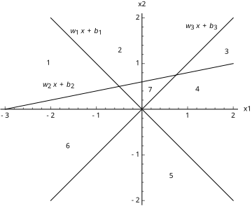
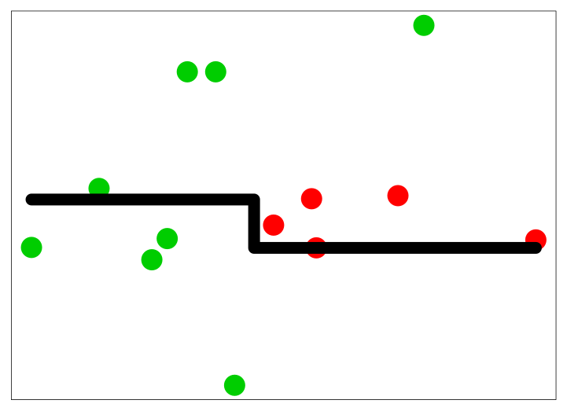
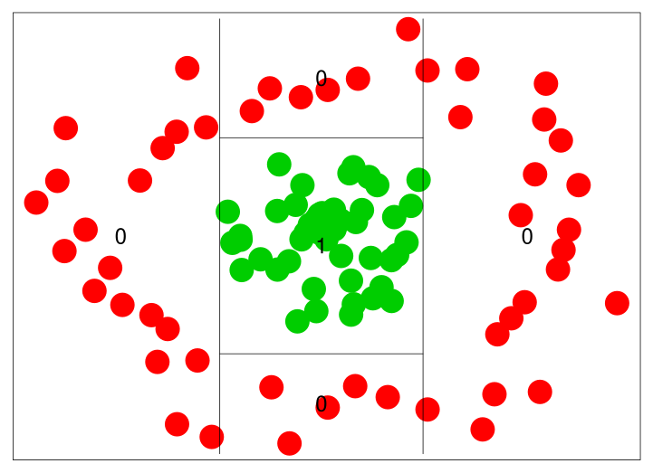
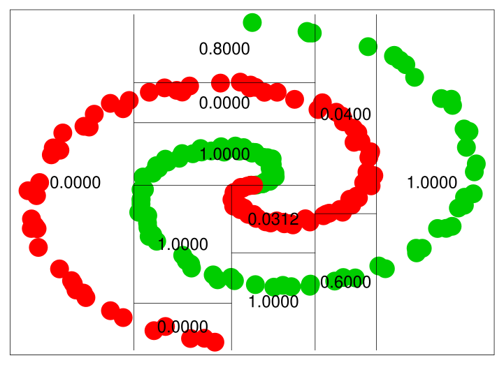
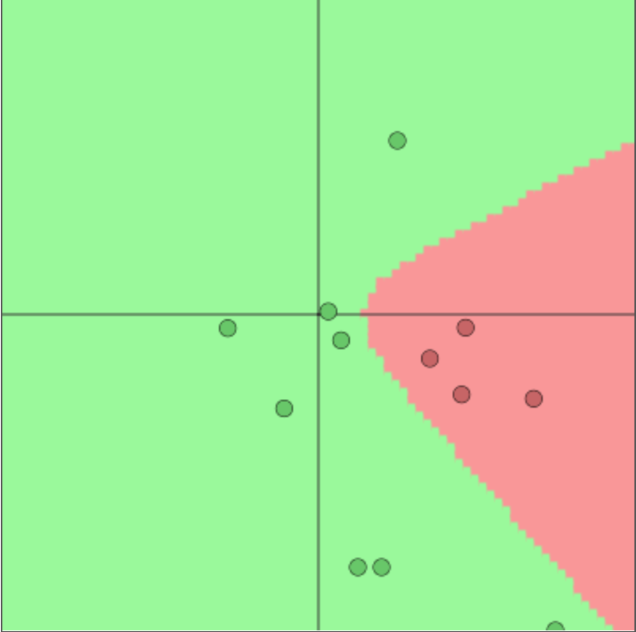
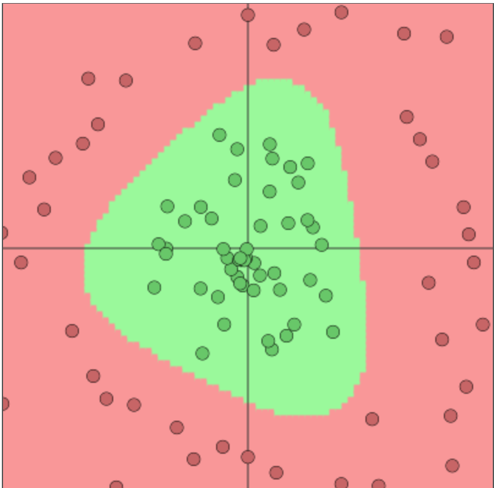
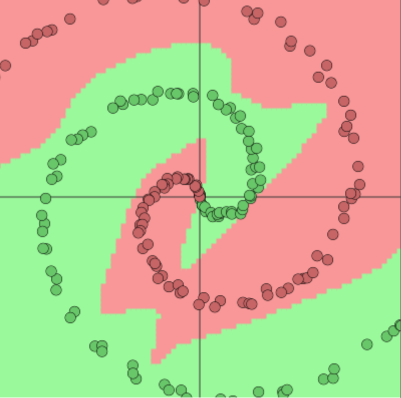
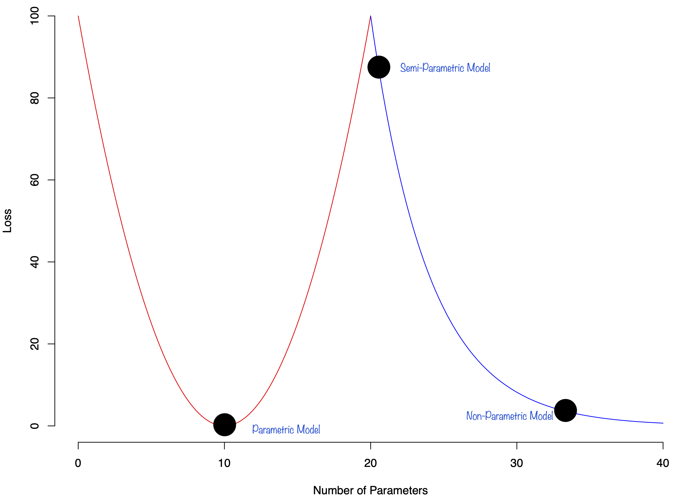



# Theory of Deep Learning {#sec-theorydl}

This chapter explores the theoretical foundations of deep learning through the lens of multivariate function approximation. We begin with *ridge functions* as fundamental building blocks, functions of the form $f(x) = g(w^\top x)$ that represent one of the simplest forms of nonlinear multivariate functions by combining a single linear projection with a univariate nonlinear transformation. Their key geometric property, remaining constant along directions orthogonal to the projection vector $w$, makes them particularly useful for high-dimensional approximation.

Building on ridge functions, we introduce *projection pursuit regression*, which approximates complex input-output relationships using linear combinations of ridge functions. This technique, developed in the 1980s, provides the mathematical foundation for understanding how neural networks decompose high-dimensional problems.

The chapter culminates with the *Kolmogorov Superposition Theorem* (KST), a result showing that any real-valued continuous function can be represented as a sum of compositions of single-variable functions. This theorem provides a theoretical framework for understanding how multivariate functions can be decomposed into simpler, more manageable components, a principle that underlies the architecture of modern neural networks.

Throughout, we examine a central question: can we achieve superior performance through mathematically elegant representations of multivariate functions rather than raw computational power? This tension between theoretical efficiency and practical computation motivates much of the research in deep learning theory.

## Ridge and Projection Pursuit Regression

To understand the significance of this trade-off, we consider ridge functions, which represent a fundamental building block in multivariate analysis. Since our ultimate goal is to model arbitrary multivariate functions $f$, we need a way to reduce dimensionality while preserving the ability to capture nonlinear relationships. Ridge functions accomplish this by representing one of the simplest forms of nonlinear multivariate functions, requiring only a single linear projection and a univariate nonlinear transformation. Formally, a ridge function $f: \mathbb{R}^n \rightarrow \mathbb{R}$ takes the form $f(x) = g(w^\top x)$, where $g$ is a univariate function and $x,w \in \mathbb{R}^n$. The non-zero vector $w$ is called the direction. The term "ridge" reflects a key geometric property: the function remains constant along any direction orthogonal to $w$. Specifically, for any direction $u$ such that $w^\top u = 0$, we have

$$
f(x+u) = g(w^\top(x+u)) = g(w^\top x) = f(x)
$$

Ridge functions play a central role in high-dimensional statistical analysis. For example, projection pursuit regression approximates input-output relations using a linear combination of ridge functions [@friedman1981projection; @huber1985projection]:
$$
\phi(x) = \sum_{i=1}^{p}g_i(w_i^\top x),
$$
where both the directions $w_i$ and functions $g_i$ are learnable parameters, and $w_i^\top x$ represents the one-dimensional projection of the input vector $x$ onto the direction defined by $w_i$. Each $g_i(w_i^\top x)$ can be interpreted as a learned feature extracted from the data. @diaconis1984nonlinear extended this approach using nonlinear functions of linear combinations, establishing the mathematical framework that would later inform the design of multi-layer neural networks.

### From Approximation to Representation

While ridge functions and projection pursuit provide approximation tools, they rely on sums of increasing numbers of components to achieve precision. A fundamental question in deep learning theory is whether we can achieve *exact* representation of multivariate functions using a finite number of components, rather than just approximation.

This question addresses a core tension in machine learning: the trade-off between the mathematical efficiency of a representation and its computational feasibility. Modern deep learning succeeds not just because of hardware acceleration (GPUs), but because deep architectures may implicitly exploit efficient representations of high-dimensional functions.

To understand this, we turn to a foundational result that seemingly solves the representation problem entirely: the Kolmogorov Superposition Theorem.


## Kolmogorov Superposition Theorem (KST)

Kolmogorov demonstrated that any real-valued continuous function $f(\mathbf{x})$ on the unit cube $E^n = [0,1]^n$ can be represented as a composition of single-variable functions:

$$
f(x_1,\ldots,x_n) = \sum_{q=1}^{2n+1} g_q\left(\phi_q(x_1,\ldots,x_n)\right)
$$

where $g_q$ are continuous single-variable functions defined on $\phi_q(E^n)$. Kolmogorov further showed that the $\phi_q$ functions can be decomposed into sums of single-variable functions:

$$
\phi_q(x_1,\ldots,x_n) = \sum_{i=1}^n \psi_{q,i}(x_i)
$$

The Kolmogorov representation theorem @kolmogorov1956representation states: for any continuous $f: [0,1]^n \to \mathbb{R}$, there exist continuous outer functions $g_q: \mathbb{R} \to \mathbb{R}$ and monotone increasing inner functions $\psi_{q,i}: [0,1] \to \mathbb{R}$ such that

$$
f(x_1,\ldots,x_n) = \sum_{q=1}^{2n+1} g_q\left(\sum_{i=1}^n \psi_{q,i}(x_i)\right)
$$

The theorem has been refined over time, with inner functions becoming Hölder continuous and Lipschitz continuous, requiring modifications to both outer and inner functions.

The inner functions $\psi_{q,i}$ partition the input space into distinct regions, and the outer function $g$ must be constructed to provide the correct output values across these regions. For each input configuration, the inner functions generate a unique encoding, and $g$ must map this encoding to the appropriate value of $f(x)$. This creates a dictionary-like structure that associates each region with its corresponding output value.

The constructive proof of KST has been refined through several contributions. @sprecher1965structure provided the first explicit construction of the inner functions, though his proof contained technical gaps. @koppen2002training corrected these errors and provided a complete algorithmic construction. More recently, @actor2018computation and @demb2021note proposed computational improvements to the algorithm. @braun2009kolmogorov further enhanced the understanding by providing precise definitions of the shift parameters $\delta_k$ and characterizing the topological structure induced by the inner functions.

A fundamental trade-off in KST exists between function smoothness and dimensionality. The inner functions $\psi_{p,q}$ can be chosen from two different function spaces, each offering distinct advantages. The first option is to use functions from $C^1([0,1])$, the space of continuously differentiable functions, but this limits the network's ability to handle higher dimensions effectively. The second option is to relax the smoothness requirement to Hölder continuous functions ($\psi_{p,q} \in \text{Hölder}_\alpha([0,1])$), which satisfy the inequality $|\psi(x) - \psi(y)| \le C|x-y|^\alpha$. These functions are less smooth, but this "roughness" enables better approximation in higher dimensions.

### Kolmogorov-Arnold Networks

A significant development has been the emergence of Kolmogorov-Arnold Networks (KANs). The key innovation of KANs is their use of learnable functions rather than weights on the network edges. This replaces traditional linear weights with univariate functions, typically parametrized by splines, enhancing both representational capacity and interpretability.

A practical connection exists between KST and neural networks: any KAN can be constructed as a 3-layer MLP. Consider a KST in the form of sums of functions, a two layer model:

$$
f( x_1 , \ldots , x_d ) = f( x) = ( g \circ \psi ) (x ) 
$$

Then KAN is not only a superposition of functions but also a particular case of a tree of discrete Urysohn operators:

$$
U(x_1 , \ldots , x_d ) = \sum_{j=1}^d g_j (x_j ) 
$$

This structure enables fast, scalable algorithms that avoid backpropagation for any GAM model through *projection descent with Kaczmarz schemes*, iterative methods originally developed for solving systems of linear equations that can be adapted for training these networks [@kaczmarz1937angenaherte].

## Kolmogorov Generalized Additive Models (K-GAM)

Rather than using learnable functions as network node activations, we directly use the KST representation [@polson2017deep]. This 2-layer network with non-differentiable inner function has architecture:

$$
f(x_1,\ldots,x_d) = \sum_{q=0}^{2d} g_q(z_q)
$$

where the inner layer embeds $[0,1]^d$ to $\mathbb{R}^{2d+1}$ via:

$$
z_q = \eta_q ( x_1 , \ldots , x_d ) = \sum_{p=1}^ d \lambda_p \psi  ( x_p + q a ) 
$$

Here the weights are $\lambda_1 = 1$ and $\lambda_p = \sum_{r=1}^\infty \gamma^{-(p-1)\beta(r)}$ for $p > 1$, built from the base-$\gamma$ digit expansion with $\beta(r) = (d^r-1)/(d-1)$, together with an integer base $\gamma \geq 2d+2$ and shift $a = (\gamma(\gamma-1))^{-1}$. The inner function therefore depends on the input dimension $d$ through $\beta$.

The Köppen function $\psi$ [@koppen2002training] is defined first on the dense set of terminating base-$\gamma$ rationals

$$
D_k = \left\{ u_k \in \mathbb{Q} : u_k = \sum_{l=1}^{k}i_l\gamma^{-l},\; i_l \in \{0,\ldots,\gamma-1\} \right\}
$$

and then extended to $[0,1]$ by a limit, since every $x \in [0,1]$ is the limit of its truncations $u_k$:

$$
\psi(x) = \lim_{k \rightarrow \infty} \psi_k(u_k), \qquad x = \sum_{l=1}^{\infty}i_l\gamma^{-l} = \lim_{k \rightarrow \infty} u_k .
$$

The functions $\psi_k$ are defined recursively on $D_k$, with $i_k$ the last digit of $u_k$, as:

$$
\psi_k(u_k) =
\begin{cases}
    u_k, & k = 1,\\
    \psi_{k-1}(u_k-i_k\gamma^{-k}) + i_k\gamma^{-\beta(k)}, & k>1,\; i_k<\gamma-1,\\
    \tfrac{1}{2}\left(\psi_{k-1}(u_k-i_k\gamma^{-k}) + \psi_{k-1}(u_k+i_k\gamma^{-k})\right) + i_k\gamma^{-\beta(k)}, & k>1,\; i_k = \gamma - 1 .
\end{cases}
$$

Köppen's recursion repairs an earlier definition of Sprecher's that turns out to be neither monotone nor continuous; @braun2009kolmogorov supply the convergence proof the construction had been missing.

The most striking aspect of KST is that it leads to a Generalized Additive Model (GAM) with fixed features that are independent of the target function $f$. These features, determined by the Köppen function, provide universal topological information about the input space, effectively implementing a k-nearest neighbors structure that is inherent to the representation.

This leads to the following architecture. Any deep learner can be represented as a GAM with feature engineering (topological information) given by features $z_k$ in the hidden layer:

\begin{align*}
y_i &= \sum_{k=1}^{2n+1} g(z_k)\\
z_k &= \sum_{j=1}^n \lambda^j\psi(x_j + \epsilon k) + k
\end{align*}

where $\psi$ is a single activation function common to all nodes, and $g$ is a single outer function.

One approach replaces each $\phi_j$ with a single ReLU network $g$:

$$
g(x) = \sum_{k=1}^K \beta_k\text{ReLU}(w_kx + b_k)
$$

where $K$ is the number of neurons.

## Space Partitioning

The partitioning of the input space by a deep learner is similar to that performed by decision trees and partition-based models such as CART, MARS, and RandomForests. However, trees are more local in the regions that they use to construct their estimators. Each neuron in a deep learning model corresponds to a manifold that divides the input space. In the case of the ReLU activation function $f(x) = \max(0,x)$, the manifold is simply a hyperplane. The neuron activates when the new observation is on the "right" side of this hyperplane, with the activation magnitude equal to the distance from the boundary. For example, in two dimensions, three neurons with ReLU activation functions will divide the space into seven regions, as shown in @fig-hyper-planes.

{#fig-hyper-planes}

The key difference between tree-based architectures and neural network-based models lies in how hyperplanes are combined. @fig-tree-dl-comp compares space decomposition by hyperplanes in tree-based versus neural network architectures. We compare a two-layer neural network (bottom row) with a tree model trained via the CART algorithm (top row). The network architecture used is:

$$
\begin{aligned}
Y &=  \mathrm{softmax}(W^{(0)}Z^{(2)} + b^{(0)})\\
Z^{(2)} &=  \tanh(W^{(2)}Z^{(1)} + b^{(2)})\\
Z^{(1)} &=  \tanh(W^{(1)}X + b^{(1)})
\end{aligned}
$$

The weight matrices for simple data are $W^{(1)}, W^{(2)} \in \mathbb{R}^{2 \times 2}$; for circle data $W^{(1)} \in \mathbb{R}^{2 \times 2}$ and $W^{(2)} \in \mathbb{R}^{3 \times 2}$; and for spiral data we have $W^{(1)} \in \mathbb{R}^{2 \times 2}$ and $W^{(2)} \in \mathbb{R}^{4 \times 2}$. An advantage of deep architectures is that the number of hyperplanes grows exponentially with the number of layers. 

::: {#fig-tree-dl-comp layout-ncol=3}












Space partition by tree architectures (top row) and deep learning architectures (bottom row) for three different datasets.
:::

### Connection to Bayesian Model Averaging

This space partitioning perspective connects naturally to Bayesian ensemble methods. A Bayesian probabilistic approach can optimally weight predictors via model averaging:

$$
\hat{Y}(X) = \sum_{r=1}^R w_r \hat{Y}_r(X)
$$

where $\hat{Y}_r(X) = \E{Y \mid X, \text{model } r}$ and weights $w_r$ are posterior model probabilities. @amit1999multiple demonstrated the success of multiple randomized classifiers (e.g., an ensemble of 100 trees), which reduces error rates significantly compared to single trees by exploiting the weak correlation between diverse classifiers.

## Kernel Smoothing and Interpolation

The theory of kernel methods was developed by Fredholm in the context of integral equations [@fredholm1903classe]. The idea is to represent a function as a linear combination of basis functions, which are called kernels.

$$
 f(x) = \int_{a}^{b} K(x,x') \phi(x') \, dx' \quad \text{where} \quad \mathbf{x} = ( x_1 , \ldots , x_d )
$$

Here, the unknown function $f(x)$ is represented as a linear combination of kernels $K(x,x')$ with unknown coefficients $\phi(x')$. The kernels are known, and the coefficients are unknown. The coefficients are found by solving the integral equation. The first work in this area was done by Abel, who considered equations of the form above.

Nowadays, we call those equations Fredholm integral equations of the first kind. Integral equations typically arise in inverse problems. Their significance extends beyond their historical origins, as kernel methods have become instrumental in addressing one of the fundamental challenges in modern mathematics: the curse of dimensionality. 

@nadaraya1964estimating and @watson1964smooth independently proposed using kernels to estimate the regression function. The idea is to estimate $f(x)$ at a point $x$ by computing a weighted average of the response values $y_i$ at nearby points $x_i$, with the kernel function defining the weights.

The regression function estimate:

$$
\hat{f}(x) = \sum_{i=1}^n  y_i K(x,x_i)/ \sum_{i=1}^n K(x,x_i) ,
$$

with normalized kernel weights.

Both Nadaraya and Watson considered the symmetric kernel $K(x,x') = K(\|x'-x\|_2)$, where $\|\cdot\|_2$ is the Euclidean norm. The most popular kernel of that sort is the Gaussian kernel:

$$
K(x,x') = \exp\left( -\dfrac{\|x-x'\|_2^2}{2\sigma^2}\right).
$$

Alternatively, replacing the squared 2-norm with inner products gives the unnormalized form: $K(x,x') = \exp\left(\frac{\|x\|^2 + \|x'\|^2}{2\sigma^2}\right)\exp\left(-\frac{\|x - x'\|^2}{2\sigma^2}\right)$, which reduces to a function of $x^\top x'$ when inputs lie on a sphere.

Kernel methods are supported by numerous generalization bounds which often take the form of inequalities that describe the performance limits of kernel-based estimators. A particularly important example is the $k$-nearest neighbors ($k$-NN) estimator, which can be expressed in a kernel framework as:

$$
\hat{f} ( x) =  \sum_{i=1}^N w_i y_i        \; \text{where}\; w_i := K( x_i , x ) /  \sum_{i=1}^N K( x_i ,x )   
$$

$k$-NN classifiers converge to error rates bounded relative to the Bayes error rate, with relationships depending on class number. For binary classification, the asymptotic error rate of the nearest-neighbor rule is at most $2R^*(1-R^*)$, where $R^*$ is the Bayes error rate. @cover1967nearest established this bound, showing that the nearest-neighbor rule is asymptotically no worse than twice the Bayes rate.

## Transformers as Kernel Smoothing

This section views the transformer through the lens of kernel smoothing to connect it with the approximation theory developed above. For the full architectural treatment (embeddings, positional encoding, multi-head attention, and training), see @sec-nlp.

@bahdanau2014neural proposed kernel smoothing for sequence-to-sequence learning, estimating next-word probability using context vectors, weighted averages of input sequence vectors $h_j$:

$$
c_i = \sum_{j=1}^n \alpha_{ij} h_j,
$$

where weights $\alpha_{ij}$ are defined by the kernel function:

$$
\alpha_{ij} = \dfrac{\exp\left( e_{ij}\right)}{\sum_{k=1}^n \exp\left( e_{ik}\right)}.
$$

Instead of using a traditional similarity measure like the 2-norm or inner product, the authors used a neural network to define the energy function $e_{ij} = a(s_{i-1},h_j)$. This neural network measures the similarity between the last generated element of the output sequence $s_{i-1}$ and $j$-th element of the input sequence $h_j$.

### Transformer

Transformers have become the dominant architecture for natural language processing, achieving strong results across tasks from machine translation to language modeling and text generation. Originally designed to handle sequential data, the transformer architecture has since been extended to computer vision (Vision Transformers), protein structure prediction (AlphaFold), and speech recognition. Its success stems from a novel self-attention mechanism that efficiently captures long-range dependencies.

The idea to use kernel smoothing for sequence to sequence was called "attention", or cross-attention, by @bahdanau2014neural. When used for self-supervised learning, it is called self-attention. When a sequence is mapped to a matrix $M$, it is the self-attention embedding of @lin2017structured. The concept of self-attention and attention for natural language processing was further developed by @vaswani2017attention, who developed a smoothing method that they called the transformer.

The transformer architecture revolves around a series of mathematical concepts and operations:

- *Embeddings*: The input text is converted into vectors using embeddings. Each word (or token) is represented by a unique vector in a high-dimensional space.
- *Positional Encoding*: Since transformers do not have a sense of sequence order (like RNNs do), positional encodings are added to the embeddings to provide information about the position of each word in the sequence.
- *Multi-Head Attention*: The core of the transformer model. It enables the model to focus on different parts of the input sequence simultaneously. The attention mechanism is defined as:
  $$ \text{Attention}(Q, K, V) = \text{softmax}\left(\frac{QK^\top}{\sqrt{d_k}}\right)V $$
  where $Q$, $K$, and $V$ are query, key, and value matrices, respectively.
- *Query (Q), Key (K), and Value (V) Vectors*: These are derived from the input embeddings. They represent different aspects of the input.
- *Scaled Dot-Product Attention*: The attention mechanism calculates the dot product of the Query with all Keys, scales these values, and then applies a softmax function to determine the weights of the Values.
- *Multiple 'Heads'*: The model does this in parallel multiple times (multi-head), allowing it to capture different features from different representation subspaces.
- *Layer Normalization and Residual Connections*: After each sub-layer in the encoder and decoder (like multi-head attention or the feed-forward layers), the transformer applies layer normalization and adds the output of the sub-layer to its input (residual connection). This helps in stabilizing the training of deep networks.
- *Feed-Forward Neural Networks*: Each layer in the transformer contains a fully connected feed-forward network applied to each position separately and identically. It is defined as:
  $$ \text{FFN}(x) = \max(0, xW_1 + b_1)W_2 + b_2 $$
  where $W_1$, $W_2$, $b_1$, and $b_2$ are learnable parameters.
- *Output Linear Layer and Softmax*: The decoder's final output passes through a linear layer followed by a softmax layer. This layer converts the decoder output into predicted next-token probabilities.
- *Training and Loss Function*: Transformers are often trained using a variant of Cross-Entropy Loss to compare the predicted output with the actual output.
- *Masking*: In the decoder, to prevent future tokens from being used in the prediction, a technique called 'masking' is applied.
- *Backpropagation and Optimization*: The model's parameters are adjusted through backpropagation and optimization algorithms like Adam.

In the self-attention embedding of @lin2017structured mentioned above, a sequence of words (a sentence) is mapped to a single matrix:

$$
M = AH,
$$

where $H$ is the matrix representing an input sequence $H = (h_1,\ldots,h_n)$ and $A$ is the matrix of weights:

$$
A = \mathrm{softmax}\left(W_2\tanh\left(W_1H^\top\right)\right).
$$

This allows us to represent a sequence of words of any length $n$ using a "fixed size" $r\times u$ matrix $M$, where $u$ is the dimension of a vector that represents an element of a sequence (word embedding), and $r$ is the hyperparameter that defines the size of the matrix $M$.

The primary advantage of transformers over recurrent architectures is their parallelizability: all positions in a sequence can be processed simultaneously rather than sequentially. Modern large language models such as BERT [@devlin2018bert], GPT [@brown2020language], and T5 [@raffel2020exploring] are built on transformer architectures. See @tsai2019transformer for an interpretation of the transformer's attention as a kernel smoother.

## Deep Learning as Representation Learning

A fundamental perspective on deep learning is that it automates the process of feature engineering. Formally, we seek to find a predictor $\mathbf{Y} = f(\mathbf{X})$. We can decompose this function into two stages: a data transformation (representation learning) $\phi(\mathbf{X})$ and a predictive model $g(\cdot)$.

$$
\mathbf{Y} \sim p(\mathbf{Y} \mid \mathbf{Z}), \quad \mathbf{Z} = \phi(\mathbf{X})
$$

Here, $\mathbf{Z}$ represents latent features. The transformation $\phi(\cdot)$ effectively performs dimensionality reduction (or expansion) to uncover a structure where the relationship between $\mathbf{Z}$ and $\mathbf{Y}$ is simpler (often linear).

### Dimensionality Expansion vs. Reduction

Classically, statisticians approached complex functions through *dimensionality expansion* (basis expansion). Methods like *Kernel Regression* or *Splines* map the input $\mathbf{X}$ into a higher-dimensional space of features $\phi(\mathbf{X}) = (\phi_1(\mathbf{X}), \ldots, \phi_M(\mathbf{X}))$ (e.g., interactions, polynomials) and then fit a linear model. The "Kernel Trick" allows this to be done efficiently without explicit computation of features.

Deep learning, in contrast, often emphasizes *dimensionality reduction* (feature learning). It searches for a low-dimensional manifold embedded in the high-dimensional input space.

### Linear Baselines: PCA and PLS

To understand the contribution of deep learning, it is useful to compare it with linear methods for Representation Learning:

1.  *Principal Component Analysis (PCA)*: An unsupervised method that finds orthogonal directions (eigenvectors of $\mathbf{X}^\top\mathbf{X}$) maximizing variance. It creates features $\mathbf{Z}_{PCA} = \mathbf{X}\mathbf{W}$ without knowledge of the target $\mathbf{Y}$.
2.  *Partial Least Squares (PLS)*: A supervised method that finds directions maximizing the covariance between $\mathbf{X}$ and $\mathbf{Y}$. It effectively finds features that are both variable and predictive.

Deep Neural Networks extrapolate this concept to the nonlinear regime. They can be viewed as performing *Nonlinear PLS*. The layers of a network apply successive semi-affine transformations:

$$
\mathbf{Z}^{(l)} = \sigma(W^{(l)}\mathbf{Z}^{(l-1)} + b^{(l)})
$$

This hierarchical stacking allows the network to learn progressively more abstract representations, discovering nonlinear factors that maximize predictive power, much like a nonlinear generalization of the supervised dimensionality reduction performed by PLS.

### Uncertainty Quantification

We can extend this framework to quantify uncertainty. Our probabilistic model is $\mathbf{Y} \mid \mathbf{Z} \sim p(\mathbf{Y} \mid \mathbf{Z})$, where $\mathbf{Z} = g(\mathbf{X})$ is the deep feature extraction. A key result by @brillinger2012generalized suggests that for certain input distributions (e.g., Gaussian), the central subspace estimated by methods like PLS or Deep Learning can be consistent.

By treating the top layer as a generalized linear model on learned features $\mathbf{Z}$, we can apply standard Bayesian techniques for the final prediction layer while relying on the deep network for feature discovery. This "Last Layer Bayesian" approach provides a practical path to uncertainty quantification in deep learning, enabling the calculation of predictive intervals:
$$
\mathbf{Y}_{\star} \sim \int p(\mathbf{Y} \mid \mathbf{Z}_{\star}, \theta) p(\theta \mid \mathcal{D}) d\theta
$$
where $\theta$ represents the parameters of the output layer. 


## Double Descent {#sec-double-descent}
Double descent is a phenomenon of over-parameterized statistical models. In this section, we present a view of double descent from a Bayesian perspective. Over-parameterized models such as deep neural networks have an interesting re-descending property in their risk characteristics. This is a recent phenomenon in machine learning and has been the subject of many studies. As the complexity of the model increases, there is a U-shaped region corresponding to the traditional bias-variance trade-off, but then as the number of parameters equals the number of observations and the model becomes one of interpolation, the risk can become infinite and then, in the over-parameterized region, it re-descends, the double descent effect. We show that this has a natural Bayesian interpretation. Moreover, we show that it is not in conflict with the traditional Occam's razor that Bayesian models possess, in that they tend to prefer simpler models when possible. 

Empirically, the double descent effect was initially observed for high-dimensional neural network regression models and the good performance of these models on tasks such as large language models, image processing, and generative AI methods [@nareklishvili2023generative].
The double descent effect extends the classical bias-variance trade-off curve that shrinkage estimators possess. This phenomenon was first observed in the context of linear regression [@belkin2019reconciling]. The authors showed that the test error of the estimator can decrease as the number of parameters increases. @bach2024highdimensional extends these results to stochastic regression models. 

Interpolators, estimators that achieve zero training error, were then shown to have attractive properties due to the double descent effect [@hastie2022surprises]. Our goal is to show that Bayesian estimators can also possess a double descent phenomenon. Interpolators such as ReLU neural networks [@polson2017deep] have increased in popularity with many applications such as traffic flow modeling [@polson2017deepa] and high-frequency trading [@dixon2019deep], among many others.

Occam's razor, the favoring of simpler models over complex ones, is a natural feature of Bayesian methods that are based on the weight of evidence (a.k.a. the marginal likelihood of the data). To do this, they penalize models with higher complexity via a correction term as in the Bayesian Information Criterion (BIC). This seems inconsistent with the double descent phenomenon. We show that this is not the case, as even though Bayesian methods shift the posterior towards lower-complexity models, highly parameterized Bayesian models can also have good risk properties due to the conditional prior of parameters given the model. We illustrate this with an application to neural network models.

Double descent has been studied from a frequentist point of view in @belkin2019reconciling, @bach2024highdimensional. The phenomenon of double descent is illustrated in @fig-double-descent. The first part of the curve represents the classical U-shaped bias-variance trade-off. The second part demonstrates the double descent phenomenon, where the test error of the estimator can decrease as the model becomes over-parameterized beyond the interpolation threshold. The same phenomenon was later observed in deep learning [@nakkiran2021deep].

{#fig-double-descent width=60%}

::: {#exm-double-descent}
## Double Descent Demonstration Using Polynomial Regression

To illustrate the double descent phenomenon in a concrete setting, we present a detailed example using polynomial regression with Legendre basis functions.


Our demonstration uses a one-dimensional regression problem where we attempt to learn a sinusoidal function $f(x) = \sin(5x)$ from a small dataset of only $n = 20$ observations sampled from the interval $[-1, 1]$. We add Gaussian noise with standard deviation $\sigma = 0.3$ to simulate realistic measurement error. The choice of a small sample size is crucial for observing double descent, as it creates a regime where the number of model parameters can substantially exceed the number of observations.

We fit polynomial models of varying degrees $d = 1, 2, \ldots, 50$ using Legendre polynomial basis functions. Legendre polynomials provide a numerically stable orthogonal basis that helps avoid the numerical instabilities associated with standard monomial bases in high-degree polynomial fitting. For each degree $d$, we estimate the coefficients using the Moore-Penrose pseudoinverse, which provides the minimum-norm solution when the system is underdetermined (i.e., when $d + 1 > n$).

@fig-double-descent-grid illustrates how model behavior changes dramatically across different polynomial degrees. The four panels show representative cases that capture the key phases of the double descent phenomenon:

- *Degree 1 (Underparameterized)*: The linear model is too simple to capture the oscillatory nature of the underlying sine function, resulting in high bias and poor fit to both training and test data.

- *Degree 5 (Classical Optimum)*: This represents the sweet spot of the classical bias-variance tradeoff, where the model has sufficient complexity to capture the main features of the sine function without overfitting severely.

- *Degree 20 (Interpolation Threshold)*: At this degree, the model has approximately as many parameters as training observations (a degree-20 Legendre fit has 21 coefficients for the 20 data points), enabling perfect interpolation of the training data. However, the resulting fit exhibits wild oscillations between data points, leading to poor generalization performance.

- *Degree 50 (Over-parameterized)*: Surprisingly, despite having far more parameters than observations, this highly over-parameterized model achieves better test performance than the interpolating model, demonstrating the double descent effect.

```{python global-setup}
#| echo: false
import numpy as np
import numpy.random as rand
import numpy.linalg as la
import matplotlib.pyplot as plt

# Set random seed for reproducibility
np.random.seed(42)
# Functions
def arctan_gt(x): 
    return np.arctan(5*x)

def cubic_gt(x): 
    return poly(x, np.array([0, -1, 0, 1]), 3)

def relu(x): 
    return x*(x >= 0)

def sin(x): 
    return np.sin(5*x)

def Vand(x, d):
    """Vandermonde matrix for pts x, to degree d"""
    X = np.array([x**i for i in range(0, d+1)]).T
    return X

```

The code below simulates the $n = 20$ noisy observations and defines `fit(d)`, in which the pseudoinverse `la.pinv` of the Legendre design matrix `G(x, d)` gives the minimum-norm least-squares coefficients; the imports (`la` is `numpy.linalg`) and the helper `sin`, which computes $\sin(5x)$, are in `code/19-theorydl.py`. The function returns the coefficients with the test error, measured against the true curve on a grid of 100 points, and the training error, measured against the observations.

```{python}
#| echo: true

n = 20  # number of samples
sigma = 0.3  # stdev of noise
a = -1
b = 1  # range of x values
# Legendre polynomial basis
G = np.polynomial.legendre.legvander

# Initialize data
ground_truth = sin
x = np.linspace(a, b, n)
y = ground_truth(x) + sigma * np.random.normal(size=n)
xdense = np.linspace(a, b, 100)
ygt = ground_truth(xdense)

def fit(d):
    betaHat = la.pinv(G(x, d)).dot(y)
    mseos = np.mean((G(xdense, d).dot(betaHat) - ygt)**2)
    mseis = np.mean((G(x, d).dot(betaHat) - y)**2)
    return betaHat, mseos, mseis
```

```{python}

def poly(pts, beta, d):
    return G(pts, d).dot(beta)

def run(d, ax):
    """Compute the regressor for degree d, and plot the solution."""
    betaHat, mseos, mseois = fit(d)
    ax.plot(xdense, ygt, label='ground-truth')
    ax.scatter(x, y, c='r', label='samples')
    ax.plot(xdense, poly(xdense, betaHat, d), label='model')
    ax.set_ylim(-2, 2)
    ax.axis('off')
    ax.legend()
    ax.set_title('d=%d, MSE: Test=%.2f, Train=%.2f' % (d, mseos, mseois))
```


```{python}
#| code-fold: true
#| label: fig-double-descent-grid
#| fig-cap: "Double Descent Phenomenon: Polynomial Regression with Different Degrees."

# Create 2x2 subplot grid (all functions and variables are now persistent!)
fig, axes = plt.subplots(2, 2, figsize=(5.5, 4.6))
fig.suptitle('Double Descent Phenomenon: Polynomial Regression', fontsize=10)

# Plot each degree in its respective subplot
run(1, axes[0, 0])   # Top left
run(5, axes[0, 1])   # Top right  
run(20, axes[1, 0])  # Bottom left
run(50, axes[1, 1])  # Bottom right

for ax in axes.flat:
    ax.legend(fontsize=6)
    ax.title.set_fontsize(8)

plt.tight_layout()
plt.show()
```

We will plot the test error (solid line) and the training error (dashed line) for different polynomial degrees from 1 to 50.
```{python}
#| code-fold: true
#| label: fig-mse-curve
#| fig-cap: "Bias-Variance Trade-off: Training and Test MSE vs Model Complexity."

# Generate MSE data for different polynomial degrees (using persistent functions!)
nd = 51
mse1 = np.zeros(nd)  # Test MSE
mse2 = np.zeros(nd)  # Train MSE

for d in range(1, nd):
    betaHat, mseos, mseois = fit(d)
    mse1[d] = mseos
    mse2[d] = mseois
fig, ax1 = plt.subplots()
ax1.set_xlabel('Polynomial Degree')
ax1.set_ylabel('log10(Test MSE)', color='blue')
ln1 = ax1.plot(range(1, nd), np.log10(mse1[1:]), color='blue', label='out-of-sample')
ax1.tick_params(axis='y', labelcolor='blue')

ax2 = ax1.twinx()
ax2.set_ylabel('log10(Train MSE)', color='red')
ln2 = ax2.plot(range(1, nd), np.log10(mse2[1:]), color='red', linestyle='--', label='in-sample')
ax2.tick_params(axis='y', labelcolor='red')

# Combined legend with no box
lns = ln1 + ln2
labs = [l.get_label() for l in lns]
ax1.legend(lns, labs, loc='upper right', frameon=False)

# Remove the box (spines)
ax1.spines['top'].set_visible(False)
ax2.spines['top'].set_visible(False)
ax1.spines['right'].set_visible(False)
ax2.spines['left'].set_visible(False)

plt.tight_layout()
```

The key insight from @fig-mse-curve is the characteristic double descent shape in the test error (solid line). The curve exhibits three distinct phases:

1. *Classical Regime*: For low degrees ($d < 5$), increasing model complexity reduces both bias and test error, following the traditional understanding of the bias-variance tradeoff.

2. *Interpolation Crisis*: Around the interpolation threshold ($d \approx n = 20$), test error peaks dramatically as the model begins to perfectly fit the training data while generalizing poorly.

3. *Over-parameterized Regime*: For very high degrees ($d > 30$), test error decreases again, demonstrating that extreme over-parameterization can lead to improved generalization despite the model's ability to memorize the training data.


This behavior challenges the conventional wisdom that more parameters necessarily lead to worse generalization. The double descent phenomenon arises from the implicit regularization effects of minimum-norm solutions in over-parameterized settings. When $d \geq n$, the pseudoinverse solution corresponds to the minimum $\ell_2$-norm coefficients among all possible interpolating solutions. This implicit bias toward simpler functions can lead to surprisingly good generalization properties.


While this example uses polynomial regression for clarity, the double descent phenomenon has been observed across a wide range of modern machine learning models, including deep neural networks, random forests, and kernel methods. Given that model selection is time-consuming and computationally expensive, this example shows that instead of spending time to do model selection to find the "sweet spot" model with a 5-degree polynomial, we just over-parametrise and get a good model for free!
:::

## Application

### Simulated Data

We also apply the K-GAM architecture to a simulated dataset to evaluate its performance on data with known structure and relationships. The dataset contains 100 observations generated from the following function:

\begin{align*}
    &y = \mu(x) + \epsilon, \quad \epsilon \sim \mathcal{N}(0,1)\\
         &\mu(x) = 10\sin(\pi x_1 x_2) + 20(x_3-0.5)^2 + 10x_4 + 5x_5.
\end{align*}

The goal is to predict the function $y(x)$ based on the input $x$. The dataset is often used as a benchmark dataset for regression algorithms due to its diverse mix of relationships (linear, quadratic, nonlinear, Gaussian random noise) between the input features and the target function.

We use the Köppen function to transform the five-dimensional input into a set of 11 features ($2d+1$). We then learn the outer function $g$ using a ReLU network. To thoroughly investigate the model's capabilities, we implement two distinct approaches to learning the outer function. The first approach uses different $g$ functions for each feature, following the original KST formulation. This allows each function to specialize in capturing specific patterns, but might be more difficult to train and has more parameters. The second approach uses a single $g$ function for all features, as proposed by @lorentz197613th, providing a more unified and parameter-efficient representation.

The first model with multiple $g_i$ functions has dimensions: $W^0_i \in \mathbb{R}^{16\times 1}$ and $W^j_i \in \mathbb{R}^{16\times 16}$ for $j=1,\ldots,18$.

The second architecture using single function $g$ for all features maintains similar structure but increases inner layer width from 16 to 200. This increased capacity allows single functions to learn complex patterns, compensating for the constraint versus multiple specialized functions.

### Training Rates

Consider nonparametric regression $y_i= f (x_i) + \epsilon_i$ where $x_i = ( x_{1i} , \ldots , x_{di} )$. We estimate $f( x_1 , \ldots , x_d )$ for $x  = ( x_1 , \ldots , x_d ) \in [0,1]^d$. From a classical risk perspective:

$$
R ( f , \hat{f}_N ) = \E[X,Y]{ \lVert  f - \hat{f}_N \rVert^2 },
$$
where $\lVert \cdot \rVert$ denotes $L^2(P_X)$-norm.

Under standard assumptions, optimal minimax rate $\inf_{\hat{f}} \sup_f R( f , \hat{f}_N ) = O_p ( N^{- 2 \beta /( 2 \beta + d )} )$ for $\beta$-Hölder smooth functions $f$. This rate depends on dimension $d$, problematic in high dimensions. Restricting function classes yields better rates independent of $d$, avoiding the curse of dimensionality. Common approaches include linear superpositions (ridge functions) and projection pursuit models.

::: {#res-posterior-concentration}

Another asymptotic result comes from posterior concentration. Here, $\hat{f}_N$ is a regularized MAP (maximum a posteriori) estimator solving:

$$
\hat{f}_N = \arg \min_{ \hat{f}_N } \frac{1}{N} \sum_{i=1}^N ( y_i - \hat{f}_N ( x_i ))^2 + \phi ( \hat{f}_N ) 
$$

where $\phi(\hat{f})$ is regularization. Under smoothness and prior mass conditions [@polson2018posterior], the posterior distribution $\Pi(f \mid x, y)$ concentrates around the true function at the minimax rate (up to a $\log N$ factor).

:::

A key result in the deep learning literature provides convergence rates for deep neural networks. Given a training dataset of input-output pairs $( x_i , y_i)_{i=1}^N$ from the model $y = f(x) + \epsilon$ where $f$ is a deep learner (i.e., superposition of functions)

$$
f = g_L \circ \ldots \circ g_1 \circ g_0
$$

where each $g_i$ is a $\beta_i$-smooth Hölder function with $d_i$ variables, that is $|g_i(x) - g_i(y)| \le C_i|x-y|^{\beta_i}$ for some constant $C_i$.

Then, the estimator has optimal rate:

$$
O \left ( \max_{1\leq i \leq L } N^{- 2 \beta_i^* /( 2 \beta_i^* + d_i ) } \right )  \; \text{where}\; \beta_i^* = \beta_i \prod_{l = i+1}^L \min ( \beta_l , 1 ) 
$$

This result can be applied to various function classes, including generalized additive models of the form

$$
f_0 ( x ) = h \left ( \sum_{p=1}^d f_{0,p} (x_p) \right ) 
$$

where $g_2(z) = h(z)$, $g_0 ( x_1 , \ldots , x_d ) = ( f_{01}(x_1) , \ldots , f_{0d} (x_d) )$ and $g_1 ( y_1 , \ldots , y_d ) = \sum_{i=1}^d y_i$. In this case, $d_0 = d_2 = 1$, and assuming $h$ is Lipschitz, we get an optimal rate of $O(N^{-2/3})$, which is independent of $d$.

@schmidt-hieber2021kolmogorov show that deep ReLU networks also have optimal rate of $O( N^{-2/3} )$ for certain function classes. For $3$-times differentiable (e.g., cubic B-splines), @coppejans2004kolmogorovs finds a rate of $O( N^{-6/7} )$. @igelnik2003kolmogorovs finds a rate $O( N^{-1} )$ for Kolmogorov Spline Networks.

The relationship between expected risk and empirical risk. The expected risk, $R$, is typically bounded by the empirical risk plus a term of order $1/\sqrt{N}$:

$$
R(y, f^\star) \leq \frac{1}{N} \sum_{i=1}^N R(y_i, f^\star(x_i)) + O\left(\frac{\|f\|}{\sqrt{N}}\right)
$$

where $f^\star$ is the minimizer of the expected risk. However, in the case of interpolation, where the model perfectly fits the training data, the empirical risk term becomes zero, leaving only the $O(1/\sqrt{N})$ term.

## Conclusion

This chapter has traced the theoretical foundations of deep learning through the lens of multivariate function approximation. Several key insights emerge from this analysis:

*Mathematical Foundations*: The Kolmogorov Superposition Theorem provides a rigorous theoretical basis for understanding why neural networks can approximate any continuous function. The theorem shows that any multivariate function can be decomposed into compositions of univariate functions, a principle that directly informs the layered architecture of modern neural networks.

*Representation vs. Computation*: While KST guarantees the existence of such representations, the inner functions (like the Köppen function) are typically non-smooth and computationally challenging. This highlights a fundamental tension: mathematically elegant representations may not always translate to efficient computation.

*Connections Across Methods*: We have seen deep connections between seemingly disparate approaches. Transformers can be understood as kernel smoothing methods. Deep networks perform sophisticated space partitioning similar to decision trees. The K-GAM framework reveals that deep learners are essentially generalized additive models with automatically learned features.

*Double Descent and Over-parameterization*: Perhaps most surprisingly, the double descent phenomenon suggests that classical intuitions about the bias-variance trade-off may not apply to modern over-parameterized models. Networks with more parameters than training examples can still generalize well, challenging conventional wisdom about model complexity.

## Exercises {.unnumbered}



