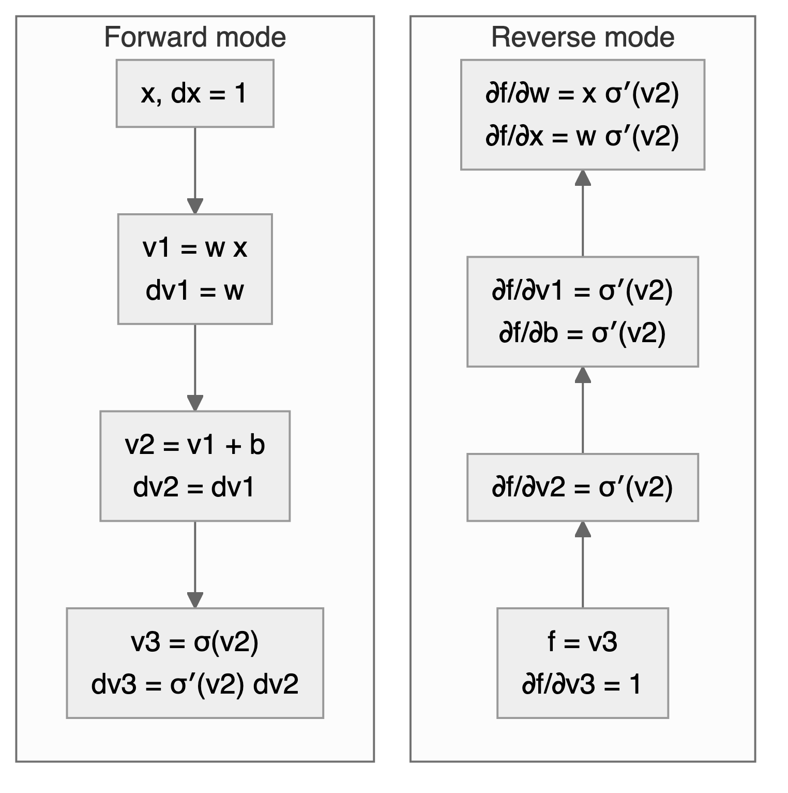
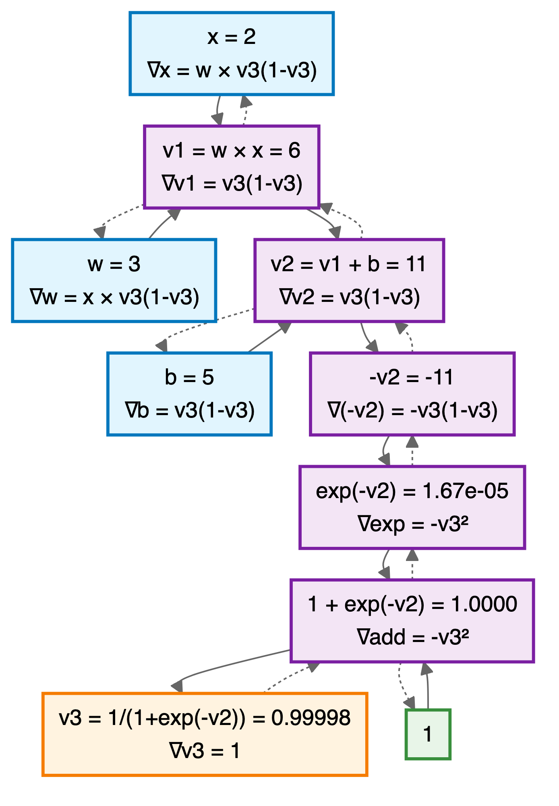



# Gradient Descent {#sec-sgd}

> "*Elegance is found in reducing parameters, not multiplying them.*"---Boris Polyak

How does a neural network with millions of parameters learn the right values? Classical statistical models rely on second-order optimization: least squares for linear regression and Newton-type methods like Broyden-Fletcher-Goldfarb-Shanno (BFGS) for generalized linear models. These algorithms use curvature information (the Hessian matrix) to take efficient steps toward the optimum.

However, second-order optimization algorithms do not scale well to deep learning models. When a model has millions or billions of parameters, computing and storing the Hessian matrix becomes prohibitive from both computational and memory standpoints. Instead, first-order gradient descent methods, which require only gradient information, are the workhorses for training deep neural networks.

This chapter unifies a theme that already appeared earlier: in @sec-pattern we framed estimation as likelihood maximization and showed how the negative log-likelihood becomes a loss. In @sec-gp we used the same idea computationally to fit Gaussian process hyperparameters by maximizing a marginal likelihood (via `optim`). Here we make the optimization mechanics explicit and reusable.

Given a parametric model $f_{\theta}(x)$, the problem of parameter estimation (when the likelihood belongs to the exponential family) is an optimization problem:
$$
    \min_{\theta} l(\theta) := -\dfrac{1}{n} \sum_{i=1}^n \log p(y_i \mid x_i, \theta),
$$
where $l$ is the negative log-likelihood of a sample (equivalently, $l(\theta)=-\ell(\theta)$ up to scaling, with $\ell(\theta)=\log L(\theta)$ as in @sec-pattern), and $\theta$ is the vector of parameters. The gradient descent method is an iterative algorithm that starts with an initial guess $\theta^{0}$ and then updates the parameter vector $\theta$ at each iteration $t$ as follows:
$$
    \theta^{t+1} = \theta^t - \alpha_t \nabla l(\theta^t).
$$
Here 
$$
\nabla l(\theta^t) = \left(\frac{\partial l}{\partial \theta_0}, \ldots,\frac{\partial l}{\partial \theta_p}\right),
$$ 
is the gradient of the loss function with respect to the parameters at iteration $t$.

This algorithm is based on the simple fact that a function value decreases in the direction of the negative gradient, at least locally. This fact follows from the definition of the gradient, which is the vector of partial derivatives of the function with respect to its parameters. The gradient points in the direction of the steepest ascent, and thus the negative gradient points in the direction of the steepest descent. It is easy to see in the figure below, where the function $l(x)$ is shown in blue and the gradient at the point $x_0$ is shown in red. We can easily see it in a one-dimensional case. The derivative is defined as 
$$
    l'(\theta) = \lim_{h \to 0} \frac{l(\theta+h) - l(\theta)}{h}.
$$
The derivative is the slope of the tangent line to the function at the point $\theta$. The derivative is positive, when $l(\theta+h) > l(\theta)$ for small $h > 0$, then the function is increasing at that point, and if it is negative, then the function is decreasing at that point. Thus, we can use the negative derivative to find the direction of the steepest descent. 

For the derivative (or gradient in the multivariate case) to be defined, the function $l(\theta)$ must be continuous and *smooth* at the point $\theta$. In practice, this means that the function must not have any sharp corners or discontinuities. For example, $f(\theta) = |\theta|$ has a sharp corner at zero, with a derivative of $+1$ for $\theta > 0$ and $-1$ for $\theta < 0$. At zero itself, the derivative is undefined. This is called a *non-differentiable point*. Another example is the sign function $f(\theta) = \text{sign}(\theta)$, which has a discontinuity at zero.

This matters for deep learning because the popular ReLU activation function $\max(0, x)$ has a non-differentiable point at zero. Gradient descent, despite operating on these non-smooth loss surfaces, remains the workhorse for training deep neural networks. In practice, this works because: (1) the probability of landing exactly at a non-differentiable point is zero for continuous distributions, and (2) subgradients provide valid descent directions even at kinks.

The second component is the learning rate $\alpha_t$, a positive scalar controlling the step size. If the learning rate is too small, convergence is slow; if too large, the algorithm may diverge or oscillate. @fig-learning_rates shows this effect: when $\alpha = 0.5$, the algorithm converges in one step from $\theta_0 = 2$; when $\alpha = 0.25$, it converges more slowly; when $\alpha = 1$, it overshoots the minimum.
```{r, echo=FALSE}
#| layout-ncol: 3
#| fig-width: 1.74
#| fig-height: 1.6
#| label: fig-learning_rates
#| fig-cap: Effect of Learning Rates on Gradient Descent.
#| fig-subcap: 
#| - $\alpha=1$ (too large)
#| - $\alpha=0.5$ (ideal)
#| - $\alpha=0.25$ (working)
plot(c(-3,3),c(0,9), type='n', xlab=expression(theta), ylab=expression(l(theta)), bty='n')
curve(x^2, from=-3, to=3, col="blue", lwd=2, add=TRUE)
arrows(2, 0, -2, 0, col="red", lwd=2, length=0.1)
# Dashed line to show projection of the point on the x-axis
abline(v=2, lty=2, col="gray")
abline(v=-2, lty=2, col="gray")
text(-1.1, 7, expression(alpha==1), col="red", cex=0.6)

plot(c(-3,3),c(0,9), type='n', xlab=expression(theta), ylab=expression(l(theta)), bty='n')
curve(x^2, from=-3, to=3, col="blue", lwd=2, add=TRUE)
arrows(2, 0, 0, 0, col="red", lwd=2, length=0.1)
# Dashed line to show projection of the point on the x-axis
abline(v=2, lty=2, col="gray")
abline(v=0, lty=2, col="gray")
text(-1.1, 7, expression(alpha==0.5), col="red", cex=0.6)

plot(c(-3,3),c(0,9), type='n', xlab=expression(theta), ylab=expression(l(theta)), bty='n')
curve(x^2, from=-3, to=3, col="blue", lwd=2, add=TRUE)
arrows(2, 0, 1, 0, col="red", lwd=2, length=0.1)
# Dashed line to show projection of the point on the x-axis
abline(v=2, lty=2, col="gray")
abline(v=1, lty=2, col="gray")
text(-1.1, 7, expression(alpha==0.25), col="red", cex=0.6)
```
In practice, the learning rate is often set to a small value, such as $0.01$ or $0.001$, and then adjusted during the training process. There are several techniques for adjusting the learning rate, such as learning rate decay, where the learning rate is reduced by a factor at each epoch, or adaptive learning rates, where the learning rate is adjusted based on the gradient of the loss function.


## Deep Learning and Least Squares
The deep learning model approximates the relation between inputs $x$ and outputs $y$ using a non-linear function $f_{\theta}(x)$, where $\theta$ is a vector of parameters. The goal is to find the optimal value of $\theta$ that minimizes the negative log-likelihood (loss function), given a training dataset $D = \{x_i,y_i\}_{i=1}^n$. The loss function is a measure of discrepancy between the true value of $y$ and the predicted value $f_{\theta}(x)$ 
$$
    l(\theta) = - \sum_{i=1}^n \log p(y_i \mid x_i, \theta),
$$
where $p(y_i \mid x_i, \theta)$ is the conditional likelihood of $y_i$ given $x_i$ and $\theta$. In the case of regression, we have
$$
  y_i = f_{\theta}(x_i) + \epsilon, ~ \epsilon \sim N(0,\sigma^2),
$$
The loss function is then (dropping the constant term $n\log(\sigma\sqrt{2\pi})$):
$$
    l(\theta) = - \sum_{i=1}^n \log p(y_i \mid x_i, \theta) \propto \sum_{i=1}^n (y_i - f_{\theta}(x_i))^2,
$$

Now, let's demonstrate the gradient descent algorithm on a simple example of linear regression using the `iris` dataset.

::: {#exm-lm}
## Linear Regression
Linear regression can be viewed as a degenerate neural network: a single layer with no hidden units and an identity activation function. The insight of deep learning is that using *deep and narrow* architectures (multiple layers with fewer units per layer) enables learning complex, hierarchical representations.

Let's fit a linear regression model to the `iris` dataset using gradient descent. We use $y =$ `Petal.Length` as the response variable and $x =$ `Petal.Width` as the predictor. The model is
$$
    y_i = \theta_0 + \theta_1 x_i + \epsilon_i,
$$
or in matrix form:
$$
    y = X \theta + \epsilon,
$$
where $\epsilon_i \sim N(0, \sigma^2)$, $X = [1 ~ x]$ is the design matrix with first column being all ones.

The negative log-likelihood function for the linear regression model is:
$$
    l(\theta) = \sum_{i=1}^n (y_i - \theta_0 - \theta_1 x_i)^2.
$$
The gradient is then:
$$
    \nabla l(\theta) = -2 \sum_{i=1}^n (y_i - \theta_0 - \theta_1 x_i) \begin{pmatrix} 1 \\ x_i \end{pmatrix}.
$$
In matrix form, we have:
$$
    \nabla l(\theta) = -2 X^\top (y - X \theta).
$$

First, let's load the data and prepare the design matrix. We will use the `Petal.Length` as a response variable and `Petal.Width` as a predictor.
```{r}
#| echo: true
data(iris)
y = iris$Petal.Length
x = cbind(rep(1,150),iris$Petal.Width)
```
Let's implement the gradient descent algorithm to estimate the parameters of the linear regression model. We will use a small learning rate and 40 iterations.
```{r}
#| echo: true
# initialize theta
theta <- matrix(c(0, 0), nrow = 2, ncol = 1)
# learning rate
alpha <- 0.0001
# number of iterations
n_iter <- 40
loss = numeric(n_iter)
# gradient descent
for (i in 1:n_iter) {
    # compute gradient
    grad <- -2 * t(x) %*% (y - x %*% theta)
    # update theta
    theta <- theta - alpha * grad
    # compute loss
    loss[i] <- sum((y - x %*% theta)^2)
}
```
Our gradient descent minimization algorithm finds the following coefficients
```{r gd-coef, echo=FALSE}
knitr::kable(t(theta), col.names = c("Intercept ($\\theta_0$)","Petal.Width ($\\theta_1$)"))
```

Let's plot the data and model estimated using gradient descent
```{r iris-gd-plot, echo=-1}
par(mar=c(4,4,1,1), bty='n')
plot(x[,2],y,pch=16, xlab="Petal width (cm)", ylab="Petal length (cm)")
abline(a=theta[1], b=theta[2], lwd=3, col="red")
```

Let's compare it to the standard estimation algorithm
```{r cars-lm, echo=-2}
m = lm(Petal.Length~Petal.Width, data=iris)
knitr::kable(t(coef(m)))
```
The values found by gradient descent are close to the ones found by the standard OLS algorithm. They have not converged yet after 40 iterations, and more iterations would bring them closer.

The standard way to monitor the convergence of the gradient descent algorithm is to plot the value of the loss function at each iteration. 
```{r iris-gd-loss}
plot(loss[1:40], type='l', xlab="Iteration", ylab="Loss", bty='n', col="blue", lwd=2)
abline(h=min(loss), lty=2, col="red")
```

We can see that the loss smoothly decays to the minimum value. This is because our loss function is convex (quadratic function of the parameters $\theta$), meaning that it has a single global minimum and no local minima, and our learning rate of $0.0001$ is small enough to ensure that the algorithm does not overshoot the minimum. However, this is often not the case for more complex models, such as deep neural networks. In those cases, the loss function may oscillate between multiple local minima and saddle points, which can make the convergence of the gradient descent algorithm difficult. In practice, we often use a larger learning rate and a modified version of the gradient descent algorithm, such as Nesterov accelerated gradient descent (NAG) or Adam, to help with the convergence.
:::

::: {#exm-glm}
## Logistic Regression
Logistic regression is a generalized linear model (GLM) with a logit link function, defined as:
$$
    \log \left(\frac{p}{1-p}\right) = \theta_0 + \theta_1 x_1 + \ldots + \theta_p x_p,
$$
where $p$ is the probability of the positive class. The negative log-likelihood function for logistic regression is a cross-entropy loss 
$$
    l(\theta) = - \sum_{i=1}^n \left[ y_i \log p_i + (1-y_i) \log (1-p_i) \right],
$$
where $p_i = 1/\left(1 + \exp(-\theta_0 - \theta_1 x_{i1} - \ldots - \theta_p x_{ip})\right)$. The derivative of the negative log-likelihood function is
$$
    \nabla l(\theta) = - \sum_{i=1}^n \left[ y_i - p_i \right] \begin{pmatrix} 1 \\ x_{i1} \\ \vdots \\ x_{ip} \end{pmatrix}.
$$
In matrix notation, we have
$$
    \nabla l(\theta) = - X^\top (y - p).
$$
Let's implement the gradient descent algorithm now. 
    
```{r, echo=-3} 
y = ifelse(iris$Species=="setosa",1,0)
x = cbind(rep(1,150),iris$Sepal.Length)
# gradient descent function for logistic regression
lrgd  = function(x,y, alpha, n_iter) {
  theta <- matrix(c(0, 0), nrow = 2, ncol = 1)
  for (i in 1:n_iter) {
    # compute gradient
    p = 1/(1+exp(-x %*% theta))
    grad <- -t(x) %*% (y - p)
    # update theta
    theta <- theta - alpha * grad
  }
  return(theta)
}
theta = lrgd(x,y,0.005,20000)
```
The gradient descent parameters are 
```{r gd-coef-glm, echo=FALSE}
knitr::kable(t(theta), col.names = c("Intercept ($\\theta_0$)","Sepal.Length ($\\theta_1$)"))
```
And the plot is 
```{r iris-gd-plot-glm}
#| echo: true
p = 1/(1+exp(-x %*% theta))
plot(x[,2],y,pch=16, xlab="Sepal length (cm)", ylab="Setosa (1) or not (0)")
lines(x[,2],p,type='p', pch=16,col="red")
legend("topright", c("observed", "fitted probability"), pch = 16, col = c("black", "red"), bty = "n", cex = 0.7)
```
Let's compare it to the standard estimation algorithm
```{r iris-glm}
#| echo: true
glm(y~x-1, family=binomial(link="logit")) %>% tidy() %>% kable()
```

:::

## Stochastic Gradient Descent
Stochastic gradient descent (SGD) is a variant of the gradient descent algorithm. The main difference is that instead of computing the gradient over the entire dataset, SGD computes the gradient over a randomly selected subset of the data. This allows SGD to be applied to estimate models when the dataset is too large to fit into memory, which is often the case with deep learning models. The SGD algorithm replaces the gradient of the negative log-likelihood function with the gradient computed over a randomly selected subset of the data:
$$
    \nabla l(\theta) \approx \dfrac{1}{|B|} \sum_{i \in B} \nabla l(y_i, f(x_i, \theta)),
$$
where $B \subseteq \{1,2,\ldots,n\}$ is a *batch* (random subset) sampled from the dataset, and $|B|$ denotes the *batch size* (number of samples in the batch). This method can be interpreted as gradient descent using noisy gradients, which are typically called *mini-batch gradients*.

SGD is based on the idea of stochastic approximation introduced by @robbins1951stochastic. Stochastic approximation simply replaces the expected gradient with its Monte Carlo approximation.

In a small mini-batch regime, when $|B| \ll n$ and typically $|B| \in \{32,64,\ldots,1024\}$, it was shown that SGD converges faster than standard gradient descent, does converge to minimizers of strongly convex functions (the negative log-likelihood of an exponential-family model is convex, and strongly convex under $L_2$ regularization) [@bottou2018optimization], and is more robust to noise in the data [@hardt2016train]. Further, SGD can avoid saddle points, which is often an issue with deep learning loss functions. In the case of multiple minima, SGD can find a good solution [@keskar2016largebatch; @lecun2002efficient], meaning that out-of-sample performance is often worse when trained with large-batch methods compared to small-batch methods.

Now, we implement SGD for logistic regression and compare performance for different batch sizes
<!-- https://math.stackexchange.com/questions/2503428/derivative-of-binary-cross-entropy-why-are-my-signs-not-right -->
```{r sgd-lr}
#| echo: true
lrgd_minibatch  = function(x,y, alpha, n_iter, bs) {
  theta <- matrix(c(0, 0), nrow = 2, ncol = n_iter+1)
  n = length(y)
  for (i in 1:n_iter) {
    s = ((i-1)*bs+1)%%n
    e = min(s+bs-1,n)
    xl = x[s:e,]; yl = y[s:e]
    p = 1/(1+exp(-xl %*% theta[,i]))
    grad <- -t(xl) %*% (yl - p)
    # update theta
    theta[,i+1] <- theta[,i] - alpha * grad
  }
  return(theta)
}
```

Now run our SGD algorithm  with different batch sizes. 
```{r sgd-mb-run, echo=1:9}
set.seed(92) # kuzy
ind = sample(150)
y = ifelse(iris$Species=="setosa",1,0)[ind] # shuffle data
x = cbind(rep(1,150),iris$Sepal.Length)[ind,] # shuffle data
nit=200000
lr = 0.01
th1 = lrgd_minibatch(x,y,lr,nit,5)
th2 = lrgd_minibatch(x,y,lr,nit,15)
th3 = lrgd_minibatch(x,y,lr,nit,30)

par(mar=c(4,4,1,1), bty='n')
ind = seq(1,nit,100)
plot(ind/1000,th1[1,ind], type='l', ylim=c(0,33), col=1, ylab=expression(theta[0]), xlab="Iteration (thousands)")
abline(h=27.83, lty=2)
lines(ind/1000,th2[1,ind], type='l', col=2, lty=4)
lines(ind/1000,th3[1,ind], type='l', col=3, lty=3)
legend("bottomright", legend=c(5,15,30),col=1:3, lty=c(1,4,3), bty='n',title = "Batch Size", cex = 0.7)
```
We run it with `r nit` iterations and the learning rate of `r lr` and plot the intercept $\theta_0$ every 100 iterations. First, we shuffle the data before using it. The reason is that if the data are sorted in any way (e.g., by date or by value of one of the inputs), then data within batches can be highly correlated, which reduces the convergence speed. Shuffling helps avoid this issue, but it also implicitly treats the dataset as exchangeable; for time series and streaming data, shuffling is typically inappropriate (see @sec-forecasting). Second, the larger the batch size, the smaller the number of iterations required for convergence. However, in this specific example, from the computational point of view, the batch size does not change the number of calculations required overall. Let's look at the same plot, but scale the x-axis according to the amount of computations 
```{r sgd-scaled-plot}
plot(ind/1000,th1[1,ind], type='l', ylim=c(0,33), col=1, ylab=expression(theta[0]), xlab="Computation (thousands of iterations with batch size 5)")
abline(h=27.83, lty=2)
lines(ind/1000*3,th2[1,ind], type='l', col=2, lty=4)
lines(ind/1000*6,th3[1,ind], type='l', col=3, lty=3)
legend("bottomright", legend=c(5,15,30),col=1:3, lty=c(1,4,3), bty='n',title = "Batch Size", cex = 0.7)
```

- The larger the batch size, the more memory is required to store the data. 
- Parallelization is more efficient with larger batch sizes. Modern hardware supports parallelization of matrix operations, which is the main operation in SGD. Usually there is a sweet spot $|B|$ for the batch size, which is the largest batch size that can fit into memory or be parallelized. This means it takes the same amount of time to compute an SGD step for batch size $1$ and $B$.
- Third, the larger the batch size, the less noise in the gradient. However, it was empirically shown that in many applications we should prefer noisier gradients (small batches) to obtain high-quality solutions when the objective function (negative log-likelihood) is non-convex [@keskar2016largebatch].

## Automatic Differentiation (Backpropagation)

Gradient descent requires computing gradients at each iteration. But how do we efficiently compute gradients for complex compositional functions like deep neural networks? The answer lies in *automatic differentiation*, a technique whose development is intertwined with the history of neural networks themselves.

Original neural networks (Perceptrons) proposed by @rosenblatt1958perceptron were single-layer feedforward networks with a threshold activation function in the output layer. They were trained using an error-correction (perceptron) learning rule.

The *delta rule* of @widrow1960adaptive provides a simple gradient-based learning algorithm for single-layer networks with a differentiable activation. For a single-layer perceptron with output $\hat{y} = \sigma(w^\top x + b)$, where $\sigma$ is an activation function, the delta rule updates weights as:
$$
w^{t+1} = w^t - \alpha (\hat{y} - y) \sigma'(w^\top x + b) x
$$
where $\alpha$ is the learning rate, and $y$ is the target output. This rule is intuitive: when the prediction $\hat{y}$ differs from the target $y$, we adjust the weights proportionally to the input $x$ and the derivative of the activation function.

However, the delta rule encounters a fundamental limitation with multi-layer networks. Consider a network with hidden layers: $h = \sigma_1(W_1 x + b_1)$ and $\hat{y} = \sigma_2(W_2 h + b_2)$. To update weight $W_1$ in the first layer, we need to compute $\frac{\partial L}{\partial W_1}$, where $L$ is the loss function. By the chain rule:
$$
\frac{\partial L}{\partial W_1} = \frac{\partial L}{\partial \hat{y}} \cdot \frac{\partial \hat{y}}{\partial h} \cdot \frac{\partial h}{\partial W_1}
$$

The delta rule could not efficiently compute this gradient through multiple layers, as it lacked a systematic method for propagating error signals backward through the network. This meant that while single-layer networks could be trained effectively, there was no practical way to train deeper architectures that could learn more complex representations.

The inability to train multi-layer networks led to the first AI winter in the late 1960s and 1970s. @minsky1969perceptrons demonstrated that single-layer perceptrons could not solve non-linearly separable problems like XOR, and without a method to train deeper architectures, neural network research largely stagnated.

Unknown to most of the neural network community at the time, the solution to training multi-layer networks through systematic application of the chain rule was being developed independently by several researchers. In the Soviet Union, @galushkin1974synthesis developed methods for training multi-layer networks using gradient-based approaches, though this work remained largely unknown in the West due to the Cold War. 

In the Western literature, the first clear formulation of backpropagation came from @werbos1974regression, who in his 1974 PhD thesis at Harvard University introduced the idea of using the chain rule to efficiently compute gradients in multi-layer networks. Werbos explicitly showed how to propagate derivatives backward through a network by decomposing complex functions into simpler components. He refined these ideas further in @werbos1982applications, demonstrating how reverse-mode automatic differentiation could be applied to train neural networks efficiently.

The same mathematical principle, systematic application of the chain rule for computing derivatives, was being applied in a different context around the same time. @nelder1972generalized introduced Generalized Linear Models (GLMs) and developed an iteratively reweighted least squares (IRLS) algorithm that explicitly used the chain rule to compute gradients for maximum likelihood estimation.

To understand their contribution, consider a GLM where the response variable $y_i$ follows a distribution from the exponential family with mean $\mu_i$. The model relates the mean to the predictors through a link function $g(\cdot)$:
$$
g(\mu_i) = \eta_i = x_i^\top \theta
$$
where $x_i$ is the vector of predictors for observation $i$, $\theta$ is the parameter vector, and $\eta_i$ is the linear predictor. For example, in logistic regression (which we saw in @exm-glm), we have $g(\mu) = \log(\mu/(1-\mu))$ (the logit link).

The key innovation of Nelder and Wedderburn was recognizing that computing the gradient of the log-likelihood with respect to $\theta$ requires systematic application of the chain rule. Specifically, for observation $i$, the gradient decomposes as:
$$
\frac{\partial \log L}{\partial \theta_j} = \frac{\partial \log L}{\partial \mu_i} \cdot \frac{\partial \mu_i}{\partial \eta_i} \cdot \frac{\partial \eta_i}{\partial \theta_j}
$$

The first term, $\partial \log L/\partial \mu_i$, depends on the specific distribution (e.g., Gaussian, Bernoulli, Poisson). For exponential family distributions, this takes the form $(y_i - \mu_i)/V(\mu_i)$, where $V(\mu_i)$ is the variance function. The second term, $\partial \mu_i/\partial \eta_i$, is the derivative of the inverse link function. The third term is simply $x_{ij}$, the $j$-th predictor value.

Combining these using the chain rule, they derived the gradient:
$$
\frac{\partial \log L}{\partial \theta_j} = \sum_{i=1}^n \frac{(y_i - \mu_i)}{V(\mu_i)} \cdot \frac{\partial \mu_i}{\partial \eta_i} \cdot x_{ij}
$$

For the Newton-Raphson optimization method (also known as Fisher scoring when using expected second derivatives), they needed to compute the Hessian matrix. Applying the chain rule again to the gradient yields the Fisher information matrix with elements:
$$
\mathcal{I}_{jk} = \sum_{i=1}^n w_i x_{ij} x_{ik}
$$
where the weight $w_i = \left(\frac{\partial \mu_i}{\partial \eta_i}\right)^2 / V(\mu_i)$ is itself computed by the chain rule. This leads to the iteratively reweighted least squares algorithm, where at each iteration $t$ we solve:
$$
\theta^{t+1} = \theta^t + \mathcal{I}(\theta^t)^{-1} \nabla \log L(\theta^t)
$$

The success of GLMs demonstrated that chain rule-based gradient computation was practically valuable for fitting sophisticated models. Nelder and Wedderburn published their GLM framework in 1972, just two years before Werbos's PhD thesis on backpropagation; both independently discovered that systematic chain rule application could efficiently compute gradients in compositional models. Despite these parallel discoveries, backpropagation did not enter mainstream neural network research until @rumelhart1986learning popularized it under the name *backpropagation*.

To calculate the value of the gradient vector at each step of the optimization process, gradient descent algorithms require calculations of derivatives. In general, there are three different ways to calculate those derivatives. First, we can do it by hand. This is slow and error-prone. Second is numerical differentiation, when a gradient is approximated by a finite difference; for some small $h$, calculate $f'(x) \approx (f(x+h)-f(x))/h$, which requires two function evaluations. This approach is not backward stable [@griewank2012numerical], meaning that for a small perturbation in input value $x$, the calculated derivative is not the correct one. Lastly, we can use symbolic differentiation or automatic differentiation (AD) which has been used for decades in computer algebra systems such as `Mathematica` or `Maple`. Symbolic differentiation uses a tree form representation of a function and applies the chain rule to the tree to calculate the symbolic derivative of a given function. 

The advantage of symbolic calculations is that the analytical representation of the derivative is available for further analysis, for example, when derivative calculation is an intermediate step of the analysis. A third way to calculate a derivative is to use automatic differentiation (AD). Similar to symbolic differentiation, AD recursively applies the chain rule and calculates the exact value of the derivative, thus avoiding the problem of numerical instability. The difference between AD and symbolic differentiation is that AD provides the value of the derivative evaluated at a specific point, rather than an analytical representation of the derivative. 

AD does not require analytical specification and can be applied to a function defined by a sequence of algebraic manipulations, logical and transcendent functions applied to input variables and specified in computer code. AD can differentiate complex functions which involve IF statements and loops, and AD can be implemented using either forward or backward mode. Consider an example of calculating a derivative of the logistic function
$$
f(x) = \frac{1}{1+e^{-(Wx+b)}}.
$$

Which is implemented as follows:
```{r diff-ex, eval=F}
#| echo: true
sigmoid = function(x,b,w){
  v1 = w*x
  v2 = v1 + b
  v3 = 1/(1+exp(-v2))
}
```


<!-- The gradient calculations for each step: -->

<!-- 1. **∂v_3/∂v_2**: For \( v_3 = \frac{1}{1+\exp(-v_2)} \), the derivative is: 
    \[
    \frac{\partial v_3}{\partial v_2} = \frac{\exp(-v_2)}{(1+\exp(-v_2))^2} = v_3(1-v_3)
    \]

2. **∂v_2/∂v_1**: For \( v_2 = v_1 + b \), the derivative is: 
    \[
    \frac{\partial v_2}{\partial v_1} = 1
    \]

3. **∂v_1/∂w**: For \( v_1 = w \cdot x \), the derivative is: 
    \[
    \frac{\partial v_1}{\partial w} = x
    \]

4. **∂v_1/∂x**: For \( v_1 = w \cdot x \), the derivative is: 
    \[
    \frac{\partial v_1}{\partial x} = w
    \] -->

Given the function $f(x) = \frac{1}{1+e^{-(Wx+b)}} = v_3$, the derivative with respect to $w$ is given by the chain rule. Recall that for the sigmoid function $\sigma(z) = 1/(1+e^{-z})$, we have $\sigma'(z) = \sigma(z)(1-\sigma(z))$. Therefore:
$$
\frac{\partial f}{\partial w} = \frac{\partial v_3}{\partial v_2} \cdot \frac{\partial v_2}{\partial v_1} \cdot \frac{\partial v_1}{\partial w} = v_3(1-v_3) \cdot 1 \cdot x
$$

$$
\frac{\partial f}{\partial b} = \frac{\partial v_3}{\partial v_2} \cdot \frac{\partial v_2}{\partial b} = v_3(1-v_3) \cdot 1
$$


In the forward mode, an auxiliary variable, called a dual number, will be added to each line of the code to track the value of the derivative associated with this line. In our example, if we set `x=2, w=3, b=5`, we get the calculations given in the table below.

 Function calculations           | Derivative calculations                                     
---------------------------------|-------------------------------------------------------------
 1. `v1 = w*x = 6`               | 1. `dv1 = w = 3` (derivative of `v1` with respect to `x`)   
 2. `v2 = v1 + b = 11`           | 2. `dv2 = dv1 = 3` (derivative of `v2` with respect to `x`) 
 3. `v3 = 1/(1+exp(-v2)) = 0.99998` | 3. `dv3 = dv2*v3*(1-v3) = 5e-05` 
 
Variables `dv1,dv2,dv3` correspond to partial (local) derivatives of each intermediate variable `v1,v2,v3` with respect to $x$, and are called dual variables. Tracking for dual variables can either be implemented using source code modification tools that add new code for calculating the dual numbers or via operator overloading. 


The reverse AD also applies the chain rule recursively but starts from the outer function, as shown in the table below. 

 Function calculations           | Derivative calculations                           
---------------------------------|---------------------------------------------------
 1. `v1 = w*x = 6`               | 4. `dv1 = dv2*dv2dv1 = 1.67e-05; df/dx = dv1*w = 5e-05`
 2. `v2 = v1 + b = 11`           | 3. `dv2dv1 = 1; dv2 = dv3*dv3dv2 = 1.67e-05`      
 3. `v3 = 1/(1+exp(-v2)) = 0.99998` | 2. `dv3 = dv4 = 1; dv3dv2 = v3*(1-v3) = 1.67e-05`           
 4. `v4 = v3`                    | 1. `dv4 = 1`                                        

The key difference between forward and reverse mode is the direction of computation:

{#fig-backfor width=60% fig-alt="Two columns. Forward mode, top to bottom: x with dx = 1, then v1 = w x with dv1 = w, v2 = v1 + b with dv2 = dv1, and v3 = sigma(v2) with dv3 = sigma prime of v2 times dv2. Reverse mode, bottom to top: f = v3 with df/dv3 = 1, then df/dv2 = sigma prime of v2, then df/dv1 and df/db both equal sigma prime of v2, and at the top df/dw = x sigma prime of v2 and df/dx = w sigma prime of v2."}


- *Forward mode*: Propagates derivatives *with* the computation, from inputs to outputs. Efficient when number of inputs < number of outputs.
- *Reverse mode*: Propagates derivatives *against* the computation, from outputs to inputs. Efficient when number of outputs < number of inputs.

For neural networks with millions of parameters (inputs to the loss function) but a single scalar loss (one output), reverse mode is dramatically more efficient, which is why backpropagation uses reverse mode AD.                                        


@fig-comp-graph shows a tree representation of the composition of affine and sigmoid functions (the first layer of our neural network). The numbers in the nodes are the values of the variables at a specific point, and the arrows show the flow of data. During the forward pass (solid arrows), the data flow from inputs (x, w, b) to the final output v3, and all intermediate variables are computed. During the backward pass (dashed arrows), the gradient values flow from the output back to the inputs by applying the chain rule to each variable.

{#fig-comp-graph width=65% fig-alt="Computational graph of the sigmoid of w times x plus b for x = 2, w = 3 and b = 5, with solid arrows for the forward pass to v3 = 0.99998 and dashed arrows for the gradients flowing back to the inputs."}

For DL, derivatives are calculated by applying the reverse AD algorithm to a model which is defined as a superposition of functions. A model is defined either using a general-purpose language as it is done in `PyTorch` or through a sequence of function calls defined by framework libraries (e.g., in `TensorFlow`). Forward AD algorithms calculate the derivative with respect to a single input variable, but reverse AD produces derivatives with respect to all intermediate variables. For models with many parameters, it is much more computationally feasible to perform the reverse AD. 

In the context of neural networks, the reverse AD algorithm is called *backpropagation* and was popularized in AI by @rumelhart1986learning. According to @schmidhuber2015deep, the first version of what we call today backpropagation was published in 1970 in a master's thesis @linnainmaa1970representation and was closely related to the work of @ostrovskii1971uber. However, similar techniques rooted in Pontryagin's maximum principle were discussed in the context of multi-stage control problems [@bryson1961gradient; @bryson1969applied]. @dreyfus1962numerical applies backpropagation to calculate the first-order derivative of a return function to numerically solve a variational problem. Later @dreyfus1973computational used backpropagation to derive an efficient algorithm to solve a minimization problem. The first neural network-specific version of backpropagation was proposed in @werbos1974regression, and an efficient backpropagation algorithm was discussed in @werbos1982applications.

Modern deep learning frameworks fully automate the process of finding derivatives using AD algorithms. For example, `PyTorch` relies on the `autograd` library which automatically finds gradients using the backpropagation algorithm. Here is a small code example using the `autograd` library in `jax`.

The code below implements a simple neural network with one hidden layer and uses backpropagation to find the gradient of the negative log-likelihood function. The model is trained on a synthetic dataset generated from a circle. The code uses the `jax` library, which is a high-performance numerical computing library that supports automatic differentiation. The 200 points `x` (two coordinates each) and their 0/1 labels `y` are read from `data/circle.csv`, and the weights and biases `w1`, `b1` of the four hidden units and `w2`, `b2` of the output unit start as small random normal numbers. A JAX random key gives the same numbers every time it is used, so the code splits one key into four, one per array; reusing a single key would make `b1` a scaled copy of the first entries of `w1`. In the code, `jnp` stands for `jax.numpy`.
```{python py-jax, eval=TRUE}
import jax.numpy as jnp
import pandas as pd
from jax import random
import matplotlib.pyplot as plt

def abline(slope, intercept):
    """Plot a line from slope and intercept"""
    axes = plt.gca()
    x_vals = jnp.array(axes.get_xlim())
    ylim = axes.get_ylim()
    y_vals = intercept + slope * x_vals
    plt.plot(x_vals, y_vals, '-'); plt.ylim(ylim)

d = pd.read_csv('data/circle.csv').values
x = d[:, 1:3]; y = d[:, 0]
k1, k2, k3, k4 = random.split(random.PRNGKey(0), 4)
w1 = 0.1*random.normal(k1,(2,4))
b1 = 0.01*random.normal(k2,(4,))
w2 = 0.1*random.normal(k3,(4,1))
b2 = 0.01*random.normal(k4,(1,))
```

```{python}
#| echo: true
from jax import grad,jit
def sigmoid(x):
    return 1 / (1 + jnp.exp(-x))
def predict(x, w1,b1,w2,b2):
    z = sigmoid(jnp.dot(x, w1)+b1)
    return sigmoid(jnp.dot(z, w2)+b2)[:,0]
def nll(x, y, w1,b1,w2,b2):
    yhat = predict(x, w1,b1,w2,b2)
    return -jnp.sum(y * jnp.log(yhat) + (1 - y) * jnp.log(1 - yhat))
@jit
def gd_step(x, y, w1,b1,w2,b2, lr):
    grads = grad(nll,argnums=[2,3,4,5])(x, y, w1,b1,w2,b2)
    return w1 - lr * grads[0],b1 - lr * grads[1],w2 - lr * grads[2],b2 - lr * grads[3]
def accuracy(x, y, w1,b1,w2,b2):
    y_pred = predict(x, w1,b1,w2,b2)
    return jnp.mean((y_pred > 0.5) == y)


for i in range(1500):
    w1,b1,w2,b2 = gd_step(x,y,w1,b1,w2,b2,0.02)
print(accuracy(x,y,w1,b1,w2,b2))
```

Note that inside the gradient descent function `gd_step` we use the `grad` function to calculate the gradient of the negative log-likelihood function with respect to the weights and biases. The `jit` decorator is used to compile the function for faster execution. The `gd_step` function updates the weights and biases using the calculated gradients and a learning rate of `0.02`.

Finally, we can plot the decision boundary of the trained model

```{python}
#| fig-width: 3.2
#| fig-height: 3
fig, ax = plt.subplots(figsize=(3.2, 3));
ax.scatter(x[y==1,0], x[y==1,1], c='r', marker='o', s=7); ax.scatter(x[y==0,0], x[y==0,1], c='g', marker='x', s=12); plt.xlabel("$x_1$", fontsize=8); plt.ylabel("$x_2$", fontsize=8); plt.xlim(-10,10);
ax.spines['top'].set_visible(False); ax.set_aspect('equal'); ax.tick_params(labelsize=6);
for j in range(4):
    abline(-w1[0,j]/w1[1,j], -b1[j]/w1[1,j])
plt.tight_layout();
plt.show();
```

We can see that the model has learned to separate the two classes. Two of the lines, the two nearly parallel ones at the upper right, both cut off the same side of the cluster, so those two hidden units do largely the same job. We could have gotten away with using only three hidden units instead of four.

## Advanced Optimization Methods

While the basic SGD algorithm introduced earlier works well for many problems, practitioners have developed numerous enhancements to improve convergence speed and stability.

### Momentum Methods

One limitation of vanilla SGD is that the descent in the loss function is not guaranteed at every iteration, and progress can be slow when gradients are noisy. To address this, *momentum-based* methods add memory to the search process by combining new gradient information with previous search directions [@polyak1964some]. Empirically, momentum-based methods have been shown to have better convergence for deep learning networks [@sutskever2013importance]. The gradient only influences changes in the velocity of the update, which then updates the variable:

$$
v^{k+1} = \mu v^k - t_k g((W,b)^k)
$$
$$
(W,b)^{k+1} = (W,b)^k + v^{k+1}
$$

The hyperparameter $\mu$ controls the damping effect on the rate of update of the variables. The physical analogy is the reduction in kinetic energy that allows to "slow down" the movements at the minima. This parameter can also be chosen empirically using cross-validation.

Nesterov's momentum method [@nesterov1983method] (a.k.a. Nesterov acceleration) calculates the gradient at the point predicted by the momentum. One can view this as a look-ahead strategy with the updating scheme

$$
v^{k+1} = \mu v^k - t_k g((W,b)^k + \mu v^k)
$$
$$
(W,b)^{k+1} = (W,b)^k + v^{k+1}
$$

### Adaptive Learning Rate Methods

Another popular modification is *AdaGrad* [@duchi2011adaptive], which adaptively scales the learning rate for each parameter based on the history of gradients:

$$
c^{k+1} = c^k + g(\theta^k)^2
$$
$$
\theta^{k+1} = \theta^k - \frac{t_k}{\sqrt{c^{k+1}} + \epsilon} g(\theta^k)
$$

where $\epsilon$ is a small constant (e.g., $\epsilon = 10^{-8}$) to prevent division by zero. *RMSprop* [@hinton2012rmsprop] extends AdaGrad by using an exponentially weighted moving average of squared gradients:

$$
c^{k+1} = \rho c^k + (1-\rho) g(\theta^k)^2
$$
$$
\theta^{k+1} = \theta^k - \frac{t_k}{\sqrt{c^{k+1}} + \epsilon} g(\theta^k)
$$

The *Adam* method [@kingma2014adam] combines RMSprop with momentum by maintaining exponentially weighted averages of both the gradient (first moment) and the squared gradient (second moment):

$$
m^{k+1} = \beta_1 m^k + (1-\beta_1) g(\theta^k)
$$
$$
c^{k+1} = \beta_2 c^k + (1-\beta_2) g(\theta^k)^2
$$
$$
\theta^{k+1} = \theta^k - \frac{t_k}{\sqrt{\hat{c}^{k+1}} + \epsilon} \hat{m}^{k+1}
$$

where $\hat{m}^{k+1}$ and $\hat{c}^{k+1}$ are bias-corrected estimates. The typical hyperparameter values are $\beta_1 = 0.9$, $\beta_2 = 0.999$, and $\epsilon = 10^{-8}$.

| Method | Key Idea | Update Rule |
|--------|----------|-------------|
| SGD | Noisy gradient estimates | $\theta^{k+1} = \theta^k - t_k g^k$ |
| Momentum | Accumulate gradient direction | $v^{k+1} = \mu v^k - t_k g^k$; $\theta^{k+1} = \theta^k + v^{k+1}$ |
| Nesterov | Look-ahead gradient | $v^{k+1} = \mu v^k - t_k g(\theta^k + \mu v^k)$; $\theta^{k+1} = \theta^k + v^{k+1}$ |
| AdaGrad | Per-parameter learning rates | Scale by $1/\sqrt{\sum g^2}$ |
| RMSprop | Exponential moving average | Scale by $1/\sqrt{\text{EMA}(g^2)}$ |
| Adam | Momentum + adaptive rates | Combines first and second moment estimates |

### Second-Order Methods

Second-order methods solve the optimization problem by solving a system of nonlinear equations $\nabla f(\theta) = 0$ using Newton's method:

$$
\theta^{+} = \theta - \{ \nabla^2 f(\theta) \}^{-1} \nabla f(\theta)
$$

We can see that SGD effectively approximates the inverse Hessian $\{\nabla^2 f(\theta)\}^{-1}$ by $t_k I$, where $I$ is the identity matrix. The advantages of second-order methods include much faster convergence rates and insensitivity to the conditioning of the problem. However, in practice, second-order methods are rarely used for deep learning applications [@dean2012large]. The major disadvantage is the inability to train models using mini-batches as SGD does. Since typical deep learning models rely on large-scale datasets, computing and storing the Hessian becomes memory and computationally prohibitive.


## Why Robbins-Monro?
The Robbins-Monro algorithm was introduced in their seminal 1951 paper "A Stochastic Approximation Method" @robbins1951stochastic. The paper addressed the problem of finding the root of a function when only noisy observations are available.

Consider a function $M(\theta)$ where we want to find $\theta^*$ such that $M(\theta^*) = \alpha$ for some target value $\alpha$. In the original formulation, $M(\theta)$ represents the expected value of some random variable $Y(\theta)$:

$$M(\theta) = \E{Y(\theta)} = \alpha$$

The key insight is that we can only observe noisy realizations $y(\theta)$ where:

$$y(\theta) = M(\theta) + \epsilon(\theta)$$

where $\epsilon(\theta)$ is a zero-mean random error term.

The Robbins-Monro algorithm iteratively updates the estimate $\theta_n$ using:

$$\theta_{n+1} = \theta_n - a_n(y(\theta_n) - \alpha)$$

where $a_n$ is a sequence of positive step sizes that must satisfy:

$$\sum_{n=1}^{\infty} a_n = \infty \quad \text{and} \quad \sum_{n=1}^{\infty} a_n^2 < \infty$$

These conditions ensure that the algorithm can explore the entire space (first condition) while eventually converging (second condition).

Under appropriate conditions on $M(\theta)$ (monotonicity and boundedness), the algorithm converges almost surely to $\theta^*$:

$$\lim_{n \to \infty} \theta_n = \theta^* \quad \text{almost surely}$$

The convergence rate depends on the choice of step sizes. For $a_n = c/n$ with $c > 0$ and $c$ sufficiently large, the mean squared error $\E{(\theta_n - \theta^*)^2}$ decreases as $O(1/n)$ [@robbins1951stochastic].

This foundational work established the theoretical basis for stochastic approximation methods that are now widely used in machine learning, particularly in stochastic gradient descent and related optimization algorithms.

### Connection to M-Estimation

The Robbins-Monro framework connects naturally to statistical estimation. Many estimands, including means, medians, quantiles, and regression coefficients, can be expressed as solutions to convex optimization problems:

$$\theta^* = \arg\min_{\theta \in \mathbb{R}^p} \E{\ell_\theta(X_i, Y_i)},$$

where $\ell_\theta$ is a convex loss function. Under mild conditions, the optimum $\theta^*$ satisfies the first-order condition:
$$
\E{g_\theta(X_i, Y_i)} = 0,
$$ {#eq-value-solving}

where $g_\theta$ is a subgradient of the loss. SGD can be viewed as applying the Robbins-Monro algorithm to find roots of this gradient condition using noisy samples.

## The EM, ECM, and ECME Algorithms

Gradient descent is not the only iterative optimization algorithm used in statistics. When dealing with *latent variables* or *missing data*, directly computing gradients of the log-likelihood can be intractable. The *Expectation-Maximization (EM) algorithm* provides an elegant alternative that iteratively maximizes a surrogate function, avoiding explicit gradient computation while guaranteeing monotonic improvement in the likelihood.

First, define a function $Q(\theta,\phi)$ such that $Q(\theta) = Q(\theta,\theta)$ and it satisfies the domination condition $Q(\theta,\phi) \leq Q(\theta,\theta)$ for all $\phi$, i.e., $Q$ minorizes the objective. Then define

$$\theta^{(g+1)} = \arg\max_{\theta \in \Theta} Q(\theta,\theta^{(g)})$$

Since $Q(\theta,\phi) \leq Q(\theta,\theta)$ for any $\phi$, maximizing $Q(\theta,\theta^{(g)})$ over $\theta$ guarantees monotone improvement. In order to prove convergence, you get a sequence of inequalities

$$Q(\theta^{(0)},\theta^{(0)}) \leq Q(\theta^{(1)},\theta^{(0)}) \leq Q(\theta^{(1)},\theta^{(1)}) \leq \ldots \leq Q$$

In many models we have to deal with a latent variable and require estimation where integration is also involved. For example, suppose that we have a triple $(y,z,\theta)$ with joint probability specification $p(y,z,\theta) = p(y\mid z,\theta)p(z,\theta)$. This can occur in missing data problems and estimation problems in mixture models.

A standard application of the EM algorithm is to find

$$\arg\max_{\theta \in \Theta} \int_z p(y\mid z,\theta)p(z\mid\theta)dz$$

As we are just finding an optimum, you do not need the prior specification $p(\theta)$. The EM algorithm finds a sequence of parameter values $\theta^{(g)}$ by alternating between an expectation and a maximisation step. This still requires the numerical (or analytical) computation of the criteria function $Q(\theta,\theta^{(g)})$ described below.

EM algorithms have been used extensively in mixture models and missing data problems. The EM algorithm uses the particular choice where

$$Q(\theta) = \log p(y\mid\theta) = \log \int p(y,z\mid\theta)dz$$

Here the likelihood has a mixture representation where $z$ is the latent variable (missing data, state variable, etc.). This is termed a Q-maximization algorithm with:

$$Q(\theta,\theta^{(g)}) = \int \log p(y,z\mid\theta)p(z\mid\theta^{(g)},y)dz = \E[z\mid\theta^{(g)},y]{\log p(y,z\mid\theta)}$$

To implement EM you need to be able to calculate $Q(\theta,\theta^{(g)})$ and optimize at each iteration.

The EM algorithm and its extensions ECM and ECME are methods of computing maximum likelihood estimates or posterior modes in the presence of missing data. Let the objective function be $\ell(\theta) = \log p(\theta\mid y) + c(y)$, where $c(y)$ is a possibly unknown normalizing constant that does not depend on $\theta$, and $y$ denotes observed data. We have a mixture representation,

$$p(\theta\mid y) = \int p(\theta,z\mid y)dz = \int p(\theta\mid z,y)p(z\mid y)dz$$

where distribution of the latent variables is $p(z\mid\theta,y) = p(y\mid\theta,z)p(z\mid\theta)/p(y\mid\theta)$.

In some cases, the complete data log-posterior is simple enough for $\arg\max_{\theta} \log p(\theta\mid z,y)$ to be computed in closed form. The EM algorithm alternates between the Expectation and Maximization steps for which it is named. The E-step and M-step computes

$$Q(\theta\mid\theta^{(g)}) = \E[z\mid\theta^{(g)},y]{\log p(y,z\mid\theta)} = \int \log p(y,z\mid\theta)p(z\mid\theta^{(g)},y)dz$$

$$\theta^{(g+1)} = \arg\max_{\theta} Q(\theta\mid\theta^{(g)})$$

This has an important monotonicity property that ensures $\ell(\theta^{(g)}) \leq \ell(\theta^{(g+1)})$ for all $g$. In fact, the monotonicity proof given by Dempster et al. (1977) shows that any $\theta$ with $Q(\theta,\theta^{(g)}) \geq Q(\theta^{(g)},\theta^{(g)})$ also satisfies the log-likelihood inequality $\ell(\theta) \geq \ell(\theta^{(g)})$.

In problems with many parameters, the M-step of EM may be difficult. In this case $\theta$ may be partitioned into components $(\theta_1,\ldots,\theta_k)$ in such a way that maximizing $\log p(\theta_j\mid\theta_{-j},z,y)$ is easy. The ECM algorithm pairs the EM algorithm's E-step with $k$ conditional maximization (CM) steps, each maximizing $Q$ over one component $\theta_j$ with each component of $\theta_{-j}$ fixed at the most recent value. Due to the fact that each CM step increases $Q$, the ECM algorithm retains the monotonicity property. The ECME algorithm replaces some of ECM's CM steps with maximizations over $\ell$ instead of $Q$. Liu and Rubin (1994) show that doing so can greatly increase the rate of convergence.

Seen through the optimization lens, ECM is a form of block coordinate ascent on a surrogate objective: it improves parameters one block at a time while holding the rest fixed. This contrasts with SGD, which takes small stochastic steps along noisy gradients of a single objective; both are iterative methods, but they trade off different sources of computational convenience (closed-form block updates versus cheap gradient estimates).

In many cases we will have a parameter vector $\theta = (\beta,\nu)$ partitioned into its components and a missing data vector $z = (\lambda,\omega)$. Then we compute the $Q(\beta,\nu\mid\beta^{(g)},\nu^{(g)})$ objective function and then compute E- and M steps from this to provide an iterative algorithm for updating parameters. To update the hyperparameter $\nu$ we can maximize the fully data posterior $p(\beta,\nu\mid y)$ with $\beta$ fixed at $\beta^{(g+1)}$. The algorithm can be summarized as follows:

$$\beta^{(g+1)} = \arg\max_{\beta} Q(\beta\mid\beta^{(g)},\nu^{(g)}) \quad \text{where} \quad Q(\beta\mid\beta^{(g)},\nu^{(g)}) = \E[z\mid\beta^{(g)},\nu^{(g)},y]{\log p(y,z\mid\beta,\nu^{(g)})}$$

$$\nu^{(g+1)} = \arg\max_{\nu} \log p(\beta^{(g+1)},\nu\mid y)$$


::: {#exm-simulated-annealing}
Simulated Annealing (SA) is a simulation-based approach to finding

$$\hat{\theta} = \arg\max_{\theta \in \Theta} H(\theta)$$

$$\pi_J(\theta) = \frac{e^{JH(\theta)}}{\int e^{JH(\theta)}d\mu(\theta)}$$

where $J$ is an inverse temperature parameter. Instead of looking at derivatives and performing gradient-based optimization, you can simulate from the sequence of densities. This forms a time-inhomogeneous Markov chain, and under suitable regularity conditions on the relaxation schedule for the temperature we have $\theta^{(g)} \to \hat{\theta}$. The main caveat is that we need to know the criterion function $H(\theta)$ to evaluate the Metropolis probability for sampling from the sequence of densities. This is not always available.

An interesting generalisation which is appropriate in latent variable mixture models is the following. Suppose that $H(\theta) = \E[z\mid\theta]{H(z,\theta)}$ is unavailable in closed-form where, without loss of generality we assume that $H(z,\theta) \geq 0$. In this case, we can use latent variable simulated annealing (LVSA) methods. Define a joint probability distribution for $z_J = (z_1,\ldots,z_J)$ as

$$\pi_J(z_J,\theta) \propto \prod_{j=1}^J H(z_j,\theta)p(z_j\mid\theta)\mu(\theta)$$

for some measure $\mu$ which ensures integrability of the joint. This distribution has the property that its marginal distribution on $\theta$ is given by

$$\pi_J(\theta) \propto \E[z\mid\theta]{H(z,\theta)}^J \mu(\theta) = e^{J \ln H(\theta)}\mu(\theta)$$

By the simulated annealing argument we see that this marginal collapses on the maximum of $\ln H(\theta)$. The advantage of this approach is that it is typically straightforward to sample with MCMC from the conditionals:

$$\pi_J(z_i\mid\theta) \sim H(z_j,\theta)p(z_j\mid\theta) \quad \text{and} \quad \pi_J(\theta\mid z) \sim \prod_{j=1}^J H(z_j,\theta)p(z_j\mid\theta)\mu(\theta)$$

Jacquier, Johannes, and Polson (2007) apply this framework to finding MLE estimates for commonly encountered latent variable models. The LVSA approach is particularly useful when the criterion function involves complex integrals that make direct optimization challenging, but where sampling from the conditional distributions remains tractable.
:::

## Conclusion

This chapter has covered the computational foundations of training deep learning models. Several key insights emerge:

*Gradient Descent as the Foundation*: While classical statistical methods rely on second-order optimization (Newton-Raphson, BFGS), deep learning's scale demands first-order methods. Gradient descent, despite its simplicity, remains effective because it requires only gradient information, which scales linearly with the number of parameters.

*Stochastic Approximation*: The Robbins-Monro framework provides theoretical justification for SGD: noisy gradient estimates, when properly scheduled, converge to the true optimum. Mini-batch SGD exploits this insight, trading exact gradients for computational efficiency and, counterintuitively, often *better* generalization through implicit regularization.

*Automatic Differentiation*: The backpropagation algorithm is simply reverse-mode automatic differentiation applied to neural networks. Understanding this connection reveals why modern frameworks (PyTorch, JAX) can automatically compute gradients for arbitrary computational graphs. The key insight is that reverse mode is efficient when outputs are few and parameters are many, precisely the situation in supervised learning.

*Advanced Optimizers*: Building on vanilla SGD, momentum methods accelerate convergence by accumulating gradient information, while adaptive methods (AdaGrad, RMSprop, Adam) automatically tune per-parameter learning rates. These innovations have proven essential for training deep networks efficiently, though the optimal choice remains problem-dependent.

*Beyond Gradients*: The EM algorithm provides an alternative optimization paradigm for latent variable models, avoiding explicit gradient computation through clever algebraic manipulation. Simulated annealing offers yet another approach, using stochastic sampling to escape local minima.

The practical success of SGD and its variants remains somewhat surprising from a theoretical perspective. Why does an algorithm designed for convex optimization work so well on highly non-convex loss landscapes? Ongoing research suggests that the geometry of over-parameterized networks may be more benign than previously thought: saddle points abound, but local minima tend to generalize well. Understanding these phenomena remains an active area of research at the intersection of optimization theory and deep learning.

## Exercises {.unnumbered}

