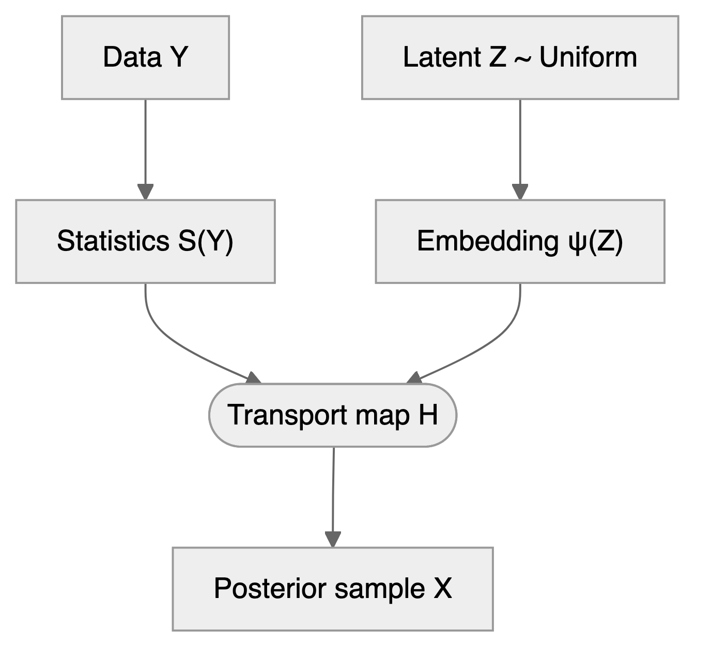
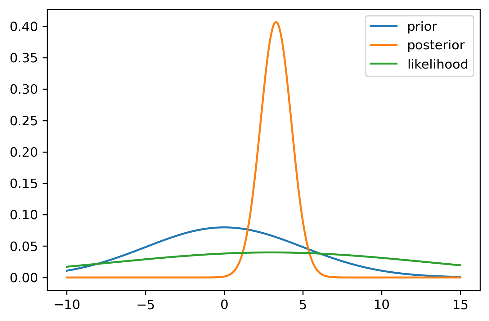
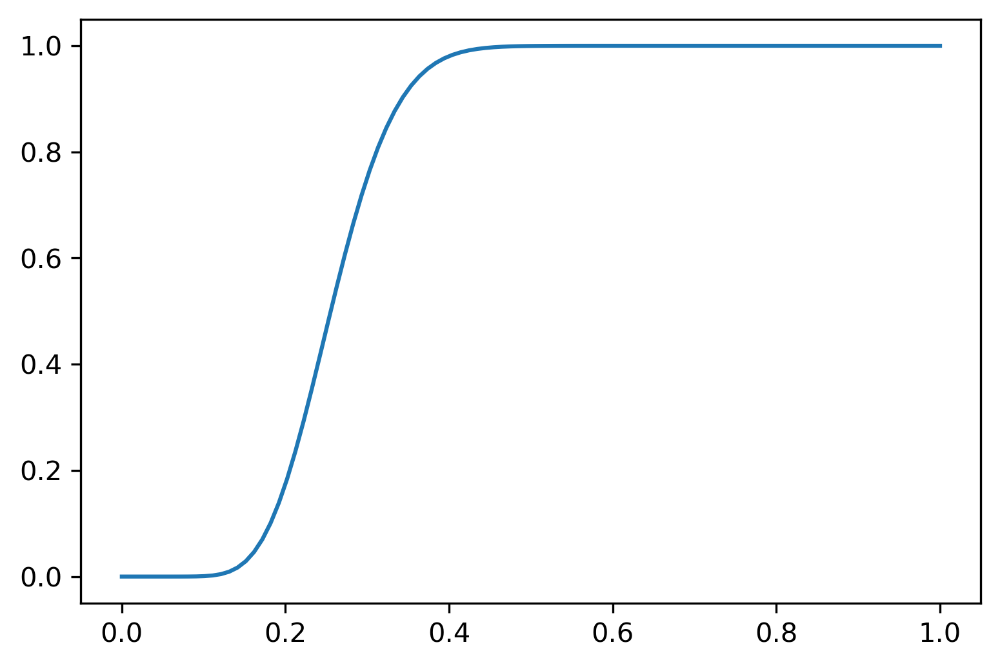
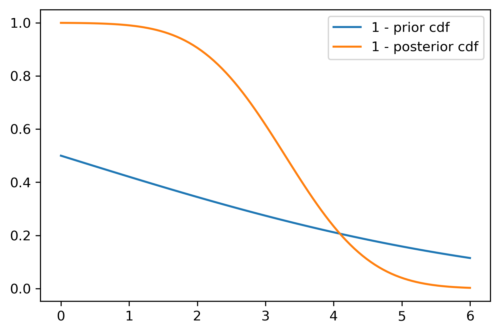
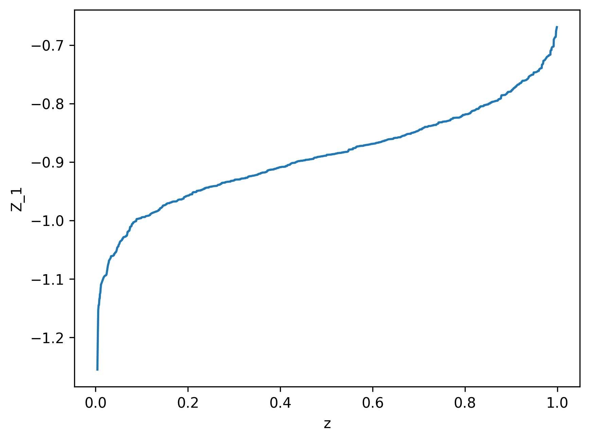
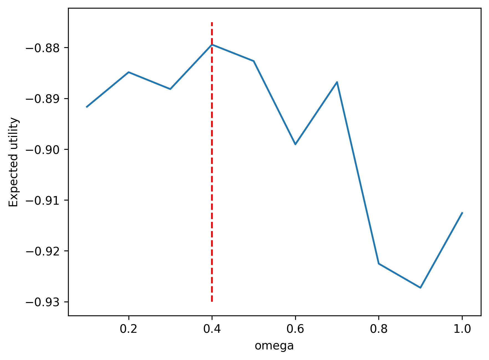



> "*It is better to be roughly right than precisely wrong.*" (John Maynard Keynes)

# Quantile Neural Networks

With the architecture (@sec-nn) and training algorithms (@sec-sgd) of neural networks in hand, we now apply them to a problem at the intersection of Bayesian inference and decision theory.

In @sec-bl, we explored how to learn posterior distributions $p(\theta\mid y)$ using Bayesian learning and to use it for predictions, hypothesis testing, and other tasks. In @sec-Decisions, we explored how rational agents make decisions under uncertainty by maximizing expected utility. Traditional Bayesian approaches to such problems require computing posterior distributions $p(\theta\mid y)$, which in turn requires specifying likelihood functions $p(y\mid \theta)$ and often involves challenging posterior estimation.[^qnn-density] But what if we could bypass density estimation entirely and directly learn the quantities we need for decision-making and other tasks?

This chapter introduces *quantile neural networks*, which learn posterior distributions through their quantile functions rather than their densities. This shift from densities to quantiles enables likelihood-free inference, provides direct connections to decision theory through the quantile-expectation identity, and scales to high-dimensional problems where density estimation becomes intractable.

The key insight is straightforward. Any expectation, including the expected utility central to decision theory, can be represented as an integral over quantiles:
$$
\E{f(\theta)} = \int_0^1 F^{-1}_{f(\theta) \mid y}(\tau) d\tau
$$
Rather than learning densities and then computing expectations via sampling, we can directly learn the quantile function $F^{-1}_{f(\theta) \mid y}(\tau)$ using neural networks. This approach is not only more efficient but also naturally handles simulation-based models where likelihoods are unavailable or computationally expensive.[^qnn-amortization]

We begin with quantile regression (@sec-qnn-quantile-regression) and neural network implementation (@sec-qnn-implementation), then use demand forecasts for an inventory decision. Posterior and utility quantiles extend the same learning objective to Bayesian inference and decision theory.

## Quantile Regression {#sec-qnn-quantile-regression}

A retailer must choose tomorrow's stock before observing demand $D$. Under a single-period model with no fixed ordering cost or capacity constraint, let $c_u$ be the cost per unit of unmet demand and $c_o$ the cost per unit left over. Writing $v^+ = \max(v,0)$, the expected cost is
$$
C(q) = E[c_u(D-q)^+ + c_o(q-D)^+] = (c_u+c_o)E[\rho_\tau(D-q)], \qquad \tau = \frac{c_u}{c_u+c_o}.
$$
If a shortage costs nine times as much as a leftover, the optimal stock level is the 90th percentile of demand. The asymmetric costs determine the statistical target.

For observed values $y_1, \ldots, y_n$, a sample median minimizes the sum of absolute deviations:
$$
m \in \arg\min_q \frac{1}{n} \sum_{i=1}^n |y_i-q|.
$$
A population median similarly minimizes $E[|Y-q|]$, assuming a finite first moment. At least half the probability lies on each side of a median.

The median is the special case $\tau = 0.5$, but the same principle generalizes to any quantile $\tau \in (0,1)$. We use a generalization of the absolute value function, the *check loss* or *pinball loss*, to find the minimizer:
$$
q_\tau = \arg\min_q \frac{1}{n} \sum_{i=1}^n \rho_\tau(y_i - q).
$$
Here $\rho_\tau(u)$ is the *check loss* or *pinball loss* and is defined as:
$$
\rho_\tau(u) = u(\tau - I(u < 0)) = \begin{cases}
\tau u & \text{if } u \geq 0 \\
(\tau - 1) u & \text{if } u < 0
\end{cases}
$$
This can also be written in the more computationally convenient form:
$$
\rho_\tau(u) = \max(u\tau, u(\tau-1))
$$

For a continuous conditional distribution, differentiating the population risk gives
$$
\frac{\partial}{\partial q} E[\rho_\tau(Y-q)\mid X=x] = F_{Y\mid X=x}(q)-\tau.
$$
The derivative is negative below the requested quantile and positive above it. For discrete demand, the corresponding subgradient condition is $F(q^-)\leq\tau\leq F(q)$. Thus minimizing check loss selects a conditional quantile, including the stock level required by the cost ratio.

::: {#exm-quantile-regression-r}
## Linear Quantile Regression

To illustrate quantile regression, we analyze engine displacement and fuel efficiency in `mtcars`. Alongside the mean relationship from ordinary least squares, we estimate conditional quantiles on the log-log scale (@fig-plot-mtcars).

```{r}
#| cache: true
#| echo: true

# Define the check loss (pinball loss) function
check_loss <- function(u, tau) {
    # rho_tau(u) = u * (tau - I(u < 0))
    u * (tau - (u < 0))
}

# Objective function: sum of check losses for quantile regression
quantile_objective <- function(beta, X, y, tau) {
    y_pred <- X %*% beta
    residuals <- y - y_pred
    sum(check_loss(residuals, tau))
}

# Prepare data
X <- cbind(1, log(mtcars$disp)) # Design matrix with intercept
y <- log(mtcars$mpg)
```

We minimize this objective with `optim` (BFGS, started at the least squares fit) separately for $\tau = 0.1, 0.5, 0.9$, and compare the three fitted lines with ordinary least squares on the log-log scale.

```{r}
#| cache: true
#| fig-cap: "Quantile regression on mtcars dataset. The relationship between engine displacement and fuel efficiency varies across quantiles, revealing heteroskedasticity in the data."
#| label: fig-plot-mtcars

# Fit quantile regression models using optim()
quantiles <- c(0.1, 0.5, 0.9)
results <- list()

for (tau in quantiles) {
    # Initial values (use OLS estimates as starting point)
    ols_fit <- lm(log(mpg) ~ log(disp), data = mtcars)
    beta_init <- coef(ols_fit)

    # Optimize using BFGS (quasi-Newton method)
    # The check loss is non-differentiable at zero, so BFGS, which assumes a
    # smooth objective, only approximates the minimum
    optim_result <- optim(
        par = beta_init,
        fn = quantile_objective,
        X = X,
        y = y,
        tau = tau,
        method = "BFGS"
    )

    results[[as.character(tau)]] <- list(
        coefficients = optim_result$par,
        value = optim_result$value,
        convergence = optim_result$convergence
    )
}

# Also fit OLS for comparison
ols_model <- lm(log(mpg) ~ log(disp), data = mtcars)

# Create visualization
plot(log(mtcars$disp), log(mtcars$mpg),
    pch = 16, col = "gray30",
    xlab = "log(Displacement)",
    ylab = "log(Miles per Gallon)", cex.lab = 0.8, cex.axis = 0.8, cex.main = 0.8
)

# Add regression lines
disp_range <- seq(min(log(mtcars$disp)), max(log(mtcars$disp)), length.out = 100)

# OLS line
abline(ols_model, col = "black", lwd = 2, lty = 2)

# Quantile regression lines
colors <- c("blue", "darkgreen", "red")
for (i in seq_along(quantiles)) {
    tau <- quantiles[i]
    beta <- results[[as.character(tau)]]$coefficients
    # Predicted values: y = beta_0 + beta_1 * x
    pred <- beta[1] + beta[2] * disp_range
    lines(disp_range, pred, col = colors[i], lwd = 2, lty = c(3, 1, 4)[i])
}

# Add legend
legend("topright",
    legend = c(
        "OLS (Mean)",
        expression(tau == 0.1),
        expression(tau == 0.5 ~ "(Median)"),
        expression(tau == 0.9)
    ),
    col = c("black", colors), lty = c(2, 3, 1, 4),
    lwd = 2, bg = "white", bty = "n", cex = 0.6
)
```

@tbl-quantile-regression-results shows the estimated coefficients.

```{r}
#| code-fold: true
#| code-summary: "Quantile regression results"
#| label: tbl-quantile-regression-results
#| tbl-cap: "Quantile regression results."
# Print model summaries
# Create results table
results_table <- data.frame(
    Model = character(),
    Intercept = numeric(),
    Slope = numeric(),
    stringsAsFactors = FALSE
)

# Add quantile regression results
for (tau in quantiles) {
    results_table <- rbind(results_table, data.frame(
        Model = sprintf("Quantile tau = %.1f", tau),
        Intercept = results[[as.character(tau)]]$coefficients[1],
        Slope = results[[as.character(tau)]]$coefficients[2]
    ))
}

# Add OLS results
results_table <- rbind(results_table, data.frame(
    Model = "OLS (Mean)",
    Intercept = coef(ols_model)[1],
    Slope = coef(ols_model)[2]
))

# Display as kable table
knitr::kable(results_table,
    digits = 4,
    caption = "Quantile Regression Results: Fuel Efficiency vs. Engine Displacement",
    col.names = c("Model", "Intercept", "Slope")
)
```

The slopes differ across quantiles: the 10th percentile slope is `r sprintf("%.4f", results[["0.1"]]$coefficients[2])`, while the 90th percentile slope is `r sprintf("%.4f", results[["0.9"]]$coefficients[2])`. The fitted negative relationship is stronger at the lower quantile, so the gap between the fitted quantiles widens with displacement. These data do not identify the causes of that spread.

Unlike squared-error loss, absolute loss does not give increasingly large residuals increasingly large slopes. Median regression is therefore less sensitive to extreme response values than OLS, although unusual predictor values can still have substantial influence.

Finally, the check loss $\rho_\tau(u)$ is piecewise linear, making it non-differentiable at zero. `BFGS` assumes a smooth objective, so it is not guaranteed to reach the minimum here, and in this example `optim` stops slightly short of it: the slopes are within 0.01 of those of the linear programming algorithm of `quantreg::rq`, the standard way to fit quantile regression.

:::

Linear quantile regression restricts each quantile to a linear predictor. Neural quantile regression replaces that predictor with a learned nonlinear function and can share features across quantiles. The loss continues to identify the same statistical target.

## Neural Network Implementation {#sec-qnn-implementation}

A conditional quantile network $q_{\varphi}(x,\tau)$ receives the observed features $x$ and a quantile level $\tau\in(0,1)$, and predicts $F^{-1}_{Y\mid X=x}(\tau)$. Here $\varphi$ denotes network weights, distinct from Bayesian model parameters $\theta$. Given training pairs $(x_i,y_i)$ and levels $\tau_1,\ldots,\tau_K$, minimize pure averaged pinball loss:
$$
L(\varphi) = \frac{1}{NK}\sum_{i=1}^N\sum_{k=1}^K \rho_{\tau_k}\big(y_i-q_{\varphi}(x_i,\tau_k)\big).
$$
Alternatively, draw independent uniform levels during training. At each fixed $(x,\tau)$, the population loss is minimized by the conditional quantile, as the derivative above shows. An independently drawn $\tau$ specifies which quantile to estimate; it does not turn an observed $y_i$ into that quantile.

A mini-batch update makes the learning mechanism explicit. Sample a batch $B$ of observed pairs and draw $\tau_i\sim U(0,1)$ independently for each pair. With step size $\eta$, take a stochastic subgradient update:
$$
\varphi \leftarrow \varphi-\eta\,\partial_{\varphi}\left[\frac{1}{|B|}\sum_{i\in B}\rho_{\tau_i}\big(y_i-q_{\varphi}(x_i,\tau_i)\big)\right].
$$
No MSE term is needed to identify quantiles. Adding squared error to the same output generally shifts its population minimizer away from the requested quantile; a conditional median need not equal a conditional mean. A separate mean output could share features, but would estimate a different target.

### Learning Multiple Quantiles Simultaneously

Rather than training separate networks for each $\tau_k$, one network takes $\tau$ as an input and shares features across levels. It can also be evaluated at untrained levels. Neither sharing nor interpolation guarantees accuracy or prevents quantile crossing.

### Cosine Embedding for $\tau$

One architectural choice is to concatenate $\tau$ with the other inputs. Another is a *cosine embedding*, used by @dabney2018implicit:
$$
F^{-1}(\tau,x) \approx q_{\varphi}(x,\tau) = g(\psi(x)\circ\phi(\tau)),
$$
where $\circ$ is element-wise multiplication, $g$ and $\psi$ are feed-forward networks, and
$$
\phi_j(\tau) = \mathrm{ReLU}\left(\sum_{i=0}^{n-1}\cos(\pi i\tau)w_{ij}+b_j\right), \qquad j=1,\ldots,m.
$$
The scalar $\tau$ becomes an $m$-dimensional vector using $n$ cosine frequencies. This branch depends only on $\tau$; the feature branch $\psi(x)$ supplies the conditioning information. Sharing these branches across quantiles can reduce parameter counts relative to separate networks.

The Fourier representation motivates the embedding, but does not guarantee smooth or monotone quantiles. Discrete outcomes can have discontinuous quantile functions, and ReLU introduces kinks. @barron1993universal gives $O(N^{-1/2})$ approximation rates for networks with $N$ sigmoidal units under a finite first Fourier-moment condition; that result is not a rate for this cosine embedding.

### Non-Crossing Constraints

A valid quantile function satisfies $F^{-1}(\tau_i)\leq F^{-1}(\tau_j)$ when $\tau_i<\tau_j$. Unconstrained networks can violate this ordering. Remedies include penalties on crossings, architectures constrained to be non-decreasing in $\tau$, and rearrangement of predictions after fitting [@chernozhukov2010quantile; @cannon2018noncrossing]. Monotone activation functions alone do not guarantee a monotone network: the weights and how $\tau$ enters must also be constrained.

These are possible safeguards, rather than procedures used by every example below. The reproducible neural comparison uses no crossing penalty or rearrangement, so ordering must be checked separately.

### Synthetic Data Example

Consider synthetic data generated from the model:
$$
x\sim U(-1,1),\qquad y\mid x\sim N\left(\frac{\sin(\pi x)}{\pi x},\frac{\exp(1-x)}{10}\right).
$$
The variance increases as $x$ decreases. Define $\operatorname{sinc}(0)=1$ by continuity; the true conditional quantile is
$$
f_\tau(x)=\operatorname{sinc}(x)+\Phi^{-1}(\tau)\sqrt{\frac{\exp(1-x)}{10}}.
$$
An implicit network learns a function of both $x$ and $\tau$. An explicit approach fits separate outputs at selected levels, illustrated here at $\tau\in\{0.05,0.5,0.95\}$.

{#fig-qnn-synthetic width=100%}

For an inspectable comparison on the same model, the computing exercise "Cosine Embeddings for the Quantile Level" supplies the full training code (the computing exercises appear in the HTML edition and in the notebooks of `exercises/`). It generates 400 pairs with seed 7. The implicit network has eight cosine frequencies, embedding dimension six, a $1\to6$ tanh feature network, and a linear readout. Nine explicit networks each use a $1\to6$ tanh feature layer and linear readout. Both minimize summed pinball loss at $\tau=0.1,0.2,\ldots,0.9$ using `optim` with L-BFGS-B and `maxit = 300`; the explicit initializations use seed 11. Quantile levels are fixed in this comparison, rather than sampled randomly.

| Network | Parameters | Quantile MAE |
|:--------|-----------:|-------------:|
| Implicit | 73 | 0.081 |
| Explicit with interpolation | 171 | 0.078 |

: Mean absolute quantile error at $\tau=0.37$ from the reproducible exercise, evaluated against the known quantile on $x\in\{-0.9,-0.7,\ldots,0.9\}$. {#tbl-qnn-synthetic-error}

The implicit network answers directly at the untrained level 0.37; the explicit approach linearly interpolates its 0.3 and 0.4 fits. The errors in @tbl-qnn-synthetic-error are similar, with the explicit interpolation slightly better in this run. Sharing uses fewer parameters here, but establishes neither an accuracy advantage nor calibration across all levels. This experiment is separate from the illustration in @fig-qnn-synthetic, whose training settings are not recorded in the chapter.

### Quantiles and Wasserstein Distance

For scalar distributions with finite first moments, the 1-Wasserstein distance is
$$
W_1(P_U,P_V)=\int_0^1\left|F_U^{-1}(\tau)-F_V^{-1}(\tau)\right|d\tau.
$$
It can be computed from order statistics [@levina2001earth]. Matching every target quantile makes this distance zero. This is the population-target connection used in @exr-wasserstein-check-loss, rather than an identity between empirical pinball loss and $W_1$. In a restricted neural family, minimizing one need not minimize the other. For an equal-weight approximation by $K$ point masses, the $W_1$-optimal locations are the target quantiles at $(2k-1)/(2K)$, $k=1,\ldots,K$ [@dabney2017distributional].

Wasserstein GANs use this distributional distance because it can distinguish disjoint supports [@arjovsky2017wasserstein]. That motivation does not make arbitrary quantile-network training equivalent to GAN training or guarantee its stability.

## Supply Chain Forecasting at Scale {#sec-qnn-forecasting}

Large retailers must choose stock levels for many products and locations. Too little inventory leads to stockouts and lost sales; too much ties up capital and risks obsolescence. We return to the asymmetric inventory choice that motivated check loss.

For the single-period costs defined in @sec-qnn-quantile-regression, the optimal stock target is $F^{-1}_{D\mid x}(c_u/(c_u+c_o))$. P50 is optimal only when the unit costs are equal. P90 corresponds to a shortage cost nine times the overage cost; it is a demand level, whereas safety stock usually means inventory above an expected-demand baseline over a specified replenishment period. Capacity planning can also use a high quantile, with the level determined by the relevant costs or service constraint.

For a high-margin item with $c_u/c_o$ between $7/3$ and $4$, the optimal policy may target $P_{70}$ or $P_{80}$. For perishable goods with $c_u/c_o$ between $3/7$ and $2/3$, target $P_{30}$ or $P_{40}$. These are cost-based examples, not fixed rules for product categories (@exr-newsvendor-fractile).

DeepAR [@salinas2019deepar] is a recurrent probabilistic forecasting model that predicts parameters of a chosen distribution, such as a Gaussian or negative binomial, from related time series. Quantiles can be obtained analytically where available or by sampling. Wen and colleagues' 2017 multi-horizon quantile recurrent forecaster directly predicts demand quantiles at several horizons using check loss: https://www.amazon.science/publications/a-multi-horizon-quantile-recurrent-forecaster. These are distinct approaches, rather than a documented sequence of internal retail deployments. Chronos-2 (2025) extends pretrained forecasting to univariate, multivariate, and covariate-informed tasks: https://arxiv.org/abs/2510.15821.

Direct quantile prediction accommodates asymmetric costs without choosing a parametric response family. It can represent zero-demand quantiles, although intermittent demand still requires adequate data and a suitable model. Linear growth of the loss limits the influence of extreme response residuals; promotional effects still need predictors. Feature choices and network restrictions remain modeling assumptions.

### Demand Forecasting Setup

Consider forecasting demand $y_t$ for a product given the features in @tbl-demand-features:

| Feature Category | Examples | Purpose |
|-----------------|----------|---------|
| Temporal features | Day of week, month, holiday indicators, days since launch | Capture seasonal patterns and product lifecycle |
| Lagged demand | $y_{t-1}, y_{t-7}, y_{t-28}$ (yesterday, last week, last month) | Incorporate recent demand history and autocorrelation |
| Product features | Category, price, promotional flags | Account for product-specific characteristics |
| External covariates | Weather, events, competitor prices | Include external factors affecting demand |

: Features for demand forecasting. {#tbl-demand-features}

The model predicts conditional quantiles:
$$
q_\tau(t) = F^{-1}_{Y_t \mid X_t}(\tau)
$$

where $X_t$ contains information available when the forecast is issued. Training pairs $(y_t,x_t)$ may be pooled across products.

### A Possible Neural Architecture

Product embeddings can share information across related items, while recurrent or attention layers encode history and its interactions with numerical features. Such sharing may help products with little history when their relationships transfer. One possible architecture uses the same two branches as @sec-qnn-implementation.

::: {#fig-demand-architecture}

$$
\begin{aligned}
\text{product, history, covariates}&\longrightarrow h_t,\\
\tau&\longrightarrow\phi(\tau),\\
(h_t,\phi(\tau))&\longrightarrow g(h_t\circ\phi(\tau))=q_{\varphi}(x_t,\tau).
\end{aligned}
$$

A possible demand quantile architecture. Product embeddings, encoded history, and known covariates form $h_t$; an independent branch embeds the requested quantile level.
:::

In @fig-demand-architecture, the branch $\phi(\tau)$, a cosine embedding as in @sec-qnn-implementation, receives only $\tau$, independently of feature fusion. Training can sample products and historical forecast origins in mini-batches and minimize averaged pinball loss. This is a possible design, not a claim about a retailer's production architecture.

### An Instructional Linear Baseline

The following simulation uses three products over two years. It includes positive trends, weekly and monthly seasonality, promotions on approximately 10% of days, and noise whose standard deviation grows with demand. The promotional increments range from 50 to 90 units. These patterns are stipulated by the simulator, rather than evidence from retail data.

Five linear quantile regressions are fitted separately at $\tau\in\{0.1,0.3,0.5,0.7,0.9\}$, using product identifier, day, promotion, numerical day-of-week and day-of-month features, and 1-, 7-, and 30-day demand lags. Training covers days 31 to 640. The final 90 days are evaluated as rolling one-step forecasts: each day uses demand observed through the preceding day, including realized test-period lags, and assumes that day's promotion is known before forecasting. The fitted coefficients remain fixed. These are not 90-day-ahead forecasts issued together on day 640.

```{r amazon-demand-forecast}
#| code-fold: true
#| code-summary: "Demand forecasting with linear quantile regression"
#| cache: true
#| warning: false
#| message: false
#| fig-cap: "Demand forecasting with linear quantile regression. Top: Historical demand with trend and seasonality. Bottom: Out-of-sample forecasts showing P10, P50, P90 quantiles (fan chart)."
#| fig-width: 5.5
#| fig-height: 4.4

# Load required libraries
library(quantreg) # For quantile regression
library(ggplot2)
library(dplyr)
library(tidyr)

# Set seed for reproducibility
set.seed(42)

# Generate synthetic demand data for multiple products
generate_demand_data <- function(n_days = 365 * 2, n_products = 5) {
    days <- 1:n_days

    # Create data frame
    data_list <- lapply(1:n_products, function(p) {
        # Base parameters varying by product
        base_demand <- 50 + p * 20
        trend <- 0.05 * p

        # Seasonal components
        weekly_pattern <- 10 * sin(2 * pi * days / 7 + p)
        monthly_pattern <- 15 * sin(2 * pi * days / 30.5 + p * 0.5)

        # Promotional effect (random promotions)
        promo <- rbinom(n_days, 1, 0.1) # 10% of days have promotions
        promo_effect <- promo * (30 + 20 * p)

        # Trend + seasonality + promotions + noise
        mu <- base_demand + trend * days + weekly_pattern + monthly_pattern + promo_effect

        # Heteroskedastic noise (variance increases with demand)
        sigma <- 5 + 0.1 * mu
        demand <- pmax(0, rnorm(n_days, mu, sigma)) # Demand can't be negative

        data.frame(
            product = paste0("Product_", p),
            day = days,
            demand = demand,
            promo = promo,
            day_of_week = (days %% 7) + 1,
            day_of_month = ((days - 1) %% 30) + 1
        )
    })

    do.call(rbind, data_list)
}

# Generate data
demand_data <- generate_demand_data(n_days = 365 * 2, n_products = 3)

# Create lagged features
demand_data <- demand_data %>%
    group_by(product) %>%
    arrange(day) %>%
    mutate(
        lag_1 = lag(demand, 1, default = NA),
        lag_7 = lag(demand, 7, default = NA),
        lag_30 = lag(demand, 30, default = NA)
    ) %>%
    ungroup() %>%
    filter(!is.na(lag_30)) # Remove rows with NA lags

# Train/test split
train_days <- max(demand_data$day) - 90
train_data <- demand_data %>% filter(day <= train_days)
test_data <- demand_data %>% filter(day > train_days)

# Quantile regression for multiple quantiles
quantiles <- c(0.1, 0.3, 0.5, 0.7, 0.9)
models <- list()

# cat("Training quantile regression models...\n")
for (q in quantiles) {
    # cat(sprintf("  Quantile %.2f...\n", q))
    models[[as.character(q)]] <- rq(
        demand ~ product + day + promo + day_of_week + day_of_month +
            lag_1 + lag_7 + lag_30,
        tau = q,
        data = train_data
    )
}

# Generate predictions for test set
predictions <- test_data
for (q in quantiles) {
    col_name <- paste0("q_", gsub("\\.", "", sprintf("%.2f", q)))
    predictions[[col_name]] <- predict(models[[as.character(q)]], newdata = test_data)
}

# Calculate prediction intervals and coverage
predictions <- predictions %>%
    mutate(
        in_80_interval = (demand >= q_010 & demand <= q_090),
        in_60_interval = (demand >= q_030 & demand <= q_070)
    )

# Calculate metrics
coverage_80 <- mean(predictions$in_80_interval, na.rm = TRUE)
coverage_60 <- mean(predictions$in_60_interval, na.rm = TRUE)
mae_median <- mean(abs(predictions$demand - predictions$q_050), na.rm = TRUE)

# cat(sprintf("\nForecast Performance:\n"))
# cat(sprintf("  80%% interval coverage: %.1f%% (target: 80%%)\n", coverage_80 * 100))
# cat(sprintf("  40%% interval coverage: %.1f%% (target: 40%%)\n", coverage_60 * 100))
# cat(sprintf("  Median absolute error: %.2f units\n", mae_median))

# Visualization
par(mfrow = c(2, 1))

# Plot 1: Training data for one product
product_1_train <- train_data %>% filter(product == "Product_1")
rng <- range(product_1_train$demand)
plot(product_1_train$day, product_1_train$demand,
    type = "l", lwd = 1.5, col = "darkblue",
    xlab = "Day", ylab = "Demand",
    ylim = c(rng[1], rng[2] + 0.18 * diff(rng)),
    main = "Historical Demand (Product 1)"
)
points(product_1_train$day[product_1_train$promo == 1],
    product_1_train$demand[product_1_train$promo == 1] + 0.05 * diff(rng),
    col = "red", pch = 2, cex = 0.7
)
legend("topleft",
    legend = c("Demand", "Promotion"),
    col = c("darkblue", "red"), lwd = c(2, NA), pch = c(NA, 2), horiz = TRUE,
    bty = "n", cex = 0.6
)
grid()

# Plot 2: Forecasts with quantiles (fan chart)
product_1_test <- predictions %>% filter(product == "Product_1")
plot(product_1_test$day, product_1_test$demand,
    type = "l", lwd = 2, col = "black",
    xlab = "Day", ylab = "Demand",
    main = "Demand Forecasts with Quantiles (Product 1)",
    ylim = range(c(product_1_test$q_010, product_1_test$q_090, product_1_test$demand))
)

# Add prediction intervals
polygon(c(product_1_test$day, rev(product_1_test$day)),
    c(product_1_test$q_010, rev(product_1_test$q_090)),
    col = rgb(0.7, 0.7, 1, 0.3), border = NA
)
polygon(c(product_1_test$day, rev(product_1_test$day)),
    c(product_1_test$q_030, rev(product_1_test$q_070)),
    col = rgb(0.5, 0.5, 1, 0.4), border = NA
)

# Add quantile lines
lines(product_1_test$day, product_1_test$q_010, col = "blue", lty = 3, lwd = 1.5)
lines(product_1_test$day, product_1_test$q_050, col = "darkblue", lty = 2, lwd = 2)
lines(product_1_test$day, product_1_test$q_090, col = "blue", lty = 3, lwd = 1.5)

# Actual demand
lines(product_1_test$day, product_1_test$demand, col = "black", lwd = 2)

legend("topright",
    legend = c("Actual", "P50 (Median)", "P10-P90 (80%)", "P30-P70 (40%)"),
    col = c("black", "darkblue", rgb(0.7, 0.7, 1), rgb(0.5, 0.5, 1)),
    lwd = c(2, 2, 5, 5), lty = c(1, 2, 1, 1),
    bty = "n", cex = 0.6
)
grid()
par(mfrow = c(1, 1))
```

The held-out results are mixed. The P10-P90 interval has 79.6% coverage against a nominal 80%, while P30-P70 has 33.7% against 40%. The median forecast has mean absolute error 21.94 units. One near-nominal aggregate coverage rate does not establish calibration across quantiles, products, or promotional conditions.

| Quantile level | Fraction of test demand below the fitted quantile |
|:---------------|-------------------------------------------------:|
| P10 | 10.0% |
| P30 | 33.7% |
| P50 | 48.1% |
| P70 | 67.4% |
| P90 | 89.6% |

: Marginal quantile checks across all three products and rolling test days. {#tbl-demand-calibration}

The central levels in @tbl-demand-calibration help locate the narrower interval's undercoverage. Aggregation can hide product-specific errors; calibration should also be checked by product and promotion status. Coverage measures how often observations fall inside an interval, while width measures its sharpness. A wide interval can cover well without being useful.

The top panel shows Product 1's training demand and promotions. The bottom fan chart shows rolling forecasts: P50 is dashed, and the bands span P10-P90 and P30-P70. For an illustrative decision, suppose shortages cost nine times leftovers. The first test-day P90 forecast for Product 1 is about 135 units, giving a stock target of about 135 under the single-period assumptions. A whole-unit implementation and stock already on hand require corresponding adjustments. The undercoverage checks matter because an inaccurate P90 can change the intended service level and cost.

## From Densities to Quantiles: A Generative Approach {#sec-qnn-generative}

The same network can estimate a scalar posterior quantile. Generate a look-up table of simulated pairs $\{\theta^{(i)},y^{(i)}\}_{i=1}^N$ by drawing $\theta^{(i)}\sim\pi(\theta)$ and then $y^{(i)}\sim p(y\mid\theta^{(i)})$. The latter step needs a simulator, not an evaluable likelihood. A deterministic forward map is also possible. @polson2023generative develops this approach to Bayesian computation.

Squared-error regression of $\theta$ on $Y$, whether by kernel smoothing, nearest neighbors, or a neural network, targets the conditional mean $E[\theta\mid Y]$. This point estimate discards spread and shape, including multimodality. Here $\theta$ may represent a parameter or a latent state. To estimate scalar posterior quantiles, replace the response in our training objective by $\theta$ and the features by $S(Y)$:
$$
\mathcal{R}(\varphi)=E_{\theta,Y,\tau}\left[\rho_\tau\big(\theta-q_{\varphi}(S(Y),\tau)\big)\right],\qquad \tau\sim U(0,1),\quad \tau\perp(\theta,Y).
$$
The joint expectation uses the prior and simulator. At each $(S(y),\tau)$, its population minimizer is the corresponding conditional quantile. If $S$ is sufficient, this is a quantile of $\theta\mid Y=y$; otherwise it is a quantile of $\theta\mid S(Y)=S(y)$, which may discard information. Independent uniform levels do not give a pointwise regression identity $\theta^{(i)}=H(S(y^{(i)}),\tau^{(i)})$.

Once trained, the scalar map can generate approximate posterior draws by evaluating it at fresh uniforms. The gain is *amortization*: an upfront simulation and training investment can make repeated inference fast for datasets represented by the training distribution. Posterior Monte Carlo does not require fitting a density estimator. Training cost, simulator misspecification, summary information loss, and extrapolation must enter the comparison.

The theoretical foundation for a random-input representation is the *noise outsourcing theorem* [@kallenberg1997foundations]. For $(Y,\Theta)$ taking values in standard Borel spaces, there is, on an enlarged probability space if necessary, a uniform variable $\tau$ independent of $Y$ and a measurable $H$ such that
$$
(Y,\Theta)\stackrel{a.s.}{=}(Y,H(Y,\tau)).
$$
If $Y$ and $\Theta$ are conditionally independent given a sufficient statistic $S(Y)$, the representation can use $H(S(Y),\tau)$. This is an existence result about a suitable coupling. It does not show that ordinary squared-error regression on independently paired noise learns a posterior sampler. For scalar $\Theta$, the conditional quantile function supplies such a map, and pinball risk supplies its learning objective.

{#fig-transport-map width=65% fig-alt="Flow chart: data Y give statistics S(Y), independent noise Z gives embedding psi(Z), and both enter transport map H to generate a posterior draw."}

In @fig-transport-map, the generic transport notation $\psi(Z)$ denotes the noise embedding; in our scalar quantile architecture this is $\phi(\tau)$. For a general transport map, $Z$ may instead be a vector of uniforms or standard normal draws. A learned summary is not automatically sufficient. Under single-index and predictor-linearity assumptions, the result of @brillinger2012generalized can recover the index direction by ordinary least squares when the slope is nonzero; it does not guarantee sufficient summaries for arbitrary simulators. @polson2024generative uses neural quantile maps for Bayesian decision problems.

Scalar marginal quantiles alone do not specify multivariate dependence. For $\theta=(\theta_1,\ldots,\theta_p)$, one option is an autoregressive sequence of conditional quantiles. With independent uniform levels, generate
$$
\begin{aligned}
\theta_1&=F^{-1}_{\theta_1\mid y}(\tau_1),\\
\theta_j&=F^{-1}_{\theta_j\mid\theta_{1:j-1},y}(\tau_j),\qquad j=2,\ldots,p.
\end{aligned}
$$
Each component conditions on the data and previously generated components. The conditional factorization represents dependence without requiring normalized density outputs.

## Bayes' Rule for Quantiles {#sec-qnn-bayes-quantiles}

@parzen2004quantile showed that quantile methods provide direct alternatives to density-based Bayesian computations.

Given a conditional CDF $F_{\theta\mid y}$, define its generalized inverse by
$$
Q_{\theta\mid y}(u)\defeq F^{-1}_{\theta\mid y}(u)=\inf\{t:F_{\theta\mid y}(t)\geq u\},\qquad 0<u<1.
$$
It is non-decreasing and left-continuous. Inverse-CDF sampling gives $Q_{\theta\mid y}(\tau)\sim p(\theta\mid y)$ for $\tau\sim U(0,1)$. Sorting posterior samples estimates this map on a probability grid; it does not make independent training targets equal to specified quantiles.

Quantiles also compose under non-decreasing, left-continuous transformations $g$. Writing $Q_Y$ for the quantile function of $Y$,
$$
Q_{g(Y)}(u)=g(Q_Y(u)).
$$
This gives a compositional representation that a neural network may approximate.

For a continuous, strictly increasing prior CDF $F_\theta$, $\theta=Q_\theta(F_\theta(\theta))$ almost surely. Bayesian updating then has the representation
$$
Q_{\theta\mid Y=y}(u)=Q_\theta(s),\qquad s=Q_{F_\theta(\theta)\mid Y=y}(u).
$$

When the posterior CDF is continuous, the transformed level satisfies:
$$
u = F_{F_\theta(\theta) \mid Y=y}(s) = P(F_\theta(\theta) \leq s \mid Y=y) = P(\theta \leq Q_\theta(s) \mid Y=y) = F_{\theta \mid Y=y}(Q_\theta(s))
$$

The posterior quantile is the prior quantile composed with a data-dependent transformation of probability levels. This identity is a representation of updating, not by itself an algorithm for learning that transformation.

::: {#exm-qnn-wang}
## Normal-Normal Model and Wang Distortion

The normal-normal conjugate model gives an analytic example of the updating identity. Its probability-level transformation has the form of a Wang distortion, connecting posterior updating with risk distortion in finance.

Consider the model:
$$
y_1, \ldots, y_n \mid \theta \sim N(\theta, \sigma^2)
$$
$$
\theta \sim N(\mu,\alpha^2)
$$

The sufficient statistic for $\theta$ (assuming known $\sigma^2$) is $S(y) = \bar y = \frac{1}{n} \sum_{i=1}^n y_i$. Define $t = \sigma^2 + n\alpha^2$. The posterior is $\theta \mid y \sim N(\mu_*, \sigma_*^2)$ with
$$
\mu_* = \frac{\sigma^2 \mu + n\alpha^2\bar{y}}{t}, \quad \sigma^2_* = \frac{\alpha^2 \sigma^2}{t}
$$

The posterior and prior survival functions are related via a Wang distortion function:
$$
1-\Phi(\theta; \mu_*,\sigma_*^2) = g(1 - \Phi(\theta; \mu, \alpha^2))
$$
where $\Phi(\cdot; \mu, \sigma^2)$ denotes the normal CDF. The Wang distortion is:
$$
g(p) = \Phi\left(\lambda_1 \Phi^{-1}(p) + \lambda\right)
$$
with distortion parameters:
$$
\lambda_1 = \frac{\alpha}{\sigma_*}, \quad \lambda = \frac{\alpha\lambda_1(n\bar{y}-n\mu)}{t}
$$

The form of $g$ follows by writing both normal survival functions in standardized coordinates. It is a location-and-scale extension of the normal-quantile distortions used in risk management [@wang1996premium]. Here its parameters depend on the observed sample mean and prior hyperparameters. In more complex models, a neural network can learn this distortion function $g$ directly from data, without requiring conjugacy.

*Numerical Example*: Consider prior $\theta \sim N(0,5)$ and data from $y_i \sim N(3,10)$ with $n=100$ observations. The posterior is $\theta \mid y \sim N(2.941, 0.098)$, since the posterior precision is $1/\alpha^2 + n/\sigma^2 = 1/5 + 100/10 = 10.2$ and the posterior mean is $(n\bar y/\sigma^2)/10.2 = 30/10.2 = 2.941$ for $\bar y = 3$.

::: {#fig-wang layout-ncol=3}
{#fig-wang-a}

{#fig-wang-b}

{#fig-wang-c}

The Normal-Normal learning model. Left: Prior, likelihood, and posterior densities. Center: The distortion function $g$ that transforms prior survival probabilities to posterior survival probabilities. Right: Survival functions showing how $g$ maps the prior tail probabilities to posterior tail probabilities.
:::
:::

## Maximum Expected Utility via Quantile Neural Networks {#sec-qnn-meu}

Recall from @sec-Decisions that optimal Bayesian decisions maximize expected utility:
$$
d^\star(y)=\arg\max_d E_{\theta\mid y}[U(d,\theta)]=\arg\max_d\int U(d,\theta)p(\theta\mid y)d\theta.
$$
Posterior samples can estimate this expectation without density estimation. When many datasets and candidate decisions must be evaluated, a trained utility-quantile map offers another amortized approximation. It concentrates the prediction target on a scalar utility rather than every component of a potentially high-dimensional parameter.

For an integrable random variable $U$, the quantile representation of its expectation is
$$
\E{U}=\int_0^1F_U^{-1}(\tau)d\tau.
$$
Thus, for each decision $d$,
$$
E_{\theta\mid y}[U(d,\theta)]=\int_0^1F^{-1}_{U\mid d,y}(\tau)d\tau.
$$
The full integral gives the expectation; a Lorenz curve uses a partial, and usually normalized, quantile integral. Heavy utility tails still require adequate simulation and numerical resolution near the endpoints.

### Implementation Strategy

::: {#res-meu-quantile-network}

Simulate prior/data pairs $(\theta^{(i)},y^{(i)})$, choose decisions independently of those pairs over the range of interest, and compute response targets $U_d^{(i)}=U(d,\theta^{(i)})$. Draw independent uniform levels and minimize
$$
L(\varphi)=\frac{1}{M}\sum_{i=1}^M\rho_{\tau_i}\big(U_{d_i}^{(i)}-q_{\varphi}(S(y^{(i)}),d_i,\tau_i)\big).
$$
Here $M$ counts training tuples, possibly reusing simulated pairs across decisions. The utility is the training response, while $S(y)$, $d$, and $\tau$ are inputs. Given sufficient summaries and a successful fit, the network approximates $F^{-1}_{U\mid d,y}(\tau)$. Numerically integrate it and optimize:
$$
d^\star(y)\approx\arg\max_d\int_0^1q_{\varphi}(S(y),d,\tau)d\tau.
$$
:::

Utility functions often place high weight on tail events, which are risk scenarios of low posterior probability, so plain Monte Carlo spends most of its samples where the utility matters least. One architectural response is to incorporate the utility function $U(d, \theta)$ directly into the first layer of the network [@polson2024generative], so that the network learns representations tuned to utility computation rather than to pure posterior approximation. Whether this saves computation compared with the two-step approach of posterior approximation followed by Monte Carlo integration is an empirical question. One network can cover many decisions when $d$ is an input, including simulator models with unavailable likelihoods. Its accuracy must be checked where the decision is sensitive to utility errors. Neither utility targeting nor uniform quantile sampling automatically gives more information about rare events than the training simulations contain.

## Portfolio Optimization with Quantile Neural Networks {#sec-qnn-portfolio}

This example, developed by @polson2024generative, checks quantile integration against a known-parameter optimum. It validates the numerical decision calculation before adding posterior uncertainty.

Consider exponential (CARA) utility of a normally distributed payoff $W$, without leverage. In this stylized allocation model,
$$
W(\omega)=(1-\omega)r_f+\omega R,\qquad R\sim N(\mu,\sigma^2).
$$
The transformed quantity $X=e^W$ is log-normal, but the utility below acts on $W$, not on $X$. Here $\omega\in(0,1)$ is the allocation weight, $r_f$ is the risk-free return, and $\mu$ and $\sigma^2$ describe the risky return. The utility is
$$
U(W)=-e^{-\gamma W}.
$$
The normal exponential moment gives expected utility
$$
U(\omega)=E[-e^{-\gamma W}]=-\exp\left\{-\gamma\{(1-\omega)r_f+\omega\mu\}+\frac12\gamma^2\omega^2\sigma^2\right\}.
$$
When the optimum lies in $(0,1)$, it has the fractional-Kelly algebraic form
$$
\omega^*=(\mu-r_f)/(\sigma^2\gamma).
$$

Parameter uncertainty could be included by drawing $(\mu,\sigma^2)$ from a joint posterior before simulating payoffs. The displayed calculation fixes these parameters and does not demonstrate that extension.

Reorder the expectation using utility quantiles:
$$
\E{U(W)}=\int_0^1F^{-1}_{U(W)}(\tau)d\tau.
$$
A quantile network can approximate this function, after which numerical integration and a grid search over $\omega$ approximate the optimum.

Since $U$ is strictly increasing and invertible, utility and payoff quantiles satisfy $F^{-1}_{Z_\omega}(\tau)=U(F^{-1}_{W_\omega}(\tau))$, where $Z_\omega=U(W_\omega)$. Conversely, $F^{-1}_{W_\omega}(\tau)=U^{-1}(F^{-1}_{Z_\omega}(\tau))$. This is the quantile composition property in @sec-qnn-bayes-quantiles.

The decision variable $\omega$ affects the distribution of the returns. The utility only depends on the returns $W$. Our quantile neural network solution is given by the following algorithm:

1. Simulate payoffs $W^{(i)}\mid \omega^{(i)} \sim N((1-\omega^{(i)})r_f + \omega^{(i)}\mu, \sigma^2 (\omega^{(i)})^2)$
2. Calculate corresponding utilities $Z^{(i)} = U(W^{(i)})$
3. Learn $F_{Z_{\omega}}^{-1}$ with a quantile NN
4. Find the optimal portfolio weight $\omega^\star$ via
$$
E(Z_{\omega}) \approx \frac{1}{N}\sum_{i=1}^{N}F^{-1}_{Z_{\omega}}(u_i) \rightarrow \underset{\omega}{\mathrm{maximize}}
$$

### Known-Parameter Sanity Check

Consider $\omega \in (0,1)$, $r_f = 0.05$, $\mu=0.1$, $\sigma=0.25$, $\gamma = 2$. We have the closed-form fractional Kelly criterion solution
$$
\omega^* = \frac{1}{\gamma}   \frac{ \mu - r_f}{ \sigma^2} = \frac{1}{2} \frac{ 0.1 - 0.05 }{ 0.25^2 } = 0.40
$$
We can simulate the expected utility and compare with the closed-form solution.

::: {#fig-portfolio-qnn layout-ncol=2}
{#fig-portfolio-tau}

{#fig-portfolio-eu}

Portfolio utility integration. Left: sorted simulated utilities $-\exp(-\gamma W)$ plotted against probability levels, with $\gamma=2$ and $\omega=0.1$. Right: utility integrals computed by the trapezoid rule across allocation weights. The dashed line is the analytic optimum $\omega=0.4$. These plots check empirical quantile integration; they do not measure a trained network's error or the effect of posterior parameter uncertainty.
:::

## Optional Comparison: Quantile Trend Filtering {#sec-qnn-trend-filtering}

Trend filtering offers a nonlinear alternative for ordered, low-dimensional inputs. It estimates function values by penalizing discrete differences; @polson2016mixtures develops related hierarchical representations through envelope duality.

::: {#res-quantile-trend-filtering}

For ordered inputs $x_1<\cdots<x_n$, estimate $f$ by solving

$$
\min_{f} \sum_{i=1}^n \rho_\tau(y_i - f(x_i)) + \lambda \sum_{i=1}^{n-k} |\Delta^k f_i|
$$

Here $\Delta^k$ is the $k$th finite-difference operator. On an equally spaced grid, $k=1$ gives piecewise constant fits, $k=2$ piecewise linear fits, and $k=3$ piecewise quadratic fits. For irregular inputs, differences should account for spacing; the simple code below instead penalizes differences by observation index.

For $k=2$, the penalty is $\sum_{i=2}^{n-1}|f_{i+1}-2f_i+f_{i-1}|$. On a regular grid, with the appropriate spacing factor, it approximates $\int|f''(x)|dx$. Smoothing splines instead penalize $\int(f''(x))^2dx$. The $\ell_1$ penalty allows locally adaptive changes in slope.

An asymmetric Laplace working likelihood and Laplace priors on differences connect penalized check loss with posterior modes. With unit likelihood scale, a second-order specification is

$$
\begin{aligned}
y_i &\sim \text{AsymmetricLaplace}(f_i, \tau, 1) \\
\Delta^2 f_i &\sim \text{Laplace}(0, 1/\lambda) \quad \text{for } i = 2, \ldots, n-1
\end{aligned}
$$

The asymmetric Laplace negative log likelihood is check loss up to scale and constants. With unpenalized level and slope, its posterior mode gives the penalized objective. This is a computational representation, not a claim that the observed errors must follow that distribution.

:::

Data augmentation can support EM or Gibbs algorithms. Here we minimize the non-smooth objective directly with `optim`, so the example does not demonstrate those computational advantages.

We now demonstrate trend filtering for nonlinear quantile regression using synthetic data with both smooth regions and sharp transitions. For this small example we minimize the $k = 2$ objective with $\lambda = 2$ directly, using `optim` (L-BFGS-B) for $\tau = 0.1, 0.5, 0.9$, rather than through the data augmentation above. @fig-trend-filtering-quantile shows the results.

```{r}
#| code-fold: true
#| code-summary: "Trend filtering for nonlinear quantile regression"
#| cache: true
#| label: fig-trend-filtering-quantile
#| fig-cap: "Nonlinear quantile regression via trend filtering. The method adapts to both smooth regions and sharp transitions while estimating conditional quantiles."
#| fig-width: 5.5
#| fig-height: 2.4

# Set seed for reproducibility
set.seed(123)

# Generate nonlinear synthetic data with heteroskedasticity
n <- 100
x <- sort(runif(n, 0, 10))

# True function with different regimes
f_true <- ifelse(x < 3, 1 + 0.5 * x,
    ifelse(x < 5, 2.5 + 2 * (x - 3),
        6.5 + 0.2 * (x - 5)
    )
)

# Heteroskedastic noise that increases with x
sigma <- 0.3 + 0.1 * x
y <- f_true + rnorm(n, 0, sigma)

# Define second-order difference operator
D2 <- function(n) {
    D <- matrix(0, n - 2, n)
    for (i in 1:(n - 2)) {
        D[i, i:(i + 2)] <- c(1, -2, 1)
    }
    return(D)
}

# Trend filtering objective function for quantile regression
trend_filter_obj <- function(f, y, lambda, tau, D) {
    # Check loss
    residuals <- y - f
    quantile_loss <- sum(residuals * (tau - (residuals < 0)))

    # L1 penalty on second differences
    penalty <- lambda * sum(abs(D %*% f))

    return(quantile_loss + penalty)
}

# Fit trend filtering for multiple quantiles using optim
# For better performance, we use BFGS with box constraints
quantiles <- c(0.1, 0.5, 0.9)
lambda <- 2.0 # Smoothing parameter
D <- D2(n)

results_tf <- list()

for (tau in quantiles) {
    # Initialize with linear quantile regression
    X_init <- cbind(1, x)
    init_fit <- lm(y ~ x)
    f_init <- predict(init_fit)

    # Optimize using L-BFGS-B
    opt_result <- optim(
        par = f_init,
        fn = trend_filter_obj,
        y = y,
        lambda = lambda,
        tau = tau,
        D = D,
        method = "L-BFGS-B"
    )

    results_tf[[as.character(tau)]] <- opt_result$par
}

# Visualization
par(mfrow = c(1, 2))

# Left panel: Data and trend filtering estimates
plot(x, y,
    pch = 16, col = "gray50", cex = 0.8,
    xlab = "x", ylab = "y", ylim = range(c(y, unlist(results_tf))),
    main = "Trend Filtering Quantile Regression"
)

# True function
lines(x, f_true, col = "black", lwd = 2, lty = 2)

# Quantile estimates
colors <- c("blue", "darkgreen", "red")
for (i in seq_along(quantiles)) {
    tau <- quantiles[i]
    lines(x, results_tf[[as.character(tau)]],
        col = colors[i], lwd = 2.5, lty = c(4, 1, 3)[i]
    )
}

legend("bottomright",
    legend = expression("True mean", tau == 0.1, tau == 0.5, tau == 0.9),
    col = c("black", colors),
    lty = c(2, 4, 1, 3),
    lwd = c(2, 2.5, 2.5, 2.5),
    bg = "white",
    bty = "n",
    cex = 0.6
)

# Right panel: Uncertainty quantification
plot(x, y,
    pch = 16, col = "gray50", cex = 0.8,
    xlab = "x", ylab = "y", ylim = range(c(y, unlist(results_tf))),
    main = "Conditional Quantiles and Prediction Intervals"
)

# Fill prediction intervals
polygon(c(x, rev(x)),
    c(results_tf[["0.1"]], rev(results_tf[["0.9"]])),
    col = rgb(0.5, 0.5, 1, 0.3), border = NA
)

# Quantile curves
lines(x, results_tf[["0.1"]], col = "blue", lwd = 2, lty = 2)
lines(x, results_tf[["0.5"]], col = "darkgreen", lwd = 2.5)
lines(x, results_tf[["0.9"]], col = "red", lwd = 2, lty = 2)

legend("bottomright",
    legend = c("P50 (Median)", "P10-P90 (80% interval)"),
    col = c("darkgreen", rgb(0.5, 0.5, 1)),
    lwd = c(2.5, 5),
    bg = "white",
    bty = "n",
    cex = 0.6
)
par(mfrow = c(1, 1))

# Calculate empirical coverage
# coverage <- mean(y >= results_tf[["0.1"]] & y <= results_tf[["0.9"]])
# cat(sprintf("\nEmpirical 80%% interval coverage: %.1f%%\n", coverage * 100))
```

@fig-trend-filtering-quantile shows the fitted 10th, 50th, and 90th percentiles and their nominal 80% band. Its empirical coverage is 68.0% on the same observations used for fitting. This is an observed failure requiring diagnosis, not evidence that sample size or function complexity caused it. Penalty selection, the index-based difference approximation, and non-smooth optimization are possible contributors; held-out check loss and coverage are needed to assess a repair.

Trend filtering is useful when ordered inputs and adaptive piecewise polynomial fits make interpretation straightforward. Neural networks instead compose learned nonlinear features and can accommodate high-dimensional, unordered inputs. The choice depends on the structure and amount of data; neither method guarantees calibrated intervals.

### Optional Measure Notation

Let $P(dy\mid\theta)$ denote the simulator's conditional law and $\Pi(d\theta\mid y)$ the posterior. If the latter has a density relative to a measure $\mu$, write
$$
\Pi(d\theta\mid y)=\pi(\theta\mid y)\mu(d\theta).
$$
The transport representation covers both likelihood-based models, $P(dy\mid\theta)=p(y\mid\theta)\lambda(dy)$, and deterministic forward simulators $y=f(\theta)$. Learning a scalar posterior or utility quantile uses simulated pairs from this joint model; it does not remove its assumptions.

## Distributional Reinforcement Learning {#sec-qnn-rl}

Quantile neural networks also apply to reinforcement learning. Recall from @sec-RL that a policy $\pi$ is evaluated by its expected discounted return $Q^\pi(s,a)=E[R\mid s,a,\pi]$. Q-learning seeks optimal action values. *Distributional reinforcement learning* [@bellemare2017distributional] models the return distribution, including randomness from rewards and transitions, rather than only its mean.

A quantile network estimates $F^{-1}_{R\mid s,a,\pi}(\tau)$. Expected returns follow from
$$
Q^\pi(s,a)=\int_0^1F^{-1}_{R\mid s,a,\pi}(\tau)d\tau,
$$
and a greedy improvement step chooses
$$
\pi_{\mathrm{new}}(s)\in\arg\max_a\int_0^1F^{-1}_{R\mid s,a,\pi}(\tau)d\tau.
$$
With learned approximations, this step alone is not a guarantee of an optimal policy.

Return risk and learning uncertainty are different. A thoroughly known action that pays either zero or ten with equal probability has high return variance but offers little new information. A nearly deterministic action tried only once can have low outcome variance and substantial uncertainty about its mean. A learned return distribution alone does not identify epistemic uncertainty or justify exploration.

For a fixed policy, discount factor below one, and finite relevant moments, the exact distributional Bellman evaluation operator contracts in the maximal Wasserstein metric over state-action pairs [@bellemare2017distributional]. This does not give a generic convergence guarantee for greedy control with neural approximation. @dabney2018implicit trains implicit quantile networks using a quantile Huber loss and reports Atari-57 results, rather than robotic-control experiments.

Lower return quantiles can inform downside-sensitive decisions, but P10 is a lower-tail threshold, not the literal worst case. Higher quantiles instead emphasize upside. Weighting quantile levels through probability distortions connects to dual utility theory [@yaari1987dual]. Such risk-sensitive objectives require their own policy specification; changing the return summary does not automatically solve every utility-maximization problem.

## Discussion and Summary {#sec-qnn-discussion}

Quantile networks are useful when asymmetric costs select a quantile, when repeated conditional inference can reuse a simulation and training investment, or when a scalar utility distribution is the decision target. The pinball objective identifies conditional quantiles; integrating an integrable utility's quantile function gives expected utility.

The practical test is whether the learned quantiles support the intended decision. Check ordering, held-out pinball loss, coverage at several levels and within relevant groups, and sensitivity of the chosen action to approximation errors. Compare total simulation and training cost with repeated posterior computation. Simulator assumptions, summaries, tail resolution, and extrapolation remain limitations even when density estimation is unnecessary.

[^qnn-density]: Posterior Monte Carlo does not require fitting a posterior density estimator. The computational comparison in the opening concerns repeated posterior computation across datasets, which may use an evaluable likelihood or a simulator.

[^qnn-amortization]: Efficiency here means possible savings after reusing an upfront simulation and training investment, not a universal advantage. The learned map inherits the prior, simulator, summaries, and training distribution. Scalar quantiles do not by themselves encode multivariate dependence. The expectation in the opening identity is conditional on $y$ and assumes $E[|f(\theta)|\mid y]<\infty$.

## Exercises {.unnumbered}


