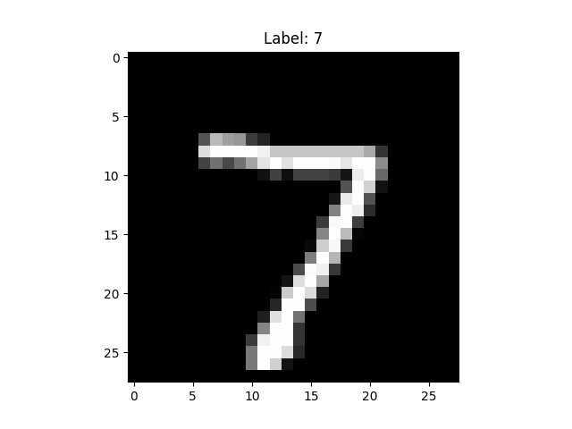
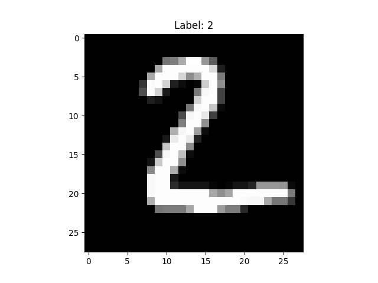
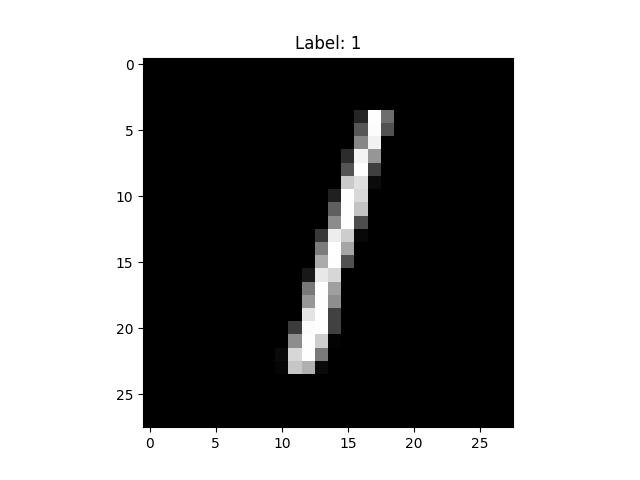
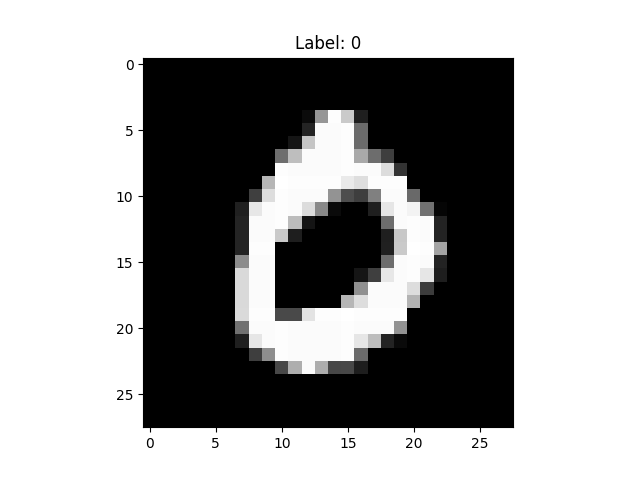
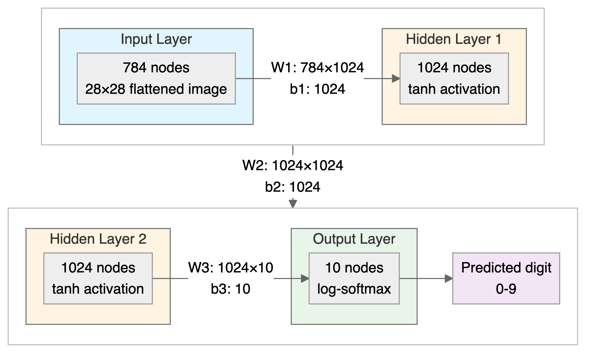
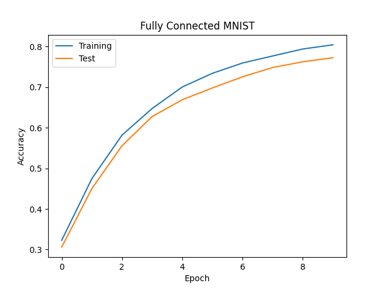
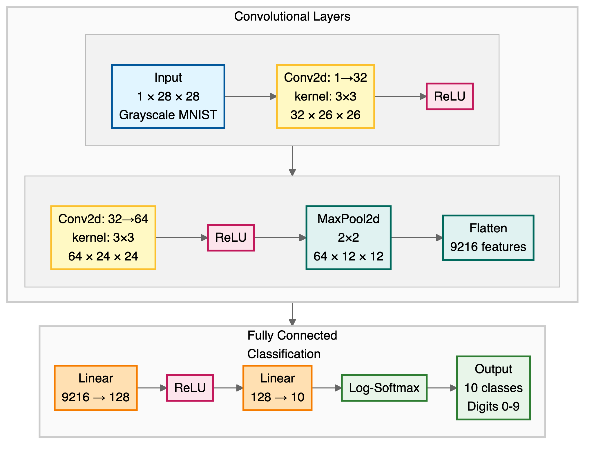



# Convolutional Neural Networks {#sec-cnn}

> "*The face is not a simple pattern; it is a hierarchy of parts within parts within parts.*"---David Marr, *Vision* (1982)

The feed-forward networks of @sec-nn treat every input dimension identically. When the input is an image, this ignores spatial structure: nearby pixels are more related than distant ones, and the same pattern (an edge, a texture) can appear anywhere in the frame. Convolutional neural networks encode these two priors, locality and translation equivariance, directly into the architecture.

The foundational architecture for convolutional neural networks emerged in 1980, when Kunihiko Fukushima introduced the Neocognitron [@fukushima1980neocognitron], a hierarchical neural network inspired by Hubel and Wiesel's discoveries about simple and complex cells in the mammalian visual cortex. The Neocognitron was the first architecture to use convolutional layers for feature extraction and pooling layers for translation invariance, successfully recognizing simple patterns through unsupervised learning, regardless of their position in the image. In 1988, Wei Zhang and colleagues applied backpropagation to train a simplified Neocognitron for alphabet recognition [@zhang1988shift], demonstrating that supervised learning could be effectively combined with the convolutional architecture. This combination of Fukushima's architectural insights with gradient-based supervised learning became the foundation for modern CNNs, which now power everything from facial recognition on smartphones to autonomous vehicle perception systems.

We first calculate a filter response by hand, then combine two filters into a classifier. The MNIST example then learns filters from data and compares a CNN with the fully connected networks of @sec-nn.

## Convolutions

A *filter* (also called a *kernel*) is a small matrix of weights, typically $3\times3$ or $5\times5$, that extracts local features by computing a weighted sum of pixel values within a sliding window. The same weights are used at every position.

### Key Concepts

Consider the upper-left and upper-right $3\times3$ patches of a $5\times5$ cross formed by its two diagonals. Call these patches $P$ and $Q$, and use a filter $f$ with ones along its main diagonal:
$$
P=\begin{pmatrix}1&0&0\\0&1&0\\0&0&1\end{pmatrix},\qquad
Q=\begin{pmatrix}0&0&1\\0&1&0\\1&0&0\end{pmatrix},\qquad
f=\begin{pmatrix}1&0&0\\0&1&0\\0&0&1\end{pmatrix}.
$$
Multiply corresponding entries and add. With rows and columns indexed from zero, the responses at positions $(0,0)$ and $(0,2)$ are
$$
\begin{aligned}
C_{0,0}&=1\cdot1+0\cdot0+0\cdot0+0\cdot0+1\cdot1+0\cdot0+0\cdot0+0\cdot0+1\cdot1=3,\\
C_{0,2}&=0\cdot1+0\cdot0+1\cdot0+0\cdot0+1\cdot1+0\cdot0+1\cdot0+0\cdot0+0\cdot1=1.
\end{aligned}
$$
The matching diagonal gives the larger response; the opposite diagonal still shares the center pixel. Repeating this calculation across the image produces a *feature map* recording where the filter responds.

Now place a shorter diagonal stroke on a blank image and shift it one pixel right, without clipping any of its pixels:
$$
X=\begin{pmatrix}1&0&0&0&0\\0&1&0&0&0\\0&0&1&0&0\\0&0&0&0&0\\0&0&0&0&0\end{pmatrix}
\quad\longrightarrow\quad
X'=\begin{pmatrix}0&1&0&0&0\\0&0&1&0&0\\0&0&0&1&0\\0&0&0&0&0\\0&0&0&0&0\end{pmatrix}.
$$
The response of 3 moves from $(0,0)$ to $(0,1)$. This is *translation equivariance*: for a shared filter with stride one, moving the pattern moves its response, away from boundary effects. Invariance would mean an unchanged output. A maximum over the whole feature map is 3 for either image, but no longer tells us where the stroke was.

The *stride* is the number of pixels by which the filter shifts at each step. A stride of 1 moves pixel by pixel; a stride of 2 skips positions. The *receptive field* is the input region influencing one output value, here $3\times3$. *Padding* adds zeros around the border: with stride one, "same" padding preserves the input dimensions, while "valid" padding uses no padding and shrinks the output.

A related local weighted sum is kernel smoothing. For a one-dimensional signal $x$ and a filter $w$ of length $h$, the unflipped operation is
$$
C(t)=\sum_{i=0}^{h-1}x(t+i)w(i).
$$
Strictly, this is cross-correlation: convolution in signal processing flips the filter and sums $x(t-i)w(i)$. Deep learning libraries omit the flip and still call the operation convolution; learned weights can absorb that reversal. The toy below also uses this unflipped convention. For a symmetric filter such as the moving average below, the two agree up to a shift of the output index.

In @fig-conv1d, a uniform filter of length 10, with each weight $1/10$, smooths a noisy sine wave over $[0,10]$. Smoothing uses fixed averaging weights; learned image filters can instead emphasize changes such as edges.

```{python}
#| label: fig-conv1d
#| fig-cap: "Smoothing a noisy signal using 1D convolution with a moving average filter. The light gray line shows the original noisy sinusoidal signal, while the black line displays the smoothed output after applying a uniform filter of size 10."

import matplotlib.pyplot as plt

from jax import random
import jax.numpy as jnp
import numpy as np

key = random.PRNGKey(1701)

x = jnp.linspace(0, 10, 500)
y = jnp.sin(x) + 0.2 * random.normal(key, shape=(500,))

window = jnp.ones(10) / 10
y_smooth = jnp.convolve(y, window, mode='same')

plt.plot(x, y, 'lightgray')
plt.plot(x, y_smooth, 'black');
```

### A Toy Example

To build intuition, consider a simple example with $5\times5$ images and $3\times3$ filters. We will classify images into three classes: `cross`, `diagonal`, and `right-diagonal`.

```{python conv2d}
#| layout-ncol: 3
#| fig-width: 1.74
#| fig-height: 1.5
img = np.genfromtxt("data/img-x.tsv", delimiter="\t")
imgx = img[0:5,:]
imgd = img[5:10,:]
imgrd = img[10:15,:]
for im, name in [(imgx, 'Cross'), (imgd, 'Diagonal'), (imgrd, 'Right-Diagonal')]:
    plt.figure(figsize=(1.74, 1.5))
    plt.imshow(im, cmap='binary'); plt.title(name, fontsize=7); plt.tick_params(labelsize=6)
    plt.tight_layout(pad=0.3); plt.show()
```

We will use two filters.

```{python conv2d1}
#| layout-ncol: 2
f = np.genfromtxt("data/img-filter.tsv", delimiter="\t")
f1 = f[0:3,:]
f2 = f[3:6,:]
plt.imshow(f1, cmap='binary'); plt.title(f'Filter 1'); plt.show();
plt.imshow(f2, cmap='binary'); plt.title(f'Filter 2'); plt.show();
```

The first filter has 1s along its main diagonal and 0s elsewhere, as in our hand calculation. The second detects the opposite diagonal. The toy network takes a few lines of code: `conv` slides a $3\times3$ filter over the image, `maxpool` performs global max pooling by keeping the strongest response over the entire feature map, and `fc` followed by `softmax` turns the two pooled responses into class probabilities. Both the filters and classifier weights `w` are set by hand, not learned.

```{python}
#| echo: true
def conv(img, f):
    out = np.zeros((3,3))
    for i in range(3):
        for j in range(3):
            out[i,j] = np.sum(img[i:i+3,j:j+3]*f)
    return out
def maxpool(img):
    return np.max(img)
def fc(x, w, b):
    return jnp.dot(w,x) + b
def softmax(x):
    return jnp.exp(x) / jnp.sum(jnp.exp(x))

def cnn(img, f1, f2):
    out1 = conv(img,f1)
    out2 = conv(img,f2)
    x = np.array([maxpool(out1), maxpool(out2)])
    w = np.array([[1,0],[0,1],[0.6,0.6]])
    b = 0
    z = fc(x,w,b)
    return softmax(z),out1,out2
```

```{python conv2d2}
#| layout-ncol: 2

zx, outx1, outx2 = cnn(imgx,f1,f2)
plt.imshow(outx1, cmap='binary'); plt.title(f'Output 1'); plt.show();
plt.imshow(outx2, cmap='binary'); plt.title(f'Output 2'); plt.show();
```

Both feature maps for the cross have a maximum of 3. Applying the same two filters to the `diagonal` image gives different responses.

```{python conv2d3}
#| layout-ncol: 2
zd, outd1, outd2 = cnn(imgd,f1,f2)
plt.imshow(outd1, vmin=0,vmax=3,cmap='binary'); plt.title(f'Output 1');  plt.show();
plt.imshow(outd2, vmin=0,vmax=3, cmap='binary'); plt.title(f'Output 2'); plt.show();
```

The opposite-diagonal filter produces the weaker map $\left(\begin{smallmatrix}1&0&1\\0&1&0\\1&0&1\end{smallmatrix}\right)$, rather than a zero response. Global max pooling reduces each map to one number:

| Image | Filter 1 maximum | Filter 2 maximum |
| :--- | ---: | ---: |
| Diagonal | 3 | 1 |
| Right-diagonal | 1 | 3 |
| Cross | 3 | 3 |

For the diagonal image, the classifier multiplies $(3,1)$ by its three weight rows to obtain logits $(3,1,2.4)$. The cross row $[0.6,0.6]$ rewards both diagonals together: for $(3,3)$ it gives 3.6, exceeding either individual response of 3. Softmax converts these logits to probabilities.

```{python conv2d4}
#| results: hide
zrd, outrd1, outrd2 = cnn(imgrd,f1,f2)
print(f'Cross: {zx}')
print(f'Diagonal: {zd}')
print(f'Right-Diagonal: {zrd}')
```

The three class probabilities, ordered diagonal, right-diagonal, cross, are (0.26, 0.26, 0.48) for the cross image, (0.59, 0.08, 0.33) for the diagonal image and (0.08, 0.59, 0.33) for the right-diagonal image. The model correctly predicted all three classes. Global pooling discards position, as in the shifted-stroke example, but also loses spatial relationships that may matter for classification.

We now learn both filters and classifier weights from labeled images.

## The MNIST Dataset

The MNIST dataset contains grayscale images of handwritten digits, each $28\times28$ pixels, labeled 0 through 9. The original dataset includes 60,000 training images and 10,000 test images. For simplicity, both examples below use only the official test data, shuffled into 8,000 training images and 2,000 held-out evaluation images. We call the latter the held-out set throughout; this is not the standard MNIST training/test protocol.

Image data are represented as a matrix of pixel values. A grayscale image has shape (28, 28), with intensities from 0 (black) to 255 (white). Color images add red, green, and blue channels, giving shape (28, 28, 3). @fig-mnist shows sample digits.

```{python load-mnist}
#| eval: false
import gzip
import struct
import array
import numpy as np
import matplotlib.pyplot as plt

def parse_labels(filename):
    with gzip.open(filename, "rb") as fh:
        _ = struct.unpack(">II", fh.read(8))
        return np.array(array.array("B", fh.read()), dtype=np.uint8)
def parse_images(filename):
    with gzip.open(filename, "rb") as fh:
        _, num_data, rows, cols = struct.unpack(">IIII", fh.read(16))
        return np.array(array.array("B", fh.read()),dtype=np.uint8).reshape(num_data, rows, cols)
x = parse_images("data/t10k-images-idx3-ubyte.gz")
y = parse_labels("data/t10k-labels-idx1-ubyte.gz")
plt.imshow(x[0,:,:], cmap='gray'); plt.title(f'Label: {y[0]}'); plt.show()
plt.imshow(x[1,:,:], cmap='gray'); plt.title(f'Label: {y[1]}'); plt.show()
plt.imshow(x[2,:,:], cmap='gray'); plt.title(f'Label: {y[2]}'); plt.show()
plt.imshow(x[3,:,:], cmap='gray'); plt.title(f'Label: {y[3]}'); plt.show()
```

::: {#fig-mnist layout-ncol="4"}








Sample MNIST digits.
:::

## Fully Connected Approach

A natural starting point is a fully connected neural network, which reshapes each image into a vector of 784 values with no built-in notion of neighboring positions. Its units combine pixels, but separate weights must learn the same pattern at different locations. The output contains probabilities for the 10 classes.

The JAX implementation follows @sec-nn and the gradient updates of @sec-sgd. Pixel values are scaled to $[0,1]$, and labels are stored as one-hot vectors.

```{python mnist-fc}
#| eval: false
import numpy.random as npr
def flatten(x):
    """Flatten all but the first dimension of an ndarray."""
    return np.reshape(x, (x.shape[0], -1))

def one_hot(x, k, dtype=np.float32):
    """Create a one-hot encoding of x of size k."""
    return np.array(x[:, None] == np.arange(k), dtype)
rng = npr.RandomState(0)
n = x.shape[0]
perm = rng.permutation(n)
traini = perm[0:8000]
testi = perm[8000:n]
train_images = flatten(x[traini,:,:])/ np.float32(255.)
test_images = flatten(x[testi,:,:])/ np.float32(255.)
train_labels  = one_hot(y[traini],10)
test_labels =  one_hot(y[testi],10)
```

The cross-entropy loss selects the predicted log-probability of the true digit; accuracy compares the most probable class with the label.

```{python mnist-fc1}
#| eval: false
#| echo: true
from jax import jit, grad
import jax.numpy as jnp
from jax.scipy.special import logsumexp

def loss(params, batch):
  inputs, targets = batch
  preds = predict(params, inputs)
  return -jnp.mean(jnp.sum(preds * targets, axis=1))

def accuracy(params, batch):
  inputs, targets = batch
  target_class = jnp.argmax(targets, axis=1)
  predicted_class = jnp.argmax(predict(params, inputs), axis=1)
  return jnp.mean(predicted_class == target_class)
```

The network has two hidden layers with $\tanh$ activation. Its final layer returns log-probabilities, computed as $z_i-\log\sum_j e^{z_j}$ using `logsumexp` for numerical stability.

```{python mnist-fc2}
#| eval: false
#| echo: true
def predict(params, inputs):
    activations = inputs
    for w, b in params[:-1]:
        outputs = jnp.dot(activations, w) + b
        activations = jnp.tanh(outputs)

    final_w, final_b = params[-1]
    logits = jnp.dot(activations, final_w) + final_b
    return logits - logsumexp(logits, axis=1, keepdims=True)
```

We initialize the weights, form mini-batches of 128 images, and use SGD with step size 0.001 for 10 epochs.

```{python}
#| eval: false
#| echo: true
layer_sizes = [784, 1024, 1024, 10]
param_scale = 0.1
step_size = 0.001
num_epochs = 10
batch_size = 128

num_train = train_images.shape[0]
num_complete_batches, leftover = divmod(num_train, batch_size)
num_batches = num_complete_batches + bool(leftover)

def init_random_params(scale, layer_sizes, rng=npr.RandomState(0)):
  return [(scale * rng.randn(m, n), scale * rng.randn(n))
          for m, n, in zip(layer_sizes[:-1], layer_sizes[1:])]

def data_stream():
    while True:
        perm = rng.permutation(num_train)
        for i in range(num_batches):
            batch_idx = perm[i * batch_size:(i + 1) * batch_size]
            yield train_images[batch_idx], train_labels[batch_idx]
batches = data_stream()

@jit
def update(params, batch):
    grads = grad(loss)(params, batch)
    return [(w - step_size * dw, b - step_size * db) for (w, b), (dw, db) in zip(params, grads)]
```

```{python mnist-fc3}
#| eval: false

params = init_random_params(param_scale, layer_sizes)
log = np.empty((2,num_epochs))
for epoch in range(num_epochs):
    for _ in range(num_batches):
        params = update(params, next(batches))
    train_acc = accuracy(params, (train_images, train_labels))
    test_acc = accuracy(params, (test_images, test_labels))
    log[:,epoch] = [train_acc,test_acc,]
print(f"Training set accuracy {train_acc}")
print(f"Test set accuracy {test_acc}")

plt.plot(range(num_epochs),log[0,:]);
plt.plot(range(num_epochs),log[1,:]);
```

The architecture is shown in @fig-mnist-fc. The run achieves 80% training accuracy and 77% held-out accuracy; this run also leaves substantial training error.

{#fig-mnist-fc width=95% fig-alt="Fully connected network for MNIST with a 784-node input layer, two hidden layers of 1024 tanh nodes and a 10-node log-softmax output layer that gives the predicted digit, with the weight and bias shapes written on each connection."}

@fig-mnist-fc-test shows the training and held-out accuracy during training.

{#fig-mnist-fc-test width=50%}

A fully connected layer connecting a $28\times28$ image to 1024 hidden units requires over 800,000 parameters. A shared $3\times3$ filter uses nine weights at every position, avoiding separate copies of a detector for different locations.

## CNN for MNIST

We use PyTorch's `nn.Conv2d` to implement learned filters. Each first-layer filter produces one feature map. A second-layer filter spans all 32 input maps, sums their local weighted responses, and adds a bias to produce one new map. Thus each second-layer output channel has $32\times3\times3+1=289$ parameters, and its 64 channels have 18,496 parameters. Two stride-one $3\times3$ layers have a $5\times5$ receptive field before pooling: the second layer combines features from neighboring first-layer windows.

The shapes in @fig-cnn-architecture follow $1\times28\times28$, $32\times26\times26$, $64\times24\times24$, then $64\times12\times12$ after local $2\times2$ max pooling. Unlike the toy's global maximum, local pooling retains a grid of responses. It can reduce sensitivity to some shifts, but does not guarantee invariance; the flattened dense head also uses position.

{#fig-cnn-architecture width=95% fig-alt="Architecture of the convolutional network: a 1 by 28 by 28 grayscale input, two 3 by 3 convolutions with ReLU, max pooling and flattening to 9216 features, then a 9216 to 128 linear layer with ReLU and a 128 to 10 linear layer with log-softmax giving 10 digit classes."}

```{python}
#| eval: false
#| echo: true
import torch
import torch.nn as nn
from torch.nn import functional as F
x = parse_images("data/t10k-images-idx3-ubyte.gz")
y = parse_labels("data/t10k-labels-idx1-ubyte.gz")
class Net(nn.Module):
    def __init__(self):
        super(Net, self).__init__()

        self.conv1 = nn.Conv2d(1, 32, 3, 1)  # 1 input channel (grayscale), 32 output channels, 3x3 kernel
        self.conv2 = nn.Conv2d(32, 64, 3, 1)  # 32 input channels, 64 output channels
        # Note: PyTorch defaults to valid padding (no padding). 
        # After conv1 (28->26), conv2 (26->24), pool (24->12): 64 channels × 12 × 12 = 9216
        self.fc1 = nn.Linear(9216, 128)
        self.fc2 = nn.Linear(128, 10)
    def forward(self, x):
        x = self.conv1(x)
        x = F.relu(x)
        x = self.conv2(x)
        x = F.relu(x)
        x = F.max_pool2d(x, 2)
        x = torch.flatten(x, 1)
        x = self.fc1(x)
        x = F.relu(x)
        x = self.fc2(x)
        output = F.log_softmax(x, dim=1)
        return output
```

```{python mnist-cnn}
#| eval: false

def data_stream():
    perm = rng.permutation(num_train)
    while True:
        for i in range(num_batches):
            # index into traini so we train on the same split as the FC network (no test leakage)
            batch_idx = traini[perm[i * batch_size:(i + 1) * batch_size]]
            yield torch.from_numpy(x[batch_idx,:,:]/ np.float32(255.))[:, None, :, :], torch.from_numpy(y[batch_idx])

```

Training draws the same 8,000 images as the dense network, as tensors of shape (batch, 1, 28, 28). The second axis is the grayscale channel expected by `nn.Conv2d`.

```{python}
#| eval: false
#| echo: true
def train(model, optimizer):
    model.train()
    batches = data_stream()
    for epoch in range(num_epochs):
        for _ in range(num_batches):
            optimizer.zero_grad()
            data, target = next(batches)
            output = model(data)
            loss = F.nll_loss(output, target)
            loss.backward()
            optimizer.step()
        print(f"Epoch {epoch}: Loss {loss.item()}")

torch.manual_seed(0)
model = Net()
optimizer = torch.optim.Adadelta(model.parameters(), lr=0.1)
train(model, optimizer)
```

This run uses Adadelta with learning rate 0.1, rather than the dense network's SGD. We evaluate on the same 2,000 held-out images.

```{python mnist-cnn-eval}
#| eval: false
model.eval()
with torch.no_grad():
    test_data = torch.from_numpy(x[testi,:,:]/ np.float32(255.))[:, None, :, :]
    test_targets = torch.from_numpy(y[testi])
    output = model(test_data)
    pred = output.argmax(dim=1)
    correct = pred.eq(test_targets).sum().item()
    accuracy = 100. * correct / len(testi)
    print(f"CNN Test Accuracy: {accuracy:.1f}%")
```

The two implementations give the following reported results. Both use 10 epochs and mini-batches of 128; parameter counts include biases.

| Model | Training setup | Held-out accuracy | Parameters |
| :--- | :--- | ---: | ---: |
| Fully connected | JAX, $\tanh$, SGD, step size 0.001 | 77% | 1,863,690 |
| CNN | PyTorch, ReLU, Adadelta, learning rate 0.1 | 93% | 1,199,882 |

The accuracy gap does not isolate convolution: architecture, activation, optimizer, and framework all change. These are two illustrative implementations, not evidence that convolution alone raises accuracy from 77% to 93%. A controlled comparison would use matched training recipes and evaluate both models on the same held-out digits and their translated versions.

Weight sharing has a directly countable effect. The two convolutional layers together have 18,816 parameters, while the CNN's first dense layer, `Linear(9216, 128)`, has 1,179,776. Most parameters in this CNN are therefore in its dense head; shared filters do not by themselves ensure a small total model.

## Summary

Moving the stroke moved its filter response: convolution is translation equivariant away from boundaries. Taking a global maximum erased its position, whereas local pooling retained some spatial information and offered no guarantee of an unchanged prediction. Stacked filters combine channels and enlarge the receptive field, so early layers detect simple features (edges, textures) and deeper layers combine them into complex patterns (shapes, objects). These are the architectural ideas illustrated by the MNIST network. Attention, developed in @sec-nlp, offers another way to combine information across positions.

## Exercises {.unnumbered}


