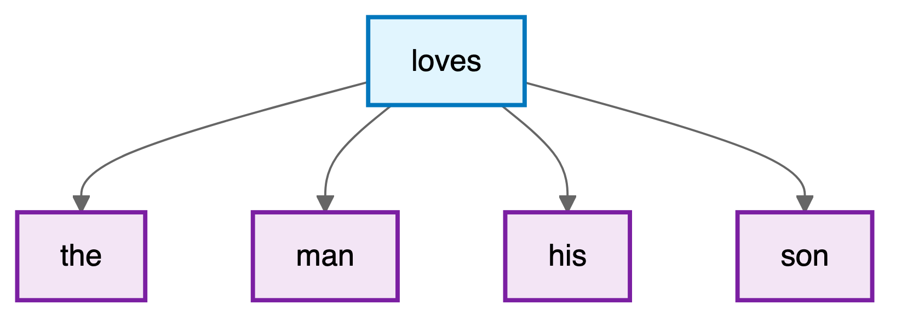
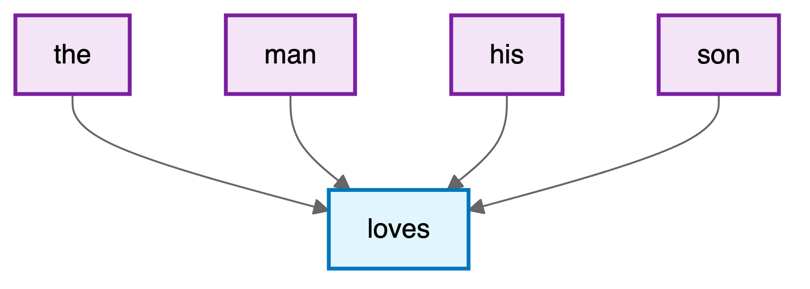
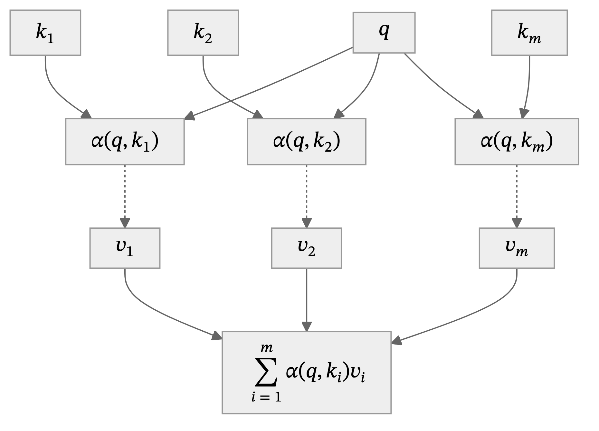
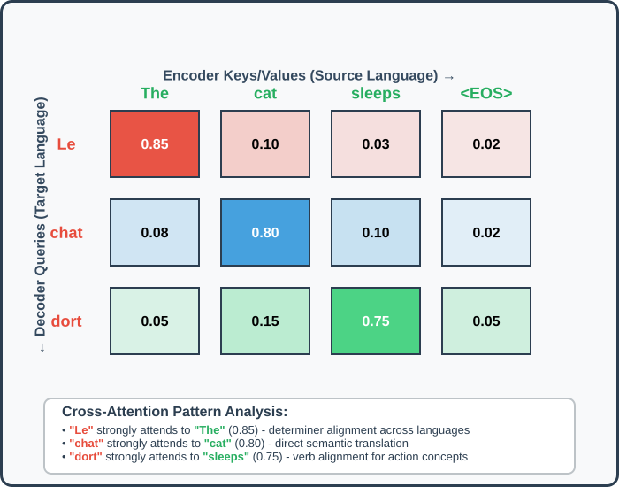
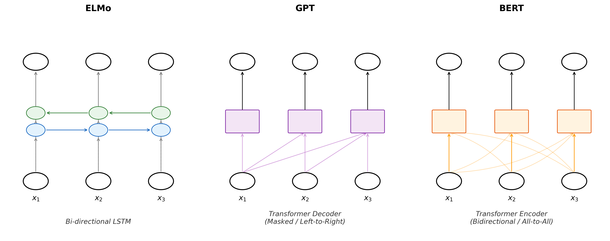
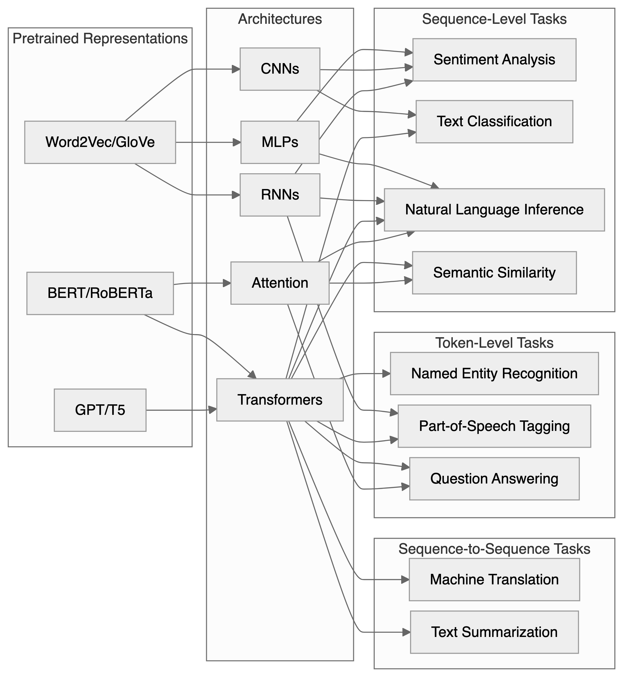



# Natural Language Processing {#sec-nlp}

CNNs (@sec-cnn) exploited the spatial structure of images; language presents a different kind of structure. Words are discrete symbols; their meaning depends on context, and sentences have variable length. These properties demand a new set of architectural ideas: embeddings, attention, and the Transformer, developed in this chapter.

The ability to understand and generate human language has long been considered a hallmark of intelligence. When Alan Turing proposed his famous test in 1950, he chose natural conversation as the ultimate benchmark for machine intelligence. Yet for decades, this goal remained frustratingly elusive. Early attempts at machine translation in the 1950s, which simply replaced words using bilingual dictionaries, produced nonsensical results that highlighted the complexity of human language. The phrase "The spirit is willing, but the flesh is weak" allegedly translated to Russian and back as "The vodka is good, but the meat is rotten": a cautionary tale about the subtleties of meaning that transcend mere word substitution.

This chapter traces the path from those early failures to today's language models that can engage in nuanced dialogue, translate between languages with near-human accuracy, and even generate creative text. At the heart of this transformation lies a fundamental shift in how we represent language computationally: from discrete symbols manipulated by hand-crafted rules to continuous vector spaces learned from vast corpora of text.

The chapter develops the mathematical foundations of natural language understanding: *word embeddings*, *attention mechanisms*, and the *Transformer* architecture that powers modern language models like BERT and GPT.

We will learn a representation from context, update it through attention, and choose a prediction objective for an NLP task. Word2Vec and BERT serve as historical case studies; @sec-llm develops large generative language models.

## Converting Words to Numbers (Embeddings)
Language poses distinctive challenges for mathematical modeling: unlike images, which naturally exist as arrays of continuous pixel values, or audio signals, which are continuous waveforms, text consists of discrete symbols with no inherent geometric structure. The word "cat" is not inherently closer to "dog" than to "quantum", at least not in any obvious mathematical sense. Yet humans effortlessly recognize that cats and dogs share semantic properties that neither shares with abstract physics concepts.

A naive way to represent words is through one-hot encoding, where each word in a vocabulary is assigned a unique vector with a single non-zero entry. For example, in a vocabulary of size $|V|$, the word "cat" might be represented as 
$$
v_{\text{cat}} = \overbrace{[0, 0, \ldots, 1, \ldots, 0]}^{|V|}
$$ 
with the 1 in the $i$-th position corresponding to "cat". However, this approach fails to capture any notion of semantic similarity: the cosine similarity between any two distinct one-hot vectors is zero, erasing all information about how words relate to each other. 

This type of representation makes even the seemingly simple task of determining whether two sentences have similar meanings challenging. The sentences "The cat sat on the mat" and "A feline rested on the rug" express nearly identical ideas despite sharing no words except "the" and "on." Conversely, "The bank is closed" could refer to a financial institution or a river's edge, with the same words encoding entirely different meanings. These examples illustrate why early symbolic approaches to natural language processing, based on logical rules and hand-crafted features, struggled to capture the fluid, contextual nature of meaning.

Instead of treating words as atomic symbols, we embed them in a continuous vector space where geometric relationships can reflect semantic relationships. Vector arithmetic sometimes captures analogies, as in "king - man + woman $\approx$ queen," though such relationships must be checked rather than assumed.

To formalize this intuition, we seek a mapping $\phi: \mathcal{V} \rightarrow \mathbb{R}^d$ from a vocabulary $\mathcal{V}$ of discrete tokens to $d$-dimensional vectors. The challenge lies in learning this mapping such that the resulting geometry reflects semantic relationships.

### The Math of Twenty Questions

My (Vadim's) daughter and I play a game of Twenty Questions during road trips. The rules are simple: one person thinks of something, and the other person has to guess what it is by asking yes-or-no questions. The person who is guessing can ask up to twenty questions, and then they have to make a guess. If they guess correctly, they win; if not, the other person wins. The game illustrates how a shared set of questions can turn descriptions into numbers. For a few animals, part of the representation might be:

|           | Animal | Domestic | Larger than human | Long tail | Can move on two feet |
|-----------|:------:|:--------:|:-----------------:|:---------:|:--------------------:|
| Bear      | 1 | 0 | 1 | 0 | 1 |
| Dog       | 1 | 1 | 0 | 1 | 0 |
| Cat       | 1 | 1 | 0 | 1 | 0 |

Each row is a binary word vector, and each column is a question. These rough descriptions do not distinguish every animal: dog and cat need additional features. Binary answers also hide variation, such as size differences among dog breeds. Allowing real-valued features gives a more flexible representation.

The process of converting words into numbers is called "embedding." The resulting vectors are called "word embeddings." Here the literal analogy ends. Learned coordinates usually have no assigned question, need not lie between zero and one, and can be rotated together without changing their inner products. Training learns vectors useful for predicting observed text, rather than rewarding guesses according to how close their meanings seem.

For example, in "the cat sat on the mat," the observed center-context pair ("cat", "sat") supplies a prediction target: given "cat," increase the probability assigned to "sat." Nothing labels the meanings: the surrounding text is the supervision. Word2Vec, introduced by @mikolov2013efficient in 2013, made this approach efficient enough to learn embeddings from large corpora. Earlier neural language models had also used distributed word representations.

## Word2Vec and Distributional Semantics
The theoretical foundation for learning meaningful word representations comes from the distributional hypothesis, articulated by linguist J.R. Firth in 1957: "You shall know a word by the company it keeps" [@firth1957synopsis]. This principle suggests that words appearing in similar contexts tend to have similar meanings. If "coffee" and "tea" both frequently appear near words like "drink," "hot," "cup," and "morning," we can infer their semantic similarity.

The Word2Vec framework turns this hypothesis into a prediction problem. It has two variants: skip-gram predicts surrounding words from a center word, while continuous bag of words predicts the center from its surroundings. Their learned vectors can then be evaluated on similarity or analogy tasks; these evaluations differ from the training objective.

### The Skip-Gram Model
The skip-gram model predicts surrounding context words within a fixed window given a center word. This approach assumes that words appearing in similar contexts tend to have similar meanings, directly implementing the distributional hypothesis.

Consider the sentence "The man loves his son" with "loves" as the center word and a context window of size 2. The skip-gram model aims to maximize the probability of generating the context words "the," "man," "his," and "son" given the center word "loves." This relationship can be visualized as follows:

{width=80% fig-align="center" fig-alt="The center word loves with arrows to the four context words the, man, his and son."}

The mathematical foundation assumes conditional independence among context words given the center word, allowing the joint probability to factorize:

$$
\begin{aligned}
&P(\text{"the"}, \text{"man"}, \text{"his"}, \text{"son"} \mid \text{"loves"}) = \\
&\quad P(\text{"the"} \mid \text{"loves"}) \cdot P(\text{"man"} \mid \text{"loves"}) \cdot P(\text{"his"} \mid \text{"loves"}) \cdot P(\text{"son"} \mid \text{"loves"})
\end{aligned}
$$

This conditional independence is a modeling simplification, not a property of natural language. The conditional probability uses two sets of embeddings: $\mathbf{v}_w$ for words as centers and $\mathbf{u}_w$ for words as context. Softmax normalizes over the entire vocabulary:

$$P(w_o \mid w_c) = \frac{\exp(\mathbf{u}_o^\top \mathbf{v}_c)}{\sum_{i \in \mathcal{V}} \exp(\mathbf{u}_i^\top \mathbf{v}_c)}$$

The skip-gram objective seeks to maximize the likelihood of observing all context words across the entire corpus. For a text sequence of length $T$ with words $w^{(1)}, w^{(2)}, \ldots, w^{(T)}$, the objective becomes:

$$\mathcal{L}_{\text{skip-gram}} = \frac{1}{T} \sum_{t=1}^T \sum_{-m \leq j \leq m, j \neq 0} \log P(w^{(t+j)} \mid w^{(t)})$$

where $m$ is the context window size and only valid corpus positions $1 \leq t+j \leq T$ are included. Division by $T$ averages the log-likelihood contributions per center word.

The gradient with respect to the center word embedding reveals the learning dynamics:

$$\frac{\partial \log P(w_o \mid w_c)}{\partial \mathbf{v}_c} = \mathbf{u}_o - \sum_{i \in \mathcal{V}} P(w_i \mid w_c) \mathbf{u}_i$$

Each output score is linear in the center embedding, with coefficients that are themselves learned embeddings. This connects the construction to the ridge-function representations in @sec-theorydl. The gradient moves the center vector toward the observed context vector $\mathbf{u}_o$, relative to the model-weighted average of context vectors. The dot product is a compatibility score; differences between scores give log-odds, since $\log[P(w_o \mid w_c)/P(w_i \mid w_c)] = (\mathbf{u}_o-\mathbf{u}_i)^\top\mathbf{v}_c$.

The skip-gram architecture assigns two vector representations to each word: $\mathbf{v}_w$ when the word serves as a center word and $\mathbf{u}_w$ when it appears in context. This asymmetry allows the model to capture different aspects of word usage. After training, the center word vectors $\mathbf{v}_w$ are typically used as the final word embeddings, though some implementations average or concatenate both representations.

### The Continuous Bag of Words (CBOW) Model

While skip-gram predicts context words from a center word, the Continuous Bag of Words (CBOW) model reverses this relationship: it predicts a center word based on its surrounding context. For the same text sequence "the", "man", "loves", "his", "son" with "loves" as the center word, CBOW models the conditional probability:

$$P(\text{"loves"} \mid \text{"the"}, \text{"man"}, \text{"his"}, \text{"son"})$$

The CBOW architecture can be visualized as multiple context words converging to predict a single center word:

{width=80% fig-align="center" fig-alt="The four context words the, man, his and son with arrows to the center word loves."}

The key difference from skip-gram lies in how CBOW handles multiple context words. Rather than treating each context word independently, CBOW averages their embeddings. For a center word $w_c$ with context words $w_{o_1}, \ldots, w_{o_{2m}}$, the conditional probability is:

$$P(w_c \mid w_{o_1}, \ldots, w_{o_{2m}}) = \frac{\exp\left(\mathbf{u}_c^\top \bar{\mathbf{v}}_o\right)}{\sum_{i \in \mathcal{V}} \exp\left(\mathbf{u}_i^\top \bar{\mathbf{v}}_o\right)}$$

For a full window away from corpus boundaries, $\bar{\mathbf{v}}_o = \frac{1}{2m}\sum_{j=1}^{2m} \mathbf{v}_{o_j}$ is the average of context word vectors. Note that in CBOW, $\mathbf{u}_i$ represents word $i$ as a center word, and $\mathbf{v}_i$ represents it as a context word, the opposite of skip-gram's convention.

The CBOW objective maximizes the likelihood of generating all center words given their contexts, omitting positions outside the corpus:

$$\mathcal{L}_{\text{CBOW}} = \sum_{t=1}^T \log P(w^{(t)} \mid w^{(t-m)}, \ldots, w^{(t-1)}, w^{(t+1)}, \ldots, w^{(t+m)})$$

The gradient with respect to context word vectors reveals how CBOW learns:

$$\frac{\partial \log P(w_c \mid \mathcal{W}_o)}{\partial \mathbf{v}_{o_i}} = \frac{1}{2m}\left(\mathbf{u}_c - \sum_{j \in \mathcal{V}} P(w_j \mid \mathcal{W}_o) \mathbf{u}_j\right)$$

This gradient is scaled by $\frac{1}{2m}$, effectively distributing the learning signal across all context words. CBOW tends to train faster than skip-gram because it predicts one word per context window rather than multiple words, but skip-gram often produces better representations for rare words since it generates more training examples per sentence.

### Pretraining Word2Vec

The historical Word2Vec training recipe used vocabulary frequency thresholds, stochastic gradient descent with a linearly decreasing learning rate, and subsampling of frequent words [@mikolov2013distributed]. Frequent words such as "the" occur in many contexts, so reducing their contribution can make training more informative. One subsampling rule discards a word with probability

$$P(\text{discard } w) = \max\left(0, 1 - \sqrt{\frac{t}{f(w)}}\right),$$

where $f(w)$ is its relative frequency and $t$ is a threshold. This is a sampling choice about training efficiency.

Training pairs come from a sliding context window. Sampling its radius uniformly from $1,\ldots,m$ gives nearby words more opportunities to contribute than distant ones. For "sat" in "the cat sat on the mat," radius 1 gives ["cat", "on"], while radius 2 gives ["the", "cat", "on", "the"]. These choices affect the representation and should be distinguished from the objective itself.

## Computational Efficiency through Negative Sampling

The elegance of word2vec's formulation belies a serious computational challenge. Computing the normalization term in the softmax requires summing over the entire vocabulary (potentially millions of terms) for every gradient update. With large corpora containing billions of words, this quickly becomes intractable.

Negative sampling transforms the problem from multi-class classification to binary classification. Instead of predicting which word from the entire vocabulary appears in the context, we ask a simpler question: given a word pair, is it a real center-context pair from the corpus or a randomly generated negative example? The objective becomes:

$$\mathcal{L}_{\text{NS}} = \log \sigma(\mathbf{u}_o^\top \mathbf{v}_c) + \sum_{k=1}^K \E[w_k \sim P_n]{\log \sigma(-\mathbf{u}_{w_k}^\top \mathbf{v}_c)}$$

where $\sigma(x) = 1/(1 + e^{-x})$ is the sigmoid function, and $P_n$ is a noise distribution over words. Each pair now uses $K+1$ scores instead of $|\mathcal{V}|$, with $K$ typically between 5 and 20. Negative sampling does not approximate the softmax likelihood; it replaces it. With unrestricted pair scores and the unigram noise distribution, the population optimum satisfies $\mathbf{u}_o^\top \mathbf{v}_c = \mathrm{PMI}(o, c) - \log K$ [@levy2014neural], so finite-dimensional vectors approximate a factorization of a shifted pointwise-mutual-information matrix rather than the skip-gram conditional distribution. The noise distribution is set empirically to $P_n(w) \propto f(w)^{3/4}$ [@mikolov2013distributed], where $f(w)$ is word frequency; the exponent draws frequent words less often than their raw frequency would, and was chosen by experiment rather than derived. With this noise the unrestricted optimum is $\mathbf{u}_o^\top \mathbf{v}_c = \log\left(P(o \mid c)/P_n(o)\right) - \log K$, a pointwise mutual information in which the marginal $P(o)$ is replaced by $P_n(o)$.

A different remedy is hierarchical softmax [@morin2005hierarchical; @mikolov2013distributed]. The vocabulary is arranged as the leaves of a binary tree, and the single choice among $|\mathcal{V}|$ words is broken into a chain of two-way choices made on the way down from the root. Every internal node $n$ owns a vector $\mathbf{u}_n$; at that node the walk turns left with probability $\sigma(\mathbf{u}_n^\top \mathbf{v}_c)$ and right with probability $\sigma(-\mathbf{u}_n^\top \mathbf{v}_c)$. The probability of a word is the probability of the walk that ends at its leaf:

$$P(w_o \mid w_c) = \prod_{j=1}^{L(w_o)-1} \sigma\left([\![n(w_o, j+1) = \text{leftChild}(n(w_o, j))]\!] \cdot \mathbf{u}_{n(w_o,j)}^\top \mathbf{v}_c\right)$$

Here $n(w_o, 1), \ldots, n(w_o, L(w_o))$ are the nodes on the path from the root to the leaf of $w_o$, and the double bracket is a sign: $+1$ if the next node on the path is the left child and $-1$ if it is the right child, so each factor is the probability of the turn the path actually takes. Since $\sigma(x) + \sigma(-x) = 1$, the two branches at every node have probabilities that add to one, and the leaf probabilities add to one without a sum over the vocabulary. Scoring a word costs $L(w_o) - 1$ sigmoids, which is $O(\log |\mathcal{V}|)$ for a balanced tree against $O(|\mathcal{V}|)$ for the flat softmax. The two remedies optimize different objectives, so their downstream performance must be compared empirically.

## Global Vectors and Matrix Factorization

While word2vec learns from local context windows, GloVe (Global Vectors) [@pennington2014glove] leverages global co-occurrence statistics. The key observation is that the ratio of co-occurrence probabilities can encode semantic relationships. Consider the words "ice" and "steam" in relation to "solid" and "gas": $P(\text{solid} \mid \text{ice}) / P(\text{solid} \mid \text{steam})$ is large (around 8.9), while $P(\text{gas} \mid \text{ice}) / P(\text{gas} \mid \text{steam})$ is small (around 0.085), and $P(\text{water} \mid \text{ice}) / P(\text{water} \mid \text{steam})$ is close to 1 (around 1.36).

These ratios capture the semantic relationships: ice is solid, steam is gas, and both relate to water. GloVe learns embeddings that preserve these ratios through the objective:

$$\mathcal{L}_{\text{GloVe}} = \sum_{i,j} h(X_{ij}) \left(\mathbf{v}_i^\top \mathbf{u}_j + b_i + c_j - \log X_{ij}\right)^2$$

where the sum runs over pairs with $X_{ij}>0$, $X_{ij}$ counts co-occurrences, $h(\cdot)$ is a weighting function that prevents very common or very rare pairs from dominating, and $b_i, c_j$ are bias terms. A typical choice is $h(x) = (x/x_{\max})^{\alpha}$ if $x < x_{\max}$, else 1, with $\alpha = 0.75$ and $x_{\max} = 100$.

This formulation reveals GloVe as a weighted matrix factorization problem. The inner products plus row and column biases approximate log co-occurrence counts, with weights $h(X_{ij})$. If every count is positive, every entry is fitted, $h \equiv 1$, and biases are omitted, the best low-rank fit is the truncated SVD of the entrywise matrix $\log \mathbf{X}$, by the Eckart-Young theorem. The weights $h(X_{ij})$ destroy that closed form: weighted low-rank approximation has no eigendecomposition solution in general, which is why GloVe is fitted by gradient descent (AdaGrad) rather than by an SVD. The unweighted case is still the right intuition for what the factors represent.

::: {#ex-word2vec}
*Word2Vec for War and Peace.* Do military terms have closer learned neighbors than social terms? In this run they do not. We train CBOW with negative sampling on Tolstoy's novel, using 100-dimensional vectors and a maximum context window of 5. The code uses gensim's default number of training epochs; this does not establish convergence. PCA projects a selected list of word vectors into two dimensions for inspection.

```{python}
#| echo: true
from gensim.models import Word2Vec
from sklearn.decomposition import PCA

# define training data, read from data/warpeace.txt
with open('data/warpeace.txt', 'r') as file:
    Text = file.read()
sentences = [s.split() for s in Text.split('. ')]  # split the text into sentences
# Strip punctuation from each word and drop empty tokens
sentences = [[word.strip('.,!?;:()[]') for word in sentence if word.strip('.,!?;:()[]')] for sentence in sentences]

# Remove empty sentences
sentences = [sentence for sentence in sentences if sentence]
model = Word2Vec(sentences, vector_size=100, window=5, min_count=1, seed=42, workers=1)
# fit a 2d PCA model to the vectors, only use the words from data/embedding_words.txt
with open('data/embedding_words.txt', 'r') as file:
    words = file.read().splitlines()
X = model.wv[words]  # get the vectors for the words
# reduce the dimensionality of the vectors to 2D using PCA
pca = PCA(n_components=2)
result = pca.fit_transform(X)
```
```{python}
#| fig-cap: "Word2Vec for War and Peace."
#| fig-width: 9
import matplotlib.pyplot as plt

# create a scatter plot of the projection
fig, ax = plt.subplots(figsize=(10, 4))
ax.scatter(result[:, 0], result[:, 1])
ax.set_xlabel('PC 1')
ax.set_ylabel('PC 2')

for i, word in enumerate(words):
    if word == 'society':
        ax.annotate(word, xy=(result[i, 0], result[i, 1]), xytext=(-5, 0), textcoords='offset points', ha='right', va='center')
    else:
        ax.annotate(word, xy=(result[i, 0], result[i, 1]), xytext=(5, 0), textcoords='offset points', ha='left', va='center')

# Remove top and right borders
ax.spines['top'].set_visible(False)
ax.spines['right'].set_visible(False)

plt.tight_layout()
plt.show()
```

PCA preserves directions of variance, not semantic neighborhoods. In a run with gensim 4.4.0, the two components explained 80.6% of the variance among these 14 selected vectors. That fraction concerns the chosen words, not the entire vocabulary, and does not establish the novel's thematic structure.

Nearest neighbors in the original 100-dimensional space provide a separate check. The table reports cosine similarities from the same run; counts are occurrences in the preprocessed corpus.

| Query (count) | Neighbor (count) | Cosine similarity |
|:--------------|:-----------------|------------------:|
| soldier (182) | Frenchman (95) | 0.971 |
| soldier (182) | lady (76) | 0.968 |
| battle (333) | war (258) | 0.933 |
| battle (333) | fact (151) | 0.932 |

The figure and the table come from the same fixed-seed run. For scale, the cosine between "soldier" and "battle" is 0.694, between "soldier" and "ballroom" 0.907, and random pairs of words occurring at least 50 times average 0.70 (90th percentile 0.90). With `min_count=1`, one novel and the default epochs, the vectors are crowded together, so a high similarity such as "soldier" and "lady" at 0.968 reflects that crowding as much as shared context, and military terms are barely closer to each other (mean cosine 0.80) than to social terms (0.79), while social terms are closer to each other (0.91). Shared contexts need not imply a shared theme. Check the passages where the words occur and repeat the analysis with another seed or window size before interpreting a cluster. Such checks matter before using embeddings for theme extraction, character relationships, historical interpretation, or similarity-based search and recommendation. The position of "peace" in a selected projection cannot establish its narrative centrality.
:::

## Beyond Words: Subword and Character Models (Tokenization)

A fundamental limitation of word-level embeddings is their inability to handle out-of-vocabulary words or capture morphological relationships. The word "unhappiness" shares obvious morphological connections with "happy," "unhappy," and "happiness," but word2vec treats these as completely independent tokens.

FastText [@bojanowski2017enriching] addresses this limitation by representing words as bags of character n-grams. For the word "where" with n-grams of length 3 to 6, we extract: "<wh", "whe", "her", "ere", "re>", and longer n-grams up to the full word. The word embedding is then the sum of its n-gram embeddings:

$$\mathbf{v}_{\text{where}} = \sum_{g \in \mathcal{G}_{\text{where}}} \mathbf{z}_g$$

This approach handles out-of-vocabulary words by breaking them into known n-grams and provides better representations for rare words by sharing parameters across morphologically related words.

An even more flexible approach is Byte Pair Encoding (BPE), which learns a vocabulary of subword units directly from the data. Starting with individual characters, BPE iteratively merges the most frequent pair of adjacent units until reaching a desired vocabulary size. For example, given a corpus with word frequencies {"fast": 4, "faster": 3, "tall": 5, "taller": 4}, BPE might learn merges like "t" + "a" $\rightarrow$ "ta", then "ta" + "l" $\rightarrow$ "tal", and so on. This approach balances vocabulary size against sequence length. Character-based BPE still needs a policy for unseen characters; byte-based variants can represent arbitrary text through their byte alphabet.

Vocabulary size is a model-dependent trade-off. A smaller vocabulary usually lengthens sequences, increasing attention work, while a larger one requires more embedding and output parameters. The balance also depends on which languages and domains supplied the tokenizer training data.

Consider how "The Verbasizer helped Bowie create unexpected word combinations" might be tokenized: ["The", " Ver", "bas", "izer", " helped", " Bow", "ie", " create", " unexpected", " word", " combinations"]. This fragmentation handles rare words and proper names by breaking them into common subcomponents.

This tokenization process explains some behavioral patterns in modern language models. Names from fictional universes, specialized terminology, and code snippets can be tokenized in ways that fragment their semantic meaning, potentially affecting model performance.

## Attention Mechanisms and Contextual Representations

Static word embeddings assign a single vector to each word, ignoring context. The word "bank" receives the same representation whether it appears in "river bank" or "investment bank." Contextual representations instead update a token's vector using the surrounding sequence.

Recurrent networks already provided contextual representations, but their sequential updates limit parallel computation, and information from early positions can be difficult to preserve. Attention [@bahdanau2014neural; @vaswani2017attention] lets a model directly access and combine representations across positions. Transformers use this operation without recurrence, allowing positions to be processed in parallel during training.

In @sec-theorydl, we interpreted attention as a form of kernel smoothing. Here we develop that connection into a contextual update. Consider how you might search through a library: you formulate a *query* (what you are looking for), examine *keys* (catalog entries), and retrieve the associated *values* (the contents). Attention answers a query with a weighted sum of values:

$$
\textrm{Attention}(\mathbf{q}) \defeq \sum_{i=1}^m \alpha_i(\mathbf{q}, \mathbf{k}_i)\mathbf{v}_i.
$$

We call this operation attention pooling. Nonnegative weights summing to one make the output a convex combination of the values. Softmax converts real-valued scores $s_i$, one per key, into such weights:

$$
\alpha_i = \frac{\exp(s_i)}{\sum_{j=1}^m \exp(s_j)}.
$$

{width=55% fig-align="center" fig-alt="The query q and each key k produce a weight alpha(q, k) for the matching value v, and the output is the sum of the weighted values."}

::: {#ex-kernel-smoothing}
*Kernel smoothing as attention.* In Nadaraya-Watson regression [@nadaraya1964estimating; @watson1964smooth], similarity kernels determine how much weight to give each observation. Suppose $y_1,\ldots,y_n$ are observed at spatial locations $x^{(i)}\in\mathbb{R}^2$. We want to predict at an unobserved location $q$.

```{python}
#| label: fig-kernel-smoothing
#| fig-height: 2
#| fig-cap: "Simulated data for kernel smoothing."
#| echo: true
import numpy as np
import matplotlib.pyplot as plt

# Generate some data
np.random.seed(42)
x1 = np.random.uniform(0, 1, 100)
x2 = np.random.uniform(0, 1, 100)
y = np.sin(2 * np.pi * x1) + x2*x2+ np.random.normal(0, 0.1, 100)

plt.scatter(x1, x2, c=y, cmap='viridis')
plt.colorbar();
plt.show()
```

The observed locations are the keys and the responses are the values. A kernel $K$ supplies normalized weights and a prediction:

$$
\alpha_i(q) = \frac{K(q,x^{(i)})}{\sum_{j=1}^n K(q,x^{(j)})}, \qquad \hat{y}(q) = \sum_{i=1}^n\alpha_i(q)y_i.
$$

The denominator must be positive. It is what makes the weights sum to one, so the prediction is a convex combination of the observed $y_i$: exactly the attention pooling of the previous section, with a fixed similarity rather than a learned one. Without it the constant kernel $K \equiv 1$ would return $\sum_i y_i = n\bar{y}$ instead of $\bar{y}$.

Common choices [@zhang2023dive] are:

| Kernel | Formula for $K(q,x^{(i)})$ |
|:-------|:--------------------------|
| Gaussian | $\exp\left(-\frac{\|q-x^{(i)}\|^2}{2h^2}\right)$ |
| Boxcar | $\mathbb{I}\left(\|q-x^{(i)}\|<h\right)$ |
| Constant | $1$ |
| Epanechnikov | $\max\left(1-\frac{\|q-x^{(i)}\|^2}{h^2},0\right)$ |

Here $h$ controls the width of the neighborhood. The following comparison evaluates the Gaussian smoother on a 100 by 100 grid with $h=0.1$. The implementation is in `code/23-nlp.py`; the figure compares the true function, its smoothed estimate, and their difference.

::: {.content-hidden unless-meta="show-kernel-implementation"}

```{python}
#| echo: true
def gaussian_kernel_smoothing(X1, X2, x1_train, x2_train, y_train, bandwidth=0.1):
    # Get the shape of the grid
    shape = X1.shape
    
    # Flatten the grid points for easier computation
    X1_flat = X1.flatten()
    X2_flat = X2.flatten()
    
    # Initialize predictions array
    y_pred_flat = np.zeros(len(X1_flat))
    
    # For each test point, compute weighted average using Gaussian kernel
    for i in range(len(X1_flat)):
        test_x1, test_x2 = X1_flat[i], X2_flat[i]
        
        # Compute distances from test point to all training points
        distances_squared = (x1_train - test_x1)**2 + (x2_train - test_x2)**2
        
        # Compute Gaussian weights
        weights = np.exp(-distances_squared / (2 * bandwidth**2))
        
        # Compute weighted average (kernel smoothing prediction)
        if np.sum(weights) > 0:
            y_pred_flat[i] = np.sum(weights * y_train) / np.sum(weights)
        else:
            y_pred_flat[i] = 0  # fallback if all weights are zero
    
    # Reshape back to grid shape
    y_pred = y_pred_flat.reshape(shape)
    
    return y_pred
```

:::

```{python}
#| label: smoothing_debug
#| fig-cap: "Kernel Smoothing using Gaussian Kernel."
import numpy as np
import matplotlib.pyplot as pyplot

# Generate grid data for x1 and x2 (test data)
x1 = np.linspace(0, 1, 100)
x2 = np.linspace(0, 1, 100)
# Now compute the grid of x1 and x2 values
X1, X2 = np.meshgrid(x1, x2)

# Generate training data
np.random.seed(42)
x1_train = np.random.uniform(0, 1, 100)
x2_train = np.random.uniform(0, 1, 100)
y_train = np.sin(2 * np.pi * x1_train) + x2_train*x2_train + np.random.normal(0, 0.1, 100)


# Test the function with the existing data
y_pred = gaussian_kernel_smoothing(X1, X2, x1_train, x2_train, y_train, bandwidth=0.1)

# Plot comparison between true function and kernel smoothing prediction
fig, axes = pyplot.subplots(1, 3, figsize=(5.5, 2.0))

# True function (without noise for cleaner visualization)
y_true = np.sin(2 * np.pi * X1) + X2*X2
lev = np.linspace(min(y_true.min(), y_pred.min()), max(y_true.max(), y_pred.max()), 21)

# Plot 1: True function
im1 = axes[0].contourf(X1, X2, y_true, levels=lev, cmap='viridis')
axes[0].scatter(x1_train, x2_train, c='white', edgecolors='black', marker='o', s=6, linewidths=0.5)
axes[0].set_title('True Function')
axes[0].set_xlabel('$x_1$')
axes[0].set_ylabel('$x_2$')
pyplot.colorbar(im1, ax=axes[0]);

# Plot 2: Kernel smoothing prediction
im2 = axes[1].contourf(X1, X2, y_pred, levels=lev, cmap='viridis')
axes[1].scatter(x1_train, x2_train, c='white', edgecolors='black', marker='o', s=6, linewidths=0.5)
axes[1].set_title('Gaussian Kernel Smoothing')
axes[1].set_xlabel('$x_1$')
axes[1].set_ylabel('$x_2$')
pyplot.colorbar(im2, ax=axes[1]);

# Plot 3: Difference (error)
diff = y_true - y_pred
im3 = axes[2].contourf(X1, X2, diff, levels=20, cmap='cividis')
axes[2].scatter(x1_train, x2_train, c='white', edgecolors='black', marker='o', s=6, linewidths=0.5)
axes[2].set_title('Error (True - Predicted)')
axes[2].set_xlabel('$x_1$')
axes[2].set_ylabel('$x_2$')
plt.colorbar(im3, ax=axes[2]);

for ax in fig.axes:
    ax.tick_params(labelsize=6)
    ax.title.set_fontsize(7)
    ax.xaxis.label.set_fontsize(8)
    ax.yaxis.label.set_fontsize(8)
plt.tight_layout()
plt.show()
```

The error panel matters as much as the fitted surface: smoothing can miss local variation where observations are sparse. Agreement inside this sampled region provides no guarantee about extrapolation.
:::

The correspondence with attention is direct:

| Kernel smoothing | Attention |
|:-----------------|:----------|
| Prediction location | Query |
| Observed locations | Keys |
| Observed responses | Values |
| Normalized kernel weights | Attention weights |

For a small token update, consider a toy head over "The cat sat." Let the query at "cat" be $q=1$, the keys be $(0,\log 2,0)$, and the value vectors be $(1,0)$, $(0,2)$, and $(2,0)$. The scalar dot-product scores are $(0,\log 2,0)$, giving weights $(1/4,1/2,1/4)$. The contextual output at "cat" is

$$
o_{\text{cat}} = \tfrac14(1,0)+\tfrac12(0,2)+\tfrac14(2,0)=(0.75,1).
$$

These are illustrative numbers, not fitted word vectors. In a learned model, query and key projections change the similarity coordinates, while value projections change the information transported. The surrounding prediction loss determines which changes are useful.

### Attention over a Sequence of Words

Self-attention obtains queries, keys, and values from the same sequence. Cross-attention obtains queries from one sequence and keys and values from another, as when a translation decoder retrieves information from an encoded source sentence. Either operation can connect distant positions directly. Whether a position may attend to future tokens depends on the prediction task and its mask.

Let $H\in\mathbb{R}^{n\times d}$ contain one token representation per row. For self-attention, the learned projections are

$$
Q = HW_Q, \qquad K = HW_K, \qquad V = HW_V,
$$

where $W_Q,W_K\in\mathbb{R}^{d\times d_k}$ and $W_V\in\mathbb{R}^{d\times d_v}$. Queries and keys have dimension $d_k$; values can have a different dimension $d_v$. For query position $i$ and key position $j$, scaled dot-product attention computes

$$
s_{ij}=\frac{q_i^\top k_j}{\sqrt{d_k}}, \qquad
\alpha_{ij}=\frac{\exp(s_{ij})}{\sum_{l=1}^n\exp(s_{il})}, \qquad
o_i=\sum_{j=1}^n\alpha_{ij}v_j.
$$

The softmax is taken separately for each row, producing weights that sum to one over key positions. If query and key coordinates have approximately unit variance and weak dependence, unscaled dot-product variance grows with $d_k$. The factor $1/\sqrt{d_k}$ counteracts this growth and reduces softmax saturation. All positions can be computed together:

$$
\operatorname{Attention}(Q,K,V)=\operatorname{softmax}\left(\frac{QK^\top}{\sqrt{d_k}}\right)V.
$$

A dot product over a whole sequence is a matrix multiplication, an operation suited to accelerators and differentiable in $Q$ and $K$. Non-differentiable attention trained by reinforcement learning also exists [@mnih2014recurrent], but is harder to optimize. Dot products depend on vector lengths as well as direction; they equal cosine similarity only for unit vectors.

For unit-normalized queries and keys, the Gaussian connection is exact. Since $\|q_i-k_j\|^2=2-2q_i^\top k_j$,

$$
\frac{\exp(-\|q_i-k_j\|^2/(2h^2))}{\sum_l\exp(-\|q_i-k_l\|^2/(2h^2))}
=\frac{\exp(q_i^\top k_j/h^2)}{\sum_l\exp(q_i^\top k_l/h^2)}.
$$

The common factor cancels, and $h^2$ acts as a softmax temperature. Ordinary learned projections need not have unit norm, so this identity does not make every Gaussian smoother identical to scaled dot-product attention. Learning projections and choosing an attention scale are separate design choices.

::: {#ex-attention-weights}
For example, consider the sentence:

> "The cat sat on the mat"

@fig-attention-weights is a schematic of one bidirectional attention head in one layer, not output from a trained model. Rows are query positions and columns are key positions. Both occurrences of the determiner remain in the sequence; every row sums to one.

:::: {#fig-attention-weights}

| | $\text{The}_1$ | $\text{cat}_2$ | $\text{sat}_3$ | $\text{on}_4$ | $\text{the}_5$ | $\text{mat}_6$ |
|:--|--:|--:|--:|--:|--:|--:|
| $\text{The}_1$ | 0.05 | 0.70 | 0.05 | 0.05 | 0.05 | 0.10 |
| $\text{cat}_2$ | 0.05 | 0.40 | 0.20 | 0.05 | 0.05 | 0.25 |
| $\text{sat}_3$ | 0.05 | 0.60 | 0.10 | 0.10 | 0.05 | 0.10 |
| $\text{on}_4$ | 0.05 | 0.10 | 0.10 | 0.20 | 0.05 | 0.50 |
| $\text{the}_5$ | 0.05 | 0.05 | 0.05 | 0.10 | 0.05 | 0.70 |
| $\text{mat}_6$ | 0.05 | 0.10 | 0.05 | 0.25 | 0.05 | 0.50 |

Illustrative self-attention weights for the six token positions in "The cat sat on the mat."
::::

The first determiner attends most strongly to "cat," while the second attends most strongly to "mat." Positional information, introduced below, lets two occurrences of the same word type receive different updates. The "sat"-to-"cat" weight of 0.60 differs from the reverse weight of 0.20: attention need not be symmetric. The "on"-to-"mat" weight is 0.50, while the reverse is 0.25. Diagonal entries weight each position's own value.

Particular heads in particular BERT models have shown syntactic and coreference patterns [@clark2019does]. These are empirical findings, not assignments that every head must learn. Weights describe a routing operation; a large weight alone does not establish why a prediction was made, because values, other heads, and later layers also matter.
:::

Cross-attention uses the same normalization, but its matrix can be rectangular. With decoder queries and encoder keys,

$$
s_{ij}=\frac{q_i^\top k_j}{\sqrt{d_k}},\qquad
\alpha_{ij}=\frac{\exp(s_{ij})}{\sum_{l=1}^{n_{\text{encoder}}}\exp(s_{il})},
$$

where $i=1,\ldots,n_{\text{decoder}}$ and $j=1,\ldots,n_{\text{encoder}}$. The output remains a weighted sum of encoder value vectors.

::: {#ex-cross-attention}
*Cross-attention for translation.* Consider translating "The cat sleeps" into French. English encoder representations supply keys and values; French decoder representations supply queries. @fig-cross-attention-matrix is a schematic of one illustrative head, not a fitted translation model.

{#fig-cross-attention-matrix width=80%}

The three rows label target prediction positions ["Le", "chat", "dort"], and the four columns label source positions ["The", "cat", "sleeps", `<EOS>`]. Decoder inputs are shifted: the query used to predict "chat" comes from a representation of the preceding target prefix, not from seeing "chat" itself. We make this shift explicit in the Transformer walkthrough.

The schematic assigns weights 0.85 to "Le"-"The," 0.80 to "chat"-"cat," and 0.75 to "dort"-"sleeps." Such alignments can be learned [@bahdanau2014neural], but translation need not align words one for one. As with self-attention, these weights alone are not a causal explanation of an output. Encoder-decoder models also use cross-attention for summarization and question answering; a decoder-only chatbot can instead put prompt and response in one sequence.
:::

### Multi-Head Attention: Parallel Perspectives

A single attention head can combine several relationships, but one weight matrix must serve them all. Consider the sentence "The student who studied hard passed the exam." We might want to simultaneously track:

- Syntactic relationships (subject-verb agreement between "student" and "passed")
- Semantic relationships (the connection between "studied hard" and "passed")
- Coreference relationships (resolution of "who" to "student")

Multi-head attention addresses this by computing multiple attention functions in parallel, each potentially specializing in different types of relationships. For input representation matrices $H_q,H_k,H_v$ (all equal to $H$ in self-attention),

$$\text{MultiHead}(H_q,H_k,H_v) = \text{Concat}(\text{head}_1, \ldots, \text{head}_h)\mathbf{W}_O$$

each head is computed as:

$$\text{head}_i = \text{Attention}(H_q\mathbf{W}_Q^i, H_k\mathbf{W}_K^i, H_v\mathbf{W}_V^i)$$

In cross-attention, $H_q$ comes from the decoder and $H_k,H_v$ from the encoder. Head roles are learned, not prescribed. The projection matrices $\mathbf{W}_Q^i, \mathbf{W}_K^i, \mathbf{W}_V^i$ are typically chosen so that $d_k = d_v = d_{\text{model}}/h$, keeping the total computational cost comparable to single-head attention with full dimensionality.

The final linear projection $\mathbf{W}_O$ allows the model to learn how to combine information from different heads. This design enables the model to attend to different representation subspaces simultaneously, capturing multiple types of relationships that might be difficult for a single attention head to model.


### Positional Information in Attention

Without positional information or a position-dependent mask, self-attention is permutation-equivariant: permute the input tokens and the outputs $o_i$ are permuted the same way, with no output vector changing value. A token's representation therefore depends on which tokens surround it but never on where it sits, so word order is lost. Parallel computation does not require losing order; positional information must be supplied separately.

The Transformer architecture addresses this through *positional encodings* that are added to the input embeddings before attention computation. The original formulation uses sinusoidal encodings:

$$\text{PE}(\text{pos}, 2i) = \sin\left(\frac{\text{pos}}{10000^{2i/d_{\text{model}}}}\right)$$
$$\text{PE}(\text{pos}, 2i+1) = \cos\left(\frac{\text{pos}}{10000^{2i/d_{\text{model}}}}\right)$$

where $\text{pos}$ is the position and $i$ indexes pairs of coordinates. Different frequencies distinguish positions at different scales without learned parameters. The formula is defined beyond training lengths, but that alone does not guarantee accurate extrapolation.

Alternative approaches include learned positional embeddings or relative position encodings that explicitly model the distance between positions rather than their absolute locations.

### Computational Efficiency and Practical Considerations

Full self-attention forms $n^2$ scores and costs $O(n^2d)$ for head dimension $d$. Sparse patterns restrict the available connections: local attention uses a fixed window, while strided patterns retain some long-range links. Linear attention uses kernel feature maps or low-rank approximations; with fixed feature dimension, some formulations cost $O(nd^2)$. These changes trade computation against the interactions a model can represent.

Gradient accumulation combines gradients across smaller batches before updating weights. Mixed precision uses lower-precision arithmetic for many operations while retaining higher precision where needed. Gradient checkpointing saves memory by recomputing discarded activations in the backward pass. These are training and implementation choices, separate from the attention objective; @sec-llm develops efficiency at larger scales.

## Transformer Architecture

Introduced by @vaswani2017attention, the original Transformer used an encoder-decoder architecture for translation. We use that model as the reference throughout this walkthrough. Transformers have since been adapted to text and audio generation, image recognition, protein structure prediction, and game playing.

@fig-transformer shows the original architecture schematically. Each encoder block contains multi-head self-attention and a position-wise feed-forward network. Each decoder block contains masked self-attention, cross-attention to encoder outputs, and a feed-forward network. Residual connections and normalization surround every sublayer, although the diagram omits them.

{#fig-transformer width=95% fig-alt="Encoder and decoder stacks side by side, with the encoder output feeding the cross-attention layer of the decoder, which ends in a linear layer and softmax that give the output probabilities."}

The input and output tokens are embedded and given positional encodings. Causal masking and a one-position shift make the decoder predict the next token rather than copy the target. For the French target "Le chat dort," a training example is:

| Decoder position | 1 | 2 | 3 | 4 |
|:-----------------|:--|:--|:--|:--|
| Decoder input | `<BOS>` | Le | chat | dort |
| Prediction target | Le | chat | dort | `<EOS>` |

Here `<BOS>` starts the target and `<EOS>` ends it. Before softmax, the decoder replaces score $s_{ij}$ by $-\infty$ whenever $j>i$. At position 2, the decoder can use `<BOS>`, "Le," and the encoded English source to predict "chat," but cannot inspect the target inputs "chat" or "dort" at later positions. During training, the observed prefix is supplied at every position, so all next-token losses can be computed in parallel. During generation, later inputs depend on earlier generated tokens, so tokens are produced sequentially.

### Position-Wise Feed-Forward Network

Following the attention mechanism, each token's representation passes through a position-wise feedforward network. The MLP serves a different purpose than attention: while attention routes information between tokens, the MLP transforms each token's representation independently. Its weights are shared across positions. The original Transformer uses two linear transformations with ReLU between them:

$$\text{MLP}(x)=\operatorname{ReLU}(xW_1+b_1)W_2+b_2.$$

The first transformation expands the dimensionality, allowing the model to use a higher-dimensional space for computation before projecting back to the original size. This expansion provides the representational capacity needed for complex transformations while maintaining consistent dimensions across layers.

### Residual Connections, Normalization, and Dropout

In the original architecture, each sublayer uses normalization after the residual addition:

$$\text{output}=\operatorname{LayerNorm}\bigl(x+\operatorname{Dropout}(\operatorname{Sublayer}(x))\bigr).$$

Thus each encoder block has two normalization operations and each decoder block three. Layer normalization acts across the features of one token:

$$\operatorname{LayerNorm}(x)=\frac{x-\mu}{\sqrt{\sigma^2+\epsilon}}\odot\gamma+\beta,$$

where $\mu$ and $\sigma^2$ are the feature mean and variance, $\epsilon>0$ stabilizes the denominator, and $\gamma,\beta$ are learned. Residual paths help gradients reach early layers; they do not guarantee successful optimization. Dropout zeros a random fraction of sublayer activations during training to reduce overfitting and is disabled at inference.

These choices are architecture-specific. GPT-2, including its small 124-million-parameter version, uses a decoder-only stack with normalization before sublayers [@radford2019language] and GELU, as in GPT-1 [@radford2018improving]. The encoder-decoder model above uses ReLU and normalization after residual addition.

### Output Probabilities and Architecture Families

After processing through all Transformer blocks, the final representations are projected into vocabulary space using a linear transformation:

$$\text{logits}=\text{final\_representations}\cdot W_{\text{output}}+b_{\text{output}}.$$

This produces a vector of $|\mathcal{V}|$ logits, one for each possible next token. Softmax converts the logits into a conditional probability distribution. For source sequence $s$ and target prefix $x_{<t}$,

$$P(x_t=i\mid x_{<t},s)=\frac{\exp(\text{logit}_i)}{\sum_{j\in\mathcal{V}}\exp(\text{logit}_j)}.$$

One can sample from this distribution or choose a decoding rule. A valid distribution is not automatically calibrated confidence in the factual correctness of generated text.

Three common architecture families differ in what context is available and which target is predicted:

| Architecture | Available context | Typical pretraining objective and use |
|:-------------|:------------------|:--------------------------------------|
| Encoder-only (BERT) | Both directions in the input | Predict selected tokens from corrupted text; classification, extraction, or retrieval representations |
| Decoder-only (GPT) | Earlier tokens under a causal mask | Predict the next token; autoregressive generation |
| Encoder-decoder (original Transformer, T5) | Full source and earlier target tokens | Predict a target sequence conditional on a source; translation and summarization |

T5 [@raffel2020exploring] expresses tasks as text-to-text prediction, including answering questions and translating. The architecture and objective must match the intended use: bidirectional masked prediction does not itself define a left-to-right joint distribution over text.

## Pretraining: BERT as a Historical Case Study

BERT (Bidirectional Encoder Representations from Transformers) [@devlin2018bert] introduced an influential pretraining framework in 2018. Its masked language modeling (MLM) objective selects 15% of tokens for prediction. For each selected token, 80% are replaced with `[MASK]`, 10% with random tokens, and 10% left unchanged. This prevents the model from simply learning to copy tokens when they're not masked. The model cannot tell which visible tokens are unchanged targets, so it must still predict from context at every selected position. The mixture also reduces the mismatch with downstream inputs containing no `[MASK]` tokens. The loss includes every selected position, not only positions actually replaced with `[MASK]`:

$$\mathcal{L}_{\text{MLM}}=-\sum_{m\in\mathcal{M}}\log P(x_m\mid\mathbf{x}_{\backslash\mathcal{M}}).$$

Here $\mathcal{M}$ is the set of selected positions and $\mathbf{x}_{\backslash\mathcal{M}}$ denotes the corrupted input, not literal deletion of those positions. Equivalently, writing that input as $\tilde{x}$, the target is the original token $x_m$ conditioned on $\tilde{x}$. Unlike causal prediction, the encoder can use tokens on both sides of a selected position. For "the cat `[MASK]` on the mat," "sat" is a masked target; a causal model instead predicts each successive token using only its prefix.

Original BERT also used next sentence prediction (NSP): 50% of segment pairs were consecutive and 50% randomly paired. This is a binary training target. Inputs combine `[CLS]`, the first segment, `[SEP]`, the second segment, and `[SEP]`, with segment embeddings distinguishing the two. MLM and NSP belong to this historical recipe, rather than being requirements for every contextual encoder: RoBERTa dropped NSP and trained longer (<https://arxiv.org/abs/1907.11692>).

The original models trained on BookCorpus (800 million words from over 11,000 books) and English Wikipedia (2,500 million words). Vocabulary construction, segment preparation, masking, and padding turn such corpora into prediction examples. In applications, fine-tuning an available pretrained encoder avoids repeating this pretraining process.

### Comparing Contextual Representations

@fig-bert-comparison contrasts ELMo, GPT, and BERT. ELMo already provided contextual features by combining separate forward and backward LSTMs (<https://aclanthology.org/N18-1202/>). GPT uses causal Transformer attention; BERT conditions jointly on both directions through its encoder. Thus attention did not introduce contextual representations, but changed how they could be computed.

{#fig-bert-comparison}

The original BERT configurations were:

| Model | Transformer Layers | Hidden Dimensions | Attention Heads | Parameters |
|:------|-------------------:|------------------:|----------------:|-----------:|
| BERT-Base | 12 | 768 | 12 | 110M |
| BERT-Large | 24 | 1024 | 16 | 340M |

: BERT configurations and parameters.

Both used a vocabulary of about 30,000 WordPiece tokens and a maximum sequence length of 512. Most pretraining used length 128, with the final 10% using full-length sequences. These are design choices of the original models, not universal vocabulary or context limits. WordPiece marks continuation pieces, and an unsegmentable word can still map to an unknown token; subword tokenization alone does not guarantee coverage of arbitrary text.

## Transfer Learning and Downstream Applications

Pretrained contextual encoders remain useful when a task needs a label, an extracted span, or a representation for retrieval. Sequence-level tasks produce one output per sequence or sequence pair; token-level tasks produce outputs at individual positions; sequence-to-sequence tasks generate a new sequence. @fig-nlp-taxonomy maps these distinctions to architectures.

{#fig-nlp-taxonomy width=95% fig-alt="Three columns of boxes: pretrained representations on the left feed architectures in the middle, which serve sequence-level, token-level and sequence-to-sequence tasks on the right."}

### A Sentiment Decision

For sentiment analysis, add a linear classifier to BERT's `[CLS]` representation and fine-tune on labeled reviews, such as IMDb or Stanford Sentiment Treebank. The target is the review's sentiment label, rather than a missing or next token. A softmax or sigmoid head supplies $p_+=P(\text{positive}\mid\text{review})$. For equal error costs, predict positive when $p_+>0.5$.

A simple lexicon baseline labels a review positive if it contains "good" and negative if it contains "bad." Negation exposes its limitation. The following is a hypothetical held-out check: the probabilities are stipulated for a contextual classifier, not measured BERT outputs. Treat the four sentences as reserved for evaluation rather than training.

| Review | Target | Lexicon prediction | Contextual $p_+$ |
|:-------|:-------|:-------------------|-----------------:|
| The film is good. | Positive | Positive | 0.90 |
| The film is not good. | Negative | Positive | 0.60 |
| The film is bad. | Negative | Negative | 0.10 |
| The film is not bad. | Positive | Negative | 0.70 |

At threshold 0.5, the contextual classifier gets three of four labels right; the baseline gets two. The contextual classifier still fails on "not good." Context makes the distinction representable but does not guarantee that training learns it. Four constructed cases illustrate the calculation, not deployment accuracy. A real comparison needs an untouched test sample from the intended review population, with accuracy reported overall and separately for negation and domain changes.

Normalization alone does not calibrate $p_+$. Among many held-out reviews assigned probability near 0.9, roughly 90% should be positive if the classifier is calibrated. Moving from movie reviews to another domain can change both error rates and calibration.

### Other Prediction Targets

| Task | Representation and output |
|:-----|:--------------------------|
| Natural language inference | Encode premise and hypothesis together; classify entailment, contradiction, or neutral from `[CLS]` |
| Named entity recognition | Predict a BIO label at each token position |
| Extractive question answering | Predict start and end distributions; select a valid answer span |
| Retrieval | Compare separately encoded query and document vectors, trained for relevance |
| Translation or summarization | Decode a target sequence conditional on an encoded input |

*Natural language inference (NLI)* determines logical relationships between premise and hypothesis sentences, labeled as entailment, contradiction, or neutral in datasets such as SNLI. For BERT-based NLI, we concatenate premise and hypothesis with `[SEP]` tokens and classify using the `[CLS]` representation. Because both sentences occupy a single input sequence, self-attention can link a word in the hypothesis directly to the word in the premise that supports or contradicts it. Retrieval has a different requirement: the embedding similarity must be evaluated for relevance, since ordinary masked-token training does not guarantee useful sentence-level distances.

For named entity recognition, a token-wise classifier can use BIO tags: B-PER begins a person name, I-PER continues it, and O marks tokens outside an entity. In "Apple Inc. was founded by Steve Jobs," "Apple" is B-ORG, "Inc." is I-ORG, "Steve" is B-PER, and "Jobs" is I-PER. Predictions depend on contextual representations even when the output head classifies each position separately; structured decoders can additionally constrain tag sequences.

For extractive question answering, as in SQuAD, BERT predicts start and end positions separately. The returned span maximizes the product of start and end probabilities subject to $i\leq j$ and a length limit, rather than combining two unconstrained argmaxes. For "Who founded Apple?" over a passage naming "Steve Jobs," that phrase is the example answer span. The model extracts an answer supported by the supplied passage; it is not thereby verifying a complete historical account.

## Model Compression and Efficiency

Knowledge distillation trains a smaller student to mimic a teacher. One task-level formulation combines the labeled loss with agreement between their predictive distributions:

$$\mathcal{L}_{\text{distill}}=\alpha\mathcal{L}_{\text{task}}+(1-\alpha)\operatorname{KL}(p_{\text{teacher}}\|p_{\text{student}}),\qquad 0\leq\alpha\leq1.$$

DistilBERT [@sanh2019distilbert] reported retaining about 97% of BERT-base's average GLUE development score with 40% fewer parameters. Its reported 60% inference speedup concerned a full pass over STS-B's development set, with batch size one on an Intel Xeon CPU. Neither number guarantees the same trade-off on another task or device. DistilBERT's actual pretraining loss also included masked prediction and a hidden-state cosine term.

Quantization reduces numerical precision, for example from 32-bit to 8-bit weights, while magnitude pruning removes small weights. Size, speed, and predictive losses depend on the task, implementation, and hardware. @sec-llm develops these trade-offs and the distinction between compression and fine-tuning.

## Theoretical Perspectives and Limits
The success of language models connects to several theoretical frameworks. Transformers are universal approximators for sequence-to-sequence functions: with sufficient capacity and appropriate positional encodings, they can approximate any continuous sequence-to-sequence function on a compact domain to any accuracy in the $L^p$ norm, $1 \le p < \infty$ [@yun2020are]. This is accuracy on average over the domain, not uniform accuracy at every input. The self-attention mechanism provides an inductive bias well-suited to capturing long-range dependencies.

Overparameterization does not by itself guarantee generalization. Optimization can act as an implicit regularizer, favoring some solutions over others, while the training distribution still determines which language patterns are available to learn. A progression from syntax and morphology to semantic and task-specific features across layers is a hypothesis to inspect, not a fixed assignment: the patterns depend on the model and task.

Compositional generalization remains a concrete test. Learning "red car" and "blue house" does not guarantee correct handling of a rare combination such as "red house." Negation, ambiguity, and domain changes likewise need held-out checks. Attention visualizations show how values are combined, but explaining a prediction requires evidence beyond a heatmap.

Multimodal models already extend these ideas to images, video, and speech [@grattafiori2024llama]. They introduce further questions about which modalities support a prediction. More efficient architectures and better accounts of learned representations remain research directions, alongside the statistical questions of generalization and calibration.

## Conclusion

Word2Vec learns fixed representations through context prediction; attention updates token representations by learned, normalized averaging. The Transformer combines these updates with position-wise transformations, and its architecture determines which context is available to each prediction. Masked-token, next-token, and task-label objectives answer different questions.

The sentiment example shows why a contextual representation must still be tested against a baseline, failures, and held-out targets. @sec-llm builds on these representations and objectives to study large generative models, including their training, decoding, evaluation, and deployment.

## Exercises {.unnumbered}


