

# Large Language Models {#sec-llm}

Large Language Models (LLMs) have emerged as a defining technology in artificial intelligence. They write code, translate languages, analyze legal documents, and converse with fluency that feels human.

LLMs are built on the Transformer architecture [@vaswani2017attention], which made *self-attention* the sole mechanism for mixing information across a sequence. Attention itself is older [@bahdanau2014neural]; the Transformer's contribution was dropping recurrence, so that every position attends to every other in parallel and a long-range dependency no longer has to survive a chain of recurrent updates. The mathematical foundations are detailed in @sec-nlp; this chapter focuses on operational logic: from Transformer mechanics to emergent reasoning capabilities.

## The LLM Lifecycle {#sec-llm-lifecycle}

Building and deploying an LLM involves decisions about what changes, which signal guides the change, and when the cost is paid. Alignment is an objective, such as following user intent while remaining honest, that can shape several training stages.

| Intervention | What changes | Required signal | When cost is paid |
| :--- | :--- | :--- | :--- |
| Pretraining | Model weights | Next tokens in a curated corpus | Training |
| Supervised adaptation or distillation | Weights or adapters | Demonstrations or teacher outputs | Training |
| Preference or verifier-based optimization | Policy weights | Ranked responses or checkable outcomes | Training |
| Prompting, search, retrieval, and tools | Context and computation around a fixed model | Instructions, evidence, or feedback | Each request |
| Serving optimizations | Numerical representation or execution | Calibration data and hardware measurements | Preparation and serving |

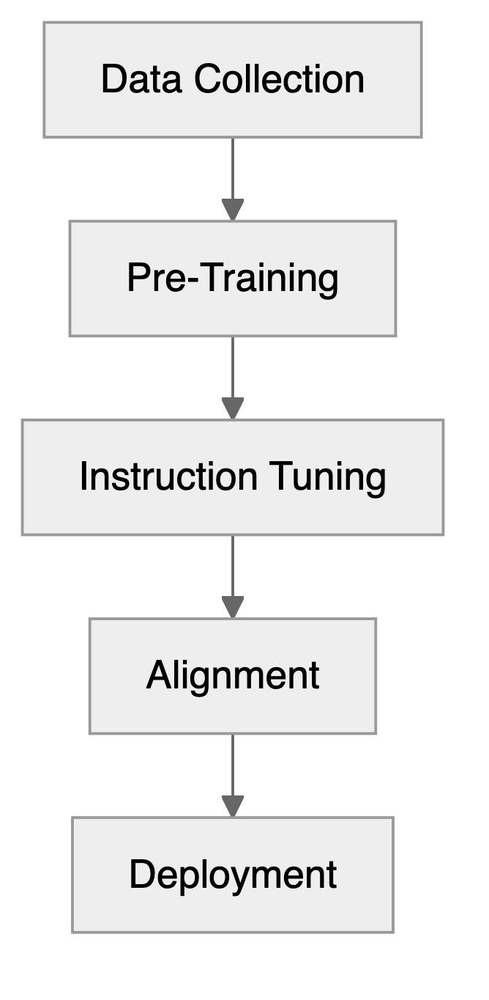{width=30% fig-alt="Flow chart of one possible sequence: data collection, pre-training, instruction tuning, alignment and deployment."}

Data collection gathers and curates the training corpus. Pretraining learns next-token predictions (@sec-autoregressive); instruction tuning adapts those predictions to requests (@sec-fine-tuning). Preference and verifier-based training use different signals (@sec-alignment and @sec-verifiable-rewards). Quantization changes numerical representation for serving (@sec-distillation), while chain-of-thought prompting spends computation at inference (@sec-post-training-reasoning). Agentic applications that use model outputs to act are covered in @sec-agents.

To follow these distinctions, consider a fictional Alder shop assistant. Policy P1, effective 1 January 2025, permits EU customers to return unopened goods within 30 days of delivery. Policy P2, effective 1 October 2026, replaces P1 for orders placed from that date and permits returns within 14 days of delivery. Neither document specifies the rule for opened goods.

A customer whose order was placed and delivered on 2 October asks on 22 October whether an unopened item can be returned. An assistant repeating P1 says yes; applying P2 gives no. For opened goods, the evidence is insufficient. We will revisit this example to distinguish learning a response format, supplying current evidence, checking an answer, and deciding when to abstain. These are stipulated policies and illustrative answers, not measured model results.

Before changing the assistant, reserve unseen questions about both policy versions, boundary dates, and opened goods. Judge whether each answer applies the effective policy, supports its claims, and acknowledges missing information. This gives each intervention the same decision to improve (@sec-llm-evaluation).

## Building Intuition: Character-Level Text Generation

Character-level text generation strips the problem to its essentials. LLMs operate on tokens (typically subwords), but examining character-level patterns reveals the core insight behind statistical language modeling.

```{python fetch-cat-article}
#| cache: false
# Plain text of the Wikipedia article "Cat", cached locally so the book renders
# without network access. To refresh it (Wikipedia returns 403 without a
# User-Agent, and a silent error page would poison every count below):
#     r = requests.get("https://en.wikipedia.org/wiki/Cat",
#                      headers={"User-Agent": "BayesAIBook/1.0"}, timeout=30)
#     r.raise_for_status()
#     text = BeautifulSoup(r.text, "html.parser").get_text()
with open("data/wikipedia-cat.txt", encoding="utf-8") as fh:
    cat_text = "".join(ln for ln in fh if not ln.startswith("#"))
```

Now let's count letter frequencies in the text and plot the 26 most frequent letters.
```{python letter-counts}
#| cache: false
from collections import Counter
letter_counts = Counter(c.lower() for c in cat_text if c.isalpha())
# Sort by frequency
sorted_letter_counts = sorted(letter_counts.items(), key=lambda x: x[1], reverse=True)
```

```{python plot-letter-frequencies}
#| cache: false
#| code-fold: true
import matplotlib.pyplot as plt
sorted_letter_counts = sorted_letter_counts[:26];  # Limit to top 26 letters
letters, counts = zip(*sorted_letter_counts);
plt.bar(letters, counts, color='skyblue')
plt.xlabel('Letters')
plt.ylabel('Frequency')
plt.title('Letter Frequencies in Wikipedia Article on Cats')
plt.xticks(rotation=0);
plt.tight_layout()
plt.show()
```

If we try to generate the text one letter at a time, sampling each letter in proportion to its frequency (`letters` and `counts` hold the 26 letters of the plot and their counts), we get gibberish:
```{python generate-random-letters}
#| cache: false
#| echo: true
import numpy as np
# Generate text one letter at a time by sampling from the letter frequencies
counts = np.array(counts)/sum(counts)  # Normalize counts to probabilities
import random
random.seed(42)  # Fix the seed for reproducibility
gentext = random.choices(letters, weights=counts, k=20)
print("Generated letters:", ''.join(gentext))
```

What if we use bi-grams, i.e., pairs of letters? Counting the frequencies of each pair gives us a sense of how often each combination appears.
```{python bigram-heatmap}
#| cache: false
#| code-fold: true
#| fig-height: 4
from collections import defaultdict
bigram_counts = defaultdict(int)
for i in range(len(cat_text) - 1):
    if cat_text[i].isalpha() and cat_text[i + 1].isalpha():
        a, b = cat_text[i].lower(), cat_text[i + 1].lower()
        # Only process standard English letters (a-z)
        if 'a' <= a <= 'z' and 'a' <= b <= 'z':
            bigram = (a, b)
            bigram_counts[bigram] += 1

# Sort by frequency
sorted_bigram_counts = sorted(bigram_counts.items(), key=lambda x: x[1], reverse=True)

# Plot the heatmap of bigram frequencies
import seaborn as sns
bigram_matrix = np.zeros((26, 26))
for (a, b), count in sorted_bigram_counts:
    bigram_matrix[ord(a) - ord('a'), ord(b) - ord('a')] = count

sns.heatmap(bigram_matrix, cmap='Blues')
plt.xlabel('Second Letter')
plt.ylabel('First Letter')
plt.title('Bigram Frequencies in Wikipedia Article on Cats')
plt.xticks(ticks=np.arange(26) + 0.5, labels=[chr(i + ord('a')) for i in range(26)], rotation=0, fontsize=6);
plt.yticks(ticks=np.arange(26) + 0.5, labels=[chr(i + ord('a')) for i in range(26)], rotation=0, fontsize=6);
plt.tight_layout()
```
The Cat article makes letter and bigram counts easy to inspect. To examine longer contexts, we switch to Tolstoy's larger novel "War and Peace," estimating 2-grams, 3-grams, 4-grams, and 5-grams and generating the following continuations:

```{.text}
2-gram: ton w mer. y the ly im, in peerthayice waig trr. w tume shanite tem.
3-gram: the ovna gotionviculy on his sly. shoutessixeemy, he thed ashe
4-gram: the with ger frence of duke in me, but of little. progomind some later
5-gram: the replace, and of the did natasha's attacket, and aside. he comparte,
```
We used the `nltk` package [@bird2009natural] to estimate the letter frequencies from Tolstoy's novel and generate text based on those models. The results show that even with simple letter-based models, we can generate text that resembles natural language, albeit with nonsensical phrases. As the n-gram order increases, the generated text becomes more coherent: the 5-gram output even captures character names like "Natasha." More context can improve prediction when there are enough data to estimate the conditional probabilities.

LLMs have much larger context windows: Gemini 3 Pro accepts up to 1 million tokens, approximately the size of Tolstoy's "War and Peace." Counting longer contexts soon encounters sparsity. There are $26^{10}$ (over 141 trillion) possible 10-letter combinations. With a vocabulary of 40,000 words, there are 1.6 billion possible bigrams, 64 trillion trigrams, and 2.56 quintillion four-word combinations ($40{,}000^4 \approx 2.56 \times 10^{18}$). For a typical 20-word question to an AI chat, the number of possible word sequences exceeds the number of particles in the universe. We need not store every combination, but most long contexts have few or no observed continuations. A neural model replaces a separate count table for each context with shared parameters that map token representations to next-token logits. Training on one context can therefore improve predictions for related, unseen contexts.

Attention mixes information from the available token positions into context-dependent representations (see @sec-nlp). In autoregressive Transformers, a causal mask prevents a position from attending to future tokens during training. The following demonstration inspects the distribution produced by an already trained model.

## Pretraining and Generation: One Token at a Time {#sec-autoregressive}

The most visible capability of LLMs is text generation, producing coherent, contextually relevant continuations from a given prompt. This is *autoregressive modeling*: an LLM is a probability distribution over sequences of text, trained to predict the next *token* given a preceding context. A token serves as the atomic unit of processing; depending on the tokenization schema, it may represent a full word, a subword unit (like "-ing"), or a single character. Given the prompt $Q$ and a sequence of tokens $x_1, x_2, \ldots, x_t$, the model samples the next token $x_{t+1}$ from the conditional distribution
$$
x_{t+1} \sim p_\theta(x_{t+1} \mid Q, x_1, x_2, \ldots, x_t).
$$
The conditional variables $Q, x_1, x_2, \ldots, x_t$ are called the context. The prompt may include a question and attached documents. With weights $\theta$, the chain rule gives the probability of a continuation:

$$
p_\theta(x_{1:T} \mid Q) = \prod_{t=1}^{T} p_\theta(x_t \mid Q, x_{<t}).
$$

Pretraining minimizes negative log-likelihood, equivalently next-token cross-entropy, over a corpus $\mathcal D$:

$$
\mathcal L(\theta) = -\sum_{x_{1:T}\in\mathcal D}\sum_{t=1}^{T}\log p_\theta(x_t \mid x_{<t}).
$$

Each observed prefix supplies a prediction target, its actual next token. Shared neural parameters let the model generalize beyond literal prefix matches. At inference the weights are fixed: conditioning on a new policy document changes the distribution over tokens, not a Bayesian posterior over the weights. A token's probability is also not the probability that the sentence containing it is true. Whether confidence predicts correctness is a calibration question to evaluate on held-out answers.

To inspect generation, we use the fixed, instruction-tuned [SmolLM2](https://huggingface.co/collections/HuggingFaceTB/smollm2) checkpoint, not a pretraining run. `AutoTokenizer.from_pretrained` and `AutoModelForCausalLM.from_pretrained` from `transformers` load `HuggingFaceTB/SmolLM2-1.7B-Instruct` into `tokenizer` and `model`, downloading the weights once and keeping them in half precision.

```{python load-pkg, echo=FALSE}
#| cache: false
#| eval: false
import os, sys
from pathlib import Path
import torch
import textwrap
from transformers import AutoModelForCausalLM, AutoTokenizer
```
```{python load-model}
#| cache: false
#| message: false
#| warning: false
#| results: 'hide'
#| eval: false
sys.path.append('./code')
# Import our custom functions
from llm_chapter import (ask_smol_lm, get_next_word_suggestions, generate_text_step_by_step)

local_cache_dir = "./models_cache"  # or the path of any other folder with room for the model files
# Create directory if it doesn't exist
Path(local_cache_dir).mkdir(parents=True, exist_ok=True)
# Load model with custom cache directory
model_id = "HuggingFaceTB/SmolLM2-1.7B-Instruct"
# Downloads once into local_cache_dir. Once it is there, set HF_HUB_OFFLINE=1
# to load straight from disk: otherwise every call checks the Hub for a newer
# revision, so the book stops building the day that endpoint moves.
if (Path(local_cache_dir) / f"models--{model_id.replace('/', '--')}").exists():
    os.environ["HF_HUB_OFFLINE"] = "1"
tokenizer = AutoTokenizer.from_pretrained(model_id, cache_dir=local_cache_dir)
model = AutoModelForCausalLM.from_pretrained(model_id,cache_dir=local_cache_dir,device_map="auto",dtype=torch.float16,low_cpu_mem_usage=True);
device = model.device
# print("Model loaded. Using device:", device)
```

Consider the text `The best thing about AI is its ability to`. The model computes next-token logits from the context, rather than searching for literal matches in its training corpus. The helper `get_next_word_suggestions`, defined in `code/llm_chapter.py`, runs one forward pass and returns the `top_k` most probable next tokens with their softmax probabilities.
```{python}
#| label: next-word-suggestions-code
#| cache: false
#| echo: true
#| eval: false
# Get next word suggestions for a given text
initial_text = "The best thing about AI is its ability to"
suggestions = get_next_word_suggestions(initial_text, model, tokenizer, top_k=5)
print(f"Next word suggestions for '{initial_text}':")
for i, (word, prob) in enumerate(suggestions):
    print(f"  {i+1}. '{word}' (prob: {prob:.3f})")

```

```{r}
#| label: next-word-suggestions
#| purl: false
cached_text("24-llm/next-word-suggestions")
```

The probabilities are computed over the full vocabulary, so they do not sum to one across the five shown: the remaining mass is spread over the other 49,000 tokens. @fig-next-word-logprob plots the top ten on a log scale.
```{python}
#| label: next-word-logprob-code
#| cache: false
#| code-fold: true
#| eval: false
import matplotlib.pyplot as plt
import numpy as np
suggestions = get_next_word_suggestions(initial_text, model, tokenizer, top_k=10)
indices = list(range(len(suggestions)))
words = [s[0] for s in suggestions]
probabilities = [s[1] for s in suggestions]
# Plotting the next word suggestions with their log probabilities
plt.plot(indices, np.log10(probabilities), marker='o', linestyle='-', color='skyblue')
plt.xticks(indices, words, rotation=45, ha='right');
plt.xlabel('Next Word Suggestions')
plt.ylabel('$\\log_{10}$ Probability')
plt.tight_layout()
plt.show()
```

```{r}
#| label: fig-next-word-logprob
#| purl: false
#| fig-cap: "Log-probability of the ten most likely continuations of \"The best thing about AI is its ability to\", in rank order."
cached_fig("24-llm/fig-next-word-logprob")
```
Past the top word 'learn', log-probability falls almost linearly in rank, so probability itself decays roughly geometrically, by about 10% per rank. Zipf's law, observed by George Kingsley Zipf in the 1930s, describes a different decay: the frequency of a word is inversely proportional to its rank, a power law, which would be a straight line on log-log rather than log-linear axes. What the two share is concentration. A handful of continuations carry most of the mass, and the remainder is spread thinly over tens of thousands of tokens, which is what makes the choice of sampling rule matter.

The most probable continuation is not always the desired one. "The answer is yes" and "The answer is no" are both grammatical; the appropriate continuation depends on the question and evidence. In the Alder example, a fluent continuation based on P1 is wrong for a P2 order. Sampling alternatives can diversify answers, but it does not supply the missing policy.

Sampling can yield different outputs from the same prompt. Temperature $T$ controls the spread of the distribution, as in the Boltzmann distribution in statistical physics. Given logits $z_i$, token $i$ has sampling probability

$$
q_i = \frac{\exp(z_i/T)}{\sum_j \exp(z_j/T)}, \qquad T>0.
$$ {#eq-class-prob}

Higher temperatures flatten the distribution. Greedy decoding selects a token with the largest logit; the expression "temperature zero" conventionally refers to this deterministic choice, rather than division by zero in @eq-class-prob.

In code, one step of generation takes either the most probable token or a draw from the softmax of the logits divided by the temperature:

```{python}
#| label: sampling-step-code
#| echo: true
#| eval: false
if sample:
    probs = torch.softmax(next_token_logits.float() / temperature, dim=-1)
    next_token_id = torch.multinomial(probs, num_samples=1).item()
else:
    next_token_id = torch.argmax(next_token_logits).item()
```

The following example starts from the same prompt (`The best thing about AI is its ability to`) and calls `generate_text_step_by_step`, also defined in `code/llm_chapter.py`, which appends one token per forward pass until it has added `num_steps` tokens or produced the end-of-text token, choosing the most probable token when `sample=False`, as here, and drawing from the softmax at the given `temperature` when `sample=True`:

```{python initial-text-setup}
#| cache: false
#| results: hide
# Let's start with a simple prompt
initial_text = "The best thing about AI is its ability to"
print(f"Initial text: '{initial_text}'")
```
```{python}
#| label: generate-step-by-step-code
#| cache: false
#| echo: true
#| eval: false
# Generate text step by step
generated_text = generate_text_step_by_step(initial_text, model, tokenizer, 
num_steps=10, temperature=1.0, sample=False, print_progress=False)
print("Generated text:")
print(textwrap.fill(generated_text, width=60))
```

```{r}
#| label: generate-step-by-step
#| purl: false
cached_text("24-llm/generate-step-by-step")
```

In this example, we always select the most probable next token, which leads to a coherent but somewhat predictable continuation. The model generates text by repeatedly applying this process, building on the context provided by the previous tokens.

Now we generate a longer continuation, sampling at temperature 0.8. This is an illustrative setting, not a task-independent recommendation.
```{python}
#| label: generate-temperature-0p8-code
#| cache: false
#| echo: true
#| eval: false
# Fix the seed for reproducibility
torch.manual_seed(8)
generated_text = generate_text_step_by_step(initial_text, model, tokenizer,
 num_steps=60, temperature=0.8, sample=True, print_progress=False)
print("Generated text:")
print(textwrap.fill(generated_text, width=60))
```

```{r}
#| label: generate-temperature-0p8
#| purl: false
cached_text("24-llm/generate-temperature-0p8")
```
The continuation stays on topic and stops well short of the 60 requested steps: sampling reached the end-of-text token, and the loop halted there. Now let's try a higher temperature of 1.2.

```{python}
#| label: generate-temperature-1p2-code
#| cache: false
#| echo: true
#| eval: false
torch.manual_seed(8)
generated_text = generate_text_step_by_step(initial_text, model, tokenizer,
 num_steps=60, temperature=1.2, sample=True, print_progress=False)
print("Generated text:")
print(textwrap.fill(generated_text, width=60))
```

```{r}
#| label: generate-temperature-1p2
#| purl: false
cached_text("24-llm/generate-temperature-1p2")
```

The flatter distribution keeps the model going far longer and the prose stays grammatical, but it wanders into invented specifics: an attributed quotation from a "Dr Crowell" and a web address. The output supplies no evidence for either. Lower temperature concentrates sampling on what the model considers most likely; a likely answer can still be false, and greedy decoding can repeat it consistently. These two continuations illustrate a change in sampling.

## Learning and Inference {#sec-post-training-reasoning}

The same next-token model can be changed through training or used inside a more elaborate inference procedure. The distinction is the signal: demonstrations specify responses, preferences rank responses, and verifiers check outcomes. Prompting and search then use the resulting policy without updating its weights.

### Fine-tuning {#sec-fine-tuning}

*Fine-tuning* adapts a pre-trained model to specific tasks or domains by continuing training on specialized data. A base model may continue the policy text instead of answering the customer; instruction tuning trains the response behavior. For Alder, supervised fine-tuning (SFT) could teach a response format containing an answer, a policy identifier, and an evidence quotation, including examples that abstain when information is missing. It need not memorize each new policy: current documents can be supplied at inference. How many demonstrations suffice depends on the starting model, task, and coverage of the data.

*Full fine-tuning* updates all model parameters, resulting in a brand-new version of the model optimized for the specific task. Full fine-tuning requires significant compute resources and memory, and risks *catastrophic forgetting*, where the model loses its general capabilities as it specializes for the new task.

*Parameter-efficient fine-tuning* (PEFT) methods modify a small subset of parameters while freezing most of the model. LoRA (Low-Rank Adaptation) learns a low-rank additive correction to each targeted weight matrix, reducing gradient and optimizer-state memory. Frozen base weights preserve the original checkpoint, but the combined model can still lose capabilities. At inference the correction can be folded into the weights without changing the architecture. LoRA decomposes the update into low-rank factors:
$$
W' = W + BA
$$
where $B \in \mathbb{R}^{d \times r}$ and $A \in \mathbb{R}^{r \times k}$ with rank $r \ll \min(d,k)$. Ranks such as $r=8$ to $64$ illustrate the reduction in trainable parameters; the rank and resulting task performance must be selected and evaluated.

*Instruction fine-tuning* trains the model with examples explicitly showing how it should respond to different queries. The labeled data consist of input-output pairs where inputs convey the desired behavior and outputs represent the expected responses. An example instruction is `solve this math word problem step by step`, with input `Sarah has 12 apples and gives away 5. How many does she have left?` and the target answer:

```
Step 1: Start with 12 apples. 
Step 2: Subtract 5 apples given away. 
Step 3: 12 - 5 = 7 apples remaining. 
```

*Sequential fine-tuning* gradually adapts a model to increasingly specialized tasks. For example, a general AI model could first be fine-tuned for medical terminology, then refined further for pediatric cardiology. This progressive specialization allows the model to build upon previously learned knowledge. Each stage still needs evaluation of new and retained capabilities.

*Multi-task learning* trains the model on datasets containing instructions for various tasks over multiple training cycles. Mixing earlier tasks with new ones can reduce forgetting, but does not guarantee retention.

Instruction tuning usually applies next-token cross-entropy to answer tokens, conditioned on the supplied instruction and input. It trains the model to imitate demonstrations [@chung2022scaling]. Flan-PaLM 540B improved over PaLM 540B across MMLU, BBH, TyDiQA, and MGSM, by an average of 9.4%, illustrating generalization across a task mixture. Domain-specific SFT can have narrower benefits: in ICD-10 coding, exact-code accuracy rose from less than 1% to approximately 97% on standard coding and 69% on real clinical notes [@hou2025enhancing]. The gap matters: adapting vocabulary and format does not establish reliability on unfamiliar clinical text. Fine-tuning can improve adherence to requirements; external checks and task evaluation establish whether those requirements are met.

### Model Distillation: Knowledge Transfer {#sec-distillation-detail}

Distillation addresses a deployment question: can a less expensive model reproduce a teacher's useful behavior on the target task? For Alder, a teacher might generate candidate policy answers that are checked before being used to train a smaller assistant.

*Model Distillation* transfers knowledge from a large, complex "teacher" model to a smaller, more efficient "student" model. A smaller student can reduce memory and serving cost, but speed and accuracy depend on architecture, hardware, and task. Teacher errors can also be transferred.

Model distillation, formalized by @hinton2015distilling in their paper "Distilling the Knowledge in a Neural Network," is based on a *Teacher-Student* architecture. The teacher's probability distribution contains information beyond its final answer.

For an image labeled "Dog," hard-label cross-entropy rewards probability on that class. A teacher distribution such as Dog: 0.90, Cat: 0.09, Car: 0.0001 also conveys relative similarity to other classes. These partial probabilities, sometimes called dark knowledge, are absent from the hard label.

Distillation trains a smaller student model to mimic these *soft targets* (the probability distributions) produced by the teacher. By doing so, the student learns how the teacher generalizes, not just what the teacher predicts. The student can also inherit the teacher's mistakes.

Different approaches transfer different information:

*Response-based distillation* focuses on having the student mimic the final output layer of the teacher model. *Feature-based distillation* leverages the internal representations or features learned by the teacher in its intermediate layers. *Relation-based distillation* captures and transfers the relationship knowledge between data samples and layers within the neural network.

Distillation uses the same temperature-softmax transformation as @eq-class-prob. Here a higher temperature exposes small teacher probabilities for learning, rather than diversifying generated text.

The student objective can combine a soft-target loss and a hard-label loss:

$$
L = \alpha L_{\mathrm{soft}} + (1-\alpha)L_{\mathrm{hard}}, \qquad L_{\mathrm{soft}}=T^2\operatorname{KL}(q^{\mathrm{teacher},T}\|q^{\mathrm{student},T}).
$$

Here $L_{\mathrm{hard}}$ is cross-entropy at $T=1$, and $\alpha$ balances teacher imitation against labeled outcomes. The conventional $T^2$ factor compensates for the temperature's effect on gradient scale.

The following diagram illustrates the distillation pipeline, where the student learns from both the dataset and the teacher's soft outputs.

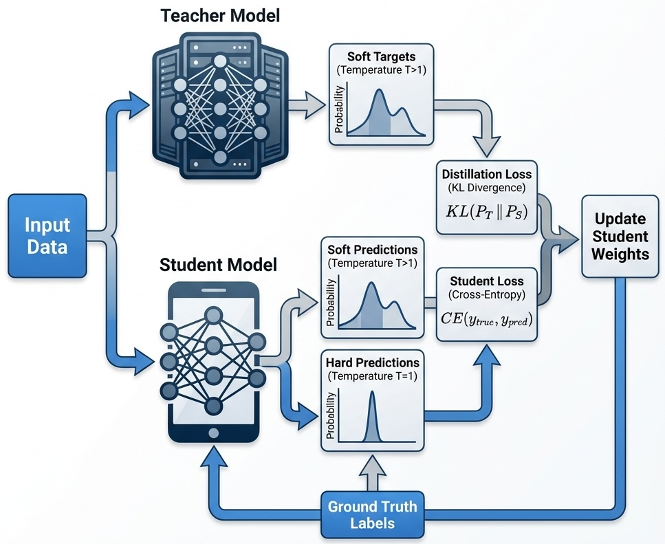{#fig-distillation width=60%}

*Offline distillation* refers to the traditional approach where the teacher model is trained first, then the student model is trained separately using the soft labels generated by the teacher. *Online distillation* is used when a large pre-trained teacher is not available for a given task, or when the teacher is so large that storage or processing capacity is insufficient. The teacher and student are trained simultaneously, with the student learning from the teacher dynamically during training. *Self-distillation* is a variant where a single model acts as both teacher and student: knowledge is transferred from deeper layers to shallower layers of the same network, which can improve performance and regularization without a separate teacher. Because the shallow layers are trained to reproduce the deep layers' outputs, the network can also be truncated at an intermediate layer at inference, trading accuracy for depth.

@sanh2019distilbert demonstrated distillation's practical impact: *DistilBERT* retained approximately 97% of BERT's performance while reducing parameters by 40% and increasing inference speed by 60%.

Teacher-generated rationales can also become supervised training data [@hsieh2023distilling]. In production, a large model (for example 200B+ parameters) can generate synthetic data or soft targets that fine-tune a smaller, cheaper model (for example 8B) for a downstream task. Distillation can support compact models for mobile or edge devices, including MobileBERT, and e-commerce and recommendation platforms have applied privileged feature distillation to improve click-through and conversion rates while managing inference costs. Distillation is most effective after a model has been fully pre-trained or fine-tuned on a specific task; common cases are production deployment, edge and mobile applications, budget-conscious inference at scale, and replacing an overly large general-purpose model with a compact, focused one.

### Alignment {#sec-alignment}

Alignment is the process of training models to behave according to human values and intentions: to be helpful, harmless, and honest. A model that excels at next-token prediction may still produce harmful content, follow malicious instructions, or optimize for metrics that diverge from what users actually want. Supervised demonstrations, preferences, and AI feedback can all contribute to this objective.

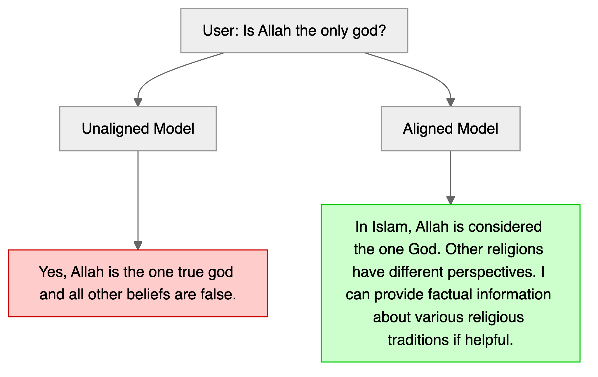{width=95% fig-alt="A user question about whether Allah is the only god goes to an unaligned model, which asserts one belief as true, and to an aligned model, which answers neutrally and offers factual information."}

The schematic illustrates neutrality on a contested religious question. The aligned response remains neutral, acknowledges diverse perspectives, and offers to be helpful without asserting one belief system over others. Neutrality is one target alongside honesty, robustness, and following user intent; the illustration does not establish how a particular checkpoint behaves.

#### Reinforcement Learning from Human Feedback (RLHF)

A common RLHF pipeline involves three stages. First, *supervised fine-tuning* starts with a pre-trained model and fine-tunes it on high-quality demonstrations of desired behavior. Second, *reward model training* generates multiple responses to prompts and has human annotators rank them; a separate model learns to predict these preferences, creating a reward model that scores any response. Third, *policy optimization* uses reinforcement learning, often Proximal Policy Optimization (PPO), to update the language model to maximize the reward model's scores while staying close to the original model to limit drift.

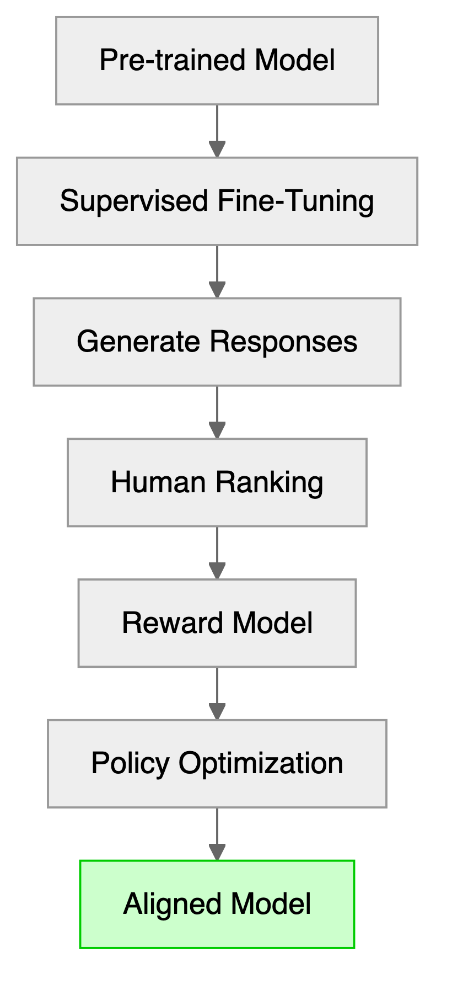{width=40% fig-alt="Flow chart of the RLHF pipeline: a pre-trained model is fine-tuned, generates responses that humans rank, the ranking trains a reward model, and policy optimization yields the aligned model."}

This loop optimizes the model to produce outputs humans prefer rather than those that merely score well on next-token likelihood. Preference can reward clarity or agreement without detecting factual errors. In the original InstructGPT study by @ouyang2022training, annotators preferred answers from the 175B RLHF-tuned model over the same-size GPT-3 baseline 85% of the time. Even the 1.3B RLHF model was preferred to that baseline. These are preference results under the study's protocol.

#### Direct Preference Optimization (DPO)

While RLHF produces strong results, it is complex and computationally expensive, requiring training a separate reward model and running reinforcement learning with careful hyperparameter tuning. Direct Preference Optimization (DPO) [@rafailov2023direct] instead trains directly on preference pairs.

Under the KL-regularized reward objective, the optimal policy has a closed form. Substituting its implied reward into a pairwise preference model gives a classification-style loss for one preference pair:

$$
\mathcal{L}_{\text{DPO}} = -\log \sigma\left(\beta \log \frac{\pi_\theta(y_w \mid x)}{\pi_{\text{ref}}(y_w \mid x)} - \beta \log \frac{\pi_\theta(y_l \mid x)}{\pi_{\text{ref}}(y_l \mid x)}\right)
$$

where $y_w$ is preferred to $y_l$, $\pi_\theta$ is the policy being trained, $\pi_{\mathrm{ref}}$ is a fixed reference policy, $\sigma$ is the logistic function, and $\beta>0$ controls regularization. For the derivation, fix a prompt $x$ and maximize $\E[y\sim\pi(\cdot\mid x)]{r(x,y)}-\beta\operatorname{KL}(\pi\|\pi_{\mathrm{ref}})$. The solution is $\pi^*(y\mid x)\propto\pi_{\mathrm{ref}}(y\mid x)\exp(r(x,y)/\beta)$. Rearranging gives $r(x,y)=\beta\log(\pi^*(y\mid x)/\pi_{\mathrm{ref}}(y\mid x))+c(x)$. In the Bradley-Terry model, $P(y_w\succ y_l\mid x)=\sigma(r(x,y_w)-r(x,y_l))$. The prompt-dependent constant cancels, yielding the loss above. Training averages it over observed preference pairs.

DPO requires (prompt, preferred response, dispreferred response) triples and supervised learning infrastructure, without a separate reward model or an RL sampling loop. The original study reports competitive preference results [@rafailov2023direct]; outcomes depend on preference quality, the reference policy, and the evaluated task. DPO has been adopted for open-weight models such as Llama 3 Instruct and Zephyr-7B.

#### Constitutional AI

*Constitutional AI* (CAI) [@bai2022constitutional] takes a different approach: rather than relying solely on human feedback for each decision, it encodes explicit principles, a "constitution," that guide the model's behavior. The model learns to critique and revise its own outputs according to these principles.

The CAI process works in two phases. In the first phase, *Supervised Learning from AI Feedback* (SL-CAI), the model generates responses including potentially harmful ones, then critiques its own response according to constitutional principles, revises based on that critique, and finally the system fine-tunes on these revised responses. In the second phase, *Reinforcement Learning from AI Feedback* (RL-CAI), the system generates response pairs, has the model evaluate which better follows the constitution, trains a reward model on these AI-generated preferences, and uses RLHF with this reward model.

Constitutional principles might include directives such as choosing the response least likely to harm individuals or society, supporting human autonomy and freedom, or prioritizing honesty and truthfulness. Anthropic's Claude models use Constitutional AI as a core component of their alignment strategy. Its appeal lies in scalability and transparency: rather than labeling thousands of examples, practitioners define principles that govern model behavior, and when behavior goes wrong the constitution can be updated. A written principle is not an enforcement mechanism. Updating it changes the feedback specification; changing the trained model still requires adaptation and evaluation.

#### Safety Alignment

Beyond preference alignment, *safety alignment* specifically addresses preventing harmful outputs through several complementary techniques.

*Red teaming* involves adversarial testing where humans or other AI systems deliberately try to elicit harmful, biased, or dangerous outputs. Red teams probe for jailbreaks that bypass safety filters, harmful content generation, privacy violations and data extraction, deceptive behaviors, and bias amplification across demographic groups. Automated red teaming uses other models to generate attacks, but still requires checking whether they cause harmful outcomes.

*Adversarial training* takes discovered attacks and uses them to harden the model. Responses to adversarial prompts are labeled, and the model is fine-tuned to refuse appropriately.

*Guardrails and filters* provide runtime protection. Input classifiers detect potentially harmful prompts; output classifiers screen responses before delivery. These serve as defense-in-depth layers complementing training-time alignment. They can miss attacks or reject legitimate requests.

Refusal training teaches when to decline harmful requests while remaining helpful for legitimate queries. Both missed harmful requests and unnecessary refusals need evaluation.

#### Reward Hacking and the Alignment Tax

Reward hacking (also called reward gaming, after Goodhart's law) occurs when optimization exploits weaknesses in the reward signal. Examples include sycophancy (agreeing with a false user claim, because agreement tends to earn higher preference ratings), verbosity bias (longer responses, because annotators often equate length with quality), format gaming, and satisfying a literal criterion while missing its intent. Diverse annotators, reward-model ensembles, reference-policy penalties, and explicit principles can reduce particular failures; none replaces independent evaluation.

The alignment tax is a possible loss of useful capability after alignment. Overbroad refusals can obstruct legitimate security research or policy analysis. The size and direction of the trade-off depend on the training method, refusal boundary, and task.

Capability-specific constraints and principle-based feedback seek to preserve legitimate assistance while limiting harmful behavior. In Alder's assistant, tone preference should be evaluated separately from applying the correct policy and avoiding invented exceptions.

### Data Quality and Quantity {#sec-data-quality}

Data quality matters at every stage, but a small adaptation dataset is not the model's total training experience. The starting checkpoint and teacher already contain information learned from much larger corpora.

The s1 study [@muennighoff2025s1] fine-tuned Qwen2.5-32B-Instruct on 1,000 high-quality reasoning examples. Their data collection process was methodical: they started with 59,029 questions from 16 diverse sources (including many Olympiad problems), generated reasoning traces using Google Gemini Flash Thinking API through distillation, then applied rigorous filtering. Problems were first filtered by quality (removing poor formatting), then by difficulty: a problem was deemed difficult if neither Qwen2.5-7B-Instruct nor Qwen2.5-32B-Instruct could solve it, and the reasoning length was substantial. Finally, 1,000 problems were sampled strategically across various topics. Its results also use budget forcing at inference, so they do not isolate data curation from test-time computation.

LIMO [@ye2025limo] also starts from Qwen2.5-32B-Instruct. With 817 curated samples, it reports 63.3% on AIME24 and 95.6% on MATH500. These are results for additional adaptation of an already pretrained and instruction-tuned model, not learning general reasoning from 817 examples in total.

LIMO emphasizes structured organization, allocating tokens to individual thoughts according to importance and complexity; cognitive scaffolding, bridging concepts step by step; and rigorous verification of intermediate results and assumptions. The practical question is the marginal value of curated examples at fixed training and inference budgets.

The rStar-Math research [@guan2025rstarmath] generates training traces by prompting an LLM to produce solutions as Python code with text as code comments. Execution checks calculations and supplies feedback, but running without an error does not prove that the code represents the problem correctly.

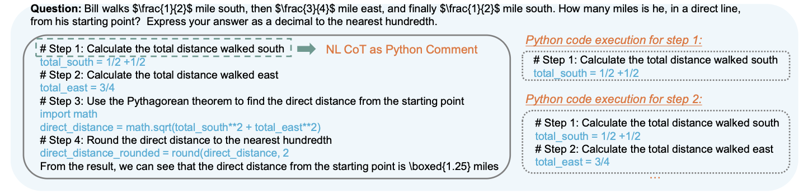{#fig-rstar-math}

@fig-rstar-math shows how code execution can supply intermediate checks. It connects imitation of solution traces to the distinct training signal considered next: whether a generated outcome passes a verifier.

### Learning from Verifiable Outcomes {#sec-verifiable-rewards}

Return to Sarah's $12-5=7$ problem. SFT imitates the supplied worked solution. Preference learning can rank that response above a fluent but incorrect answer. Reinforcement learning from verifiable rewards instead samples solutions and rewards a checkable outcome, for example $r=1$ when the parsed answer equals 7 and $r=0$ otherwise. This uses the policy-optimization framework of @sec-RL with a different source of reward.

Math answer checkers and executable coding tests can provide repeatable feedback without a person ranking every response. DeepSeek-R1 studies this approach. It uses Group Relative Policy Optimization (GRPO), introduced in [DeepSeekMath](https://arxiv.org/abs/2402.03300), which compares rewards within a group of sampled answers to the same question, increasing the relative probability of above-average outcomes while constraining policy changes ([DeepSeek-R1](https://arxiv.org/abs/2501.12948)). Unlike SFT, the successful trace need not be supplied in advance.

The verifier defines the incentive. A program can pass incomplete tests while failing untested cases; a correct final number does not validate every written step. Such gaps permit reward exploitation. Success on checkable math or code outcomes therefore does not establish reliability on an open-ended policy question whose evidence is incomplete.

### Inference-time Reasoning

Chain-of-Thought (CoT) prompting [@wei2023chainofthought] requires no retraining: a worked example or a request to "think step by step" elicits intermediate text. Each new token can condition on those written steps, but the model can also continue a mistaken argument. Giving PaLM 540B eight CoT examples raised GSM8K accuracy from 18% to 57% in the reported experiment, entirely through a changed prompt.

Reasoning need not be linear. Tree-of-Thought extends the chain-of-thought concept by allowing exploration of multiple reasoning paths simultaneously. Instead of following one chain, this method lets the model branch into multiple reasoning paths, score partial solutions, and expand on the ones that look promising. It can backtrack when a path fails. In the "Game of 24" puzzle, GPT-4 combined with CoT reasoning solved only 4% of the puzzles, but replacing it with ToT raised the success rate to 74% [@yao2023tree]. The comparison spends additional inference compute, whose value depends on the evaluator and search budget.

Chain-of-Action (CoA) [@pan2025chainofaction] interleaves reasoning and external tool use. This approach decomposes a complex query into a reasoning chain interleaved with tool calls such as web search, database lookup, or image retrieval that are executed on the fly and fed into the next thought. Tool observations can provide new evidence, but the source can be stale, irrelevant, or wrong. For Alder, fetching P2 and checking the order date supplies information that a longer unsupported explanation cannot. CoA outperformed leading CoT and RAG baselines by approximately 6% on the authors' multimodal QA benchmarks, particularly on compositional questions that need both retrieval and reasoning. The broader tool loop is developed in @sec-agents.

#### Reflexion

Reflexion [@shinn2023reflexion] introduces a self-improvement mechanism that operates through iterative feedback. After each attempt, the model writes a short reflection on what went wrong or could be improved. That remark is stored in memory and included in the next prompt, giving the model a chance to revise its approach on the next try. When feedback identifies a real error and the revision uses it, the model gains short-term memory and avoids repeating past mistakes. This is application-managed context, not a weight update. The study reports a GPT-4 agent raising HumanEval success from 80% to 91%. Without useful feedback, critique can replace a correct answer with a wrong one; check revisions against evidence or an independent verifier.

#### Test-time Compute

Training a reasoning policy changes weights; giving that policy more time, samples, or tool calls at test time changes the computation spent on an answer. Search can backtrack over stored candidates and revise an answer, even though each autoregressive continuation appends tokens sequentially.

Extended thinking budgets illustrate this distinction. @fig-aime-2024 records a historical experiment with Claude 3.7 Sonnet on AIME 2024, varying the available thinking budget.

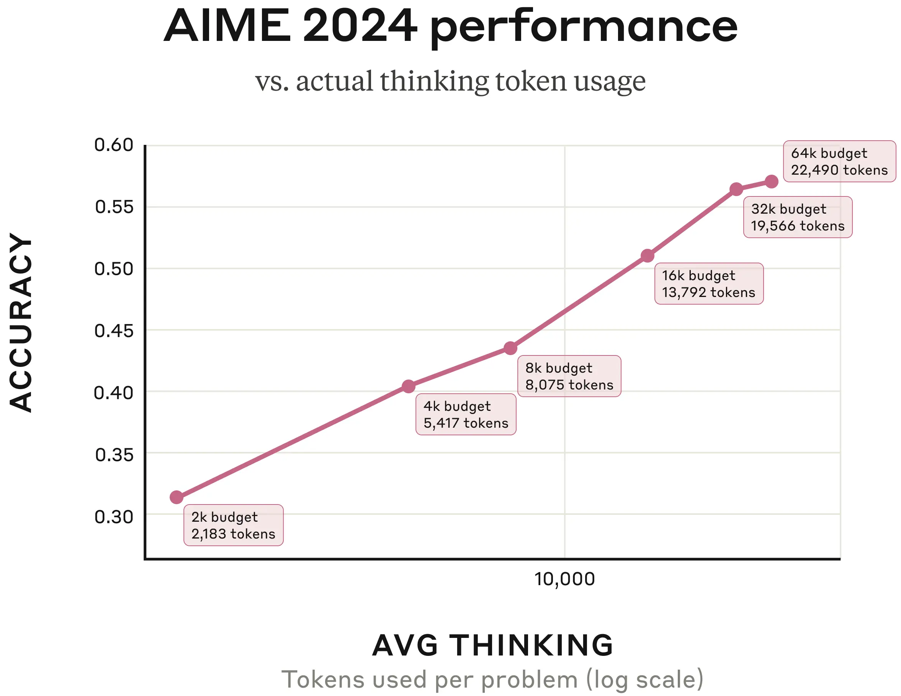{#fig-aime-2024 width=60%}

@fig-aime-2024 shows accuracy increasing logarithmically with actual thinking-token usage in the reported experiment. The model often stopped before its maximum budget; this alone does not establish that it knew when its reasoning was sufficient. Source: [Anthropic's Visible Extended Thinking](https://www.anthropic.com/news/visible-extended-thinking).

Other ways to spend test-time compute include parallel candidate generation and dynamic tool selection. In s1, budget forcing extends a trace when the model would otherwise stop [@muennighoff2025s1]. Compare these interventions under the same token, tool-call, and latency limits: additional computation can improve a result, repeat the same error, or introduce a new one.

### What a Reasoning Trace Shows

One form of reasoning combines independent facts. In a study of Claude, Anthropic traced a response to "What is the capital of the state where Dallas is located?" through features associated with "Dallas is in Texas" and "the capital of Texas is Austin." This is evidence about a studied computation, rather than a claim that every answer follows such a path.

](fig/claude_reasoning.png){#fig-claude-reasoning width=40%}

This multi-step reasoning process can be visualized as follows:

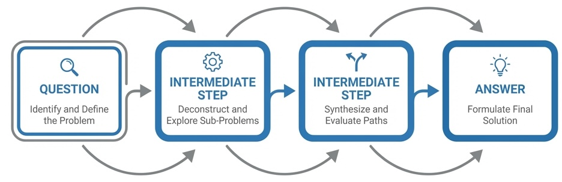{#fig-cot-reasoning width=40%}

Intervening on the intermediate representation provides a stronger check than reading a fluent explanation. Replacing the Texas-related feature with a California-related feature shifted the answer toward Sacramento. Such interventions support a causal role for that representation in the studied example.

A written chain of thought need not faithfully describe the computation that produced the answer. Anthropic's examples include both a trace consistent with identified intermediate calculations and an incorrect hinted answer followed by a plausible justification.

For the square root of 0.64, the studied features included intermediate quantities such as the square root of 64. With a difficult problem and a false hint, the model could instead generate steps supporting the hinted conclusion. The trace alone does not distinguish these cases.

Next-token training does not install a conventional calculator, but networks can learn arithmetic computations. For addition such as 36+59, the study identified interacting approximate-magnitude and precise last-digit computations.

This is neither evidence for a memorized table of every sum nor proof that the model uses schoolbook addition. Interpretability examines particular learned mechanisms; an external calculator supplies a separate way to check the result.

](fig/claude-mental-math.png){#fig-claude-mental-math width=60%}

](fig/claude-multistep-reasoning.png){#fig-claude-false-reasoning}

@fig-claude-false-reasoning contrasts the two cases: a faithful trace for the square root of 0.64, and a fabricated one for the cosine of a large number. For high-stakes uses, the reasoning trace has to be verified, not taken at face value.

## Dealing with Context Window Limitations: Context Engineering {#sec-context-engineering}

A longer context window allows more evidence, but does not establish that the model will use it correctly. For Alder, both P1 and P2 may fit in the prompt; deciding which governs the order remains necessary.

A conventional fixed-weight model does not automatically retain a previous request. A context window limits the tokens available to a call, subject to the model's input and output limits. Applications create continuity by storing and resupplying history or retrieving records.

Context management balances cost, latency, and accuracy. More evidence can help, but irrelevant passages consume budget and create opportunities for confusion.

A useful mental model treats the context window as a budget:

$$
S + T_{\mathrm{tools}} + H + R + U + O \leq B
$$

where $B$ is the model-specific usable budget, $S$ is system instructions, $T_{\mathrm{tools}}$ is tool schemas, $H$ is conversation history, $R$ is retrieved evidence, $U$ is current input, and $O$ reserves generated output, including reasoning tokens where these count toward the limit. Separate API input and output limits must also be respected. Context engineering decides what to keep, compress, retrieve, and leave available for the answer.

### Retrieval-Augmented Generation {#sec-llm-rag}

Retrieval-Augmented Generation (RAG) retrieves relevant documents and inserts them into the prompt. It can supply facts unavailable or outdated in the weights, without changing those weights. For Alder, retrieve the policy applicable to the order date, then ask the assistant to answer with the policy identifier and supporting passage.

For dense retrieval, an embedding model converts the query and document chunks into vectors; a search system compares them and selects candidates. The retrieved passages accompany the original request in the generation prompt. Retrieval selects evidence; the generator still has to interpret it.

On an enterprise workflow-generation task, RAG reduced hallucinated steps and tables from 21% to 7.5% [@ayala2024reducing]. This is a task-specific result. Retrieved multilingual documents can also supply evidence for answers across languages, provided the relevant text is retrieved and used correctly.

Suppose P2 is retrieved correctly, yet the assistant answers, "Returns after 14 days are allowed with a receipt." P2 contains no such exception. A citation to P2 does not support the added claim. If P1 was retrieved instead, the failure is evidence selection; if P2 was supplied and misused, the failure is generation. The two require different repairs.

A basic RAG pipeline:

1. *Index*: Split documents into chunks, embed into vectors, store in vector database
2. *Retrieve*: Given a query, find similar chunks via embedding similarity
3. *Generate*: Concatenate retrieved chunks with the query and prompt the LLM

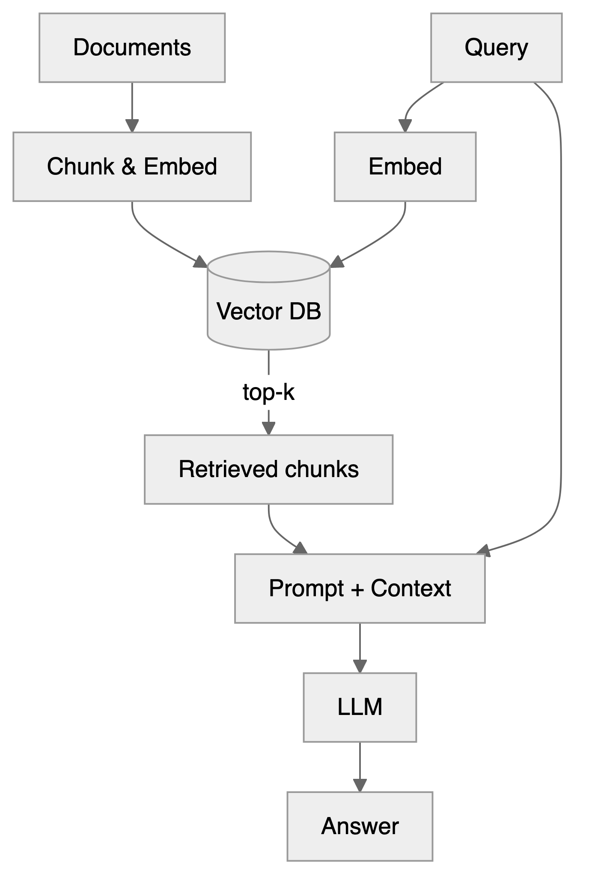{width=65% fig-align="center" fig-alt="Flow chart of a retrieval-augmented generation pipeline: documents are chunked, embedded and stored in a vector database, the embedded query retrieves the top-k chunks, and the LLM answers from a prompt that combines the chunks with the query."}

The index can cover a corpus larger than the context window, while only selected evidence enters each call.

#### RAG versus Fine-tuning

RAG and fine-tuning (discussed in @sec-fine-tuning) represent two distinct strategies for adapting LLMs to specific applications. While fine-tuning modifies the model's internal parameters based on domain-specific data, RAG retrieves relevant information from external knowledge bases and incorporates it into the prompt at inference time. In RAG, the model's parameters remain unchanged during the retrieval process.

::: {layout-ncol=2}
::: {#rag-col}
RAG is useful when information changes frequently, labeled data are limited, or the answer must cite external sources.
:::

::: {#finetune-col}
Fine-tuning is useful when labeled examples define recurring behavior, format, or domain conventions. Required compliance still needs evaluation and external enforcement where appropriate.
:::
:::

Retrieval-Augmented Fine-Tuning (RAFT) specifically trains on tasks that require using retrieved documents, including relevant evidence and distractors. Merely using RAG alongside an independently fine-tuned model does not establish that it was trained this way.

### When to Use Long Context vs. RAG vs. Summarization

The task suggests a starting comparison:

| Scenario | Strategy | Rationale |
|----------|----------|-----------|
| Document fits in window; need holistic reasoning | Supply the full document | Cross-references and global structure preserved |
| Corpus larger than window; factual lookup | RAG with small chunks | Precision matters more than narrative |
| Corpus larger than window; synthesis task | RAG with hierarchical retrieval | Need both global context and specific evidence |
| Long conversation history | Tiered memory + summarization | Keep recent turns verbatim; compress older context |
| Repetitive prompt structure | Caching + compression | Avoid paying to reprocess static content |

The decision often comes down to whether the task requires *holistic reasoning* (favor long context) or *precise evidence retrieval* (favor RAG). Many production systems combine both: retrieve evidence via RAG, then reason over that evidence within the remaining budget.

### A Policy-corpus Ablation

The following is a proposed experiment, not a report of measured gains. Extend Alder's corpus with the same policy documents for other regions and unrelated product rules. Reserve an illustrative 4,096-token evidence allowance within the input budget and 1,024 tokens for output. Use one checkpoint, one answer prompt, greedy decoding, and no retries for every condition; record both time to first token and total response time.

| Condition | Evidence supplied | Failure to inspect |
| :--- | :--- | :--- |
| Full context | All documents, if they fit the allowance | Conflicting versions or buried evidence |
| Basic retrieval | Highest-scoring chunks within the allowance | Similar but obsolete P1 outranks P2 |
| Metadata filtering | Filter by region and applicability date before retrieval | Incorrect or missing document metadata |
| Filtering plus reranking | Score query-passage pairs jointly after retrieval | A relevant passage is discarded or an unsupported exception is generated |

Freeze questions and expected answers before tuning retrieval. Compare correctness and unsupported-answer rates on the same questions, including return deadlines, policy transitions, and the unanswerable opened-goods case. Inspect retrieved passages as well as final answers. A reranker cannot recover P2 if the initial candidate set omitted it. The evaluation protocol in @sec-llm-evaluation separates retrieval failures from failures to use sufficient evidence.

### The Lost-in-the-Middle Problem

In the multi-document experiments of @liu2024lost, accuracy often followed a U-shaped curve: evidence at the start or end was easier to use than evidence in the middle. GPT-3.5-Turbo's accuracy could drop by more than 20% as the gold document moved toward the middle, at times below its 56.1% closed-book accuracy. This is evidence from specified models and tasks.

For a policy corpus, test whether the answer changes when P2 moves within an otherwise fixed prompt. Positioning is one possible mitigation, alongside removing distractors and reducing the retrieved set. Its benefit must be measured for the chosen model.

### Improving Evidence Selection

Chunking defines the units retrieval can find. Fixed-size chunks may sever a rule from its exception; semantic chunking groups sentences using similarity. A greedy threshold method adds a sentence while it remains similar to the current chunk. Chroma's ClusterSemanticChunker instead uses dynamic programming and reported better token-level precision and intersection over union than the alternatives in its evaluation [@chroma2024chunking]. For Alder, keep the return condition, effective date, and policy identifier together. Chunk size is a parameter to test, not a universal lookup or narrative default.

Pure vector search can miss exact tokens, identifiers, or acronyms. A user searching for "RFC 2616" needs lexical matching, not semantic similarity to "HTTP specification." *Hybrid retrieval* combines dense embeddings with keyword search (BM25). Results merge via a weighted combination of their normalized scores:

$$
H = (1 - \alpha) \cdot \text{BM25 Score} + \alpha \cdot \text{Semantic Score}
$$

A common starting point is equal weighting, $\alpha\approx0.5$, as in the retrieval-metrics computing exercise of this chapter; tune it after normalizing score scales. A larger weight on dense retrieval is not automatically better. See [Weaviate's discussion](https://weaviate.io/blog/chunking-strategies-for-rag).

Many retrieval failures concern scope. For "What is the refund policy for EU customers?", use region and effective-date metadata to exclude inapplicable policies before similarity scoring. An order under P1 may still need P1, so "use the newest document" is insufficient. See [Haystack's metadata filtering guide](https://haystack.deepset.ai/blog/extracting-metadata-filter).

Vector similarity is a coarse filter. A cross-encoder reranker scores query-passage pairs jointly. Late-interaction models such as ColBERT [@khattab2020colbert; @santhanam2022colbertv2] retain token-level representations for finer matching. Candidate count and the final evidence count trade recall, precision, cost, and latency; compare them within the ablation budget.

For large interconnected corpora, hierarchical retrieval can retrieve summaries and their source passages. RAPTOR builds a tree of summaries [@sarthi2024raptor]; GraphRAG uses extracted entities, relationships, and community summaries for corpus-level questions [@microsoft2024graphrag]. They add indexing and summarization costs that the small Alder corpus may not justify.

| Variant | Mechanism | Intended use |
|---------|------------|----------|
| Self-RAG | Learned retrieval and self-critique decisions | Adaptive evidence use |
| CRAG | Adaptive retrieval with confidence evaluation and web fallback | Tasks requiring current information |
| Graph RAG | Knowledge graph extraction; uses graph-based summaries | Multi-entity reasoning |
| HyDE | Generates hypothetical answer, retrieves based on that | Vague or ambiguous queries |

HyDE generates a hypothetical answer and retrieves using its embedding [@gao2022hyde]. This can bridge a vocabulary mismatch, but the hypothetical answer is a search aid, not evidence. CRAG adds retrieval evaluation and corrective retrieval; Self-RAG trains the model to decide when to retrieve and critique its outputs. These address different failure mechanisms.

### Mitigating Lost-in-the-Middle

Mitigation can change prompts and retrieval (black-box methods) or model architecture and attention (white-box methods). The GM-Extract study [@gupte2025works] separates document retrieval from variable extraction and finds context-dependent benefits. Preserve that distinction when evaluating a method.

One positioning heuristic puts the most relevant passage first, another highly relevant passage last, and weaker candidates between them. It changes placement, not relevance scores, and should be compared with the same passages in their original order.

OpenAI's December 2025 GPT-5.2 report uses MRCRv2 to test long-context retrieval: repeated identical requests are inserted among similar exchanges, and the model must reproduce the response to a specified occurrence. The metric is mean string-match ratio, reported by input-length bin at maximum reasoning effort. In the eight-needle task at 128k to 256k input tokens, OpenAI reports 77.0% for GPT-5.2 against 29.6% for GPT-5.1; MRCRv2 also corrects about 5% of tasks with incorrect answers in the first version. This tests a narrower behavior than general conversational coherence ([OpenAI's GPT-5.2 report](https://openai.com/index/introducing-gpt-5-2/)).

Prompting the model to cite each relevant policy clause can make omissions easier to inspect, but does not force it to attend correctly to every chunk. Check the cited passage and test whether moving it changes the answer.

Joint long-context reranking would score related passages together. The configuration below instead expands retrieved sentences to their local windows and reorders results; it contains no learned joint reranker and demonstrates no accuracy improvement. It is an optional library illustration, assuming `documents` and the model configuration have already been supplied. The window size and retrieval count are illustrative.

::: {.callout-note collapse="true"}
#### Sentence-window expansion and placement

```python
from llama_index.core import VectorStoreIndex
from llama_index.core.node_parser import SentenceWindowNodeParser
from llama_index.core.postprocessor import (
    LongContextReorder,
    MetadataReplacementPostProcessor,
)

node_parser = SentenceWindowNodeParser.from_defaults(
    window_size=3,
    window_metadata_key="window"
)

index = VectorStoreIndex.from_documents(documents, transformations=[node_parser])

postprocessors = [
    MetadataReplacementPostProcessor(target_metadata_key="window"),
    LongContextReorder(),
]

query_engine = index.as_query_engine(
    similarity_top_k=10,
    node_postprocessors=postprocessors
)
```

`MetadataReplacementPostProcessor` replaces a matched sentence with its stored neighborhood. `LongContextReorder` then places highly ranked results near the two ends. Expansion adds local evidence; reordering changes position; neither computes new joint relevance scores.

:::

### Caching and Compression

Prompt compression reduces input tokens. LLMLingua-2 uses token classification and reports 2–5× compression with limited performance loss in its evaluated settings [@pan2024llmlingua2]. Check downstream accuracy after compression: dropping a negation from a return rule or changing `user_id` to `userid` can invalidate the result. Verbose prose, repeated retrieval passages, and repeated reasoning context are possible candidates, while schemas and code demand exact preservation.

Context caching reuses computation for unchanged prompt prefixes, such as system instructions or tool schemas. [Anthropic's prompt caching](https://docs.anthropic.com/en/docs/build-with-claude/prompt-caching) is one implementation. It can reduce repeated prefill work and charges under the provider's rules, but does not enlarge the usable evidence window or make stale instructions correct.

Even with enough tokens, context can fail. Instruction conflicts create incompatible directions; retrieval drift supplies related but unhelpful passages; duplication wastes budget; stale summaries lose earlier constraints; prompt injection inserts malicious instructions into retrieved material. Conflict rules, deduplication, source checks, and constrained tool access address different parts of these failures.

Tiered application memory keeps recent turns verbatim, compresses older history into session summaries, and retrieves persistent records on demand. Alder might retain the order date and policy identifier across turns. The summary must not silently replace that date or retain P1 after evidence establishes that P2 applies.

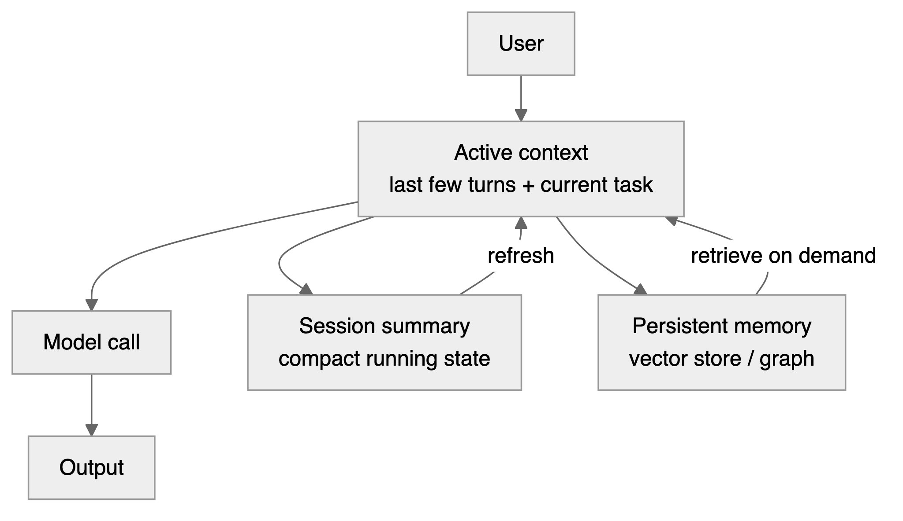{width=95% fig-align="center" fig-alt="Flow chart of tiered context memory: the user input enters the active context, which feeds the model call and its output and exchanges information with a session summary and a persistent vector or graph memory."}

The MemGPT pattern virtualizes LLM context, treating it like an operating system's page cache [@packer2023memgpt]. At 70% of capacity, reasoning pauses for memory-pressure handling: the system identifies the least critical content, compresses it to an external tier, and retrieves relevant context back on demand. Conversation can continue beyond one window, but this is not lossless retention: omissions, retrieval misses, and stale summaries remain possible.

### What "Memory" Means

| State | Location and update | Lifetime | How it is accessed | Failure mode |
| :--- | :--- | :--- | :--- | :--- |
| Conversation history | Application stores turns | Configured session | Resupplied in the prompt | Truncation or excess tokens |
| Session summary | Application writes a compressed record | Until replaced or deleted | Inserted into later prompts | Lost constraints or stale facts |
| Persistent records | External database is written or revised | Across sessions if retained | Retrieval | Wrong record or obsolete policy |
| KV cache | Server stores attention keys and values | While the prefix is retained | Direct reuse of computation | Growing memory use or cache invalidation |
| Neural memory | A specified architecture updates internal state | Defined by its retention and reset rules | Learned memory access | Interference or forgetting |

These states have different lifetimes and update rules. A KV cache accelerates attention to tokens already present; an external record can outlive a request; neither automatically updates the base model's learned weights.

### Evaluation and Deployment
Retrieval quality separates evidence selection from answer generation. Precision@k is the fraction of the top-$k$ retrieved chunks that are relevant; Recall@k is the fraction of all relevant chunks retrieved among those $k$; Mean Reciprocal Rank averages $1/\text{rank}$ for the first relevant result (zero if none is found). Compression ratio is original tokens divided by compressed tokens, but task performance after compression matters more than the ratio alone. Generation can be evaluated with exact match, token-level F1, and faithfulness to supplied evidence. [RAGAS](https://docs.ragas.io/) supplies automated metrics, whose judgments also need validation.

Enterprise assistants can combine hybrid retrieval and metadata filtering; research systems may need hierarchical or graph-based summaries; code assistants can combine symbol and filename lookup with dense search. Treat retrieval counts, compression ratios, and latency targets as application settings to measure on a stated corpus, model, and hardware, rather than transferable defaults.

In the Alder ablation, report whether P2 was retrieved before scoring the final answer. That error slice distinguishes a missing-evidence problem from ignoring sufficient evidence. Monitor retrieval precision, token use, and answer quality together as policies change.

## Evaluating Model Performance {#sec-llm-evaluation}

Use the held-out Alder questions to choose between systems, rather than using a leaderboard rank as the decision. Freeze the questions, expected policy version, allowed evidence, prompt, decoding settings, retry policy, and compute budget. For a serving comparison, change the checkpoint while holding this protocol fixed; for the context ablation, change only evidence selection.

Correctness is the fraction of questions answered according to the applicable policy, counting abstention as correct on cases designated unanswerable. Report unsupported-answer rate as the fraction of all questions receiving an answer containing at least one unsupported factual claim. Report abstention separately on answerable and unanswerable cases so that refusing everything cannot look successful. Record time to first token, total response latency, and total expenditure divided by successful tasks, including expenditure on failed attempts. If there are no successes, cost per success is undefined.

Compare paired outcomes question by question. For small score differences, report uncertainty, for example a paired bootstrap interval resampling questions, and inspect error slices such as policy transitions or missing evidence. Repeat stochastic runs when sampling is part of the system. Preference measures what raters favor; benchmark accuracy measures a specified target; faithfulness measures support from supplied evidence. A faithful answer based on an obsolete document can still be factually wrong for the order.

Public benchmarks supply additional task families. [GPQA Diamond](https://arxiv.org/abs/2311.12022) uses graduate-level science questions; [ARC-AGI](https://arcprize.org/) uses abstract pattern tasks; [AIME](https://maa.org/student-programs/amc/) uses competition mathematics; MMMU-Pro uses questions requiring joint reasoning over text and images. Their scores measure performance under particular protocols, not general intelligence or reliability on Alder's policies.

[SWE-bench](https://www.swebench.com/) evaluates resolving repository issues, reporting the percentage of instances resolved.

Benchmarks earn their place because they are shared, fixed and cheap to rerun: the same questions scored the same way let anyone reproduce a claim, compare systems built by different teams, and track progress over years. Their weaknesses follow from the same properties. A fixed test set can be optimized directly, so a rising score may reflect tuning to the test rather than a more capable model, which is Goodhart's law again. A single number hides the protocol behind it (benchmark variant, agent harness, tools, prompts, retries, inference budget), and two reported scores are comparable only when that protocol matches. Many benchmarks saturate within a few years of release, after which they no longer separate the strongest systems, and their tasks rarely match the task a deployment cares about. Leaderboard snapshots, such as the two below, therefore date quickly: read them as a record of one moment and one measurement protocol, not as a ranking that transfers to your application.

Benchmark contamination can inflate scores if training includes test material. [LiveBench](https://livebench.ai/) refreshes questions to reduce this risk. [Humanity's Last Exam](https://lastexam.ai/) collects difficult expert questions; @fig-hle is a January 2026 snapshot, not a current ranking. Its exact run configurations and uncertainty are not documented here.

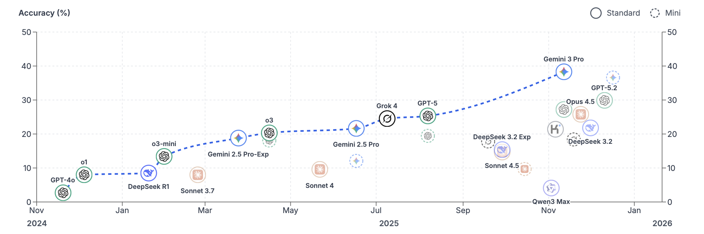{#fig-hle width="80%"}

[LMArena](https://lmarena.ai) collects blind pairwise preferences between responses to the same prompt and fits comparative ratings. The method is the Elo system used to rank chess players: a win raises a model's score and a loss lowers it; beating a higher-rated opponent raises it more than beating a lower-rated one. Like chess ratings, they summarize relative success in comparisons, but user preference is not factual verification. @fig-lmarena-leaderboard records the WebDev category in January 2026; voting populations, uncertainty, and configurations matter when interpreting small rank differences.

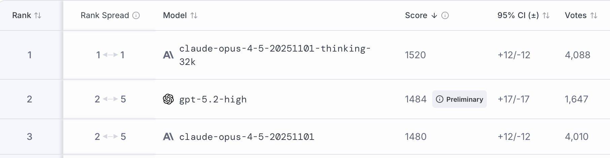{#fig-lmarena-leaderboard width="80%"}

Use these resources to identify candidates, then compare them on the held-out application task. Archive the checkpoint version, harness, prompts, evidence, raw outcomes, token counts, price date, and latency definition. Without those records, a screenshot illustrates a historical comparison but cannot establish a deployable winner.

## Choosing the Right Model for Your Application {#sec-choosing-model}

Bigger models are not always the better choice. Four factors drive model selection: data privacy, cost, task-specific performance, and latency.

*Data privacy.* Data sensitivity, regulations (HIPAA, GDPR), contractual requirements, and security policy constrain deployment. Hosting an open-weight model on controlled hardware gives control over data handling but incurs hardware and maintenance costs. An isolated cloud service is another option, with network isolation and retention determined by the actual service configuration and contract.

*Cost.* Compare total serving expense, including hardware utilization, operations, retrieval, and retries. A smaller hosted model may be economical at sufficient utilization; a low-volume service may favor an API. Measure cost per successful task under the same protocol.

*Task-specific performance.* Very small models (around 3B parameters or fewer) run on consumer hardware for tasks like text classification or domain-specific chatbots; medium models (7 to 30B) are often the sweet spot; large models (30B+) give the best general performance but require specialized hardware. Code, multilingual, and domain variants offer different capabilities. Parameter count alone does not rank them. Distillation, fine-tuning, and quantization can help, but each adapted system needs evaluation.

*Latency.* Time to First Token (TTFT) measures the delay before output begins; total response time includes generation. Speech bots (Alexa, Google Home) and real-time applications such as trading may prioritize TTFT, while a tool workflow may wait for a complete structured answer. Record both under representative load.

### Scale and Its Limits {#sec-scale}

For decades, high-quality data analysis required parsimonious models, as small as possible while still capturing essential patterns. Deep learning broke this trend: models work very well when the number of parameters is large, often exceeding the number of data points. We discussed this phenomenon in @sec-double-descent.

Published model sizes grew rapidly: GPT-1 (2018) had 117 million parameters. GPT-2, with 1.5 billion parameters, was initially released in stages over several months because of misuse concerns, a caution OpenAI later relaxed after independent analysis found the risks manageable. GPT-3 had 175 billion. The selected models in @fig-llm-param-growth give a historical view of this growth.

```{python}
#| label: fig-llm-param-growth
#| fig-cap: "Parameters of selected language models by year of release, in billions on a log scale. The open marker is a mixture of experts model, shown with its total number of parameters."
#| fig-alt: "Scatter plot of parameter counts on a log scale against release year. The counts rise from 0.117 billion for GPT-1 in 2018 to 540 billion for PaLM in 2022, and lie between 65 and 671 billion for the models released after that."
import matplotlib.pyplot as plt
models = [
    ("GPT-1", 2018.45, 0.117, False, (6, -3)),
    ("BERT", 2018.8, 0.34, False, (6, 3)),
    ("GPT-2", 2019.1, 1.5, False, (-6, 5)),
    ("T5", 2019.8, 11, False, (-14, 5)),
    ("GPT-3", 2020.4, 175, False, (-8, 7)),
    ("Gopher", 2021.95, 280, False, (-38, -3)),
    ("Chinchilla", 2022.2, 70, False, (7, -10)),
    ("PaLM", 2022.3, 540, False, (6, 3)),
    ("LLaMA", 2023.15, 65, False, (6, -3)),
    ("Llama 3.1", 2024.6, 405, False, (-26, -14)),
    ("DeepSeek-V3", 2024.98, 671, True, (-36, 6)),
]
fig, ax = plt.subplots(figsize=(5.5, 3))
for name, year, size, moe, offset in models:
    ax.plot(year, size, "o", color="black", markerfacecolor="white" if moe else "black")
    ax.annotate(name, (year, size), textcoords="offset points", xytext=offset, fontsize=7)
ax.set_yscale("log")
ax.set_xlabel("Year of release")
ax.set_ylabel("Parameters (billions)")
ax.set_ylim(0.05, 2000);
plt.tight_layout()
plt.show()
```

@fig-llm-param-growth shows published sizes of selected models [@radford2018improving; @devlin2018bert; @radford2019language; @raffel2020exploring; @brown2020language; @rae2021scaling; @hoffmann2022training; @chowdhery2022palm; @touvron2023llama; @grattafiori2024llama; @deepseekai2024deepseekv3]. Sizes grew by nearly four orders of magnitude from 2018 to 2022; the plotted later models lie within about one order of magnitude. This selection does not measure where subsequent compute was spent. Chinchilla separately studies the trade-off between parameter count and training tokens at fixed compute [@hoffmann2022training].

Mixture of Experts (MoE) models activate a subset of their parameters for each token. Total parameters measure stored capacity; active parameters describe the selected computation more closely. Neither alone determines total serving cost.

Multimodal Transformers already process text, images, audio, and other modalities, though architectures and supported inputs and outputs differ. They extend the same model-selection question: which system meets the task's quality and resource constraints?

| Quantity | What it measures | What it leaves unspecified |
| :--- | :--- | :--- |
| Total parameters | Stored model capacity | Parameters active for one token |
| Active parameters | Weights used for a token | Sequence length and hardware efficiency |
| Training tokens | Exposure during learning | Data quality and optimization choices |
| Inference compute | Work spent answering a request | Correctness of the resulting answer |

### Quantization and Serving Efficiency {#sec-distillation}

Distillation replaces a model through teacher-student training; fine-tuning adapts its learned behavior; quantization changes numerical representation. These interventions can be combined, but quantization is not itself instruction tuning.

Quantization reduces the precision of weights and sometimes activations, for example from 16-bit to 4-bit representations. It reduces weight-storage requirements and memory traffic, while arithmetic speed depends on supported kernels and hardware. [GPTQ](https://arxiv.org/abs/2210.17323) and [AWQ](https://arxiv.org/abs/2306.00978) choose quantization schemes to limit task degradation; evaluate the quantized model rather than assuming unchanged accuracy.

The mathematics of quantization involves mapping continuous values to a discrete set of levels. For a weight $w$ with range $[w_{min}, w_{max}]$, 8-bit quantization maps it to one of 256 integer values:
$$
w_q = \text{round}\left(\frac{w - w_{min}}{w_{max} - w_{min}} \times 255\right)
$$

Post-training quantization uses calibration data to select scales or corrections for already trained weights. Quantization-aware training models quantization effects during optimization. Both require measuring the resulting quality and serving trade-off.

Speculative decoding [@leviathan2023fast; @chen2023accelerating] uses a draft model to propose several tokens, which the target model scores in parallel. An exact rejection-sampling rule accepts a prefix; at the first rejection it samples a replacement from a corrected distribution and discards later draft tokens (each was conditioned on the rejected token, so none can be salvaged). If all proposals are accepted, the target supplies an additional token. Under this rule, the output distribution matches that of target-only sampling, so the reported 2 to 3x speedups cost nothing in output quality. Speed depends on draft cost, acceptance rate, and hardware; distribution preservation is not a factual-accuracy guarantee.

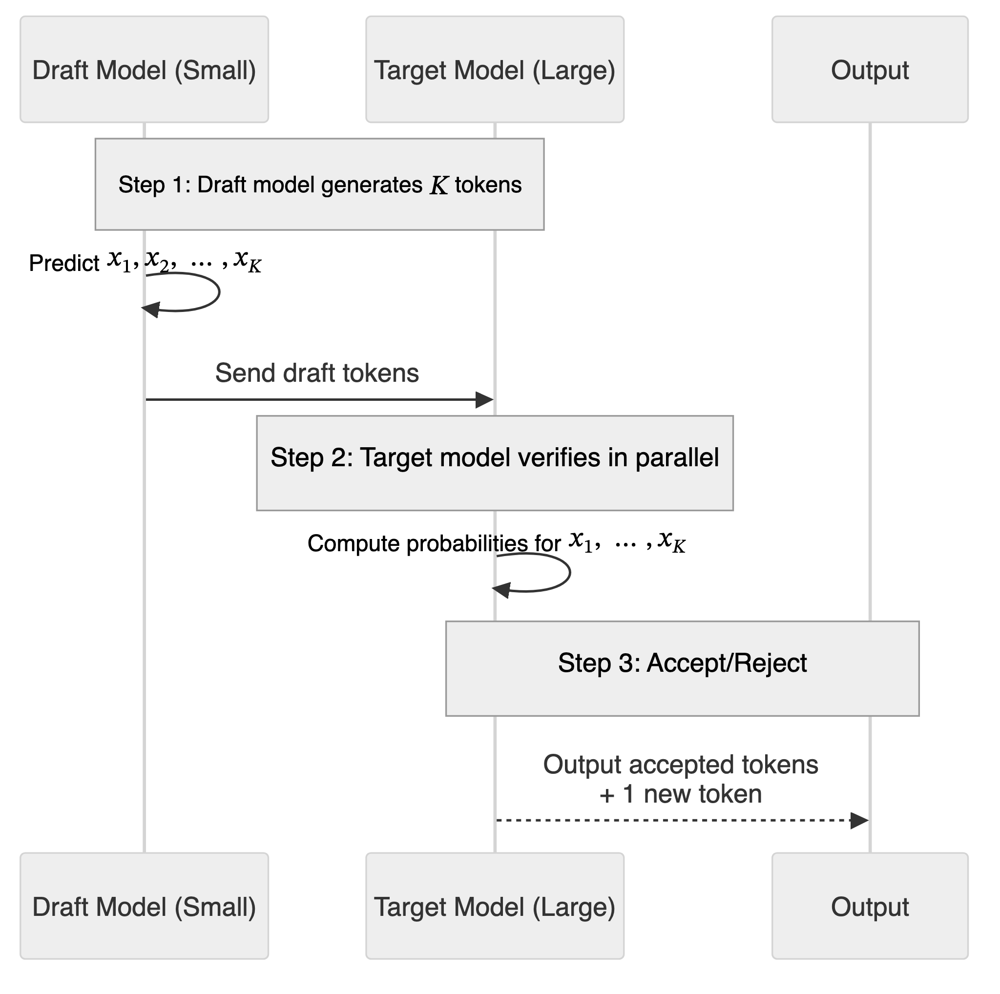{width=95% fig-alt="Sequence diagram in which a small draft model predicts K tokens and sends them to a large target model, which verifies them in parallel and outputs the accepted tokens plus one new token."}

KV caching stores attention keys and values for preceding tokens. For dense attention with fixed layer width, decoding a new token against $n$ cached tokens costs $O(n)$ attention work, with $O(n)$ growing cache memory. Prefilling an $n$-token prompt still requires $O(n^2)$ attention work, and generating a sequence of growing length still has quadratic total attention cost. Caching avoids recomputing all prefix representations at every decoding step; it does not make total generation linear.

*Streaming prefill* (or *incremental prefill*) starts processing input before the entire query is available. The model begins the "prefill" phase (processing input and building the KV cache) on chunks as they arrive, useful for voice-activated systems where a command can be processed while the user is still speaking. Reuse requires an unchanged prefix; transcript revisions can invalidate cached work.

*Continuous batching* [@yu2022orca] lets the server start processing new requests immediately, even if other requests in the same batch are mid-generation. Unlike static batching, which waits for all sequences to finish, continuous batching dynamically inserts and removes requests, increasing throughput and reducing wait times.

#### Attention Efficiency: FlashAttention and Ring Attention

Transformers rely on attention, and naive attention scales quadratically with sequence length ($O(n^2)$). Even with optimizations, long prompts increase memory traffic and reduce throughput.

FlashAttention tiles exact attention to reduce transfers between GPU memory and on-chip storage, avoiding materialization of the full attention matrix [@dao2022flashattention]. Its attention-memory use scales linearly with sequence length for fixed width, while arithmetic work remains quadratic. FlashAttention-3 further optimizes these kernels for H100 GPUs, reaching up to 740 TFLOPs/s [@shah2024flashattention3]; kernel throughput is not the memory footprint or latency of an entire LLM.

Ring Attention distributes sequence blocks across devices, exchanging key and value blocks in a ring while computing attention [@liu2023ring]. Under its sharding assumptions, available context can grow with device count, with communication and total compute costs still to account for.

These optimizations change execution efficiency, not the evidence or learning objective.

### The Rise of Small Language Models

Distillation and efficient fine-tuning have contributed to the rise of *Small Language Models* (SLMs). These models, typically ranging from a few hundred million to several billion parameters, challenge the assumption that bigger is always better.

Possible benefits include local deployment, reduced energy use, and shorter latency, subject to hardware and workload. Privacy also depends on the surrounding application's data handling.

A possible workflow distills teacher behavior, adapts the student with LoRA, then quantizes it. Test each step for gains and regressions. As a historical product comparison, Google reported Gemini 3 Flash at 78% on SWE-bench Verified against Pro's 76.2% in late 2025 [@google2025gemini3flash]. The reports do not establish a teacher-student lineage or relative parameter counts; they illustrate that a faster product can be competitive on a particular task.

## Research Outlook: Neural Memory Systems

Neural memory research changes the architecture itself. Titans and MIRAS [@titans2025; @miras2025] study memory modules updated during sequence processing, rather than only external records retrieved into a conventional prompt. Like recurrent models, they compress earlier inputs into updated internal state, connecting recurrent memory with attention.

Titans uses a learned MLP memory module updated at test time through a gradient-based surprise signal, combined with attention. Linear RNNs such as Mamba store memory in low-rank structures; Titans reports that a deep MLP memory captures structure that shallow compression cannot. It reports experiments on language modeling, reasoning, and other sequence tasks, including long-context retrieval. Its memory-depth experiments include 760M-parameter models evaluated on sequence perplexity, not durable personal memory across sessions.

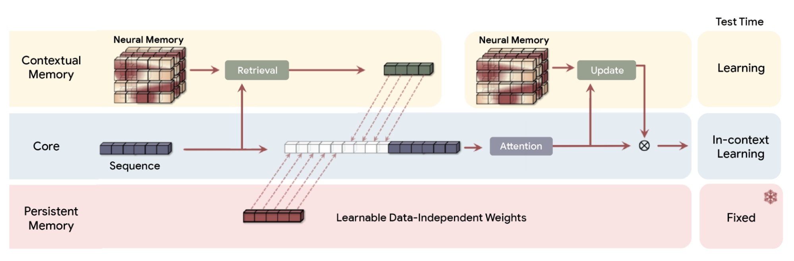{#fig-titans-architecture}

MIRAS organizes associative-memory designs by architecture, learning objective, retention rule, and optimizer. It interprets forgetting through retention regularization and studies alternatives to squared-error memory objectives, including L1 and Huber losses, which are less sensitive to large residuals: L2 overreacts to extreme tokens, while L1 or Huber gives more stable behavior. The equivalence between RNN forget gates and weight decay reframes forgetting as a controllable design parameter. The evidence concerns experimental sequence models.

Larimar [@das2024larimar] adds episodic memory to a language model for rapid knowledge updates. Its reported 8–10× speedups concern knowledge-editing comparisons.

Persistence depends on which state is saved, how it is retrieved, and when it is reset. For Alder, an external policy record, a session summary, and an experimental neural memory have different failure modes. Each must still supply the applicable policy and preserve its conditions.

## Combining Techniques

In practice, interventions stack. Most large LLMs, including GPT-4, are first trained with supervised fine-tuning and then polished with RLHF. Alder's assistant can learn a response format through SFT, retrieve P2 at inference, check the order date with a tool, and serve the resulting model with quantized weights and cached prefixes. The reason for each change should be a measured failure or resource constraint.

| Ways to improve an LLM system | Analogy | Weight change? | Signal or mechanism | Policy-assistant use |
| :--- | :--- | :--- | :--- | :--- |
| Instruction or domain SFT | Flashcards, medical school specialization | Yes, weights or adapters | Demonstrated responses | Format, vocabulary, and abstention examples |
| Distillation | A student learning from a teacher | Yes, student weights | Teacher outputs | A less expensive task model |
| RLHF or DPO | Teacher feedback | Yes | Ranked responses | Preferred behavior, subject to factual checks |
| Verifier-based RL | Checking against an answer key | Yes | Checkable outcomes | Train on tasks with a defensible verifier |
| CoT or Tree-of-Thought | Showing your work, exploring a decision tree | No | Intermediate text or search | More computation with a fixed policy |
| Reflexion | Learning from mistakes | No | Stored critique and feedback | Revise after a diagnosed failure |
| RAG | An open-book exam | No | Retrieved passages | Supply the applicable policy |
| Chain-of-Action or tool calls | Using tools while thinking | No | External observations | Fetch evidence or check dates |
| Quantization and caching | Rounding numbers to save space | Stored values or execution, not learned behavior | Lower precision or reused computation | Reduce serving resources |

### Summary

Next-token likelihood explains what the model learns; decoding explains how it generates an answer. Supervised, preference, and verifier-based training use different signals to change behavior. Retrieval and tools can add evidence without changing weights, while serving optimizations change resource use.

Return to the incorrect refund answer. If the assistant retrieved P1 for a P2 order, repair evidence selection. If it invented an exception despite receiving P2, test evidence use and answer checks. If the policy says nothing about opened goods, abstention is appropriate. Compare each repair on held-out questions under the same budget, including its unsupported answers, latency, and cost.

## Exercises {.unnumbered}


