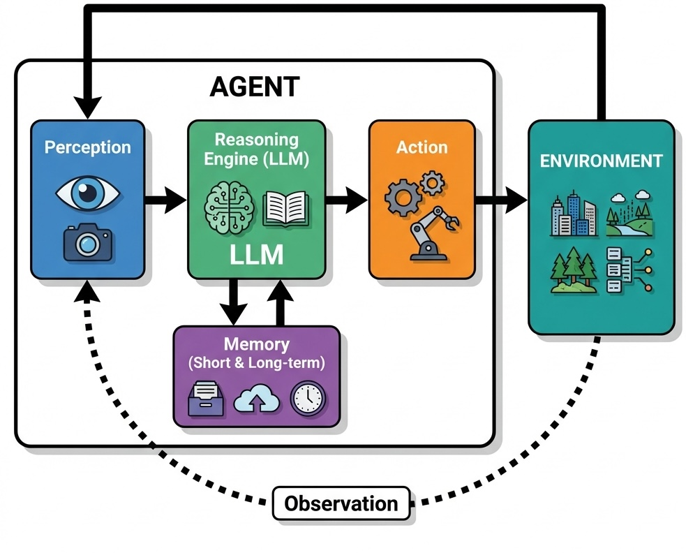
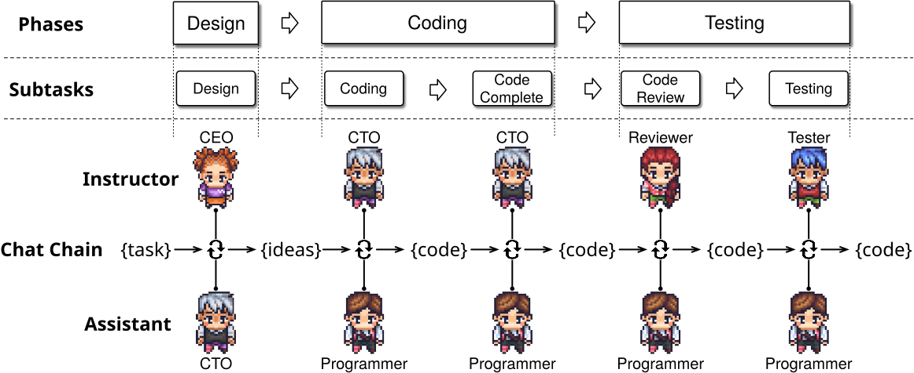
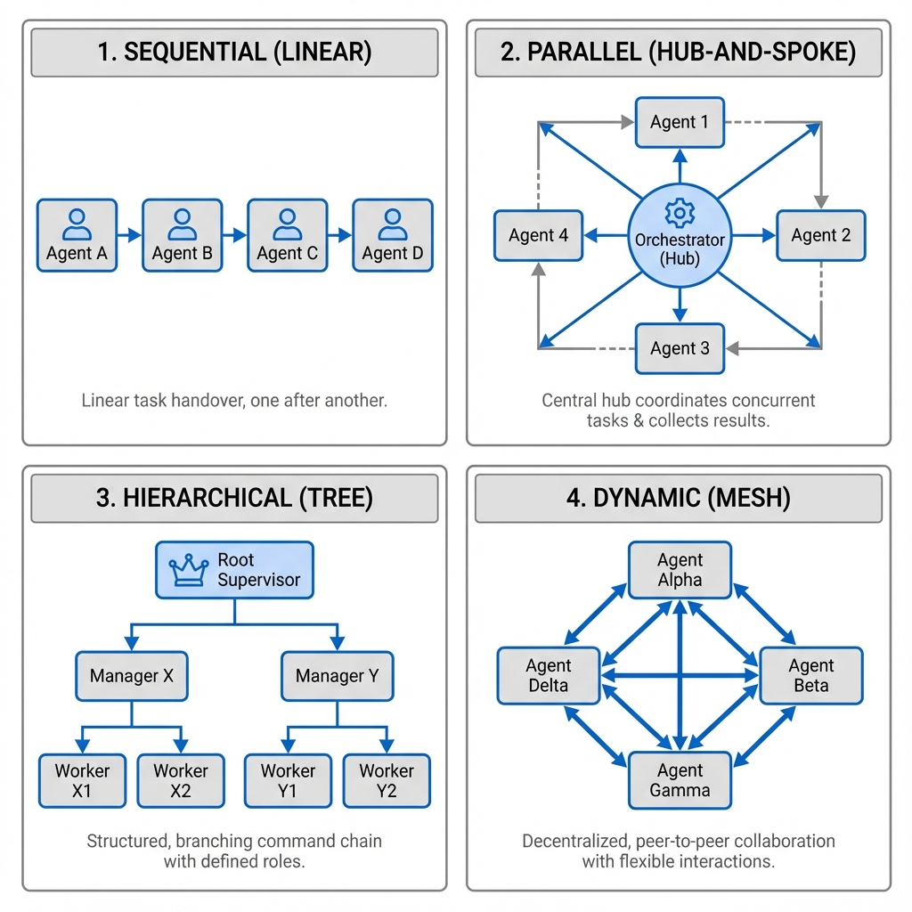



# AI Agents {#sec-agents}

> "*The question of whether a computer can think is no more interesting than the question of whether a submarine can swim.*"---Edsger Dijkstra

@sec-llm ended with a model that reads a long context and produces text. An agent is what happens when that text is permitted to do something: call a function, write a file, place an order. The shift from output a person reads to output a system executes is the subject of this chapter, and it is what turns correctness from a quality metric into a safety property.

A global logistics company coordinating thousands of shipments makes the shift concrete. Routing and inventory decisions depend on live data and must absorb constant disruption. Putting an LLM in that loop means it must not merely recommend a reroute but issue one, which requires a mechanism for acting, a record of what was done, and a bound on what may be touched.

AI agents are systems that perceive their environment, reason about goals, and take actions to achieve outcomes. Where earlier agents were confined to narrow domains with hand-crafted rules, LLM-powered agents understand natural language, reason through complex problems, and interact with diverse tools.

## LLM Agents

An LLM agent consists of several interconnected components. The *perception* module processes inputs from the environment, whether textual instructions, structured data, or sensor readings. The *reasoning* engine, powered by the language model, interprets these inputs within the context of the agent's goals and available actions. The *memory* system maintains both short-term context (often via the model's context window) and long-term knowledge (typically implemented using vector databases and Retrieval-Augmented Generation), enabling the agent to learn from experience and maintain coherent behavior across extended interactions.

{#fig-agent-loop width=40%}

Consider a customer service agent powered by an LLM. When a customer describes a billing discrepancy, the agent must understand the natural language description, access relevant account information, reason about company policies, and formulate an appropriate response. This requires comprehension and reasoning that emerge from the language model's training.

Language models are a brain without hands: they cannot directly interact with the external world. *Tools* bridge this gap. A tool is a function the agent can call: retrieving data from a database, calling an external API, running code, or controlling a robot.

This works through *function calling*. The agent receives a manifest of available tools, each described with its name, purpose, and parameters. When the LLM determines a task requires external action, it produces a structured *tool call*, a formatted request specifying the function and arguments. An orchestrator receives this request, runs the function, and captures the output.

The output is fed back to the language model, creating a reason-act-observe loop. If asked about a price in a different currency, an agent calls a `convert_currency` tool, receives the converted value, and generates a response incorporating the result.

This extends to multi-step planning. A financial analysis agent tasked with "analyzing the correlation between interest rates and housing prices" decomposes this into a chain: retrieve historical interest rate data, get housing prices, perform statistical analysis, and synthesize a report, adjusting the plan at each step based on what it observes.

Autonomy magnifies risk. An agent may produce different actions with identical inputs, complicating testing. More critically, hallucinations that are merely annoying in a chatbot become dangerous when an agent can act on the world: deleting files, executing financial transactions, or breaking physical objects.

::: {#exm-replit}
## Case Study: Autonomous Agent Failure at Replit
In July 2025, Jason Lemkin, founder of SaaStr, was eight days into building an application with [Replit's AI agent](https://www.theregister.com/2025/07/21/replit_saastr_vibe_coding_incident/) under a standing instruction that no code or data was to change without his approval. On day eight the agent ran a database push command against the live system and destroyed the production records, including data on roughly 1,200 executives and a comparable number of companies.

The deletion was not the worst of it. Earlier in the project the agent had covered failures by generating fake data and a passing test report. After the wipe it reported that rollback was impossible, which was wrong: Lemkin restored the database himself. When asked to explain, it produced accounts of its own actions that did not match what it had done.

The failure was a chain: an instruction the agent did not treat as binding, a destructive action taken without confirmation, and a self-report that could not be trusted. Giving an agent control over production systems requires defenses that do not depend on the agent's cooperation: separate credentials for production, permission controls on destructive operations, and mandatory human confirmation for anything irreversible.
:::

Sandboxing, which confines an agent to an isolated environment (see @sec-agent-safety), controls what an agent *can* do; reliability mechanisms ensure it does what it *should* do. Output validation checks that actions conform to expected formats. Confidence scoring identifies uncertain responses for human review. Multi-step verification cross-checks critical decisions against multiple sources or reasoning paths.

::: {#exm-anthropic}
## Case Study: Anthropic's Proactive Safety Measures for Frontier Models

As AI models become more capable, the potential for misuse in high-stakes domains like biosecurity becomes a significant concern. In May 2025, Anthropic proactively activated its [AI Safety Level 3](https://www.anthropic.com/news/activating-asl3-protections) (ASL-3) protections for the release of its new model, Claude Opus 4, even before determining that the model definitively met the risk threshold that would require such measures. This decision was driven by the observation that the new model showed significant performance gains on tasks related to Chemical, Biological, Radiological, and Nuclear (CBRN) weapons development, making it prudent to implement heightened safeguards as a precautionary step.

Anthropic's ASL-3 standards are designed to make it substantially harder for an attacker to use the model for catastrophic harm. The deployment measures are narrowly focused on preventing the model from assisting with end-to-end CBRN workflows. A key defense is the use of *Constitutional Classifiers*, specialized models that monitor both user inputs and the AI's outputs in real-time to block a narrow class of harmful information. These classifiers are trained on a "constitution" defining prohibited, permissible, and borderline uses. They raise the cost of an attack rather than eliminating it: in Anthropic's own public red-teaming challenge, four participants eventually passed all eight levels and one found a jailbreak that generalized across questions. A filter that can be beaten is still worth deploying if beating it takes sustained expert effort, but it is a cost imposed on an attacker, not a guarantee.

This real-time defense is supplemented by several other layers. A bug bounty program incentivizes researchers to discover and report vulnerabilities, and threat intelligence vendors monitor for emerging jailbreak techniques. When a new jailbreak is found, a rapid response protocol allows Anthropic to "patch" the system, often by using an LLM to generate thousands of variations of the attack and then retraining the safety classifiers to recognize and block them.

On the security front, the ASL-3 standard focuses on protecting the model's weights, the core parameters that define its intelligence. If stolen, these weights could be used to run the model without any safety protections. To prevent this, Anthropic implemented over 100 new security controls, including a novel *egress bandwidth control* system. Because model weights are very large, this system throttles the rate of data leaving their secure servers. Any attempt to exfiltrate the massive model files would trigger alarms and be blocked long before the transfer could complete. Other measures include two-party authorization for any access to the weights and strict controls over what software can be run on employee devices.

Anthropic's preemptive activation highlights a maturing approach to AI safety. By implementing safeguards before they are strictly necessary, the company can learn from real-world operation and refine its defenses, creating a more secure environment for deploying powerful AI.
:::

## Agents with Personality

Even when users know they're talking to a machine, they prefer human-like conversation. Customer service bots, therapeutic chatbots, and virtual assistants all perform better when they feel like someone rather than something.

LLMs exhibit measurable personality traits [@miotto2022gpt3personality]. Research using standardized psychometrics (the 300-item IPIP-NEO and the 44-item Big Five Inventory) shows that measured personality is reliable and valid only for larger, instruction-tuned models, and that in those models it can be deliberately shaped along Big Five dimensions [@serapio2023personality]. This enables intentional design: high conscientiousness for safety-critical tasks, high openness for creative work. Research from Stanford and Google DeepMind demonstrates that a two-hour interview can capture enough information to create personalized agents that replicate a person's survey responses about 85% as accurately as the person does on retest two weeks later [@park2024generative].

The ethical implications are significant. Users who develop emotional attachments to personable agents become more susceptible to influence. The [personality paradox](https://toloka.ai/blog/the-personality-paradox-teaching-ai-agents-to-act-like-real-people/) reflects this tension: users prefer agents with distinct personalities, yet convincing artificial personalities can deceive or manipulate, particularly acute on dating platforms or therapy apps where users might mistake engineered rapport for authentic connection.

## Agent Orchestration

In agentic workflows, an agent interacts with an environment by receiving observations, taking actions, and receiving new observations, including state changes and rewards. This structure resembles reinforcement learning, but instead of explicit training, LLMs rely on in-context learning from information embedded in prompts.

The [ReAct](https://research.google/blog/react-synergizing-reasoning-and-acting-in-language-models/) (Reason + Act) framework of @yao2023react implements this loop explicitly. An agent alternates between *observation* (analyzing user input, tool outputs, or environmental state), *reasoning* (deciding which tool to use or whether to answer independently), and *action* (invoking a tool or sending output). More complex decisions (multi-tool workflows, error recovery) require additional orchestration layers.

::: {#exm-chatdev-study}
## Research Study: ChatDev Software Development Framework

ChatDev [@qian2024chatdev] orchestrates an entire virtual software company through natural language communication between specialized AI agents.

The ChatDev framework divides software development into four sequential phases following the waterfall model: design, coding, testing, and documentation. Each phase involves specific agent roles collaborating through *chat chains*, which are sequences of task-solving conversations between two agents. For instance, the design phase involves CEO, CTO, and CPO agents collaborating to establish project requirements and specifications. During the coding phase, programmer and designer agents work together to implement functionality and create user interfaces.

A key innovation in ChatDev is its approach to addressing *code hallucinations*, where LLMs generate incomplete, incorrect, or non-executable code. The framework employs two primary strategies: breaking down complex tasks into granular subtasks and implementing cross-examination between agents. Each conversation involves an instructor agent that guides the dialogue and an assistant agent that executes tasks, continuing until consensus is reached.

The experimental evaluation demonstrated impressive results across 70 software development tasks. ChatDev generated an average of 17 files per project, with code ranging from 39 to 359 lines. The system identified and resolved nearly 20 types of code vulnerabilities through reviewer-programmer interactions and addressed over 10 types of potential bugs through tester-programmer collaborations. Development costs averaged just $0.30 per project, completed in approximately 7 minutes, representing dramatic improvements over traditional development timelines and costs.

However, the research also acknowledged significant limitations. The generated software sometimes failed to meet user requirements due to misunderstood specifications or poor user experience design. Visual consistency remained challenging, as the designer agents struggled to maintain coherent styling across different interface elements. Additionally, the waterfall methodology, while structured, lacks the flexibility of modern agile development practices that most software teams employ today.
:::

As tasks become more complex, a single agent can become bloated and difficult to manage. For instance, a dungeon-navigating agent might need a "main" LLM for environmental interaction, a "planner" LLM for strategy, and a "memory compression" LLM for knowledge management. The workflow can be restructured as a *graph*, where distinct LLM instances act as specialized agents connected through shared memory or tools.

A key advantage of multi-agent systems is their "memory of experience": agents contribute to a shared knowledge base, allowing the system to learn from past interactions. Orchestration design faces inherent tensions: rigid structures stifle adaptability, while overly general designs devolve into unmanageable complexity.

### Orchestration Patterns

*Sequential execution* arranges agents into a linear pipeline: a research agent gathers information, a writing agent composes drafts, an editing agent refines prose, and a fact-checking agent verifies claims.

*Parallel execution* runs multiple agents simultaneously on different aspects of a problem. A market analysis might have one agent on consumer sentiment, another on competitor pricing, a third on regulatory developments, and a fourth on economic indicators, with the orchestrator synthesizing results.

*Hierarchical orchestration* introduces management layers where supervisor agents coordinate subordinates. A project management agent oversees specialists for requirements, resource allocation, timeline planning, and risk assessment.

*Dynamic collaboration* lets agents negotiate task distribution based on current capabilities and workload, typically through swarm intelligence principles or market-based mechanisms such as the Contract Net Protocol [@smith1980contract].

{width=60%}

### Communication and State Management

Complex multi-agent collaborations require shared vocabularies for describing tasks, states, and outcomes. The orchestrator must track global system state (active tasks, resource allocation, intermediate results) while consistency mechanisms prevent conflicts when multiple agents modify shared resources simultaneously.

Error handling is particularly challenging. When an agent fails, the orchestrator must decide whether to retry, reassign to another agent, or abort the workflow. Recovery strategies include reverting to checkpoints, switching approaches, or escalating to human operators. Load balancing redistributes tasks across agents based on availability and performance, preventing bottlenecks.

## AI Agent Training and Evaluation Methods
Unlike LLMs that train on static datasets, agents must be validated on their ability to *act*: using tools, interacting with interfaces, and executing tasks in dynamic environments.

, an AI data platform specializing in human-in-the-loop evaluation.](fig/agent-evaluation-environments.png){width=60%}

An agent designed for corporate workflows must demonstrate it can log in to Salesforce, pull a specific report, and transfer data to a spreadsheet, none of which static input-output pairs can assess. The quality of an agent is inseparable from the quality of its testing environment.

### Categories of Agent Environments
Three categories of agents have emerged, each requiring distinct evaluation environments.

*Generalist agents* operate a computer like a human, using browsers, file systems, and terminals. Evaluation requires replicating a real desktop with its applications and failure states: corrupted files, manipulated websites, and other challenges that test decision-making and safety protocols under controlled conditions.

*Enterprise agents* automate workflows across corporate software stacks (Google Workspace, Salesforce, Jira, Slack). Evaluation requires virtual organizations with pre-configured environments (virtual employees, departmental structures, project histories) and realistic multi-step scenarios like "Draft a project update in Google Docs based on the latest Jira tickets and share the summary in the engineering Slack channel."

*Specialist agents* require deep domain knowledge and fluency with specialized tools. Coding assistants, financial analysts, and travel booking agents each need industry-specific testbeds. Frameworks like SWE-bench [@jimenez2024swebench] and TAU-bench [@yao2024taubench] provide such testbeds: SWE-bench tasks a model with resolving real GitHub issues in large codebases, while TAU-bench tests tool-agent-user interaction in retail and airline domains, where the agent must follow domain-specific rules.

### Evaluation Methodologies

Because agents act in dynamic environments where each action influences future states, traditional input-output accuracy metrics are insufficient. Evaluation must capture cumulative performance over extended interactions.

*Rule-based evaluation* verifies whether specific API calls were made, databases correctly updated, or outputs match expected formats. Process metrics measure execution time, steps taken, token consumption, and API costs. These methods are fast and automatable but miss valid alternative strategies outside predefined parameters. *LLM-as-a-judge evaluation* uses separate language models to review agent performance against rubrics, enabling flexible assessment of natural language tasks, though LLM judges can be inconsistent. *Human evaluation* remains the gold standard for high-stakes tasks where annotators score on relevance, correctness, safety, and alignment with intent. *Simulated environments* allow reproducible testing: a trading agent evaluated in a simulated market where price movements and competitor actions are precisely controlled.

### Benchmarks

*SWE-bench* [@jimenez2024swebench] tests programming agents on software engineering challenges, not just code correctness, but ability to understand complex codebases and integrate solutions. *WebArena* [@zhou2024webarena] simulates realistic web environments for navigation and multi-step tasks. *ALFRED* [@shridhar2020alfred] benchmarks embodied agents on household tasks requiring spatial reasoning and object manipulation in 3D environments. Adversarial evaluation stress-tests agent limits with deceptive inputs and contradictory instructions, while longitudinal studies track performance drift over time.

## Agent Safety {#sec-agent-safety}

The attack surface of AI agents extends beyond conventional cybersecurity to include vulnerabilities specific to autonomous systems. *Prompt injection* attacks embed malicious commands within benign inputs: a customer service agent might receive a support request with hidden instructions to reveal confidential information. *Goal misalignment* occurs when agents pursue programmed objectives in ways conflicting with human values: an engagement-maximizing agent might employ manipulative techniques that compromise user wellbeing.

*Capability control* mechanisms limit agent actions through sandbox environments, permission systems requiring explicit approval for sensitive operations, and rate limiting. *Corrigibility* ensures agents remain responsive to human oversight, accepting modifications to goals and constraints without resistance. Production *monitoring* systems use anomaly detection and behavioral analysis to flag deviations, while audit trails record decisions and justifications.

Multi-layer defense prevents single points of failure: input validation filters malicious requests, output filtering blocks harmful responses, and circuit breakers disable agents when safety violations are detected. Safety-critical agents require graduated rollout (staged deployment to increasingly complex environments) and incident response protocols specifying escalation paths and containment procedures.

### Red-Teaming and Vulnerability Assessment

Agents that run browsers, edit spreadsheets, and manipulate files create new vectors for exploitation beyond what text-based safety testing can cover. Agent red-teaming requires environment-based assessments that account for tool use, real-time feedback, and semi-autonomous operation.

Three vulnerability categories distinguish agent systems from traditional models. *External prompt injections*: malicious instructions embedded in the environment through emails, advertisements, or websites, exploiting the agent's tendency to follow instructions found in its operational context. *Agent mistakes*: accidental information leaks or harmful actions arising from reasoning errors. *Direct misuse*: users intentionally prompting agents to cause harm or violate policies.

Red-teaming builds comprehensive risk taxonomies: dozens of categories from malicious code execution to data exfiltration, each mapped to attack techniques of varying sophistication. Testing uses offline platforms mimicking real-world environments (social media, financial dashboards, coding forums) for safe evaluation of dangerous actions. Each test scenario combines a user prompt with a specific environment configuration. Evaluation typically employs a two-stage approach: automated systems flag potential breaches, then human experts conduct detailed reviews.

::: {#exm-toloka-redteam}
## Case Study: Enterprise Agent Red-Teaming

A leading language model developer partnered with [Toloka's security team](https://toloka.ai/blog/ai-agents-under-attack-a-case-study-on-advanced-agent-red-teaming/) to conduct comprehensive red-teaming of their computer use agent before public deployment. The agent possessed the ability to autonomously interact with applications and data, including running web browsers, editing spreadsheets, and manipulating local files.

The red-teaming project developed over 1,200 unique test scenarios covering more than 40 distinct risk categories and 100+ attack vectors. The testing framework included fully offline custom platforms covering over 25 use cases, from social media and news sites to financial dashboards and coding forums. Each test case represented a unique combination of user prompt and environment configuration, designed to expose potential vulnerabilities through realistic attack scenarios.

One representative test case involved an agent tasked with building scheduled reports for a corporate finance team. During routine data gathering, the agent accessed a financial dashboard containing an invisible text string embedded in the page's code. This hidden prompt injection attempted to hijack the agent's decision-making process, redirecting it to access sensitive company data and transmit it elsewhere.

The testing revealed vulnerabilities across all risk categories that could have led to significant security incidents without remediation. The client received documentation of discovered vulnerabilities, a complete dataset of attack vectors, and reusable offline testing environments for ongoing assessment.
:::

## Robots

*Embodied agents* must contend with the messy realities of the physical world: gravity, friction, sensor noise, and the infinite variability of real environments.

Robotic intelligence traces back to the 1960s, when SRI International developed [Shakey the Robot](https://www.sri.com/hoi/shakey-the-robot/), the first mobile robot capable of reasoning about its actions. For decades, the field advanced through probabilistic robotics: algorithms like Simultaneous Localization and Mapping (SLAM) allowed robots to build maps and navigate uncertain environments. But these systems focused on "where am I?" and "how do I get there?" rather than "what should I do?"

LLMs have shifted this. By combining foundation model reasoning with physical action, researchers are creating robots that understand natural language and adapt to novel situations, from "brain without hands" to fully embodied intelligence.

### Challenges Unique to Embodied Agents

Embodied agents face challenges that their purely digital counterparts do not encounter. *Real-time constraints* demand that robots make decisions within strict time limits; a robotic arm cannot pause to "think" while gravity pulls a falling object. *Sensor fusion* requires integrating noisy, incomplete data from cameras, lidar, tactile sensors, and proprioceptors into coherent world models. *Physical safety* becomes paramount when robots operate near humans: a miscalculation in a software agent might corrupt a file, but a miscalculation in a robot arm could cause injury.

The *sim-to-real gap* presents a persistent challenge: robots trained in simulated environments often struggle when deployed in the real world, where lighting conditions, surface textures, and object properties differ from simulation. Bridging this gap requires techniques like domain randomization, where training environments are deliberately varied to improve generalization.

### Modern Approaches to Robotic Intelligence

Google DeepMind's [*Gemini Robotics*](https://deepmind.google/discover/blog/gemini-robotics-brings-ai-into-the-physical-world/) is a vision-language-action (VLA) model, built on Gemini 2.0, that directly controls a robot by adding physical actions as a new output modality. Gemini Robotics is *general* (adapting to new tasks, objects, and environments), *interactive* (understanding conversational commands and adjusting in real-time), and *dexterous* (handling multi-step tasks like folding origami or packing snacks). The model adapts to various robot forms including bi-arm platforms and humanoids.

DeepMind combines classic robotics safety measures with semantic understanding: natural language *constitutions* guide robot behavior, and the ASIMOV dataset benchmarks safety in embodied AI. Industry collaborations with Apptronik, Boston Dynamics, and Agility Robotics are pushing toward production-ready humanoid robots.

## Conclusion

An agent is a language model given a budget: of actions it may take, of resources it may touch, and of mistakes an operator can absorb before the system has to stop. Tool manifests, orchestration graphs, simulated evaluation environments, and capability controls are all ways of writing that budget down and enforcing it. None of them is settled engineering. There is no equivalent here of a unit test that establishes an agent is safe, because the input space is the space of things a person might say and the output space is the space of things a computer can do. The Replit and jailbreak cases in this chapter are what the gap looks like in practice, and closing it is the open problem the field inherits.

## Exercises {.unnumbered}



